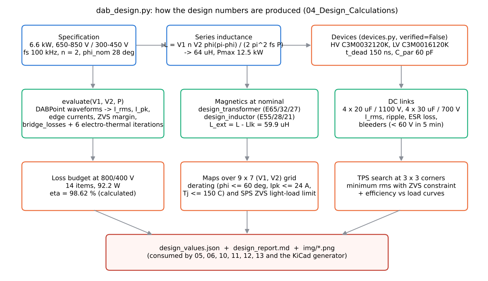

# 06 Design calculations

> Reading time: ~45 min. Prerequisites: chapters 03 (SiC devices), 04 (DAB operation), 05 (mathematical
> model). Files covered: `04_Design_Calculations/dab_design.py`, `04_Design_Calculations/design_values.json`,
> `04_Design_Calculations/design_report.md`, `00_Requirements/01_requirements_specification.md`,
> `00_Requirements/02_operating_envelope.md`, `dabtools/dab/dab_model.py`, `dabtools/dab/losses.py`,
> `dabtools/dab/devices.py`.

## Overview

**Level 1 - Beginner:** A converter design is a chain of choices that must all fit together: how much
energy the series inductor may hold, how many turns the transformer has, how fast the switches toggle,
which transistors can carry the current, how much capacitance keeps the DC voltages steady and how long
the two transistors of one leg must both be off so that they never short the bus. In this project all
those choices are made by one Python script, `04_Design_Calculations/dab_design.py`, which reads the
specification, works through the equations of chapter 05 and writes every result into a single file,
`04_Design_Calculations/design_values.json`. Think of it as the recipe card of the converter: every
later step (simulation, magnetics, firmware, schematic) reads its numbers from that card instead of
retyping them.

**Level 2 - Engineering:** The script fixes the series inductance from the nominal phase shift
(phi_nom = 28 deg at 800 V / 400 V, 6.6 kW -> L = 64 uH, P_max = 12.5 kW), chooses the SiC devices
(C3M0032120K on the 800 V bridge, C3M0016120K on the 400 V bridge, `dabtools/dab/devices.py`,
all values flagged `verified=False`), sets the dead time to 150 ns, evaluates every operating point of
the 650-850 V x 300-450 V envelope with the numerical waveform model, iterates the electro-thermal
loop six times per point, sizes the magnetics and the DC links, and produces the loss budget at nominal
(92.2 W, calculated efficiency 98.62 %), the derating map, the SPS light-load ZVS map, a TPS search at
the nine voltage corners, and the protection thresholds (24 A design limit, 32 A hardware trip). All
of this is `[Simulated]` or, more exactly, analytical: nothing has been measured.

**Level 3 - Research:** The chain is deterministic and single-sourced, which is what makes it a
research platform: `Advanced_Research_2026/Robust_Optimization/` and
`Advanced_Research_2026/Uncertainty_Quantification/` re-run the same functions with parameter
distributions instead of point values, `Advanced_Research_2026/Digital_Twin/` identifies L on the switched
plant that consumes this JSON, and `Advanced_Research_2026/FEM_Magnetics/` revisits the leakage and
proximity estimates that enter the loss budget. The open research questions are the ones the script
exposes rather than hides: device data from memory, a fixed k_zvs = 0.35 share of the datasheet turn-off
energy, a 0.4 % flat allowance for copper and bus bars, and ZVS judged by an energy criterion instead of
the charge-based condition.

*Figure 06-1 (sketch, `img/make_figs_06_10.py`): the order in which `04_Design_Calculations/dab_design.py`
produces the numbers; every box corresponds to a section of the script.*

## Topic 1: Series inductance and nominal phase shift

### Series inductance L and phi_nom
**What is it?** L is the total inductance in series with the transformer (external inductor plus
transformer leakage), referred to the HV side. phi_nom is the phase shift between the two bridge
voltages at the nominal operating point.

**Why do we need it?** In a DAB the inductance is the "resistor" that sets how much power flows for a
given phase shift. Too small and a tiny phase error produces a huge current; too large and the
converter cannot reach rated power at the worst voltage corner.

**How does it work?**
**Level 1 - Beginner:** Imagine two water tanks connected by a pipe; the pipe diameter is the
inductance. A thinner pipe (larger L) needs a bigger height difference (phase shift) to push the same
flow. The designer picks a pipe that gives a comfortable height difference at normal load, leaving room
for the worst case.
**Level 2 - Engineering:** From equation (4) of `03_Mathematical_Models/dab_mathematical_model.md`,
P = V1 n V2 phi (pi - phi) / (2 pi^2 fs L). Solving for L at phi_nom = 28 deg, V1 = 800 V,
n V2 = 800 V, fs = 100 kHz and P = 6600 W gives 63.7 uH, rounded to 64 uH in the script
(`L = round(L * 1e6) * 1e-6`). With that L, the maximum SPS power at nominal voltage is
P_max = V1 n V2 / (8 fs L) = 12.5 kW, so the nominal point sits at 53 % of the theoretical maximum.
**Level 3 - Research:** The choice of 28 deg is a trade-off between reactive current (grows with phi)
and controllability margin (phi <= 60 deg is enforced by the envelope rule). The 2026 modules treat L as
an uncertain parameter (+/-20 % for an integrated leakage, +/-5 % for a gapped inductor, see chapter 07)
and the digital twin estimates it online because every current in the converter scales with 1/L.

**Example from our converter:** `04_Design_Calculations/design_values.json` -> `"L": 6.4e-05`,
`"phi_nom": 0.4916` rad (28.17 deg at exactly 6600 W with the rounded L), `"Pmax_nom": 12500.0`,
`"L_ext": 5.99e-05` (external inductor after subtracting the 4.1 uH transformer leakage). `[Simulated]`

**Engineering calculations:** L = 800 * 800 * 0.4887 * (3.1416 - 0.4887) / (2 * 9.8696 * 1e5 * 6600)
= 6.37e-5 H -> 64 uH. P_max = 800 * 800 / (8 * 1e5 * 64e-6) = 12 500 W. Source:
`04_Design_Calculations/dab_design.py`, section 1, and `dabtools/dab/dab_model.py` (`sps_max_power`).

**Design decision made in this project:** L = 64 uH HV-referred, split as 4.1 uH transformer
leakage (interleaved winding) + 59.9 uH external gapped inductor. `[Implemented]` in the design chain,
not built.

**Alternatives considered:** A larger phi_nom (30 deg is the default mentioned in
`03_Mathematical_Models/dab_mathematical_model.md`) would allow a larger L and lower peak currents at
the voltage-matched point but less margin at the 650/300 V corner (57 deg required, see the corner
table). Integrating the whole 64 uH into the transformer leakage was rejected because of the +/-20 %
manufacturing tolerance that maps one-to-one into power capability (`06_Magnetics/magnetics_design.md`,
section 3).

**How to verify it:** The ngspice model (`05_Simulation/spice/spice_results.json`) delivers 6568 W at the
designed phi with the same L, within 0.5 % of 6600 W `[Simulated]`; on hardware, the inductance of the
assembled module would be measured at 0, 10 and 20 A bias per `06_Magnetics/magnetics_design.md`
section 6 `[Proposed]`.

**Common mistakes:** Forgetting that L is referred to the HV side (the LV-side value is L / n^2 = 16 uH);
forgetting the transformer leakage when ordering the external inductor; using the small-angle
approximation P ~ phi so that the inverse becomes wrong above ~30 deg.

**Interview explanation (30 s):** "We chose the series inductance so that rated power needs 28 degrees
of phase shift at the nominal voltages. That gives 64 microhenry and a theoretical maximum of 12.5
kilowatts, so even the worst corner at 650 and 300 volts still fits below the 60-degree limit we impose
for controllability."

**Research-level explanation:** The design equation is the lossless SPS closed form; the numerical
`DABPoint` engine in `dabtools/dab/dab_model.py` reproduces it to < 0.1 %. The research question is not
the value of L but its uncertainty: the Digital Twin study (chapter 16) shows that a 20 % low L makes the
nominal model under-predict the rms current by 10 % on average and shifts every ZVS boundary.

## Topic 2: Device selection and dead time

### SiC MOSFET choice and dead time
**What is it?** The two bridges use different 1200 V SiC MOSFETs from `dabtools/dab/devices.py`:
C3M0032120K (32 mOhm) for the 800 V bridge and C3M0016120K (16 mOhm) for the 400 V bridge. The dead
time t_dead is the interval during which both devices of a leg are off.

**Why do we need it?** The LV bridge carries twice the current (n = 2), so it needs half the on-resistance
for the same conduction loss. The dead time prevents shoot-through and gives the inductor current time to
swing the switch node (ZVS transition).

**How does it work?**
**Level 1 - Beginner:** Two switches in a leg are like two doors of an airlock: both must never be open
at once. The dead time is the pause between closing one and opening the other. Too short and the doors
collide (shoot-through); too long and you waste time with the current flowing through the body diode,
which is a lossy path.
**Level 2 - Engineering:** The conduction loss of a bridge is 4 I_dev,rms^2 Rds(Tj) with I_dev,rms =
I_rms / sqrt(2). With 9.23 A rms on the HV side and 18.46 A rms on the LV side the resistances 32 and
16 mOhm give nearly the same loss per bridge (6.1 W vs 12.5 W because the LV current is doubled and the
resistance only halved). The required dead time is charge based, t_dead >= 2 Qoss / I_sw (equation (9)
of the model document): with Qoss(800 V) = 200 nC and the nominal edge current 9.6 A it is 42 ns; at
2.7 A it reaches 150 ns, the value chosen so that ZVS completes down to the light-load ZVS limit.
**Level 3 - Research:** The datasheet numbers in `dabtools/dab/devices.py` are explicitly
`verified=False` (entered from memory); the loss model applies k_zvs = 0.35 to the datasheet turn-off
energy (assumption). Both are sensitivity inputs for `Advanced_Research_2026/Uncertainty_Quantification/`;
adaptive dead time as a function of the measured edge current is studied in
`Advanced_Research_2026/Adaptive_MPC/` and `Advanced_Research_2026/Active_Gate_Drive/`.

**Example from our converter:** `"dev1": "C3M0032120K"`, `"dev2": "C3M0016120K"`, `"t_dead": 1.5e-07`
in `04_Design_Calculations/design_values.json`; junction temperatures at nominal 49.1 C (HV) and
51.0 C (LV) with a 45 C ambient. `[Simulated]`

**Engineering calculations:** Rds(49.1 C) = 0.032 + (0.052 - 0.032) * (49.1 - 25) / 125 = 35.9 mOhm;
P_cond,HV = 4 * (9.229^2 / 2) * 0.0359 = 6.11 W, exactly the JSON value 6.108 W. Gate loss
= 4 Qg (Vgs,on - Vgs,off) fs = 4 * 87 nC * 19 V * 100 kHz = 0.66 W (HV) + 1.37 W (LV) = 2.03 W.
Sources: `dabtools/dab/losses.py`, `dabtools/dab/devices.py`.

**Design decision made in this project:** Two different die sizes per bridge, TO-247-4 with Kelvin
source, t_dead = 150 ns fixed, dead-time compensation of 0.047 rad in the modulator
(`11_Control_Algorithms/control_params.json`, `phi_dead_comp_rad`). `[Implemented]`

**Alternatives considered:** The same 16 mOhm device on both bridges (more Coss on the HV side, which
raises the ZVS minimum current from 2.0 A); 650 V devices on the LV side (rejected: 450 V working voltage
plus overshoot leaves too little margin, and the two bridges share one device family for the BOM);
adaptive dead time (research option).

**How to verify it:** Hard-switching losses are zero in the budget only because every edge satisfies
the energy criterion; the ngspice model confirms ZVS at all eight edges at nominal (v_ds / V_dc at
turn-on < 0.005, `05_Simulation/spice/spice_results.json`) `[Simulated]`. Datasheet re-verification before
procurement is listed in `16_BOM/bom.md`. `[Not yet tested]`

**Common mistakes:** Using the 25 C Rds(on) for the loss budget (SiC roughly 1.6x at 150 C); mixing the
energy-related Coss (used for ZVS energy) with the time-related Coss (used for dv/dt); treating the dead
time as free (every nanosecond of body-diode conduction costs Vsd * I).

**Interview explanation (30 s):** "The high-voltage bridge uses 32-milliohm 1200-volt SiC, the
low-voltage bridge 16 milliohm because it carries twice the current. Dead time is 150 nanoseconds, set
from the charge of the output capacitances divided by the lightest current at which we still want zero
voltage switching, and the modulator compensates the phase it removes."

**Research-level explanation:** The electro-thermal loop (`evaluate()` iterates Tj six times) couples
Rds(Tj) to the losses; it converges because the thermal gain Rth * dP/dTj is far below one at these
loss levels. The twin's thermal observer (chapter 16) extends this with a Foster network and a Kalman
estimate of Tj from the heatsink NTC.

## Topic 3: Zero-voltage switching criterion

### ZVS minimum current I_min and the parasitic capacitance C_par
**What is it?** I_min is the smallest inductor current at a switching edge that can fully charge and
discharge the leg capacitances during the dead time; C_par is the transformer winding capacitance seen by
a bridge (60 pF estimate).

**Why do we need it?** Below I_min the device turns on with voltage across it and dissipates the full
Coss energy plus E_on; the whole efficiency argument of a SiC DAB rests on avoiding that.

**How does it work?**
**Level 1 - Beginner:** To open a heavy door without a bang you need enough momentum. The inductor
current is the momentum; the capacitors on the switch node are the heavy door. If the current is too
small the door is still half open when the transistor forces it, and the energy becomes heat.
**Level 2 - Engineering:** Energy criterion (equation (8) of the model): 0.5 L I_sw^2 >= Coss,er V^2 +
0.5 C_par V^2, so I_min = sqrt(2 E / L). For the HV bridge: E = 170 pF * 800^2 + 0.5 * 60 pF * 800^2
= 128 uJ, I_min = sqrt(2 * 128e-6 / 64e-6) = 2.0 A. For the LV bridge the same calculation with
Coss,er = 350 pF, 400 V, L / n^2 = 16 uH and C_par n^2 gives 3.07 A in LV amperes. The margin reported
per bridge is min(I_edge) - I_min: 7.67 A (HV) and 8.22 A (LV) at nominal.
**Level 3 - Research:** The energy criterion is conservative compared with the charge-based condition
(Everts et al., cited in the model document) and it ignores the non-linear Coss(V). The project keeps it
because it errs on the safe side; `Advanced_Research_2026/Adaptive_MPC/` builds ZVS maps over V1, V2,
power, temperature and direction, and the Digital Twin shows that Coss is not identifiable with the
sensors on the board (a transition-time sensor is `[Proposed]`).

**Example from our converter:** `"Imin1": 2.0`, `"Imin2": 3.066`, `"zvs1": 7.67`, `"zvs2": 8.22`
(amperes) in the `nominal` block of `04_Design_Calculations/design_values.json`; the corner 650/450 V
has only 0.73 A of HV margin at full power, and 850/300 V only 3.0 A on the LV side. `[Simulated]`

**Engineering calculations:** see above; implemented in `dabtools/dab/dab_model.py`
(`zvs_current_min`, `DABPoint.zvs_margin`).

**Design decision made in this project:** C_par = 60 pF is a design assumption (comment in
`04_Design_Calculations/dab_design.py`); the margins are evaluated with it at every grid point and the
light-load ZVS limit is mapped (Topic 6).

**Alternatives considered:** Charge-based criterion with Qoss(V) (more accurate, needs the Coss curve);
adding external snubber capacitance to reduce turn-off loss (increases I_min, rejected for a 100 kHz
design with small datasheet E_off).

**How to verify it:** `05_Simulation/gen_spice.py` samples v_ds 10 ns before every gate turn-on and reports
the ratio to V_dc; all four leg checks are < 0.005 at nominal `[Simulated]`. On hardware: drain voltage
probe at the dead-time end (`20_Experimental_Test_Plan/test_plan.md`). `[Proposed]`

**Common mistakes:** Checking ZVS only at nominal and only for the HV bridge; forgetting that the LV
bridge sees n times the current but has a larger Coss; evaluating the edge current with the wrong sign
convention (the model returns "positive = favourable").

**Interview explanation (30 s):** "A leg switches softly when half L I squared exceeds the energy of
the two output capacitances at the bus voltage. For our 800-volt bridge that is two amps; at nominal
power the edge current is almost ten, so the margin is large, but at light load and at the voltage-ratio
corners it collapses, which is why we map it over the whole envelope."

**Research-level explanation:** ZVS feasibility is the binding constraint for modulation research: the
TPS search in `dabtools/dab/dab_model.py` is a constrained minimum-rms problem with the energy
criterion at every edge, and the 2026 supervisory layer keeps a 1 A margin on both bridges.

## Topic 4: DC-link capacitors and bleeders

### DC-link capacitance, ripple current and discharge resistors
**What is it?** Four 20 uF / 1100 V film capacitors on the HV link (80 uF) and four 30 uF / 700 V on the
LV link (120 uF), each with a passive bleeder chain.

**Why do we need it?** The bridges draw a pulsating current from the links; the capacitors supply the
pulses so that the port voltage stays smooth, and they must survive the resulting rms current. The
bleeders make a disconnected converter safe to touch within a defined time.

**How does it work?**
**Level 1 - Beginner:** The capacitor is a small water reservoir next to a pump that takes water in
gulps; the reservoir smooths the gulps into a steady stream from the main pipe. The bleeder is a tiny
leak that empties the reservoir after switch-off so nobody gets a shock.
**Level 2 - Engineering:** `dc_link()` in `04_Design_Calculations/dab_design.py` takes the bridge current
i_br = i_L * sign(v_bridge), subtracts its mean and computes the rms of the remainder (capacitor current)
and the peak-to-peak charge excursion divided by C (voltage ripple). The bleeder is sized from
R = t / (C ln(V0 / 60 V)) with t = 300 s.
**Level 3 - Research:** The film capacitor ESR of 4 mOhm is a class assumption (comment "verify ESR");
capacitor ageing enters `Advanced_Research_2026/Reliability_Engineering/`. The external bus capacitance
(>= 500 uF on the HV side, >= 1 mF on the LV side, APP-04) dominates the control dynamics, not these
on-board links.

**Example from our converter:** `dclink` block of `04_Design_Calculations/design_values.json`:
HV I_rms = 4.17 A, ripple 0.081 V (0.010 %), worst corner 0.036 %, ESR loss 0.07 W; LV I_rms = 8.38 A,
ripple 0.108 V (0.027 %), worst 0.090 %, ESR loss 0.28 W; bleeders 1.41 MOhm (0.51 W at 850 V) and
1.24 MOhm (0.16 W). `[Simulated]`

**Engineering calculations:** R_bleed1 = 300 / ln(850 / 60) / 80e-6 = 1.41 MOhm; P = 850^2 / 1.41e6 =
0.51 W. Requirement EL-13 (<= 2 % ripple) is met by two orders of magnitude; SAF-04 (< 60 V in 5 min).

**Design decision made in this project:** 80 uF film (HV) and 120 uF film (LV) on the board, the rest
of the energy storage in the external bus (APP-04). `[Implemented]` in the schematic as C1-C4 and C9-C12
(`dabtools/kicad_dab/design_dab.py`).

**Alternatives considered:** Electrolytic capacitors (higher energy density, worse ripple-current
rating and lifetime at 850 V); larger on-board film banks (more volume, no control benefit because the
external bus dominates).

**How to verify it:** The switched simulation reports a 6.1 mV peak-to-peak LV ripple at 50 % load with
the external 1 mF included (`05_Simulation/switched_results.json`, `switching_50pct`) `[Simulated]`.
Discharge time would be measured per `20_Experimental_Test_Plan/test_plan.md`. `[Proposed]`

**Common mistakes:** The schematic bleeder chain is 4 x 680 kOhm = 2.72 MOhm on the HV link and 2 x 1 MOhm
on the LV link (`dabtools/kicad_dab/design_dab.py`, R1-R4 and R5-R6), which gives 577 s and 484 s to
60 V with the on-board capacitance alone, i.e. slower than the 300 s used in the calculation. The
schematic values must be reconciled with `04_Design_Calculations/design_values.json` before a safety review (the external active
discharge of SAF-04 is a separate function). This is an inconsistency between two repository files, not
a measured fault.

**Interview explanation (30 s):** "The on-board links are film capacitors, 80 and 120 microfarad; their
job is the 100-kilohertz ripple current of four and eight amps rms, not energy storage, which the cabinet
bus provides. The bleeders bring the links below 60 volts in five minutes."

**Research-level explanation:** The capacitor rms current is computed from the actual waveform rather
than from a sinusoidal approximation, so it stays valid for EPS and TPS where the bridge current is no
longer a trapezoid; this is the same waveform engine the research modules reuse.

## Topic 5: Loss budget and calculated efficiency

### The 14-item loss budget at 800 V / 400 V, 6.6 kW
**What is it?** The itemised list of power losses at the nominal point, from which the calculated
efficiency follows.

**Why do we need it?** Requirements EL-06 (peak >= 97.5 %) and EL-07 (full load >= 96.5 %) are
efficiency objectives; the budget shows where the watts go and which items are assumptions.

**How does it work?**
**Level 1 - Beginner:** Add up every place where electrical energy turns into heat: transistors while
conducting, transistors while switching, the transformer core and copper, the inductor, the capacitors,
the circuit board copper and the "housekeeping" (fans, gate drivers, controller). Efficiency is output
divided by output plus all those losses.
**Level 2 - Engineering:** The values come from `nominal.losses` in
`04_Design_Calculations/design_values.json`:

| Item | W |
|---|---|
| HV bridge conduction | 6.11 |
| HV bridge switching (ZVS turn-off) | 2.80 |
| HV bridge hard switching | 0.00 |
| HV bridge dead-time diode | 0.87 |
| LV bridge conduction | 12.46 |
| LV bridge switching (ZVS turn-off) | 2.05 |
| LV bridge hard switching | 0.00 |
| LV bridge dead-time diode | 1.23 |
| Gate drive (both bridges) | 2.03 |
| Transformer | 18.83 |
| Series inductor | 7.04 |
| DC-link capacitors | 0.35 |
| Auxiliary / bias / fans | 12.00 |
| PCB copper and bus bars (est.) | 26.40 |
| Total | 92.17 |

Calculated efficiency eta = 6600 / (6600 + 92.17) = 98.62 % (`"eta": 0.98623`). The calculated peak over
the three efficiency curves is 98.66 % at 80 % load, 800/400 V (`"eta_peak"`). These are calculated
values; no efficiency has been measured.
**Level 3 - Research:** Two items are flat assumptions (12 W auxiliary, 0.4 % of power for copper and bus
bars = 26.4 W, together 42 % of the budget), one is a modelling constant (k_zvs = 0.35) and the transformer
copper loss is revised upward by the 2026 finite-difference study (10.4 W instead of 7.4 W, see chapter
07). The honest statement is therefore "about 98.6 % with an uncertainty that the 2026 modules quantify".

**Example from our converter:** `04_Design_Calculations/img/loss_budget.png` (bar chart) and
`04_Design_Calculations/img/efficiency_vs_load.png` (three curves, 800/400, 650/450, 850/300 V). `[Simulated]`

**Engineering calculations:** `budget()` in `04_Design_Calculations/dab_design.py` scales the
transformer core loss with (V1 / V1_nom)^beta and the copper loss with (I_rms / I_rms,nom)^2 when it
evaluates other points; the inductor core loss scales with (I_pk / I_pk,nom)^2.5.

**Design decision made in this project:** The budget is accepted against EL-06/EL-07 with margin, and
the efficiency curves are generated for three voltage ratios to show the light-load collapse (89 % at
10 % load because the fixed 12 W plus the ZVS-lost edges dominate). `[Simulated]`

**Alternatives considered:** A 60 kHz switching frequency (lower switching and core loss, larger
magnetics) and 150 kHz are the optimisation range of EL-05; `12_Optimization/optimize.py` explores them.

**How to verify it:** `18_Verification/run_verification.py` checks that the analytical efficiency meets the
objectives (eta_nom >= 96.5 %, peak >= 97.5 %) and labels the result "not measured" `[Verified]` as a
software check; calorimetric or input-output measurement is a laboratory task `[Proposed]`.

**Common mistakes:** Quoting 98.6 % without the word "calculated"; adding the gate-drive loss twice
(once as gate loss and once inside the 12 W auxiliary - the script keeps them separate: the 2.03 W is
energy dissipated in the gate resistors, the 12 W is the bias and fan input power); forgetting that the
LV bridge conducts twice the current.

**Interview explanation (30 s):** "At nominal we calculate 92 watts of loss, so 98.6 percent. A third is
magnetics, a quarter is semiconductors, and the rest are flat allowances for auxiliaries and copper.
Hard-switching loss is zero because every edge is soft at this point. Nothing has been measured."

**Research-level explanation:** The budget is a point estimate; the research modules turn it into a
distribution (uncertainty quantification), into a function of ageing (reliability), and into an
objective for the magnetics co-optimisation (FEM and robust optimisation).

## Topic 6: Operating envelope, derating and ZVS maps

### Derating map and SPS light-load ZVS limit
**What is it?** Two maps over the 9 x 7 grid of (V1, V2): the maximum allowed power fraction and the
minimum load at which both bridges still switch softly with single phase shift.

**Why do we need it?** EL-04 requires full power only inside a ratio window; outside it the converter
must know how much to derate, and the control must know where SPS loses ZVS.

**How does it work?**
**Level 1 - Beginner:** A car has a map of which gears work at which speeds; here the map says at which
pair of input and output voltages you may run full power, and below which load the switches start to
"bang" instead of switching softly.
**Level 2 - Engineering:** For every grid point the script searches downward from 100 % load until a
point satisfies |phi| <= 60 deg, I_pk <= 24 A and Tj <= 150 C (derating), and downward from 100 % until an
edge loses ZVS (ZVS map). Result: the derating map is 100 % everywhere in the envelope
(`"frac"` all 1.0); the SPS ZVS limit ranges from 20 % load near voltage matching to 100 % at the far
corners (e.g. 850/300 V needs 85 % load for full ZVS with SPS).
**Level 3 - Research:** The map is the input to the modulation research: EPS voltage matching (chapter
09) extends ZVS at light load without a table, the TPS search gives the lowest rms current, and the 2026
ZVS maps add temperature and parameter tolerance.

**Example from our converter:** `derating.zvs_sps` in `04_Design_Calculations/design_values.json`:
row V1 = 800 V -> [0.75, 0.65, 0.55, 0.40, 0.30, 0.50, 0.70] for V2 = 300 ... 450 V, i.e. 30 % load at
800/400 V. The TPS table shows the extension at the corners: 850/300 V from 100 % (SPS) to 100 % (TPS,
no gain), 800/300 V to 75 %, 800/400 V to 35 %. `[Simulated]`

**Engineering calculations:** `00_Requirements/02_operating_envelope.md` lists the four checks; the
corner table in `04_Design_Calculations/design_report.md` gives phi, currents, margins, Tj and efficiency at
the nine corners (e.g. 650/300 V: phi 57.1 deg, 13.7 A rms, 97.92 %).

**Design decision made in this project:** Full power guaranteed over the whole 650-850 x 300-450 V
envelope (derating map 100 %), with the peak-current limit of 24 A as the design envelope and 32 A as the
hardware trip. `[Simulated]`

**Alternatives considered:** Frequency modulation or burst mode for light load (not implemented; the
Digital Twin README identifies them as the remaining light-load strategy).

**How to verify it:** Re-running `04_Design_Calculations/dab_design.py` regenerates the maps (the
verification script runs it and reports exit status) `[Verified]` as reproducibility; the physical
envelope test is in `20_Experimental_Test_Plan/test_plan.md`. `[Proposed]`

**Common mistakes:** Reading the ZVS map as a hard limit (below it the converter still works, with
hard-switching loss that the thermal model absorbs); assuming ZVS at light load because it holds at
nominal.

**Interview explanation (30 s):** "We evaluate a 63-point grid of input and output voltages. Full power
is feasible everywhere, but with single phase shift the soft-switching region shrinks to 30 percent load
at the nominal ratio and to full load at the extreme ratios, which is why the firmware uses voltage
matching and why TPS is a documented option."

**Research-level explanation:** Light-load hard switching is a structural property of the DAB under
SPS/EPS, confirmed by the 2026 supervisory study (19 of 27 points with at least one hard-switched edge
under the fixed schedule); the maps are the baseline against which any new modulation is benchmarked.

## Topic 7: Protection thresholds derived from the design

### Current limit, hardware trip and voltage windows
**What is it?** The numeric thresholds that the firmware and the hardware comparators use: 24 A design
envelope peak (HV side), 32 A hardware trip (= 64 A on the LV side), OV 900 V / 480 V, UV 600 V / 280 V in
the design report and 250 V in the control parameters, NTC trip at 95 C.

**Why do we need it?** Protection must sit above the worst-case normal operation and below the device
limits, otherwise it either trips in normal use or fails to protect.

**How does it work?**
**Level 1 - Beginner:** A fuse must be bigger than the biggest normal current and smaller than the wire
can take. The same logic sets every trip level here.
**Level 2 - Engineering:** Worst-corner peak current is 19.6 A (850/300 V); 24 A is 1.25x that, 32 A adds
a further 33 % and stays below the device pulsed rating. OV trips sit 6 % (HV) and 7 % (LV) above the
maximum port voltage. The comparator in the schematic implements 32 A as 2.0 V across the CT burden
(chapter 10).
**Level 3 - Research:** The twin's limiter passes advisory commands through the same limits; safe
reinforcement learning (`Advanced_Research_2026/Safe_RL_Research/`) treats them as hard constraints.

**Example from our converter:** `"I_limit_pk": 24.0`, `"I_trip_hw": 32.0` in
`04_Design_Calculations/design_values.json`; `limits` in `11_Control_Algorithms/control_params.json`
(v1_ov 900, v1_uv 600, v2_ov 480, v2_uv 250, i_pk_hv 32, T_max 95). `[Implemented]`

**Engineering calculations:** `04_Design_Calculations/design_report.md`, section 8.

**Design decision made in this project:** Two-level current protection (firmware limit via phi_max and
the 24 A envelope, hardware comparator at 32 A). Note the UV value: the report says 280 V, the control
parameters and the firmware header use 250 V; the firmware value is the one that is executed.

**Alternatives considered:** Cycle-by-cycle current-mode control (EL-12 asks for a cycle-by-cycle peak
limit; the board provides it through the C2000 CMPSS on the CT signal, the Python controller only
latches a fault).

**How to verify it:** SIL scenario 3 injects i_pk = 40 A and expects FLT_I_PK `[Verified]`; the switched
simulation short-circuit case reaches 31.2 A before the V2_UV fault (`05_Simulation/switched_results.json`)
`[Simulated]`.

**Common mistakes:** Setting the hardware trip from the device continuous rating instead of from the
worst-case peak plus margin; forgetting the turns ratio when the trip is sensed on the other side.

**Interview explanation (30 s):** "The worst corner peaks at about 20 amps, so the firmware envelope is
24 and the hardware comparator trips at 32 on the high-voltage side, well below the pulsed rating of the
device. Over- and under-voltage windows sit a few percent outside the specified port ranges."

**Research-level explanation:** The threshold set is the "safety envelope" that every learning or
adaptive controller in the 2026 modules must respect; it is deliberately derived from the design
calculation, not tuned in the lab.

## Worked example with real numbers

Start from the specification in `04_Design_Calculations/dab_design.py`: P = 6600 W, V1 = 800 V,
V2 = 400 V, n = 2, fs = 100 kHz, phi_nom = 28 deg = 0.4887 rad.

1. Inductance: L = 800 * 800 * 0.4887 * (pi - 0.4887) / (2 pi^2 * 1e5 * 6600) = 63.7 uH -> 64 uH.
2. Maximum power at nominal: 800 * 800 / (8 * 1e5 * 64e-6) = 12.5 kW. Actual phi at 6600 W with
   64 uH: solve phi (pi - phi) = 2 pi^2 fs L P / (V1 n V2) -> phi = 0.4916 rad = 28.2 deg.
3. Currents from the numerical waveform (`nominal` block): I_rms1 = 9.23 A, I_pk1 = 9.75 A,
   I_rms2 = 18.46 A, I_pk2 = 19.5 A, circulating (backflow) power 302 W.
4. ZVS: I_min,HV = sqrt(2 (170 pF * 800^2 + 30 pF * 800^2) / 64 uH) = 2.0 A; edge currents are 9.6-9.7 A,
   margin 7.7 A. LV: I_min = 3.07 A, margin 8.2 A.
5. Dead time: 2 Qoss / I_sw = 2 * 200 nC / 9.6 A = 42 ns at nominal; 150 ns chosen to cover edges down to
   2.7 A.
6. Conduction loss HV: Rds(49 C) = 35.9 mOhm; 4 * (9.23 / sqrt 2)^2 * 0.0359 = 6.11 W.
7. Thermal: Ts = 45 + P_bridge * 0.22; Tj = Ts + P_dev * (0.45 + 0.35) -> 49.1 C (HV), 51.0 C (LV).
8. Budget: 92.17 W -> eta = 98.62 % calculated; peak 98.66 % at 80 % load.
9. DC link: HV I_rms 4.17 A, ripple 0.01 %; bleeder 1.41 MOhm (0.51 W).
10. Protection: worst peak 19.6 A -> limit 24 A, hardware trip 32 A.

Every number above is in `04_Design_Calculations/design_values.json`; running the script reproduces
them (it takes a few minutes because of the 63-point grid with electro-thermal iterations).

## How this chapter connects to the files

| File | What it contains | Status |
|---|---|---|
| `04_Design_Calculations/dab_design.py` | the complete calculation chain (L, devices, evaluate(), magnetics call, DC link, budget, maps, TPS, plots, JSON, report) | `[Implemented]` |
| `04_Design_Calculations/design_values.json` | all numbers used by later folders (spec, L, nominal, transformer, inductor, dclink, corners, derating, tps, eff_curves, limits) | `[Simulated]` |
| `04_Design_Calculations/design_report.md` | human-readable report with the corner, TPS, loss and magnetics tables | `[Simulated]` |
| `04_Design_Calculations/img/derating_map.png`, `04_Design_Calculations/img/loss_budget.png`, `04_Design_Calculations/img/efficiency_vs_load.png`, `04_Design_Calculations/img/sps_waveforms.png` | the four figures of the report | `[Simulated]` |
| `00_Requirements/01_requirements_specification.md` | EL-01..EL-16, SAF, APP requirements the calculation answers | `[Implemented]` |
| `00_Requirements/02_operating_envelope.md` | the four envelope checks and the dynamic limits | `[Implemented]` |
| `dabtools/dab/dab_model.py` | DABPoint, SPS closed forms, ZVS minimum current, dead time, TPS search | `[Implemented]` |
| `dabtools/dab/losses.py` | bridge_losses with k_zvs = 0.35, capacitor_loss | `[Implemented]` |
| `dabtools/dab/devices.py` | device parameters, `verified=False` | `[Not yet tested]` |
| `18_Verification/run_verification.py` | re-runs the script and checks the efficiency objectives (analytical only) | `[Verified]` |

## Viva / interview questions

### Basic (10)

1. What single equation fixes the series inductance of the DAB?
   P = V1 n V2 phi (pi - phi) / (2 pi^2 fs L); solved for L at the nominal point (28 deg, 800/400 V,
   6.6 kW) it gives 64 uH.
2. Why is phi_nom chosen around 28 deg and not 80 deg?
   Power is maximal at 90 deg; beyond ~60 deg the reactive current grows fast and the control loses
   margin, so the nominal point is placed at about half the maximum power.
3. Which two devices are used and why are they different?
   C3M0032120K (32 mOhm) on the 800 V bridge, C3M0016120K (16 mOhm) on the 400 V bridge; the LV bridge
   carries twice the current, so it needs the lower resistance.
4. What is the dead time and how was it sized?
   150 ns; from t_dead >= 2 Qoss / I_sw with Qoss = 200 nC at the lightest edge current for which ZVS is
   still wanted (about 2.7 A).
5. What does the file design_values.json do for the rest of the project?
   It is the single source of numbers for simulation, magnetics, firmware parameters, control design and
   the KiCad generator.
6. What efficiency is calculated at nominal and what does "calculated" mean here?
   98.62 % from a 92 W loss budget; no hardware exists, so the number is analytical only.
7. How much on-board capacitance is on each link?
   80 uF (4 x 20 uF / 1100 V film) on the HV link, 120 uF (4 x 30 uF / 700 V film) on the LV link.
8. Which loss item is the largest at nominal?
   The flat 0.4 % allowance for PCB copper and bus bars (26.4 W), followed by the transformer (18.8 W).
9. What is the ZVS minimum current of the HV bridge at 800 V?
   2.0 A from the energy criterion with Coss,er = 170 pF and C_par = 60 pF.
10. What are the two current protection levels?
    24 A design envelope (HV side) and 32 A hardware comparator trip (64 A on the LV side).

### Intermediate (10)

1. Derive P_max for the nominal voltages.
   P_max = V1 n V2 / (8 fs L) = 640000 / (8 * 1e5 * 64e-6) = 12.5 kW.
2. Why does the script round L to a whole microhenry and then recompute phi?
   A round value is what a magnetics vendor builds; the exact nominal phi (28.17 deg) is then the
   consequence, stored as phi_nom.
3. Explain the electro-thermal iteration in evaluate().
   Tj starts at 100 C; losses are computed with Rds(Tj), Tj is recomputed from the heatsink model
   (0.22 K/W per bridge, 0.35 K/W TIM, RthJC), six passes converge because the thermal feedback gain is
   small.
4. Why is the LV ZVS minimum current expressed in LV amperes in the JSON but compared with HV-referred
   margins in the evaluator?
   The evaluator divides by n to refer it to the HV side; the JSON stores Imin2 = 3.07 A for the LV bridge
   so that a hardware test can compare it with a measured LV edge current.
5. What is k_zvs and what happens to the budget if it is wrong?
   The share (0.35) of the datasheet E_off assumed to be dissipated under ZVS; the switching items (2.8 W
   and 2.0 W) scale linearly with it.
6. Why is the derating map 100 % everywhere although some corners have hard-switched edges?
   The derating criteria are phi <= 60 deg, I_pk <= 24 A and Tj <= 150 C; hard switching only raises Tj,
   and the thermal margin absorbs it at 45 C ambient.
7. How is the DC-link rms current obtained without a closed-form formula?
   From the numerical waveform: bridge current i_L sign(v), minus its mean, rms of the remainder.
8. Where does the 1.5 Ts loop delay of chapter 09 originate in this chapter?
   Not here; this chapter only fixes fs = 100 kHz, which sets Ts = 10 us; the delay is a property of the
   once-per-period controller.
9. What inconsistency exists between the bleeder calculation and the schematic?
   The calculation needs 1.41 / 1.24 MOhm for 300 s; the schematic uses 2.72 / 2.0 MOhm, giving about
   577 / 484 s to 60 V with the on-board capacitance alone.
10. How much of the loss budget rests on flat assumptions?
    12 W auxiliary plus 26.4 W copper = 38.4 W, 42 % of the 92 W total.

### Advanced / research (10)

1. Compare the energy-based ZVS criterion with a charge-based one.
   Energy: 0.5 L I^2 >= Coss,er V^2 (conservative, ignores Coss(V) shape); charge-based: the inductor
   must deliver 2 Qoss(V) within the dead time, which depends on the current trajectory during the
   transition and is exact for a given Coss(V) curve.
2. Why is Coss not identifiable from the period-average measurements on the board?
   Period-average quantities (I2_avg, I1_avg, peak) have zero sensitivity to Coss; only a transition-time
   or dv/dt measurement carries that information (Digital Twin observability study).
3. How would a 20 % lower L change the design numbers?
   All currents scale with 1/L: 20 % more rms and peak current, 44 % more conduction loss, every ZVS
   boundary moves to lighter load; the twin reports a 10 % mean under-prediction of rms by the nominal
   model.
4. The budget scales transformer core loss with (V1/V1_nom)^beta. Why is that correct for a DAB and not
   for a PSFB?
   In a DAB with D1 = 1 the transformer always sees a full square wave of V1, so Bpk is proportional to V1
   only; in a PSFB the duty cycle also changes the volt-seconds.
5. Propose a way to replace the 0.4 % copper allowance by a model.
   Extract the DC resistance of the bus-bar and plane paths from the PCB (chapter 11) and add I_rms^2 R
   with the AC factor of the 100 kHz loops; the 2026 parasitic-extraction module provides the starting
   point.
6. What does the TPS search minimise and what does it constrain?
   It minimises the HV-side rms current at a given power over (D1, D2, phi) subject to the energy ZVS
   criterion at every edge of both bridges.
7. Why does TPS give no gain at 850/300 V light load in the table while it gives a large backflow
   reduction at full load?
   At light load no (D1, D2) combination satisfies ZVS on both bridges, so the constrained search returns
   the SPS point; at full load the edge currents are large enough and D1 = 0.78 removes most of the
   circulating power (1417 W -> 225 W).
8. How does the budget's treatment of auxiliary power affect the light-load efficiency curve?
   The 12 W is fixed, so at 10 % load (660 W) it alone costs 1.8 points of efficiency, which is why the
   curves fall to 87-89 %.
9. Which design parameters would a robust optimisation vary and which would it keep fixed?
   Vary L (tolerance), Coss, Rds(on) and the magnetic material coefficients; keep fs, n, the device family
   and the thermal interface as design decisions.
10. How would you turn the calculated 98.62 % into a validated number?
    Build the stage, measure input and output power with a precision power analyser at the nominal point,
    separate the magnetics by calorimetry, and compare item by item with the budget; the test plan in
    `20_Experimental_Test_Plan/test_plan.md` stages this.

## Pitches

**30 s:** One script turns the specification into every number of the converter: 64 microhenry of series
inductance for 28 degrees at nominal, 1200-volt SiC devices sized per bridge, 150 nanoseconds of dead
time, film DC links, a 92-watt loss budget giving a calculated 98.6 percent, and maps that show where
soft switching holds. All results live in one JSON file that the rest of the project reads.

**2 min:** The design starts from the lossless DAB power equation and places the nominal point at 28
degrees, which gives 64 microhenry and a theoretical maximum of 12.5 kilowatts; the worst voltage corner
needs 57 degrees, within the 60-degree envelope rule. Devices are chosen per bridge by current (32 and
16 milliohm SiC), the dead time from the output-capacitance charge at the lightest soft-switched edge.
Every operating point on a 63-point voltage grid is evaluated with the numerical waveform model, including
an electro-thermal iteration on the junction temperature. The loss budget at nominal lists fourteen items
(92 watts, 98.6 percent calculated); 42 percent of it is flat allowances, which the 2026 modules replace by
models and distributions. The derating map is 100 percent everywhere; the single-phase-shift ZVS map
collapses to 30 percent load at the nominal ratio and to full load at the extreme ratios, which motivates
voltage matching in the firmware and the TPS search. Protection levels (24 and 32 amps, OV/UV windows) are
derived here, not tuned later. Nothing is measured; the device data are flagged as unverified.

**10 min outline:**
* Specification and envelope (EL-01..EL-07, APP-04, the four envelope checks).
* The power equation and the choice of phi_nom; L = 64 uH, P_max = 12.5 kW, corner table.
* Device choice, Rds(Tj), gate charge, k_zvs assumption; dead time from Qoss.
* ZVS energy criterion, I_min per bridge, C_par; the ngspice confirmation at nominal.
* DC links: waveform-based rms current, ripple, bleeders; the schematic inconsistency.
* Loss budget table, calculated efficiency, light-load curves; what is assumption and what is model.
* Derating and ZVS maps, TPS search at the corners.
* Protection thresholds and how they propagate to firmware and schematic.
* Reproducibility: run the script, compare JSON; what the verification script checks.
* Research hooks: uncertainty, twin identification of L, FEM revision of the magnetics loss.

## Further reading

* `03_Mathematical_Models/dab_mathematical_model.md` - the equations used by the script (SPS closed forms,
  ZVS, loss model), with the references it cites (Kheraluwala 1992, Krismer and Kolar 2010/2012, Everts
  2014).
* `Advanced_Research_2026/Literature_Database/literature_2022_2026.csv`: L06 (APEC 2025, 6.6 kW
  reconfigurable DAB, confirmed from the programme) and L07 (TI 6.6 kW bidirectional CLLC reference
  design, vendor page confirmed) as comparable power-level designs; L16 and L17 (confirmed via index) for
  TPS-based modulation that the TPS search approximates.
* `12_Optimization/optimization_report.md` - the design-space exploration that reuses the same evaluator.
* `Advanced_Research_2026/Digital_Twin/README.md` - what happens to these numbers when L is wrong.
