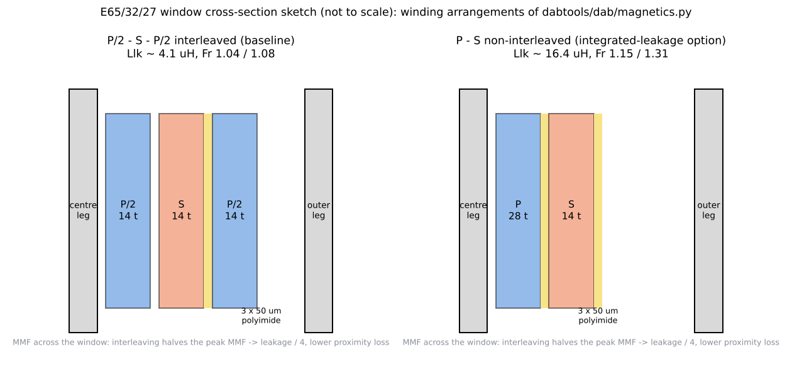
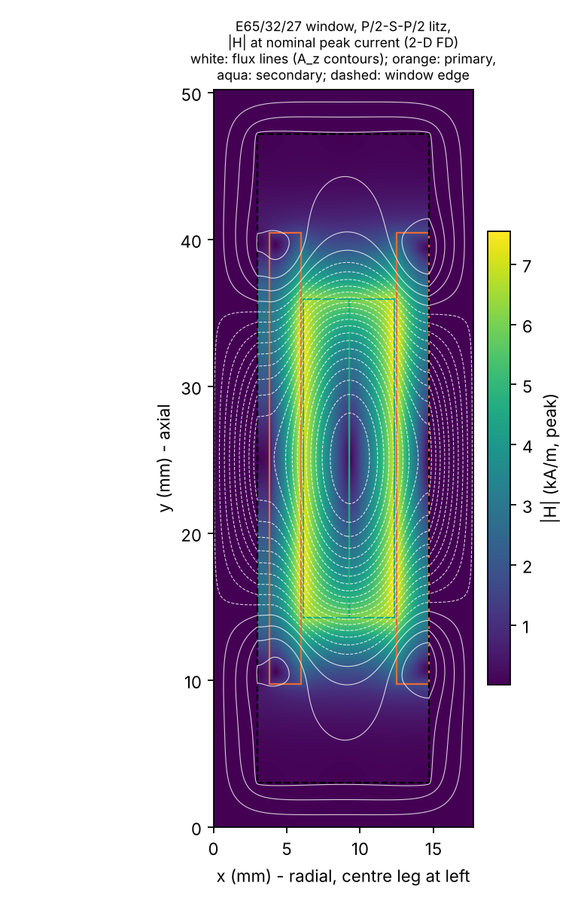

# 07 Magnetics

> Reading time: ~45 min. Prerequisites: chapters 01 (fundamentals), 05 (model), 06 (design calculations).
> Files covered: `06_Magnetics/magnetics_design.md`, `06_Magnetics/transformer_design.py`,
> `dabtools/dab/magnetics.py`, the `transformer` and `inductor` blocks of
> `04_Design_Calculations/design_values.json`, `Advanced_Research_2026/FEM_Magnetics/README.md`.

## Overview

**Level 1 - Beginner:** Two magnetic parts sit between the bridges: a transformer that isolates the
800 V side from the 400 V side and converts 2:1, and a series inductor that stores a little energy
each half cycle and sets how much power flows. Both are built from ferrite cores (a ceramic that
conducts magnetic flux) and litz wire (hundreds of thin insulated strands twisted together so that
100 kHz current spreads evenly). The transformer is a pair of E65/32/27 cores with 28 and 14 turns;
the inductor is a pair of E55/28/21 cores with a 2.1 mm air gap and 17 turns.

**Level 2 - Engineering:** `dabtools/dab/magnetics.py` contains the design routines: turns from Faraday's
law for a square wave, Steinmetz core loss with an iGSE multiplier for the triangular flux, skin depth
and Dowell's AC-resistance ratio applied at the strand level for litz, a window fill check, and
closed-form leakage and inter-winding capacitance estimates (Hurley and Woelfle). The selected
transformer runs at 0.132 T peak, loses 11.4 W in the core and 7.4 W in the copper (design estimate), has
4.1 uH of leakage with the interleaved P/2-S-P/2 winding and about 631 pF of inter-winding capacitance,
and rises 36 K at 3 m/s. The inductor stores 4.1 mJ, loses 7.0 W and is gapped to 59.9 uH. The core
comparison table in `06_Magnetics/magnetics_design.md` explains why E65 was chosen over E55, ETD59, PQ65
and E70. All numbers are `[Simulated]` (analytical), nothing has been wound.

**Level 3 - Research:** In 2026 an in-house 2-D finite-difference magnetostatic solver
(`Advanced_Research_2026/FEM_Magnetics/README.md`) checked the closed forms: the interleaved leakage comes
out at 7.6 uH instead of 4.1 uH (+86 %, mostly because the winding only fills 70 % of the window height
and the margin field stores energy), the proximity factors at 100 kHz are 1.41 / 1.57 instead of
1.04 / 1.08 (the strand-level Dowell shortcut under-estimates thick litz bundles), and the four bundle
layers need 12.8 mm radially against an 11.7 mm window, so the bundles must be compressed to a packing
factor of 0.61. The copper loss at nominal rises from 7.4 to 10.4 W. A planar PCB-winding alternative was
shown to be 2-4x lossier at this turn count. These are predictions (maturity L2); no transformer exists.

*Figure 07-1 (sketch, `img/make_figs_06_10.py`): the two winding arrangements modelled in
`dabtools/dab/magnetics.py` for the E65/32/27 window.*

## Topic 1: Core selection and area product

### Core selection by area product and loss
**What is it?** The area product Ap = Ae * Aw (core cross-section times window area) is the first
estimate of how big a core must be for a given power, flux density and current density; the final choice
compares core loss, copper loss, fill factor and leakage for several candidates.

**Why do we need it?** A core that is too small saturates or overheats; one that is too large wastes
volume and, at a fixed flux density, needs fewer turns but has more core loss per watt transferred.

**How does it work?**
**Level 1 - Beginner:** The core must be fat enough to carry the magnetic flux without "overflowing"
(saturation) and have a window wide enough for all the copper. Multiplying the two areas gives one
number to compare cores with.
**Level 2 - Engineering:** `area_product_required(P, Bpk, J, f, Ku, Kf)` returns
Ap = P / (Kf Ku 2 Bpk f J); with 6600 VA, 0.13 T, 4 A/mm2, 100 kHz, Ku = 0.3 and Kf = 4 that is
5.3e-8 m^4 = 5.3 cm^4. The E65/32/27 has Ae = 540 mm2 and Aw = 394 mm2, Ap = 21 cm^4, four times the
minimum - the extra room is used by the 50 % litz packing, the 1 mm reinforced insulation and the margins.
`06_Magnetics/transformer_design.py` then runs `design_transformer` for five cores and two materials and
tabulates loss, fill, leakage and temperature rise.
**Level 3 - Research:** The 2026 study found that even the E65 window is marginal in the radial
direction once real bundle diameters are used (12.8 mm needed vs 11.7 mm available), which the fill
factor of 0.66 did not reveal because the fill check is an area ratio, not a geometric stack-up.

**Example from our converter:** Table in `06_Magnetics/magnetics_design.md`, section 1: E55/28/21 fills
1.45 (does not fit), ETD59 1.06 (does not fit), E65/32/27 0.66 with 18.8 W total, PQ65/60 0.81 (flag),
E70/33/32 0.50 with 18.8 W but 102 cm3 instead of 79 cm3. Selection: E65/32/27 pair, 3C95. `[Simulated]`

**Engineering calculations:** Ap as above; core data in `dabtools/dab/magnetics.py` (`CORES`), material
data in `MATERIALS` (3C95: k = 1.63, alpha = 1.42, beta = 2.55, Bsat 0.41 T at 100 C, mu_i = 3000).

**Design decision made in this project:** 2 x E65/32/27, 3C95, ungapped (Lm about 10.9 mH), bobbin
winding. `[Implemented]` in the design chain and listed as an off-board item in
`16_BOM/off_board_items.md`.

**Alternatives considered:** N97 (3-4 % lower core loss, same geometry); planar E64 with PCB windings
(rejected in section 1 of the magnetics report: 28 turns of 2 mm2 would need more than 24 layers; the
2026 study quantifies it as 2-4x the copper loss).

**How to verify it:** `06_Magnetics/transformer_design.py` regenerates the table (listed as PASS in
`18_Verification/verification_report.md`) `[Verified]` as reproducibility; the physical check is the
test procedure in section 6 of the magnetics report (turns ratio, Lm, leakage, resistance, hipot,
thermal run). `[Proposed]`

**Common mistakes:** Comparing cores at the same turns instead of the same flux density; forgetting
that litz packing halves the copper fill; ignoring the radial stack-up of the layers.

**Interview explanation (30 s):** "The area product says we need about five centimetres to the fourth;
the E65 pair has twenty, which pays for litz packing and a millimetre of reinforced insulation. Among
five candidate cores it gives the lowest total loss that actually fits the window."

**Research-level explanation:** Area-product sizing is a heuristic; the real constraint set is loss,
temperature, insulation distance and manufacturability. The finite-difference study turned the area
check into a geometric one and found the window is tighter than the fill factor suggested.

## Topic 2: Turns, flux density and core loss

### Turns ratio, peak flux and Steinmetz / iGSE core loss
**What is it?** N1 and N2 set the voltage ratio and, with the core area and frequency, the peak flux
density; core loss follows a Steinmetz power law corrected for the non-sinusoidal flux.

**Why do we need it?** Too few turns push the flux towards saturation and raise core loss steeply
(B^2.55); too many turns add copper loss and leakage.

**How does it work?**
**Level 1 - Beginner:** Each turn of wire "catches" a share of the voltage; the more turns, the less
flux each volt-second produces in the core. Ferrite heats up in proportion to how far and how fast the
flux swings, so the designer keeps the swing at about a third of the saturation level.
**Level 2 - Engineering:** For a square wave the flux rises linearly for a half period, so
Bpk = V1 D / (4 fs N1 Ae). `design_transformer` chooses N1 = ceil(V1 / (4 fs Bpk_target Ae)) = 29 for
0.13 T, rounds N2 = 14 to keep the exact ratio and recomputes N1 = 28, giving Bpk = 800 / (4 * 1e5 * 28
* 5.4e-4) = 0.132 T. Core loss: Pv = k f^alpha B^beta = 1.63 * (1e5)^1.42 * 0.1323^2.55 = 118 kW/m3,
times Ve = 79.3 cm3 gives 9.4 W, times the iGSE multiplier 1 + 0.4 (beta - 2) = 1.22 for triangular
flux gives 11.4 W.
**Level 3 - Research:** The Steinmetz coefficients are curve fits of the published 100 C loss charts
(docstring in `dabtools/dab/magnetics.py`: "re-fit from the datasheet before relying on absolute
numbers"); the iGSE multiplier is a simplified closed form rather than the full Venkatachalam integral.
Under EPS/TPS the flux waveform becomes trapezoidal with flat segments, where the iGSE gives a different
factor; the research modules reuse the same function, so this is an identified limitation.

**Example from our converter:** `transformer` block of `04_Design_Calculations/design_values.json`:
N1 = 28, N2 = 14, Bpk = 0.1323 T, P_core = 11.42 W, Ae = 5.4e-4 m2, Ve = 7.93e-5 m3. `[Simulated]`

**Engineering calculations:** as above; functions `turns_for_flux`, `peak_flux`, `steinmetz_loss`,
`igse_correction` in `dabtools/dab/magnetics.py`.

**Design decision made in this project:** 28:14 turns, Bpk 0.132 T (32 % of Bsat at 100 C) at 800 V;
at 850 V it rises to 0.141 T, still far from saturation. `[Implemented]`

**Alternatives considered:** 24:12 on a PQ65 or E70 (Bpk 0.12 T, lower copper loss, more volume);
a lower Bpk target to cut core loss at the price of more turns and leakage.

**How to verify it:** Core loss cannot be verified without hardware (calorimetric or B-H loop
measurement); the design chain only checks consistency. `[Proposed]`

**Common mistakes:** Using the sinusoidal Steinmetz loss for a square-wave transformer without the
waveform correction; using 25 C ferrite data (3C95 is designed for its loss minimum near 100 C);
forgetting that the DAB transformer sees the full square wave at all loads, so core loss is constant
from no load to full load.

**Interview explanation (30 s):** "Twenty-eight to fourteen turns put the peak flux at 0.13 tesla,
a third of saturation. Steinmetz with the triangular-flux correction gives about eleven watts of core
loss, independent of load, which is why the transformer loss dominates at light load."

**Research-level explanation:** Core loss under the three-level voltages of EPS/TPS requires the full
iGSE or a loss-map approach; coupling the loss to temperature (Steinmetz coefficients drift with T) is
the subject of the multiphysics module. No core-loss measurement exists in this repository.

## Topic 3: Windings - skin and proximity effect, litz wire

### Skin depth, Dowell's ratio and the litz approximation
**What is it?** At 100 kHz current crowds into a skin depth of 0.24 mm (copper at 100 C) and the field of
neighbouring layers pushes it further to the layer edges (proximity effect). Litz wire of 0.1 mm strands
keeps each strand below the skin depth; Dowell's formula gives the AC/DC resistance ratio Fr.

**Why do we need it?** Copper loss is I_rms^2 R_dc Fr; a wrong Fr can double the winding loss and the
hot-spot temperature.

**How does it work?**
**Level 1 - Beginner:** Fast-changing current prefers the outside of a conductor, like traffic that
only uses the outer lanes; splitting the wire into hundreds of insulated strands gives every strand its
own small road, and twisting them makes each strand take every lane position in turn.
**Level 2 - Engineering:** delta = sqrt(rho / (pi f mu0)) = 0.239 mm at 100 kHz, 100 C. Strand count from
J = 4 A/mm2: A1 = 9.23 A / 4 = 2.31 mm2 -> 294 strands of 0.1 mm; A2 = 4.62 mm2 -> 588 strands.
`litz_rac_ratio` calls `dowell_rac_ratio` with an effective foil thickness of 0.886 d_strand, an
effective layer count m sqrt(n_strands) / 2 and porosity 0.5; for the interleaved arrangement the
physical layers (2 + 2) count as half, giving Fr1 = 1.038 and Fr2 = 1.077. R1dc = 41.1 mOhm, R2dc = 10.3
mOhm, P_cu = 9.23^2 * 0.0411 * 1.038 + 18.46^2 * 0.0103 * 1.077 = 3.63 + 3.78 = 7.41 W.
**Level 3 - Research:** `Advanced_Research_2026/FEM_Magnetics/README.md` evaluates the same windings with
the 2-D field of the window and Ferreira's strand-level factors: Fr1 = 1.41, Fr2 = 1.57 at 100 kHz
(4.70 / 6.09 at 300 kHz), copper loss 10.4 W instead of 7.41 W; for the non-interleaved P-S arrangement
2.06 / 2.54 and 16.1 W. A 1-D "Sullivan" estimate (1.28) lands between the two, so the design's strand-
level Dowell shortcut under-estimates (Fr - 1) by roughly a factor of ten for these thick bundles. The
third harmonic of the trapezoidal current adds only about 4 % to the fundamental loss.

**Example from our converter:** `"delta": 2.39e-4`, `"strands1": 294`, `"strands2": 588`,
`"Fr1": 1.038`, `"Fr2": 1.077`, `"P_cu": 7.41` in the `transformer` block; non-interleaved variant
`"Fr1": 1.153`, `"Fr2": 1.307`, `"P_cu": 8.62`. `[Simulated]`

**Engineering calculations:** functions `skin_depth`, `dowell_rac_ratio`, `litz_rac_ratio` in
`dabtools/dab/magnetics.py`; Dowell 1966 and Hurley and Woelfle 2013 are the cited sources.

**Design decision made in this project:** Litz 294 x 0.1 mm (primary, 2 layers) and 588 x 0.1 mm
(secondary, 2 layers), P/2-S-P/2 interleaving, 4 A/mm2. `[Implemented]` in the design; the loss budget
of chapter 06 uses the 7.41 W design value, which the 2026 study revises to 10.4 W.

**Alternatives considered:** Foil windings (lower DC resistance, strong proximity loss at two or more
layers, hard to insulate for 850 V); thinner strands (0.05 mm: better at 300 kHz, worse packing);
non-interleaved winding to gain leakage (Topic 5).

**How to verify it:** The finite-difference solver is validated against Dowell to 0.02 % for foil layers
(`Advanced_Research_2026/FEM_Magnetics/results/validation_dowell.csv`) `[Verified]` as a software check;
the winding resistance at DC (4-wire) and AC (impedance analyser) is a bench test. `[Proposed]`

**Common mistakes:** Applying Dowell with the number of bundle layers only (ignores strand-level
proximity inside a thick bundle); using 20 C copper resistivity (31 % low at 100 C); not interleaving
and then wondering why the secondary runs hot.

**Interview explanation (30 s):** "Skin depth is a quarter millimetre at 100 kilohertz, so we use
0.1-millimetre litz, 294 strands on the primary and 588 on the secondary, and interleave the primary
around the secondary. The closed-form estimate gives AC-to-DC ratios near 1.05; the 2026 field solver
says 1.4 to 1.6, which raises the copper loss from 7 to 10 watts - a known revision."

**Research-level explanation:** Thick litz bundles are a known weak point of Dowell-type models; the
2-D magnetostatic field plus Ferreira strand factors is the standard semi-analytical remedy, and the
remaining gap to a measurement is the bundle-level circulating current that neither model includes.

## Topic 4: Leakage inductance and inter-winding capacitance

### Leakage inductance Llk and inter-winding capacitance C_iw
**What is it?** Llk is the part of the winding inductance whose flux does not link both windings; it
adds to the external inductor. C_iw is the capacitance between primary and secondary across the
insulation; it carries common-mode displacement current at every voltage edge.

**Why do we need it?** Llk is part of the 64 uH design value and a tolerance source; C_iw drives the
common-mode EMI (chapter 13) and the Y-capacitor current.

**How does it work?**
**Level 1 - Beginner:** Some magnetic field lines slip through the gap between the two windings
instead of going through the core; that stray field behaves like a small extra inductor. The two
windings are also two metal surfaces close together - a capacitor.
**Level 2 - Engineering:** Hurley and Woelfle: Llk = mu0 N1^2 lw / hw (h_ins + (h1 + h2) / 3), with
h_ins = 1 mm, h1 and h2 the radial winding thicknesses and hw the window height; interleaving P/2-S-P/2
divides it by about 4. Result 4.10 uH interleaved, 16.4 uH non-interleaved. C_iw as a parallel plate
with eps_r 3.5 across 1 mm: 631 pF interleaved (two interfaces), 316 pF non-interleaved. The
displacement current at a 20 V/ns edge is i = C dv/dt = 0.6 nF x 20 V/ns = 12 A peak pulses, returned by
the Y capacitors (`06_Magnetics/magnetics_design.md`, section 5).
**Level 3 - Research:** The finite-difference study decomposes the +86 % leakage discrepancy
(`Advanced_Research_2026/FEM_Magnetics/README.md`, section 4): with the actual layer thicknesses and
0.15 mm of insulation the 1-D value is 3.2 uH; using the real winding height of 30.7 mm instead of the
44.2 mm window gives 4.6 uH; the fringing field in the 6.7 mm end margins brings the 2-D result to
7.6 uH (mesh convergence +/-2 %). Non-interleaved: 20.4 uH, and a 1 mm spacer adds only 4.5 uH, so the
"~40 uH with a 3 mm spacer" of the design note is not reachable in this window. The README recommends
relaxing the acceptance test from "< 6 uH" to about 8 +/- 2 uH.

**Example from our converter:** `"Llk": 4.098e-06`, `"C_iw": 6.31e-10` (interleaved) and
`"Llk": 1.639e-05`, `"C_iw": 3.16e-10` (non-interleaved) in `04_Design_Calculations/design_values.json`;
`L_ext = L - Llk = 59.9 uH`. 2026 values 7.61 uH (P/2-S-P/2), 20.4 uH (P-S), 7.35 uH (P-S-P-S) in
`Advanced_Research_2026/FEM_Magnetics/results/fem_results.json`. `[Simulated]`

**Engineering calculations:** code lines in `design_transformer` (`dabtools/dab/magnetics.py`);
the 2-D solver `Advanced_Research_2026/FEM_Magnetics/fd_magnetostatic.py` computes L = 2 W' lw / I^2
from the stored field energy with balanced ampere-turns.

**Design decision made in this project:** Keep the leakage small (interleaved) and put the inductance
in a gapped external inductor whose value is set by the gap (+/-5 %), because leakage of a hand-wound
bobbin has +/-20 % tolerance that maps directly into power capability. With the 2026 value, the external
inductor would be 56.4 uH instead of 59.9 uH to keep 64 uH total - a parameter change, not a redesign.
`[Implemented]` as design intent.

**Alternatives considered:** Integrated-leakage transformer (non-interleaved plus spacer), kept as an
optimisation variable in `12_Optimization/optimize.py` with +/-20 % tolerance; the 2026 study caps it at
20-25 uH, which is 31-39 % of the required inductance.

**How to verify it:** Short-circuit inductance measurement at 100 kHz with the secondary shorted
(`06_Magnetics/magnetics_design.md`, section 6, item 2) `[Proposed]`; the Digital Twin estimates the total
L online from the switched plant with 0.24 % final error on simulated data (`[Simulated]`, chapter 16).

**Common mistakes:** Using the full window height for a winding that fills 70 % of it; forgetting the
fringing in the end margins; treating the leakage as a free design variable with 5 % tolerance.

**Interview explanation (30 s):** "The interleaved transformer leaks about four microhenry by the
closed form and about eight by the two-dimensional field solution, because the winding does not fill the
window height and the margin field stores energy. Either way it is a small part of the 64 microhenry, so
the gapped external inductor sets the value. The inter-winding capacitance of about 0.6 nanofarad is the
common-mode EMI source."

**Research-level explanation:** Leakage integration is attractive for volume (L23 in the literature
database, open access, optimised coil arrangement) but costs tolerance and proximity loss; the project
quantifies both and keeps the discrete inductor. The 3-D end effects (+/-10-20 % per the README) are the
remaining uncertainty before a measurement.

## Topic 5: The series inductor

### E55/28/21 gapped inductor, 59.9 uH
**What is it?** A gapped ferrite inductor carrying the full HV-side current (9.2 A rms, 9.75 A peak at
nominal, up to 19.6 A peak at the worst corner) and providing the external part of the 64 uH.

**Why do we need it?** It is the power-transfer element of the DAB; its value must be stable (gap
defined) and it must not saturate at the hardware current trip.

**How does it work?**
**Level 1 - Beginner:** An air gap in the ferrite core is where the energy is actually stored; the gap
makes the inductance depend on the geometry rather than on the ferrite, which keeps it stable and
prevents saturation at high current.
**Level 2 - Engineering:** `design_inductor(L, I_pk, I_rms, fs, core, Bpk_max)` with I_pk = 1.2 x
9.75 A = 11.7 A and Bpk_max = 0.12 T: N = ceil(L I_pk / (Bpk Ae)) = ceil(59.9e-6 * 11.7 / (0.12 *
3.54e-4)) = 17; Bpk = L I_pk / (N Ae) = 0.116 T; gap = mu0 N^2 Ae / L - le / mu_r = 2.10 mm (fringing
ignored, to be corrected at build); stored energy 0.5 L I^2 = 4.1 mJ; core loss (Steinmetz with the full
Bpk as the AC swing - conservative) 4.6 W; copper 2.5 W with 294 x 0.1 mm litz, 2 layers, Fr = 1.50
including a +30 % allowance for the fringing field near the gap; fill 0.28.
**Level 3 - Research:** The inductor is not covered by the 2026 field study; its gap fringing loss and
the DC-bias behaviour up to 32 A are open items. The test procedure asks for L at 0, 10, 20 A DC bias
(must stay within -10 % at 24 A).

**Example from our converter:** `inductor` block: core E55/28/21, N = 17, Bpk = 0.1165 T, gap 2.105 mm,
P_core = 4.58 W, P_cu = 2.47 W, Rdc = 19.3 mOhm, Fr = 1.50, E = 4.1 mJ, fill 0.28. `[Simulated]`

**Engineering calculations:** as above; `gap_for_inductance`, `design_inductor` in
`dabtools/dab/magnetics.py`. Bpk at the 32 A trip: 0.116 x 32 / 11.7 = 0.32 T, below Bsat 0.41 T at
100 C.

**Design decision made in this project:** 2 x E55/28/21, 3C95, centre-leg gap 2.10 mm, 17 turns of the
same litz as the primary, kept 3 mm from the gap. `[Implemented]` as design; off-board item L1.

**Alternatives considered:** Powder-core toroid (soft saturation, distributed gap, higher core loss at
100 kHz); integrating the inductance into the transformer leakage (Topic 4).

**How to verify it:** Inductance vs bias and hipot per section 6 of the magnetics report `[Proposed]`;
the loss budget scales inductor core loss with (I_pk / I_pk,nom)^2.5 across the envelope `[Simulated]`.

**Common mistakes:** Sizing the gap without a fringing correction (real inductance comes out higher,
the gap must be opened); placing turns next to the gap (fringing-field eddy loss); designing for the
nominal peak instead of the current-limit peak.

**Interview explanation (30 s):** "Sixty microhenry on a gapped E55 pair: 17 turns, a 2.1-millimetre
gap, 0.12 tesla at 1.2 times the nominal peak and 0.32 at the 32-amp trip, 4 millijoules stored, about
seven watts of loss. The gap sets the value to a few percent, which is why we did not integrate the
inductance into the transformer."

**Research-level explanation:** The inductor's non-linearity under bias and temperature is one of the
parameter drifts that the digital twin tracks as 1/L; the gapped-ferrite choice keeps the drift small by
construction.

## Topic 6: Thermal and insulation of the magnetics

### Temperature rise and the insulation system
**What is it?** The simple surface-cooling estimate of the temperature rise and the insulation build
(polyimide tape, margins, triple-insulated lead-outs) that makes the transformer safe at 850 V working
voltage.

**Why do we need it?** Ferrite loss rises steeply above ~120 C and litz insulation has a temperature
class; the insulation must satisfy the basic-insulation requirement HV-LV (chapter 14).

**How does it work?**
**Level 1 - Beginner:** The heat has to leave through the surface of the core and winding into the air
stream from the fans; the insulation is tape layers and spacing that keep 850 V from reaching the
400 V side even if one layer fails.
**Level 2 - Engineering:** dT = (P_core + P_cu) / (h A) with h = 12 W/m2K (3 m/s) and an approximate
surface area gives 35.7 K for the interleaved design (38 K non-interleaved). Insulation: 3 x 50 um
polyimide between P and S (each layer rated > 5 kV), 6 mm margin tape, creepage along the bobbin > 12 mm,
triple-insulated wire for the primary exits, core bonded to PE through a thermal pad so that winding-to-
core insulation is also basic (850 V / 450 V).
**Level 3 - Research:** The thermal model is a lumped estimate; the multiphysics module couples losses
and temperature. With the 2026 copper loss (10.4 W) the rise becomes about 41 K by the same formula.
Partial-discharge inception across 150 um polyimide at the 100 kHz square voltage is "not expected below
1 kV peak but must be tested" (magnetics report, section 5).

**Example from our converter:** `"dT": 35.7` K in the `transformer` block; insulation and test
procedure in sections 5 and 6 of `06_Magnetics/magnetics_design.md`. `[Simulated]` / `[Proposed]`

**Engineering calculations:** `design_transformer` thermal lines in `dabtools/dab/magnetics.py`.

**Design decision made in this project:** Forced air at 3 m/s across the magnetics (same fans as the
heatsinks, `13_Thermal_Analysis/thermal_report.md`), single bobbin with tape insulation (interleaving
needs one bobbin), hipot 2.5 kVrms 60 s P-S and P-core. `[Proposed]` as procedure.

**Alternatives considered:** Split bobbin (simpler insulation, no interleaving, higher leakage and
proximity loss); potting (better cooling, worse serviceability).

**How to verify it:** Thermal run with a thermocouple under the outer layer, hipot and partial-discharge
screening (section 6 of the magnetics report). `[Proposed]`

**Common mistakes:** Quoting a temperature rise without the airflow assumption; placing the secondary
litz exit through the primary margin; assuming the core is floating (it is earthed, so both windings need
basic insulation to it).

**Interview explanation (30 s):** "About 36 kelvin rise at three metres per second from nineteen
watts, insulated with three layers of polyimide tape and six-millimetre margins for basic insulation at
850 volts; the primary exits in triple-insulated wire and the core is earthed."

**Research-level explanation:** The real questions are the hot spot inside the litz bundle and the
partial-discharge behaviour of tape insulation under 20 V/ns square edges, both outside the current
model and listed for test.

## Worked example with real numbers

Transformer at 800 V, 100 kHz (all inputs from `04_Design_Calculations/design_values.json`):

1. Turns: N1 = ceil(800 / (4 * 1e5 * 0.13 * 5.4e-4)) = ceil(28.5) = 29 -> N2 = round(29 / 2) = 14,
   N1 = 28 to keep n = 2. Bpk = 800 / (4 * 1e5 * 28 * 5.4e-4) = 0.1323 T.
2. Core loss: Pv = 1.63 * 1e5^1.42 * 0.1323^2.55 = 1.18e5 W/m3; x 7.93e-5 m3 = 9.36 W; x 1.22 (iGSE) =
   11.42 W.
3. Skin depth: rho(100 C) = 1.72e-8 (1 + 0.00393 * 80) = 2.26e-8 Ohm m; delta = sqrt(2.26e-8 / (pi * 1e5 *
   4 pi e-7)) = 0.239 mm.
4. Strands: 9.23 A / 4 A/mm2 = 2.31 mm2 / (pi * 0.05^2 mm2) = 294; secondary 588.
5. DC resistance: R1 = 2.26e-8 * 28 * 0.150 / 2.31e-6 = 41.1 mOhm; R2 = 10.3 mOhm.
6. Copper loss (design): 9.23^2 * 0.0411 * 1.038 + 18.46^2 * 0.0103 * 1.077 = 7.41 W.
   Copper loss (2026 field solution): 10.4 W with Fr 1.41 / 1.57.
7. Leakage (design): mu0 * 28^2 * 0.150 / 0.0442 * (1e-3 + (h1 + h2) / 3) / 4 = 4.10 uH; 2-D: 7.61 uH.
8. Temperature rise: (11.42 + 7.41) / (12 * A) = 35.7 K with the surface estimate.

Inductor: N = 17, gap 2.10 mm, Bpk 0.116 T at 11.7 A, 4.1 mJ, 7.0 W; L_ext = 64 - 4.1 = 59.9 uH.

## How this chapter connects to the files

| File | What it contains | Status |
|---|---|---|
| `dabtools/dab/magnetics.py` | materials, cores, Steinmetz/iGSE, skin depth, Dowell, litz ratio, area product, turns, gap, `design_transformer`, `design_inductor` | `[Implemented]` |
| `06_Magnetics/transformer_design.py` | core comparison table, selected transformer, integrated-leakage option, inductor, insulation, test procedure (writes the report) | `[Implemented]` |
| `06_Magnetics/magnetics_design.md` | the generated magnetics report | `[Simulated]` |
| `04_Design_Calculations/design_values.json` (`transformer`, `transformer_integrated_leakage`, `inductor`) | all magnetic design numbers | `[Simulated]` |
| `16_BOM/off_board_items.md` | T1, L1 and the CT core as off-board items | `[Implemented]` |
| `Advanced_Research_2026/FEM_Magnetics/README.md` | purpose, method, validation, wound and planar results, Pareto study, limitations | `[Simulated]` |
| `Advanced_Research_2026/FEM_Magnetics/fd_magnetostatic.py` | 2-D finite-difference magnetostatic solver and loss post-processing | `[Implemented]` |
| `Advanced_Research_2026/FEM_Magnetics/run_fem_magnetics.py` | the study script (validation, wound, planar, Pareto) | `[Implemented]` |
| `Advanced_Research_2026/FEM_Magnetics/results/fem_results.json`, `Advanced_Research_2026/FEM_Magnetics/results/pareto_variants.csv`, `Advanced_Research_2026/FEM_Magnetics/results/validation_dowell.csv`, `Advanced_Research_2026/FEM_Magnetics/results/validation_leakage_convergence.csv` | numerical results and solver validation | `[Simulated]` / `[Verified]` (validation against closed forms) |
| `Advanced_Research_2026/FEM_Magnetics/results/fig_field_wound_interleaved.png`, `Advanced_Research_2026/FEM_Magnetics/results/fig_pareto.png` | field maps and Pareto figure | `[Simulated]` |

*Figure 07-2: field magnitude and flux lines of the interleaved E65 window from the 2-D solver
(`Advanced_Research_2026/FEM_Magnetics/results/fig_field_wound_interleaved.png`).*

## Viva / interview questions

### Basic (10)

1. What are the two magnetic components and their cores?
   Transformer on 2 x E65/32/27 (3C95, 28:14) and series inductor on 2 x E55/28/21 (3C95, gapped 2.1 mm,
   17 turns).
2. Why litz wire?
   The skin depth at 100 kHz is 0.24 mm; 0.1 mm strands keep the current uniform and twisting cancels the
   proximity effect between strands.
3. What is the peak flux density of the transformer and how far from saturation is it?
   0.132 T at 800 V, against 0.41 T saturation at 100 C.
4. Why does the DAB transformer have constant core loss at all loads?
   Both bridges apply a full square wave (D = 1), so the volt-seconds and the flux swing do not depend on
   the power.
5. What does the air gap in the inductor do?
   It stores the energy and sets the inductance by geometry, keeping it stable and preventing saturation.
6. How much leakage inductance does the design estimate and how much the 2026 solver?
   4.1 uH (closed form, interleaved) vs 7.6 uH (2-D finite difference).
7. What is the inter-winding capacitance and why does it matter?
   About 631 pF; at a 20 V/ns edge it conducts about 12 A of common-mode displacement current.
8. What temperature rise does the design predict for the transformer?
   About 36 K at 3 m/s airflow (surface-cooling estimate).
9. Which insulation makes the transformer safe for 850 V?
   Three 50 um polyimide layers between windings, 6 mm margins, triple-insulated primary exits, earthed
   core.
10. Has any magnetic component been built or measured?
    No; all values are calculated, and the test procedure is only a plan.

### Intermediate (10)

1. Derive the number of primary turns for 0.13 T.
   N1 = V1 / (4 fs Bpk Ae) = 800 / (4 * 1e5 * 0.13 * 5.4e-4) = 28.5 -> 29, then 28 after fixing N2 = 14.
2. What is the iGSE multiplier used and where does it come from?
   1 + 0.4 (beta - 2) = 1.22 for 3C95; a simplified closed form for triangular flux relative to a sinusoid
   of the same peak.
3. Explain why interleaving reduces both leakage and proximity loss.
   It halves the peak MMF in the window: leakage energy falls by about 4, and each layer sees half the
   field, so the proximity term (which scales with field squared) drops.
4. How does `litz_rac_ratio` approximate litz wire?
   It calls Dowell with an effective foil thickness 0.886 d_strand, porosity 0.5 and an effective layer
   count m sqrt(n_strands) / 2.
5. Why is the design copper loss 7.4 W but the 2026 estimate 10.4 W?
   The strand-level Dowell shortcut gives Fr about 1.04-1.08; the 2-D field with Ferreira strand factors
   gives 1.41 / 1.57 because the field inside thick bundles is much higher than the 1-D layer model
   assumes.
6. Where does the +86 % leakage discrepancy come from, step by step?
   Actual layer thickness and 0.15 mm insulation: 3.2 uH; real winding height 30.7 mm instead of 44.2 mm:
   4.6 uH; fringing into the 6.7 mm margins (2-D): 7.6 uH.
7. What does the window geometry check of the 2026 study say?
   The four bundle layers need 12.8 mm radially but the window is 11.7 mm; the bundles must be
   compressed to packing 0.61.
8. How was the inductor gap computed and what is missing?
   gap = mu0 N^2 Ae / L - le / mu_r = 2.10 mm; the fringing correction is left for the build.
9. What is the inductor flux at the 32 A hardware trip?
   0.116 T x 32 / 11.7 = 0.32 T, below the 0.41 T saturation.
10. Why was the integrated-leakage transformer rejected?
    Hand-wound leakage has +/-20 % tolerance that maps into +/-20 % power capability, and the 2026 study
    shows it reaches only 20-25 uH anyway, at 1.5-2x the copper loss.

### Advanced / research (10)

1. What are the limitations of the 2-D magnetostatic approach?
   Translational symmetry (no end windings or 3-D fringing), AC resistance from the DC field (Dowell/
   Ferreira assumption), uniformly distributed perfectly transposed strands, fundamental only, rasterised
   layer edges (+/-2 % mesh uncertainty).
2. How was the solver validated without a commercial FEM package?
   Against the closed-form foil leakage (error -0.04 % at h = 0.05 mm), against Dowell for foil layers
   (-0.02 / -0.03 %), and by energy consistency 0.5 sum B.H vs 0.5 sum A J.
3. Why does the planar alternative lose at 28:14 turns?
   2 oz PCB copper cannot provide 2.3 / 4.6 mm2 per turn inside a 10 mm window; even two stacked cores
   with three paralleled boards give 2-4x the copper loss, while leakage and Fr are excellent.
4. What does the Pareto study conclude?
   W1 (P/2-S-P/2) and W3 (P-S-P-S) are equivalent within model error (21.9 vs 21.8 W, 7.6 vs 7.4 uH);
   planar variants win only on volume (P1) or leakage (P5) at much higher loss and cost.
5. How should the acceptance test for leakage be updated?
   From "< 6 uH" to about 8 +/- 2 uH, and the external inductor nominal from 59.9 to about 56.4 uH if the
   2-D value is adopted.
6. Why does the third harmonic contribute only ~4 % to copper loss despite Fr = 4.7 at 300 kHz?
   The trapezoidal current's third harmonic has about 1/9 of the fundamental amplitude, so its loss is
   (1/81) x (4.7 / 1.41) of the fundamental loss.
7. How would core loss under EPS/TPS differ from the square-wave case?
   The flux becomes trapezoidal with flat segments; the iGSE integral over the actual dB/dt gives a
   different multiplier, and the three-level voltages also introduce minor loops at light load.
8. What is the common-mode consequence of the 631 pF inter-winding capacitance and how is it managed?
   Displacement current of about 12 A peak at the edges returns through the Y1 capacitors
   (chapter 10) and the EMI filter (chapter 13); shielding or a lower-capacitance winding would reduce it.
9. Which parameters of the magnetics are identifiable online with the sensors on the board?
   The total series inductance L (0.24 % final error in simulation); core loss, Lm and C_iw are not
   observable from the period-average measurements.
10. Propose a measurement campaign to close the model gap.
    Open/short-circuit impedance vs frequency (Llk, Lm, C_iw), 4-wire DC resistance, impedance-analyser
    AC resistance up to 1 MHz, calorimetric loss at rated square-wave excitation, thermal imaging of the
    hot spot, partial-discharge test at 1.5 x working voltage.

## Pitches

**30 s:** The transformer is an E65 pair with 28 to 14 turns of 0.1-millimetre litz, interleaved for low
leakage and proximity loss, running at 0.13 tesla with about nineteen watts of calculated loss; the
series inductor is a gapped E55 pair at 60 microhenry. A 2026 field solver revised the leakage from four
to eight microhenry and the copper loss from seven to ten watts and found the window radially tight -
all predictions, nothing wound yet.

**2 min:** Magnetics design in this project is a chain of closed forms in one Python module: area product
to shortlist cores, Faraday's law for turns at 0.13 tesla, Steinmetz with an iGSE multiplier for the
triangular DAB flux, skin depth and strand-level Dowell for litz, a window-fill check, Hurley-Woelfle
leakage and a parallel-plate inter-winding capacitance, and a surface-cooling temperature rise. The E65
pair with 3C95 wins the comparison at 18.8 watts and a feasible fill. The leakage is kept small by
interleaving so that a gapped E55 inductor, whose value is set by its 2.1-millimetre gap, provides the
64 microhenry with a few percent tolerance. In 2026 a two-dimensional finite-difference magnetostatic
solver was validated against the foil and Dowell closed forms and applied to the real window: the
leakage comes out at 7.6 microhenry because the winding fills only 70 percent of the window height and
the margin field stores energy; the proximity factors are 1.4 and 1.6 instead of 1.04 and 1.08 because
thick litz bundles sit in a much stronger field than the layer model assumes; and the four bundle
layers need 12.8 millimetres against an 11.7-millimetre window. The consequences are small for the
converter (adjust the external inductor, accept ten watts of copper loss, relax the leakage acceptance
test) but important for the method: the shortcuts are now bounded. A planar PCB-winding alternative was
shown to be two to four times lossier at this turn count. Nothing has been built or measured.

**10 min outline:**
* Roles of transformer and inductor in a DAB; why leakage and external inductance add.
* Area product and the five-core comparison; why E65/3C95.
* Turns, flux density, Steinmetz and iGSE; constant core loss vs load.
* Skin depth, Dowell, the litz approximation; strand counts and DC resistances.
* Interleaving: MMF diagram, leakage / 4, proximity reduction.
* Leakage and inter-winding capacitance closed forms; the displacement-current consequence.
* The gapped inductor: turns, gap, flux at trip, fringing allowance.
* Thermal estimate, insulation build, test procedure.
* The 2026 finite-difference study: method, validation, leakage decomposition, proximity revision, window
  geometry finding, planar comparison, Pareto; limitations.
* What a measurement campaign must deliver before the numbers are trusted.

## Further reading

* `dabtools/dab/magnetics.py` docstrings cite Dowell (1966), Hurley and Woelfle (2013) and Venkatachalam et
  al. (2002, iGSE); `Advanced_Research_2026/FEM_Magnetics/README.md` cites Ferreira (1994) for the strand
  factors.
* `Advanced_Research_2026/Literature_Database/literature_2022_2026.csv`: L23 (Yadollahi and Zakipour 2025,
  Scientific Reports, open access) on coil arrangements for leakage integration - the alternative this
  project quantified and rejected; L06 and L07 for comparable 6.6 kW designs.
* `06_Magnetics/magnetics_design.md`, section 6 - the test procedure that would turn these predictions into
  measurements.
* `14_EMI_EMC/emi_report.md` - where the inter-winding capacitance enters the common-mode estimate.
