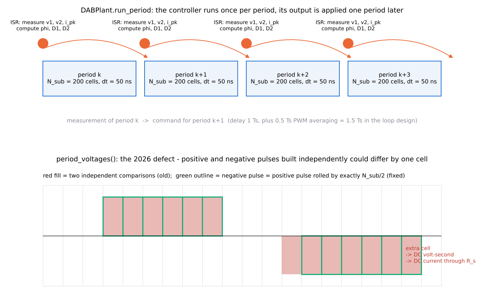
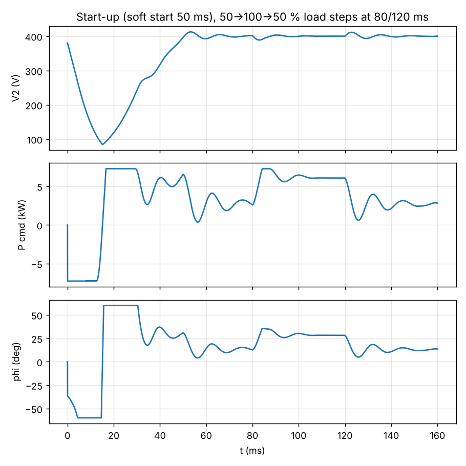
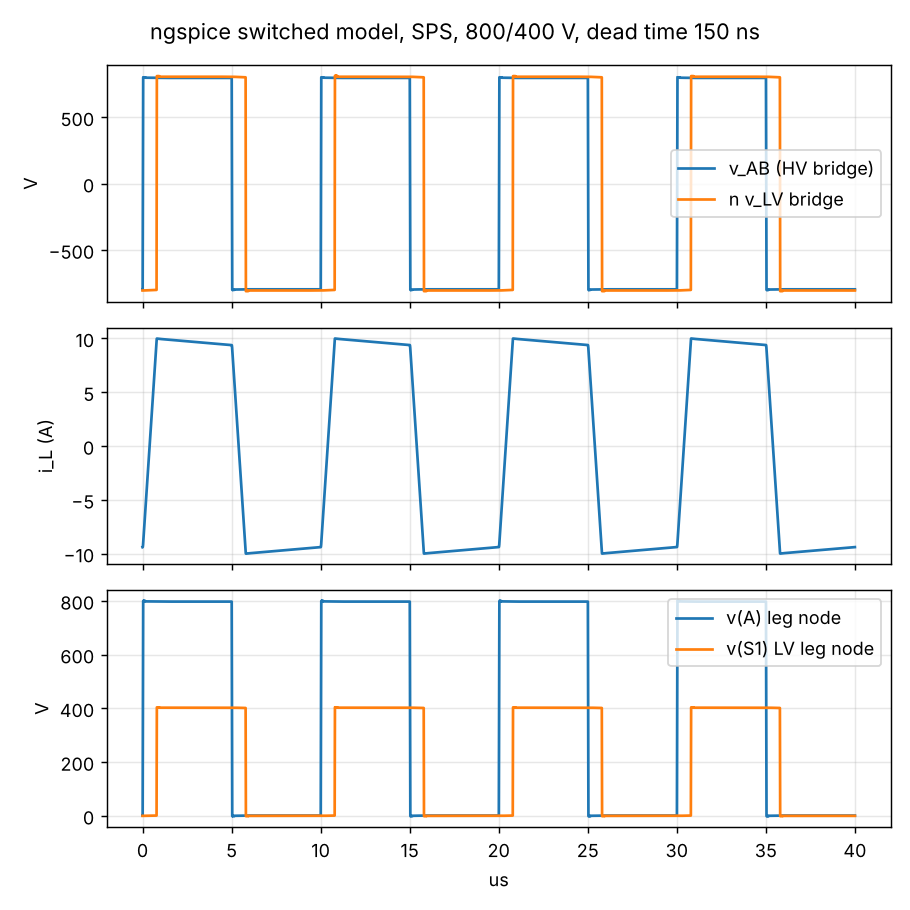

# 08 Simulation

> Reading time: ~40 min. Prerequisites: chapters 04, 05, 06. Files covered:
> `dabtools/dab/sim_switched.py`, `05_Simulation/run_switched_sim.py`, `05_Simulation/gen_spice.py`,
> `05_Simulation/spice/dab_sps.cir`, `05_Simulation/switched_results.json`,
> `05_Simulation/spice/spice_results.json`, `05_Simulation/img/`, `10_Firmware/hal/sil/plant.c`,
> `Advanced_Research_2026/Digital_Twin/README.md` (section 2).

## Overview

**Level 1 - Beginner:** Before anything is built, the converter is "run" twice in software. The first
run is a Python program that steps through time in 50-nanosecond slices, switches the two bridges
exactly as the firmware would, and lets the digital controller adjust the phase shift once every 10
microseconds; this shows how the output voltage behaves at start-up, when the load jumps, when the
input dips, when the power reverses and when something goes wrong. The second run is an electrical
circuit simulator (ngspice) with transistors modelled as switches plus body diodes and output
capacitances; it looks at a few switching cycles in detail and checks that every transistor turns on
with (almost) no voltage across it.

**Level 2 - Engineering:** `dabtools/dab/sim_switched.py` is a fixed-step switched plant (dt = Ts / N_sub,
N_sub = 200), with ideal three-level bridge voltages, L, R_s = 0.3 Ohm loop resistance, an ideal
transformer, both DC links with their external bus capacitance (580 uF HV, 1.12 mF LV) and a load
callable; the controller of `dabtools/dab/control.py` runs once per period and its output is applied in
the next period. `05_Simulation/run_switched_sim.py` executes six cases (start-up with load steps, HV
dip, reversal, short circuit, dead-bus start, last-two-period waveforms) and writes
`05_Simulation/switched_results.json`. `05_Simulation/gen_spice.py` generates an ngspice netlist with
behavioural switches (Ron = Rds at 150 C, Roff = 10 MOhm), body diodes and Coss, runs 40 periods and
reports power, currents and the v_ds / V_dc ratio 10 ns before every turn-on. Results: regulation
400.0 V, 0.37 % dip on a 50 % load step, reversal with < 0.7 % link excursion, ngspice 6568 W and 9.17 A
rms versus 6600 W and 9.23 A analytical, ZVS ratio < 0.005 at all eight edges. The dead-bus case fails
the hardware current limit (61.8 A peak, I_PK fault), which the verification report lists as FAIL. All
`[Simulated]`.

**Level 3 - Research:** The switched plant is the "ground truth" of every 2026 module (digital twin,
MPC benchmarks, safe RL, embedded AI), which is why a modelling defect found by the twin study
mattered: the positive and negative pulses of a three-level voltage were built by two independent
floating-point comparisons that could differ by one cell when an edge fell on a cell centre, producing a
DC volt-second per period and, through R_s, a 13 A DC inductor current at inner phase shifts below one.
The fix (negative pulse = positive pulse rolled by exactly N_sub / 2 cells) is documented in the code
comment of `period_voltages` and in `Advanced_Research_2026/Digital_Twin/README.md`, section 2. The
limits of the plant - ideal switches, no dead time in the Python plant, no parasitics, 200-step time
quantisation of the modulator - define what the research results can and cannot claim.

*Figure 08-1 (sketch, `img/make_figs_06_10.py`): the once-per-period controller with one-period delay
(top) and the pulse-asymmetry defect fixed in 2026 (bottom).*

## Topic 1: The Python switched plant

### DABPlant: fixed-step switched model with a controller in the loop
**What is it?** A class that integrates the three state variables of the DAB (inductor current, HV link
voltage, LV link voltage) with a fixed time step inside one switching period, driven by the commanded
(phi, D1, D2).

**Why do we need it?** The averaged model of chapter 05 cannot show switching ripple, peak currents, the
one-period controller delay, saturation of the modulator or protection trips; the SPICE model is too slow
for 160 ms of closed-loop behaviour. The switched plant sits between them.

**How does it work?**
**Level 1 - Beginner:** The program cuts every 10-microsecond period into 200 slices. In each slice it
asks "which bridge switches are on?", computes the voltage across the inductor, updates the current by
a small step (V = L di/dt turned around), and updates the two capacitor voltages by the charge that
flowed in or out. After 200 slices the controller looks at the result and decides the phase shift for
the next period.
**Level 2 - Engineering:** `period_voltages(phi, D1, D2)` builds two arrays s1, s2 in {-1, 0, +1} over
the N_sub cells (positive pulse centred on pi/2 with width D pi, negative pulse rolled by N_sub / 2).
`run_period` then iterates: iL += (s1 v1 - s2 n v2 - R_s iL) / L dt; v1 += (i_src - iL s1) / C1 dt with
i_src = (V1_src - v1) / R1_src (stiff bus through 0.3 Ohm); v2 += (iL s2 n - load(v2, t)) / C2 dt. The
peak |iL| of the period is tracked as `ipk` and fed to the controller as the measured peak current.
With dt = 50 ns and L = 64 uH the explicit Euler step is stable (the largest time constant ratio is
L / R_s = 213 us >> dt). R_s = 0.3 Ohm represents 2 Rds1 + 2 n^2 Rds2 + winding resistance referred to
the HV side.
**Level 3 - Research:** The 2026 library (`Advanced_Research_2026/Adaptive_MPC/dab_mpc_lib.py`) wraps
this plant as `MeasuredDABPlant` with period-average accumulators and a 12-bit ADC model, and validates
its own piecewise-linear period model against `DABPoint`; the plant therefore defines the simulation
ground truth for every controller benchmark. Its 200-cell quantisation of the switching instants
(50 ns, 1.8 deg) is coarser than the C2000 ePWM (10 ns), which the twin handles by evaluating its
regressor on the applied pattern rather than on the commanded phase.

**Example from our converter:** `DABPlant(L, n, fs, C1, C2, 800.0, 0.3, load_fn, N_sub=200)` in
`05_Simulation/run_switched_sim.py` with C1 = 80 uF + 500 uF and C2 = 120 uF + 1 mF (APP-04 bus
capacitances). `[Implemented]`

**Engineering calculations:** dt = 10 us / 200 = 50 ns; one 16 000-period start-up case is 3.2 million
Euler steps in pure Python (minutes, not seconds).

**Design decision made in this project:** Explicit Euler, fixed step, pure Python (no compiled
dependency) so that the firmware SIL plant in C (`10_Firmware/hal/sil/plant.c`) can be a line-by-line
port with the same equations. `[Implemented]`

**Alternatives considered:** Event-driven switching (exact edge times, more code); a state-space
averaged model (no ripple); a commercial circuit simulator (not available, not scriptable here).

**How to verify it:** The last two periods of the start-up case at 50 % load give iL_pk = 4.96 A,
iL_rms = 4.42 A and 6.1 mV LV ripple (`05_Simulation/switched_results.json`, `switching_50pct`); the
analytical 50 % point in `11_Control_Algorithms/control_design.md` gives 4.3 A rms (SPS) - consistent
with the EPS inner shift and R_s. `[Simulated]`

**Common mistakes:** Building the two half-period pulses independently (the 2026 defect, Topic 4);
feeding the controller the current state instead of the previous period's state (hides the delay);
forgetting that `ipk` is reset every period, so a fault check must run every period.

**Interview explanation (30 s):** "Fixed-step Euler with 200 cells per period, ideal three-level bridge
voltages, series L and R, both DC links with the cabinet bus capacitance, and a controller that runs once
per period and acts one period later, exactly like the ISR. It is the plant that every controller in
the project, including the 2026 research controllers, is tested against."

**Research-level explanation:** The plant has no dead time, no Coss, no parasitics and ideal switches,
so it cannot tell ZVS from hard switching; that information comes from the analytical ZVS criterion or
from ngspice. Research on soft-switching control therefore uses the plant for dynamics and the
analytical maps for ZVS, a split the twin README states explicitly.

## Topic 2: The simulation cases and how to read the plots

### The six closed-loop cases of run_switched_sim.py
**What is it?** Scripted scenarios that map to requirements: start-up with 50-100-50 % load steps
(EL-08, EL-10), switching waveforms, HV bus dip (APP-04), power reversal (EL-11), LV short through 0.5
Ohm (EL-12), dead-bus start (APP-05 variant with the LV link at 0 V).

**Why do we need it?** Each requirement with "sim" in its verification column needs a repeatable
numerical test with a pass criterion that the verification script can read.

**How does it work?**
**Level 1 - Beginner:** Every case is a short story: "the output is precharged to 380 V, the converter is
enabled, the reference ramps to 400 V in 50 ms, then the load doubles at 80 ms and halves at 120 ms".
The plots show the output voltage, the commanded power and the phase shift over time; a good result is
a flat 400 V line with small bumps at the load steps.
**Level 2 - Engineering:** Case 1 (`05_Simulation/img/sim_startup_loadstep.png`, three panels V2, P_cmd, phi): v2 reaches
396 V at 40.05 ms (the soft-start ramp from v2_start = 380 V), overshoot 0.38 %, final 400.0016 V; the
50 % step dips 0.37 %. Case 2 (`05_Simulation/img/sim_switching_waveforms.png`): bridge voltages, inductor current and the
pulsating link currents of the last two periods. Case 3 (`05_Simulation/img/sim_v1_dip.png`): V1 800 -> 720 V for 20 ms,
V2 stays within 399.86-400.11 V because the modulator inverse uses the measured v1 (feedforward). Case
4 (`05_Simulation/img/sim_reversal.png`): P_ref ramped +6.6 -> -6.6 kW at 2 kW/ms into a 400 V / 0.1 Ohm battery; V1
797.2-802.6 V, V2 398.2-401.8 V, no fault. Case 5 (short): phi saturates at 60 deg, peak 31.2 A, then
V2_UV fault - the controller cannot hold the voltage, as expected; the 32 A hardware trip is assumed.
Case 6 (`05_Simulation/img/sim_deadbus_start.png`): LV link from 0 V with 10 % load and EPS matching - the current peak
reaches 61.8 A and the controller faults with I_PK after v2 reaches only 93 V.
**Level 3 - Research:** The dead-bus failure is the honest result of the current Python run and is
reported as FAIL in `18_Verification/verification_report.md`; the C SIL harness runs the same scenario
with its own plant and reports 20.2 A peak and a clean start (chapter 09). The two plants are no longer
identical: `10_Firmware/hal/sil/plant.c` still builds the pulses from two independent comparisons while
the Python plant has the 2026 roll fix, and the metric `rec_ms` of case 1 is degenerate (1.8e-9 ms,
because the recovery band of 4 V is never left). Both are open items, not hidden.

**Example from our converter:** `05_Simulation/switched_results.json`: `startup.v2_final` 400.0016,
`startup.overshoot_pct` 0.377, `load_step.dip_pct` 0.374, `v1_dip` 399.86/400.11,
`reversal` 797.2/802.6/398.2/401.8 with `fault: null`, `short.ipk_max` 31.2 with `fault: V2_UV`,
`dead_bus_start.ipk_max` 61.8 with `fault: I_PK`. `[Simulated]`

**Engineering calculations:** EL-10 requires <= 3 % deviation and < 5 ms recovery for a 50 % step; the
simulated dip of 0.37 % with a 612 Hz loop (chapter 09) is consistent with the 1.12 mF link:
a 8.25 A load step held for roughly 1 / (4 fc) = 0.4 ms draws 3.4 mC, i.e. 3 V, about 0.75 %; the PI
with feedforward does better because the modulator inverse acts within one period.

**Design decision made in this project:** Cases are chosen to mirror the SIL scenarios one to one so that
the Python reference controller and the C control core can be compared (chapter 09). `[Implemented]`

**Alternatives considered:** Monte-Carlo over parameter tolerances (done in
`Advanced_Research_2026/Uncertainty_Quantification/`); longer thermal-time-scale runs (the plant has no
thermal model; `Advanced_Research_2026/Digital_Twin/` adds a Foster network).

**How to verify it:** `18_Verification/run_verification.py` reads the JSON and checks EL-08 (|v2 - 400| <
4 V: PASS), EL-10 (dip < 3 %: PASS), EL-11 (no fault, v1_max < 840 V: PASS) and the dead-bus limit
(FAIL). `[Verified]` for the three passing checks, `[Simulated]` with a failing check for the dead-bus
case.

**Common mistakes:** Reading the recovery-time metric without checking its band; comparing the
closed-loop 50 % waveforms (EPS, D1 < 1) with the SPS analytical point; treating the short-circuit case
as a pass because "the controller saturated" (it faults on under-voltage, which is the intended outcome
only if the hardware trip is independently present).

**Interview explanation (30 s):** "Six scripted cases: start-up with load steps, a bus dip, a power
reversal, a short circuit and a dead-bus start, plus the switching waveforms. Regulation, step response
and reversal meet the requirements in simulation; the dead-bus start currently exceeds the hardware
current limit in the Python run and is flagged as a failed check."

**Research-level explanation:** The cases are the regression suite of the research platform; the 2026
twin re-ran them after the plant fix and reported changes below 0.3 V / 0.1 % for the headline cases,
with the EPS/dead-bus cases being the sensitive ones - which is exactly where the remaining FAIL sits.

## Topic 3: The ngspice behavioural model

### gen_spice.py: switches, body diodes, Coss and the ZVS check
**What is it?** A generated netlist of the full DAB power stage with eight voltage-controlled switches,
eight body diodes, eight Coss capacitors, the series inductor, a behavioural ideal transformer, both DC
links with their source impedances and the designed dead time.

**Why do we need it?** To see what the Python plant cannot: the switch-node transitions during the
dead time, body-diode conduction, and whether each device turns on at zero voltage.

**How does it work?**
**Level 1 - Beginner:** A circuit simulator solves the real circuit equations at nanosecond resolution.
Each transistor is a switch with a small on-resistance, a diode in parallel (the body diode) and a small
capacitor (its output capacitance). The gate pulses are generated with the designed 150 ns gaps, and we
watch the voltage across each switch at the moment it is told to turn on.
**Level 2 - Engineering:** `bridge()` emits, per switch, a PULSE source (period Ts, width Ts/2 - t_dead,
5 ns edges), `S` (SW model, Ron = Rds_150 = 52 mOhm HV / 27 mOhm LV, Roff = 1e7, Vt 0.5 V), a body
diode (Is 1e-12, N = 2, Rs 10 mOhm) and a capacitor Coss,er (170 / 350 pF). The LV bridge pulses are
delayed by phi / (2 pi) Ts = 0.782 us (28.2 deg). The transformer is Ep = n v(s1, s2) and Gs = n i(Ep)
with 1 GOhm references. `.tran 2n 400u 360u 2n uic` simulates 40 periods and records the last four.
Post-processing: P_in = -mean(v_hv i(V1)); ZVS check samples |v_rail - v_node| / V_dc 10 ns before each
gate turn-on; values below 0.05 count as ZVS.
**Level 3 - Research:** The model has no package inductance, no gate-loop dynamics and a constant Coss,
so it validates the ZVS criterion only at the energy level; the 5.4 deg "phase loss equivalent" of the
dead time (360 fs t_dead) reported in `05_Simulation/spice/spice_results.json` is the number behind the
firmware's dead-time compensation (half of it, 0.047 rad, applied in `phi_from_power`).
`Advanced_Research_2026/Parasitic_Extraction/` is the module that would add layout parasitics.

**Example from our converter:** `05_Simulation/spice/spice_results.json`: P_in 6568 W, iL_pk 10.01 A,
iL_rms 9.169 A (analytical 9.229 A), dead time 150 ns, phase-loss equivalent 5.4 deg, ZVS ratios A1
0.0021, A2 0.0021, B1 0.0046, B2 0.0045. `[Simulated]`

**Engineering calculations:** dP = |6568 - 6600| / 6600 = 0.5 %, dI_rms = 0.6 % - both below the 5 %
acceptance of the verification script. The small power deficit is the dead time (each half period loses
150 ns of applied voltage) and the loop resistances.

**Design decision made in this project:** Behavioural switches instead of vendor SPICE models (not
available offline; the device data are unverified anyway), so that the simulation is reproducible from
the repository alone. `[Implemented]`

**Alternatives considered:** Vendor models with full Coss(V) curves (better transition fidelity,
convergence issues, licensing); LTspice (not scriptable here).

**How to verify it:** `18_Verification/run_verification.py` lists "ngspice vs analytical" PASS (0.5 %,
0.6 %) and "ngspice ZVS at all 8 edges" PASS. `[Verified]` as software checks; a bench measurement of
v_ds at turn-on is `[Proposed]`.

**Common mistakes:** Forgetting `uic` with initial conditions on the link capacitors (the first periods
would otherwise charge from zero); sampling the switch voltage after the gate edge (it is always low
then); reading the ngspice run log and missing that no compatibility mode was selected (harmless here).

**Interview explanation (30 s):** "The ngspice model uses behavioural switches with body diodes and
output capacitances, the real dead time and the designed inductance. It delivers 6.57 kilowatts and
9.17 amps rms against 6.6 and 9.23 analytical, and every one of the eight switches sees less than half a
percent of the bus voltage at turn-on - zero voltage switching confirmed at the nominal point."

**Research-level explanation:** Confirming ZVS at one point is necessary, not sufficient; the research
value of the SPICE model is as a reference for the transition-time sensor proposal of the twin (the
dv/dt during the dead time is exactly what that sensor would measure).

## Topic 4: Limitations and the 2026 defect story

### What the simulations do not model, and the pulse-asymmetry defect
**What is it?** An explicit list of what both simulation levels leave out, and the record of a modelling
defect found and fixed in 2026.

**Why do we need it?** A simulation result is only as good as its stated limits; a research platform
must document its own bugs so that earlier results can be re-interpreted.

**How does it work?**
**Level 1 - Beginner:** The Python model has perfect switches, no pause between the two switches of a
leg, no stray inductance and capacitance; the circuit model has the pause and the capacitances but no
circuit-board effects. Neither has heat. In 2026 a researcher noticed a steady current flowing in the
inductor that should average to zero, traced it to a rounding subtlety in how the model drew the pulses,
and fixed it.
**Level 2 - Engineering:** Python plant: ideal switches (no Rds except as the lumped R_s), no dead time
(`dead_time` is accepted by the constructor but not used in the integration), no Coss, no parasitics, no
thermal model, no measurement noise (the 2026 library adds ADC quantisation), 50 ns time quantisation
of the switching instants. ngspice: constant Coss, no package or layout parasitics, no gate-driver
dynamics, open loop at a fixed phase. The defect: `three()` used to build the positive pulse with one
comparison on x and the negative pulse with a second comparison on a shifted x; when an edge fell on a
cell centre the two pulses could differ by one cell (50 ns x V1 = 40 uVs per period); the loop
resistance R_s = 0.3 Ohm then integrates the DC volt-second into a DC current up to 13 A at inner duty
below one. Fix: `v[np.roll(pos, N_sub // 2)] = -amp`, so both half periods have the same cell count by
construction (comment in `period_voltages`, `dabtools/dab/sim_switched.py`).
**Level 3 - Research:** The twin study (E3) was the detector because an estimator that assumes <i> = 0
diverged; `Advanced_Research_2026/Digital_Twin/README.md`, section 2, records the symptom, cause, fix and
the re-run ("headline results move by < 0.3 V / < 0.1 %; the affected cases were the EPS/dead-bus
ones"). The second artefact it names, the 200-step time quantisation, is handled by evaluating the
regressor on the applied pattern. The C plant of the SIL harness still has the old construction, which
is a traceable inconsistency to resolve.

**Example from our converter:** the comment block in `period_voltages` of `dabtools/dab/sim_switched.py`
and the paragraph "Baseline defect found by this study" in `Advanced_Research_2026/Digital_Twin/README.md`.
`[Implemented]` fix, `[Simulated]` re-run.

**Engineering calculations:** one extra cell of +V1 for 50 ns per 10 us period is a mean voltage of
800 x 0.005 = 4 V; divided by R_s = 0.3 Ohm it is 13.3 A of DC current - the magnitude reported.

**Design decision made in this project:** Keep the plant simple and explicit; document limits in the
module docstring; fix defects at the source and record them in the research README rather than
patching results. `[Implemented]`

**Alternatives considered:** Event-driven edges (would remove the quantisation and the defect class
entirely at the cost of complexity); using the SPICE model for closed loop (too slow).

**How to verify it:** A unit check is simple: `sum(s1) == 0` and `sum(s2) == 0` for every (phi, D1, D2)
after `period_voltages` - true by construction after the fix. Such a check is not yet in the repository.
`[Proposed]`

**Common mistakes:** This is the "common mistakes" example of the chapter: two code paths that must
produce symmetric results computed independently with floating-point comparisons. The symptom (a DC
inductor current) looks like a physical effect (transformer saturation would be the hardware analogue)
and can be misread as a control problem. The lesson generalises: whenever a model has a symmetry
(half-wave, balanced ampere-turns, charge conservation), enforce it structurally and test it. A second
lesson from the same episode: when a defect is fixed in one plant, fix its port (`10_Firmware/hal/sil/plant.c`)
in the same change.

**Interview explanation (30 s):** "The Python plant has ideal switches, no dead time and no parasitics;
SPICE adds the dead time and capacitances but no layout. In 2026 the digital-twin estimator exposed a
DC inductor current caused by the two half-period pulses differing by one time step; the negative pulse
is now the positive one rolled by exactly half a period, and the regression cases were re-run."

**Research-level explanation:** The episode is an example of model-based estimation acting as a
model-validation tool: an estimator with a physically justified structural assumption (zero mean
current) is a sensitive detector of modelling errors, which is one argument for physics-informed
estimators over black-box ones (literature database L05, L10, L28).

## Topic 5: How to run and reproduce

### Running the simulations
**What is it?** The commands, run times and outputs of the two simulation levels.

**Why do we need it?** Reproducibility is the only verification available without hardware.

**How does it work?**
**Level 1 - Beginner:** Two commands, each writes pictures and a results file; the verification script
reads the results files and prints PASS or FAIL per requirement.
**Level 2 - Engineering:** From `SiC_6k6_Industrial_DAB`: `python3 05_Simulation/run_switched_sim.py`
(pure Python, numpy, matplotlib; several minutes; writes `05_Simulation/switched_results.json` and five
PNGs in `05_Simulation/img/`) and `python3 05_Simulation/gen_spice.py` (needs ngspice on the PATH;
writes `05_Simulation/spice/dab_sps.cir`, `05_Simulation/spice/dab_sps.csv`,
`05_Simulation/spice/ngspice.log`, `05_Simulation/spice/spice_results.json` and
`05_Simulation/img/spice_sps_waveforms.png`). Both read `04_Design_Calculations/design_values.json` and
the switched case reads `11_Control_Algorithms/control_params.json`, so the design chain must have been
run first. `05_Simulation/switched_run.log` holds the console output of the last run with `EXIT=0`.
**Level 3 - Research:** The 2026 modules import the same plant and controller through
`dabtools.dab` and write their own provenance (python and package versions, git commit, input hashes),
following `Advanced_Research_2026/MODULE_CONVENTIONS.md`.

**Example from our converter:** `18_Verification/verification_report.md` run of 2026-10-10 07:43 lists
the ngspice and switched-simulation checks with their numbers. `[Verified]`

**Engineering calculations:** none beyond the run-time estimate (16 000 periods x 200 cells).

**Design decision made in this project:** No binary artefacts are required; everything regenerates from
scripts. `[Implemented]`

**Alternatives considered:** Caching results in a database; a notebook interface (not used, scripts
only).

**How to verify it:** Run both scripts and diff the JSON files against the committed ones (expected
differences are at the 1e-6 level from library versions). `[Verified]` in the current report.

**Common mistakes:** Running the SPICE generator from a different working directory (it writes absolute
paths into the `wrdata` line); interrupting the long switched run and trusting a partial JSON.

**Interview explanation (30 s):** "Two scripts, both driven by the design JSON: the Python closed-loop
run takes minutes and writes the case results; the ngspice run takes seconds and writes the ZVS check.
The verification script turns both into PASS/FAIL lines against the requirement IDs."

**Research-level explanation:** Deterministic, script-only reproduction is the maturity-L3 criterion of
the research conventions; the plant's defect history shows why hash-tracked provenance matters when a
ground-truth model changes.

## Worked example with real numbers

Reading the 50 % load switching waveforms (`05_Simulation/img/sim_switching_waveforms.png`) and
`switching_50pct` in `05_Simulation/switched_results.json`:

1. Operating point: 800 V / 400 V, 3.3 kW, closed loop, EPS matching active (D1 = n v2 / v1 ~ 1.0 at
   voltage match, so the waveform is practically SPS).
2. Phase shift from the inverse power equation: I2 = 3300 / 400 = 8.25 A; c = 2 pi^2 fs L I2 / (n V1) =
   2 x 9.87 x 1e5 x 64e-6 x 8.25 / 1600 = 0.651; phi = (pi - sqrt(pi^2 - 4 x 0.651)) / 2 = 0.218 rad
   = 12.5 deg, plus 0.047 rad dead-time compensation = 15.2 deg. The SIL log of the same case shows
   13.4-13.5 deg in steady state at 50 % (`10_Firmware/sil/sil_results.csv`), the difference being the
   PI trimming the losses.
3. Peak and rms current: iL_pk = 4.96 A, iL_rms = 4.42 A from the plant; the analytical SPS 50 % point
   gives 4.3 A rms (`11_Control_Algorithms/control_design.md`, 800/400 table).
4. LV ripple: 6.1 mV peak-to-peak on 1.12 mF - consistent with Q = I_ripple / (2 fs): roughly 4 A x
   5 us / 1.12 mF = 18 mV as an upper bound (triangular approximation).
5. ngspice at full load: P_in 6568 W, iL_rms 9.17 A, iL_pk 10.0 A; the analytical values are 6600 W,
   9.23 A, 9.75 A; the 2.6 % higher peak comes from the dead-time step in the current.
6. ZVS: HV legs 0.2 % of 800 V, LV legs 0.5 % of 400 V remaining at turn-on.

## How this chapter connects to the files

| File | What it contains | Status |
|---|---|---|
| `dabtools/dab/sim_switched.py` | DABPlant: fixed-step plant, period_voltages with the 2026 roll fix, run_period, state | `[Implemented]` |
| `dabtools/dab/control.py` | reference controller used in the loop (chapter 09) | `[Implemented]` |
| `05_Simulation/run_switched_sim.py` | the six cases, plots and results JSON | `[Implemented]` |
| `05_Simulation/switched_results.json` | start-up, load step, switching, dip, reversal, short, dead-bus numbers | `[Simulated]` |
| `05_Simulation/switched_run.log` | console output of the last run | `[Simulated]` |
| `05_Simulation/img/sim_startup_loadstep.png`, `05_Simulation/img/sim_switching_waveforms.png`, `05_Simulation/img/sim_v1_dip.png`, `05_Simulation/img/sim_reversal.png`, `05_Simulation/img/sim_deadbus_start.png` | case plots | `[Simulated]` |
| `05_Simulation/gen_spice.py` | netlist generator, ngspice batch run, ZVS post-processing | `[Implemented]` |
| `05_Simulation/spice/dab_sps.cir`, `05_Simulation/spice/ngspice.log`, `05_Simulation/spice/spice_results.json`, `05_Simulation/img/spice_sps_waveforms.png` | netlist, log, results, figure | `[Simulated]` |
| `10_Firmware/hal/sil/plant.c` | C port of the plant for the SIL harness (pulse construction not yet aligned with the 2026 fix) | `[Implemented]` |
| `Advanced_Research_2026/Digital_Twin/README.md` | section 2: the defect record and re-run statement | `[Simulated]` |
| `18_Verification/verification_report.md` | PASS/FAIL lines for both simulation levels | `[Verified]` |

## Viva / interview questions

### Basic (10)

1. What are the two simulation levels in the project?
   A Python fixed-step switched plant with the digital controller in the loop, and an ngspice model with
   behavioural switches for the switching transitions.
2. How many time steps per switching period does the Python plant use?
   N_sub = 200, i.e. 50 ns at 100 kHz.
3. When does the controller run and when is its output applied?
   Once per period, using the previous period's measurements; the command acts in the next period
   (one-period delay).
4. Which cases does the closed-loop script simulate?
   Start-up with 50-100-50 % load steps, switching waveforms, HV bus dip, power reversal, short circuit,
   dead-bus start.
5. What did ngspice confirm at the nominal point?
   6568 W delivered, 9.17 A rms, and v_ds / V_dc below 0.005 at all eight turn-on instants (ZVS).
6. What does the Python plant not model?
   Dead time, Coss, parasitics, switching loss, temperature, measurement noise; switches are ideal.
7. What is the measured dip for a 50 % load step in simulation?
   0.37 % (EL-10 allows 3 %).
8. Which simulated case currently fails its check?
   The dead-bus start: 61.8 A peak and an I_PK fault in the Python run.
9. What was the 2026 defect in the plant?
   The positive and negative pulses could differ by one cell, producing a DC volt-second and a DC inductor
   current through R_s.
10. How is it fixed?
    The negative pulse is the positive pulse rolled by exactly N_sub / 2 cells.

### Intermediate (10)

1. Why is explicit Euler acceptable at dt = 50 ns?
   The fastest plant time constant (L / R_s = 213 us) is thousands of steps long and the inputs are
   piecewise constant; stability and accuracy are not an issue at this ratio.
2. What does R_s = 0.3 Ohm represent?
   The HV-referred AC loop resistance: 2 Rds1 + 2 n^2 Rds2 + winding resistances.
3. Why does the HV dip barely disturb V2?
   The modulator inverse uses the measured v1, so the feedforward corrects phi within one period.
4. Explain the ZVS check in gen_spice.py.
   The gate turn-on times are known from the PULSE sources; the script samples the switch voltage 10 ns
   before each and normalises by the bus voltage; < 0.05 is counted as ZVS.
5. Why does ngspice deliver 32 W less than 6600 W at the designed phase shift?
   The 150 ns dead time removes applied volt-seconds (5.4 deg equivalent) and the loop resistances
   dissipate power; the firmware compensates half the dead-time phase.
6. How does the plant feed the current limit to the controller?
   `ipk`, the maximum |iL| of the previous period, is passed as `i_pk`; the controller faults above 32 A.
7. Why are the switched 50 % waveforms not identical to the SPS analytical point?
   The closed loop runs EPS matching and the PI trims phi for the losses; the analytical table is SPS,
   lossless.
8. What is degenerate about the load-step recovery metric?
   It searches for the first sample within 4 V of 400 V, which is the very first sample, so it reports
   ~0 ms; a proper metric needs a band left and re-entered.
9. Why does the SIL C plant give a different dead-bus result than the Python plant?
   The C plant (`10_Firmware/hal/sil/plant.c`) still builds pulses from two comparisons and has its own
   state handling; the two plants diverged after the 2026 fix - an open inconsistency.
10. What is the magnitude of the DC current the defect produced and why?
    One extra 50 ns cell of 800 V per 10 us is 4 V mean, divided by 0.3 Ohm gives about 13 A.

### Advanced / research (10)

1. Why can the Python plant not distinguish ZVS from hard switching, and what are the consequences for
   research on soft-switching control?
   It has no Coss and no dead time; ZVS must be judged by the analytical criterion on the plant's edge
   currents, so controllers optimising ZVS are evaluated on a model-based margin, not on a simulated
   transition.
2. How does the 50 ns quantisation of the modulator bias a parameter estimator?
   The applied phase differs from the commanded one by up to 1.8 deg; an estimator using the commanded
   phase sees a 4-7 % error at small phase shifts; evaluating the regressor on the applied pattern
   removes it.
3. Propose an event-driven alternative and its trade-offs.
   Integrate analytically between edges (piecewise-linear current) with exact edge times; removes
   quantisation and the symmetry defect class, but needs edge sorting for three-level waveforms and
   complicates the load model.
4. Why is an estimator a good model-validation tool?
   A structural assumption (zero mean current, balanced ampere-turns) makes the estimator diverge when
   the model violates it, which is more sensitive than visual inspection of waveforms.
5. What would a dead-time-aware Python plant need?
   During the dead time the switch node is driven by the current sign through the body diodes; the plant
   would need per-leg states and a Coss charge model to reproduce partial transitions.
6. How would you add the thermal dimension to the switched simulation?
   Couple a per-device loss estimate (from edge currents and rms) to a Foster network per period, as the
   Digital Twin's thermal layer does, and feed Rds(Tj) back into R_s.
7. Which parasitics matter most in a SPICE model of this stage and why?
   The bridge commutation-loop inductance (overshoot at turn-off), the Kelvin-source loop and the
   transformer inter-winding capacitance (common-mode current); the parasitic-extraction module is the
   source.
8. What is the correct interpretation of the short-circuit case ending in V2_UV?
   The firmware cannot regulate into 0.5 Ohm; the cycle-by-cycle hardware limit at 32 A must protect the
   devices, and the firmware's role is to latch a fault - both behaviours are seen.
9. How should the dead-bus failure be investigated?
   Compare the Python and C plants period by period at the first periods (D1 = 0.12, v2 = 0), check the
   EPS inner duty and the V2_FLOOR current interpretation, and verify whether the controller's i_pk
   limit is evaluated on the correct side (HV-referred); then align both plants.
10. Why do the research conventions require provenance hashes of the design JSON and the plant?
    Because the plant is the ground truth; a changed plant (as in 2026) silently changes every benchmark
    unless the input hashes expose it.

## Pitches

**30 s:** We simulate at two levels: a Python switched plant with the real digital controller in the
loop, and an ngspice model that checks the switching transitions. Regulation, load steps, a bus dip and
a full power reversal meet their requirements in simulation; ngspice confirms zero-voltage switching at
the nominal point. The dead-bus start currently fails the current limit, and a modelling defect found in
2026 is documented and fixed.

**2 min:** The Python plant is a fixed-step integrator with 200 cells per period, ideal three-level
bridge voltages, the series inductance and loop resistance, and both DC links with the cabinet bus
capacitance; the controller runs once per period and acts one period later, exactly like the C2000 ISR.
Six scripted cases map to requirements and write a results file the verification script reads:
regulation to 400.0 V, a 0.37 % dip for a 50 % load step, no reaction to a 10 % bus dip thanks to the
modulator feedforward, a 6.6 ms power reversal with under 0.7 % link excursion, a short-circuit case that
ends in an under-voltage fault, and a dead-bus start that currently exceeds the 32 A hardware limit and
is honestly reported as a failed check. The ngspice model adds behavioural switches, body diodes, Coss
and the 150 ns dead time, reproduces the analytical power and rms current within 0.6 %, and shows every
switch turning on below half a percent of its bus voltage. The limits are explicit: no dead time, Coss or
parasitics in the Python plant, no layout parasitics in SPICE, no thermal model in either. In 2026 the
digital-twin estimator exposed a plant defect - half-period pulses built by independent comparisons
could differ by one cell and create a DC inductor current - which is now fixed structurally and recorded.
The C plant of the firmware SIL harness has not yet received the same fix.

**10 min outline:**
* Why two levels: dynamics vs transitions; what each can and cannot show.
* DABPlant internals: period_voltages, run_period, state, N_sub, R_s, bus capacitances.
* Controller-in-the-loop timing: one-period delay, 1.5 Ts in the loop design.
* The six cases and their requirement IDs; reading each plot; the numbers in the JSON.
* The failing dead-bus case and the Python/C plant inconsistency.
* ngspice: netlist structure, switch models, transformer behavioural sources, ZVS sampling; results.
* The 2026 defect: symptom, cause, magnitude, fix, re-run; lessons on symmetry and ports.
* Limitations list; what the research modules add (ADC model, thermal, parasitics).
* Running and reproducing; verification lines.
* Open items: event-driven plant, dead-time-aware plant, recovery metric, unit test on pulse symmetry.

## Further reading

* `Advanced_Research_2026/Digital_Twin/README.md` - section 2 (defect record) and section 5 (what was not
  verified).
* `Advanced_Research_2026/MODULE_CONVENTIONS.md` - the plant API used by all research modules and the
  provenance rules.
* `Advanced_Research_2026/Literature_Database/literature_2022_2026.csv`: L10 (physics-embedded neural
  ODEs for converters, accessible preprint) and L28 (parameter estimation with differentiable physics
  simulation, accessible preprint) for simulation-as-estimator approaches; L03 (digital twin models for
  DAB, closest match, not confirmed) as a caution on provenance.
* `11_Control_Algorithms/control_design.md` - the analytical tables the closed-loop results are compared with.
