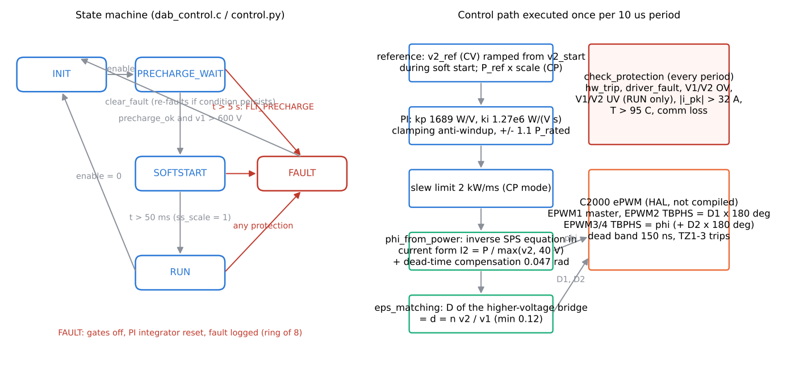
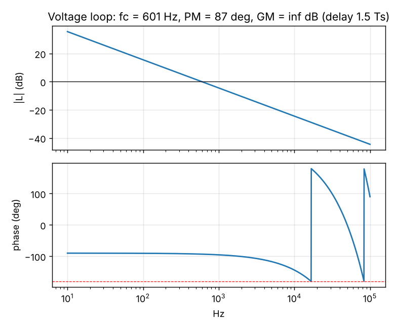
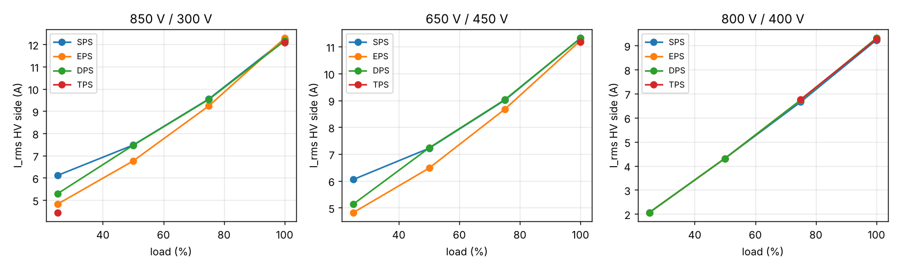
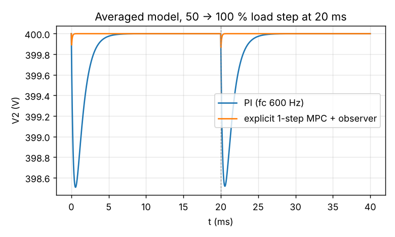

# 09 Control and firmware

> Reading time: ~50 min. Prerequisites: chapters 05 (averaged model), 06, 08. Files covered:
> `11_Control_Algorithms/control_design.md`, `11_Control_Algorithms/control_design.py`,
> `11_Control_Algorithms/control_params.json`, `dabtools/dab/control.py`, `10_Firmware/README.md`,
> `10_Firmware/src/dab_control.c`, `10_Firmware/src/dab_control.h`, `10_Firmware/src/dab_params.h`,
> `10_Firmware/src/dab_comm.c`, `10_Firmware/sil/sil_main.c`, `10_Firmware/sil/sil_results.csv`,
> `10_Firmware/hal/c2000/hal_f28004x.c`, `10_Firmware/hal/c2000/main.c`, `Advanced_Research_2026/Adaptive_MPC/`.

## Overview

**Level 1 - Beginner:** The converter is controlled by a small computer (a TI C2000 microcontroller)
that, 100 000 times per second, reads the two DC voltages and the inductor current, decides how much
power should flow, converts that into a phase shift between the two bridges, and updates the PWM
generators. A state machine makes sure it only starts when the capacitors are precharged, ramps the
output gently, and shuts everything off and remembers why if a limit is exceeded. The same algorithm
exists twice: once in Python (the reference) and once in portable C (the firmware), and a test program
runs the C code against a simulated converter to show that both behave the same.

**Level 2 - Engineering:** The voltage loop is a PI whose output is a power command; the modulator
inverse `phi_from_power` linearises the DAB so that the loop gain does not depend on V1 or the operating
phase shift. Design values (`11_Control_Algorithms/control_params.json`): kp = 1689 W/V, ki = 1.27e6
W/(V s), crossover 612 Hz, phase margin 76 deg, gain margin infinite, with a 1.5 Ts delay and the 1.12 mF
LV capacitance. EPS voltage matching (D of the higher-voltage bridge = d) is the default modulation; soft
start ramps the reference from the precharged voltage in 50 ms; the state machine has five states; eight
protections latch a FAULT with a ring log; telemetry is an ASCII line with CRC-16/CCITT-FALSE. The SIL
harness (`10_Firmware/sil/sil_main.c`) runs five scenario groups and reports RESULT: ALL PASS with 30
PASS lines and 0 failures (`[Verified]`, gcc on the host). The C2000 HAL is written against the driverlib
API but has never been compiled with the TI toolchain (`[Not yet tested]`; only a gcc syntax check passes).

**Level 3 - Research:** The baseline documents an explicit one-step MPC with a disturbance observer that
gives a 0.1 V dip instead of 1.5 V on the averaged model, kept as an option because the PI already meets
the requirements. `Advanced_Research_2026/Adaptive_MPC/` goes further: a CCS-MPC with box constraints,
an explicit look-up-table version (31 x 9 x 23 nodes, 25.7 kB in float32 or 12.8 kB in Q15), an
adaptive variant with RLS on 1/L and a robust variant, all benchmarked on the switched plant. The open
questions are the ones a simulation cannot close: ISR timing on the real MCU, the ADC chain's real gain
errors, and the dead-bus start that fails in the Python plant.

*Figure 09-1 (sketch, `img/make_figs_06_10.py`): state machine and the per-period control path.*

## Topic 1: Voltage-loop design

### PI voltage loop with modulator feedforward
**What is it?** A proportional-integral controller on the LV port voltage whose output is a power
command, followed by the inverse of the DAB power equation that turns the command into a phase shift.

**Why do we need it?** EL-08 (+/- 1 % regulation), EL-10 (50 % step: <= 3 %, < 5 ms) and APP-04 (10 %
port steps) need a closed loop; the feedforward makes one set of gains valid over 650-850 V.

**How does it work?**
**Level 1 - Beginner:** The controller compares the measured output voltage with 400 V. If it is low,
it asks for more power; the integral part keeps nudging until the error is exactly zero. Because the
relation between phase shift and power is curved and depends on the input voltage, the controller
thinks in watts and a small formula converts watts to degrees.
**Level 2 - Engineering:** Averaged plant (chapter 05, equation 12): the DAB is a current source into
C2 with a load R; with the power-normalised controller the plant seen by the PI is G = (R / V2) /
(1 + s R C2) e^(-s Td), R = 400^2 / 6600 = 24.2 Ohm, C2 = 120 uF + 1 mF = 1.12 mF (pole at 5.9 Hz),
Td = 1.5 Ts = 15 us. Design in `11_Control_Algorithms/control_design.py`: target fc = 600 Hz, so kp =
(V2 / R) |1 + j fc / fz| = 16.5 x 102.4 = 1689 W/V; PI zero at fc / 5 = 120 Hz, ki = 2 pi 120 x 1689 =
1.27e6 W/(V s). Result: fc = 612 Hz, PM = 76 deg, GM infinite (the delay lag at 612 Hz is only 3.3 deg).
Without the feedforward, K_phi varies from 26.6 to 36.6 A/rad across V1, a +/-15 % gain change.
**Level 3 - Research:** The loop bandwidth of fs / 167 is conservative; the research question is not the
PI but the plant uncertainty: C2 is the cabinet capacitance (>= 1 mF per APP-04, unknown exactly), the
load may be a battery with 20-200 mOhm internal resistance (a much faster plant), and L drift changes
the feedforward accuracy, which the adaptive MPC addresses by estimating 1/L.

**Example from our converter:** `11_Control_Algorithms/control_params.json`: `kp` 1689.0, `ki` 1273477,
`fc` 612.2, `pm` 76.15, `gm` Infinity, `Td` 1.5e-5, `C2` 0.00112. The same numbers appear as
`DAB_KP_W_PER_V` and `DAB_KI_W_PER_VS` in `10_Firmware/src/dab_params.h`. `[Implemented]`

**Engineering calculations:** see above; the Bode plot is `11_Control_Algorithms/img/loop_bode.png`.

**Design decision made in this project:** Power-normalised PI with clamping anti-windup (integrate
only when the output is not saturated), output limits +/- 1.1 P_rated (7260 W), slew limit 2 kW/ms in CP
mode. `[Implemented]` in `dabtools/dab/control.py` (class `PI`) and `10_Firmware/src/dab_control.c`
(`dab_pi_step`).

**Alternatives considered:** Gain scheduling on V1 instead of feedforward (more tables, same result);
a current inner loop (needs a fast inductor-current measurement; the board has a peak detector only);
explicit MPC (Topic 7).

**How to verify it:** Switched simulation: 0.37 % dip, 400.0 V steady (`[Simulated]`); SIL scenario 1:
"steady-state regulation within +/-1 % (EL-08)" and "50 % load step deviation < 3 % (EL-10)" PASS
(`[Verified]`); the design script itself runs in the verification report (`[Verified]`).

**Common mistakes:** Designing the loop for the on-board 120 uF instead of the 1.12 mF with the cabinet
bus (10x bandwidth error); forgetting the half-period PWM delay (1.5 Ts, not 1 Ts); letting the
integrator wind up during soft start or saturation.

**Interview explanation (30 s):** "A PI in watts, then the inverse DAB equation to get degrees. Gains
1689 watts per volt and 1.27 million watts per volt-second give a 612-hertz crossover with 76 degrees of
phase margin on the 1.1-millifarad link with a 15-microsecond delay. The feedforward removes the
input-voltage dependence of the gain."

**Research-level explanation:** The baseline loop is linear and time-invariant by construction of the
feedforward; the research modules keep the same structure and change what sits in front of it (MPC) or
what feeds it (estimated parameters), which keeps the comparison fair.

## Topic 2: The modulator inverse

### phi_from_power and dead-time compensation
**What is it?** The function that converts a power command into the outer phase shift by inverting the
SPS power equation in its current form, I2 = n V1 phi (pi - phi) / (2 pi^2 fs L).

**Why do we need it?** It is the feedforward that linearises the plant, and it must stay defined when the
LV voltage is zero (dead-bus start) and bounded when the command exceeds what the stage can deliver.

**How does it work?**
**Level 1 - Beginner:** Power equals voltage times current; if the output voltage is near zero the
controller would ask for an infinite current. The firmware therefore pretends the output is at least
40 V when converting watts to amps, and never asks for more than 98 % of the maximum current the
inductor can carry at that phase shift.
**Level 2 - Engineering:** I2 = P / max(v2, 40 V); Imax = n v1 / (8 fs L) (the value at phi = pi / 2);
clamp I2 to +/- 0.98 Imax; c = 2 pi^2 fs L |I2| / (n v1); phi = (pi - sqrt(pi^2 - 4 c)) / 2 (the smaller
root); add the dead-time compensation phi_dead_comp = 0.5 x 2 pi fs t_dead = 0.047 rad (half the 5.4
deg phase the 150 ns dead time removes, chapter 08); limit to phi_max = 60 deg; sign from I2. Returns 0
if v1 < 50 V. Identical code in `dabtools/dab/control.py` (`phi_from_power`) and
`10_Firmware/src/dab_control.c` (`dab_phi_from_power`).
**Level 3 - Research:** The inverse is exact for lossless SPS only; under EPS (D < 1) the power at a
given phi is lower, so the PI absorbs the mismatch. The 2026 MPC library linearises around
phi0 = phi_ff(P_hat, V1) and uses the same inverse as its operating point; the twin's RLS estimate of
1/L would directly correct the constant c.

**Example from our converter:** at 800 V / 400 V and 6600 W: I2 = 16.5 A; Imax = 2 x 800 / (8 x 1e5 x
64e-6) = 31.25 A; c = 2 pi^2 x 1e5 x 64e-6 x 16.5 / 1600 = 1.303; phi = 0.4916 rad; plus 0.047 =
0.539 rad = 30.9 deg commanded. `[Implemented]`

**Engineering calculations:** as above; `DAB_PHI_DEAD_COMP 4.712389e-02`, `DAB_V2_FLOOR_V 40.0`,
`DAB_PHI_MAX_RAD 1.047198` in `10_Firmware/src/dab_params.h`.

**Design decision made in this project:** Current-form inverse with a 40 V floor and a 98 % current
clamp, fixed dead-time compensation. `[Implemented]`

**Alternatives considered:** Table look-up of phi(P, V1, V2) (more memory, allows EPS/TPS-exact
inverses); no feedforward (gain varies +/-15 %).

**How to verify it:** SIL scenario 5 parses commands and the start-up scenario drives the inverse over
the whole soft-start range; the CP command "$C,MODE,CP,-3000" is parsed and sets a negative reference
(`[Verified]`). Reverse power: switched case 4 and SIL scenario 2 reach the full reverse phase shift
within 20 ms (`[Simulated]`, `[Verified]`).

**Common mistakes:** Taking the larger root of the quadratic (phi > 90 deg, unstable branch);
forgetting the sign for reverse power; compensating the full dead-time phase on both edges (the
compensation is 0.5 x by design).

**Interview explanation (30 s):** "We invert the DAB power equation in current form so it stays defined
at zero output voltage, clamp to 98 % of the maximum current, add half the dead-time phase, and limit to
60 degrees. The sign of the current command sets the power direction."

**Research-level explanation:** The inverse is a static map; its error under parameter drift is the
disturbance the loop must reject, and it is the first place where an online estimate of L pays off.

## Topic 3: Modulation in firmware - EPS voltage matching

### eps_matching and the modulation comparison
**What is it?** Extended phase shift with the inner duty of the higher-voltage bridge reduced to
d = n v2 / v1 (minimum 0.12), so that the two bridge voltages match in volt-seconds.

**Why do we need it?** When the voltage ratio is far from 1 (battery at low state of charge, dead-bus
start), SPS circulates large reactive currents and loses ZVS at light load; EPS removes most of the
circulating power without a table.

**How does it work?**
**Level 1 - Beginner:** If one bridge pushes with 800 V and the other with only 600 V (referred), the
inductor current grows too fast in one direction. Shortening the pulse of the stronger bridge so that
both deliver the same volt-seconds keeps the current balanced.
**Level 2 - Engineering:** `eps_matching(v1, v2)`: d = n v2 / v1; if d < 1 then D1 = max(0.12, d),
D2 = 1; else D1 = 1, D2 = max(0.12, 1 / d). The comparison table in
`11_Control_Algorithms/control_design.md` at 850/300 V, 25 % load: SPS 6.1 A rms / 1378 W backflow /
ZVS margin -7.9 A; EPS 4.8 A / 376 W / -1.0 A; TPS 4.4 A / 196 W / +1.0 A. At 800/400 V all modulations
coincide. TPS gives the lowest rms but the gain over EPS is small at this ratio range, so it is kept as
an optional table (`tps_table` hook in the Python controller, not generated: `10_Firmware/README.md`).
**Level 3 - Research:** The 2026 supervisory layer (chapter 16) selects (D1, D2) from a 16-candidate grid
around EPS matching using the estimated L and a 1 A ZVS margin; the honest result is a modest 2.3 %
mean rms reduction and 16 instead of 19 points with hard-switched edges out of 27 - light-load hard
switching is structural for SPS/EPS and needs a different strategy (TPS search, frequency modulation or
burst mode).

**Example from our converter:** `DAB_D_MIN 0.120` in `10_Firmware/src/dab_params.h`; the SIL start-up log
`10_Firmware/sil/sil_results.csv` shows d1 = 0.949 at t = 0.1 ms with v2 = 379.5 V (d = 2 x 379.5 / 800)
rising to 1.000 at 400 V. `[Verified]`

**Engineering calculations:** the comparison uses `DABPoint` with bisection on phi for each (D1, D2)
(`_solve` in `11_Control_Algorithms/control_design.py`).

**Design decision made in this project:** EPS matching as the firmware default; TPS as a documented
look-up option; all modulation changes applied at the period boundary with the same feedforward.
`[Implemented]`

**Alternatives considered:** DPS (D1 = D2, no benefit in the table); TPS table from
`12_Optimization/optimize.py` (not generated); frequency modulation (not studied).

**How to verify it:** SIL scenario 4 (dead-bus start with EPS matching) reports 20.2 A peak, below the
32 A limit, and reaches 400 V (`[Verified]` on the C plant); the Python plant run of the same case fails
(chapter 08) - the discrepancy is open.

**Common mistakes:** Implementing the inner duty by changing the pulse width of one leg instead of
shifting leg B (the leg-shift method keeps every leg at 50 % so the dead band stays symmetric);
forgetting the D_min floor (the modulator inverse assumes a non-zero pulse).

**Interview explanation (30 s):** "The firmware shortens the pulse of whichever bridge has the higher
referred voltage so that both apply the same volt-seconds. That cuts the circulating power from 1.4
kilowatts to 0.4 at the worst corner and keeps soft switching to lighter loads, with no table. Triple
phase shift would do slightly better and is kept as an option."

**Research-level explanation:** EPS matching is a one-parameter heuristic; the Krismer-Kolar optimal
modulation (cited in the model document) and the TPS search are the references; the 2026 result that a
supervisor around EPS gains little at light load is a negative result worth stating.

## Topic 4: Soft start and the state machine

### INIT, PRECHARGE_WAIT, SOFTSTART, RUN, FAULT
**What is it?** The sequence logic of the controller and the 50 ms soft-start ramp.

**Why do we need it?** APP-05 forbids enabling the stage before both links are precharged; EL-08/10
expect no overshoot; SAF-07 requires a safe latched state on any fault.

**How does it work?**
**Level 1 - Beginner:** Off, waiting for the "capacitors are charged" signal, ramping up gently, running,
or stopped because something went wrong - and once stopped it stays stopped until someone clears the
fault and the cause has gone.
**Level 2 - Engineering:** From `10_Firmware/src/dab_control.c`: INIT (gates off) -> PRECHARGE_WAIT on
enable; -> SOFTSTART when precharge_ok and v1 > 600 V (the PI integrator is reset and v2_start = the
measured v2); FLT_PRECHARGE if 5 s pass without it; SOFTSTART ramps ss_scale = t / 0.05 s and the CV
reference from v2_start to v2_ref (CP: P_ref x scale) -> RUN at scale 1; enable = 0 from any running
state returns to INIT with gates off; any protection -> FAULT with gates off, integrator reset, entry in
an 8-deep ring log of (fault << 24 | period counter); `dab_ctrl_clear_fault` returns to INIT only from
FAULT, and the next step re-faults if the condition persists. UV checks are active in RUN only (so a
discharged link does not fault during start-up).
**Level 3 - Research:** The state machine is the safety envelope the research controllers plug into:
the twin's advisory commands and the MPC variants replace only the regulation step, never the state
logic; a cyber-security module (chapter 18) treats the command parser and the enable path as the attack
surface.

**Example from our converter:** `10_Firmware/sil/sil_results.csv`: state 1 (PRECHARGE_WAIT) at period 0,
state 2 (SOFTSTART) from period 10 (0.1 ms), state 3 (RUN) from period 5010 (50.1 ms). `[Verified]`

**Engineering calculations:** `DAB_SOFT_START_S 0.0500`; the precharge timeout is hard-coded as 5.0 s
in the C core.

**Design decision made in this project:** Reference ramp from the precharged voltage (not from zero),
5 s precharge timeout, latched faults with a ring log, re-fault on clear while the condition persists.
`[Implemented]`

**Alternatives considered:** Current-limited soft start (the modulator floor and EPS matching provide a
form of it); automatic fault retry (rejected: APP-03 says the supervisory system decides).

**How to verify it:** SIL scenario 1 ("reaches RUN without fault", "start-up overshoot < 5 %") and
scenario 3 (five injected faults each latch, stay latched for 200 periods, re-fault after clear; precharge
timeout -> FLT_PRECHARGE) PASS. `[Verified]`

**Common mistakes:** Ramping from 0 V when the link is already at 380 V (a step down, then up);
checking UV before the stage runs; clearing the integrator only on fault and not on SOFTSTART entry.

**Interview explanation (30 s):** "Five states. The stage waits for the precharge feedback, then ramps
the reference from the actual link voltage to 400 volts in 50 milliseconds, then runs. Any of eight
protections latches a fault with gates off and a logged period counter, and the fault can only be
cleared explicitly and only if the cause has gone."

**Research-level explanation:** Formal verification of the state machine (model checking of the
transition table against SAF-07) would be the natural next step; the SIL harness is a scenario test,
not a proof.

## Topic 5: Protections, limits and the hardware/firmware split

### check_protection and the limit set
**What is it?** The per-period check of eight conditions against the limits of
`11_Control_Algorithms/control_params.json`, plus the hardware trip path that works without firmware.

**Why do we need it?** SAF-06 requires hardware protection independent of firmware; SAF-07 requires
firmware protection with a latched log.

**How does it work?**
**Level 1 - Beginner:** Every 10 microseconds the firmware asks: is a voltage too high or too low, is
the current too high, is a heatsink too hot, has a gate driver complained, has the hardware tripped, has
the supervisor gone silent? Any "yes" stops the converter. Separately, a comparator on the board stops
it even if the firmware is frozen.
**Level 2 - Engineering:** Order in `check_protection`: hw_trip, driver_fault, v1 > 900 V, v2 > 480 V,
v1 < 600 V (RUN only), v2 < 250 V (RUN only), |i_pk| > 32 A, temp > 95 C, comm lost (not in INIT).
The HAL maps TZ1 to the OC comparator, TZ2 to the drivers' FLT wired-OR and TZ3 to the OV comparator
as one-shot trips on all four EPWMs; CMPSS on the inductor current gives cycle-by-cycle limiting
(`10_Firmware/hal/c2000/hal_f28004x.h`). The firmware peak limit (32 A) equals the hardware trip; the
design envelope (24 A) is enforced indirectly through phi_max and the current clamp.
**Level 3 - Research:** The 2026 safe-RL and MPC modules use the same limits as hard constraints and
report constraint violations as a metric; health monitoring (chapter 18) would add slowly varying
thresholds (Rds drift) on top of the fixed ones.

**Example from our converter:** `limits` block of `11_Control_Algorithms/control_params.json` and
`LIM_*` macros in `10_Firmware/src/dab_params.h`; SIL scenario 3 injects v1 = 950 V, i_pk = 40 A,
driver_fault, comm_ok = false and temp = 110 C after 7000 periods. `[Verified]`

**Engineering calculations:** the limits are derived in chapter 06 (Topic 7); note the UV discrepancy
(280 V in the design report, 250 V in the parameters and firmware).

**Design decision made in this project:** Two independent layers; firmware latches and logs, hardware
trips the PWM through the trip zones; comm loss = no heartbeat for 500 ms (CAN mapping in
`10_Firmware/README.md`, to be confirmed). `[Implemented]` core, `[Not yet tested]` HAL.

**Alternatives considered:** Firmware-only protection (rejected by SAF-06); a separate safety MCU
(not required for this maturity level).

**How to verify it:** SIL scenario 3: 15 PASS lines for the five injections plus the precharge timeout.
`[Verified]`. The hardware path (comparators, trip zones) is `[Not yet tested]`.

**Common mistakes:** Checking UV in all states (false fault at start-up); unlatching a fault by
re-enabling; not resetting the PI integrator on fault (wind-up into the next start).

**Interview explanation (30 s):** "Eight firmware checks every period - hardware trip, driver fault,
over- and under-voltage on both links, 32-amp peak, 95-degree heatsink, communication loss - each
latches a fault with gates off and a logged period counter. In parallel, comparators on the board drive
the C2000 trip zones so that protection does not depend on the firmware running."

**Research-level explanation:** The limit set is fixed by design; adaptive limits driven by estimated
device health are a research direction, with the constraint that the hardware trip remains the last
line.

## Topic 6: Telemetry, commands and the SIL harness

### CRC-16 telemetry, command parser and software-in-the-loop test
**What is it?** An ASCII line protocol ("$T,..." telemetry with a CRC-16/CCITT-FALSE suffix, "$C,..."
commands) and a gcc-built harness that runs the C control core against a C port of the plant.

**Why do we need it?** EL-15 asks for telemetry at >= 10 Hz; the SIL harness is the only executable test
of the firmware without hardware.

**How does it work?**
**Level 1 - Beginner:** The firmware prints a line of numbers (state, fault, voltages, current, power,
phase) ten times a second with a checksum at the end so a corrupted line is detected; it accepts simple
text commands to enable, set the mode or clear a fault. The test program feeds the firmware a simulated
converter and checks a list of expected outcomes.
**Level 2 - Engineering:** `dab_comm_build_telemetry` formats period counter, state, fault, mode, v1, v2,
i_pk, temp, p_cmd, phi, d1, d2 and appends "*XXXX" with the CRC over the preceding bytes
(polynomial 0x1021, init 0xFFFF). Commands: "$C,EN,0|1", "$C,CLR", "$C,MODE,CV,<250..460 V>",
"$C,MODE,CP,<-7000..7000 W>"; returns -1 for unknown, -2 for out-of-range. The harness
(`10_Firmware/sil/sil_main.c`) runs: scenario 1 start-up + load steps (4 checks), scenario 2 reversal
(3), scenario 3 protections (5 injections x 3 + precharge timeout = 16), scenario 4 dead-bus start (2),
scenario 5 comm (5): 30 PASS lines, "RESULT: ALL PASS (0 failures)", exit code 0. The CSV
`10_Firmware/sil/sil_results.csv` logs every 10th period of scenario 1 (1600 rows).
**Level 3 - Research:** The twin interface (`Advanced_Research_2026/Digital_Twin/interface.md`)
extends the frame with the applied PWM registers at 1 kHz; the cyber-security module treats the
unauthenticated command parser as a finding.

**Example from our converter:** running the compiled `10_Firmware/sil/sil_test` prints "startup:
v2_end=400.00 overshoot=0.4% step dip=0.37%", "reversal: v1 798.3..802.6 v2 398.2..401.1", "dead-bus:
v2_end=400.0 ipk_max=20.2 A fault=0". `[Verified]` (gcc host build; `10_Firmware/README.md` quotes
35 checks, the current harness prints 30 PASS lines - the README count is stale).

**Engineering calculations:** none; the harness uses the same plant parameters as
`05_Simulation/run_switched_sim.py` (C1 = 580 uF, C2 = 1.12 mF, R_s = 0.3 Ohm, N_sub = 200).

**Design decision made in this project:** Portable C core without MCU dependencies; parameters generated
into `10_Firmware/src/dab_params.h` by `10_Firmware/tools/gen_params.py` from the design and control
JSON files (single source of truth); host build with `make test` (`10_Firmware/Makefile`). `[Implemented]`

**Alternatives considered:** Binary CAN frames only (the README maps IDs 0x100/0x101/0x200/0x7FF, to be
confirmed); a unit-test framework (a plain CHECK macro was enough).

**How to verify it:** `18_Verification/verification_report.md` line "firmware control core SIL (gcc)":
PASS, "RESULT: ALL PASS (0 failures)". `[Verified]`

**Common mistakes:** Computing the CRC over the "*" and checksum characters; reading the README's
check count instead of the harness output; assuming the SIL plant equals the Python plant (it has not
received the 2026 pulse fix).

**Interview explanation (30 s):** "The control core is portable C, built with gcc and run against a C
plant in five scenario groups - start-up, reversal, five fault injections, dead-bus start and protocol
round trip - thirty checks, all passing. Telemetry is a CRC-16-protected ASCII line at 10 hertz."

**Research-level explanation:** SIL proves algorithmic equivalence between the Python reference and the
C core on the same scenarios; it says nothing about timing, numerical precision on the target or the
ADC chain, which are HIL questions (`Advanced_Research_2026/HIL_Validation/`, proposal only).

## Topic 7: The C2000 HAL and the explicit MPC alternative

### C2000 HAL [Not yet tested] and explicit MPC [Proposed]
**What is it?** `10_Firmware/hal/c2000/hal_f28004x.c` implements the PWM phase-shift scheme, dead band,
trip zones, ADC start-of-conversion and scaling for the TMS320F280049C with driverlib calls, guarded by
`__TMS320C28XX__`; `10_Firmware/hal/c2000/main.c` is the ISR/main skeleton. The explicit MPC is the
research alternative to the PI.

**Why do we need it?** The HAL is what turns the portable core into firmware on the LaunchPad; the MPC
shows what a model-based controller could gain.

**How does it work?**
**Level 1 - Beginner:** The HAL is the glue between the algorithm and the chip's PWM and ADC hardware;
it has been written but never compiled for the chip because the TI tools are not available here.
Explicit MPC means pre-computing the best control move for every situation into a table so that the
chip only looks it up.
**Level 2 - Engineering:** EPWM1-4 at 100 MHz TBCLK, up-down count, TBPRD = 500 (100 kHz); EPWM1 is the
master, EPWM2 = HV leg B shifted by D1 x 180 deg (leg-shift method for the inner duty), EPWM3 = LV leg A
at phi + (1 - D2) x 90 deg, EPWM4 = EPWM3 + D2 x 180 deg; dead band DBRED/DBFED = 150 ns; TZ1-3 one-shot;
ADC-A SOC0-3 on EPWM1 SOCA with 12-bit results scaled 1000 V / 4096 (V1), 500 V / 4096 (V2), 40 A / 4096
(I_L); 10 ns phase resolution = 0.36 deg = 0.5 % of rated power. Timing budget: ~120 floating-point
operations per step, < 2 us, under 5 % of the period (`10_Firmware/README.md`). Status: syntax-checked
with gcc only; pin mapping of the BoosterPack headers to be verified. The explicit MPC of
`11_Control_Algorithms/control_design.py`: one-step prediction with the delay model and a load observer,
quadratic cost with a closed-form minimiser; 0.1 V dip vs 1.5 V (PI) and 0.0 ms vs 1.28 ms settling on
the averaged model, ~30 multiply-adds per ISR.
**Level 3 - Research:** `Advanced_Research_2026/Adaptive_MPC/build_explicit_mpc.py` tabulates a CCS-MPC
law (horizon N = 8, weights q = 1, r = 2) on a 31 x 9 x 23 grid of (voltage error -60..60 V, V1
650..850 V, estimated load power -7260..7260 W): 6417 entries, 25 668 bytes in float32 or 12 834 in Q15;
the law saturates at 96.7 % of the nodes, the 600- vs 1200-iteration convergence check differs by 8e-8
deg, and trilinear interpolation between nodes has an rms error of 3.8 deg (max 25.3 deg, p99 20.8 deg)
against the 0.36 deg PWM step (`Advanced_Research_2026/Adaptive_MPC/results/empc_lut_meta.json`). The
library also provides FCS-MPC, adaptive (RLS on 1/L) and robust (L in 0.8-1.2 L_nom) variants
benchmarked on the switched plant; a README for the module does not exist yet, so the numbers above are
taken from the result files and the script docstrings.

**Example from our converter:** `HAL_TBPRD 500u`, `rad_to_counts()` and `hal_pwm_apply()` in
`10_Firmware/hal/c2000/hal_f28004x.c`; the MPC class in `11_Control_Algorithms/control_design.py`
(section 5). HAL `[Not yet tested]`, MPC `[Proposed]` (baseline) / `[Simulated]` (2026 module).

**Engineering calculations:** phase counts = phi / (2 pi) x 2 TBPRD = phi / (2 pi) x 1000; 28.2 deg ->
78 counts.

**Design decision made in this project:** Leg-shift implementation of the inner duty so that every leg
runs at 50 % and the hardware dead band stays symmetric; PI remains the baseline controller because it
meets EL-08/EL-10 in simulation. `[Implemented]` / `[Proposed]`

**Alternatives considered:** Pulse-width implementation of D (asymmetric dead band); FCS-MPC
(candidate enumeration, higher ISR cost); PI plus observer feedforward (the "optional load-current
feedforward" hook in the Python controller).

**How to verify it:** `18_Verification/verification_report.md`: "C2000 HAL host syntax check (not a
target build)" PASS with gcc -fsyntax-only; a CCS build and a LaunchPad PWM capture are
`[Not yet tested]`. The explicit MPC table's interpolation error is reported in its meta file
(`[Simulated]`).

**Common mistakes:** Treating a syntax check as a build; forgetting that TBPHS counts in up-down mode
span 2 TBPRD per period; assuming a 25 kB table fits the F280049C's RAM without checking the memory
map (not done here); comparing the MPC on the averaged model with the PI on the switched plant.

**Interview explanation (30 s):** "The HAL maps the four EPWMs with the leg-shift scheme, a 150-
nanosecond dead band and three trip zones, and scales the ADC readings; it is written against the
driverlib API but has only passed a gcc syntax check. An explicit MPC was evaluated - ten times smaller
dip on the averaged model - and the 2026 module tabulates a constrained version in 25 kilobytes; the PI
stays the baseline."

**Research-level explanation:** The explicit-MPC interpolation error (rms 3.8 deg against a 0.36 deg PWM
step) is the kind of honest metric that decides whether a table-based law is viable on a 12 kB budget;
the saturation fraction of 97 % says most of the table is the constraint boundary, which points to a
hybrid (analytic law plus table near the boundary).

## Worked example with real numbers

A 50 % load step at 800 V / 400 V, following `10_Firmware/sil/sil_results.csv` and the design files:

1. Before the step the converter delivers 3300 W; the PI output is about 2780 W (the CSV column p_cmd
   shows 2776-2783 W at t = 159.8-159.9 ms after the load returns to 50 %; the shortfall against 3300 W is
   the lossless feedforward being trimmed by the PI for the plant's R_s and EPS inner duty).
2. The step to 6600 W draws an extra 8.25 A from the 1.12 mF link; in the 1.5 Ts delay plus roughly one
   crossover quarter-period (0.4 ms) the link loses about 3 mC, i.e. 3 V worst case; the simulated dip is
   1.5 V (0.37 %), because the PI's proportional path (1689 W/V) commands +2.5 kW per volt of error.
3. phi: the inverse at 6600 W gives 28.2 deg + 2.7 deg = 30.9 deg; the CSV shows 13.4-13.5 deg at 50 %.
4. Soft start: v2_start = 380 V, ramp 50 ms, RUN at period 5010; d1 = 0.949 at 379.5 V rising to 1.0.
5. Loop numbers: fz = 1 / (2 pi x 24.2 x 1.12e-3) = 5.9 Hz; kp = 400 / 24.2 x sqrt(1 + (600 / 5.9)^2) =
   1689 W/V; ki = 2 pi x 120 x 1689 = 1.27e6; delay lag at 612 Hz = 360 x 612 x 15e-6 = 3.3 deg; PM 76 deg.

## How this chapter connects to the files

| File | What it contains | Status |
|---|---|---|
| `11_Control_Algorithms/control_design.py` | loop design, gain sensitivity, modulation comparison, MPC alternative, parameter export | `[Implemented]` |
| `11_Control_Algorithms/control_design.md` | the generated design note with the PI table, modulation table, MPC result, reverse flow | `[Simulated]` |
| `11_Control_Algorithms/control_params.json` | kp, ki, fc, pm, gm, Td, C2, phi_max, D_min, V2_floor, dead-time compensation, soft start, slew, limits | `[Implemented]` |
| `11_Control_Algorithms/img/loop_bode.png`, `11_Control_Algorithms/img/modulation_rms.png`, `11_Control_Algorithms/img/mpc_vs_pi.png` | figures | `[Simulated]` |
| `dabtools/dab/control.py` | Python reference controller (PI, phi_from_power, eps_matching, state machine, protections) | `[Implemented]` |
| `10_Firmware/src/dab_control.c`, `10_Firmware/src/dab_control.h` | portable C control core | `[Verified]` (SIL) |
| `10_Firmware/src/dab_params.h` | generated parameters (from `10_Firmware/tools/gen_params.py`) | `[Implemented]` |
| `10_Firmware/src/dab_comm.c`, `10_Firmware/src/dab_comm.h` | telemetry, CRC-16, command parser | `[Verified]` (SIL scenario 5) |
| `10_Firmware/sil/sil_main.c`, `10_Firmware/sil/sil_results.csv`, `10_Firmware/Makefile` | SIL harness, log of scenario 1, host build | `[Verified]` |
| `10_Firmware/hal/sil/plant.c`, `10_Firmware/hal/sil/plant.h` | C plant for SIL | `[Implemented]` |
| `10_Firmware/hal/c2000/hal_f28004x.c`, `10_Firmware/hal/c2000/hal_f28004x.h`, `10_Firmware/hal/c2000/main.c` | C2000 HAL and application skeleton | `[Not yet tested]` |
| `10_Firmware/README.md` | status table, CAN mapping, timing budget, known limitations | `[Implemented]` |
| `Advanced_Research_2026/Adaptive_MPC/dab_mpc_lib.py`, `Advanced_Research_2026/Adaptive_MPC/build_explicit_mpc.py`, `Advanced_Research_2026/Adaptive_MPC/results/empc_lut_meta.json` | MPC library, explicit table builder and its metadata | `[Simulated]` |

## Viva / interview questions

### Basic (10)

1. What does the voltage loop control and what is its output?
   The LV port voltage (400 V reference); the PI output is a power command in watts.
2. Why does the controller work in watts rather than degrees?
   The inverse DAB equation then linearises the plant, so the loop gain does not depend on V1 or on the
   operating phase shift.
3. State the PI gains and the loop figures.
   kp = 1689 W/V, ki = 1.27e6 W/(V s); crossover 612 Hz, phase margin 76 deg, gain margin infinite.
4. What is EPS voltage matching?
   The bridge with the higher referred voltage gets its inner duty reduced to d = n v2 / v1 (minimum 0.12)
   so both bridges apply equal volt-seconds.
5. List the five states.
   INIT, PRECHARGE_WAIT, SOFTSTART, RUN, FAULT.
6. How long is the soft start and where does the ramp begin?
   50 ms, from the measured (precharged) LV voltage to the reference.
7. Which protections exist in firmware?
   Hardware trip, driver fault, V1/V2 over-voltage, V1/V2 under-voltage (RUN only), 32 A peak current,
   95 C heatsink, communication loss.
8. How is telemetry protected against corruption?
   A CRC-16/CCITT-FALSE over the ASCII frame, appended as "*XXXX".
9. What is the status of the C2000 HAL?
   Written against driverlib, syntax-checked with gcc, never compiled with the TI toolchain, never run.
10. How many SIL checks pass?
    30 PASS lines, 0 failures, exit code 0 (the README's "35" is stale).

### Intermediate (10)

1. Derive kp from the target crossover.
   |Gc Gp| = 1 at fc with Gc ~ kp: kp = (V2 / R) |1 + j fc / fz| = 16.5 x 102.4 = 1689 W/V.
2. Why is the PI zero placed at fc / 5?
   Fast integral recovery with about 11 deg of phase-margin cost; the resulting PM is 76 deg.
3. Why does the loop design use 1.12 mF and not the on-board 120 uF?
   APP-04 guarantees >= 1 mF on the LV port (battery or load capacitance); the external capacitance
   dominates the plant pole.
4. Explain the dead-time compensation value.
   The 150 ns dead time removes 360 x fs x t_dead = 5.4 deg of effective phase; half of it (0.047 rad)
   is added in the inverse because only one edge per half period is affected on average.
5. What does the 98 % current clamp protect against?
   The square root in the inverse becoming imaginary when the command exceeds the SPS maximum current;
   it also keeps phi below 90 deg.
6. How is the inner duty implemented on the C2000?
   By shifting leg B of a bridge by D x 180 deg instead of 180 deg (leg-shift method), so each leg stays
   at 50 % duty and the dead-band submodule stays symmetric.
7. Why are UV faults masked outside RUN?
   During PRECHARGE_WAIT and SOFTSTART the links may legitimately be below the UV thresholds.
8. What does the SIL dead-bus scenario show and how does it compare with the Python run?
   20.2 A peak and a clean 400 V on the C plant; the Python plant run faults at 61.8 A - an open
   inconsistency between the two plants.
9. Which CP command values are accepted?
   -7000 to 7000 W; out of range returns -2.
10. What is the ISR timing budget?
    ~120 floating-point operations including one sqrt, under 2 us, under 5 % of the 10 us period (estimate,
    not measured).

### Advanced / research (10)

1. Why does the explicit one-step MPC achieve a 0.1 V dip on the averaged model and why is that not the
   whole story?
   It uses a load observer and the delay model to cancel the disturbance within one step; on the
   switched plant with EPS, quantisation and parameter error the advantage shrinks, and it depends on C2
   and the delay being known.
2. Interpret the explicit-MPC table metadata.
   6417 nodes, 25.7 kB float32 or 12.8 kB Q15; 96.7 % of nodes saturated (constraint-dominated); rms
   interpolation error 3.8 deg against a 0.36 deg PWM step - the table is too coarse near the boundary.
3. How would an adaptive MPC use the twin's 1/L estimate?
   The linearisation gain g = dI2 / dphi and the feedforward phi0 scale with 1/L; updating them per
   period keeps the prediction unbiased under drift (E1 of the twin: 0.24 % final error on simulated data).
4. What is the structural reason light-load hard switching persists under EPS?
   At light load the edge currents fall below I_min on at least one bridge for any (D1, D2) around
   voltage matching; only TPS with reduced duties on both bridges, frequency modulation or burst mode
   restores ZVS.
5. What would formal verification of the state machine involve?
   A model of the transition table with the enable, precharge, timeout and fault inputs, and
   model-checking properties such as "gates_enabled implies state in {SOFTSTART, RUN}" and "FAULT is
   left only via clear_fault".
6. Why is the hardware trip level equal to the firmware peak limit?
   Both are 32 A so that the firmware latches a fault whenever the hardware would trip, keeping the logs
   consistent; the 24 A design envelope is enforced by phi_max and the clamp.
7. Which parts of the control chain cannot be verified without hardware?
   ISR timing, ADC gain and offset errors, PWM phase resolution in practice, trip-zone latency, the
   BoosterPack pin mapping, and the CAN driver (placeholder).
8. How would you detect a stale parameter header?
   Compare the `DAB_*` macros with the JSON sources (the generator is deterministic); a hash of the
   inputs in the header would make it self-checking.
9. What is the security exposure of the command parser?
   Unauthenticated ASCII commands over UART (and CAN later) can enable the stage or change the mode;
   the cyber-security module treats this as a finding to be mitigated with authentication and rate
   limiting.
10. Propose a HIL test that closes the gap between SIL and hardware.
    Run the C core on the LaunchPad with the HAL against a real-time plant emulator fed by the PWM
    outputs, measure ISR duration with a GPIO toggle, inject the five faults through the trip-zone pins,
    and compare the telemetry with the SIL log period by period (`Advanced_Research_2026/HIL_Validation/`
    is the placeholder).

## Pitches

**30 s:** A PI in watts with the inverse DAB equation as feedforward, 612 hertz crossover and 76 degrees
of margin, voltage-matching modulation, a five-state machine with soft start and latched faults, and a
CRC-protected telemetry line. The algorithm exists in Python and in portable C; thirty software-in-the-
loop checks pass. The C2000 layer is written but never compiled; an explicit MPC is the documented
alternative.

**2 min:** Control starts from the averaged model: the DAB is a current source into the LV link, so a PI
whose output is a power command, followed by the inverse power equation in current form, gives a
linear loop independent of the input voltage. The gains are 1689 watts per volt and 1.27 million watts
per volt-second, giving a 612-hertz crossover and 76 degrees of phase margin with the 1.5-period delay
and the 1.1-millifarad link. Modulation is extended phase shift with voltage matching, which removes most
of the circulating power at the voltage corners without a table; triple phase shift is kept as an option.
The state machine waits for precharge, ramps the reference from the actual link voltage in 50
milliseconds, runs, and latches any of eight faults with gates off and a logged period counter; hardware
comparators trip the PWM independently. The core is portable C generated from the design JSON, built
with gcc and run against a C plant in five scenario groups: start-up and load steps, power reversal, five
fault injections plus a precharge timeout, a dead-bus start and the protocol round trip - thirty checks,
all passing. The C2000 HAL implements the leg-shift PWM scheme, dead band, trip zones and ADC scaling but
has only passed a syntax check. An explicit MPC was evaluated on the averaged model and, in 2026,
tabulated as a constrained law in 25 kilobytes with an honest interpolation-error figure; the PI stays
the baseline because it already meets the requirements in simulation.

**10 min outline:**
* Plant for control: averaged model, 1.12 mF, 5.9 Hz pole, 1.5 Ts delay.
* Power-normalised PI: why, gains, Bode, margins, anti-windup, limits, slew.
* phi_from_power: current form, floor, clamp, dead-time compensation, sign.
* EPS matching: the comparison table, why not DPS, TPS as option, the 2026 negative result.
* State machine: transitions, soft start from v2_start, precharge timeout, fault latch and log.
* Protections and limits: order of checks, hardware trip path, discrepancies (UV 250/280 V).
* Telemetry and commands: frame, CRC, parser, CAN mapping to confirm.
* SIL: scenarios, checks, numbers, the plant inconsistency with Python.
* C2000 HAL: PWM scheme, ADC scaling, trip zones, status and what cannot be verified here.
* MPC: baseline explicit one-step, 2026 CCS/explicit/adaptive/robust variants, table metadata; research
  directions (formal verification, HIL, security).

## Further reading

* `11_Control_Algorithms/control_design.md` - sections 1-5 (plant, PI, modulation, MPC, reverse flow).
* `10_Firmware/README.md` - status table, CAN mapping, timing budget, limitations.
* `Advanced_Research_2026/Digital_Twin/README.md` - sections 3 and 4 (supervisory self-optimisation and
  the software interface to the firmware).
* `Advanced_Research_2026/Literature_Database/literature_2022_2026.csv`: L16 (moving discretized control-set
  MPC for DAB with TPS, confirmed via index), L17 (MPC with TPS, confirmed via index), L26 and L27 (MPC
  with PWM plus TPS, turn-off loss optimisation, confirmed via index), L01 and L02 (2026 hybrid-phase-shift
  MPC and AI-based TPS control, confirmed) - the context for the Adaptive_MPC module.
