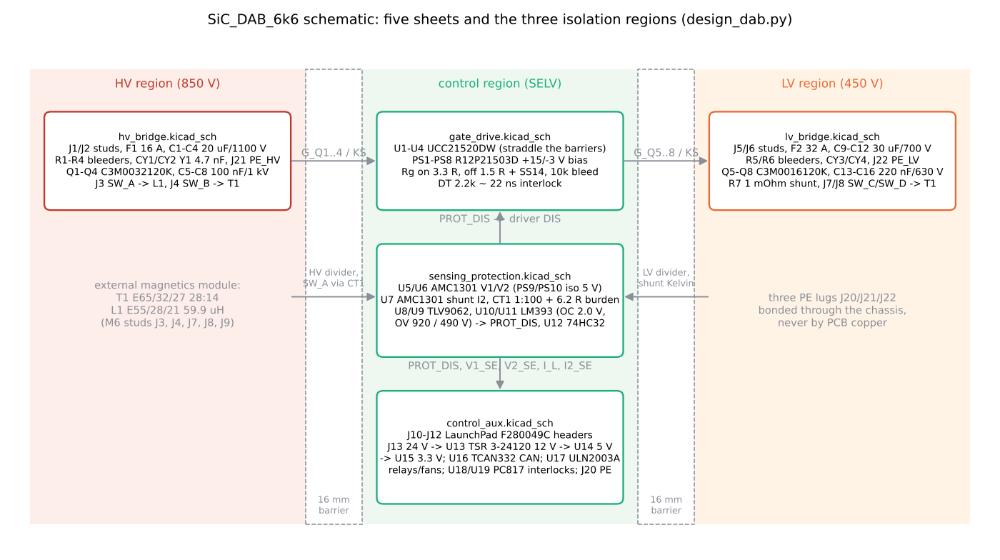

# 10 Schematics walkthrough

> Reading time: ~55 min. Prerequisites: chapters 03, 06, 09. Files covered:
> `07_KiCad_Schematics/SiC_DAB_6k6.kicad_sch`, `07_KiCad_Schematics/hv_bridge.kicad_sch`,
> `07_KiCad_Schematics/lv_bridge.kicad_sch`, `07_KiCad_Schematics/gate_drive.kicad_sch`,
> `07_KiCad_Schematics/sensing_protection.kicad_sch`, `07_KiCad_Schematics/control_aux.kicad_sch`,
> `dabtools/kicad_dab/design_dab.py`, `dabtools/kicad_dab/gen_sch_dab.py`, `dabtools/kicad_dab/bom_dab.py`,
> `16_BOM/bom.md`, `16_BOM/off_board_items.md`, `08_KiCad_PCB/README.md`,
> `18_Verification/run_verification.py`, `18_Verification/verification_report.md`,
> `07_KiCad_Schematics/drc_summary.json`.

## Overview

**Level 1 - Beginner:** The schematic is the wiring diagram of the power board. It is drawn on five
sheets: the 800 V side with its four transistors and capacitors, the 400 V side with the same, the
gate-driver sheet that lets the microcontroller switch transistors sitting at hundreds of volts, the
sensing sheet that measures voltages and currents safely and stops the converter in hardware when a
limit is passed, and the controller sheet with the plug-in TI LaunchPad, the auxiliary power supplies,
CAN, relays and fans. The transformer and inductor are not on the board; they bolt to M6 studs.

**Level 2 - Engineering:** The schematic is not drawn by hand: `dabtools/kicad_dab/design_dab.py` is a
Python design database (261 components, 193 nets, five sheets) from which
`dabtools/kicad_dab/gen_sch_dab.py` writes the KiCad 7 project, `dabtools/kicad_dab/bom_dab.py` writes
`16_BOM/bom.md` and the PCB generator places and routes the board. Every component carries a `pin_verified`
flag; seven part types are flagged for datasheet verification (AMC1301, the three BoosterPack headers, the
1 W isolated 5 V modules, R12P21503D, TCAN332). Key blocks: Q1-Q4 C3M0032120K and Q5-Q8 C3M0016120K,
C1-C4 20 uF / 1100 V and C9-C12 30 uF / 700 V film links, UCC21520DW dual isolated drivers U1-U4 with
R12P21503D bias modules PS1-PS8 (+15 / -3 V), AMC1301 isolated amplifiers U5-U7 on resistive dividers
(1000 V and 500 V full scale to 250 mV) and a 1 mOhm shunt, a 1:100 current transformer with a 6.2 Ohm
burden (32 A = 2.0 V), TLV9062 op-amps U8/U9, LM393 comparators U10/U11 wired-OR into PROT_DIS,
BoosterPack headers J10-J12, TCAN332 CAN transceiver, ULN2003A relay/fan driver, PC817 interlock inputs,
TRACO 12 V / 5 V modules and an AMS1117 3.3 V LDO, four 4.7 nF Y1 capacitors and three PE lugs.
Verification status (`18_Verification/verification_report.md`, 2026-10-10 07:43): schematic generation
plus kicad-cli netlist export matches the design database (261 symbols) `[Verified]`; every design pin
exists in its symbol and footprint `[Verified]`; ERC-lite "no single-pin nets" FAIL (nine unconnected
header pins); PCB DRC 0 errors, 0 unconnected, 63 warnings `[Verified]`.

**Level 3 - Research:** A generated schematic is a research asset because it is diffable and
re-generable: the insulation coordination study (`15_Safety_Reliability/01_insulation_coordination.md`)
turned into net-class rules, the parasitic-extraction module reads the same database, and open items
are explicit in the file itself (the bias modules are basic-class isolation where reinforced is required;
the sensor supplies PS9/PS10 have no selected part; several documents still name AMC1311 and UCC21710
while the database uses AMC1301 and UCC21520). The research question behind the board is how far a
design can be verified by software alone: netlist equivalence and DRC are automated, ERC is a
substitute check, and everything electrical remains `[Not yet tested]`.

*Figure 10-1 (sketch, `img/make_figs_06_10.py`): the five sheets, the three isolation regions and the
signals that cross between them.*

## Topic 1: HV sheet - port, DC link and HV bridge

### hv_bridge.kicad_sch: J1/J2, F1, C1-C4, R1-R4, CY1/CY2, Q1-Q4, C5-C8, J3/J4
**What is it?** The 650-850 V port and the first SiC full bridge.

**Why do we need it?** It converts the HV DC bus into the 100 kHz square wave applied to the series
inductor and transformer primary, and it stores the HF ripple energy of the bridge.

**How does it work?**
**Level 1 - Beginner:** Power enters through two bolts (J1 HV+, J2 HV-), passes a fuse, charges four
film capacitors, and feeds four transistors arranged as two "legs". Each leg's midpoint (SW_A, SW_B)
swings between 0 and 800 V; the inductor and transformer hang between the two midpoints. Small
capacitors right next to the transistors supply the fastest current pulses, and two safety capacitors
to earth tame interference.
**Level 2 - Engineering:** From `dabtools/kicad_dab/design_dab.py`: J1 (HV_IN) -> F1 16 A / 1000 V
semiconductor fuse (Bussmann FWP class, to verify) -> HV_P; C1-C4 20 uF / 1100 V film (TDK B32778
class, 77 % voltage utilisation per `16_BOM/bom.md`); bleeder chain R1-R4 4 x 680 kOhm 2 W in series
(212 V per resistor, 500 V rating); CY1/CY2 4.7 nF Y1 (Vishay VY1472M63Y5UQ63V0) from HV_P and HV_N to
PE_HV with the PE lug J21; Q1 (HV_P -> SW_A), Q2 (SW_A -> HV_N), Q3 (HV_P -> SW_B), Q4 (SW_B -> HV_N),
each with gate G_Qn and Kelvin source KS_Qn; C5-C8 100 nF / 1 kV X7T MLCC (85 % utilisation, BOM
suggests a 2 kV part) one pair per leg; J3 SW_A to the external inductor L1 (via the CT on the sensing
sheet, J9), J4 SW_B to the transformer primary; test points TP1-TP3.
**Level 3 - Research:** The commutation loop (C5-C8, Q-pairs, planes In2/In4) is the main parasitic of
interest for the gate-drive and EMI modules; the Y-capacitor return through PE_HV is where the
transformer's inter-winding displacement current (chapter 07) closes.

**Example from our converter:** `16_BOM/bom.md` rows for C1-C4, C5-C8, Q1-Q4, R1-R4, CY1-CY4, F1;
PCB region 5-118 mm in `08_KiCad_PCB/README.md`. `[Implemented]`

**Engineering calculations:** bleeder power 850^2 / 2.72e6 = 0.27 W; discharge to 60 V with the on-board
80 uF alone: 2.72e6 x 80e-6 x ln(850 / 60) = 577 s (chapter 06 discusses the 300 s target and the
1.41 MOhm calculation); ripple current 4.17 A rms over four capacitors (1.04 A each).

**Design decision made in this project:** Film DC link, one 2220 MLCC pair per leg, Y1 capacitors at the
port, the three PE lugs joined through the chassis only ("no copper may cross the isolation barriers",
J21 description). `[Implemented]`

**Alternatives considered:** Electrolytic link (rejected, chapter 06); snubber networks on the switch
nodes (not fitted; 2 kV MLCC suggested by the BOM as a derating improvement).

**How to verify it:** Netlist match and pin check `[Verified]`; voltage derating noted in the BOM;
hipot and functional tests `[Proposed]` (`20_Experimental_Test_Plan/test_plan.md`).

**Common mistakes:** Bleeder chain slower than the calculated 300 s target (open reconciliation);
85 % voltage utilisation of the 1 kV MLCCs; placing the HF decoupling far from the legs (the PCB README
puts them in the bridge region).

**Interview explanation (30 s):** "Studs, a 16-amp semiconductor fuse, four 20-microfarad 1100-volt
film capacitors with a bleeder chain, Y1 capacitors to a dedicated earth lug, and four 32-milliohm 1200-volt
SiC MOSFETs with Kelvin sources and a 100-nanofarad ceramic pair per leg. The two leg midpoints go to studs
for the external inductor and transformer."

**Research-level explanation:** The sheet defines the HV isolation region; its boundary (16 mm barrier)
is enforced on the PCB by net classes derived from the insulation study, which is the mechanism that
lets a software DRC stand in for part of a safety review.

## Topic 2: LV sheet - port, DC link, shunt and LV bridge

### lv_bridge.kicad_sch: J5/J6, F2, C9-C12, R5/R6, CY3/CY4, R7, Q5-Q8, C13-C16, J7/J8
**What is it?** The 300-450 V port and the second SiC full bridge, with the port current shunt.

**Why do we need it?** It is the regulated port in forward mode and the source in reverse mode; the shunt
gives the average port current for telemetry and the twin.

**How does it work?**
**Level 1 - Beginner:** A mirror image of the HV sheet at half the voltage and twice the current:
bigger transistors (16 mOhm), 30 uF capacitors rated 700 V, and a 1 milliohm resistor in the negative
lead that turns 33 A into 33 mV for measurement.
**Level 2 - Engineering:** J5 (LV_IN) -> F2 32 A / 700 V -> LV_P; C9-C12 30 uF / 700 V film (64 %
utilisation); R5/R6 2 x 1 MOhm bleeder; CY3/CY4 4.7 nF Y1 to PE_LV (lug J22); R7 1 mOhm Vishay
WSBS8518L1000JK (0.5 %, 2 W) between LV_N and SH_N, J6 LV- behind the shunt; Q5 (LV_P -> SW_C), Q6
(SW_C -> LV_N), Q7 (LV_P -> SW_D), Q8 (SW_D -> LV_N) C3M0016120K; C13-C16 220 nF / 630 V X7T (71 %
utilisation); J7/J8 SW_C/SW_D to the transformer secondary; TP4-TP6.
**Level 3 - Research:** The shunt's Kelvin lines (SH_P, SH_NS) float at LV_N potential and are classed
LV_GATE on the PCB; the shunt average current I2_avg is the main regressor of the twin's L estimator
(chapter 16), so its 0.5 % tolerance and the AMC1301 gain error are directly in the estimate's bias
budget.

**Example from our converter:** `16_BOM/bom.md` rows R7, C9-C12, C13-C16, Q5-Q8, F2; PCB region
221-335 mm. `[Implemented]`

**Engineering calculations:** shunt dissipation at 16.5 A average: 16.5^2 x 1e-3 = 0.27 W; at the 33 A
LV peak scale 33 mV, which is 13 % of the AMC1301 +/-250 mV range - adequate for telemetry, coarse for
estimation (12-bit ADC after a gain of 8.2).

**Design decision made in this project:** Shunt in the negative lead (common-mode at LV_N potential,
sensed through an isolated amplifier); LV port fuse 32 A. `[Implemented]`

**Alternatives considered:** Hall sensor (no isolation amplifier needed, offset drift); shunt in the
positive lead (same isolation need).

**How to verify it:** Netlist and pin checks `[Verified]`; shunt and amplifier gain calibration
`[Proposed]`.

**Common mistakes:** Routing the shunt Kelvin lines with the power copper (the PCB README gives them
their own class); forgetting that J6 is behind the shunt (LV_N and SH_N differ by the shunt drop).

**Interview explanation (30 s):** "Same structure as the high-voltage sheet at 400 volts and 33 amps:
32-amp fuse, four 30-microfarad 700-volt film capacitors, 16-milliohm SiC devices with 220-nanofarad
decoupling per leg, and a one-milliohm shunt in the negative lead feeding an isolated amplifier."

**Research-level explanation:** The LV port carries the twin's most informative measurement; the
observability study ranks sensor sets by what they can identify, and the shunt alone already gives L to
0.03 % (noise only) but nothing about Coss.

## Topic 3: Gate-drive sheet

### gate_drive.kicad_sch: U1-U4 UCC21520DW, PS1-PS8, gate networks
**What is it?** Four dual-channel isolated gate drivers, one per leg, each with two isolated bias
supplies and the gate resistor networks of its two MOSFETs.

**Why do we need it?** The controller's 3.3 V PWM signals must drive gates that sit at up to 850 V with
+15 V on and a negative off bias, with reinforced isolation to the control region and with a
hardware disable input.

**How does it work?**
**Level 1 - Beginner:** Each driver chip is an isolated bridge: the PWM comes in on the safe side,
crosses an insulation barrier inside the package, and comes out as a strong pulse referenced to the
transistor's source. A tiny isolated power module gives each transistor its own +15 V / -3 V supply.
Resistors and a diode set how fast the gate charges and discharges.
**Level 2 - Engineering:** From `dabtools/kicad_dab/design_dab.py`: U1 (Q1/Q2, PWM1A/B), U2 (Q3/Q4,
PWM2A/B), U3 (Q5/Q6, PWM3A/B), U4 (Q7/Q8, PWM4A/B); VCCI = +5 V with 1 uF; pin 5 DIS = PROT_DIS (high
= drivers disabled); DT pin with 2.2 kOhm to GND for ~22 ns of interlock dead time (the operational 150
ns dead time comes from the C2000 dead-band submodule); outputs VDD_Qn / GD_Qn / VEE_Qn per channel.
Per MOSFET: PSn R12P21503D (SIP-7, +12 V in, +15 V / -3 V out referenced to KS_Qn, 10 uF input
capacitor), 10 uF + 1 uF on VDD-KS, 4.7 uF + 1 uF on KS-VEE; Rg,on 3.3 Ohm (GD -> G), Rg,off 1.5 Ohm in
series with an SS14 Schottky steering diode (GD -> RGOFF -> G), 10 kOhm gate-source bleed. Total 92
components on the sheet. Isolation: UCC21520 5.7 kVrms reinforced; R12P21503D 5.2 kVDC "basic-class
component - open item 15.1" (`16_BOM/bom.md`); DESAT-capable UCC21710 is "the documented upgrade path".
**Level 3 - Research:** `Advanced_Research_2026/Active_Gate_Drive/` studies multi-level and adaptive
gate drive on top of this baseline; the fixed 3.3 / 1.5 Ohm split is the reference point. Note that
`dabtools/dab/devices.py` models Vgs,off = -4 V while the bias module delivers -3 V, and the insulation
document lists +15 / -4 V - a parameter alignment to make before any hardware.

**Example from our converter:** `16_BOM/bom.md` rows U1-U4, PS1-PS8, R102-R128 (3.3 R, 1.5 R, 10 k),
D21-D28 SS14, R101/R108/R115/R122 2.2 k; the PCB places U1/U2 and PS1-PS4 straddling barrier 1, U3/U4 and
PS5-PS8 barrier 2, with a 1.6 mm milled slot in the module pin gap (`08_KiCad_PCB/README.md`).
`[Implemented]`

**Engineering calculations:** gate charge per device 87 nC (HV) / 180 nC (LV) at 18 V swing; bias power
per module at 100 kHz: Qg x 18 V x fs = 0.16 W (HV) / 0.32 W (LV) plus driver quiescent, well inside the
2 W module rating; the eight modules draw roughly 1.3 A from the 12 V rail at full rating.

**Design decision made in this project:** Non-DESAT dual driver per leg with a hardware DIS input,
isolated bias per device with negative turn-off bias, split on/off gate resistors. `[Implemented]`; the
reinforced-rated bias module is an open item `[Not yet tested]`.

**Alternatives considered:** UCC21710 single-channel DESAT drivers (eight devices, built-in short-circuit
protection, the upgrade path); bootstrap supplies for the high-side devices (not acceptable at 850 V with
long on-times and negative bias); transformer-based bias (reinforced construction, more parts).

**How to verify it:** Pin-existence check PASS; the R12P21503D and PS9/PS10 pinouts are flagged
`pin_verified=False` (`[Not yet tested]`); gate waveform and dead-time measurements are
`[Proposed]`.

**Common mistakes:** Relying on the driver's interlock dead time (22 ns) instead of the PWM dead band;
using a basic-class bias module where reinforced isolation to SELV is required (the open item);
forgetting the gate-source bleed (floating gates during bias ramp-up).

**Interview explanation (30 s):** "Four UCC21520 dual drivers, one per leg, 5.7-kilovolt reinforced
isolation, with a hardware disable line from the protection comparators. Each MOSFET has its own isolated
plus-15 minus-3 volt module, 3.3 ohms on, 1.5 ohms off through a Schottky, and a 10-kilohm bleed. The
bias modules are basic-class and must be replaced by reinforced-rated parts before a safety review."

**Research-level explanation:** The gate loop (driver, resistors, Kelvin source, package inductance) is
the physical plant of active gate-drive research and the sensing point for health monitoring (gate
switching oscillations, L12 in the literature database).

## Topic 4: Sensing and hardware protection sheet

### sensing_protection.kicad_sch: AMC1301 x3, PS9/PS10, CT1, TLV9062 x2, LM393 x2, 74HC32
**What is it?** The measurement chain for V1, V2, the port current I2 and the inductor current I_L, and
the hardware comparators that disable the drivers.

**Why do we need it?** The firmware needs isolated, scaled measurements (EL-14); SAF-06 needs
over-current and over-voltage trips independent of firmware.

**How does it work?**
**Level 1 - Beginner:** High voltages are divided down to a quarter of a volt and sent across isolating
amplifier chips; the inductor current is sensed by a small transformer whose output is rectified; two
comparator chips watch these signals and pull a shared "stop" line if anything is too high. That line
goes straight to the gate drivers and to the microcontroller's trip input.
**Level 2 - Engineering:** V1: 2 x 1 MOhm (R129, R130) and 499 Ohm (R131) divide 1000 V to 249 mV at
U5 AMC1301 (gain 8.2, reinforced, 7 kVpk), supplied by PS9 (1 W isolated 5 V, part TBD, SIP-7 with
>= 7.6 mm pin gap), HV_ISOGND tied to HV_N by a 0 Ohm link, 1 nF input filter. V2: 2 x 1 MOhm and 1
kOhm give 250 mV at 500 V into U6, supplied by PS10. I2: U7 on the shunt via 10 Ohm Kelvin resistors and
a 10 nF differential filter. U8 TLV9062 converts the V1/V2 differential outputs to single-ended V1_SE /
V2_SE (10 k networks; the description notes the gain and the AMC1301's 2 V p-p around 1.44 V as a point
to review), U9 does the same for I2 with a 1.65 V reference. CT1: 1:100 toroid (Magnetics ZW42908TC
with 100 turns AWG32) around a one-turn insulated lead from J3 to J9, BAV99 rectifier, 6.2 Ohm burden:
32 A -> 0.32 A x 6.2 = 1.98 V, 40 A full scale = 2.48 V, 1 k / 220 pF filter to I_L. Comparators: U10 OC
(I_L > OC_REF = 5 x 6.8 / 16.8 = 2.02 V) and HV OV (V1_SE > 2.25 V, labelled 920 V), U11 LV OV (V2_SE
> 2.5 V, labelled 490 V), open-collector outputs wired-OR on PROT_DIS with a 10 k pull-up to +5 V (high =
disabled); U12 74HC32 forms DIS_ALL = PROT_DIS OR DSP_DIS (reserved; the drivers use PROT_DIS directly
in rev A). TP7-TP10.
**Level 3 - Research:** The sensing chain fixes what the twin can observe: 12-bit ADC, 0.3-1 % gain
classes (observability study in `Advanced_Research_2026/Digital_Twin/README.md`); the peak detector on
the CT gives I_pk, but no transition-time or dv/dt signal exists, which is why Coss is unobservable and a
sensor is `[Proposed]`.

**Example from our converter:** `16_BOM/bom.md` rows U5-U7, U8/U9, U10/U11, U12, CT1, R141 (6.2 R),
R131 (499 R), R157 (6.8 k), R159 (8.2 k); `10_Firmware/hal/c2000/hal_f28004x.c` scales V1 as 1000 V
/ 4096 counts, V2 as 500 V / 4096, I_L as 40 A / 4096. `[Implemented]`

**Engineering calculations:** divider power at 850 V: 850^2 / 2e6 = 0.36 W over two 1206 resistors (to
check against their power and voltage rating); OC threshold 2.02 V corresponds to 32.6 A, matching the
32 A design trip.

**Design decision made in this project:** Resistive dividers plus AMC1301 for both links (the firmware
README and the insulation document still say AMC1311, which is a 0-2 V input part - the database is the
source of truth and uses AMC1301 with 250 mV dividers); CT with a one-turn lead for the inductor current
(isolation by the lead insulation, no shunt in the HF loop); comparators wired-OR into one disable line.
`[Implemented]`

**Alternatives considered:** AMC1311 with a 2 V divider (fewer microvolts of offset sensitivity, higher
divider current); Hall sensor for I_L (bandwidth); digital isolators plus an isolated ADC (more flexible,
more parts).

**How to verify it:** Netlist and pin checks `[Verified]`; the ERC-lite check reports I2_REF_OUT (U9 pin
7) as a single-pin net - the reference buffer output is unconnected in rev A (FAIL line in
`18_Verification/verification_report.md`); threshold and gain calibration `[Proposed]`.

**Common mistakes:** The single-pin I2_REF_OUT net; the V1/V2 single-ended stage described in the
database itself as a "simplified representation" of a true difference amplifier; sensing-ground links
(0 Ohm) that create a second ground path if also tied elsewhere; mixing up AMC1301 and AMC1311 ranges.

**Interview explanation (30 s):** "Both link voltages go through two-megohm dividers into AMC1301
isolated amplifiers at a quarter of a volt full scale, the port current through a one-milliohm shunt into
a third, and the inductor current through a 1-to-100 current transformer with a 6.2-ohm burden so that
32 amps is two volts. Two LM393 comparators watch the current and both voltages and pull a shared disable
line that goes to every gate driver and to the DSP trip-zone input."

**Research-level explanation:** The chain's gain classes and 12-bit quantisation bound every estimator on
the board; the Cramer-Rao analysis of the twin quantifies that bound and shows which added sensor would
unlock which parameter.

## Topic 5: Controller, auxiliary power, communication and interlocks

### control_aux.kicad_sch: J10-J12, U13-U15, U16, U17-U19, J13-J20
**What is it?** The LaunchPad interface, the 24 V to 12 / 5 / 3.3 V supply chain, CAN, the relay and fan
driver, the optocoupled interlock inputs, NTC inputs, PE and mounting.

**Why do we need it?** EL-14 (C2000 control), EL-15 (CAN plus UART), EL-16 (24 V aux), APP-05 (precharge
interface), SAF-05 (PE bonding).

**How does it work?**
**Level 1 - Beginner:** The microcontroller board plugs into three pin headers; a 24 V supply from the
cabinet is turned into 12 V for the gate-bias modules, 5 V for the logic and 3.3 V for references; a CAN
chip talks to the supervisor; a driver chip switches the precharge contactors and the fans; two
optocouplers read "precharge done" and "enable" from the cabinet; two thermistors report heatsink
temperatures.
**Level 2 - Engineering:** J10 (BoosterPack pins 1-20: +3V3, V1_SE, UART, GPIO_EN_IN, V2_SE, SPI,
GPIO_PRE_FB, I2C, GPIO_DIS_OUT, GPIO_FAN, RESET_N, GPIO_LED, I2_SE, GPIO_RELAY1, GND), J11 (pins 21-40:
+5V, I_L, TEMP1/2, GPIO_RELAY2, GPIO_TZ_IN, CAN_RX/TX, PWM3A/B, PWM4A/B), J12 (PWM1A/B, PWM2A/B,
GPIO_SYNC) - all three `pin_verified=False`, "F280049C GPIO mapping to be verified against SPRUII7".
0 Ohm links: GPIO_DIS_OUT -> DSP_DIS, PROT_DIS -> GPIO_TZ_IN. Power: J13 24 V in, D32 SMBJ33A TVS, D33 SS34
reverse-polarity series diode, 100 uF bulk, U13 TSR 3-24120 (12 V / 3 A for the eight bias modules), U14
TSR 1-2450 (5 V / 1 A), U15 AMS1117-3.3. U16 TCAN332 (3.3 V, non-isolated; ISO1042 is the upgrade),
120 Ohm termination R164, J14; J15 service UART; D34 status LED, D35 fault LED on PROT_DIS. U17
ULN2003A (RELAY1, RELAY2, FAN outputs to J16 with 24 V, 500 mA each); U18/U19 PC817 on 4.7 k from the
24 V contacts (precharge feedback, external enable) to J17; J18/J19 NTC headers with 10 k pull-ups to
3.3 V; J20 PE lug with R173 0 Ohm GND-PE bond ("fit 0 R or 1 nF / 1 MOhm per EMC test"); H1-H6 M4
mounting holes; TP11-TP13.
**Level 3 - Research:** The unauthenticated UART/CAN command path is the cyber-security module's
subject; the 24 V contact interlocks are the system-level safety hooks the FMEA (chapter 14) relies on;
the non-isolated CAN transceiver is acceptable only because the control ground is SELV and
PE-referenced.

**Example from our converter:** `16_BOM/bom.md` rows J10-J12 (PINOUT TO VERIFY), U13-U17, U16 (PINOUT TO
VERIFY), U18/U19, D32/D33; PCB control region 134-205 mm. `[Implemented]`

**Engineering calculations:** 12 V rail: 8 modules x up to 2 W / 12 V = 1.3 A of the 3 A module;
5 V rail: drivers' VCCI, three AMC1301 secondaries, two PS9/PS10 primaries (1 W each), comparators,
LaunchPad - under the 1 A rating with margin to be confirmed; the 12 W "auxiliary" item of the loss
budget (chapter 06) is the input-side allowance for this chain plus fans.

**Design decision made in this project:** LaunchPad on headers rather than a soldered MCU (research
platform flexibility); SIP regulator modules rather than discrete converters; contactors and fans driven
through a Darlington array from 24 V. `[Implemented]`

**Alternatives considered:** Isolated CAN (ISO1042) - named as the upgrade; on-board MCU (fixed pinout,
less flexible); PWM fan control with tachometer (not in rev A; fan failure is detected via the NTC rise,
`13_Thermal_Analysis/thermal_report.md`).

**How to verify it:** Netlist and pin checks `[Verified]`; the ERC-lite FAIL lists eight single-pin header
nets (SPI_CLK, I2C_SCL, I2C_SDA, SPI_CS, SPI_MISO, SPI_MOSI, RESET_N, GPIO_SYNC) - header pins that are
intentionally brought out but connect to nothing else, which the check cannot distinguish from an error;
BoosterPack mapping `[Not yet tested]`.

**Common mistakes:** Trusting the BoosterPack pin functions without the LaunchPad user's guide; sharing
GND_EXT of the interlock inputs with the control GND (they are kept separate through the optocouplers);
forgetting the TVS on a cabinet 24 V bus.

**Interview explanation (30 s):** "Three headers take the F280049C LaunchPad; a 24-volt input with TVS
and reverse protection feeds TRACO 12-volt and 5-volt modules and a 3.3-volt LDO. CAN through a TCAN332,
a ULN2003 for two contactor coils and the fans, two PC817 optocouplers for precharge feedback and external
enable, two NTC inputs, and a single-point ground-to-PE bond at the earth lug."

**Research-level explanation:** The header-based controller interface is what allows the C2000 HAL,
an embedded-AI variant or an HIL emulator to be swapped without a board change - the enabling choice for
the firmware-side research modules.

## Topic 6: Isolation structure, Y capacitors and PE

### Three isolation regions, Y1 capacitors CY1-CY4 and PE lugs J20-J22
**What is it?** The partition of the schematic into HV (850 V), LV (450 V) and control (SELV) regions,
the components allowed to bridge them, and the earth connections.

**Why do we need it?** SAF-01 to SAF-05: basic insulation HV-LV, reinforced insulation from both ports
to the control circuits, and PE bonding for touch current.

**How does it work?**
**Level 1 - Beginner:** The board is three islands. Only certified components (gate drivers, isolated
amplifiers, bias modules, the CT lead, optocouplers) are allowed to span the water between them, and the
earth connections of the islands are joined only through the metal chassis, never by copper on the
board.
**Level 2 - Engineering:** `net_class()` in `dabtools/kicad_dab/design_dab.py` assigns every net to
HV_POWER, HV_GATE, LV_POWER, LV_GATE, PE, CTRL_POWER or CTRL_SIGNAL by prefix rules (gate nets by Q1-Q4
vs Q5-Q8, isolated sensor nets HV_ISO5V / LV_ISOGND, shunt Kelvin nets as LV_GATE); the PCB rules
(`07_KiCad_Schematics/SiC_DAB_6k6.kicad_dru`) enforce 12 mm HV-LV and HV-control, 10 mm LV-control,
8 mm gate-signal, 5.5 mm bias-module pairs, 8.5 / 5 mm PE to HV / LV, with two 16 mm copper-free barriers
and slots under the SIP modules (`08_KiCad_PCB/README.md`). Straddlers: U1/U2, PS1-PS4, CT1, U5, PS9
(barrier 1); U3/U4, PS5-PS8, U6/U7, PS10 (barrier 2). Y1 capacitors 4.7 nF (500 Vac, Y1 class) from each
port rail to its own PE lug (J21 PE_HV, J22 PE_LV), the control PE at J20; the three are "joined through
the chassis, not on the PCB".
**Level 3 - Research:** The insulation study's open items are visible in the database: bias modules
basic-class (reinforced required), sensor supplies TBD; the common-mode path through CY1-CY4 and the
transformer C_iw is the EMI module's model (chapter 13).

**Example from our converter:** `16_BOM/bom.md` rows CY1-CY4 (Vishay VY1472M63Y5UQ63V0, "Y1 safety
capacitor, 500 Vac"), J20-J22 (Lug_M5). `[Implemented]`

**Engineering calculations:** displacement current per edge through 0.6 nF at 20 V/ns is about 12 A peak
(chapter 07); the Y capacitors (4.7 nF per rail) provide the low-impedance return; their 50 Hz leakage
current is not applicable on a DC bus but matters for the touch-current test with the system's
grounding scheme.

**Design decision made in this project:** Three PE nets, four Y1 capacitors, certified straddlers only,
DRC-enforced distances. `[Implemented]` / `[Verified]` by DRC (0 errors).

**Alternatives considered:** A single PE net across the board (rejected: would carry copper across the
barriers); X-capacitors across the ports (differential-mode, handled in the external EMI filter per
`16_BOM/off_board_items.md`).

**How to verify it:** DRC 0 errors / 0 unconnected / 63 warnings (`07_KiCad_Schematics/drc_summary.json`,
routing run 27) `[Verified]`; hipot and partial-discharge tests `[Proposed]`.

**Common mistakes:** Bonding PE_HV and PE_LV on the board; a Y capacitor rated for mains (500 Vac) used
without checking the 850 V DC working voltage against its DC rating; forgetting the slot under a SIP
module whose pin pitch is below the creepage rule.

**Interview explanation (30 s):** "Three isolation regions with 16-millimetre copper-free barriers;
only the certified drivers, bias modules, isolated amplifiers, the CT lead and the optocouplers cross
them. Each port has Y1 capacitors to its own earth lug, and the three lugs meet in the chassis, not in
copper. The DRC enforces the distances from the insulation study."

**Research-level explanation:** Encoding insulation coordination as net-class DRC rules is what makes
the layout re-generable under design changes; the remaining gap to a safety review is component-level
(basic vs reinforced modules) rather than geometric.

## Topic 7: Checks - netlist equivalence, ERC-lite and DRC

### run_verification.py: what is checked and what it found
**What is it?** The automated checks of `18_Verification/run_verification.py` that concern the
schematic and board, and their results in `18_Verification/verification_report.md`.

**Why do we need it?** KiCad 7's command line has no ERC, so the project substitutes a netlist-equivalence
check (generated schematic -> kicad-cli netlist export -> compare with the design database), a pin-
existence check and a single-pin-net check, plus the real KiCad DRC on the board.

**How does it work?**
**Level 1 - Beginner:** The computer draws the schematic from the database, asks KiCad to read it back
as a list of connections, and checks that the list is identical to the database; it checks that every
pin used exists in the symbol and footprint; it flags wires that go nowhere; and it runs KiCad's own
rule check on the board.
**Level 2 - Engineering:** Report of 2026-10-10 07:43: "DAB schematic generation + kicad-cli netlist
export + match" PASS ("schematic: 261 symbols; netlist match: True"); "symbol/footprint pin mapping"
PASS (0 mismatches); INFO: pinouts flagged for verification (AMC1301, BoosterPack J1/J3, J2/J4, PWM, ISO
5V/5V 1W SIP-7, R12P21503D, TCAN332); "ERC-lite: no single-pin nets" FAIL with nine nets (I2_REF_OUT,
SPI_CLK, I2C_SCL, I2C_SDA, SPI_CS, SPI_MISO, SPI_MOSI, RESET_N, GPIO_SYNC); "DAB PCB: KiCad DRC errors"
PASS (errors 0, unconnected 0; warnings: silk_overlap 11, silk_over_copper 27, silk_edge_clearance 16,
track_dangling 9); "DAB PCB: unrouted connections" PASS. The netlist comparison logic is in
`tools/kicad/check_netlist.py` (nets by pin set, components by reference).
**Level 3 - Research:** The DAB board reached 0 errors / 0 unconnected in routing run 27 - the earlier
snapshot in this session showed 40 unconnected items and a failed +5V terminal, which illustrates that
the generated layout converges iteratively and that the summary file is a snapshot of the latest run.
What software cannot check is listed in the report header: no hardware test was performed.

**Example from our converter:** `18_Verification/verification_report.md` ("2 failed checks, 20 passed,
2 informational") and `07_KiCad_Schematics/drc_summary.json` (`"severities": {"warning": 63}`,
`"unconnected": 0`, `"failed_terminals": []`). `[Verified]` / FAIL where stated.

**Engineering calculations:** none.

**Design decision made in this project:** Generated schematic with a database as the single source,
netlist equivalence instead of ERC, pin-existence check, DRC with project rules. `[Implemented]`

**Alternatives considered:** Running ERC in the KiCad GUI (manual, not reproducible here); a newer
kicad-cli with ERC (the audit in `00_Requirements/00_existing_project_audit.md` notes it was not
available).

**How to verify it:** `python3 18_Verification/run_verification.py` from the DAB folder regenerates the
report and status JSON (it re-runs the whole design chain and the SIL test, so it takes a while).
`[Verified]`

**Common mistakes:** Reading a PASS on netlist equivalence as "the circuit is right" (it only proves the
drawing equals the database); dismissing the ERC-lite FAIL as all-intentional (eight header pins are,
I2_REF_OUT is not); quoting the 259-symbol count of the project README (the current database has 261).

**Interview explanation (30 s):** "The schematic is generated from a Python database, exported back as
a netlist by KiCad and compared: identical, 261 symbols. Every pin exists in symbol and footprint. A
single-pin-net check flags nine nets, eight of them intentional header pins and one a real unconnected
reference output. The board passes DRC with zero errors and zero unconnected items after routing run 27."

**Research-level explanation:** Software verification of a power board stops at topology and geometry;
the missing layers (electrical ERC with pin types, SPICE of the sensing chain, thermal and insulation
tests) are the gap between L3 and L5 maturity that chapter 19 describes.

## Worked example with real numbers

Follow the inductor current from the stud to the trip:

1. SW_A leaves the HV bridge at J3, passes once through CT1 (1:100) and reaches L1 via J9; at the 32 A
   hardware trip the secondary carries 0.32 A.
2. Rectified by D30/D31 (BAV99) into the 6.2 Ohm burden R141: 0.32 x 6.2 = 1.98 V on CT_RECT; filtered
   by 1 k / 220 pF (0.7 us) to I_L.
3. U10 compares I_L with OC_REF = 5 V x 6.8 / (10 + 6.8) = 2.02 V (32.6 A); above it the open-collector
   output pulls PROT_DIS low... note the polarity convention of the database: PROT_DIS is pulled high by
   10 k and "high = drivers disabled", so the comparator network must be read with the LM393's
   open-collector behaviour and the DIS input polarity of the UCC21520 in mind - a review item.
4. PROT_DIS reaches pin 5 (DIS) of U1-U4 and, through a 0 Ohm link, GPIO_TZ_IN on J11 -> C2000 TZ1
   one-shot trip; the fault LED D35 lights; the firmware latches FLT_HW_TRIP (chapter 09).
5. In parallel I_L goes to the ADC (40 A / 4096 counts = 9.8 mA per count) and the CMPSS for
   cycle-by-cycle limiting (HAL).
6. Voltage path for comparison: 850 V on HV_P -> 2 MOhm / 499 Ohm -> 212 mV -> AMC1301 gain 8.2 ->
   1.74 V differential -> U8 -> V1_SE -> ADC (1000 V / 4096 = 0.24 V per count) and U10's OV input
   against 2.25 V (labelled 920 V).

## How this chapter connects to the files

| File | What it contains | Status |
|---|---|---|
| `dabtools/kicad_dab/design_dab.py` | design database: sheets, 261 components, pins, nets, net classes, pin_verified flags | `[Implemented]` |
| `dabtools/kicad_dab/gen_sch_dab.py` | schematic and library generation, kicad-cli netlist export and match | `[Verified]` |
| `dabtools/kicad_dab/libs_dab.py` | the 19 additional symbols/footprints for the DAB | `[Implemented]` |
| `dabtools/kicad_dab/bom_dab.py` | BOM generator with ratings, derating and verification flags | `[Implemented]` |
| `07_KiCad_Schematics/SiC_DAB_6k6.kicad_sch` and the five sheet files | the KiCad 7 schematic | `[Verified]` (netlist equivalence) |
| `07_KiCad_Schematics/netlist_export.net` | the kicad-cli netlist used for the comparison | `[Verified]` |
| `07_KiCad_Schematics/SiC_DAB_6k6.kicad_pcb`, `07_KiCad_Schematics/SiC_DAB_6k6.kicad_dru` | board and rules (chapter 11) | `[Verified]` (DRC) |
| `07_KiCad_Schematics/drc_report.txt`, `07_KiCad_Schematics/drc_summary.json` | DRC results of the latest routing run | `[Verified]` |
| `16_BOM/bom.md`, `16_BOM/bom.csv`, `16_BOM/off_board_items.md` | BOM with flags; off-board magnetics, heatsinks, fuses, LaunchPad | `[Implemented]` |
| `08_KiCad_PCB/README.md` | floor plan, barriers, straddlers, layer use | `[Implemented]` |
| `15_Safety_Reliability/01_insulation_coordination.md` | the distances and component ratings behind the net classes; open item on bias modules | `[Implemented]` |
| `18_Verification/run_verification.py`, `18_Verification/verification_report.md` | the checks and the latest results | `[Verified]` |
| `tools/kicad/check_netlist.py` | netlist comparison logic | `[Implemented]` |

## Viva / interview questions

### Basic (10)

1. How many sheets does the schematic have and what is on each?
   Five: HV port and bridge, LV port and bridge, gate drive and isolated bias, sensing and hardware
   protection, controller interface with aux power and comms.
2. Where are the transformer and inductor?
   Off-board, connected to M6 studs J3/J4 (primary side, via the CT stud J9) and J7/J8 (secondary).
3. Which gate driver is used and how many?
   UCC21520DW dual isolated driver, four pieces (U1-U4), one per leg.
4. What supplies the gate bias of each MOSFET?
   An isolated SIP module PS1-PS8 (R12P21503D class) giving +15 V / -3 V referenced to the Kelvin source.
5. How are the link voltages measured?
   Two-megohm dividers to 250 mV into AMC1301 isolated amplifiers (U5 for V1, U6 for V2) with their own
   isolated 5 V supplies (PS9, PS10).
6. How is the inductor current measured?
   A 1:100 current transformer on a one-turn lead with a 6.2 Ohm burden after a BAV99 rectifier; 32 A gives
   2.0 V.
7. What does PROT_DIS do?
   It is the wired-OR hardware fault line from the LM393 comparators: it disables all gate drivers and
   trips the C2000 trip zone.
8. What are the Y capacitors and where do they return?
   Four 4.7 nF Y1 capacitors from each port rail to the port's own PE lug (J21 HV, J22 LV).
9. Where does the controller sit?
   On a LAUNCHXL-F280049C plugged into headers J10-J12.
10. What is the DRC status of the board?
    0 errors, 0 unconnected items, 63 warnings (silkscreen and dangling-track classes) after routing run
    27.

### Intermediate (10)

1. Why is the schematic generated from a database rather than drawn?
   Single source for schematic, PCB and BOM; reproducible; diffable; netlist equivalence can be checked
   automatically because the reference is machine-readable.
2. Explain the role of the DT pin resistor on the UCC21520.
   2.2 k sets an interlock dead time of about 22 ns inside the driver as a last-resort shoot-through
   guard; the real 150 ns dead time is generated by the C2000 dead-band submodule.
3. Why split gate resistors with a Schottky diode?
   3.3 Ohm for turn-on and a faster 1.5 Ohm path for turn-off through the SS14, giving independent
   control of dv/dt at turn-on and of turn-off delay/overshoot.
4. What is the open item on the bias modules?
   R12P21503D is a basic-class (5.2 kVDC) part while the gate-drive secondary to control barrier must be
   reinforced; a reinforced-rated module or a transformer-based bias is required (insulation study, open
   item 15.1).
5. Why are there three PE lugs?
   Each isolation region needs a Y-capacitor return, and no copper may cross the barriers; the lugs are
   bonded through the chassis.
6. Which nets does the ERC-lite check flag and which one is a real issue?
   Nine single-pin nets; eight are header pins (SPI, I2C, RESET_N, GPIO_SYNC) brought out unused,
   I2_REF_OUT (U9 pin 7) is an unconnected reference-buffer output.
7. How does the OC comparator threshold relate to the design trip?
   OC_REF = 2.02 V from a 10 k / 6.8 k divider; with the 6.2 Ohm burden and 1:100 ratio that is 32.6 A,
   matching the 32 A hardware trip of the design.
8. What is inconsistent between the sensing sheet and some documents?
   The database uses AMC1301 (+/-250 mV) with 250 mV dividers; the firmware README and the insulation
   document mention AMC1311 (0-2 V); the insulation table also lists UCC21710 where the database has
   UCC21520.
9. Why is the CAN transceiver not isolated and what would change that?
   The control ground is SELV and PE-referenced, so a TCAN332 is acceptable for a first revision; ISO1042
   is the named upgrade for a galvanically isolated bus.
10. What is the difference between the 259 symbols in the project README and the 261 of the report?
    The README is an older snapshot; the current database and the netlist check report 261.

### Advanced / research (10)

1. What does netlist equivalence prove and not prove?
   That the KiCad drawing equals the Python database pin for pin; not that the database is electrically
   correct (pin types, polarities, thresholds), which an ERC or a review must cover.
2. How is insulation coordination encoded for software verification?
   Net-class prefixes in the database map every net to HV, LV, gate, PE or control classes; the DRU file
   turns the IEC 60664-1 distances into clearance rules; barriers and slots are rule areas.
3. Critique the V1/V2 single-ended conversion stage.
   The database itself notes that the 10 k networks are a simplified representation; a true difference
   amplifier needs the divided OUTP at the non-inverting input; gain and common-mode (2 V p-p around
   1.44 V) must be designed to the ADC range before layout is trusted.
4. Which sensing additions would the digital twin need, and where would they attach?
   A transition-time or dv/dt comparator on a drain node (HV and ideally LV) feeding a C2000 capture input;
   it would raise the Fisher-information rank from 2 to 3-4 and make Coss identifiable.
5. Why does the board use a CT for the inductor current rather than the LV shunt?
   The shunt measures the port average current; the CT sees the HF inductor current with isolation by
   the lead insulation and feeds the peak detector and the cycle-by-cycle comparator.
6. What review items follow from the gate-drive bias voltages?
   The modules deliver -3 V, the device model assumes -4 V and the insulation document lists -4 V; the
   choice affects dv/dt immunity (Miller turn-on) and must be aligned with the device's negative gate
   rating.
7. How would you close the ERC gap properly?
   Export the schematic to a KiCad version with command-line ERC, or add pin-type data to the database
   and check output-output conflicts, unpowered power-in pins and unconnected inputs programmatically.
8. What is the EMC role of R173 (0 Ohm GND-PE)?
   It defines the single-point bond of the control ground to PE; the alternative 1 nF / 1 MOhm option
   decouples at DC to avoid ground loops with the cabinet while keeping an HF return - to be decided by
   test.
9. How does the generated-board workflow affect research reproducibility?
   Changing a component in the database regenerates schematic, PCB and BOM; provenance of research
   results can cite a database commit rather than a hand-edited file.
10. Which parts of this board are at maturity L3 and which at L0-L1?
    Topology/netlist/DRC are software-verified (L3); component selection of unverified pinouts, the
    reinforced bias modules and the sensor supplies are open design items (L0-L1); nothing is L4 or above.

## Pitches

**30 s:** Five generated sheets: two SiC bridges with film links, four isolated dual gate drivers with
per-device isolated bias, an isolated sensing chain with hardware comparators on one disable line, and
a LaunchPad interface with aux power, CAN, relays and interlocks. The drawing equals the design database
pin for pin, the board passes DRC with zero errors, and the open items - bias-module isolation class,
unverified pinouts, one unconnected reference output - are written in the files.

**2 min:** The schematic is generated from a Python design database of 261 components on five sheets.
The HV sheet carries the 16-amp fuse, four 20-microfarad 1100-volt film capacitors, a bleeder chain, Y1
capacitors to a dedicated earth lug and the four 32-milliohm SiC devices with ceramic decoupling per leg;
the LV sheet mirrors it at 400 volts with 16-milliohm devices and a one-milliohm shunt. The gate-drive
sheet uses four UCC21520 dual drivers that straddle the isolation barriers, eight isolated bias modules,
split gate resistors and a hardware disable line. The sensing sheet divides both link voltages to a
quarter volt into AMC1301 isolated amplifiers, reads the shunt through a third, senses the inductor
current with a one-to-one-hundred current transformer scaled so that 32 amps is two volts, and feeds LM393
comparators whose open-collector outputs form the PROT_DIS line to every driver and to the DSP trip zone.
The controller sheet holds the LaunchPad headers, the 24-to-12-to-5-to-3.3-volt chain, a CAN transceiver,
a Darlington array for contactors and fans, optocoupled precharge and enable inputs, NTC inputs and the
earth bond. Three isolation regions are enforced as DRC net classes; the three earth lugs meet only in
the chassis. Verification: netlist equivalence and pin existence pass, the ERC substitute flags nine
single-pin nets of which one is real, and the board reached zero DRC errors and zero unconnected items in
routing run 27. Open items are stated in the files: basic-class bias modules where reinforced is needed,
sensor supply parts to be selected, seven pinouts to verify, document references to AMC1311 and UCC21710
that differ from the database. Nothing has been built.

**10 min outline:**
* Generated design: database, generators, BOM, PCB; why and how the checks work.
* HV sheet component by component; derating notes; the bleeder reconciliation.
* LV sheet; the shunt and its Kelvin lines; fuse.
* Gate drive: driver, DIS, DT, bias modules, gate network; the isolation open item; bias voltage
  alignment.
* Sensing: dividers, AMC1301, isolated supplies, CT and burden, op-amp stages, comparator thresholds,
  PROT_DIS logic, trip-zone link; the I2_REF_OUT finding.
* Controller sheet: headers and the pin-verification flag, power chain, CAN, relays, interlocks, NTC,
  PE bond.
* Isolation regions, barriers, straddlers, Y capacitors, three PE nets.
* Verification results: netlist, pins, ERC-lite, DRC; what they prove.
* Document inconsistencies and how to resolve them (database as source of truth).
* Research hooks: sensing additions for the twin, gate-loop research, security of the command path.

## Further reading

* `15_Safety_Reliability/01_insulation_coordination.md` - the distances and component ratings behind the
  net classes (and the open items on bias and sensor supply modules).
* `08_KiCad_PCB/README.md` - how the sheets map to board regions (chapter 11 continues there).
* `00_Requirements/00_existing_project_audit.md` - why netlist equivalence replaces ERC (kicad-cli 7 has
  no ERC) and how the generator was reused from the PSFB design.
* `Advanced_Research_2026/Digital_Twin/README.md`, section 1 - which parameters the sensing chain on this
  board can identify.
* `Advanced_Research_2026/Literature_Database/literature_2022_2026.csv`: L13 (Ugur et al. 2020, condition
  monitoring of SiC MOSFETs, confirmed) and L22 (Zhao et al. 2020, adaptive multi-level active gate
  drivers) for what the gate-drive and sensing sheets would need for health monitoring and active gate
  drive research.
