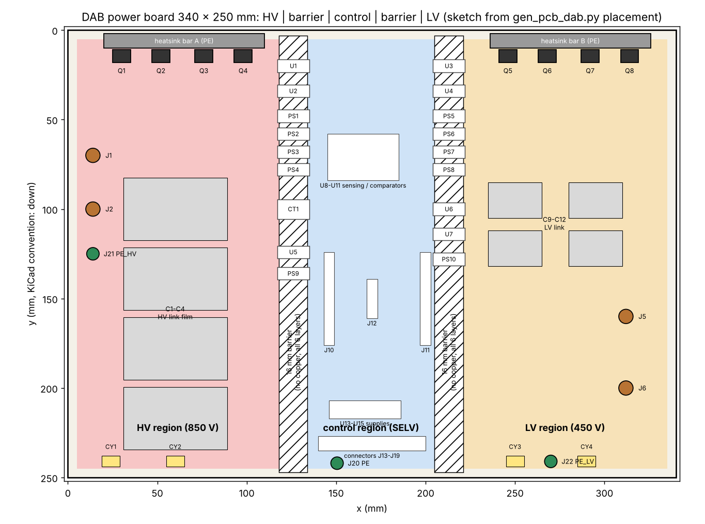
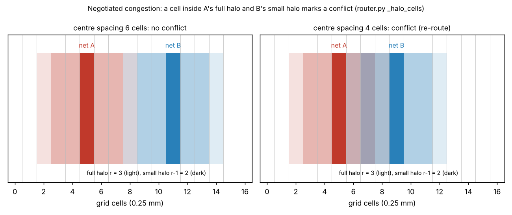
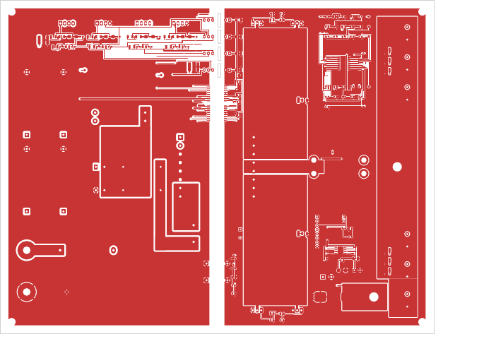

# 11 PCB layout

> Reading time: ~45 min. Prerequisites: chapters 02 (switching), 03 (SiC devices), 10 (schematics).
> Files covered: `SiC_6k6_Industrial_DAB/08_KiCad_PCB/README.md`, `SiC_6k6_Industrial_DAB/17_Manufacturing/stackup.md`,
> `SiC_6k6_Industrial_DAB/dabtools/kicad_dab/gen_pcb_dab.py`, `SiC_6k6_Industrial_DAB/07_KiCad_Schematics/SiC_DAB_6k6.kicad_dru`,
> `SiC_6k6_Industrial_DAB/07_KiCad_Schematics/drc_summary.json`, `tools/kicad/README.md`, `tools/kicad/router.py`,
> `tools/kicad/boardgen.py`, `docs/05_pcb_layout_guide.md`, `hardware/kicad/drc_summary.json`,
> `Advanced_Research_2026/Parasitic_Extraction/results/parasitics.json`.

## Overview

**Level 1 - Beginner:** A printed circuit board is the floor of a house: every component has its room,
and the copper tracks are the corridors. Fast-switching power electronics adds two house rules. First,
the corridors that carry the switched current must be as short and as "folded back on themselves" as
possible, because a long loop of fast-changing current behaves like a coil and produces voltage spikes
and radio noise. Second, the high-voltage rooms must be kept far from the rooms people can touch, with
a gap of bare board - or even a milled slot - between them, so that no spark or dirty surface can
bridge the gap. The 6.6 kW DAB board in this repository is laid out exactly like that: a high-voltage
wing, a low-voltage wing and a control wing in the middle, separated by two 16 mm copper-free strips.

**Level 2 - Engineering:** The board is 340 x 250 mm, six layers, 70 um copper on every layer, 2.4 mm
FR4 Tg 170 (`17_Manufacturing/stackup.md`). Each power region has two plane pairs (reference plane
0.2 mm under the outer layer and a power plane 0.5 mm below it), so the half-bridge commutation loop
closes through plane pairs rather than tracks. Clearance classes by net name (HV_POWER, HV_GATE,
LV_POWER, LV_GATE, CTRL_POWER, CTRL_SIGNAL, PE) are turned into KiCad custom DRC rules: 12 mm HV-LV,
12 mm HV-control, 10 mm LV-control, 8 mm gate-signal, 5.5 mm gate-bias-module pairs, 8.5 mm and
5 mm PE to HV and LV (`gen_pcb_dab.py`, `pair_clearance()`). The whole board - placement, planes,
stubs, routing, zone fill and DRC - is generated by Python; nothing is drawn by hand. The signal
routing uses an in-house negotiated-congestion router (PathFinder idea) that treats the isolation
distances as hard obstacles. Routing run 27 reached 0 DRC errors and 0 unconnected items
(`07_KiCad_Schematics/drc_summary.json`, 63 warnings, all silkscreen or dangling stubs on reserved
header pins); the preceding runs 24-26 had one auxiliary net (`+5V`) left open, and the fix history is
part of this chapter.

**Level 3 - Research:** Layout is where the idealised converter model meets parasitics. The
`Parasitic_Extraction` module computes partial inductances of the generated geometry in closed form:
28 nH (36 nH upper bound) per half-bridge commutation loop, dominated by the TO-247 leads (25 nH of
the 28 nH), and a 109 nH gate loop because the drivers straddle the isolation barrier about 100 mm
from the gates. Those numbers feed the overshoot and ringing estimates (54 V overshoot at 800 V,
9.75 A and 5 ns fall time) and are the honest boundary of what a script can tell you: a field solver
or a measurement is needed to go further. The router itself is a small research object: the halo
construction makes the DRC clearance an exact conflict criterion on a 0.25 mm grid, and the three-round
hard pass (hard re-route, bounded rip-up, region re-route) is what remains after negotiation fails.

## Topics

### Floor plan: HV | barrier | control | barrier | LV

**What is it?** The division of the 340 x 250 mm board into five vertical bands: HV region
x = 5-118 mm, barrier 1 x = 118-134 mm, control region x = 134-205 mm, barrier 2 x = 205-221 mm,
LV region x = 221-335 mm (`gen_pcb_dab.py`, constants `HV_X2, C_X1, C_X2, LV_X1`;
`08_KiCad_PCB/README.md` floor-plan table). `[Implemented]`

**Why do we need it?** The insulation study (chapter 14) requires reinforced insulation between
either power circuit and the touchable control circuit, and basic insulation between HV and LV. On a
PCB the cheapest and most robust way to get it is geometry: keep every HV copper feature on one side
of a line and every control feature on the other side, and leave the strip between them empty on all
six layers.

**How does it work?**
**Level 1 - Beginner:** Think of three rooms in a row with two empty corridors between them. The only
things that may stand in the corridors are the certified "doors": the gate drivers, the isolated bias
modules, the isolated amplifiers and the current transformer. Each of these is a component whose body
spans the gap and whose datasheet guarantees the insulation.
**Level 2 - Engineering:** The barrier is a rule area (keep-out) on every copper layer, built by
`barrier_keepouts()` in `gen_pcb_dab.py` with cut-outs for the straddling components listed in
`STRADDLE_HV` and `STRADDLE_LV`: U1/U2 (drivers at y = 20 and 34 mm), PS1-PS4 (bias modules at
y = 48-78 mm), CT1 (y = 100 mm), U5 (y = 124 mm) and PS9 (y = 136 mm) on the HV barrier, and the
mirror set U3/U4, PS5-PS8, U6/U7, PS10 on the LV barrier. `via_forbidden()` additionally forbids any
via within 0.6 mm of the barrier edges. Within each region the power planes are rectangles that stop
5 mm from the board edge (`HVR`, `CR`, `LVR` in the `ZONES` table).
**Level 3 - Research:** The barrier width (16 mm) is larger than the 12 mm reinforced-insulation
creepage required for material group II at 850 V (chapter 14) because the design value in
`01_insulation_coordination.md` was chosen to cover material group IIIa (17 mm) with a margin left for
the slots. The open research question is not the distance but the field: a copper-free strip with a
cut-out around a SOIC-16W driver has an inhomogeneous field at the cut-out corners, and only a
partial-discharge test at > 1.1 x working peak voltage (type test in chapter 14) tells whether the
component's 8 mm package creepage plus the slot is enough.

**Example from our converter:** HV bridge Q1-Q4 at x = 30, 52, 76, 98 mm, y = 14 mm on heat-sink
bar A; LV bridge Q5-Q8 at x = 246, 268, 292, 314 mm on bar B (`gen_pcb_dab.py` placement table).
The three PE lugs J21 (14, 125), J20 (150.5, 242) and J22 (270, 241) are one per region because no
copper may cross a barrier (`16_BOM/bom.md`, rows J20-J22). `[Implemented]`

**Engineering calculations:** Region width available for the HV link: 118 - 5 = 113 mm; the four
57.5 x 35 mm film capacitors C1-C4 (footprint `C_Film_P52.5`, `libs_dab.py`) stack vertically at
x = 60 mm, y = 100-217 mm. Barrier width 16 mm minus two 0.5 mm cut-out margins (`barrier_keepouts()`,
`+/- 0.5`) leaves 15 mm of copper-free FR4 between a component cut-out and the next.

**Design decision made in this project:** One board for both bridges plus the control circuit, with
geometry (not components) providing the PCB part of the insulation, and three separate PE nets bonded
through the chassis. `[Implemented]`

**Alternatives considered:** Two boards (power and control) with a cable harness - simpler insulation,
but the gate loops would cross a connector; a single PE net with a copper bridge across the barriers -
rejected because it would make the barrier creepage equal to the PE-to-HV distance (8.5 mm) instead of
16 mm.

**How to verify it:** KiCad DRC with the custom rules (`SiC_DAB_6k6.kicad_dru`) reports every copper
pair that violates a class distance; the barrier rule areas are listed in the board file.
`drc_summary.json` holds the counts. `[Verified]` for the clearance rules (0 clearance errors in the
committed summary); the floor plan itself has no automated check beyond that.

**Common mistakes:** Letting a silkscreen or a mounting hole be the only thing that "marks" the
barrier; forgetting internal layers (a plane that quietly continues under the barrier); placing a
connector or test point so that a probe tip can bridge the gap.

**Interview explanation (30 s):** "The DAB board is split into an 850 V wing, a 450 V wing and a
SELV control wing by two 16 mm copper-free barriers on all six layers. Only certified isolators
straddle the barriers, sitting in cut-outs of the keep-out, with a milled slot under the SIP modules.
The distances are enforced by KiCad custom rules generated from the net classes, so the DRC, not a
reviewer's eye, proves the geometry."

**Research-level explanation:** The barrier is a geometric realisation of the IEC 60664-1 creepage
and clearance requirements for an inhomogeneous field at pollution degree 2; the remaining
uncertainty is the local field at the straddler cut-outs and the slot edges, which is why the
insulation study calls for a PD type test and an independent review before any energisation.

### Stack-up and plane pairs

**What is it?** Six copper layers of 70 um (2 oz): F.Cu components and pours, In1 reference planes
(HV_N | GND | LV_N), In2 power planes (HV_P | GND | LV_P), In3 and In4 duplicates of In1 and In2,
B.Cu switch-node strips and signals (`17_Manufacturing/stackup.md`; `ZONES` in `gen_pcb_dab.py`).
`[Implemented]`

**Why do we need it?** The half-bridge commutation loop (DC-link capacitor -> high-side switch ->
low-side switch -> capacitor) carries the full switched current with edges of a few nanoseconds. Its
inductance sets the drain-source overshoot, the ringing frequency and the common-mode noise. A pair
of wide planes 0.5 mm apart is the lowest-inductance structure a PCB can offer.

**How does it work?**
**Level 1 - Beginner:** Two sheets of copper, one carrying current out and the one directly beneath
carrying it back, cancel each other's magnetic field almost completely. The closer the sheets, the
better the cancellation. It is the same reason a twisted pair of wires radiates less than two wires
far apart.
**Level 2 - Engineering:** The loop inductance of a plane pair of spacing h, length l and effective
width w is roughly L = mu0 h l / w (formula list in
`Advanced_Research_2026/Parasitic_Extraction/extract_parasitics.py`). For the HV leg A loop the
module reports h = 0.57 mm, l = 24 mm, w_eff = 51 mm and two pairs in parallel: 0.17 nH
(`results/loop_segments.csv`, row "HV_P/HV_N plane pair"). That is negligible next to the four
TO-247 leads (9.6 nH self-inductance each, partially cancelled by -3.3 nH mutual coupling to the
neighbouring lead). The total reported loop is 27.9 nH, upper bound 36.2 nH
(`results/parasitics.json`, `loops.HV_leg_A`). `[Simulated]` (closed-form, no field solver).
**Level 3 - Research:** The plane spacing sensitivity in `parasitics.json` (`loop_sensitivity`) shows
the loop moving only from 27.86 nH at h = 0.2 mm to 29.10 nH at h = 2.3 mm: the PCB is not the lever,
the package is. That is the quantitative argument for the literature's move to SMD packages
(TO-263-7, 5-15 nH loops) and power modules with integrated DC-link (2-10 nH), see
`results/literature_comparison.csv`. For a TO-247-4 design the remaining levers are the MLCC
placement (C5-C8 at y = 38 mm, 24 mm from the devices at y = 14 mm) and the lead length above the
board.

**Example from our converter:** HV bridge HF decoupling C5-C8 (100 nF / 1 kV, 2220) at
x = 36, 46, 82, 96 mm, y = 38 mm, chosen "clear of the SW_B strip so the plane via fits"
(`gen_pcb_dab.py` placement comment). LV side C13-C16 (220 nF / 630 V) at y = 38 mm. `[Implemented]`

**Engineering calculations:** Overshoot estimate from `results/overshoot.csv`, HV leg A, 800 V,
9.75 A (nominal peak), 5 ns fall: di/dt = 1.95 A/ns, V_os = L di/dt = 54 V, V_ds,peak = 854 V,
margin to 1200 V = 346 V, ringing 73 MHz. At the 32 A hardware trip level and 5 ns: 179 V overshoot,
979 V peak. These are `[Simulated]` closed-form figures with every input an assumption
(`parasitics.json`, `assumptions.note`).

**Design decision made in this project:** Six layers instead of four so that each region has a plane
pair under each outer layer and the 450 V / 16.5 A LV link can run on planes rather than bus bars
(`stackup.md`, "Justification"). `[Implemented]`

**Alternatives considered:** Four layers (planes on outer layers, where the components sit - rejected);
eight layers (no routing need, higher cost - rejected); laminated bus bar for the DC links (mechanical
complexity - rejected for a research board).

**How to verify it:** Geometry: `extract_parasitics.py --board <file>` recomputes the loops from the
board file and cross-checks pad positions with pcbnew (731 pads, 0.0 mm deviation reported in
`parasitics.json`). Electrical: a double-pulse test with a 1 GHz-class probe is the only real
verification. `[Not yet tested]`

**Common mistakes:** Splitting the reference plane under the switch node; routing the gate return on a
layer without a plane beneath it; counting the plane pair as "the loop" while the package leads
dominate.

**Interview explanation (30 s):** "Two plane pairs per region, 0.5 mm core between HV_P and HV_N,
2 oz copper everywhere. The extracted commutation loop is about 28 nH, of which 25 nH is the TO-247
package pair, so the planes are already better than the package allows; the remaining overshoot at
nominal current is about 54 V on 800 V."

**Research-level explanation:** The partial-inductance decomposition (Ruehli/Hoer-Love bars, Grover
mutuals, image-plane microstrip) is a first-order PEEC; the next steps documented in the module are a
field solver on the real geometry and a double-pulse measurement, and the DRC-clean board file is the
geometry input for both.

### Clearance classes and DRC rules

**What is it?** A function `pair_clearance(a, b)` that returns the minimum copper distance for any two
nets from their classes, and `dru_rules()` that writes the same table into KiCad's custom rule file
`SiC_DAB_6k6.kicad_dru` (`gen_pcb_dab.py`). `[Implemented]`

**Why do we need it?** The router must know the same distances KiCad's DRC will check; otherwise the
router produces copper the DRC rejects, or wastes space. One table feeds both.

**How does it work?**
**Level 1 - Beginner:** Every wire on the board gets a label: "high-voltage power", "high-voltage
gate", "low-voltage power", "control" or "earth". A small table says how far apart two labels must
stay. The software reads the table while drawing and the checker reads the same table afterwards.
**Level 2 - Engineering:** Classes come from `design_dab.net_class()`: HV_POWER / LV_POWER by name
list, HV_GATE / LV_GATE by the pattern `(G|GD|RGOFF|KS|VDD|VEE)_Q[1-4]` or `[5-8]` plus the sensing
nets of each side, PE for `PE, PE_HV, PE_LV`, CTRL_POWER for `GND, +12V, +5V, +3V3, +24V`, everything
else CTRL_SIGNAL. `pair_clearance()` then returns: PE to HV 8.5 mm, PE to LV 5.0 mm, HV to LV 12 mm,
HV_POWER to control 12 mm, LV_POWER to control 10 mm, gate side to CTRL_POWER 5.5 mm (the bias-module
pairs), gate side to CTRL_SIGNAL 8 mm, HV_POWER to HV_POWER 1.5 mm, power to its own gate class
0.5 mm, within a gate class 0.3 mm, CTRL_POWER 0.3 mm, otherwise 0.2 mm. The `.kicad_dru` file holds
twelve rules in that order ("later rules take precedence"): `pe_to_lv` 5.0, `pe_to_hv` 8.5,
`ctrl_power` 0.3, `gate` 0.3, `power_to_gate` 0.5, `hv_to_hv` 1.5, `lv_to_lv` 1.5,
`iso_gate_bias_modules` 5.5, `iso_gate_signal` 8.0, `iso_lv_power_ctrl` 10.0,
`iso_hv_power_ctrl` 12.0, `iso_hv_lv` 12.0.
**Level 3 - Research:** The 5.5 mm module rule is the interesting one: the SIP-7 bias modules give
only about 5.9 mm between their input and output pin rows, which is less than the 8 mm gate-signal
rule, so the rule is relaxed to 5.5 mm for exactly those pairs and the lost creepage is bought back
with a 1.6 mm milled slot under each module (`slots` list in `config()`: slot rectangles at
BAR1 + 0.47 ... BAR1 + 2.07 mm for y = 48, 58, 68, 78 mm). This is a general technique - distance on
the component replaced by distance along a slot edge - and its validity is a question for the
insulation review, not for the DRC.

**Example from our converter:** `pair_clearance("HV_P", "GND")` returns 12.0 mm;
`pair_clearance("G_Q1", "GND")` returns 5.5 mm (gate class to CTRL_POWER, the bias-module case);
`pair_clearance("G_Q1", "PWM1")` returns 8.0 mm. `[Implemented]`

**Engineering calculations:** Track widths from `track_width()`: 0.5 mm for the `+12V, +24V, +5V`
rails (the comment cites IPC-2221, about 2.6 A at 20 K rise on 70 um copper, and the 1.27 mm SOIC
fan-out pitch), 0.5 mm for gate nets, 0.8 mm for relay and fan outputs, 0.3 mm for everything else.
Fabrication minimums: 0.2 mm track and space, 0.3 mm drill, 0.8/0.4 mm via with 0.2 mm annular ring,
0.5 mm copper to edge (`stackup.md`).

**Design decision made in this project:** One Python table is the single source of truth for the
router, the DRC rules and the documentation; the `.kicad_dru` header states its origin. `[Implemented]`

**Alternatives considered:** KiCad net classes with per-class clearance (cannot express pair-wise
distances such as "gate side to control signal 8 mm but gate side to control power 5.5 mm"); manual
rule areas per pair (unmaintainable with 259 components).

**How to verify it:** The DRC run at the end of `boardgen.main()` writes `drc_report.txt` and
`drc_summary.json`; the `drc_kinds` dictionary lists every violation type. A clearance violation
would appear as `clearance` - the committed summary has none. `[Verified]` for the rule set as a
whole; the correctness of the distances themselves is reviewed in chapter 14.

**Common mistakes:** Giving a net the wrong class by naming it badly (a net called `KS_Q9` would be
CTRL_SIGNAL); forgetting that KiCad applies the last matching rule; measuring creepage as a straight
line when the real path bends around a slot.

**Interview explanation (30 s):** "Clearances are a function of two net classes. The generator writes
that function once as Python, once as a KiCad rule file. The router rasterises other-net copper
dilated by the clearance plus half its own width, so the big isolation distances are walls, not
costs, and the DRC afterwards confirms zero clearance violations."

**Research-level explanation:** Pair-wise clearance tables are the PCB equivalent of insulation
coordination's "circuit pairs"; the open methodological question is how to carry the creepage path
(a surface quantity, including slots) into a DRC that only knows straight-line clearance - the
project handles it by designing every slot so that straight-line clearance after the slot is at least
the required creepage.

### Switching-loop and switch-node layout

**What is it?** The B.Cu switch-node strips SW_A, SW_B, SW_C, SW_D that connect each TO-247 pair to
its stud and to the series-inductor terminal, plus the plane pairs that close the commutation loop
(`ZONES` list in `gen_pcb_dab.py`; `08_KiCad_PCB/README.md`, "Layers"). `[Implemented]`

**Why do we need it?** The switch node is the only node whose voltage jumps by the full link voltage
every half period (about 20 V/ns in the EMI estimate, chapter 13). Its copper area is a capacitor
plate against everything nearby, and its length is inductance in the commutation loop.

**How does it work?**
**Level 1 - Beginner:** The switch node is the "noisy" wire. You want it short, not too wide and
away from sensitive things, but still wide enough to carry the current without heating.
**Level 2 - Engineering:** Each strip is a set of rectangles on B.Cu with priority 2 and solid pad
connection, e.g. SW_A: pad stubs (32-36.2, 11-20) and (49-52.6, 11-20), a cross bar (32-52.6, 17-20),
a 4.5 mm wide run down to y = 100 mm, and a 16 x 38 mm landing under the J3 stud. The comment gives
the current ratings: 10 A rms on the HV side, 20 A rms on the LV side. The strip runs over In4 (power
plane), so the extraction treats it as a microstrip 0.27 mm above an image plane: 1.6 nH, against a
free-standing upper bound of 10 nH (`loop_segments.csv`, "SW_A strip B.Cu").
**Level 3 - Research:** The switch-node strip is also the dominant CM source: the EMI estimate
assumes about 100 pF per switching node to the earthed heat sink through the TO-247 insulating pad
(chapter 13). Reducing that capacitance (thicker pad, smaller tab area) raises RthJC (chapter 12) -
the classic layout trade-off that a coupled electro-thermal-EMI model would optimise; the repository
treats the two separately and says so.

**Example from our converter:** The HV series-inductor return goes from the SW_A stud J3 through the
current transformer CT1 (one-turn insulated lead) to J9, with a dedicated `SW_A_CT` pour on F.Cu
(rectangles (92, 90, 114, 100), (92, 142, 108, 158), (103, 95, 109, 150)) so that the CT primary
lead is a board-level feature rather than a flying wire (`gen_pcb_dab.py`, comment on `SW_A_CT`;
`manufacturing_notes.md`, assembly step 4). `[Implemented]`

**Engineering calculations:** Current density check for the SW_A strip, 4.5 mm wide, 70 um:
cross-section 0.315 mm2; at 10 A rms that is 32 A/mm2 - high for a track but acceptable for a short
strip over a plane with the 2 oz copper acting as a spreader (the `stackup.md` justification). The LV
strips SW_C/SW_D are 6 mm wide for 20 A rms.

**Design decision made in this project:** Switch nodes on the bottom layer directly under the devices,
DC-link planes inside, HF MLCCs on top within 24 mm of the device row. `[Implemented]`

**Alternatives considered:** Switch node as a top-layer pour next to the devices (would push the
gate clusters away); vertical bus bars (not for a PCB-only prototype).

**How to verify it:** Geometry and inductance: `extract_parasitics.py` (`[Simulated]`). Thermal and
electrical: double-pulse and thermal-camera tests in `20_Experimental_Test_Plan/test_plan.md`,
steps 7-8 (`[Not yet tested]`).

**Common mistakes:** Making the switch node a huge pour "for cooling" (it is a CM antenna); routing a
sensitive signal on In1 directly under a switch-node strip; letting two switch nodes' strips run in
parallel.

**Interview explanation (30 s):** "Each half-bridge has its switch node as a 4.5-6 mm strip on the
bottom layer, over the power plane, running straight from the TO-247 pads to the M6 stud. The
commutation loop closes through the HV_P/HV_N plane pair and the 2220 MLCCs on top. Extracted loop:
about 28 nH, mostly the package."

**Research-level explanation:** The strip-over-plane geometry trades loop inductance for CM
capacitance to the reference plane; the quantitative balance between the two is exactly what a
PEEC-plus-field model would give and what the project's closed-form extraction only brackets.

### Gate loop and Kelvin source

**What is it?** For each of the eight TO-247-4 devices, a gate cluster of turn-on resistor (3.3 ohm,
1206), turn-off resistor (1.5 ohm) with a Schottky steering diode SS14, a 10 kohm gate-source bleed
and four bias capacitors (10 uF + 1 uF on +15 V, 4.7 uF + 1 uF on the -3 V rail), all referenced to
the Kelvin-source pin KS_Qn (`design_dab.py`, gate sheet). `[Implemented]`

**Why do we need it?** A SiC MOSFET switching 10 A in 5 ns has di/dt of 2 A/ns. If the gate driver's
return shared the power-source lead (about 10 nH), the voltage L di/dt = 20 V would appear in the
gate loop and either slow the switch or turn it back on. The fourth pin (Kelvin source) gives the
gate loop its own return that carries no load current.

**How does it work?**
**Level 1 - Beginner:** Imagine shouting instructions to someone across a factory floor while a
forklift drives between you. The Kelvin source is a private phone line that bypasses the noise.
**Level 2 - Engineering:** `place_generated()` in `gen_pcb_dab.py` puts each cluster directly below
its MOSFET: resistors and the diode in a row at y = 22 mm (x offsets -8.5, -3, +3, +8.5 mm around
the device, "fits the 22 mm MOSFET pitch"), capacitors at y = 28 mm. The driver outputs GD_Qn,
however, come from U1-U4 at the barrier (x = 126 / 213 mm), roughly 100 mm away. The gate loop
extraction in `parasitics.json` (`gate_loops.Q1`) reports: go path 102 mm, return 93 mm, pair
spacing 1.0 mm, trace pair 80 nH, package gate-KS 12.6 nH, local 16 nH: total 109 nH. With
R_total = 6.9 ohm (driver 1 ohm + 3.3 ohm external + 2.6 ohm internal) and Ciss = 1.9 nF this gives a
damping ratio of 0.45 and an 11 MHz ring, against a critical resistance of 15.2 ohm.
`[Simulated]`
**Level 3 - Research:** The literature range for a TO-247-4 gate loop with the driver within 20 mm is
10-30 nH (`literature_comparison.csv`); this board's 109 nH is the price of putting the drivers on
the barrier. The gate-sensitivity table shows the pair spacing lever: 0.5 mm spacing gives 82 nH
(damping 0.52), 5 mm gives 170 nH (0.36). Note also that `14_EMI_EMC/emi_report.md` section 4 says
the drivers sit "within 15 mm of the gates" - that sentence describes the intention of the pre-layout
stage, and the generated placement does not meet it. The notes record the discrepancy rather than hide
it; the fix (drivers next to the devices, with the barrier moved to the driver's input side) is a
layout revision item.

**Example from our converter:** Q1 cluster at x = 30 mm: R turn-on 3.3 ohm, R turn-off 1.5 ohm, D
SS14, R 10 k at y = 22 mm; C 10 uF/1 uF/4.7 uF/1 uF at y = 28 mm; KS_Q1 is pin 3 of the
`TO-247-4_Vertical` footprint (`design_dab.py`, `add("Q1", ...)` pin map 1 G, 2 D, 3 KS, 4 S).
`[Implemented]`

**Engineering calculations:** Critical damping R_crit = 2 sqrt(L/C) = 2 sqrt(109e-9 / 1.9e-9)
= 15.2 ohm (matches `R_critical_ohm`). Ring frequency f = 1 / (2 pi sqrt(L C))
= 1 / (2 pi sqrt(109e-9 x 1.9e-9)) = 11.1 MHz (matches `f_ring_MHz`).

**Design decision made in this project:** Kelvin-source referenced clusters at the device, separate
turn-on and turn-off resistors with a steering diode, negative turn-off bias (-3 V) from the isolated
modules PS1-PS8 (`design_dab.py`). `[Implemented]`

**Alternatives considered:** Drivers at the devices with the isolation on the PWM side (better gate
loop, but each driver would need its own barrier cut-out next to a hot device); gate ferrite beads
(damping without loss in the resistor - not used).

**How to verify it:** Gate-loop inductance from `extract_parasitics.py` (`[Simulated]`); gate
waveform with an isolated probe in test step 8 of `test_plan.md` (`[Not yet tested]`).

**Common mistakes:** Connecting the bias capacitors to the power source pin instead of KS; routing
GD_Qn and KS_Qn on different layers far apart (the pair spacing is the inductance lever); forgetting
that the -3 V rail also needs a local capacitor.

**Interview explanation (30 s):** "Every device has its gate cluster at the Kelvin-source pin, 8 mm
below the package: 3.3 ohm on, 1.5 ohm off through a Schottky, 10 k bleed, local +15 V and -3 V
capacitors. The weak point is the driver distance: the drivers straddle the isolation barrier about
100 mm away, so the extracted gate loop is 109 nH with a damping ratio of 0.45."

**Research-level explanation:** The active-gate-drive module (chapter 18) assumes the gate loop can be
driven at defined di/dt and dv/dt; a 109 nH loop with 0.45 damping sets a floor on how fast the gate
can be slewed without ringing, which is why the extraction's sensitivity tables matter for the
research modules and not only for EMI.

### Fan-out stubs, corridors, private regions and stitching vias

**What is it?** The pre-routing structures that `boardgen.py` adds before the router runs: alternating
short/long stubs on fine-pitch ICs and 2.54 mm headers, a hard keep-out over the pad field, a
horizontal-only via-free corridor, a soft "mouth" band, private regions for the bias-module pin
fields, exit bands at the module output faces, and plane-stitching vias (`boardgen.py`,
`fanout_stubs()`, `stitch_vias()`; `gen_pcb_dab.py`, `fan`, `priv`, `exit_bands`). `[Implemented]`

**Why do we need it?** A grid router with a 0.25 mm grid and 0.3 mm tracks can seal a SOIC pin by
running a neighbour's track past it. Stubs push every pin's "terminal" out of the pad field and the
corridor guarantees that nothing crosses the exits.

**How does it work?**
**Level 1 - Beginner:** Every chip pin gets a short straight leg sticking out, alternately short and
long like the teeth of a zip, so that each leg can be reached from the side without crossing another.
A no-parking zone around the legs keeps other wires out.
**Level 2 - Engineering:** For U1-U7 (SOIC-16W drivers and SOIC-8W isolated amplifiers) the stub pair
is (2.2, 4.4) mm at 0.3 mm width, for U8-U12, U16, U17 (1.8, 3.6) mm, and for the headers J10/J12
(2.0, 4.0) mm (`fan` dict in `config()`). `fanout_stubs()` draws the stub on F.Cu, registers it as an
obstacle of that net, and - for plane nets such as GND - adds a via 1.2 mm beyond the long stub so the
pin lands in the plane. Then it adds a keep-out from the pad edge to `short - 0.7` mm, a horizontal-only
corridor out to `long + 1.5` mm, and a soft band 1.5 mm further where vertical moves are penalised
(`MOUTH_COST = 40` in `router.py`). `TERM_COST = 15` is added to every cell within 1 mm of any
terminal so that routes prefer to pass at least 1 mm from another net's exit. The bias-module pin
fields are private rectangles ((118.5, 42, 133.5, 84) for PS1-PS4, etc.) that only those modules'
nets may enter; `exit_bands` are 1.5 mm bands at the module output faces where tracks may only run
straight out.
**Level 3 - Research:** These are heuristics discovered by failure analysis of routing runs - the
placement comments in `gen_pcb_dab.py` document each one ("the sense-signal tracks between them
sealed the U9 +5V stub at 22 mm pitch", "14 mm exit channel", "4 mm exit channel"). Formally they
convert a global routability problem into local constraints; a research router would instead
reserve escape capacity per pin (escape routing, as in BGA fan-out literature). The project's choice is
transparent: every heuristic is a named rectangle in the configuration.

**Example from our converter:** `stitch_vias()` adds one via next to every SMD pad of a plane net
that is not in the fan-out list (0.95 mm from the pad edge, 0.8/0.4 mm via), never inside another
net's priority pour (expanded by 1 mm) and never in `via_forbidden()` zones. The DRC summary of the
PSFB board records the same mechanism working with 0 unconnected items. `[Implemented]`

**Engineering calculations:** SOIC-16W pin pitch 1.27 mm, stub width 0.3 mm, clearance 0.3 mm
(CTRL_POWER rule): three features per pitch (0.3 + 0.3 + 0.3 = 0.9 mm) fit, with 0.37 mm to spare;
alternating stub lengths 2.2/4.4 mm make the effective exit pitch 2.54 mm per row of ends.

**Design decision made in this project:** Deterministic, named pre-routing structures rather than
router cleverness; the plane nets are reached through stitch vias so that the router only handles
signal and auxiliary-power nets. `[Implemented]`

**Alternatives considered:** Letting the router fan out (tried and documented as sealing pins);
blind/buried vias (cost; the two-layer router works on F.Cu/B.Cu only).

**How to verify it:** The DRC (`unconnected_items` and `track_dangling` counts in
`drc_summary.json`) shows stubs without a route. Run 27: 0 unconnected items and 9 dangling-track
warnings, all of them fan-out stubs on reserved header pins (SPI_CLK/CS/MISO/MOSI, I2C_SCL/SDA,
RESET_N, GPIO_SYNC, I2_REF_OUT - nets with a single terminal on the BoosterPack headers, so the stub
has nothing to reach). The run-24 summary had 26 dangling stubs on `+5V`. `[Verified]`

**Common mistakes:** A corridor that opens onto another chip's corridor (the "exit channel" comments
are about exactly that); a stitching via placed inside a switch-node pour; a private region that
accidentally blocks a non-module net that must pass.

**Interview explanation (30 s):** "Before routing, every fine-pitch pin gets an alternating 2.2/4.4 mm
stub with a keep-out and a horizontal-only via-free corridor, plane pins get a via beyond the stub,
and every plane-net SMD pad gets a stitching via. The router then only sees stub ends as terminals
and cannot seal a pin."

**Research-level explanation:** This is escape routing by construction; the corridor and mouth-band
costs implement a soft version of the "no track parallel to a pin row" rule from assembly-oriented
design guides, and the remaining failure (`+5V`) shows where fixed stubs are not enough: a net with
many terminals in several corridors needs a tree, not a chain.

### The negotiated-congestion router

**What is it?** `tools/kicad/router.py`: a two-layer (F.Cu, B.Cu) A* grid router on a 0.25 mm grid
with negotiated congestion (PathFinder), a three-round hard pass and rip-up; `boardgen.py` calls it
after placing stubs and stitch vias, then fills zones and runs KiCad DRC (`tools/kicad/README.md`).
`[Implemented]`

**Why do we need it?** Two boards with 259 and about 150 components are regenerated from design
tables whenever a value changes; hand-routing would break that reproducibility. KiCad 7 has no
scriptable autorouter, so the project wrote one that uses the same clearance function as the DRC.

**How does it work?**
**Level 1 - Beginner:** Imagine many people who each have to walk from one door to another in a
crowded hall without touching. First everyone walks their shortest path and ignores collisions. Then
the places where people collided become "expensive", and everyone who collided re-plans, paying more
to walk through crowded spots. After a few rounds the crowd sorts itself out. The few who still
collide are handled one at a time with the rest standing still.
**Level 2 - Engineering:** `Router.build_blocked(net)` rasterises every item of another net dilated by
`clearance(net, other) + width/2` per layer (hard obstacles) and a no-via map dilated by
`clearance + via/2`; keep-outs, private regions and a 1 mm board-edge band are added. In
`NegotiatedRouter`, every net also marks a full halo of radius r = ceil((w/2 + clearance/2)/grid) and a
small halo r - 1 on each path cell (a via marks both layers). Two nets conflict when a cell lies in
one net's full halo and the other's small halo, i.e. exactly when their centre lines are closer than
w_a/2 + w_b/2 + clearance (`_halo_cells()` docstring). The A* cost of a cell is the Chebyshev
max-filter of (usage x `pres_fac` + history + terminal cost) over the net's own radius, so a net
"sees" its own halo. `route_all()` runs up to `max_iter` = 14 iterations (`max_passes=14` in
`gen_pcb_dab.py`), with `pres_fac` growing by 1.7 each iteration and `hist_fac` = 0.5 added to every
overlapped cell; via cost 25, turn cost 0.6, at most 2.5 million A* nodes per net. Nets still in
conflict go to `hard_pass()`: round 1 re-routes each pending net against all other routed copper as
hard obstacles, most-terminals first; round 2 is a depth-4 rip-up-and-retry on at most 12 victims,
accepted only if every victim re-routes cleanly; round 3 is the region re-route, which rips up every
net with copper within 3, then 5, then 8 mm of the failing net's terminals (at most 40 nets), routes
the failing net first and then the victims one by one. A net that still fails is left unrouted, so
the DRC reports it as an unconnected item - "the router never emits copper that violates its
clearance model" (`tools/kicad/README.md`).
**Level 3 - Research:** PathFinder (McMurchie and Ebeling, 1995) was designed for FPGA routing where
resources are discrete; the halo construction is the project's adaptation to a geometric clearance
rule, and the docstring gives the proof that the criterion is never permissive and at most one cell
conservative for mixed widths (r = ceil(x) satisfies ceil(x_A) + ceil(x_B) >= ceil(x_A + x_B)). The
remaining research gaps are visible in the log vocabulary: "unreachable terminals (static enclosure,
usually a placement problem)" and the `ROUTER_DUMP` / `ROUTER_RESUME` environment variables that let a
one-hour negotiation state be replayed into a new hard pass. A placement-aware router, or a router
that may move a component, is the obvious next step.

**Example from our converter:** `route_priority={"+12V": 0, "+5V": 1, "+3V3": 2, "+24V": 3,
"PROT_DIS": 4}` in `gen_pcb_dab.py` routes the auxiliary rails first; `+5V` was the last net to
close: runs 24-26 reported `failed_terminals: [["+5V", 0, 0]]` and 40 unconnected items, run 27
reports `failed_terminals: []`. `[Implemented]`

**Engineering calculations:** Grid 0.25 mm on 340 x 250 mm: W = 1361, H = 1001 cells, two layers,
1.36 million cells per layer. Halo radius for a 0.3 mm track at 0.3 mm clearance: x = (0.15 + 0.15)/
0.25 = 1.2, r = 2 cells; for a 0.5 mm track: x = (0.25 + 0.15)/0.25 = 1.6, r = 2 cells; via of 0.8 mm
at 0.3 mm clearance: x = (0.4 + 0.15)/0.25 = 2.2, r = 3 cells.

**Design decision made in this project:** Soft negotiation for the bulk, hard obstacles for the
isolation distances, an escalating hard pass for the residue, and KiCad's own DRC as the final judge.
`[Implemented]`

**Alternatives considered:** FreeRouting (external Java tool, not scriptable inside the generator at
the time); KiCad's interactive router (manual); a pure rip-up-and-retry router (the PathFinder history
term converges better on dense boards).

**How to verify it:** Every run ends in `pcbnew.WriteDRCReport()`; `drc_summary.json` is the
machine-readable result. The PSFB board shows the full pipeline succeeding: 72 nets, 0 unconnected,
0 errors (`docs/05_pcb_layout_guide.md`; `hardware/kicad/drc_summary.json`: only 40 silkscreen
warnings), and the DAB board reaching the same state in run 27. `[Verified]` on both boards.

**Common mistakes:** Treating a soft-cost router's output as DRC-clean without the final check;
raising `pres_fac` too fast (nets jump around, history never settles); running the hard pass without
protecting the ripped victims' old space (`avoid_hard=True` in `_route_hard()` keeps it free).

**Interview explanation (30 s):** "It is a PathFinder-style negotiated-congestion router on a 0.25 mm
grid. Other nets' copper is a soft cost that grows by 1.7 per iteration; isolation distances are hard
walls. Nets that cannot negotiate go through a hard pass: re-route alone, then bounded rip-up, then a
region re-route with 3/5/8 mm reach. KiCad DRC judges the result; both boards are at 0 errors."

**Research-level explanation:** The halo formulation turns a continuous clearance DRC into an exact
grid conflict test, which is what makes negotiated congestion applicable to PCBs with pair-wise
clearance classes; remaining open problems are placement-routing co-optimisation and multi-terminal
nets whose Steiner structure the sequential A* cannot discover.

### DRC status of the two boards

**What is it?** The machine-written summary of KiCad's DRC after each generation run:
`SiC_6k6_Industrial_DAB/07_KiCad_Schematics/drc_summary.json` (DAB) and
`hardware/kicad/drc_summary.json` (PSFB). `[Verified]` as a check that runs.

**Why do we need it?** It is the only objective statement of layout maturity in a repository where
nothing is built: a board with zero errors and zero unconnected items is "software-verified" (L3 in
the maturity scale of chapter 19); anything else is work in progress.

**How does it work?**
**Level 1 - Beginner:** The checker counts problems by type. "Unconnected" means a wire the schematic
says must exist but the board does not have yet. "Silkscreen" problems are about printed labels and
are cosmetic.
**Level 2 - Engineering:** The current DAB summary (routing run 27, DRC report created 2026-10-10
03:26:20) reads: `failed_terminals: []`, `drc_kinds: silk_overlap 11, silk_over_copper 27,
silk_edge_clearance 16, track_dangling 9`, `severities: warning 63`, `unconnected: 0`. So: 0 errors,
0 unconnected items, 0 clearance, hole-clearance, courtyard or copper-to-edge violations; 63
warnings, of which 54 are silkscreen (reference designators over neighbouring pads in the dense
passive rows, the HV warning legends over the mounting-hole circles) and 9 are dangling fan-out
stubs on reserved BoosterPack header pins (SPI, I2C, RESET_N, GPIO_SYNC, I2_REF_OUT: nets with one
terminal, so the stub cannot go anywhere). For comparison, the run-24 summary committed on
2026-10-10 02:34 UTC read `failed_terminals: [["+5V", 0, 0]]`, `unconnected_items 40,
track_dangling 26, starved_thermal 2, courtyards_overlap 1`, `warning 83, error 43`. The fix history
between the two: the driver-side exit channels were widened, J3 and TP2 were moved clear of the fuse
holder F1, U10 and U11 were spaced 8 mm wider to open the exit channel for the `+5V` stubs, and the
router gained the region re-route with 3/5/8 mm reach (`hard_pass()` round 3 in `router.py`). The
PSFB summary: `failed_terminals: []`, `silk_overlap 13, silk_over_copper 18, silk_edge_clearance 9`,
`warning 40`, `unconnected 0` - no errors.
**Level 3 - Research:** `Advanced_Research_2026/00_Gap_Analysis_and_Plan.md` rates the DAB PCB "L2 ->
L3 when 0 errors" and lists finishing it as task 1 of the plan; run 27 meets that criterion. Because the whole chain is
scripted, every run is a reproducible experiment on the router; the sequence of commit messages is in
effect a lab notebook of router heuristics.

**Example from our converter:** `+5V` feeds the AMC1301 secondary sides (U5-U7 pin 8), the TLV9062,
LM393, 74HC32 and the 100 nF decouplers across the control region (`design_dab.py`), i.e. it has
dozens of terminals in several fan-out corridors - the hardest net for a sequential router and the
last one to close (run 27). `[Implemented]`

**Engineering calculations:** Warning accounting for run 27: 11 + 27 + 16 + 9 = 63, matching the
report header "Found 63 DRC violations" and `severities: warning 63`. Run 24 for comparison:
40 + 2 + 1 = 43 errors, 13 + 28 + 16 + 26 = 83 warnings; that report header said 86 violations
because KiCad counts unconnected items separately from DRC violations (86 + 40 = 126).

**Design decision made in this project:** Publish every run's summary as it is, with the failing net
named while there was one, rather than hand-finish the board in the GUI (which would break
regeneration). `[Implemented]`

**Alternatives considered:** Routing the last net by hand - rejected for reproducibility; declaring
`+5V` a plane (a sixth plane net) - possible, discussed in the generator comments as "solid GND pads"
for specific parts.

**How to verify it:** Re-run `python3 dabtools/kicad_dab/gen_pcb_dab.py` (long) and read the new
`drc_summary.json`; for the PSFB board `python3 -m tools.kicad.gen_pcb`.

**Common mistakes:** Quoting a number from the working tree while a run is rewriting it (give the
run number and the report date); counting silkscreen warnings as errors; forgetting that
`starved_thermal` and `courtyards_overlap` are error classes here (run 24 had 2 and 1 of them).

**Interview explanation (30 s):** "PSFB board: 0 errors, 0 unconnected, 40 silkscreen warnings. DAB
board after run 27: 0 errors, 0 unconnected, 63 warnings - 54 silkscreen and 9 dangling stubs on
reserved header pins. Zero clearance violations in every run, so the isolation geometry was proven
before the last auxiliary net closed."

**Research-level explanation:** A DRC summary is a verification artefact with provenance (commit, run
number, date); the research modules follow the same convention with `provenance.json` files, so the
PCB's maturity can be stated with the same honesty as a simulation result.

### The PSFB 3 kW board as the finished example

**What is it?** `hardware/kicad/SiC_PSFB_3kW.kicad_pcb`: 260 x 200 mm, four layers, 2 oz, 2.0 mm
FR4, generated by `tools/kicad/gen_pcb.py` on the same `boardgen.py` and `router.py`
(`docs/05_pcb_layout_guide.md`). `[Implemented]` and `[Verified]` (DRC 0 errors, 0 unconnected).

**Why do we need it?** It proves the generator chain end to end, and it is the simpler board to learn
the layout rules on: one barrier instead of two, a VBUS/PGND plane pair instead of four planes.

**How does it work?**
**Level 1 - Beginner:** Same idea, smaller: a 400 V half on the left, a 48 V half on the right, one
copper-free strip of 9 mm between them, and the transformer as the only big thing crossing it.
**Level 2 - Engineering:** Layers: F.Cu pours and gate drive, In1 PGND | SGND planes, In2 VBUS |
SGND/VOUT planes, B.Cu SW_A/SW_B pours and signals. The plane pair VBUS/PGND is 0.2 mm apart; the
bridge drain/source pins go straight into the planes. Barrier: no copper in x = 125.5-134.5 mm on all
four layers (9 mm), DRC rule `isolation_primary_secondary` 8 mm, `isolation_gate_bias` 5.5 mm with
1.6 x 8 mm slots under the SIP-7 modules (5.9 mm pin gap), raising the creepage to > 12 mm.
Straddlers: T1 (44 mm between pin rows), CT1 (28 mm), U2/U3 (SOIC-16W, pads spread to 10.2 mm),
CY1/CY2 (12.5 mm pitch), PS1-PS4. Design rules table: 0.2/0.2 mm signals, PRI_GATE 0.5 mm track /
0.3 mm clearance, PRI_POWER to PRI_POWER 1.0 mm, PRI_POWER to PRI_GATE 0.5 mm, SEC_POWER to anything
0.5 mm, vias 0.8/0.4 mm signals and 1.2/0.6 mm power stitching, copper to edge 0.5 mm. Power paths:
SEC_A/SEC_B 38 mm wide pours on both outer layers for 41 A rms, VOUT 36 mm wide on F.Cu, B.Cu and In2.
Status: all 72 signal/auxiliary nets routed, 0 unconnected, 0 DRC errors, 40 silkscreen warnings
(KiCad 7.0.11).
**Level 3 - Research:** The PSFB board is the control experiment for the DAB board: same code, half
the nets, one barrier - and the router converges. The difference that matters is the number of nets
with many terminals spread over several corridors (the DAB `+5V` case), which argues for a
multi-terminal Steiner-tree stage before the sequential A*.

**Example from our converter:** Top and bottom copper renders `docs/img/psfb_top-copper.png`,
`docs/img/psfb_bottom-copper.png`, fab drawing `docs/img/psfb_F_Fab.png`; outputs (gerbers, drill,
pick-and-place) in `hardware/outputs/`. `[Implemented]`

**Engineering calculations:** Secondary pour: 38 mm x 70 um = 2.66 mm2 for 41 A rms, i.e.
15 A/mm2 - comfortable for a pour on both outer layers (two in parallel: 7.7 A/mm2).

**Design decision made in this project:** Keep the PSFB board as the preserved baseline
(`Legacy_PSFB_Baseline/`), untouched, as the regression test of the generator. `[Implemented]`

**Alternatives considered:** Re-generating the PSFB board with the six-layer DAB stack-up - no need,
the 4-layer board meets its DRC.

**How to verify it:** `python3 -m tools.kicad.gen_pcb` prints the DRC summary and writes
`hardware/kicad/drc_report.txt`. `[Verified]`

**Common mistakes:** Assuming the 4-layer PSFB rules (8 mm barrier) apply to the 850 V DAB (12-16 mm);
treating the 40 silkscreen warnings as a fabrication blocker (they are cosmetic, to be tidied).

**Interview explanation (30 s):** "The 3 kW PSFB board is the finished example: 4 layers, 260 x 200 mm,
one 9 mm barrier with 8 mm DRC rules, slots under the bias modules, VBUS/PGND plane pair 0.2 mm apart,
72 nets routed by the same router, 0 DRC errors."

**Research-level explanation:** Two boards generated by one code base give a controlled comparison of
router behaviour against board complexity; the PSFB result bounds what the heuristics can do and the
DAB result shows where they stop.

## Worked example(s) with real numbers

**1. From loop inductance to overshoot (HV leg A).** Inputs from
`Advanced_Research_2026/Parasitic_Extraction/results/parasitics.json`: L_loop = 27.9 nH, V_dc = 800 V,
I = 9.75 A (nominal HV peak, `design_values.json` `nominal.Ipk1`), t_fall = 5 ns. di/dt = 9.75 / 5e-9
= 1.95 A/ns; V_os = L di/dt = 27.9e-9 x 1.95e9 = 54 V; V_ds,peak = 854 V; margin to the 1200 V rating
346 V. Ringing: f = 1 / (2 pi sqrt(L C_oss)) with C_oss(800 V) = 170 pF (energy-related, `devices.py`,
`verified=False`): 1 / (2 pi sqrt(27.9e-9 x 170e-12)) = 73 MHz - matches `f_ring_MHz` in
`overshoot.csv`. At the 32 A trip level the same arithmetic gives 179 V and 979 V. `[Simulated]`

**2. Does the 0.3 mm CTRL_POWER clearance fit the SOIC-16W fan-out?** Pitch 1.27 mm, stub 0.3 mm
wide; neighbour stubs are 1.27 - 0.3 = 0.97 mm apart edge to edge, more than the 0.3 mm rule. For the
router: halo radius of a 0.3 mm track at 0.3 mm clearance is r = ceil((0.15 + 0.15)/0.25) = 2 cells;
two such tracks conflict when their centres are closer than 2 + 2 = 4 cells = 1.0 mm; the DRC limit is
0.3 + 0.15 + 0.15 = 0.6 mm, so the router is 0.4 mm conservative for this pair (one cell per halo, as
the docstring states "at most one cell conservative"). `[Implemented]`

**3. Reading the DRC summaries.** Run 24: 43 errors = 40 unconnected (`+5V`) + 2 starved thermal +
1 courtyard; 83 warnings = 57 silkscreen + 26 dangling stubs; 0 clearance violations. Run 27: 0
errors, 63 warnings = 54 silkscreen + 9 dangling stubs on single-terminal header pins. Maturity: L2
in the gap analysis, L3 (software-verified) by its own criterion "0 errors". `[Verified]`

## How this chapter connects to the files

| File | What it contains | Status |
|---|---|---|
| `SiC_6k6_Industrial_DAB/08_KiCad_PCB/README.md` | floor plan table, layer usage, isolation features, fan-out description | `[Implemented]` |
| `SiC_6k6_Industrial_DAB/17_Manufacturing/stackup.md` | six-layer stack-up, materials, fabrication rules, justification | `[Implemented]` |
| `SiC_6k6_Industrial_DAB/17_Manufacturing/manufacturing_notes.md` | heat-sink bar positions, assembly, conformal coating, production test | `[Implemented]` |
| `SiC_6k6_Industrial_DAB/dabtools/kicad_dab/gen_pcb_dab.py` | placement, zones, barrier keep-outs, `pair_clearance()`, `dru_rules()`, slots, fan-out, private regions | `[Implemented]` |
| `SiC_6k6_Industrial_DAB/dabtools/kicad_dab/design_dab.py` | net classes (`net_class()`), gate clusters, PE nets, straddling components | `[Implemented]` |
| `SiC_6k6_Industrial_DAB/07_KiCad_Schematics/SiC_DAB_6k6.kicad_dru` | the twelve generated clearance rules | `[Implemented]` |
| `SiC_6k6_Industrial_DAB/07_KiCad_Schematics/SiC_DAB_6k6.kicad_pcb` | the generated six-layer board (rewritten by every run) | `[Implemented]` |
| `SiC_6k6_Industrial_DAB/07_KiCad_Schematics/drc_summary.json`, `drc_report.txt` | run 27 DRC: 0 errors, 0 unconnected, 63 warnings (54 silkscreen, 9 dangling stubs on reserved header pins) | `[Verified]` |
| `tools/kicad/README.md` | generator and router description | `[Implemented]` |
| `tools/kicad/router.py` | A* grid router, PathFinder halos, hard pass, rip-up, region re-route | `[Implemented]` |
| `tools/kicad/boardgen.py` | `BoardConfig`/`BoardGen`: pours, stubs, stitch vias, routing call, zone fill, DRC | `[Implemented]` |
| `tools/kicad/plot_board.py` | matplotlib render of a board region for review | `[Implemented]` |
| `docs/05_pcb_layout_guide.md`, `docs/img/psfb_*.png` | PSFB board description, renders, DRC status | `[Implemented]` |
| `hardware/kicad/drc_summary.json` | PSFB DRC: 0 errors, 0 unconnected, 40 silkscreen warnings | `[Verified]` |
| `Advanced_Research_2026/Parasitic_Extraction/extract_parasitics.py`, `results/parasitics.json` | closed-form loop and gate inductances, overshoot, sensitivities | `[Simulated]` |
| `21_Human_Friendly_Learning_Notes/img/make_figures_ch11_14.py` | sketches used in this chapter | `[Implemented]` |

## Viva / interview questions

### Basic (10)

1. Why is a long loop of switched current a problem?
   A loop has inductance proportional to its area; with di/dt of amperes per nanosecond the voltage
   L di/dt appears as overshoot on the switch and the loop radiates. The project's loop is about 28 nH,
   giving 54 V overshoot at nominal current.
2. What is a creepage distance, and what is a clearance?
   Creepage is the shortest path along the surface between two conductors; clearance is the shortest
   path through air. Surfaces collect dirt and moisture, so creepage requirements are larger.
3. What is in the 16 mm barrier of the DAB board?
   Nothing: no copper on any of the six layers, except the certified components that straddle it in
   cut-outs (drivers, bias modules, isolated amplifiers, CT).
4. Why are there three PE lugs on the board?
   Because earth copper may not cross the barriers either; PE_HV, PE and PE_LV are bonded together
   through the heat sinks and the enclosure.
5. What does the Kelvin-source pin do?
   It gives the gate driver a return path that carries no load current, so the source-lead voltage
   L di/dt does not appear in the gate loop.
6. How many layers does the DAB board have and why not four?
   Six, so that each region has a reference plane under each outer layer and the links run on planes;
   four would push the LV planes to the outer layers where components sit.
7. What is a stitching via?
   A via next to a plane-net pad that connects it to the inner plane, so the router does not have to
   route plane nets.
8. What did "unconnected items: 40" in the run-24 DRC summary mean, and what does run 27 say?
   Forty connections required by the netlist had no copper yet, all on the `+5V` net; run 27 reports
   0 unconnected items.
9. Where is the switch node routed and how wide is it?
   On B.Cu as 4.5 mm (HV) and 6 mm (LV) strips over the power plane, from the TO-247 pads to the stud.
10. Which board in the repository has a clean DRC?
    The PSFB 3 kW board: 0 errors, 0 unconnected, 40 silkscreen warnings.

### Intermediate (10)

1. Derive the router's halo radius for a 0.5 mm gate track at 0.3 mm clearance.
   x = (0.25 + 0.15)/0.25 = 1.6, r = ceil(1.6) = 2 cells; two such tracks conflict when closer than
   4 cells = 1.0 mm, the DRC limit being 0.8 mm.
2. Why is the gate-bias-module clearance rule 5.5 mm when the gate-signal rule is 8 mm?
   The SIP-7 modules only provide about 5.9 mm between pin rows; the rule is relaxed for those pairs
   and a 1.6 mm slot under each module restores the creepage along the surface.
3. Explain the order of the `.kicad_dru` rules.
   Later rules take precedence in KiCad; the generator writes the small intra-class clearances first
   and the large isolation distances last so the isolation always wins for cross-side pairs.
4. What limits the commutation-loop inductance on this board?
   The four TO-247 leads (9.6 nH self, -3.3 nH mutual each, 25 nH of the 28 nH total); the plane
   pair contributes 0.17 nH.
5. Why is the extracted gate loop 109 nH, and what is the consequence?
   The drivers straddle the barrier about 100 mm from the gates: the trace pair alone is 80 nH. With
   6.9 ohm and 1.9 nF the damping ratio is 0.45 (ringing at 11 MHz); 15.2 ohm would be critical.
6. What are the three rounds of the router's hard pass?
   (1) re-route each pending net against the others as hard obstacles, (2) bounded rip-up-and-retry
   (depth 4, at most 12 victims), (3) region re-route of every net within 3/5/8 mm of the failing
   terminals (at most 40 nets).
7. Why does the generator add stubs to the 2.54 mm headers J10 and J12 but not J11 or J16?
   J11 faces the barrier and J16 carries one net on alternate pins; stubs there would seal nothing
   and waste corridor space (comment in `config()`).
8. What does `via_forbidden()` do?
   Rejects any via within 0.6 mm of a barrier edge so the barrier stays copper-free on all layers
   including the via barrels.
9. How is the DC-link capacitor current path arranged?
   The film capacitors feed the HV_P/HV_N planes (In2/In4 and In1/In3); the 2220 MLCCs C5-C8 on
   F.Cu at 24 mm from the devices close the HF loop through the plane pair.
10. What is the difference between `track_dangling` and `unconnected_items` in the summary?
    A dangling track is a stub with nothing at one end (warning); an unconnected item is a missing
    netlist connection (error). Run 24's 26 dangling stubs were `+5V` fan-out stubs the router had
    not reached; run 27's 9 are stubs on single-terminal header pins.

### Advanced / research (10)

1. Prove that the halo conflict test is never permissive.
   With r = ceil(x), x = (half-width + clearance/2)/grid, nets conflict when d <= r_A + r_B - 1. Since
   ceil(x_A) + ceil(x_B) >= ceil(x_A + x_B), any pair with d x grid < hw_A + hw_B + clearance is
   flagged; the test can only be one cell conservative.
2. Why does the Chebyshev max-filter of the usage map appear in the A* cost?
   A path cell puts the net's halo over a (2r+1)^2 window; it conflicts with every other halo in that
   window, so the cost seen must be the maximum of the usage over the window, not the cell value.
3. Why was `+5V` the last net to close on the DAB board, when the PSFB board routed in one go?
   `+5V` has dozens of terminals in several fan-out corridors; a sequential A* builds a chain, not a
   Steiner tree, and the stubs of later terminals got fenced by the chain itself until the exit
   channels were widened (U10/U11 spaced 8 mm wider) and the region re-route was added.
4. Discuss the trade-off between CM capacitance and RthJC at the TO-247 tab.
   The insulating pad sets both: thinner pad, lower RthJC but higher Cp (about 100 pF assumed) and
   more CM current I = Cp dv/dt; a coupled electro-thermal-EMI optimisation is the research step.
5. How would a field solver change the loop figure?
   It would resolve current crowding at the plane edges and the mutuals between all segments; the
   closed-form value brackets the loop (28-36 nH) but cannot resolve the 10-20 % the literature range
   suggests.
6. Explain the slot-versus-distance trick in insulation terms.
   Creepage follows the surface; a slot adds twice its depth-equivalent to the surface path, so a
   5.9 mm pin gap plus a 1.6 mm wide through-slot gives a creepage path > 12 mm while the straight-line
   clearance stays at 5.5 mm.
7. What would be needed to move the drivers next to the devices?
   The barrier cut-outs would move to the HV side of the drivers, the PWM inputs would cross the
   barrier as signal nets of the drivers' input side, and the bias modules would need a second barrier
   crossing; the gate loop would drop from 109 nH toward the 10-30 nH literature range.
8. Where does the router's model diverge from KiCad's DRC?
   Rasterisation to 0.25 mm cells (conservative), rectangular approximation of pads and pours, no
   knowledge of zone fill results (thermal reliefs, slivers) - hence the final DRC run.
9. What are the research questions for placement-routing co-design on this board?
   "Unreachable terminals" are placement problems; an optimiser that moves gate clusters, corridors
   and exit channels against a routability metric (overlap cells per iteration, available in the debug
   maps) is the natural extension.
10. How is layout maturity stated honestly in a repository without hardware?
    By the committed DRC summary with its date and commit, the error classes, and the maturity level
    (L2 until zero errors), never by claiming the board "works".

## Pitches

**30 s:** "The 6.6 kW DAB board is a 340 x 250 mm six-layer board generated entirely by Python:
HV, control and LV regions separated by two 16 mm copper-free barriers that only certified isolators
straddle, plane pairs for the commutation loops, Kelvin-source gate clusters at the devices, and a
negotiated-congestion router whose clearances are the same table as the KiCad DRC rules. Both
boards pass KiCad DRC with zero errors and zero unconnected items."

**2 min:** Start with the three rooms and two corridors picture; then the stack-up (two plane pairs
per region, 2 oz, 0.5 mm core) and the extracted 28 nH loop, 25 nH of it package; then the clearance
class table (12/12/10/8/5.5/8.5/5 mm) written once in Python and once as KiCad rules; then the
pre-routing structures (stubs, corridors, private regions, stitch vias) and the PathFinder router with
halos and the three-round hard pass; finish with the DRC status, quoting the numbers (run 27: 0 errors, 63 warnings; run 24: 43 errors,
40 of them `+5V`; PSFB 0 errors) and the gate-loop finding (109 nH because the drivers sit at the
barrier) as the next revision item.

**10 min outline:**
* Floor plan and barriers: regions, straddlers, PE nets, slots (figure `ch11_dab_floorplan.png`)
* Stack-up: why six layers, plane pairs, 2 oz, material (Tg 170, CTI >= 400)
* Clearance classes: `net_class()`, `pair_clearance()`, the twelve `.kicad_dru` rules
* Commutation loop: switch-node strips, MLCC placement, parasitic extraction numbers and overshoot
* Gate loop: Kelvin source, cluster placement, the 109 nH finding and its sensitivity
* Pre-routing: fan-out stubs, keep-outs, corridors, mouth bands, private regions, exit bands, stitch vias
* Router: halos (figure `ch11_router_halos.png`), negotiation, hard pass rounds, DRC as judge
* DRC status: run 27 numbers with date, the run-24 to run-27 fix history, PSFB result, maturity levels
* Open items: driver placement, silkscreen tidy-up, field-solver and double-pulse verification

## Further reading

* `tools/kicad/README.md` - the router and generator description (names McMurchie and Ebeling 1995 as
  the PathFinder source).
* `Advanced_Research_2026/Parasitic_Extraction/extract_parasitics.py` - formula list (Hoer and Love
  1965, Ruehli 1972, Grover) and `results/literature_comparison.csv` for typical loop ranges.
* `docs/05_pcb_layout_guide.md` - the PSFB board as the worked, DRC-clean example.
* `SiC_6k6_Industrial_DAB/15_Safety_Reliability/01_insulation_coordination.md` - the origin of the
  clearance classes (chapter 14).
* Literature database: `Advanced_Research_2026/Literature_Database/literature_2022_2026.csv` entries
  L21 and L22 (active gate drive, where the gate-loop inductance matters) and L11 (SiC prognosis).
