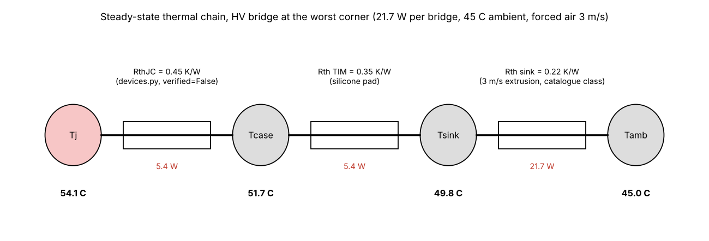
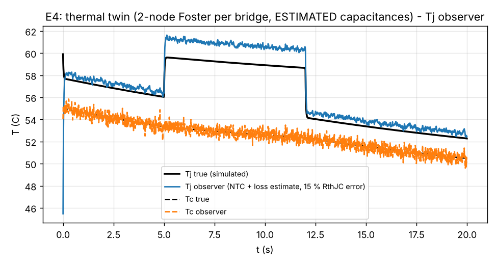

# 12 Thermal management

> Reading time: ~35 min. Prerequisites: chapters 03 (SiC devices), 06 (design calculations, loss budget),
> 11 (PCB layout). Files covered: `SiC_6k6_Industrial_DAB/13_Thermal_Analysis/thermal_analysis.py`,
> `SiC_6k6_Industrial_DAB/13_Thermal_Analysis/thermal_report.md`,
> `SiC_6k6_Industrial_DAB/04_Design_Calculations/design_values.json`,
> `SiC_6k6_Industrial_DAB/dabtools/dab/devices.py`, `Advanced_Research_2026/Digital_Twin/twin.py`,
> `Advanced_Research_2026/Digital_Twin/README.md` (section E4), `Advanced_Research_2026/Multiphysics_Models/`.

## Overview

**Level 1 - Beginner:** Every watt the converter loses becomes heat, and heat has to travel from the
tiny silicon-carbide chip, through the package, through a soft insulating pad, into an aluminium bar
with fins, and finally into the air that a fan blows past. Each step resists the flow of heat a bit,
like a chain of narrow pipes, and the temperature rises at every step. The chip must stay below its
limit (the device data say 175 C, the design uses 150 C as its own limit and keeps a large margin),
otherwise its resistance rises, its losses rise, and the loop runs away. Our converter loses about
92 W at nominal load and up to 140 W in the worst corner; with two finned bars and two 80 mm fans the
chips are calculated to sit below 60 C in a 45 C cabinet.

**Level 2 - Engineering:** `13_Thermal_Analysis/thermal_analysis.py` takes the loss split of
`04_Design_Calculations/design_values.json`, scales it to the worst corner of the operating envelope
by the squared rms-current ratio (2.22), and pushes the bridge losses through a two-resistance chain
per device (RthJC 0.45 / 0.30 K/W from `dabtools/dab/devices.py`, 0.35 K/W silicone pad) and one heat
sink per bridge (0.22 K/W at 3 m/s, catalogue class). Result at 45 C ambient: Tj 54 C (HV) and 58 C
(LV) at the worst corner; natural convection would reach 86 C and 96 C; a cold plate 50 C and 52 C.
The firmware limit is a heat-sink NTC trip at 95 C (`LIM_T_MAX_C` in
`10_Firmware/src/dab_params.h`); the required linear derating above 55 C ambient (APP-06) is a
requirement, not yet code.

**Level 3 - Research:** Steady-state chains say nothing about transients, cycling or the fact that
Tj cannot be measured. The digital-twin module adds a two-node thermal network per bridge with a
Kalman observer that estimates Tj from the case NTC and the loss model (`Digital_Twin/twin.py`,
`ThermalTwin`); on simulated load steps with a deliberately wrong RthJC (+15 %) and loss estimate
(+10 %) the observer is 1.1 K rms off, 1.6 K in steady state and 14 K at the step peak - the model
error, not the sensor noise, dominates. The planned `Multiphysics_Models` module (coupled
electro-thermal-ageing loop over a mission profile) has only an empty results folder today, so it is
`[Proposed]`; the gap analysis lists it at target maturity L2.

## Topics

### Heat sources and the loss-to-temperature chain

**What is it?** The steady-state thermal model: a loss P per device enters at the junction and flows
through RthJC (junction to case), the thermal-interface material (TIM) to the heat sink, and the heat
sink to ambient; the temperature at each node is the sum of P x Rth over the path
(`13_Thermal_Analysis/thermal_analysis.py`, function `tj()`). `[Simulated]`

**Why do we need it?** The device limit (Tj,max 175 C in `dabtools/dab/devices.py`, design limit
150 C in `design_values.json` `spec.Tj_max`) is a hard boundary for lifetime and for the loss model
itself (Rds(on) rises about 1.6x from 25 C to 150 C). Every cooling decision - fan, extrusion size,
cold plate - is taken against this chain.

**How does it work?**
**Level 1 - Beginner:** Think of heat as water and temperature as pressure. Each stage of the path
is a pipe with a resistance; the pressure (temperature) at the start equals the pressure at the end
plus flow x resistance for each pipe. Ohm's law for heat: dT = P x Rth.
**Level 2 - Engineering:** For one bridge with four devices on one bar:
T_sink = T_amb + P_bridge x Rth_sink; T_j = T_sink + (P_bridge/4) x (RthJC + Rth_tim). The script's
heat sources (worst corner of the envelope, scaled from the nominal loss split by
`scale_worst` = max over corners of (Irms1/Irms1,nom)^2 = (13.74 A / 9.23 A)^2 = 2.22): HV bridge
9.8 W nominal -> 21.7 W worst, LV bridge 15.7 -> 34.9 W, transformer 18.8 -> 41.7 W, series inductor
7.0 -> 15.6 W, DC-link capacitors 0.4 -> 0.8 W, auxiliary 12 W (table 1 of
`13_Thermal_Analysis/thermal_report.md`). The nominal bridge split from `design_values.json`
`nominal.losses`: HV conduction 6.11 W + ZVS turn-off 2.80 W + dead-time diode 0.87 W = 9.8 W; LV
conduction 12.46 W + turn-off 2.05 W + diode 1.23 W = 15.7 W; hard-switching terms are zero at
nominal (full ZVS).
**Level 3 - Research:** The chain hides three assumptions that the repository labels as such:
RthJC is a datasheet-typical value entered from memory (`verified=False` in `devices.py`), the TIM
value is a generic silicone-pad figure, and the heat-sink value is a catalogue-class number for a
150 x 60 x 40 mm extrusion. None of them is a measurement, and the loss model behind P is itself
unverified (chapter 06). Research-grade thermal work therefore starts with calibration: a thermal
transient measurement (structure function) on the real assembly gives RthJC and the TIM contribution
separately, which is exactly what the twin's observer error analysis asks for (E4 note: "calibration
need").

**Example from our converter:** Selected cooling, 3 m/s forced air, 45 C ambient, worst corner: HV
T_sink = 45 + 21.7 x 0.22 = 49.8 C, T_j = 49.8 + 5.43 x (0.45 + 0.35) = 54.1 C; LV T_sink = 45 +
34.9 x 0.22 = 52.7 C, T_j = 52.7 + 8.73 x (0.30 + 0.35) = 58.4 C - the table in the report rounds to
54 / 58 C. At nominal load the design calculation gives Tj 49.1 C (HV) and 51.0 C (LV)
(`design_values.json` `nominal.Tj1`, `nominal.Tj2`; `design_values.json` `heatsink` holds
`Rth_sink 0.22`, `Rth_tim 0.35`). `[Simulated]`

**Engineering calculations:** Per-device figures: HV 5.4 W, LV 8.7 W at the worst corner. The
junction-to-sink resistance per device is 0.80 K/W (HV) and 0.65 K/W (LV); four devices in parallel
on one bar give 0.20 / 0.16 K/W, comparable to the sink's 0.22 K/W, so the sink and the package each
take about half of the junction-to-ambient rise.

**Design decision made in this project:** TO-247-4 devices on two extruded bars (one per bridge),
insulated silicone pads, no thermal vias under the devices (they are not needed because the tabs are
on the bar), 2 oz copper on all layers to spread the lead heat (`thermal_report.md` section 2;
MEC-03 in `00_Requirements/01_requirements_specification.md`). `[Implemented]` in the layout.

**Alternatives considered:** Surface-mount devices with thermal vias to a bottom-side heat sink
(lower loop inductance, chapter 11, but the PCB becomes the thermal path); a cold plate (see the next
topic); one shared bar for both bridges (would bring HV and LV tabs onto one earthed metal part - fine
for insulation since both are basic to PE, but the mechanical layout of the floor plan favours two).

**How to verify it:** Today: `python3 13_Thermal_Analysis/thermal_analysis.py` regenerates the
tables and `img/thermal.png` (`[Simulated]`). On hardware: thermocouples under the clip of each
TO-247 tab, IR camera for PCB hot spots, thermal soak 2 h at full load with pass criteria "sink
< 60 C, transformer < 100 C" (`20_Experimental_Test_Plan/test_plan.md`, step 11).
`[Not yet tested]`

**Common mistakes:** Using the per-bridge loss in the per-device RthJC term (a factor of four);
forgetting the TIM; taking RthJC from a different package variant; ignoring that Rds(on) at the
computed Tj is higher than at 25 C (the loss model in chapter 06 iterates this).

**Interview explanation (30 s):** "Loss to temperature is a resistance chain: junction to case
0.45 K/W, pad 0.35 K/W, sink 0.22 K/W at 3 m/s. The worst-corner HV bridge dissipates 21.7 W,
5.4 W per device, so the junction sits about 9 K above ambient plus the sink rise: 54 C at 45 C
ambient. All three resistances are catalogue-class values, flagged for verification."

**Research-level explanation:** The chain is the zero-frequency limit of a Cauer network; its
parameters are the ones a structure-function measurement identifies, and until that measurement
exists the thermal margin is a model statement with an unquantified uncertainty - which the
uncertainty-quantification module (chapter 15) treats by sampling RthJC and the loss parameters.

### Cooling options and the selection

**What is it?** The comparison of five cooling options in `thermal_analysis.py` (`options` dict):
natural convection 1.0 K/W, forced air 2 m/s 0.30 K/W, 3 m/s 0.22 K/W, 5 m/s 0.16 K/W, cold plate at
45 C inlet 0.05 K/W, each at 45 C and 55 C ambient; the selection is forced air at 3 m/s with two
150 x 60 x 40 mm extrusions and two 80 mm fans (`thermal_report.md` sections 2 and 6; APP-08 in
`00_Requirements/01_requirements_specification.md`). `[Simulated]`

**Why do we need it?** The cooling method sets the enclosure concept (open with airflow vs sealed
IP54), the acoustic noise, the cost and the failure modes (fans). It must be fixed before the
mechanical layout of the board (chapter 11: bars along the top edge, x = 20-110 mm and 236-326 mm).

**How does it work?**
**Level 1 - Beginner:** A heat sink is a radiator: more fins and more air give lower temperature.
Still air is the worst case; a fan at a few metres per second cuts the sink resistance by four to
five; a water-cooled plate cuts it by twenty but needs pumps and a sealed design.
**Level 2 - Engineering:** The table in the report (Tj HV / Tj LV at 45 C and 55 C ambient): natural
71/86 and 81/96 C; 2 m/s 56/61 and 66/71 C; 3 m/s 54/58 and 64/68 C; 5 m/s 53/56 and 63/66 C; cold
plate 50/52 and 60/62 C. Every option satisfies the "Tj <= 125 C" column, so the choice is made on
margin: the report's argument is that at 3 m/s "if the real losses were 2x the model, Tj would still
be < 95 C", and that going from 3 to 5 m/s buys only 1-2 K. Note the honest wrinkle in the report:
the table marks natural convection as "yes" against 125 C, while the text says natural convection
"is not sufficient at 55 C" - the text applies the project's own margin policy (FMEA: "Tj < 75 C at
full load"), not the device limit.
**Level 3 - Research:** A cold plate "is only justified for a sealed (IP54 without airflow)
enclosure; it also cools the magnetics through the chassis". The research-level trade is between
fan reliability (FMEA row "Fans": S5 O3 D3, RPN 45, "no tachometer in rev A") and the sealed-enclosure
derating of the magnetics; a mission-profile study (`Multiphysics_Models`, `[Proposed]`) would decide
it by lifetime rather than by steady-state temperature.

**Example from our converter:** Two 80 mm fans of about 60 m3/h each across the 60 mm fin height give
about 3 m/s over the fins; the pressure drop is small because the extrusions are open; fan failure is
detected by the NTC rise and reported over CAN (`thermal_report.md` section 6). `[Simulated]` for the
air speed; `[Proposed]` for the fan monitoring, which has no tachometer input in rev A.

**Engineering calculations:** Air-speed estimate: 60 m3/h = 0.0167 m3/s per fan; through a duct of
150 mm length x 60 mm fin height minus fin area - the report simply states "about 3 m/s" for the
pair; with a free cross-section of 150 x 40 mm = 0.006 m2 one fan alone would give 2.8 m/s, so the
figure is plausible but is a stated estimate. Required sink resistance for Tj = 125 C at 55 C and
34.9 W (LV, the worse bridge): (125 - 55 - 8.73 x 0.65) / 34.9 = 1.84 K/W - natural convection would
in fact suffice for the device limit, which is why the selection is a margin choice.

**Design decision made in this project:** Forced air 3 m/s, two extrusions, two fans, open
enclosure with 45 C full-power ambient and derating to 55 C (APP-06, APP-08). `[Implemented]` as a
specification; `[Simulated]` as temperatures.

**Alternatives considered:** Natural convection (meets the device limit, fails the margin policy at
55 C); 5 m/s (noise for 1-2 K); cold plate (sealed enclosure only).

**How to verify it:** The script for the model; test step 11 (thermal soak) and the IR camera for the
assembly; anemometer reading of the real fin velocity is not in the test plan and should be added.
`[Not yet tested]`

**Common mistakes:** Reading a catalogue Rth that was measured at a different fin length or with a
centred heat source; forgetting the magnetics (41.7 W worst corner, more than either bridge) which
sit in the same air stream; placing the NTC far from the devices.

**Interview explanation (30 s):** "Five options were tabulated; all meet the 125 C device limit. We
chose 3 m/s forced air on two extrusions because it holds Tj under 60 C at 45 C ambient with a 2x
loss margin, costs 1-2 K against 5 m/s, and keeps the enclosure open so the magnetics are cooled for
free. The cold plate is the sealed-enclosure fallback."

**Research-level explanation:** The option table is a one-dimensional sweep of Rth_sink; a research
treatment would couple air speed, fan reliability, acoustic noise and magnetics temperature in one
objective and would use the uncertainty of the loss model (chapter 15) rather than a fixed 2x factor.

### Foster and Cauer networks: transient junction temperature

**What is it?** Dynamic thermal models made of thermal resistances and capacitances: a Cauer
(ladder) network has physical nodes with capacitances to ambient; a Foster network is a chain of
parallel R-C pairs fitted to a measured step response and has no physical node meaning. The twin
module implements a two-node ladder per bridge, Tj -(RthJC, CthJ)- Tc -(RthCA, CthC)- Tamb
(`Advanced_Research_2026/Digital_Twin/twin.py`, class `ThermalTwin`). `[Simulated]`

**Why do we need it?** Load steps, start-up and power cycling produce temperature swings that the
steady-state chain cannot show. Lifetime models (power cycling) need dTj per cycle, and a Tj observer
needs a dynamic model to combine a slow case sensor with a fast loss estimate.

**How does it work?**
**Level 1 - Beginner:** Heat does not arrive instantly: the chip is small and heats in milliseconds,
the heat sink is big and heats in minutes. A thermal model with "capacitors" (heat storage) captures
both time scales, like a small cup and a large bucket connected by pipes.
**Level 2 - Engineering:** `ThermalTwin` uses RthJC from `devices.py` (0.45 K/W for the HV device),
RthCA = 0.35 K/W, CthJ = 0.05 J/K, CthC = 60 J/K, sample time 1 ms, Tamb 45 C; the capacitances and
RthCA are labelled ESTIMATE in the docstring. The discrete state matrix (`A_B()`) is the explicit
Euler form: a11 = 1 - Ts/(RthJC CthJ), a12 = Ts/(RthJC CthJ), a21 = Ts/(RthJC CthC),
a22 = 1 - Ts/(RthJC CthC) - Ts/(RthCA CthC), input B = [Ts/CthJ, 0], ambient term
c = [0, Ts/(RthCA CthC) Tamb]. Time constants: tau_J = RthJC x CthJ = 22.5 ms; tau_C = RthCA x CthC
= 21 s. A Kalman filter (`step()`) with process noise Q = diag(0.5, 0.05), measurement noise from the
NTC (1 K) and initial covariance 25 corrects the state from the measured case temperature only
(H = [0, 1]).
**Level 3 - Research:** Two remarks for the reader who looks at the code. First, the docstring and
the E4 figure title call the network "Foster", but the structure - node capacitances to ambient,
series resistances - is a Cauer ladder; it is the better choice for an observer because its nodes are
physical (case temperature is a state), and the naming should be corrected. Second, a two-node model
cannot represent the die-attach and the base-plate layers separately; a measured Foster fit with
four to six pairs, converted to Cauer form, is the standard next step and needs the structure-function
measurement mentioned in the previous topic.

**Example from our converter:** Study E4 (`Advanced_Research_2026/Digital_Twin/run_twin_study.py`,
results in `Advanced_Research_2026/Digital_Twin/results/twin_study.json`): loss steps of 6 -> 14 ->
4 W per device, observer with +15 % RthJC error and +10 % loss-estimate error, NTC noise 1 K.
Tj error: 1.14 K rms, 1.65 K steady state after the step, 14.4 K peak during the step. The README
reads it honestly: the peak is observer lag plus model error; the NTC noise is not the limit.
`[Simulated]`

**Engineering calculations:** Steady-state check of the twin: at 14 W per device, Tj - Tc = 14 x
0.45 = 6.3 K; Tc - Tamb = 14 x 0.35 = 4.9 K (one device's share of the bar in the twin's
simplification). A +15 % RthJC error alone gives 0.95 K steady error at 14 W, and the +10 % loss
error 0.63 K - together consistent with the 1.65 K reported. During a step the junction settles in
about 5 tau_J = 0.11 s while the case needs about 100 s; the observer, which trusts the case sensor,
lags during those 0.1 s, hence the 14 K peak.

**Design decision made in this project:** Tj is estimated, not measured; the heat-sink NTC (J18/J19,
10 k NTC with 10 k pull-up to +3V3, `dabtools/kicad_dab/design_dab.py`) is the only thermal sensor;
the hardware trip is on the sink temperature (95 C). `[Implemented]` for the sensing chain;
`[Simulated]` for the observer.

**Alternatives considered:** Temperature-sensitive electrical parameters (Vsd at low current, Rds(on)
via the health-monitoring module, chapter 18) as a Tj measurement - proposed in
`Advanced_Research_2026/SiC_Health_Monitoring/`; a case thermocouple per device (test only).

**How to verify it:** `python3 Advanced_Research_2026/Digital_Twin/run_twin_study.py` reproduces E4
(about 45 s); on hardware the observer can be checked against a thermocouple under the TO-247 clip
(test step 11) and, for Tj, only against a TSEP calibration. `[Not yet tested]`

**Common mistakes:** Fitting a Foster network and then reading its intermediate nodes as physical
temperatures; using an Euler step larger than tau_J (here Ts = 1 ms vs 22.5 ms, stable); feeding the
observer with the nominal loss model while the device has aged (the health-monitoring link).

**Interview explanation (30 s):** "The twin has a two-node thermal ladder per bridge - junction
0.45 K/W and 0.05 J/K, case to ambient 0.35 K/W and 60 J/K - and a Kalman observer that corrects it
from the heat-sink NTC. With a deliberately wrong RthJC and loss estimate it tracks Tj to about 1 K
rms and 1.6 K steady, but it lags 14 K at a load step because the junction time constant is 20 ms and
the case sensor is slow."

**Research-level explanation:** Observer-based Tj estimation is limited by the parameter error of the
thermal network, not by sensor noise; the research path is joint estimation of RthJC and the loss
scale (the health-monitoring question) and a higher-order Cauer model identified by thermal
transient testing.

### Magnetics, capacitors, derating and thermal cycling

**What is it?** The non-semiconductor parts of the thermal budget: transformer and inductor
dissipation, film-capacitor hot-spot temperature, the ambient derating rule and the junction
temperature swing per power cycle (`thermal_report.md` sections 1, 3, 4, 5;
`design_values.json` `transformer`, `inductor`, `dclink`). `[Simulated]`

**Why do we need it?** The magnetics are the largest loss items (transformer 18.8 W nominal, 41.7 W
worst corner - more than either bridge), and the film capacitors' lifetime is a temperature and
voltage function; both are cooled by the same air stream as the bars.

**How does it work?**
**Level 1 - Beginner:** Transformers and inductors get warm from their copper and from the magnetic
material; capacitors get warm from the ripple current through their small internal resistance.
Running parts at lower voltage and temperature than their rating ("derating") makes them last longer.
**Level 2 - Engineering:** Transformer: E65/32/27 core, 3C95, 28:14 turns, core loss 11.4 W, copper
7.4 W, total 18.8 W nominal (`design_values.json` `transformer.P_core`, `P_cu`, `P_total`); the
magnetics design records a 35.7 K rise (`transformer.dT`), whereas the thermal report's text states
a 14 K rise at 3 m/s - two different models (the first without the forced-air assumption), to be
settled by the test. Inductor: E55/28/21, 17 turns, 2.1 mm gap, 7.0 W. Film capacitors: ESR loss
0.35 W total over eight parts, 0.04 W each, 15 K/W catalogue-class thermal resistance: hot spot
45 + 0.044 x 15 = 45.7 C, i.e. 46 C against an 85 / 105 C rating - "lifetime not limited by
temperature". Voltage derating: 850 V / 1100 V = 77 % (HV), 450 V / 700 V = 64 % (LV). Thermal
cycling: dTj per full on/off cycle = (21.7 / 4) x (0.45 + 0.35) = 4.3 K for the HV device, "far below
the 40-60 K swings where power-cycling lifetime becomes the limiting factor"; daily cycling for 10
years is 3650 cycles. Derating: the requirement APP-06 asks for full power to 45 C and a linear
derating to 70 % between 45 and 55 C; the script's own derating curve (allowed bridge loss for
Tj <= 125 C at 3 m/s) stays at 100 % up to 70 C because the devices are so lightly loaded, so the
APP-06 derating is a system policy, not a thermal necessity of the semiconductors.
**Level 3 - Research:** The 4 K swing is a steady-state number per on/off event; real mission
profiles (chapter 15 and the proposed multiphysics loop) add many small swings from load variation,
and the power-cycling models (Coffin-Manson-type lifetime vs dTj, with Tj,mean and heating time as
further parameters) are strongly non-linear, so a rain-flow count over a profile is needed before
any lifetime statement. The repository makes none: "manufacturer power-cycling curves to be
consulted for the exact device".

**Example from our converter:** NTC trip at 95 C sink temperature, "Tj about 110 C at the modelled
losses" (`thermal_report.md` section 5); firmware constant `LIM_T_MAX_C` = 95.0 in
`10_Firmware/src/dab_params.h` and `T_max: 95` in `11_Control_Algorithms/control_params.json`;
the fault code is `FLT_OT` in `10_Firmware/src/dab_control.h`. `[Implemented]` in the firmware
(SIL-tested, chapter 09); the linear derating above 55 C is `[Proposed]` (no code found for it).

**Engineering calculations:** Capacitor ripple current from `design_values.json` `dclink`: HV
4.17 A rms over four 20 uF parts, ESR 4 mohm: 4.17^2 x 0.004 = 0.070 W total (`nom1.P_esr`); LV
8.38 A rms over four 30 uF: 0.281 W (`nom2.P_esr`); sum 0.35 W as in the loss table. Bleeder
dissipation is separate: 0.51 W (HV) and 0.16 W (LV) at the design bleeder values (`R_bleed1`,
`P_bleed1`), see chapter 14 for the bleeder sizing question.

**Design decision made in this project:** Film capacitors only in the power path (no electrolytics),
77 / 64 % voltage derating, magnetics in the fan air stream, thermal NTC trip at 95 C sink
(`15_Safety_Reliability/02_FMEA.md`, "Reliability assessment"). `[Implemented]` as design values.

**Alternatives considered:** Electrolytic DC-link (cheaper per uF, but lifetime-limited by
temperature - rejected); mounting the magnetics on the heat sink / chassis (the cold-plate variant).

**How to verify it:** Thermocouples on the transformer outer winding, inductor core and two link
capacitors in test step 11; capacitance monitoring via ripple as a host function (FMEA row "DC-link
film capacitor", RPN 72). `[Not yet tested]`

**Common mistakes:** Treating the magnetics' temperature as the PCB's problem (the report notes the
PCB carries that heat); confusing the device-limit derating (flat here) with the system derating
policy (APP-06); forgetting that a 4 K steady swing says nothing about mission-profile cycling.

**Interview explanation (30 s):** "Beyond the bridges, the transformer is the biggest heater at
19-42 W; film capacitors sit at 46 C with 77 and 64 % voltage derating; the junction swing per
on/off cycle is only 4 K, so power cycling is not the lifetime limiter. The firmware trips at 95 C
sink temperature; the 55-70 C linear derating of the requirement is still to be coded."

**Research-level explanation:** Lifetime needs a mission profile, a rain-flow count and a
device-specific power-cycling model, all of which the proposed multiphysics module is meant to
provide; until then the project states derating factors and temperatures, not lifetimes.

### The electro-thermal twin and the multiphysics module (Level 3)

**What is it?** The coupling of the loss model, the thermal network and the device parameters into
one loop: losses heat the junction, the junction temperature raises Rds(on) (and shifts Coss and the
ZVS boundary), which changes the losses. Implemented in part as the twin's thermal layer (E4,
`Advanced_Research_2026/Digital_Twin/README.md` section 2) and planned as
`Advanced_Research_2026/Multiphysics_Models/` (gap-analysis rows 13 and 21: "coupled
electro-thermal-ageing loop, mission profile, coupling diagram" and "electro-thermal transient
(Foster), cycling, cooling comparison", target maturity L2). `[Simulated]` for E4; `[Proposed]` for
the module, whose folder holds only an empty `results/` directory at the time of writing.

**Why do we need it?** The steady-state analysis is open-loop: it takes losses at an assumed Tj.
Closing the loop is what makes a derating curve, a thermal runaway analysis (FTA top event TE3,
chapter 14) and a reliability-aware modulation (gap analysis "Contribution B") possible.

**How does it work?**
**Level 1 - Beginner:** Hotter chips lose more, more loss makes them hotter. Normally this settles at
a stable temperature; if the cooling is too weak it does not, and the chip runs away. A coupled model
finds the settling point - or the lack of one.
**Level 2 - Engineering:** The loss model already contains the temperature dependence
(`dabtools/dab/devices.py` `rds_on(dev, Tj)` linear between Rds_25 and Rds_150: 32 -> 52 mohm for
the HV device, 16 -> 27 mohm for the LV device); chapter 06's design script iterates Tj and Rds(on)
to the fixed point that gives Tj 49 / 51 C at nominal. A thermal-runaway criterion follows from the
loop gain: with dP/dTj = P_cond x (Rds_150 - Rds_25) / (125 K x Rds(Tj)) and the junction-to-ambient
resistance R_ja, the loop is stable when R_ja x dP/dTj < 1. HV device at the worst corner:
P_cond per device about 3.4 W (6.11 W x 2.22 / 4), dP/dTj = 3.4 x 0.020 / (125 x 0.035) = 0.0155 W/K,
R_ja per device = 0.80 + 4 x 0.22 = 1.68 K/W: loop gain 0.026, far from runaway.
**Level 3 - Research:** The twin's E4 study is the first element; the planned module adds ageing
(Rds(on) and RthJC drift as health indicators, shared with `SiC_Health_Monitoring`), a mission
profile and the cooling comparison under cycling. Its stated purpose in the gap analysis is to use
the electro-thermal twin "to score" modulation choices by lifetime - reliability-aware modulation. The
honest status: nothing of this exists as code yet; E4 and the health-monitoring module are the
building blocks.

**Example from our converter:** E4 results: Tj error 1.14 K rms, 1.65 K steady, 14.4 K peak
(`Advanced_Research_2026/Digital_Twin/results/twin_study.json`, key `E4`), figure
`Advanced_Research_2026/Digital_Twin/results/E4_thermal_twin.png`. `[Simulated]`

**Engineering calculations:** Loop-gain example above; for the LV device at the worst corner:
P_cond 6.9 W per device, dP/dTj = 6.9 x 0.011 / (125 x 0.018) = 0.034 W/K, R_ja = 0.65 + 0.88 =
1.53 K/W, loop gain 0.05. Even with natural convection (R_ja = 0.65 + 4.0 = 4.65 K/W) the LV loop gain
is 0.16: the design has no thermal-runaway risk at the modelled losses, which is why the FTA's TE3
frequency is tiny (1.7e-9 per year, chapter 14).

**Design decision made in this project:** Keep the thermal layer of the twin simple (two nodes,
Kalman) and label every capacitance as an estimate; defer the coupled mission-profile model to a
separate module with its own provenance file. `[Simulated]` / `[Proposed]`.

**Alternatives considered:** Finite-element thermal simulation of the board and bars (needs the
mechanical model; not in the repository); lumped three-dimensional network from the board copper
(possible from the generated geometry, as the parasitic extraction does for inductance).

**How to verify it:** For E4, re-run the twin study; for the module, nothing yet. Hardware
verification would be the thermal soak and TSEP-based Tj measurements. `[Not yet tested]`

**Common mistakes:** Claiming a lifetime from a steady-state temperature; coupling the models with
inconsistent operating points (loss at nominal, temperature at worst corner); forgetting that the
loss model's own uncertainty (chapter 15) is larger than the thermal network's.

**Interview explanation (30 s):** "The electro-thermal loop is closed in the design script - Rds(on)
rises 1.6x from 25 to 150 C and the Tj fixed point is 49-51 C - and in the twin, where a two-node
observer estimates Tj from the sink NTC. The loop gain is below 0.1 even with natural convection, so
runaway is not a risk; the coupled mission-profile and ageing module is planned, not written."

**Research-level explanation:** Reliability-aware operation needs the chain loss -> Tj -> ageing ->
loss to be closed over a mission profile with quantified uncertainty; the repository has the first
link simulated and the rest specified, which is the correct state to report for a module at L0-L1.

## Worked example(s) with real numbers

**1. Junction temperature at the worst corner, LV bridge, forced air 3 m/s, 55 C ambient.**
P_bridge = 15.7 W x 2.22 = 34.9 W (`thermal_report.md` table 1). T_sink = 55 + 34.9 x 0.22 = 62.7 C.
Per device 8.73 W; T_j = 62.7 + 8.73 x (0.30 + 0.35) = 68.4 C - the table says 68 C. Margin to the
design limit 150 C: 82 K; to the device limit 175 C: 107 K. `[Simulated]`

**2. What loss would bring the HV junction to 125 C at 45 C ambient with the selected cooling?**
P_allowed = (125 - 45) / (0.22 + (0.45 + 0.35)/4) = 80 / 0.42 = 190 W per bridge, 8.8 times the
worst-corner model value (the script's `P_allowed()`); that is why its derating curve is flat to 70 C.
`[Simulated]`

**3. Observer error budget (E4).** Steady state at 14 W per device: RthJC error 0.15 x 0.45 x 14 =
0.95 K; loss error 0.10 x 14 x 0.45 = 0.63 K; sum 1.6 K, matching the reported 1.65 K. Step
transient: the junction reaches 63 % of its new value after tau_J = 22.5 ms while the case has moved
by only 22.5 ms / 21 s = 0.1 %; the Kalman gain on the case measurement cannot see the junction
change yet, hence the 14 K peak error at the 8 K per-device step (6 -> 14 W: dTj,steady = 8 x 0.45 =
3.6 K through RthJC plus the case rise). `[Simulated]`

## How this chapter connects to the files

| File | What it contains | Status |
|---|---|---|
| `SiC_6k6_Industrial_DAB/13_Thermal_Analysis/thermal_analysis.py` | loss scaling, five cooling options, derating curve, capacitor and cycling notes, writes the report and figure | `[Simulated]` |
| `SiC_6k6_Industrial_DAB/13_Thermal_Analysis/thermal_report.md` | generated tables: heat sources, cooling options, selection, capacitors, cycling, airflow | `[Simulated]` |
| `SiC_6k6_Industrial_DAB/13_Thermal_Analysis/img/thermal.png` | Tj by option, derating vs ambient | `[Simulated]` |
| `SiC_6k6_Industrial_DAB/04_Design_Calculations/design_values.json` | nominal loss split, corners, `heatsink` (0.22 / 0.35 K/W), transformer and inductor losses, DC-link ripple | `[Simulated]` |
| `SiC_6k6_Industrial_DAB/dabtools/dab/devices.py` | RthJC 0.45 / 0.30 K/W, Tj_max 175 C, Rds(on) vs Tj, all `verified=False` | `[Implemented]` (datasheet-typical from memory) |
| `SiC_6k6_Industrial_DAB/00_Requirements/01_requirements_specification.md` | APP-06 (ambient, derating), APP-08 (cooling baseline), MEC-03 | `[Implemented]` |
| `SiC_6k6_Industrial_DAB/10_Firmware/src/dab_params.h`, `10_Firmware/src/dab_control.h` | `LIM_T_MAX_C` 95 C, `FLT_OT` | `[Verified]` (SIL harness, chapter 09) |
| `SiC_6k6_Industrial_DAB/20_Experimental_Test_Plan/test_plan.md` | step 11 thermal soak, thermocouple placement | `[Proposed]` |
| `Advanced_Research_2026/Digital_Twin/twin.py` | `ThermalTwin`: two-node ladder, Kalman observer | `[Simulated]` |
| `Advanced_Research_2026/Digital_Twin/run_twin_study.py`, `results/twin_study.json`, `results/E4_thermal_twin.png` | E4 study and its numbers | `[Simulated]` |
| `Advanced_Research_2026/Digital_Twin/README.md` | section 2 table (E4 row), section 5 "what was not verified" | `[Implemented]` |
| `Advanced_Research_2026/Multiphysics_Models/` | empty `results/` folder; module specified in `Advanced_Research_2026/00_Gap_Analysis_and_Plan.md` rows 13 and 21 | `[Proposed]` |
| `21_Human_Friendly_Learning_Notes/img/make_figures_ch11_14.py` | the thermal-chain sketch | `[Implemented]` |

## Viva / interview questions

### Basic (10)

1. What is RthJC?
   The thermal resistance from the junction (the chip) to the case (the package tab), in K/W; 0.45 K/W
   for the HV device and 0.30 K/W for the LV device in `devices.py` (datasheet-typical, unverified).
2. Why is there a silicone pad between the TO-247 and the heat sink?
   The tab is at drain potential; the pad insulates it from the earthed bar (basic insulation to PE) at
   the cost of 0.35 K/W and about 100 pF of capacitance (chapter 13).
3. How much does the converter lose at nominal load?
   92.2 W for 98.6 % calculated efficiency; the bridges 9.8 W and 15.7 W, the transformer 18.8 W.
4. What cooling was selected?
   Forced air, 3 m/s, two 150 x 60 x 40 mm extrusions (0.22 K/W each), two 80 mm fans.
5. What is the calculated junction temperature at nominal load?
   49 C (HV) and 51 C (LV) at 45 C ambient.
6. What is the worst-corner junction temperature with the selected cooling?
   54 C (HV) and 58 C (LV) at 45 C; 64 / 68 C at 55 C.
7. What does the heat-sink NTC do?
   It trips the firmware at 95 C sink temperature (`FLT_OT`) and is the only thermal sensor; Tj is
   estimated, not measured.
8. Why are film capacitors used instead of electrolytics?
   Their lifetime is not limited by temperature at 46 C hot spot and they are voltage-derated to
   77 / 64 %; no electrolytics in the power path is a stated reliability choice.
9. What is a Foster network, what is a Cauer network?
   Both are R-C ladders for transient heat flow; Cauer nodes are physical (capacitance to ambient),
   Foster pairs are a mathematical fit of a step response with no physical nodes.
10. Is natural convection enough?
    It meets the 125 C device limit (86 / 96 C at 45 / 55 C) but not the project's margin policy, so
    the report calls it insufficient at 55 C.

### Intermediate (10)

1. Derive the worst-corner scaling factor.
   Conduction loss scales with Irms^2; the worst corner has Irms1 = 13.74 A against 9.23 A nominal,
   so the factor is (13.74 / 9.23)^2 = 2.22, applied by the script to all bridge and magnetics losses.
2. Compute T_j for the HV bridge at 45 C with forced air 3 m/s.
   T_sink = 45 + 21.7 x 0.22 = 49.8 C; T_j = 49.8 + 5.43 x 0.80 = 54.1 C.
3. Why does the script's derating curve stay at 100 % to 70 C ambient?
   The allowed bridge loss for Tj = 125 C is 190 W against a 21.7 W worst-corner model; the devices
   are lightly loaded, so the APP-06 derating is a system policy rather than a semiconductor limit.
4. What are the two time constants of the twin's thermal model?
   tau_J = 0.45 x 0.05 = 22.5 ms (junction) and tau_C = 0.35 x 60 = 21 s (case / sink).
5. Why is the observer's peak error 14 K although its steady error is 1.6 K?
   During a step the junction moves within 0.1 s while the case sensor has not moved; the Kalman
   correction only acts on the case state, so the junction estimate relies on the (wrong) model until
   the case catches up.
6. How is the dTj per on/off cycle computed and what does it mean?
   (P_bridge / 4) x (RthJC + Rth_tim) = 5.43 x 0.80 = 4.3 K; it is far below the 40-60 K regime where
   power-cycling lifetime limits, but it ignores mission-profile cycling.
7. Which loss item is the largest and where is it cooled?
   The transformer (18.8 W nominal, 41.7 W worst corner), cooled in the same 3 m/s air stream; its
   calculated rise is quoted as 35.7 K in the magnetics design and 14 K in the thermal text - an
   inconsistency to settle by test.
8. What does "catalogue-class" mean for the heat-sink Rth?
   A value typical of a 150 x 60 x 40 mm extrusion from vendor tables, not the chosen part's datasheet
   and not a measurement; the report flags it "verify with the chosen part".
9. What is the capacitor hot-spot calculation?
   45 C + (0.35 W / 8) x 15 K/W = 45.7 C, i.e. 46 C; the 15 K/W is itself a catalogue-class value.
10. What would the twin need from hardware to improve?
    A calibration of RthJC and the loss scale (thermal transient test, TSEP), because the error is
    dominated by those parameters, not by the NTC noise.

### Advanced / research (10)

1. Derive a thermal-runaway criterion and evaluate it for this design.
   Loop gain G = R_ja x dP/dTj with dP/dTj = P_cond x (Rds_150 - Rds_25) / (125 K x Rds); HV device
   at the worst corner: 1.68 K/W x 0.0155 W/K = 0.026; LV with natural convection 0.16. Stable
   everywhere (G < 1), consistent with the FTA's tiny TE3 frequency.
2. Why is the twin's network a Cauer rather than a Foster network, despite its name?
   Its capacitances connect the nodes to ambient and the resistances are in series between physical
   nodes (junction, case); a Foster network would have each R in parallel with its C and no physical
   intermediate node. The observer needs the physical case node.
3. How would you identify a higher-order thermal model for the assembly?
   Thermal transient testing: heat with a known power, record the cooling curve via a TSEP, compute
   the structure function, fit a Foster series and convert to Cauer; this separates die attach, pad
   and sink.
4. What uncertainty dominates the Tj estimate, and how would UQ treat it?
   RthJC (unverified) and the loss model (unverified device parameters); chapter 15's uncertainty
   module samples these and propagates them to Tj and efficiency distributions.
5. Why can a derating curve not be taken from the semiconductor limit alone?
   Magnetics (41.7 W, 35.7 K rise), capacitors, fan reliability and enclosure temperature limits
   enter; the APP-06 policy (70 % at 55 C) is the system-level envelope.
6. Sketch the planned multiphysics loop.
   Operating point -> loss model (Tj-dependent) -> thermal network (transient) -> Tj and dTj
   history -> ageing model (Rds(on), RthJC drift) -> back into the loss model; evaluated over a
   mission profile with rain-flow counting; outputs lifetime consumption per modulation choice.
7. How does the thermal model link to the FTA top event TE3 (thermal runaway)?
   TE3's cut sets need a loss of cooling and a failed OT trip and a loss of derating; the low loop
   gain makes the hazard rate 1.68e-9 per year in the FTA - under the stated rate assumptions.
8. What is wrong with using one NTC per bar for eight devices?
   It averages four devices and cannot see one device with a degraded TIM or a bond-wire lift; the
   health-monitoring module proposes per-device electrical indicators instead.
9. Where would an SMD-package redesign change the thermal picture?
   The PCB becomes the thermal path (thermal vias to a bottom-side sink): lower loop inductance but
   RthJC-equivalent dominated by the via field and the board; the trade-off with chapter 11.
10. How should a thermal statement be phrased in a repository without hardware?
    As "calculated with stated parameters and tags": Tj 54 C `[Simulated]`, RthJC unverified, heat
    sink catalogue class, observer `[Simulated]`, module `[Proposed]` - never as a measured margin.

## Pitches

**30 s:** "Thermal design here is a resistance chain with honest labels: 0.45 K/W junction to case,
0.35 K/W pad, 0.22 K/W extrusion at 3 m/s. The worst-corner bridges lose 22 and 35 W, so the
junctions sit at 54-58 C in a 45 C cabinet with a 2x loss margin. The twin adds a two-node observer
that estimates the unmeasurable Tj within 1-2 K in steady state; the coupled ageing model is the next
module."

**2 min:** Open with the heat-source table (bridges, transformer as the biggest, capacitors small),
then the chain and the worked number for the HV bridge, then the five-option table and why 3 m/s was
chosen (margin, not limit; natural convection meets 125 C but not the policy), then the capacitor and
cycling notes (46 C, 77/64 % derating, 4 K swing), then the firmware side (95 C NTC trip exists;
55-70 C linear derating is still a requirement), and close with the twin's E4 study (1.1 K rms, 14 K
step peak, model error dominates) and the empty multiphysics folder as the honest frontier.

**10 min outline:**
* Heat sources: nominal vs worst-corner losses and the 2.22 scaling
* The chain: RthJC, TIM, sink; per-device vs per-bridge; the figure `img/ch12_thermal_chain.png`
* Cooling options table; selection logic; airflow estimate; fan failure detection
* Magnetics and capacitors: losses, hot spots, voltage derating, the two transformer-rise figures
* Thermal cycling: dTj per cycle, why mission profiles are needed for lifetime
* Firmware: NTC trip, `FLT_OT`, APP-06 derating status
* Transient models: Cauer vs Foster, the twin's two-node observer, E4 numbers and their reading
* Electro-thermal coupling: Rds(on)(Tj), loop-gain runaway criterion, link to FTA TE3
* Multiphysics module: what is specified, what exists (nothing yet), how it connects to health monitoring
* Verification: what the script proves, what only test step 11 and a TSEP calibration can prove

## Further reading

* `SiC_6k6_Industrial_DAB/13_Thermal_Analysis/thermal_report.md` - the generated analysis with its
  verification flags.
* `Advanced_Research_2026/Digital_Twin/README.md` sections 2 and 5 - the E4 study and the list of
  what was not verified.
* `Advanced_Research_2026/00_Gap_Analysis_and_Plan.md` rows 13 and 21 - the multiphysics plan.
* Literature database `Advanced_Research_2026/Literature_Database/literature_2022_2026.csv`: L11
  (review of prognosis approaches for SiC MOSFETs, accessible), L13 and L14 (condition monitoring
  and online Rds(on) estimation) for the temperature-sensitive electrical parameters that a Tj
  measurement would use.
