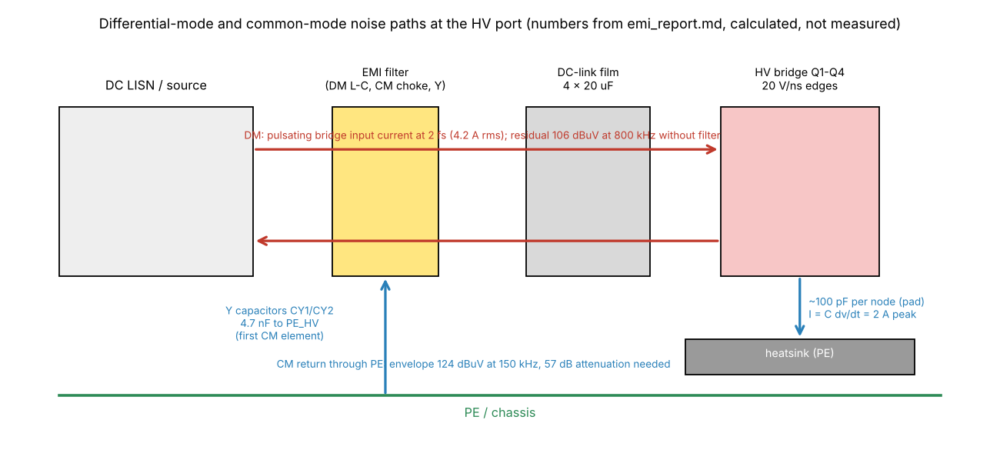
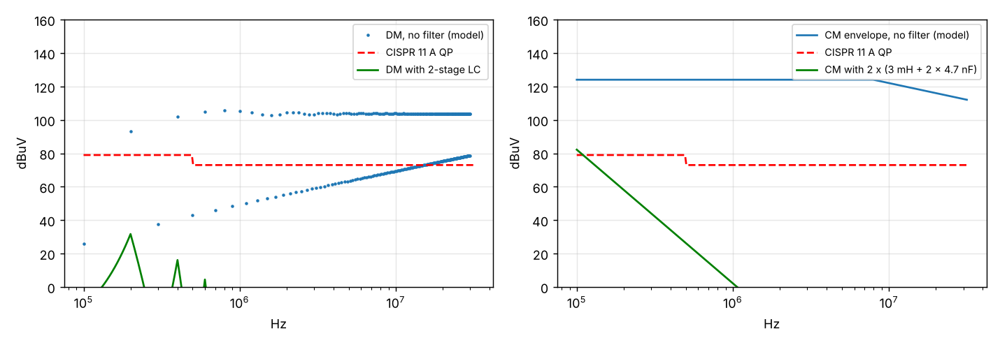

# 13 EMI/EMC and filters

> Reading time: ~35 min. Prerequisites: chapters 02 (switching), 04 (DAB operation), 11 (PCB layout).
> Files covered: `SiC_6k6_Industrial_DAB/14_EMI_EMC/emi_analysis.py`,
> `SiC_6k6_Industrial_DAB/14_EMI_EMC/emi_report.md`, `SiC_6k6_Industrial_DAB/14_EMI_EMC/img/emi_estimate.png`,
> `SiC_6k6_Industrial_DAB/04_Design_Calculations/design_values.json`, `SiC_6k6_Industrial_DAB/16_BOM/bom.md`,
> `SiC_6k6_Industrial_DAB/06_Magnetics/magnetics_design.md`, `SiC_6k6_Industrial_DAB/20_Experimental_Test_Plan/test_plan.md`,
> `Advanced_Research_2026/Parasitic_Extraction/results/parasitics.json`.

## Overview

**Level 1 - Beginner:** A converter that switches 800 V in a few tens of nanoseconds is a small radio
transmitter whether it wants to be or not. The noise leaves in two ways: as a ripple current that goes
out on one DC wire and back on the other ("differential mode"), and as a current that goes out on both
wires together and returns through the earth ("common mode"). Standards set how much of each may
appear on the cables; filters - coils and capacitors at the ports - and careful layout keep the
converter under the line. Everything in this chapter is calculated: no EMI has been measured, because
nothing has been built.

**Level 2 - Engineering:** `14_EMI_EMC/emi_analysis.py` computes the differential-mode spectrum of
the HV-bridge input current from the DAB model (4.2 A rms pulsating at 2 fs), the voltage this makes
across a 100 ohm DC-LISN behind the DC-link capacitors (106 dBuV at 800 kHz without a filter), and
a common-mode envelope from four switching nodes at 20 V/ns through about 100 pF each to the earthed
heat sink (124 dBuV at 150 kHz). Against the CISPR 11 class A group 1 quasi-peak limits (79 dBuV
below 500 kHz, 73 dBuV above) with 6 dB margin, that needs 39 dB of DM and 57 dB of CM attenuation
between 150 kHz and 2 MHz. The proposed two-stage filter - per stage 10 uH + 2.2 uF X2 for DM and a
3 mH nanocrystalline choke + 2 x 4.7 nF Y1 for CM - gives a calculated 52 dB (DM) and 56 dB (CM) at
150 kHz. On the board, the first CM elements are the Y1 capacitors CY1-CY4 (4.7 nF) from each rail to
the regional PE lug.

**Level 3 - Research:** The CM estimate stands or falls with three capacitances that nobody has
measured: the device-to-heat-sink capacitance through the pad (assumed 100 pF per node), the
transformer interwinding capacitance (631 pF from the winding geometry, 12.6 A displacement-current
pulses at 20 V/ns) and the isolation capacitance of the bias modules (< 10 pF each, claimed). The
parasitic-extraction module gives the inductive side (28 nH commutation loop, 73 MHz ring) that sets
the radiated-band content above 30 MHz, which the script does not model at all. Active gate drive
(chapter 18) is the research route to lower dv/dt at a loss cost; the trade-off cannot be settled
without a LISN measurement, which is test step 12 of the test plan.

## Topics

### Standards, limits and what is being promised

**What is it?** The applicable emission and immunity standards for an industrial-cabinet DC-DC
converter as listed in `14_EMI_EMC/emi_report.md` section 1: emission CISPR 11 / EN 55011 class A
group 1 (conducted 150 kHz - 30 MHz on the DC ports with a DC LISN per CISPR 16-1-2, radiated 30 MHz -
1 GHz at 10 m), IEC 61800-3 category C3 "by analogy"; immunity IEC 61000-6-2 (ESD 4/8 kV, RF 10 V/m,
EFT 2 kV on power ports, surge 1/2 kV, conducted RF 10 V). `[Implemented]` as a documented
assumption.

**Why do we need it?** A limit line turns "noisy" into a number. The filter is sized against the
limit minus a margin, and the pre-compliance test (step 12) is judged by the same line.

**How does it work?**
**Level 1 - Beginner:** Standards say how loud you may be at each frequency, measured in a defined
way with a defined "ear" (the LISN and the receiver). Industrial equipment (class A) may be louder
than household equipment (class B) because it lives in cabinets, not living rooms.
**Level 2 - Engineering:** The script codes the class A group 1 conducted quasi-peak limit as
79 dBuV from 150 to 500 kHz and 73 dBuV from 0.5 to 30 MHz (average 66 / 60 dBuV, noted in a
comment, `limit_qp()` in `emi_analysis.py`). Required attenuation = max over the band of (estimate -
limit) + 6 dB margin. The DC-port measurement uses a DC LISN; the script models the LISN as 100 ohm
differential (2 x 50 ohm) for DM and 25 ohm for CM (two 50 ohm in parallel).
**Level 3 - Research:** Two honest limitations are stated in the report itself: compliance "is
demonstrated only by test in an accredited lab", and the choice of CISPR 11 class A for a DC-port
converter is an engineering mapping (IEC 61800-3 C3 "by analogy"), not a product-standard citation.
Research-grade work would also address the 9-150 kHz band (below the switching frequency of 100 kHz
the fundamental ripple sits at 200 kHz, but the 2 fs component and its sub-harmonics from modulation
matter for newer DC-grid standards), which the script does not evaluate.

**Example from our converter:** Required attenuation with 6 dB margin: DM 39 dB, CM 57 dB in
150 kHz - 2 MHz (`emi_report.md` section 3). Pre-compliance plan: conducted emissions on both DC
ports, QP and AV, at 25/50/100 % load, both power directions; radiated pre-scan with near-field probes;
immunity with the functional criterion "no fault trip, < 1 % regulation disturbance"
(`emi_report.md` section 5; `20_Experimental_Test_Plan/test_plan.md` step 12, pass criterion
"margin >= 6 dB"). `[Proposed]`

**Engineering calculations:** dBuV conversion: 20 log10(V / 1 uV); 79 dBuV = 8.9 mV, 73 dBuV =
4.5 mV across the LISN. The DM estimate of 106 dBuV is 200 mV - 27 dB above the 79 dBuV line at
800 kHz (where the limit is 73 dBuV, so 33 dB over; plus 6 dB margin gives the 39 dB requirement).

**Design decision made in this project:** Design to class A group 1 with a 6 dB margin at the
pre-compliance stage, both ports treated as DC ports with a DC LISN. `[Implemented]` as a decision.

**Alternatives considered:** Class B (household, 13 dB tighter below 500 kHz) - not the installation;
IEC 61800-3 C2 - would apply to a drive in a public network; neither chosen.

**How to verify it:** Only by measurement (test step 12 with two DC LISNs and an EMI receiver
9 kHz - 30 MHz, instruments listed in `test_plan.md`). The script `[Simulated]`; compliance
`[Not yet tested]`.

**Common mistakes:** Comparing an average-detector estimate with a quasi-peak limit; forgetting the
margin; assuming a DC port is measured like an AC mains port.

**Interview explanation (30 s):** "We design to CISPR 11 class A group 1 conducted limits on the DC
ports, 79 dBuV below 500 kHz and 73 above, quasi-peak, with 6 dB margin, and IEC 61000-6-2 for
immunity. The analysis gives the required attenuation - 39 dB DM, 57 dB CM - and the report says in
its first lines that compliance is only demonstrated by test."

**Research-level explanation:** The mapping of a DC-DC converter onto CISPR 11 and 61800-3 is itself
an engineering judgement; emerging DC-grid EMC practice extends the band downward and defines the
DC LISN differently, so the standard choice should be re-validated at the independent review.

### Differential-mode noise and the DC link

**What is it?** The spectrum of the pulsating current that the HV bridge draws from its DC link and
the voltage it produces on the port through the capacitor impedance (`emi_analysis.py`: `i_br = pt.i *
np.sign(pt.v1)`, FFT, capacitor impedance ESR + j(2 pi f ESL - 1/(2 pi f C))). `[Simulated]`

**Why do we need it?** The DC-link capacitors are the first DM filter; whatever they do not absorb
appears on the cable. The estimate tells how much the external filter must add.

**How does it work?**
**Level 1 - Beginner:** The bridge takes current from the capacitors in gulps, twice per switching
period. A big capacitor smooths the gulps, but every real capacitor has a little resistance and a
little inductance, so a small ripple voltage survives and travels down the cable.
**Level 2 - Engineering:** The DAB model (`dabtools/dab/dab_model.py`, `DABPoint(800, 400, n, L,
fs, phi_nom, N=8192)`) gives the inductor current i(t); the bridge input current is i(t) times the
sign of the bridge voltage, with its mean removed: 4.2 A rms, consistent with the 4.17 A rms DC-link
ripple current of `design_values.json` (`dclink.nom1.I_rms`). Its FFT is a line spectrum at
multiples of 2 fs = 200 kHz. The capacitor bank: C1 = 80 uF (4 x 20 uF), ESR 4 mohm, ESL 20 nH
(assumed in the script); the LISN 100 ohm sits in parallel. The voltage is spec x (Zc || 100 ohm):
at 200 kHz |Zc| is about 10 mohm (capacitive 10 mohm, inductive 25 mohm, net 15 mohm), so almost
all current flows in the capacitor and the LISN sees a few millivolts; the bank's self-resonance is
at 1/(2 pi sqrt(20e-9 x 80e-6)) = 126 kHz, above which the ESL dominates and the voltage rises with
frequency - hence the maximum of 106 dBuV at 800 kHz (fourth harmonic of 2 fs).
**Level 3 - Research:** The 20 nH ESL is the lever and the unknown: it is the capacitor's own ESL
plus the loop from the capacitor terminals to the port, which the layout (chapter 11: film capacitors
feeding the planes, HV_IN pour (8-40, 64-76) on both outer layers) keeps short but which only an
impedance measurement of the assembled link gives. The parasitic-extraction module quantifies the
commutation loop (28 nH) but not the link-to-port loop; extending it to that loop is a small, useful
step.

**Example from our converter:** "The HV-bridge input current is pulsating at 2 fs with 4.2 A rms;
the link capacitors (4 x 20 uF, ESR 4 mOhm, ESL 20 nH) absorb it but the residual voltage across a
100 Ohm LISN reaches 106 dBuV at 800 kHz without a filter" (`emi_report.md` section 2).
`[Simulated]`

**Engineering calculations:** Bank impedance at 800 kHz: capacitive 1/(2 pi x 8e5 x 8e-5) =
2.5 mohm, inductive 2 pi x 8e5 x 2e-8 = 100 mohm, ESR 4 mohm: |Zc| = 98 mohm. A harmonic of 2 A
amplitude at 800 kHz would give 0.2 V = 106 dBuV across Zc || 100 ohm - the order of the reported
peak. Filter: two stages of 10 uH + 2.2 uF, each 20 log10((2 pi f)^2 L C) above resonance
(f0 = 1/(2 pi sqrt(10e-6 x 2.2e-6)) = 34 kHz): at 150 kHz 25.8 dB per stage, 52 dB for two
(`lc_att()`); at 800 kHz 54 dB per stage.

**Design decision made in this project:** Film DC link with four parallel parts per side (ESR and
ESL in parallel), HF 2220 MLCCs at the devices for the commutation loop, external two-stage LC for the
port. `[Implemented]` for the link and MLCCs (schematic, chapter 10); `[Proposed]` for the external
filter (not on the board, not in the BOM).

**Alternatives considered:** Larger link capacitance (the ripple is already 0.01 %, chapter 06; it
does not help above the self-resonance); a single filter stage (would need 39 dB at 150 kHz from one
LC: f0 would have to be below 15 kHz, i.e. a large choke).

**How to verify it:** Impedance analyser on the assembled link (the instrument list has a
100 Hz - 1 MHz LCR for magnetics; the link needs a wider range) and the LISN measurement.
`[Not yet tested]`

**Common mistakes:** Modelling the link as an ideal capacitor (the ESL makes it inductive above
126 kHz); forgetting that a DAB's input current has a 2 fs fundamental, not fs; using the LISN's
50 ohm per line as if the capacitor were absent.

**Interview explanation (30 s):** "DM noise is the 2 fs pulsating bridge current, 4.2 A rms, into a
link whose impedance turns inductive above about 130 kHz because of 20 nH of ESL. The model shows
106 dBuV at 800 kHz on a DC LISN without a filter; two 10 uH / 2.2 uF stages give 52 dB at 150 kHz,
more at the peak frequency."

**Research-level explanation:** The DM estimate is a linear circuit calculation with an assumed ESL;
its uncertainty is dominated by the link-to-port loop, which is a geometry quantity that the
parasitic-extraction approach could compute from the board file.

### Common-mode noise: dv/dt and parasitic capacitances

**What is it?** The current that the switching-node voltage edges push through parasitic
capacitances to earth: the device tab to the heat sink through the insulating pad, the transformer
primary to secondary, the bias modules' isolation capacitance (`emi_analysis.py`: `dvdt = 20e9`,
`Cp = 50e-12 * 2`, trapezoid envelope). `[Simulated]`

**Why do we need it?** CM current closes through PE and the cables; it is the dominant conducted
emission of fast SiC converters and the hardest to filter, because the CM choke must carry the full
DC current and the Y capacitance is limited by safety.

**How does it work?**
**Level 1 - Beginner:** Every metal part at switching potential is one plate of a capacitor whose
other plate is the earthed heat sink or the other winding. When the voltage jumps, a current spike
flows through that capacitor - the faster the jump, the bigger the spike - and it has to find its
way back through the earth wire.
**Level 2 - Engineering:** With dv/dt = 20 V/ns and 800 V, the edge lasts tr = 40 ns; the CM pulse
is I = Cp dv/dt = 100 pF x 20 V/ns = 2.0 A peak per node, four pulses per period from the four
switching nodes (two per bridge). The script's trapezoid-pulse envelope for the harmonic amplitude is
env(f) = 2 I tr fs x min(1, 1/(pi f tr)) x 4, converted with the 25 ohm CM LISN impedance:
124 dBuV at 150 kHz, falling at -20 dB/decade above 1/(pi tr) = 8 MHz. The transformer couples HV-side
CM to the LV port through C_iw = 631 pF (`design_values.json` `transformer.C_iw`); the magnetics
design (`06_Magnetics/magnetics_design.md`, insulation section) estimates i = C dv/dt of about 12 A
peak displacement pulses through that capacitance.
**Level 3 - Research:** All three capacitances are assumptions: the pad capacitance (100 pF per
node is a round number for a TO-247 tab on a silicone pad), C_iw from a parallel-plate estimate of the
interleaved P/2-S-P/2 winding, and the module isolation capacitance from datasheets. The research
frontier is twofold: measurement (a CM current probe on the PE strap, a network analyser on the
transformer) and mitigation at the source - the shield foil between primary and secondary tied to the
HV link midpoint, listed in the EMI report as an option "specified in 06_Magnetics", and the
active-gate-drive module that trades dv/dt for switching loss (literature L21, L22). The project's
Parasitic_Extraction module gives the inductive partner of this picture: a 28 nH loop with 170 pF
Coss rings at 73 MHz, which is where the radiated band begins and which the conducted script does not
cover.

**Example from our converter:** "Four switching nodes with ~20 V/ns edges drive 2.0 A peak pulses
through ~100 pF per node to the earthed heatsink; the transformer interwinding capacitance (631 pF)
couples HV-side CM noise to the LV port. Envelope estimate: 124 dBuV at 150 kHz" (`emi_report.md`
section 2). `[Simulated]`

**Engineering calculations:** Envelope at 150 kHz: 2 x 2.0 A x 40e-9 s x 1e5 Hz x 4 = 0.064 A
(below the corner, min(...) = 1); across 25 ohm: 1.6 V = 124 dBuV. Required CM attenuation: 124 - 79
+ 6 = 51 dB at 150 kHz, but the maximum of (estimate - limit) over the band is at 500 kHz where the
limit steps to 73 dBuV and the envelope is still flat (124 dBuV): 124 - 73 + 6 = 57 dB - the
reported requirement. CM filter: 3 mH choke with 2 x 4.7 nF to PE per stage, f0 = 1/(2 pi sqrt(3e-3
x 9.4e-9)) = 30 kHz, 28 dB per stage at 150 kHz, 56 dB for two - 1 dB short of the 57 dB target at
150 kHz, i.e. 5 dB rather than 6 dB margin at the band edge; the report states both numbers without
drawing attention to the gap.

**Design decision made in this project:** Accept the 20 V/ns edges (set by the gate resistors,
chapter 11: 3.3 ohm on / 1.5 ohm off) and filter; keep the CM sources local with Y capacitors at each
rail and PE lugs per region; isolate the sensing with AMC1301 amplifiers so no HV reference enters the
control ground. `[Implemented]` for the on-board parts.

**Alternatives considered:** Slower gates (lower dv/dt, more loss: the dead-time and ZVS budget of
chapter 04 limits this); shield foil in the transformer (option, costs leakage and capacitance to the
shield); balanced (split) inductor on both HV rails for CM symmetry (not in the design).

**How to verify it:** CM current probe on the PE strap and the LISN CM measurement (test step 12);
transformer C_iw by LCR at 100 kHz (test step 2 item 4 in `20_Experimental_Test_Plan/test_plan.md`).
`[Not yet tested]`

**Common mistakes:** Treating the heat sink as "ground" rather than as the CM return (it is bonded to
PE through straps whose inductance matters); summing CM sources without their phases; forgetting the
LV side (the transformer carries HV-side CM to the LV port).

**Interview explanation (30 s):** "CM comes from 20 V/ns edges through about 100 pF per switching
node into the earthed heat sink - 2 A pulses, 124 dBuV envelope at 150 kHz - plus the transformer's
631 pF to the LV side. We need 57 dB; two stages of a 3 mH nanocrystalline choke with 4.7 nF Y1
capacitors give a calculated 56 dB at 150 kHz, so the band edge is the critical point."

**Research-level explanation:** CM prediction at the design stage is bounded by unmeasured
capacitances; the research value of the module lies in making the sensitivity explicit (dv/dt, Cp,
C_iw, Y limit) so that a measurement on the first prototype can be attributed, and in connecting to
active gate control as the only source-side lever.

### Y capacitors, CM chokes and the PE structure

**What is it?** The on-board CM elements - CY1/CY2 (HV_P and HV_N to PE_HV), CY3/CY4 (LV_P and LV_N
to PE_LV), 4.7 nF Y1 safety capacitors, Vishay VY1472M63Y5UQ63V0, 500 Vac - and the off-board CM
chokes of the proposed filter; the three PE nets and the single-point control-ground bond R173
(`dabtools/kicad_dab/design_dab.py` lines for CY1-CY4, J20-J22, R173; `16_BOM/bom.md`).
`[Implemented]` on the board; chokes `[Proposed]`.

**Why do we need it?** A Y capacitor gives the CM current a short local return to earth before it
reaches the cable; a CM choke raises the impedance of the cable path; together they form the CM
L-C filter. Where the PE connections are made decides whether the CM current circulates locally or
through the control ground.

**How does it work?**
**Level 1 - Beginner:** The Y capacitor is a short-cut for the fast noise current back to the metal
box, placed right where the cable leaves. The CM choke is a ring of magnetic material around both
wires that lets the wanted current (out on one, back on the other) pass but blocks current that goes
the same way on both.
**Level 2 - Engineering:** Y1 class capacitors are used because they sit across a basic-insulation
barrier (power circuit to PE); 4.7 nF per rail is the first stage of the CM filter in the report
("2 x 4.7 nF Y1 to PE" per stage). The CM choke of 3 mH (nanocrystalline, 20 A) and the Y pair of
9.4 nF form each stage. The report notes that the Y-capacitor leakage-current limit of mains
equipment does not apply here: the current at 100 kHz is driven by the converter, not the mains, but
"the PE current must be bonded (SAF-05)". On the board, PE_HV (lug J21 at (14, 125)), PE (J20,
control region, with the 0 R / optional 1 nF + 1 Mohm bond R173 from GND to PE) and PE_LV (J22) are
separate nets because no copper may cross the barriers (chapter 11); the three lugs are bonded through
the heat sinks and enclosure, and the bonding resistance test (< 0.1 ohm, test step 3) covers it. The
report's layout list: control ground is one plane under the DSP, connected to PE at one point
(star); heat sinks bonded to PE with short straps; Y capacitors at the port connectors.
**Level 3 - Research:** The choice of the control-ground bond (0 R, or 1 nF in parallel with 1 Mohm
"per EMC test", `16_BOM/bom.md` row R173) is deliberately left to measurement: a hard bond gives the
lowest CM impedance for the control circuit but lets heat-sink CM current flow through the control
plane if the strap inductances are unbalanced; a capacitive bond breaks low-frequency loops. This is
a classic research question in multi-ground converters and the repository treats it as a test
variable, which is the right status.

**Example from our converter:** CY1 `{1: "HV_P", 2: "PE_HV"}`, CY2 `{1: "HV_N", 2: "PE_HV"}`, CY3/CY4
on LV_P/LV_N to PE_LV; footprint `C_Y1_P12.5` (12.5 mm pitch) placed at y = 241 mm on the bottom
edge next to the PE lugs (`gen_pcb_dab.py` placement). DRC rules `pe_to_hv` 8.5 mm and `pe_to_lv`
5.0 mm keep the earthed copper at basic-insulation distance (`SiC_DAB_6k6.kicad_dru`).
`[Implemented]`

**Engineering calculations:** CM current carried by the Y pair at the fundamental: the 124 dBuV
envelope corresponds to 64 mA harmonic amplitude at 150 kHz; the Y pair's impedance at 150 kHz is
1/(2 pi x 1.5e5 x 9.4e-9) = 113 ohm against the 25 ohm LISN, so the Y capacitors alone divert little
at 150 kHz - the choke is essential; at 5 MHz the Y pair is 3.4 ohm and takes most of it. Choke
saturation: 20 A rated against 16.5 A LV link current (chapter 06) and 8.25 A HV - adequate for the LV
port, generous for the HV port.

**Design decision made in this project:** Y1 capacitors on board at each rail of each port, PE lug per
region, control-ground bond as a fit option; CM chokes external. `[Implemented]` / `[Proposed]`.

**Alternatives considered:** Y capacitors from the switch nodes' midpoint (not for a DAB with a
floating bus); larger Y values (limited by the 100 kHz displacement current in the PE path and the
capacitor's pulse rating); a single PE net across the barriers (rejected, insulation).

**How to verify it:** PE bonding resistance test (step 3), LISN measurement with and without the
optional R173 fit (step 12). `[Not yet tested]`

**Common mistakes:** Using X2 capacitors for a line-to-PE position (must be Y1 across a basic barrier
here; Y2 would be the usual choice across basic insulation in mains equipment, the project chose Y1);
placing the Y capacitors far from the port; bonding the control ground at two points.

**Interview explanation (30 s):** "Each rail of each port has a 4.7 nF Y1 capacitor to its own PE lug
right at the port; the three PE lugs are bonded through the chassis because no copper may cross the
isolation barriers. The control ground meets PE at one point through a 0 R that can be swapped for
1 nF plus 1 Mohm after the EMC test. The 3 mH CM chokes are in the external filter."

**Research-level explanation:** Multi-region grounding on an isolated converter is a CM-loop
topology problem; the test variable R173 and the three-lug structure make the loops explicit, and a
CM equivalent circuit with measured strap inductances would be the next modelling step.

### Layout measures: what the board does for EMC

**What is it?** The EMI report's section 4 list of construction measures and how they appear in the
generated layout: HF decoupling at each leg, planes fed by the film capacitors, Kelvin-source gate
loops, isolated bias modules with low isolation capacitance, isolated sensing, single-point control
ground, Y capacitors at the ports, heat sinks bonded to PE (`emi_report.md` section 4;
`08_KiCad_PCB/README.md`). `[Implemented]` with one documented exception.

**Why do we need it?** Filters treat symptoms; layout treats causes. Loop area sets the magnetic
(DM and radiated) emission, switch-node area sets the capacitive (CM) emission, and ground
structure decides where the CM current flows.

**How does it work?**
**Level 1 - Beginner:** Keep the fast loops tiny, keep the jumping copper small, give the noise
current a short way home, and keep the quiet (control) part on its own island with one bridge to the
noisy part.
**Level 2 - Engineering:** Measure by measure, with the chapter 11 evidence: (1) "each half-bridge
leg has its 2220 MLCC decoupling within 10 mm of the drain/source pins" - the generated placement
puts C5-C8 at y = 38 mm with the devices at y = 14 mm, i.e. 24 mm pad to pad, so the 10 mm figure is
not met literally; the extracted loop is nevertheless 28 nH, with the package dominating. (2) The film
capacitors feed the planes - yes (chapter 11 stack-up). (3) The transformer and inductor are the only
components crossing the HV/LV barrier - in the schematic sense; on the board the barrier crossers are
the isolators. (4) "Gate loops are referenced to the Kelvin source; the drivers sit within 15 mm of
the gates" - the Kelvin reference is implemented, but the drivers straddle the barrier about 100 mm
away (109 nH gate loop, chapter 11); the 15 mm statement is a pre-layout intention. (5) Bias modules
with < 10 pF isolation capacitance - datasheet claim, to verify. (6) Control ground as one plane
under the DSP with a single PE point - yes (GND planes on In1-In4 of the control region, R173).
(7) Isolated sensing with AMC1301 (the report writes AMC1311; the schematic uses AMC1301) - yes.
(8) Heat sinks bonded to PE, Y capacitors at the ports - yes.
**Level 3 - Research:** The discrepancy between the measure list and the generated board is itself
a finding: generated layouts make such comparisons mechanical, and a research extension would check
each layout measure as a geometric assertion on the board file (distance from device pad to MLCC
pad, driver-to-gate distance, switch-node area) in the same way `check_netlist.py` checks the
schematic. The Parasitic_Extraction module is the first step: it reads the board and reports the
loops.

**Example from our converter:** HV switch-node strips SW_A/SW_B on B.Cu, 4.5 mm wide, over the In4
plane; CM capacitance of the strip to the plane is wanted (it is the plane, not earth) while the tab
capacitance to the heat sink is not. `[Implemented]`

**Engineering calculations:** Switch-node copper area as a CM plate against the heat sink is not the
issue for a vertical TO-247 (the tab is); the strip area (about 4.5 x 85 mm = 380 mm2 for SW_A) over
the In4 plane at 0.27 mm gives roughly C = eps0 eps_r A / d = 8.85e-12 x 4.5 x 3.8e-4 / 2.7e-4 =
56 pF to HV_P - an intra-circuit capacitance that adds to Coss, not to CM.

**Design decision made in this project:** Planes and strips as in chapter 11; the measure list is
kept in the EMI report as the target; the deviations are recorded here. `[Implemented]`

**Alternatives considered:** Drivers at the devices with the barrier on their input side (would
restore measure 4; layout revision item); MLCCs directly between the TO-247 pins on B.Cu (would meet
measure 1, but the pin field is the gate cluster's space).

**How to verify it:** Geometric: `extract_parasitics.py` on the board; electrical: near-field probe
scan (test step 12 item 2). `[Simulated]` / `[Not yet tested]`

**Common mistakes:** Writing layout rules in a report and never checking the board against them;
treating "within 10 mm" as satisfied by a schematic; routing the NTC or CAN lines across the heat-sink
strap area.

**Interview explanation (30 s):** "The EMI report lists eight layout measures. The generated board
implements the planes, the Kelvin gate clusters, the isolated sensing, the single-point control
ground, and the Y capacitors at the ports; two statements are not met literally - the MLCCs are
24 mm from the devices, not 10, and the drivers are at the barrier, not within 15 mm - and we say so."

**Research-level explanation:** Layout rules should be machine-checkable assertions on the board
geometry; the gap between the report's list and the generated placement shows why, and the
extraction module is the seed of such a checker.

### What is calculated and what would need a measurement

**What is it?** A map of the EMI/EMC claims by evidence type: analytical model, assumption, or test
only (`emi_report.md` header: "analytical pre-estimate, not a measurement"). `[Implemented]` as a
statement; this topic is the reading guide.

**Why do we need it?** The reader must not take "52 dB insertion loss" as a property of a filter in
a cabinet. It is a textbook LC formula with ideal components; the real filter has self-resonances,
coupling and saturation, and the real converter has sources the model does not contain.

**How does it work?**
**Level 1 - Beginner:** A calculation tells you what to expect if everything behaves as the formulas
say; a measurement tells you what actually happens. For EMI the gap between the two is often 10-20 dB,
which is why pre-compliance testing exists.
**Level 2 - Engineering:** Calculated: DM spectrum from the DAB model and a three-element capacitor
model; CM envelope from a trapezoid pulse with assumed Cp and dv/dt; required attenuation against a
coded limit line; insertion loss of ideal LC stages. Assumed: ESL 20 nH, Cp 100 pF per node, dv/dt
20 V/ns, C_iw 631 pF (geometric estimate), module isolation < 10 pF, LISN 100 / 25 ohm. Not modelled:
anything above about 10 MHz (the conducted band to 30 MHz is covered by the envelope formula only,
without the 73 MHz commutation ring or cable resonances), radiated emission, filter component
parasitics (choke winding capacitance, Y capacitor ESL), magnetic coupling between filter stages,
immunity. Measurement only: everything in the pre-compliance plan - QP/AV conducted on both ports at
three loads in both directions, radiated pre-scan, ESD/EFT/surge/conducted RF.
**Level 3 - Research:** The literature on SiC-converter EMI is clear that the 1-30 MHz conducted
region is governed by parasitics the design-stage model lacks; the repository's reply is to provide
the geometry (board file), the extraction code and the test plan, and to tag every number. Research
directions available in the repository: active gate drive to shape dv/dt (chapter 18), the shield-foil
option of the transformer (chapter 07), and the ground-bond experiment (R173).

**Example from our converter:** The EMI figure `14_EMI_EMC/img/emi_estimate.png` shows DM points
from the model, the CISPR 11 A QP line and the two filtered curves; the generated report calls them
"model" and "envelope" in the legends. `[Simulated]`

**Engineering calculations:** Sensitivity of the CM requirement to the assumptions: the envelope
scales linearly with Cp x dv/dt x tr x fs = Cp x V x fs (since dv/dt x tr = V), so it is independent
of dv/dt below the corner 1/(pi tr) and proportional to Cp: halving Cp to 50 pF saves 6 dB; dv/dt
only moves the corner (8 MHz at 20 V/ns, 4 MHz at 10 V/ns), i.e. slower edges help only above a few
megahertz in this envelope model.

**Design decision made in this project:** Publish the estimate with its assumptions, size a filter
with margin, and plan the measurement rather than claim compliance. `[Implemented]`

**Alternatives considered:** A SPICE-level EMI simulation with parasitic models (needs measured
component models; premature); omitting the EMI chapter until hardware exists (rejected: the filter
volume and the Y/PE structure must be known for the mechanical design).

**How to verify it:** Test step 12 and the immunity sequence; comparison of measured and calculated
spectra would be the first calibration of the model. `[Not yet tested]`

**Common mistakes:** Quoting the insertion loss as a guarantee; forgetting that the envelope model
cannot show a resonance peak; running an EMC test without the final cable lengths and enclosure.

**Interview explanation (30 s):** "Everything in the EMI chapter is calculated: DM from the DAB model
and the link's ESL, CM from a trapezoid envelope with 100 pF per node and 20 V/ns, insertion loss
from ideal LC formulas. The assumptions are listed and the 1-30 MHz region and radiated emission are
not modelled. The test plan has the LISN measurement at three loads in both directions."

**Research-level explanation:** Design-stage EMI prediction for SiC converters is an open accuracy
problem; the repository's contribution is traceability - every number has a formula and a tag - so
that the first measurement can be turned into a model correction rather than a surprise.

## Worked example(s) with real numbers

**1. CM requirement and filter margin.** Envelope at f < 8 MHz: V_cm = 25 ohm x 2 x I_pk x tr x fs x 4
= 25 x 2 x 2.0 x 40e-9 x 1e5 x 4 = 1.6 V = 124 dBuV. Limit 79 dBuV below 500 kHz, 73 above; worst
excess 124 - 73 = 51 dB at 500 kHz - 2 MHz; plus 6 dB: 57 dB. Two CM stages at 150 kHz: per stage
20 log10((2 pi x 1.5e5)^2 x 3e-3 x 9.4e-9) = 20 log10(25.0) = 28.0 dB; total 56 dB. At 500 kHz:
20 log10(278) = 48.9 dB per stage, 98 dB total - ample where the requirement is set; at the 150 kHz
band edge the margin is 5 dB instead of 6. `[Simulated]`

**2. DM filter resonance and damping.** f0 = 1/(2 pi sqrt(10e-6 x 2.2e-6)) = 33.9 kHz per stage; the
characteristic impedance sqrt(L/C) = 2.13 ohm. With a 100 ohm LISN the stage is lightly damped at
resonance; a damping branch (R-C across the X capacitor) is standard practice and is not in the
report - a review item. `[Proposed]`

**3. Displacement current through the transformer.** i = C_iw dv/dt = 631e-12 x 20e9 = 12.6 A peak
during the 40 ns edge, four times per period; the charge per edge is C V = 631e-12 x 800 = 0.5 uC,
average current 4 x 0.5e-6 x 1e5 = 0.2 A circulating as CM through the Y capacitors and PE
(`06_Magnetics/magnetics_design.md` quotes "~12 A peak pulses"). `[Simulated]`

## How this chapter connects to the files

| File | What it contains | Status |
|---|---|---|
| `SiC_6k6_Industrial_DAB/14_EMI_EMC/emi_analysis.py` | DM spectrum, CM envelope, limit line, required attenuation, two-stage filter insertion loss, figure and report | `[Simulated]` |
| `SiC_6k6_Industrial_DAB/14_EMI_EMC/emi_report.md` | standards, noise sources, filter proposal, layout measures, pre-compliance plan | `[Simulated]` |
| `SiC_6k6_Industrial_DAB/14_EMI_EMC/img/emi_estimate.png` | DM and CM estimates vs CISPR 11 A with and without filter | `[Simulated]` |
| `SiC_6k6_Industrial_DAB/04_Design_Calculations/design_values.json` | `dclink` (C1 80 uF, ESR 4 mohm, I_rms 4.17 A), `transformer.C_iw` 631 pF, `L`, `phi_nom` | `[Simulated]` |
| `SiC_6k6_Industrial_DAB/dabtools/dab/dab_model.py` | `DABPoint` waveform source for the DM spectrum | `[Verified]` (closed form vs numeric, chapter 05) |
| `SiC_6k6_Industrial_DAB/dabtools/kicad_dab/design_dab.py` | CY1-CY4, J20-J22, R173, AMC1301 isolated sensing | `[Implemented]` |
| `SiC_6k6_Industrial_DAB/16_BOM/bom.md` | Y1 capacitor part, R173 fit note, PE lugs | `[Implemented]` |
| `SiC_6k6_Industrial_DAB/06_Magnetics/magnetics_design.md` | interwinding capacitance, displacement current, PD note, hipot | `[Simulated]` |
| `SiC_6k6_Industrial_DAB/20_Experimental_Test_Plan/test_plan.md` | step 12 EMI pre-compliance, instruments (DC LISNs, receiver, probes) | `[Proposed]` |
| `SiC_6k6_Industrial_DAB/00_Requirements/01_requirements_specification.md` | SAF-05 (PE bonding) | `[Implemented]` |
| `Advanced_Research_2026/Parasitic_Extraction/results/parasitics.json` | loop 28 nH, ring 73 MHz, gate loop 109 nH | `[Simulated]` |
| `21_Human_Friendly_Learning_Notes/img/make_figures_ch11_14.py` | DM/CM path sketch | `[Implemented]` |

## Viva / interview questions

### Basic (10)

1. What is the difference between differential-mode and common-mode noise?
   DM flows out on one conductor and back on the other (like the load current); CM flows the same way
   on both and returns through earth.
2. What is a LISN and why is it needed?
   A line impedance stabilisation network gives the measurement a defined source impedance
   (50 ohm per line) and a measuring port, so results are comparable between labs.
3. Which standard and class does the project design to?
   CISPR 11 / EN 55011 class A group 1, conducted 150 kHz - 30 MHz, quasi-peak 79 / 73 dBuV.
4. Where does the DM noise of a DAB come from?
   The bridge draws a pulsating current from its DC link at twice the switching frequency; what the
   link capacitors do not absorb appears on the port.
5. Where does the CM noise come from?
   The switching-node edges (20 V/ns) push current through parasitic capacitances to the earthed
   heat sink (about 100 pF per node) and through the transformer to the other port (631 pF).
6. What are Y capacitors and where are they on this board?
   Safety-rated capacitors from each rail to PE at the ports: CY1-CY4, 4.7 nF Y1, next to the PE lugs
   on the bottom edge.
7. What does a common-mode choke do?
   It presents high impedance to currents flowing the same way on both conductors and almost none
   to the DM current; here 3 mH nanocrystalline, 20 A.
8. How much attenuation is required?
   39 dB DM and 57 dB CM in 150 kHz - 2 MHz with 6 dB margin.
9. Has any EMI been measured?
   No. The report's first line says it is an analytical pre-estimate; the test plan has the
   measurement as step 12.
10. Why does the control ground connect to PE at only one point?
    To avoid a loop through which heat-sink CM current could flow across the control plane; the bond
    is R173 (0 R or 1 nF / 1 Mohm after test).

### Intermediate (10)

1. Why does the DM voltage peak at 800 kHz rather than at 200 kHz?
   The link bank resonates at 1/(2 pi sqrt(20 nH x 80 uF)) = 126 kHz; above that it is inductive
   and the impedance rises with frequency, so higher harmonics of the 2 fs current make more voltage.
2. Compute the CM pulse current.
   I = Cp dv/dt = 100 pF x 20 V/ns = 2.0 A peak for tr = 800 V / 20 V/ns = 40 ns.
3. Why is the CM requirement set at 500 kHz - 2 MHz and not at 150 kHz?
   The envelope is flat up to 8 MHz while the limit drops from 79 to 73 dBuV at 500 kHz, so the
   excess is 6 dB larger there.
4. Insertion loss of one LC stage above resonance?
   20 log10((2 pi f)^2 L C); DM 10 uH / 2.2 uF: 25.8 dB at 150 kHz; CM 3 mH / 9.4 nF: 28 dB.
5. What is the margin of the CM filter at 150 kHz?
   56 dB calculated against 57 dB required (51 dB excess + 6 dB), i.e. 5 dB margin at the band edge.
6. Why does the Y-capacitor leakage limit not apply to the DC ports?
   The report argues the 100 kHz CM current is driven by the converter, not the mains, so the mains
   touch-current rule is not the applicable constraint; PE bonding (SAF-05) is.
7. What does the transformer's interwinding capacitance do to EMC?
   It couples HV-side CM to the LV port: 631 pF at 20 V/ns gives 12.6 A displacement pulses; a shield
   foil tied to the HV midpoint is the listed option.
8. Which two layout statements of the EMI report are not met by the generated board?
   MLCC decoupling "within 10 mm" (24 mm) and drivers "within 15 mm of the gates" (about 100 mm,
   at the barrier).
9. How does the gate resistor choice enter the EMI picture?
   It sets dv/dt (20 V/ns assumed); slower edges move the CM envelope corner down (8 MHz -> 4 MHz at
   10 V/ns) but cost switching loss and dead-time budget.
10. What is the role of the three PE nets?
    Each region's Y capacitors return to their own lug; the lugs are bonded through the chassis
    because copper may not cross the isolation barriers.

### Advanced / research (10)

1. Why is the CM envelope independent of dv/dt below its corner frequency?
   The harmonic amplitude scales with I_pk x tr = Cp x dv/dt x tr = Cp x V; only the corner 1/(pi tr)
   moves with dv/dt, so faster edges add content above a few megahertz, not at 150 kHz.
2. What does the model miss between 1 and 30 MHz?
   The commutation-loop ring (28 nH with 170 pF: 73 MHz, with harmonic content down into the band),
   filter component parasitics, cable and strap resonances, and the gate-loop ring at 11 MHz.
3. How would you attribute a measured CM spectrum to its sources?
   Current probe on each PE strap and on the transformer secondary, switching one bridge at a time,
   comparing with the envelope's Cp x V scaling; vary R173 to separate control-ground paths.
4. Discuss the shield-foil option.
   A foil between primary and secondary tied to the HV midpoint returns the primary's displacement
   current locally; it adds capacitance to the primary (Coss-like loss) and reduces coupling to the
   LV port; its effect on leakage inductance must be checked against the integrated-leakage design
   (chapter 07).
5. What is the relation between active gate drive and EMC here?
   Active control of dv/dt per edge (literature L21/L22, chapter 18) can lower the CM corner and the
   ring excitation at light load where ZVS is lost, trading switching loss; the 109 nH gate loop limits
   how fast the gate can be shaped.
6. Why is a damping network needed on the DM filter?
   Each LC stage has a 34 kHz resonance with characteristic impedance 2.1 ohm; with a low-impedance
   source the input filter can interact with the converter's negative input impedance - a damped
   R-C branch across the X capacitor is standard and not yet in the proposal.
7. How should the PE structure be modelled for CM?
   As a mesh: three lugs, two heat-sink straps, chassis, Y capacitors and the control bond, with
   strap inductances (tens of nH) and the pad capacitances; the resulting CM transfer function sets
   which path the 2 A pulses take.
8. What would an on-board geometric EMC check look like?
   Assertions on the board file: distance from each device's drain/source pads to the nearest
   same-leg MLCC, driver-to-gate distance, switch-node copper area, via count on the heat-sink straps -
   the parasitic-extraction parser already reads the required objects.
9. How does uncertainty in Cp propagate to the filter choice?
   Linearly in dB: +3 dB per doubling of Cp; a 100 -> 200 pF error consumes the entire 6 dB margin
   and the band-edge shortfall becomes 7 dB - the first prototype measurement must fix Cp.
10. What is the honest statement of EMC maturity for this design?
    L1-L2 in the gap analysis: sources and filter calculated with stated assumptions, nothing
    measured, compliance claim impossible before an accredited test.

## Pitches

**30 s:** "EMI here is a calculated picture: the DAB's 2 fs input current makes 106 dBuV of DM
noise through 20 nH of link ESL, and 20 V/ns edges through about 100 pF per switching node make a
124 dBuV CM envelope. Against CISPR 11 class A we need 39 and 57 dB; two LC stages give 52 and 56 dB
at 150 kHz. Y1 capacitors and per-region PE lugs are on the board; the chokes are external; nothing
is measured yet."

**2 min:** Begin with the two paths (figure `img/ch13_dm_cm_paths.png`); the DM source and why the
peak is at 800 kHz (link self-resonance at 126 kHz); the CM source, its envelope and the three assumed
capacitances; the limit line and the 6 dB margin giving 39 / 57 dB; the two-stage filter and the
honest 5 dB band-edge margin on CM; the on-board measures (Y1 capacitors, three PE lugs, single-point
control bond, isolated sensing) and the two layout statements the generated board does not meet; end
with what only test step 12 can tell and the research levers (active gate drive, shield foil, ground
bond experiment).

**10 min outline:**
* Standards: CISPR 11 A group 1, 61800-3 C3 by analogy, 61000-6-2 immunity; what "class A" means
* DM: bridge current spectrum, link model (C, ESR, ESL), self-resonance, 106 dBuV peak
* CM: dv/dt, Cp, trapezoid envelope, 124 dBuV; transformer C_iw and the 12.6 A displacement pulses
* Required attenuation: 39 / 57 dB; why the CM requirement is set at 500 kHz
* Filter proposal: two stages, insertion-loss formula, 52 / 56 dB, resonances, missing damping
* On-board CM elements: Y1 capacitors, PE_HV / PE / PE_LV, R173 bond option, heat-sink straps
* Layout measures vs generated board: what is met, what is not (MLCC distance, driver distance)
* Parasitic extraction link: 28 nH loop, 73 MHz ring, 109 nH gate loop
* Calculated vs measured: the assumption list, the unmodelled 1-30 MHz region, test step 12
* Research levers: active gate drive, shield foil, ground-bond experiment, geometric EMC checker

## Further reading

* `SiC_6k6_Industrial_DAB/14_EMI_EMC/emi_report.md` - the generated estimate and its plan.
* `SiC_6k6_Industrial_DAB/06_Magnetics/magnetics_design.md` section 5 - interwinding capacitance,
  displacement current, partial-discharge note.
* `Advanced_Research_2026/Parasitic_Extraction/extract_parasitics.py` - the inductive side of the
  parasitic picture, with its formula list.
* Literature database `Advanced_Research_2026/Literature_Database/literature_2022_2026.csv`: L21
  (adaptive active gate driver chip, 2026) and L22 (adaptive multi-level active gate drivers for SiC,
  2020) as the dv/dt-control route; L23 (leakage-integrated transformer coil arrangement, accessible)
  for the interaction between winding arrangement and interwinding capacitance.
