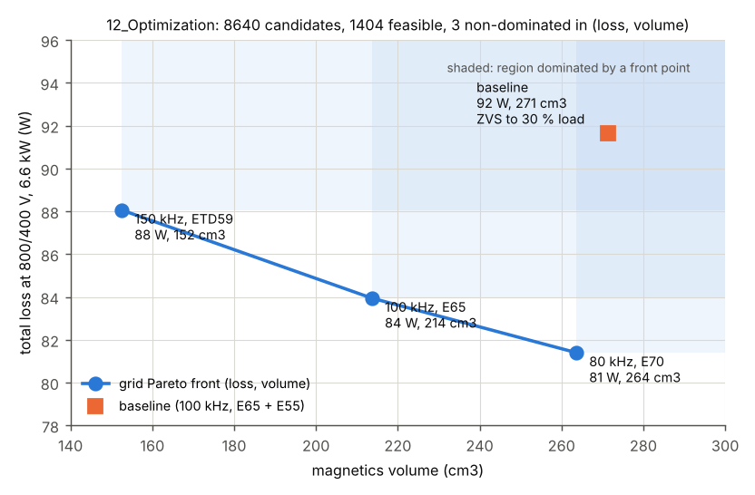
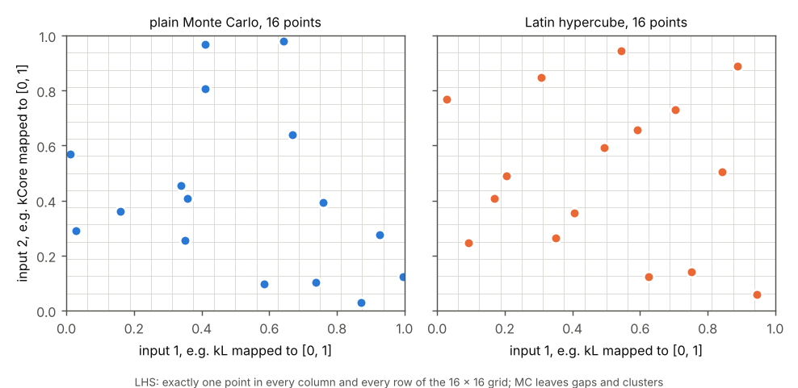
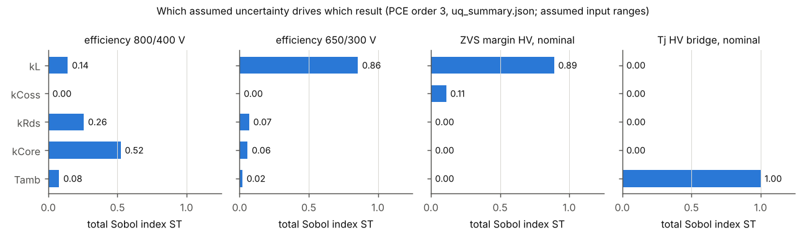

# 15 Optimization and Uncertainty

> Reading time: ~45 min. Prerequisites: chapters 04 (DAB operation), 05 (model), 06 (design
> calculations), 07 (magnetics), 12 (thermal). Files covered: `SiC_6k6_Industrial_DAB/12_Optimization/optimize.py`,
> `SiC_6k6_Industrial_DAB/12_Optimization/optimization_report.md`, `Advanced_Research_2026/Robust_Optimization/README.md`,
> `Advanced_Research_2026/Robust_Optimization/dab_eval.py`, `Advanced_Research_2026/Robust_Optimization/robust_optimize.py`,
> `Advanced_Research_2026/Uncertainty_Quantification/README.md`, `Advanced_Research_2026/Uncertainty_Quantification/uq_baseline.py`
> and their `results/` folders.

## Overview

**Level 1 - Beginner:** Designing a converter means turning many knobs at once, and each choice improves one thing and
worsens another - faster switching gives smaller magnetics but more loss. This chapter shows the menu of good compromises
(the Pareto front), then asks how sure we are about the chosen design when real parts differ from the drawing. Every
number comes from a computer model; nothing has been built or measured.

**Level 2 - Engineering:** The baseline (chapter 06: 100 kHz, n = 2, L = 64 uH, E65 transformer, E55 inductor) was
chosen by judgement. `SiC_6k6_Industrial_DAB/12_Optimization/optimize.py` evaluates an exhaustive grid of 8640
candidates with the project's loss, thermal and magnetics models: 1404 are feasible, 3 are non-dominated in (loss,
magnetics volume). In 2026, `Advanced_Research_2026/Robust_Optimization/` re-posed the problem with 9 variables and four
objectives (loss, volume, a thermal-cycling damage proxy over an assumed 24 h mission, worst-case ZVS margin), solved it
with NSGA-II and a Gaussian-process surrogate, and repeated it under worst-case and 95 % chance constraints.
`Advanced_Research_2026/Uncertainty_Quantification/` propagates five assumed tolerances through the baseline (Monte
Carlo, Latin hypercube, polynomial chaos, Sobol indices): efficiency 98.61 +/- 0.05 %. `[Simulated]`

**Level 3 - Research:** The question is which design stays acceptable when the parameters move. The baseline is within 3 % of the nominal front in loss but dominated in magnetics volume, and infeasible under
the robust and chance-constrained variants. A closed-form argument explains why: with single phase shift (SPS), ZVS at
the voltage-mismatch corners and the 60 deg phase limit at 650/300 V can only both hold for a narrow inductance band,
far below the assumed +/-15 % - the strict robust problem has no feasible design. The lever is the inductor tolerance and
the modulation (EPS/TPS), not the semiconductors. Maturity L2 (models only).

*Figure 15-1 (`img/fig_ch15_optimization.py`, data from `optimization_results.json`): the three non-dominated
points of the 12_Optimization grid and the baseline. Every point in a shaded rectangle is worse in both loss and volume
than the front point at its corner.*

## Topic 1: Formulating the design problem

### Design variables, objectives and constraints
**What is it?** An optimisation problem has variables (what may change), objectives (what to make small) and
constraints (what every acceptable design must satisfy). A solver can only find what the formulation allows.

**Why do we need it?** DAB choices are coupled: fs sets magnetics size and switching loss; L sets both power transfer and
ZVS range; n sets the voltage match at the corners. Optimising one at a time misses these couplings.

**How does it work?**
**Level 1 - Beginner:** Planning a trip: the variables are route and speed, the goals "arrive early" and "use little
fuel", the rules "obey the speed limit". A trip that breaks a rule is not slower - it is not allowed.
**Level 2 - Engineering:** In `optimize.py`: fs in {60, 80, 100, 120, 150} kHz, n in {1.8, 2.0, 2.2}, phi_nom in {20, 25,
30, 35} deg (which fixes L = V1 n V2 phi (pi - phi) / (2 pi^2 fs P) at 800/400 V, 6.6 kW), four transformer cores, three
inductor cores, dead time {100, 150, 200} ns, two device options per bridge. Constraints: full power at all nine (V1, V2)
corners with phi <= 60 deg, Tj <= 150 C, window fill <= 0.7, Bpk <= 0.2 T. Objectives: loss and magnetics volume (2.2 x core
volume). The 2026 module makes the variables continuous where physical (fs 60-200 kHz, phi_nom 12-50 deg, n 1.6-2.4, Bpk
target 0.08-0.20 T, dead time 80-250 ns), tightens Tj to 125 C, adds the 24 A HV peak-current limit and ZVS at 800/400 V at
100 % and 50 % load, and charges hard-switching loss wherever the ZVS energy criterion fails.
**Level 3 - Research:** The formulation carries modelling choices that bias the answer: SPS only, magnetics designed at
the nominal point, a one-node thermal network, and device data flagged `verified=False` in `dabtools/dab/devices.py`.
A mission-weighted loss instead of nominal-point loss would be a different problem with a different front.

**Example from our converter:** `SiC_6k6_Industrial_DAB/12_Optimization/optimization_report.md` lists the grid; in
`optimize.py` 12 W auxiliary plus 0.4 % of 6.6 kW (26.4 W) for PCB and bus bars - 38.4 W of every candidate's loss - is
design-independent. `[Implemented]`

**Engineering calculations:** phi = 28 deg = 0.489 rad: L = 800 x 2 x 400 x 0.489 x 2.653 / (2 x 9.87 x 1e5 x 6600) =
63.7 uH, the stored baseline value (rounded to 64 uH). Grid size 5 x 3 x 4 x 4 x 3 x 3 x 2 x 2 = 8640.

**Design decision made in this project:** Every constraint comes from
`SiC_6k6_Industrial_DAB/00_Requirements/02_operating_envelope.md`; "more corner ZVS margin" is an objective, not a
constraint, because the requirements allow hard switching where the thermal budget holds. `[Implemented]`

**Alternatives considered:** Corner ZVS as a hard constraint (Topic 4); nominal efficiency as the only objective.

**How to verify it:** Re-run `optimize.py`; the grid is deterministic and must reproduce bit-for-bit. The 2026 evaluator
`dab_eval.py` was cross-checked against the stored grid baseline (91.63 W vs 90.67 W, cause in Topic 6). `[Simulated]`

**Common mistakes:** Putting a "nice to have" into the constraints; treating L as free once fs, n and phi_nom are fixed.

**Interview explanation (30 s):** "We wrote the DAB design as an explicit problem: eight or nine variables, constraints taken
from the requirement document - full power at every corner under the 60-degree limit, junction temperature, flux, window fill -
and two to four objectives: loss, magnetics volume, a reliability proxy and the ZVS margin."

**Research-level explanation:** The formulation shapes the front more than the solver; the 2026 strict variants show one extra
constraint making the problem infeasible.

## Topic 2: Pareto optimality and the exhaustive grid

### Non-dominated designs and why there is no weighted-sum score
**What is it?** Design A dominates B if A is no worse in every objective and strictly better in at least one. The Pareto set
contains the feasible designs no other design dominates; in objective space it forms the Pareto front.

**Why do we need it?** Loss and volume pull in opposite directions. A single "best" design exists only after someone decides
how many cm3 one watt is worth - a product decision, not the optimiser's. The front shows every defensible compromise.

**How does it work?**
**Level 1 - Beginner:** Choosing a laptop by weight and price: one that is both heavier and dearer than another is never
sensible - it is "dominated". The rest form a menu; which one you take depends on what you value.
**Level 2 - Engineering:** `optimize.py` keeps point i if no point j has (loss_j <= loss_i and vol_j <= vol_i) with one strict
inequality. Three designs survive: 80 kHz / E70 / ETD44 at 81 W and 264 cm3, 100 kHz / E65 / ETD44 at 84 W and 214 cm3, 150 kHz
/ ETD59 / ETD44 at 88 W and 152 cm3, all at phi_nom = 20 deg, 100 ns, C3M0016120K (HV) and 2 x C3M0032120K (LV); efficiency
98.78-98.68 %.
**Level 3 - Research:** A weighted sum w1 f1 + w2 f2 is avoided ("no weighted sum", 2026 README) because (a) the weights hide a
value judgement and change with units; (b) it only reaches the convex hull of the front, so concave regions are invisible; (c)
the objectives have very different confidence (calculated loss vs a damage proxy with literature coefficients) and a sum would
blend them. Selection happens afterwards with a stated knee rule (Topic 6).

**Example from our converter:** Baseline in `optimization_results.json`: 91.6 W, 271 cm3, corner-averaged rms 10.9 A, ZVS down
to 30 % load, cost index 16.6. The 100 kHz front design: 83.9 W and 214 cm3 - better in both - but ZVS only down to 45 % load and
cost index 19.5. `[Simulated]`

**Engineering calculations:** The 100 kHz front design saves 7.7 W (8 %) and 57 cm3 (21 %).

**Design decision made in this project:** Keep the baseline. The report says it "sits on the knee of the front"; read strictly,
Figure 15-1 shows it is dominated in (loss, volume). The real justification is the two objectives the 2-D front ignores - ZVS to
30 % instead of 45 % load and a lower cost index - a legitimate multi-objective argument that should be stated as such. `[Simulated]`

**Alternatives considered:** The report's 80 kHz / 25 deg fallback; the 100 kHz / E65 / ETD44 design if light-load ZVS is left to
EPS/TPS (chapter 09).

**How to verify it:** An exhaustive grid has no convergence question, only resolution (fs steps 20-30 kHz, phi 5 deg). The 2026
module re-evaluated all 8640 points (`results/grid_front_reevaluated.csv`: 1380 feasible, 52 non-dominated in 4-D, 3 in (loss,
volume)). `[Simulated]`

**Common mistakes:** Calling a design "optimal" without naming the objectives; forgetting objectives reported but not optimised.

**Interview explanation (30 s):** "A design is Pareto-optimal if nothing else is better in every objective at once. Our 8640-point
grid leaves three, from 81 watts at 264 cubic centimetres to 88 watts at 152. We do not collapse them into a score, because the
exchange rate between watts and volume is a product decision."

**Research-level explanation:** Grids are reproducible but scale as the product of level counts (nine variables at five levels:
about 2 million runs) - hence the evolutionary search, with the grid kept as benchmark.

## Topic 3: Search algorithms

### NSGA-II, hypervolume and Bayesian optimisation with a Gaussian process
**What is it?** NSGA-II evolves a population: it sorts designs into successive non-dominated fronts, prefers well-spread designs
(crowding distance) and breeds children by crossover and mutation. The hypervolume is the objective-space volume a front
dominates inside a reference box. Bayesian optimisation (BO) fits a Gaussian process (GP) - a model that predicts the objective
and its uncertainty - and evaluates next where the expected improvement is largest.

**Why do we need it?** Nine mixed variables make a grid impractical; a population method returns a whole front per run. BO is
the tool when each evaluation is expensive.

**How does it work?**
**Level 1 - Beginner:** NSGA-II breeds designs like plants: keep the healthiest and most varied, cross them, add small random
changes, repeat. BO instead sketches a map of "how good designs seem to be", with a fuzzy band where it is unsure, and tests
where the map is either promising or very uncertain.
**Level 2 - Engineering:** `robust_optimize.py` (seed 20261010): population 60 x 60 generations (3660 evaluations per variant),
constrained domination (feasible beats infeasible, infeasible ranked by total violation), SBX crossover (eta_c = 15, p_c = 0.9),
polynomial mutation (eta_m = 20, p_m = 1/9), and an archive of all feasible first-front members. Hypervolume by Monte Carlo
(1e5 points) in a common box. The surrogate search uses a GP with an ARD squared-exponential kernel on an augmented-Tchebycheff
scalarisation s = max_k w_k f~_k + 0.05 sum_k w_k f~_k, expected improvement over 4000 random + 300 local candidates, 5 weight
vectors x (20 LHS + 30 iterations) = 250 evaluations; the reported result is still the Pareto set of all feasible evaluations.
**Level 3 - Research:** At equal budget (250 evaluations) NSGA-II reached hypervolume 0.361 vs 0.291 for the GP search, and
NSGA-II nominal dominates 100 % of the surrogate designs. The README states the limits: a simplified ParEGO-like BO, not
hypervolume-based (EHVI); one seed per variant, no multi-seed statistics; robust and chance hypervolumes still rising slowly
at the last generation. With a millisecond evaluator BO's main advantage disappears; with a switched or FEM model the comparison
could reverse.

**Example from our converter:** Hypervolumes (README section 3): NSGA-II nominal 0.691 (305 designs, 77.7-107.1 W, 152-321 cm3);
grid re-evaluated 0.437; GP search 0.291 (15 designs, `results/bo_front.csv`). NSGA-II dominates 71 % of the grid's 52 4-D
non-dominated designs. `[Simulated]`

**Engineering calculations:** 60 + 60 x 60 = 3660 evaluations per variant; six variants plus grid and BO = 30850 evaluations
in 620 s (`results/run_log.txt`, `provenance.json`), about 20 ms per design including the 24-sample uncertainty loop.

**Design decision made in this project:** NSGA-II as the main search, the grid as benchmark, the GP search as documented
comparison; hypervolume history in `results/convergence.json`. `[Implemented]`

**Alternatives considered:** NSGA-III; EHVI-based BO on an expensive model. L01 (Hu, Cheng, Ye, IEICE Electronics Express 2026, confirmed) uses Bayesian optimisation to tune hybrid phase-shift MPC
on a 1 kW prototype.

**How to verify it:** Re-evaluate front designs with `dab_eval.py`; multi-seed runs and an EHVI baseline are not done. `[Not yet tested]`

**Common mistakes:** Reporting only the last generation; comparing hypervolumes from different boxes; concluding "BO is worse
than GA" from one cheap-model run.

**Interview explanation (30 s):** "NSGA-II sorts 60 designs into non-dominated layers, keeps them spread and breeds new ones.
After 3660 evaluations it had 305 non-dominated designs and a hypervolume of 0.69 against 0.44 for the 8640-point grid; a
Gaussian-process search reached 0.29 at 250 evaluations against 0.36 for NSGA-II at the same budget."

**Research-level explanation:** Hypervolume is strictly Pareto-compliant, hence the convergence measure; a surrogate method must be
judged on the model it will actually be used with.

## Topic 4: Designing under uncertainty

### Robust (worst-case) and chance-constrained fronts
**What is it?** A robust design satisfies every constraint for all plausible parameter values; a chance-constrained design
satisfies them with a stated probability (here 95 %). Both evaluate each design over a set of uncertainty samples.

**Why do we need it?** A nominal optimum sits on its constraint edges; a 15 % inductance tolerance can push it over them.

**How does it work?**
**Level 1 - Beginner:** A bridge is designed for the heaviest allowed truck (worst case). "Chance constrained" accepts that,
say, 1 truck in 20 needs a detour.
**Level 2 - Engineering:** Five inputs, assumed uniform: kL [0.85, 1.15], kCoss [0.8, 1.2], kRds [1, 1.3] (aging), kCore [0.75,
1.25], Tamb [25, 55] C. One set of 24 Latin-hypercube samples (`results/uncertainty_samples_LHS.csv`) is reused for every design
(common random numbers). Robust: objectives and constraints are worst over the 24 samples. Chance-constrained: objectives are
means, each constraint is held at its 95 % empirical quantile (at most 1 of 24 may fail). Robust front 242 designs, 84.6-101.3 W;
chance-constrained 197 designs, 80.6-95.3 W. Of the 305 nominal-front designs only 55 survive the robust and 73 the chance
constraints.
**Level 3 - Research:** With ZVS at all five full-power points added as a hard constraint ("strict"), the robust and chance
variants found 0 feasible designs in 3660 evaluations each. With SPS the HV bridge keeps ZVS at 650/450 V only if phi > pi (V2' -
V1) / (2 V2') = 25.0 deg and the LV bridge at 850/300 V only if phi > pi (V1 - V2') / (2 V1) = 26.5 deg (ideal, before the Coss
energy), while P ~ phi (pi - phi) / L drives the 650/300 V corner towards the 60 deg limit when L is high. The README puts the
compatible band at about +/-1.5 % of L for n = 2 (about 5 % at n = 1.95), against +/-15 % assumed. EPS/TPS is the known remedy.

**Example from our converter:** Baseline (`results/knee_and_baseline.json`): nominal 90.8 W, feasible; worst case 99.9 W and
chance-constrained 93.3 W, both infeasible (violated constraint: phi_corner at 650/300 V with L at +15 %). Probability of ZVS at
800/400 V over the 24 samples 1.00; of ZVS at every full-power corner 0.71. `[Simulated]`

**Engineering calculations:** Worked example 1 below: 57 deg at 650/300 V with 64 uH, 85 deg with 1.15 x 64 uH, above the
60 deg clamp (`SiC_6k6_Industrial_DAB/11_Control_Algorithms/control_params.json`, phi_max_deg = 60).

**Design decision made in this project:** Corner ZVS stays an objective; the recommendation is a tolerance specification on the
series inductor plus EPS/TPS for the corners
(`Advanced_Research_2026/Research_Publications/Paper_4_Robust_Design_and_Uncertainty.md`, section 7). `[Proposed]`

**Alternatives considered:** Distributionally robust optimisation; an inductor trimmed at end-of-line test.

**How to verify it:** Larger fresh sample sets (the 1/24 quantile resolution is a stated limit); measured inductor tolerance
statistics on a batch. `[Proposed]`

**Common mistakes:** Comparing robust and nominal hypervolumes directly; reading "infeasible" as "bad" - it means "cannot be
guaranteed with this modulation".

**Interview explanation (30 s):** "We re-ran the optimisation with everything evaluated as the worst case, or the 95 % quantile,
over 24 Latin-hypercube tolerance samples. Only 55 of 305 nominal-front designs survive the worst case, the baseline does not,
and with corner ZVS as a hard constraint nothing survives - SPS cannot guarantee it under 15 % inductance tolerance."

**Research-level explanation:** The empty strict front turns "ZVS is hard at the corners" into a quantitative tolerance band and
points at modulation as the lever. L15 (Fu, Jing, Ren, IET Power Electronics 2023, confirmed) treats component uncertainty on the
control side (EPS-MPC); this is the design-side counterpart.

## Topic 5: Mission profile and reliability proxy

### Assumed 24 h mission and the Coffin-Manson damage proxy
**What is it?** A mission profile is the sequence of operating points a converter sees in a typical day; a damage proxy turns
the resulting junction-temperature swings into a relative wear-out measure.

**Why do we need it?** Efficiency at one point says nothing about thermal cycling between charging, discharging and standby.

**How does it work?**
**Level 1 - Beginner:** Bending a paper clip back and forth breaks it, and bigger bends break it sooner. Solder joints and bond
wires wear the same way each time they heat up and cool down.
**Level 2 - Engineering:** `results/mission_profile_ASSUMED.csv`: 24 hourly segments - night charging at 6.6 kW with the battery
rising 330 -> 445 V, vehicle-to-grid discharge up to 6.6 kW morning and evening, 3.3 kW PV charging at midday, standby. Each hour
is a steady state; the hourly Tj sequence is rainflow-counted and weighted with Nf = A dTj^alpha exp(Q/(R Tm)), LESIT coefficients
A = 3.025e5, alpha = -5.039, Q/R = 11897 K. The objective is log10(D / D_baseline) of the hotter bridge.
**Level 3 - Research:** The coefficients are for Si IGBT modules (Held et al. 1997), not SiC TO-247, so only ratios mean anything.
The absolute baseline proxy is 1.48e13 years - cycling is not life-limiting with this heatsink (dTj < 15 K) - and the hourly
model ignores sub-hour cycles. KNOWN_ISSUES item 13 adds that light-load hard switching dominates the cycling of this profile.

**Example from our converter:** Nominal knee: mission efficiency 98.33 %, 1261 Wh/day loss, Tj max 54 C, dTj 8.7 / 5.8 K;
baseline: 98.28 %, 1299 Wh/day, 57.5 C, 12.4 / 7.7 K (`results/knee_and_baseline.json`). `[Simulated]`

**Engineering calculations:** Doubling the swing at equal mean temperature multiplies damage per cycle by 2^5.039 = 33 - hence
the log10 scale.

**Design decision made in this project:** Use the proxy only for ranking, label the profile ASSUMED, never quote a lifetime. `[Implemented]`

**Alternatives considered:** A SiC-specific power-cycling law (`Advanced_Research_2026/Reliability_Engineering/`).

**How to verify it:** Power-cycling tests on the real devices and a measured or customer profile. `[Proposed]`

**Common mistakes:** Quoting 1.5e13 years as a lifetime; using hourly averages and missing fast cycles.

**Interview explanation (30 s):** "The third objective ranks designs by rainflow-counted junction swings over an assumed
charging and vehicle-to-grid day with a Coffin-Manson-Arrhenius law. Its coefficients are for silicon modules, so it ranks
designs; it never predicts a lifetime."

**Research-level explanation:** The method is ready; the profile, thermal model and lifetime law are not calibrated.

## Topic 6: Choosing a design from the front

### Knee point selection and the baseline verdict
**What is it?** The knee is the design beyond which improving any objective costs disproportionately in the others. Two rules
are used: the point closest to the ideal point in min-max normalised objective space, and (in 2-D) the point farthest from the
chord between the extremes.

**Why do we need it?** Having refused a weighted sum, the team still has to pick one design; a stated knee rule makes the
choice transparent and repeatable.

**How does it work?**
**Level 1 - Beginner:** On a menu from "cheap and slow" to "expensive and fast", the knee is where a little more money stops
buying a lot more speed.
**Level 2 - Engineering:** Nominal knee (ideal-point distance 0.64): 71 kHz, phi_nom 24.6 deg (L = 78.9 uH), n = 1.97,
E65/32/27 with ETD49/25/16, 119 ns, C3M0032120K x1 / x2: 88.3 W (98.68 %), 227 cm3, log10 D/D_base -0.83, ZVS margin -6.46 A.
The baseline evaluates to 90.8 W, 271 cm3, 0, -5.88 A and is dominated by 6 of 305 front designs (normalised distance 0.173).
**Level 3 - Research:** The baseline is within 3 % of the front in loss but not in volume: the E55 inductor core is oversized
(window fill 0.28) and an ETD49 core with 2 x C3M0032120K on the LV bridge (e.g. 91 kHz, 27 deg, 66.3 uH: 88.2 W, 227 cm3)
matches its ZVS margin and damage proxy. fs = 100 kHz, phi_nom = 28 deg, n = 2 itself lies on the front. All ZVS margins are
negative because the objective is the minimum over the envelope at 100 % and 50 % load, and with SPS every design hard-switches
at 50 % load at 850/300 V or 650/450 V.

**Example from our converter:** Table 3.1 of `Advanced_Research_2026/Robust_Optimization/README.md`; the 2-D chord knee of the
nominal front (94 kHz, 47.5 uH, 81.9 W, 214 cm3) is close to the 100 kHz / E65 / ETD44 grid design. `[Simulated]`

**Engineering calculations:** Savings 44 cm3 (16 %) and 2.6 W (2.9 %). Evaluator gap to 12_Optimization (91.63 vs 90.67 W):
`DABPoint.switching_currents()` finds a third, wrap-around HV turn-off edge, so the 04/12 chain charges three HV events per
period (2.80 W switching, 0.87 W dead-time diode in `design_values.json`) where the closed form charges two (1.88 W, 0.59 W).

**Design decision made in this project:** No redesign yet; the inductor-core resize is a Paper 4 recommendation. `[Proposed]`

**Alternatives considered:** The chance-constrained knee (133 kHz, 41.1 uH, 88.6 W, 214 cm3) as tolerance-aware choice.

**How to verify it:** Switched simulation and ngspice of the knee (chapter 08), then calorimetric loss on prototypes. `[Proposed]`

**Common mistakes:** Calling the knee "the optimum" - it is one rule among several.

**Interview explanation (30 s):** "We pick the front design closest to the ideal point after normalisation. Our baseline is
dominated by six front designs, but only by 2.6 watts and 44 cubic centimetres: the operating point is right, the inductor core
is too big."

**Research-level explanation:** A dominated baseline is a useful finding; the value is the size of the gap and its diagnosis.

*Figure 15-2 (from `robust_optimize.py`): nominal, robust and chance-constrained fronts with the grid, the surrogate
results, the knees and the baseline.*

## Topic 7: Sampling the uncertainty

### Monte Carlo vs Latin hypercube sampling
**What is it?** Monte Carlo (MC) draws input samples independently at random. Latin hypercube sampling (LHS) divides each input
range into N equal strata, puts exactly one sample in each stratum of each input and pairs the strata randomly.

**Why do we need it?** To turn assumed tolerances into distributions of efficiency, ZVS margin or temperature with as few model
runs as possible.

**How does it work?**
**Level 1 - Beginner:** To estimate the average height in a school you can pick pupils at random (MC) - and by chance pick only
tall ones - or pick one pupil from every class year (LHS), which guarantees the whole range is covered.
**Level 2 - Engineering:** `uq_baseline.py`: MC with N = 4000 (numpy PCG64) plus a 20000-sample reference; LHS with N = 200 and
500 (10 replicates for convergence). The construction in `dab_eval.py` is u = (k + r) / N per stratum k, then a random
permutation per dimension. MC error of the mean falls as 1/sqrt(N); LHS removes the additive (main-effect) part of the
estimator variance.
**Level 3 - Research:** Normalised error of the mean efficiency: MC 0.093 vs LHS 0.010 at N = 100; 0.192 vs 0.0074 at N = 25.
The LHS floor of 0.005-0.01 is the standard error of the reference itself (1/sqrt(20000) = 0.0071). The gain relies on
additivity: the largest ST - S1 is 0.01.

**Example from our converter:** Efficiency at 800/400 V, 6.6 kW: nominal 98.643 %; MC mean 98.606 %, std 0.048 %, 5-95 %
quantiles 98.527-98.682 %; LHS-200 98.608 / 0.048; LHS-500 98.608 / 0.045 (UQ README table 3.1). `[Simulated]`

**Engineering calculations:** The mean is below nominal because kRds ~ U(1, 1.3) has mean 1.15 - nominal sits at the edge of
the aging range. The mean HV Tj (44.1 C) is below nominal (48.6 C) because nominal ambient is 45 C (`U_NOM` in `dab_eval.py`)
while U(25, 55) has mean 40 C.

**Design decision made in this project:** MC for reference statistics; LHS for cheap runs and for the 24-sample set inside
the optimiser. `[Implemented]`

**Alternatives considered:** Quasi-Monte Carlo; importance sampling for rare failures.

**How to verify it:** Convergence against the 20000-sample reference (`results/convergence.png`). `[Simulated]`

**Common mistakes:** Calling the nominal value "the expected value" with asymmetric ranges; applying the 1/sqrt(N) error bar to LHS.

**Interview explanation (30 s):** "Latin hypercube puts one sample in every slice of every input range. On our model it
estimates the mean efficiency about ten times more accurately than Monte Carlo at the same number of runs, because the model
is almost additive in the five inputs."

**Research-level explanation:** LHS variance reduction is exact for additive functions and vanishes for pure interactions.

*Figure 15-3 (`img/fig_ch15_optimization.py`): 16 MC points vs 16 LHS points in two normalised inputs.*

## Topic 8: Polynomial chaos expansion

### Non-intrusive PCE as a surrogate with built-in statistics
**What is it?** A PCE writes an output as a sum of orthonormal polynomials of the standardised inputs, Y(xi) = sum_a c_a
Psi_a(xi), with the family matched to the input distribution (Legendre for uniform, Hermite for normal).

**Why do we need it?** Once the coefficients are known, mean, variance and Sobol indices follow algebraically - a few hundred
runs replace tens of thousands.

**How does it work?**
**Level 1 - Beginner:** Fit a smooth formula through a few hundred well-placed model runs, then ask the formula, not the model,
how much the result varies.
**Level 2 - Engineering:** Inputs mapped to [-1, 1]; total degree p <= 3 with 5 inputs gives 56 terms (21 for p = 2, 6 for p = 1);
least squares (`numpy.linalg.lstsq`) on 500 LHS points; validation R^2 on the 4000 independent MC samples. Orthonormality gives
mean = c_0 and variance = sum of c_a^2 over a != 0.
**Level 3 - Research:** Median R^2 0.9984 / 1.0000 / 1.0000 for p = 1 / 2 / 3, condition numbers 1.1 / 1.5 / 2.2; the worst QoI is
always the worst-corner peak current (R^2 0.612 / 0.821 / 0.888): a maximum over corners that switches corner and crosses a
ZVS/hard-switching transition - a kink a global polynomial cannot represent. Sparse, adaptive or piecewise surrogates would help.

**Example from our converter:** Efficiency at 800/400 V: PCE p = 3 mean 98.608 %, std 0.047 %, R^2 1.000; HV ZVS margin 7.786 +/-
0.298 A, R^2 1.000; worst-corner peak current R^2 0.888 (std 0.498 vs MC 0.525 A). Coefficients in
`results/pce_coefficients_order3.csv`. `[Simulated]`

**Engineering calculations:** Terms (n + p)! / (n! p!) = 8! / (5! 3!) = 56; 500 fit points give an oversampling ratio of about 9
(rule of thumb >= 2-3).

**Design decision made in this project:** Order 3 as main PCE, cross-checked with Saltelli (Topic 9). `[Implemented]`

**Alternatives considered:** A GP surrogate; intrusive Galerkin PCE.

**How to verify it:** R^2 on independent samples and moments vs MC (done); a mixed Hermite-Legendre basis with normal kL, kCoss
gives 98.609 +/- 0.046 % vs 98.606 +/- 0.048 % uniform (README section 3.6). `[Simulated]`

**Common mistakes:** A Legendre basis for normal inputs; judging accuracy on the fitting points.

**Interview explanation (30 s):** "Polynomial chaos fits 56 orthonormal Legendre polynomials of the five tolerances to 500 model
runs. It reproduces the Monte-Carlo mean and spread of efficiency to the third decimal, and the Sobol indices come straight out
of the coefficients."

**Research-level explanation:** PCE converges spectrally for smooth responses and fails visibly (low R^2) at kinks.

## Topic 9: Which uncertainty matters?

### Sobol indices, corner analysis and quantiles
**What is it?** The first-order Sobol index S_i is the share of output variance explained by input i alone; the total index ST_i
includes all interactions with i. Corner analysis evaluates all 2^5 = 32 vertices of the input box. Quantiles (5 %, 95 %) give
the band a designer should plan for.

**Why do we need it?** Tolerance money should go to the input that drives the result.

**How does it work?**
**Level 1 - Beginner:** If the cake sometimes fails, find out whether it is the oven, the flour or the eggs. Sobol indices are
the share of "blame" each ingredient gets for the variation.
**Level 2 - Engineering:** From the PCE: S_i sums c_a^2 / Var over multi-indices where only a_i > 0; ST_i over all with a_i > 0.
Cross-check: Saltelli (2010) first-order and Jansen (1999) total estimators, N = 2000 base samples (14000 runs). Largest
PCE-vs-Saltelli deviation of a total index: 0.04.
**Level 3 - Research:** The split follows the physics (Figure 15-4). Nominal efficiency: kCore 0.52, kRds 0.26, kL 0.14, Tamb 0.08.
Efficiency at 650/300 V: kL 0.86. HV ZVS margin: kL 0.89, kCoss 0.11. Tj: Tamb 1.00. Transformer core loss: kCore 1.00. The
ranking survives the normal-input alternative (kL 0.89, kCoss 0.11); magnitudes and quantiles do not. Inputs are assumed
independent; L and Coss really depend on temperature, which would correlate them with Tamb.

**Example from our converter:** Worst vertex for nominal efficiency 98.44 % (kRds = 1.3, kCore = 1.25, Tamb = 55 C) vs 98.75 %
best; HV / LV Tj worst 69.1 / 79.8 C (limit 125 C); minimum ZVS margin over the envelope -1.54 A; peak current 20.9 A (limit
24 A, trip 32 A); core loss 8.6-14.3 W. The corner box contains the 20000-sample MC range for 13 of 15 QoIs; the two exceptions
are non-monotonic. `[Simulated]`

**Engineering calculations:** Minimum ZVS margin over the corners: mean 0.894 A, std 1.229 A, 5 % quantile -1.125 A. A negative
5 % quantile means more than 5 % of assemblies would hard-switch at some full-power corner under the assumed tolerances (the
24-sample estimate in `results/knee_and_baseline.json` gives a corner-ZVS probability of 0.71); ST(kL) = 1.00.

**Design decision made in this project:** Specify the series-inductance tolerance rather than the semiconductors (Paper 4
abstract). `[Proposed]`

**Alternatives considered:** Morris screening (ranks only); Shapley effects once input correlations are known.

**How to verify it:** PCE vs Saltelli (done); bootstrap confidence intervals (not done, listed in the README); measured
tolerance statistics to replace the assumptions. `[Not yet tested]`

**Common mistakes:** Reading a Sobol index as a derivative; forgetting that indices depend on the assumed ranges.

**Interview explanation (30 s):** "Efficiency uncertainty at nominal comes mostly from core loss and Rds-on aging, but every ZVS
margin is almost entirely the inductance tolerance, and junction temperature is just ambient. So the money goes into a tight
inductor, not better transistors."

**Research-level explanation:** Agreement of two estimators to 0.04 shows numerical, not physical, correctness - the input
distributions are unmeasured.

*Figure 15-4 (`img/fig_ch15_optimization.py`, data `results/uq_summary.json`): total Sobol indices for four QoIs.*

## Worked example(s) with real numbers

**Example 1 - why the strict robust problem is empty.** Inputs from `design_values.json` (P = 6600 W, fs = 100 kHz, n = 2,
L = 64 uH) and the SPS law P = V1 V2' phi (pi - phi) / (2 pi^2 fs L) from the Robust_Optimization README (section 3.3); the
arithmetic is recomputed for these notes. `[Simulated]`

1. K = 2 pi^2 fs L P = 19.74 x 1e5 x 64e-6 x 6600 = 8.34e5 V^2 (Hz x H x W = V^2); phi (pi - phi) = K / (V1 V2').
2. 850/300 V: V1 V2' = 850 x 600 = 5.1e5 V^2 -> phi (pi - phi) = 1.635 -> phi = 37.7 deg.
3. 650/300 V: 3.9e5 V^2 -> 2.138 -> phi = 57.1 deg. (This is the README's "57 deg"; it belongs to the baseline inductance, not to
   the 26.5 deg boundary phase named in the same sentence.)
4. L x 1.15 = 73.6 uH: 650/300 V needs phi (pi - phi) = 2.459, almost the maximum pi^2 / 4 = 2.467 -> phi = 84.6 deg > 60 deg.
   This is the violated "phi_corner" constraint of the baseline under the robust variant.
5. L x 0.85 = 54.4 uH: 650/450 V (V2' = 900 V) gives phi = 25.8 deg, barely above the ideal HV boundary pi x 250 / 1800 = 25.0 deg;
   the Coss energy (for example I_min = sqrt(2 x 170 pF x 800^2 / 64 uH) = 1.84 A at 800 V, `zvs_current_min` in
   `dabtools/dab/dab_model.py`) then removes the margin.
6. High L violates the phase limit, low L loses corner ZVS: no single nominal L covers +/-15 %.

**Example 2 - reading a statistics row.** Transformer core loss, nominal 11.418 W; kCore ~ U(0.75, 1.25) acts multiplicatively,
so the range is 8.56-14.27 W (corner analysis 8.564 / 14.273 W) and the standard deviation of a uniform variable is (14.27 - 8.56)
/ sqrt(12) = 1.65 W, matching MC (1.656 W). ST(kCore) = 1.00. `[Simulated]`

## How this chapter connects to the files

| File | What it contains | Status |
|---|---|---|
| `SiC_6k6_Industrial_DAB/12_Optimization/optimize.py` | exhaustive 8640-point grid, Pareto filter, plots, report | [Implemented] |
| `SiC_6k6_Industrial_DAB/12_Optimization/optimization_report.md` | grid, 3-point front, baseline position | [Simulated] |
| `SiC_6k6_Industrial_DAB/12_Optimization/optimization_results.json` | front designs and baseline with all metrics | [Simulated] |
| `Advanced_Research_2026/Robust_Optimization/dab_eval.py` | closed-form SPS evaluator with uncertainty multipliers, LHS, self-test | [Implemented] |
| `Advanced_Research_2026/Robust_Optimization/robust_optimize.py` | NSGA-II, GP-EI search, robust / chance variants, knees | [Implemented] |
| `Advanced_Research_2026/Robust_Optimization/README.md` | result tables, infeasibility argument, limitations | [Simulated] |
| `Advanced_Research_2026/Robust_Optimization/results/knee_and_baseline.json` | knees, baseline vs fronts, survival, ZVS probabilities | [Simulated] |
| `Advanced_Research_2026/Robust_Optimization/results/mission_profile_ASSUMED.csv` | invented 24 h profile (labelled ASSUMED) | [Implemented] |
| `Advanced_Research_2026/Uncertainty_Quantification/uq_baseline.py` | MC, LHS, PCE, Saltelli/Jansen, corners | [Implemented] |
| `Advanced_Research_2026/Uncertainty_Quantification/results/uq_summary.json` | all statistics and Sobol indices | [Simulated] |
| `Advanced_Research_2026/Research_Publications/Paper_4_Robust_Design_and_Uncertainty.md` | manuscript outline built on both modules | [Proposed] |
| `21_Human_Friendly_Learning_Notes/img/fig_ch15_optimization.py` | figures 15-1, 15-3, 15-4 | [Implemented] |

## Viva / interview questions

### Basic (10)
1. What is a Pareto-optimal design?
   A feasible design that no other feasible design beats in every objective at once.
2. Name the two objectives of the 12_Optimization grid.
   Total loss at 800/400 V, 6.6 kW and magnetics volume (2.2 x transformer plus inductor core volume).
3. How many candidates did the grid evaluate, and how many were feasible?
   8640 evaluated, 1404 feasible, 3 non-dominated in (loss, volume).
4. Why does lower switching frequency cut loss but grow volume?
   Switching and core losses scale with fs; volt-seconds per half period, hence core size, grow as fs falls.
5. Constraint vs objective?
   A constraint is pass/fail and excludes designs; an objective is a quantity to be made small.
6. Why no weighted-sum score?
   It hides the watts-vs-volume exchange rate, depends on units and misses non-convex parts of the front.
7. Which inputs are uncertain in the UQ module?
   L (+/-15 %), Coss (+/-20 %), Rds_on aging (+0-30 %), core loss (+/-25 %), ambient 25-55 C - all assumed.
8. What is Monte Carlo simulation?
   Running the model many times with random inputs and taking statistics of the outputs.
9. Mean efficiency at 800/400 V under the tolerances?
   98.606 % +/- 0.048 % (MC, N = 4000), vs 98.643 % nominal.
10. Which input decides the ZVS margin?
    The inductance tolerance kL (total Sobol index 0.89 for the HV bridge, 1.00 for the corner minimum).

### Intermediate (10)
1. Is the baseline on the 12_Optimization front?
   Not in (loss, volume); it is kept for better light-load ZVS (30 vs 45 %) and cost index, which the 2-D front ignores.
2. How does NSGA-II handle constraints?
   Feasible beats infeasible; infeasible designs are ranked by total violation.
3. What is hypervolume and why a common box?
   The volume a front dominates inside a reference box; values from different boxes are not comparable.
4. What are common random numbers here?
   The same 24 LHS samples for every design, so ranking differences come from the designs, not from sample luck.
5. Why is the MC mean efficiency below nominal?
   kRds ~ U(1, 1.3): nominal is the best edge of the range, so mean conduction loss is higher.
6. Robust vs chance-constrained in this module?
   Robust: worst of 24 samples for objectives and constraints. Chance: sample means, constraints at the 95 % quantile.
7. How should the GP search result be read?
   15 designs, hypervolume 0.291 vs 0.361 for NSGA-II at 250 evaluations - meaningful only for this cheap evaluator.
8. Why is ideal-point knee selection not a weighted sum in disguise?
   It only selects among non-dominated designs, after the search, with a stated rule.
9. What did the robust study recommend for the inductor?
   A smaller core (E55 -> ETD49; fill 0.28 shows oversizing) and a tight inductance tolerance - both proposals.
10. Why does LHS beat MC here?
    The model is almost additive (ST - S1 <= 0.01), and LHS removes the main-effect variance of the estimator.

### Advanced / research (10)
1. Derive the SPS ZVS boundary for the LV bridge at 850/300 V.
   I1 > 0 needs phi > pi (V1 - V2') / (2 V1) = pi x 250 / 1700 = 26.5 deg; the Coss energy raises it further.
2. Why is the strict robust variant empty?
   At +15 % L the 650/300 V corner needs 85 deg (> 60 deg); at -15 % L the mismatch corners lose ZVS; both hold only for about
   +/-1.5 % L at n = 2.
3. What would you change in the objectives for a production design?
   Mission-weighted loss, EMI-filter volume, a calibrated lifetime metric.
4. How would you make the chance constraint statistically sound?
   More samples or subset simulation; 24 samples give only 1/24 resolution.
5. When would BO beat NSGA-II for this converter?
   With expensive evaluations (FEM, HIL) and a multi-objective acquisition such as EHVI.
6. Why is the PCE worst for the worst-corner peak current?
   A maximum over corners crossing a ZVS transition is kinked; a global polynomial reaches only R^2 0.888 at p = 3.
7. How would correlated inputs change the Sobol analysis?
   Classical indices assume independence; with L and Coss tied to temperature use grouped indices or Shapley effects.
8. Explain the 1 W gap between the grid evaluator and dab_eval.py.
   The numerical chain counts a third, wrap-around HV turn-off edge (2.80 / 0.87 W vs 1.88 / 0.59 W in the closed form).
9. What measurements would move this from L2 to measured evidence?
   Batch tolerance statistics of L and Coss, Rds_on aging data, calorimetric loss.
10. Position this work against the literature.
    L15 (confirmed) treats component uncertainty on the control side; this adds a design-side robust front - in simulation only.

## Pitches

**30 s:** We swept 8640 DAB designs and then ran a four-objective NSGA-II under tolerance. The baseline is within 3 % of the best
loss but its inductor core is too big, and under 15 % inductance tolerance no SPS design can guarantee ZVS at the voltage
corners. Uncertainty propagation gives 98.61 plus or minus 0.05 percent efficiency and shows that the inductor tolerance, not the
transistors, decides soft switching. All simulation.

**2 min:** An exhaustive grid of 8640 candidates gave three designs non-dominated in loss versus magnetics volume; watts
against volume is a product decision, so there is no single score. In 2026 a four-objective NSGA-II - loss, volume, a relative
damage proxy over an assumed charging and vehicle-to-grid day, worst ZVS margin - beat both the grid and a Gaussian-process
search on hypervolume. The baseline is dominated by six of 305 front designs, but only by 2.6 watts and 44 cubic centimetres: the
operating point is right, the inductor core is oversized. Under worst-case and chance constraints most of the front disappears,
and a closed-form argument shows SPS cannot guarantee corner ZVS under 15 percent inductance tolerance. Monte Carlo, Latin
hypercube and polynomial chaos give 98.61 plus or minus 0.05 percent efficiency, driven by core loss and Rds-on aging, while every
ZVS margin is driven by the inductance. Recommendation: a tight inductor specification and EPS or TPS at the corners. All models.

**10 min outline:**
* Formulation from the requirements; Pareto dominance, the 8640-point grid, no weighted sum, the baseline's position.
* NSGA-II, hypervolume, and the GP-EI comparison at equal budget.
* Robust and 95 % chance-constrained fronts; the closed-form infeasibility of corner ZVS under +/-15 % L with SPS.
* Mission profile and damage proxy - ranking, not lifetime.
* Knee selection and the baseline verdict.
* UQ: MC vs LHS, PCE by order, Sobol indices vs Saltelli, corners and quantiles.
* Limitations (assumed distributions, independence, SPS only, one seed, L2) and the measurements that would close them.

## Further reading

* `Advanced_Research_2026/Robust_Optimization/README.md` and `Advanced_Research_2026/Uncertainty_Quantification/README.md` -
  full tables, limitations, reproduction; methods cited there: Saltelli (2010), Jansen (1999), Held et al. (1997, LESIT).
* `Advanced_Research_2026/Research_Publications/Paper_4_Robust_Design_and_Uncertainty.md` - the paper built on both modules.
* `Advanced_Research_2026/Literature_Database/literature_2022_2026.csv`, confirmed entries: L01 (Hu, Cheng, Ye 2026, IEICE
  Electronics Express - Bayesian optimisation of hybrid phase-shift MPC); L15 (Fu, Jing, Ren 2023, IET Power Electronics - EPS-MPC
  under component uncertainty); L37 (Younis et al. 2025, IEEE Access - review of TPS optimisation, the modulation remedy).
* Chapter 16: estimating L online instead of only specifying it tightly.
