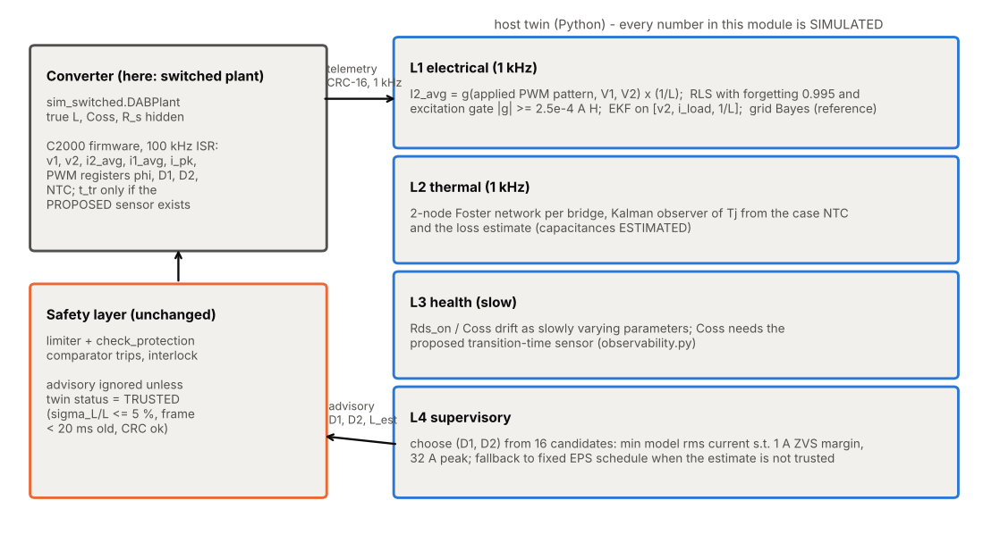
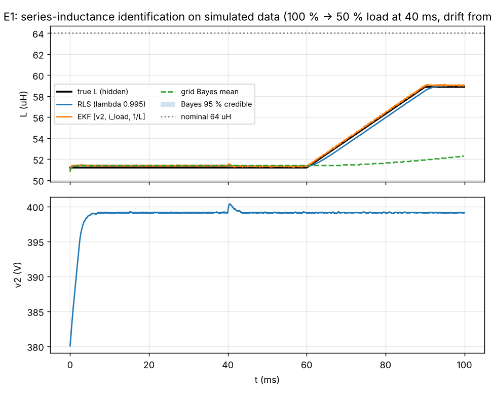
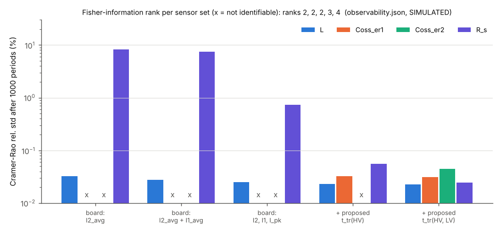
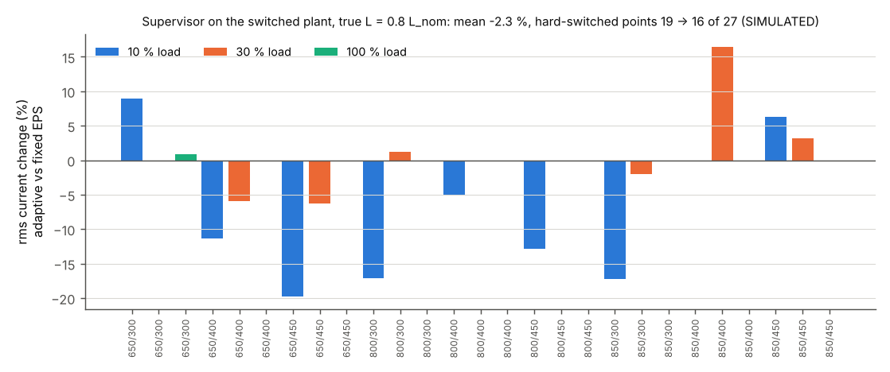

# 16 Digital Twin and Estimation

> Reading time: ~45 min. Prerequisites: chapters 04 (DAB operation), 05 (model, the 1/L regressor), 08 (simulation),
> 09 (control and firmware), 12 (thermal). Files covered: `Advanced_Research_2026/Digital_Twin/README.md`,
> `Advanced_Research_2026/Digital_Twin/interface.md`, `Advanced_Research_2026/Digital_Twin/twin.py`,
> `Advanced_Research_2026/Digital_Twin/observability.py`, `Advanced_Research_2026/Digital_Twin/run_twin_study.py`,
> `Advanced_Research_2026/Digital_Twin/supervisory.py`, `Advanced_Research_2026/Digital_Twin/results/twin_study.json`,
> `Advanced_Research_2026/Digital_Twin/results/observability.json`, `Advanced_Research_2026/Digital_Twin/results/supervisory_study.json`,
> `Advanced_Research_2026/Verification_Evidence/KNOWN_ISSUES.md`,
> `Advanced_Research_2026/Research_Publications/Paper_1_Adaptive_Soft_Switching_Twin.md`.

**Every data set in this chapter is SIMULATED** (the project's switched plant with modelled sensors, `data_origin =
SIMULATED` in `Advanced_Research_2026/Digital_Twin/provenance.json`). No hardware, no HIL.

## Overview

**Level 1 - Beginner:** A digital twin is a computer copy of the converter, fed the same measurements, that keeps its
own idea of hidden values - mainly the real size of the series inductor, which differs from the drawing and drifts. Knowing
it, the controller predicts currents better and keeps the transistors switching gently (ZVS). In simulation the inductance
could be tracked to a fraction of a percent with the existing sensors; the transistor capacitance could not.

**Level 2 - Engineering:** The twin has four layers (`twin.py`, `supervisory.py`): L1 electrical - a period-average model
evaluated on the applied PWM pattern, in which every current scales with 1/L, so 1/L is estimated by recursive least squares
(RLS) or an extended Kalman filter (EKF); L2 thermal - a 2-node Foster network per bridge with a Kalman observer of Tj from
the case NTC; L3 health - Rds_on / Coss drift; L4 supervisory - choice of the inner phase shifts (D1, D2) on the estimated
parameters, with a deterministic fallback. On simulated data RLS and EKF track a 20 % inductance offset and a 15 % drift
with 0.24 % / 0.25 % final error; a Fisher-information analysis shows L identifiable to 0.03 % (noise bound) and Coss not
identifiable at all; the supervisor reduces rms current by 2.3 % on average and hard-switched operating points from 19 to
16 of 27. `[Simulated]`

**Level 3 - Research:** This is primary contribution A of `Advanced_Research_2026/00_Gap_Analysis_and_Plan.md`, written up
as Paper 1. Its value lies less in the estimators (RLS and EKF are textbook) than in three findings: which parameters the
protection-grade sensing chain can identify at all; that the Coss branch of an adaptive ZVS law needs a transition-time
measurement and inherits the inductance error one-to-one; and an honest negative result - selecting (D1, D2) does not remove
light-load hard switching. Building the twin also exposed two defects in the engineering baseline (KNOWN_ISSUES items 1-2),
both fixed. Maturity L2 (L3 for the estimator code).

*Figure 16-1 (`img/fig_ch16_twin.py`, content from the Digital_Twin README and `interface.md`): the four layers, the
telemetry / advisory split and the unchanged safety layer.*

## Topic 1: The hierarchical twin

### Four layers, one interface, advisory-only commands
**What is it?** A layered model of the converter that runs on a host next to the firmware: L1 electrical, L2 thermal, L3
health, L4 supervisory, each with its own rate and maturity.

**Why do we need it?** The design values (64 uH, datasheet Coss, RthJC) are nominal; ZVS boundaries and current predictions
shift with the real values. A twin that tracks them lets control and diagnostics use the converter as it is.

**How does it work?**
**Level 1 - Beginner:** Like a flight computer estimating the aircraft's real weight from how it climbs, the twin estimates
the real inductor from how the currents respond and suggests settings; the safety limits stay in charge.
**Level 2 - Engineering:** `interface.md`: the C2000 firmware sends CRC-16 telemetry frames at 1 kHz (v1, v2, i2_avg, i1_avg,
i_pk averaged over 100 periods, the ePWM registers phi, D1, D2, NTC at 10 Hz, state, fault; t_tr only if the proposed
sensor exists). The host runs L1 (one scalar RLS update per frame), L2 (a 2x2 Kalman filter at 1 kHz) and L4 (16 candidate
evaluations, about 20 ms in Python). It returns an advisory frame (D1, D2, L_est, confidence, status). The firmware uses it
only in state RUN, only through the same limiter and `check_protection` as the fixed schedule, and ignores it unless the twin
status is TRUSTED (sigma_L / L <= 5 %, frame younger than 20 ms, CRC correct). Comparator trips and interlocks are untouched.
**Level 3 - Research:** The architecture separates what may go wrong (a model-based advisory) from what must never go wrong
(hardware protection) - the precondition for any adaptive layer near a power stage (compare safe RL, chapter 17).

**Example from our converter:** Layer table in `Advanced_Research_2026/Digital_Twin/README.md`: L1 maturity L2, L2 L2 with
estimated capacitances, L3 L1-L2, L4 L2. The firmware's existing telemetry is `10_Firmware/src/dab_comm.c`. `[Implemented]` for
the Python layers, `[Proposed]` for the firmware frame extension.

**Engineering calculations:** Frame payload: 2 voltages + 3 currents + 3 PWM counts + 2 NTC + 2 t_tr (16-bit each) + state,
fault (8-bit) + CRC-16 = 28 bytes per frame; at 1 kHz that is 28 kB/s of telemetry.

**Design decision made in this project:** Host-side twin with advisory commands and a deterministic fallback; nothing in the
twin can widen a limit. `[Proposed]`

**Alternatives considered:** The RLS directly in firmware - `Advanced_Research_2026/Embedded_AI/README.md` budgets it in a
10 kHz task at 4 us per 100 us; a purely data-driven twin (L03, Bayindir et al., IECON 2024, confirmed: XGBoost and DNN twins
that predict the output voltage but identify no physical parameter).

**How to verify it:** Frame CRC and staleness handling in the SIL harness; HIL with injected stale or corrupt frames
(`Advanced_Research_2026/HIL_Validation/`, proposed). `[Not yet tested]`

**Common mistakes:** Letting a twin write set-points directly; forgetting that here the "physical" side is itself a simulation.

**Interview explanation (30 s):** "The twin is a four-layer model on the host - electrical, thermal, health, supervisory - fed
by 1 kHz telemetry including the PWM registers. It sends only advisory inner phase shifts, which pass the same limiter and are
ignored unless the inductance estimate is trusted."

**Research-level explanation:** Most published converter twins (L51, Huang et al., IET Power Electronics 2025, a confirmed
review) stress prediction; this design puts the trust decision (sigma, staleness, envelope) into the interface itself.

## Topic 2: The electrical layer

### The 1/L regressor evaluated on the applied PWM pattern
**What is it?** For a lossless DAB and a fixed switching pattern, every inductor current is proportional to 1/L. Hence the
period-average LV current is I2_avg = g x (1/L), where g depends only on the pattern (s1, s2), V1, V2 and n - a linear
regression in theta = 1/L.

**Why do we need it?** A model linear in the unknown gives a well-conditioned, cheap estimator (scalar RLS) with no
iteration and no local minima.

**How does it work?**
**Level 1 - Beginner:** Halve the inductor and, for the same switching, all currents double. Measure the current, compute what
it "should" be for a 1 H inductor, and the ratio tells you the inductance.
**Level 2 - Engineering:** `twin.py`, `discrete_model(s1, s2, V1, V2, n, fs, L)`: di = (s1 V1 - s2 n V2) dt / L, cumulative sum,
mean removed, i2_avg = mean(i s2 n). The arrays s1, s2 are the *applied* bridge voltages (+1, 0, -1 per cell) as the PWM
registers define them, not the ideal phi. At full load g = I2 L = 16.5 A x 64 uH = 1.06e-3 A H (comment in class RLS).
**Level 3 - Research:** Using the applied pattern removes the modulator's time quantisation from the regressor: the plant has
200 steps per period (the C2000 ePWM about 2000), and with the ideal phase the estimate was 4-7 % off at small phase shifts
(README section 2). The regressor neglects the loop resistance R_s = 0.3 Ohm (0.6-0.9 % bias) and the dead time (absent from
the plant). A lossy variant exists (`discrete_model_lossy`, exact periodic steady state i0 = c / (1 - a^N)).

**Example from our converter:** `img/ch05_regressor_1_over_L.png` (chapter 05) shows I2 against 1/L as straight lines through
the origin for three patterns. `[Simulated]`

**Engineering calculations:** At 10 % load g is about 1.06e-4 A H, below the 2.5e-4 A H gate; the gate corresponds to about
25 % load (2.5e-4 / 1.06e-3 = 0.24).

**Design decision made in this project:** Lossless regressor on the applied pattern, R_s bias accepted and documented. `[Implemented]`

**Alternatives considered:** The lossy regressor (removes the bias but needs R_s); gradient-based identification through a
differentiable simulator (L28, Tan et al., arXiv 2026, confirmed); PINN-based estimation of L and R_eq for a DAB (L30, Dey and
Mallik, arXiv 2025, confirmed: 2.7 % / 3.1 % MAE, no uncertainty bounds).

**How to verify it:** Linearity check in chapter 05's figure; E1/E2 errors on the switched plant. `[Simulated]`

**Common mistakes:** Computing g from the commanded phase instead of the realised pattern; using it during transitions.

**Interview explanation (30 s):** "In a lossless DAB every current scales with one over L. So we compute, from the PWM
registers the controller actually applied, what the average LV current would be with a one-henry inductor, and the measured
current divided by that is one over L - a scalar linear regression."

**Research-level explanation:** Linearity in theta is structural, not a small-signal approximation; it is lost once
Coss-dependent transition intervals are modelled.

## Topic 3: Recursive least squares

### RLS with forgetting and excitation gating (experiments E1, E2)
**What is it?** RLS updates an estimate after each new measurement without storing old data; a forgetting factor lambda < 1
discounts old samples so a drifting parameter can be tracked. Excitation gating skips updates when the regressor is too small
to carry information.

**Why do we need it?** The inductance changes slowly (temperature, saturation, aging); a fixed batch estimate would not follow.
At light load the regressor shrinks and bias dominates.

**How does it work?**
**Level 1 - Beginner:** Keep a running guess and nudge it after each measurement - a lot when you are unsure, a little when
confident - while slowly forgetting very old evidence. When the signal is too weak, do not nudge at all.
**Level 2 - Engineering:** `twin.py`, class RLS: k = P g / (lambda + g P g); theta += k (y - g theta); P = (P - k g P) / lambda;
lambda = 0.995, P0 = (0.3 / L0)^2, update only if |g| >= 2.5e-4 A H. E1 (`run_twin_study.py`): true L = 0.8 L_nom, then +15 %
drift between 60 and 90 ms, a 100 -> 50 % load step, estimators start at L_nom. E2: steady state at 100 / 30 / 10 % load,
true L = 0.9 L_nom.
**Level 3 - Research:** Forgetting trades noise for tracking: memory 1 / (1 - lambda) = 200 updates. The gate prevents covariance
wind-up and light-load bias; the Adaptive_MPC module uses the same scalar RLS with bounds [0.6, 2] / L_nom.

**Example from our converter:** `results/twin_study.json`: E1 - RLS within 2 % after 0.01 ms (the first logged period), final
error 0.24 %, 1-sigma 0.86 %. E2 (gated): +0.59 % bias at 100 % (4000 updates), -0.87 % at 30 % (3490 updates), -0.49 % at 10 %
(141 updates, estimate held); ungated at 10 %: -0.79 % bias, 0.033 % std. `[Simulated]`

**Engineering calculations:** Why the light-load bias is negative and small: R_s = 0.3 Ohm against a reactance 2 pi fs L =
2 pi x 1e5 x 57.6 uH = 36 Ohm at 0.9 L_nom; the lossless model's error is of order R_s / X, about 1 %.

**Design decision made in this project:** lambda = 0.995, gate at 2.5e-4 A H, hold the last estimate below about 25 % load. `[Implemented]`

**Alternatives considered:** Batch least squares over a window.

**How to verify it:** E1/E2 on the switched plant (done); the Adaptive_MPC RLS reaches 77.4 uH against a true 76.8 uH for
L = 1.2 L_nom (`Advanced_Research_2026/Adaptive_MPC/README.md`); hardware validation not done. `[Simulated]`

**Common mistakes:** lambda too small; no gate; reading the RLS 1-sigma as the total error (it ignores bias).

**Interview explanation (30 s):** "A scalar RLS with forgetting 0.995 estimates one over L every frame and skips updates below
about a quarter load where the regressor carries little information. On the simulated plant it tracks a 20 % offset and a 15 %
drift to a quarter of a percent."

**Research-level explanation:** The residual error is bias, not variance: 0.6-0.9 % from the unmodelled loss resistance against
a Cramer-Rao noise floor of 0.03 % - so a better model, not more data, is the lever.

*Figure 16-2 (from `run_twin_study.py`): E1 inductance identification - RLS, EKF and grid Bayes against the true L.*

## Topic 4: Joint state and parameter estimation

### Extended Kalman filter and the grid Bayes reference
**What is it?** An EKF estimates states and parameters together by linearising a nonlinear model at each step. A grid Bayes
filter keeps the full posterior probability of L on a grid of candidate values - exact but expensive, used as a reference.

**Why do we need it?** The EKF also estimates the output voltage and the load current, so it can feed a model-based controller
and handle a load step; the Bayes grid shows what the "ideal" answer would be.

**How does it work?**
**Level 1 - Beginner:** The EKF is a smarter running guess that tracks several linked quantities at once; the Bayes grid writes
down how likely every possible inductor value is and updates all of them after each measurement.
**Level 2 - Engineering:** `twin.py`, class EKF_L: state x = [v2, i_load, theta = 1/L]; v2(k+1) = v2 + Ts / C2 (g theta - i_load);
i_load and theta are random walks; measurements [v2, I2]. Class BayesGridL: 701 grid points from 0.6 to 1.3 L_nom, log-likelihood
-0.5 ((y - g / L) / sigma)^2 accumulated each step.
**Level 3 - Research:** The grid posterior assumes a constant parameter, so it cannot follow the drift: final error -11.2 % in E1
with a 95 % credible width of 0.0 % - confident and wrong, the classic failure of a static posterior on a time-varying parameter.
It is reported as a reference, not a candidate. The EKF's process noise on theta plays the role of RLS forgetting.

**Example from our converter:** E1: EKF within 2 % after 0.01 ms, final error 0.25 %, 0.26 % at 50 ms; Bayes -11.2 %
(`results/twin_study.json`). `[Simulated]`

**Engineering calculations:** EKF linearisation: F = [[1, -Ts/C2, Ts/C2 g], [0, 1, 0], [0, 0, 1]], H = [[1, 0, 0], [0, 0, g]] - the
only nonlinearity is the product g theta.

**Design decision made in this project:** RLS as the primary estimator (cheapest, equal accuracy); EKF kept where states are needed
(MPC); Bayes grid only as reference. `[Implemented]`

**Alternatives considered:** A Bayes grid with a transition kernel (a proper hidden-Markov filter); particle filter; uncertainty-aware
MAP plus Laplace estimation (L29, Monopoli, Liu, Zhao, arXiv 2026, confirmed).

**How to verify it:** Comparison on E1 (done); consistency tests (normalised innovation squared) not done. `[Not yet tested]`

**Common mistakes:** Trusting a posterior width without a drift model.

**Interview explanation (30 s):** "The EKF estimates output voltage, load current and one over L together and matches RLS at 0.25 %.
A grid Bayes posterior, used as a reference, ends 11 % off with a near-zero credible interval because it assumes a constant
parameter - a nice lesson in model assumptions."

**Research-level explanation:** Equal RLS and EKF accuracy confirms that the limit is the shared model bias, not the filter.

## Topic 5: Observability

### Fisher information, Cramer-Rao bounds and why Coss is unobservable
**What is it?** The Fisher information F = sum J^T R^-1 J (J the sensitivity of the measurements to the parameters, R the noise
covariance) measures how much a data set says about the parameters. Its rank counts identifiable directions; the Cramer-Rao bound
sqrt(diag(F^-1)) is the smallest standard deviation any unbiased estimator can reach.

**Why do we need it?** Before building an estimator for Coss, check whether the sensors can see Coss at all.

**How does it work?**
**Level 1 - Beginner:** If wiggling a hidden knob does not change anything you can measure, no clever maths can find the knob's
position. The Fisher analysis wiggles every knob and checks which measurements move.
**Level 2 - Engineering:** `observability.py`: parameters p = [L, Coss_er1, Coss_er2, R_s]; central finite differences (+/-2 %) on the
switched plant in steady state at 36 points (3 V1 x 3 V2 x 4 phase shifts, EPS matching, both directions); noise 1-sigma I2_avg
0.085 A, I1_avg 0.082 A, I_pk 0.3 A, t_tr 5 ns (`results/observability.json`). Results after 1000 periods: I2_avg only - rank 2, L
0.033 %, R_s 8.2 %, Coss not identifiable; + I1_avg - rank 2, L 0.027 %, R_s 7.4 %; + peak detector - rank 2, L 0.025 %, R_s 0.74 %;
+ proposed HV t_tr - rank 3, Coss_er1 0.032 %; + LV t_tr - rank 4, all four (condition number 49).
**Level 3 - Research:** The Coss columns of J are exactly zero for every current measurement. In the project's plant this is
structural: the switched model has ideal bridges and no dead time, so Coss cannot enter a period-average current. On hardware Coss
would act only through the short resonant transitions in the dead time - a second-order effect confounded with dead time and
device delays. Either way the conclusion holds: a direct transition measurement is needed. The same theme appears in L29
(on-resistance weakly identifiable with available sensing) and L33 (Ou et al., arXiv 2025, confirmed: identifiability of a buck
with a PINN).

**Example from our converter:** At 650/400 V, phi = 0.25 rad: I2 = 6.51 A and dI2 / d ln L = -6.46 A - the 1/L law (ratio -0.99) -
while dI2 / d ln Coss = 0 (`results/observability.json`, jacobians). `[Simulated]`

**Engineering calculations:** Per-point bound to 1000 periods: sigma_1000 = sigma_point / sqrt(1000 / 36). The R_s bound falls 10x
with the peak detector because I_pk responds to damping differently from the averages, breaking the near-collinearity of L and R_s.

**Design decision made in this project:** Do not build a Coss estimator on the existing sensors; propose a transition-time sensor. `[Proposed]`

**Alternatives considered:** Datasheet Coss with a temperature model (no part-spread correction); gate-signal monitoring (L12 and L39, confirmed, use gate oscillation or gate current for gate-oxide health - chapter 18).

**How to verify it:** Run `python3 observability.py` (about 10 s); on hardware, a sensitivity test with an added drain capacitor.
`[Simulated]`

**Common mistakes:** Reading a tiny CRLB as achievable accuracy (bias is not in the bound); judging from one operating point.

**Interview explanation (30 s):** "We computed the Fisher information of inductance, both output capacitances and the loss
resistance for every sensor combination. With the board's sensors the rank is two: inductance to 0.03 percent, resistance weakly,
capacitance not at all, because averaged currents do not depend on it. Adding a transition-time sensor per bridge makes all four
identifiable."

**Research-level explanation:** Identifiability analysis before estimator design is still rare in converter-twin papers (Paper 1
names it as the gap against L04, L28, L29); here it turned a planned estimator into a sensor proposal.

*Figure 16-3 (`img/fig_ch16_twin.py`, data `results/observability.json`): Cramer-Rao relative standard deviation after
1000 periods per parameter and sensor set; x = not identifiable.*

## Topic 6: The proposed transition-time sensor

### Joint L / Coss_er estimation (experiment E3)
**What is it?** A sensor that measures how long the drain voltage takes to swing during a ZVS transition (drain-voltage slope
comparator or a desaturation-style timing sense). With the charge model t_tr = 2 Coss_er V / |I_edge|, the measured time and the
model edge current give Coss_er.

**Why do we need it?** The ZVS condition 0.5 L I^2 >= Coss_er V^2 needs Coss_er; the observability study shows it cannot be
obtained otherwise.

**How does it work?**
**Level 1 - Beginner:** Time how long it takes the transistor's voltage to swing from one rail to the other; with a known current
pushing it, that time tells you how big the "bucket" (capacitance) is.
**Level 2 - Engineering:** `twin.py`, class CossEstimator: RLS on theta_c = Coss_er in pF with regressor g = 2 V / |I_edge| (ns per
pF), forgetting 0.99, updates only when |I_edge| > 0.5 A. I_edge comes from the L1 model with the estimated L. E3: true Coss_er = 1.2 x
datasheet, true L = 0.85 L_nom, 50 % load, 5 ns rms synthetic timing noise.
**Level 3 - Research:** Result: +4.5 % with the estimated L, -11.6 % with the nominal L. Because I_edge scales as 1/L, any
inductance error passes one-to-one into Coss_er, so the two branches must run together. The 5 ns noise is assumed; against the 34 ns transition of the
calculation below it is a 15 % single-shot error, averaged down by the RLS.

**Example from our converter:** `results/twin_study.json` E3 and figure `results/E3_Coss_identification.png`; Coss_er
datasheet-typical values 170 pF (C3M0032120K) and 350 pF (C3M0016120K) from `dabtools/dab/devices.py`, `verified=False`. `[Simulated]`

**Engineering calculations:** At 800 V and I_edge = 8 A: t_tr = 2 x 170 pF x 800 V / 8 A = 34 ns. ZVS current minimum at 800 V,
64 uH: sqrt(2 x 170 pF x 800^2 / 64 uH) = 1.84 A (`zvs_current_min` in `dabtools/dab/dab_model.py`).

**Design decision made in this project:** Proposed only - the sensor does not exist on the current board. `[Proposed]`

**Alternatives considered:** Gate-voltage plateau timing; sensing integrated in an active gate driver (L21, L22, confirmed - chapter 18).

**How to verify it:** A 1 kW de-rated bench test with the sensor on one leg (Paper 1, section 7). `[Proposed]`

**Common mistakes:** Estimating Coss with the nominal L; ignoring the 60 pF winding capacitance (`design_values.json`).

**Interview explanation (30 s):** "Coss is invisible to the averaged currents, so we propose timing the drain-voltage transition.
In simulation it identifies Coss to 4.5 percent - but only together with the inductance estimate; with the nominal inductance the
error is 11.6 percent, because the edge current scales with one over L."

**Research-level explanation:** L estimation is a prerequisite of Coss estimation - contribution A3 of Paper 1.

## Topic 7: The thermal layer

### 2-node Foster network and Kalman observer of Tj (experiment E4)
**What is it?** A thermal model (junction and case nodes) driven by the loss estimate, corrected by the measured case NTC through a
Kalman filter, giving an estimate of the junction temperature, which cannot be measured directly.

**Why do we need it?** Derating, protection and lifetime counting need Tj; the NTC sits on the heatsink, seconds and kelvins away
from the junction.

**How does it work?**
**Level 1 - Beginner:** You cannot put a thermometer inside the chip, but you know how much heat it makes and how well that heat
escapes, so you can calculate its temperature and use the outside thermometer to keep the calculation honest.
**Level 2 - Engineering:** `twin.py`, class ThermalTwin: Tj -(RthJC, CthJ)- Tc -(RthCA, CthC)- Tamb, RthJC from the device table,
RthCA = 0.35 K/W, CthJ = 0.05 J/K, CthC = 60 J/K (ESTIMATED), Ts = 1 ms, NTC noise 1 K. E4: loss steps 6 -> 14 -> 4 W per device; the
observer has +15 % RthJC and +10 % loss-estimate error.
**Level 3 - Research:** Result: Tj error 1.1 K rms, 1.6 K steady, 14.4 K peak during the step. The NTC noise is not the limit;
model error is. The junction cannot be corrected by the case measurement faster than the model predicts it, so step errors are set
by the loss-model error and the observer lag. Calibration on hardware (and the multiphysics models) is the only lever.

**Example from our converter:** `results/twin_study.json` E4; figure `results/E4_thermal_twin.png`. `[Simulated]`

**Engineering calculations:** E4 uses the HV device C3M0032120K: junction time constant RthJC CthJ = 0.45 K/W x 0.05 J/K = 22.5 ms; case node about
RthCA CthC = 0.35 x 60 = 21 s. Steady error from +15 % RthJC alone at 14 W: 0.15 x 0.45 x 14 = 0.9 K.

**Design decision made in this project:** Run the observer at 1 kHz with estimated parameters and label them ESTIMATE. `[Implemented]`

**Alternatives considered:** Temperature-sensitive electrical parameters (Rds_on or threshold voltage) as direct Tj indicators -
online Rds_on estimation without current measurement (L14, TPEL 2023, confirmed); a 3-D thermal model
(`Advanced_Research_2026/Multiphysics_Models/README.md`).

**How to verify it:** Thermal-camera or TSEP measurements during load steps. `[Proposed]`

**Common mistakes:** Trusting the observer's own covariance (it does not know the RthJC error); using the NTC as Tj.

**Interview explanation (30 s):** "The thermal twin is a two-node network per bridge with a Kalman filter using the heatsink NTC.
With 15 percent thermal-resistance error and 10 percent loss error it tracks Tj to about one kelvin rms but misses by 14 kelvin
during a load step - the limit is the model, not the sensor."

**Research-level explanation:** For protection use the step error, not the rms, is the honest metric.

## Topic 8: The supervisory layer

### (D1, D2) selection on estimated parameters, and its honest result
**What is it?** For a demanded power and measured voltages, the supervisor chooses the inner phase shifts (D1, D2) from 16
candidates to minimise the model rms current subject to a 1 A ZVS margin on both bridges and the 32 A peak limit, using the estimated
L. The PI loop still sets the outer phase shift. A fixed EPS voltage-matching schedule is the fallback.

**Why do we need it?** The fixed schedule is designed with nominal parameters; with the real L different, its ZVS and rms trade-off is
off. This is the "self-optimising" layer of the gap analysis.

**How does it work?**
**Level 1 - Beginner:** With a better idea of the real inductor, the twin tries a handful of switching patterns in its head and
suggests the one with the lowest current that still switches gently.
**Level 2 - Engineering:** `supervisory.py`: candidates D in {Dm, Dm - 0.1, Dm - 0.2, 1.0} per bridge (clipped to D_min = 0.12), phi by
bisection on the model for the demanded power. Fallback when sigma > 5 %, L_est outside 0.7-1.3 L_nom, or outside the envelope. Study:
27 points (V1 650/800/850 V x V2 300/400/450 V x 10/30/100 %), true L = 0.8 L_nom, both choices run in closed loop on the switched
plant. Note: L_est is emulated with the E1 accuracy (0.25 % bias, 0.4 % spread), not produced by an RLS running in the loop.
**Level 3 - Research:** Results (`results/supervisory_study.json`): mean rms change -2.3 % (best -19.8 % at 800/300 V, 10 %; worst +16.4 %
at 850/400 V, 30 %); points with hard switching 19 -> 16 of 27; hard-switched edges 61 -> 56; 0 fallbacks. Per point: 8 points improved
in hard edges, 4 got worse (650/400 V 30 %, 800/400 V 10 % with 4 -> 8, 850/400 V 30 %, 850/450 V 10 %), 12 kept the fixed (D1, D2). The
README's reading: the clear benefit is prediction - the nominal model mis-predicts rms current by -10.5 % on average and 22.6 % at worst
when L is 20 % low - while light-load hard switching is a property of the DAB at 10-30 % load with SPS/EPS and needs TPS, frequency
modulation or burst mode (`Advanced_Research_2026/Adaptive_MPC/`). Where the supervisor did worse, the model's ZVS feasibility at the
inner edges differs from the plant's.

**Example from our converter:** 650/450 V at 10 %: rms 5.22 -> 4.19 A and hard edges 2 -> 0; 800/400 V at 100 %: same (D1, D2), 9.67 A
on the plant against 9.17 A predicted by the nominal model. `[Simulated]`

**Engineering calculations:** Prediction error at 800/400 V, 100 %: (9.17 - 9.67) / 9.67 = -5.2 %. A 20 % low L raises currents by
1 / 0.8 = 1.25 at equal pattern; the closed loop reduces phi, leaving a smaller net error.

**Design decision made in this project:** Keep the supervisor advisory, report the negative part, and route light-load ZVS to the
Adaptive_MPC ZVS maps (KNOWN_ISSUES item 13, open). `[Simulated]`

**Alternatives considered:** A larger margin or the lossy model at the inner edges (README); TPS search; MPC (chapter 17).

**How to verify it:** Re-run with the RLS in the loop and multiple seeds; HIL with an inductance step. `[Not yet tested]`

**Common mistakes:** Reporting only the mean; evaluating the supervisor on the model it optimised instead of on the plant.

**Interview explanation (30 s):** "On 27 simulated operating points with the inductance 20 percent low, the supervisor cut rms current
by 2.3 percent on average and hard-switched points from 19 to 16. The bigger win is prediction: the nominal model is 10 percent off on
current. Light-load hard switching is not removed - that needs a different modulation."

**Research-level explanation:** Publishing the mixed result, including the four points where hard switching increased, is what makes
the claim credible; Paper 1 keeps it as "the honest negative part" (section 5).

*Figure 16-4 (`img/fig_ch16_twin.py`, data `results/supervisory_study.json`): rms-current change per operating point.*

## Topic 9: The twin as a model checker

### Two baseline defects found by the twin work (KNOWN_ISSUES items 1-2)
**What is it?** Building an estimator on a simulation stresses the simulation in ways normal tests do not. Two defects in the
engineering baseline surfaced and were fixed.

**Why do we need it?** An estimator fitted to a buggy plant learns the bug; a controller validated on it inherits it.

**How does it work?**
**Level 1 - Beginner:** Measuring very precisely makes small errors in the ruler visible.
**Level 2 - Engineering:** Item 1 (found by Digital_Twin E3): the switched plant `dabtools/dab/sim_switched.py` built the positive and
negative pulses of a three-level bridge voltage from two independent floating-point comparisons, which could differ by one time step
when an edge fell on a cell centre. The DC volt-seconds per period drove a 13 A DC inductor current whenever D < 1. Fix: the negative
pulse is the positive one rolled by exactly N_sub / 2 cells; `05_Simulation/run_switched_sim.py` was re-run and headline results
moved by < 0.3 V / < 0.1 % (affected cases: EPS and dead-bus). Item 2 (found in the 18_Verification re-run that followed): the Python
controller had no gates-enable flag, so the harness switched a full square wave into the dead LV bus during PRECHARGE_WAIT ->
SOFTSTART (62 A, I_PK trip). The C core already had `cmd.gates_enabled`; the fix adds `DABController.pwm_enabled` mirroring it, and the
harness applies D1 = D2 = 0 when it is false.
**Level 3 - Research:** Both defects are invisible at nominal full-load SPS operation (D = 1, gates on), which is exactly where
classic verification looks. Inner phase shifts and start-up are where estimators and adaptive controllers operate, so twin work
doubles as a test oracle.

**Example from our converter:** `SiC_6k6_Industrial_DAB/18_Verification/verification_report.md`: "switched sim: dead-bus start under
hardware current limit" PASS, peak 20.2 A, v2 final 400.01 V, 45 ms to 90 %. `[Verified]` The firmware control core SIL run is PASS
in the same report. `[Verified]`

**Engineering calculations:** One cell of 200 at 100 kHz is 50 ns; at 800 V that is 40 uV s of DC volt-seconds per period, i.e.
4 V average on the loop; with the 0.3 Ohm loop resistance that settles at about 13 A - the observed value.

**Design decision made in this project:** Fix in the baseline, re-run, log in KNOWN_ISSUES (items 1 and 2 marked fixed). `[Implemented]`

**Alternatives considered:** Integer-tick pulse generation, as in the ePWM.

**How to verify it:** The dead-bus check above; a DC-current assertion (mean inductor current = 0 over a period) would catch item 1
permanently. `[Proposed]`

**Common mistakes:** Comparing floats for event timing.

**Interview explanation (30 s):** "The twin found two baseline bugs: a one-sample asymmetry in the simulated three-level voltage that
created 13 amps of DC inductor current whenever the inner phase shift was below one, and a missing gates-enable in the Python
controller that switched into a dead bus during start-up. Both are fixed and the checks pass."

**Research-level explanation:** Estimation residuals are a sensitive model-validation tool.

## Worked example(s) with real numbers

**Example 1 - one RLS step.** L0 = 64 uH, theta0 = 1 / L0 = 15625 /H, P0 = (0.3 / L0)^2 = 2.2e7 /H^2, lambda = 0.995. Full load:
g = 1.06e-3 A H; true L = 0.8 L0 = 51.2 uH, so y = g / L = 20.7 A (noise ignored). Gain k = P g / (lambda + g P g) = 2.2e7 x 1.06e-3 /
(0.995 + 1.06e-3 x 2.2e7 x 1.06e-3) = 23320 / 25.7 = 907 /(H A). Innovation y - g theta0 = 20.70 - 16.56 = 4.14 A. New theta = 15625 + 907 x
4.14 = 19380 /H, i.e. L = 51.6 uH - within 1 % after one update, consistent with the E1 result "within 2 % after 0.01 ms". `[Simulated]`

**Example 2 - why Coss needs the L estimate.** With true L = 0.85 L_nom the real edge current is 1 / 0.85 = 1.18 x the nominal-model
value. Using the nominal model, g = 2 V / I_edge is 18 % too large, so Coss_er = t_tr / g comes out about 15 % low - the E3 run gives
-11.6 % (true Coss 1.2 x datasheet, noise and the 50 % load point included). With the estimated L: +4.5 %.

## How this chapter connects to the files

| File | What it contains | Status |
|---|---|---|
| `Advanced_Research_2026/Digital_Twin/twin.py` | sensors, regressor, RLS, EKF, Bayes grid, Coss estimator, thermal twin | [Implemented] |
| `Advanced_Research_2026/Digital_Twin/observability.py` | Fisher information and Cramer-Rao bounds per sensor set | [Implemented] |
| `Advanced_Research_2026/Digital_Twin/run_twin_study.py` | experiments E1-E4 on the switched plant | [Implemented] |
| `Advanced_Research_2026/Digital_Twin/supervisory.py` | (D1, D2) supervisor and 27-point study | [Implemented] |
| `Advanced_Research_2026/Digital_Twin/results/twin_study.json` | E1-E4 results | [Simulated] |
| `Advanced_Research_2026/Digital_Twin/results/observability.json` | ranks, bounds, Jacobians | [Simulated] |
| `Advanced_Research_2026/Digital_Twin/results/supervisory_study.json` | per-point fixed vs adaptive metrics | [Simulated] |
| `Advanced_Research_2026/Digital_Twin/interface.md` | telemetry and advisory frames, trust rules | [Proposed] |
| `Advanced_Research_2026/Verification_Evidence/KNOWN_ISSUES.md` | items 1-2 (fixed), 13 (open) | [Implemented] |
| `SiC_6k6_Industrial_DAB/18_Verification/verification_report.md` | dead-bus start and SIL checks | [Verified] |
| `Advanced_Research_2026/Research_Publications/Paper_1_Adaptive_Soft_Switching_Twin.md` | manuscript outline | [Proposed] |
| `21_Human_Friendly_Learning_Notes/img/fig_ch16_twin.py` | figures 16-1, 16-3, 16-4 | [Implemented] |

## Viva / interview questions

### Basic (10)
1. What is a digital twin in this project?
   A host-side model fed by telemetry that estimates hidden parameters (mainly L) and suggests operating points.
2. Name the four layers.
   L1 electrical, L2 thermal, L3 health, L4 supervisory.
3. Why estimate the inductance at all?
   It sets power transfer and ZVS boundaries; with L 20 % low the nominal model mis-predicts rms current by 10.5 % on average.
4. What is the forgetting factor for?
   It discounts old data (lambda = 0.995, about 200 updates of memory) so drift can be tracked.
5. What is excitation gating?
   Skipping updates when the regressor is small (|g| < 2.5e-4 A H, about 25 % load) because the data carry little information there.
6. How accurate was the L estimate in simulation?
   0.24 % (RLS) and 0.25 % (EKF) final error after a 20 % offset and a 15 % drift.
7. Can the board's sensors measure Coss?
   No; averaged currents do not depend on it - Fisher rank 2, Coss not identifiable.
8. What does the thermal twin estimate and from what?
   Tj of each bridge, from the loss estimate and the case NTC.
9. What happens if the twin is not trusted?
   The firmware ignores its advice and keeps the fixed EPS schedule; hardware protections are never affected.
10. Is any twin result measured?
    No - all data are simulated; the transition-time sensor does not exist.

### Intermediate (10)
1. Why must the regressor be evaluated on the applied PWM pattern?
   The modulator quantises the phase (200 steps in the plant); with the ideal phase the estimate was 4-7 % off at small phase shifts.
2. Where does the 0.6-0.9 % bias come from?
   The 0.3 Ohm loop resistance missing from the lossless regressor.
3. Why did the Bayes grid end 11 % off?
   It assumes a constant L and cannot follow the drift; its posterior collapsed before the drift.
4. What is the EKF state?
   [v2, i_load, 1/L], with v2 dynamics through C2 and random walks for i_load and 1/L.
5. State the transition-time model.
   t_tr = 2 Coss_er V / |I_edge|, with I_edge from the L1 model.
6. Why does the Coss estimate inherit the L error?
   I_edge scales as 1/L, so an L error rescales the regressor one-to-one.
7. What limits the thermal observer?
   Model errors (+15 % RthJC, +10 % loss): 1.1 K rms, 14.4 K peak during steps; the 1 K NTC noise is not the limit.
8. Summarise the supervisor result.
   -2.3 % mean rms, hard-switched points 19 -> 16 of 27, edges 61 -> 56; four points got worse in hard edges.
9. What were KNOWN_ISSUES items 1 and 2?
   A one-cell pulse asymmetry giving 13 A DC current for D < 1; and a missing gates-enable flag in the Python controller causing a 62 A
   trip at dead-bus start. Both fixed.
10. Why does the twin send advisory commands only?
    So that a model error can never bypass the limiter, protections or the validated envelope.

### Advanced / research (10)
1. Define the Fisher information and the Cramer-Rao bound used here.
   F = sum_k J_k^T R^-1 J_k with J = dy/d ln p over 36 points; bound = sqrt(diag(F^-1)), scaled by sqrt(36/1000) to 1000 periods.
2. Why is the Coss sensitivity exactly zero in this study, and does that hold on hardware?
   The plant has ideal bridges and no dead time, so Coss cannot affect averages; on hardware it enters weakly through dead-time
   transitions, confounded with dead time - a direct measurement is still needed.
3. Why does the peak detector improve the R_s bound tenfold?
   I_pk responds to damping differently from the averages, breaking the L-R_s collinearity.
4. How would you remove the light-load bias?
   Use the lossy regressor with R_s estimated jointly (identifiable with the peak detector) or a two-parameter RLS.
5. Why is the Cramer-Rao bound misleading for the final accuracy?
   It bounds variance of unbiased estimators; the dominant error here is model bias (0.6-0.9 % vs 0.03 %).
6. What would you change in the supervisor study to make it publishable?
   RLS in the loop instead of emulated L_est, multiple seeds, TPS candidates.
7. Position the work against L04 and L30.
   L04 identifies buck parameters in one cycle by PSO; L30 estimates DAB L and R_eq with a PINN without uncertainty bounds; this
   work adds observability and the L-Coss coupling, in simulation only.
8. What does L03 show and what does it not?
   Data-driven DAB twins predicting output voltage, without physical parameter identification (IECON 2024, not the TIM 2025 paper the
   specification named).
9. How would you validate the twin experimentally?
   HIL with an inductance step and corrupted frames, then a 1 kW de-rated bench with the transition-time sensor on one leg (Paper 1, sec. 7).
10. Why did the twin find baseline bugs that other checks missed?
    It operates at D < 1 and start-up and fits residuals at the 0.1 % level.

## Pitches

**30 s:** We built a four-layer digital twin of the 6.6 kW SiC DAB in simulation. Because every current scales with one over L, a
scalar RLS on the applied PWM pattern tracks the inductance to a quarter of a percent. A Fisher analysis proves the board's sensors
cannot see the transistor capacitance, so we propose a transition-time sensor. The supervisor helps modestly and does not cure
light-load hard switching - and the work found two baseline bugs, now fixed.

**2 min:** ZVS in a DAB depends on the series inductance and the device output capacitance, both with 10-20 percent tolerance.
In the twin's electrical layer the average LV current is a known function of the applied PWM pattern times one over L, so RLS or an
EKF tracks a 20 percent offset and a 15 percent drift to 0.25 percent on the switched plant - limited by the unmodelled loop
resistance, not by noise. A Fisher-information study shows the protection-grade sensors identify L to 0.03 percent but the
capacitances not at all; a proposed drain transition-time sensor identifies Coss to 4.5 percent, but only with the inductance
estimate. A thermal observer tracks Tj to about a kelvin rms, 14 kelvin during steps. The advisory supervisor lowers rms current by
2.3 percent on average and hard switching from 19 to 16 of 27 points, worse at four; light-load hard switching needs a different
modulation. Building the twin exposed two baseline bugs, now fixed. Everything is simulation.

**10 min outline:**
* Why parameter knowledge matters for ZVS; the four-layer architecture and the advisory interface.
* The 1/L regressor on the applied pattern; quantisation and loss bias.
* RLS with forgetting and gating; E1/E2 numbers; EKF and the failing static Bayes posterior.
* Observability: Fisher information, ranks, Cramer-Rao bounds, why Coss is invisible.
* The transition-time sensor and the L-Coss coupling (E3).
* Thermal observer (E4): what limits it.
* Supervisor: method, mixed result, what light-load ZVS really needs.
* The two baseline defects and what they teach about verification.
* Positioning (L03, L04, L28-L30) and the validation path (HIL, de-rated bench).

## Further reading

* `Advanced_Research_2026/Digital_Twin/README.md` - section 5 lists everything not verified; `Advanced_Research_2026/Research_Publications/Paper_1_Adaptive_Soft_Switching_Twin.md` - the paper outline.
* `Advanced_Research_2026/Literature_Database/literature_2022_2026.csv`, confirmed entries: L03 (Bayindir et al., IECON 2024, DAB digital
  twins without parameter identification); L04 (Liu, Qing, Chen, IEEE TIM 2024, one-cycle digital-twin multiparameter identification);
  L28 (Tan et al., arXiv 2026, differentiable-physics estimation); L29 (Monopoli, Liu, Zhao, arXiv 2026, uncertainty-aware estimation);
  L30 (Dey and Mallik, arXiv 2025, PINN-estimated L and R_eq for adaptive DAB modulation); L33 (Ou et al., arXiv 2025, PINN identifiability
  for a buck); L51 (Huang et al., IET Power Electronics 2025, review of AI and digital twins for converter control).
* Chapter 05 for the regressor derivation, chapter 17 for the MPC that uses the same RLS, chapter 18 for health monitoring.
