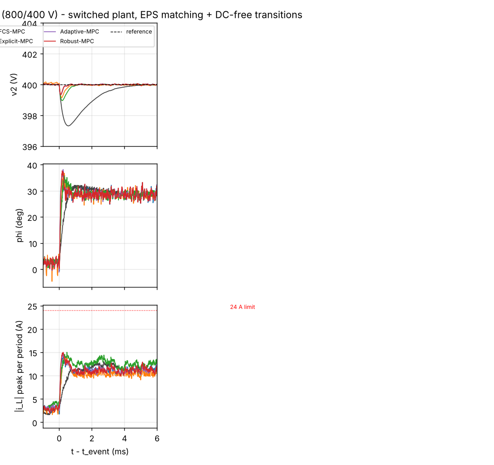
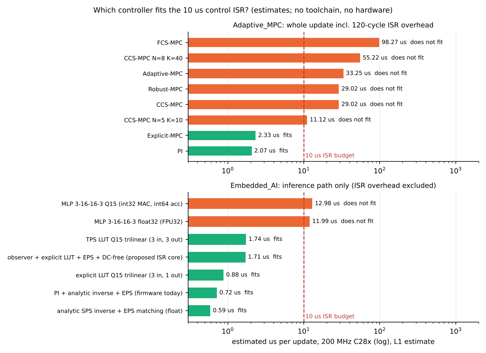
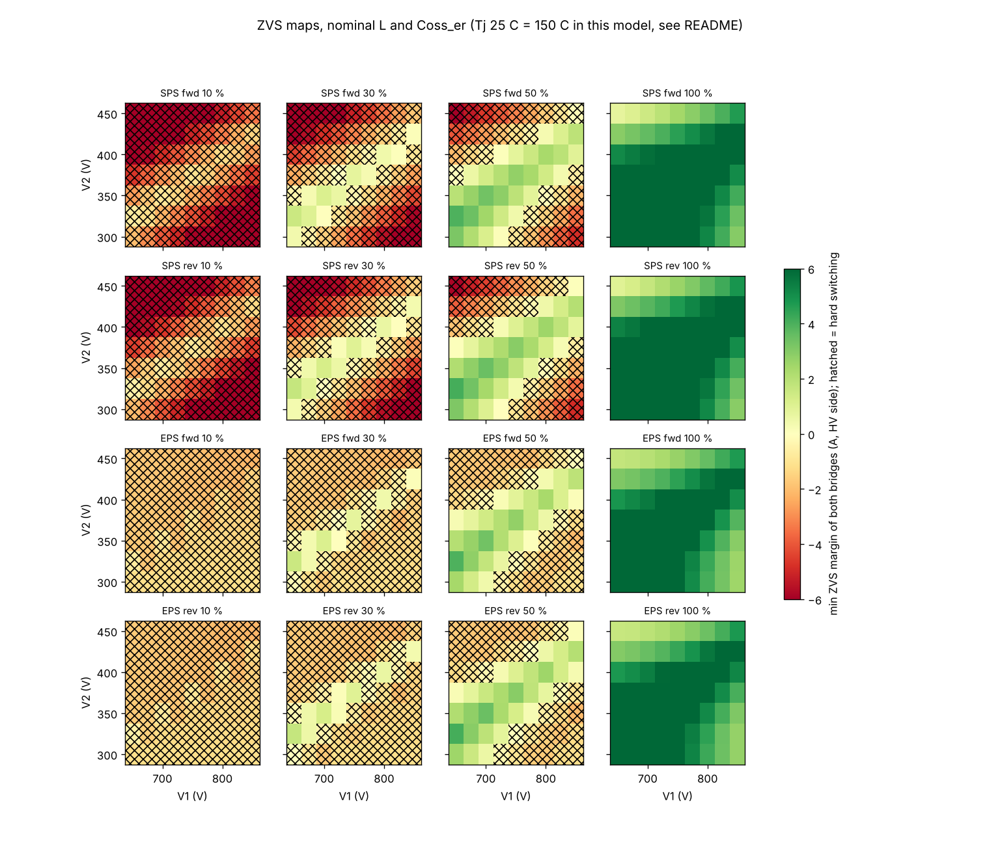
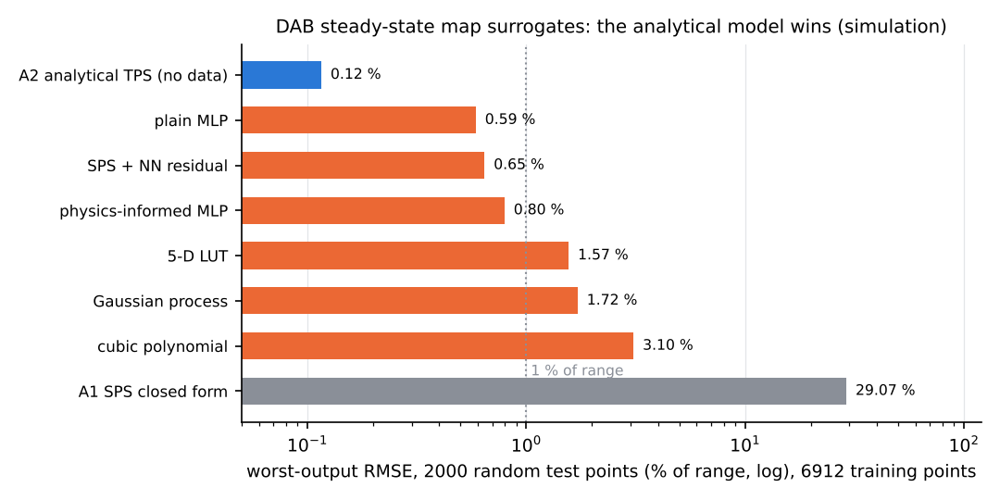

# 17 Advanced control: MPC, embedded AI, safe RL and physics-informed models

> Reading time: ~45 min. Prerequisites: chapters 04 (DAB operation, ZVS), 05 (models), 08 (switched
> simulation) and 09 (PI loop, modulator inverse). Files covered: `Advanced_Research_2026/Adaptive_MPC/`,
> `Advanced_Research_2026/Embedded_AI/`, `Advanced_Research_2026/Safe_RL_Research/README.md`,
> `Advanced_Research_2026/Physics_Informed_Models/README.md` and their `results/` folders.

## Overview

**Level 1 - Beginner:** Chapter 09 described the controller the converter actually uses: a simple PI
loop that compares the output voltage with 400 V and asks for more or less power. This chapter asks
whether a "smarter" controller does better: model predictive control (the controller looks a few steps
ahead), a small neural network inside the microcontroller, reinforcement learning (learning by trial
and error) and physics-informed neural networks. Every experiment ran only on a computer model. The
answer is that the simple tools are mostly good enough here. Prediction helps for sudden load changes,
but only a pre-computed table version is fast enough for the chip; the learned controllers and learned
models do not beat plain physics. These negative results are reported as carefully as the positive ones,
because they stop months of work on things that do not pay off for this converter.

**Level 2 - Engineering:** `Advanced_Research_2026/Adaptive_MPC/` benchmarks six controllers (PI,
CCS-MPC, FCS-MPC, explicit LUT MPC, adaptive RLS MPC, robust tube MPC) on the switched plant (L = 64 uH,
n = 2, fs = 100 kHz, C2 = 1.12 mF, 12-bit ADC). For a 10 -> 100 % load step every MPC cuts the peak
deviation from 0.672 % to 0.16-0.26 %; in power reversal the PI is better. The C2000 estimate shows that
only the explicit LUT (2.33 us) fits the 10 us ISR next to the PI (2.07 us); the online QP needs 29 us.
46.3 % of the V1 x V2 x P envelope hard-switches at nominal parameters. `Advanced_Research_2026/Embedded_AI/`
chooses a Q15 LUT (13.3 KB, 0.88 us) over a Q15 MLP (0.84 KB, 12.98 us). Safe RL gives no rms benefit
over PI + EPS; the exact analytical TPS model (0.116 % of range) is 5x more accurate than the best
learned surrogate (0.589 %).

**Level 3 - Research:** The 2022-2026 literature is full of MPC, AI-based TPS and deep-RL DAB papers,
mostly on 1 kW prototypes. The contribution here is a fair comparison on one plant with explicit compute
budgets and honest negative results: MPC gives margin, not compliance; the robust tube MPC is infeasible
at 650/450 V; learned policies add risk without gain; a physics loss did not help. Everything is L2
(simulation) or L1 (cycle estimates); nothing is hardware-validated.

## Topic 1: The controller benchmark on the switched plant

### Six controllers, five scenarios, one plant
**What is it?** A side-by-side benchmark of the project PI, a continuous-control-set MPC (CCS-MPC), a
finite-control-set MPC (FCS-MPC), an explicit (look-up-table) MPC, an adaptive MPC with RLS on 1/L and
a robust tube MPC, on one switched DAB plant in five scenarios: load step up and down, V1 step, power
reversal and soft start. `[Simulated]`

**Why do we need it?** Papers usually compare a new controller with a weakly tuned PI on another plant.
Only the same plant, ADC model, modulator and metrics show whether advanced control is worth its
compute cost on THIS converter.

**How does it work?**
**Level 1 - Beginner:** Six drivers drive the same car on the same road with the same bends (a sudden
load change, an input-voltage drop, a power reversal, a start-up). We measure how far each drifts from
the lane centre and how hard it steers (the inductor current). The PI reacts to the error it sees now;
the MPC drivers plan the next few moves.
**Level 2 - Engineering:** All MPCs use the averaged model v2[k+1] = v2[k] + a (i2[k] - d[k]) with
a = Ts / C2 = 8.9 mV/A and a two-state Luenberger observer for d (load current plus mismatch), which
gives offset-free tracking. The current is linearised around the last command with
g = n V1 (pi - 2|phi0|) / (2 pi^2 fs L). CCS-MPC: N = 8, q = 1, r = 16, box on phi (60 deg and the 24 A
bound), 20 fixed projected-gradient iterations. FCS-MPC: 22 candidates evaluated with the exact period
model. Explicit MPC: the CCS law stored on a 33 x 9 x 23 grid of (e, V1, P_hat). One update per period,
command applied in the next period, EPS voltage matching inside.
**Level 3 - Research:** The plant uses 1000 sub-steps per period (0.36 deg) but is lossless in the
bridges, without dead time, with an ideal transformer: any claim is L2. Windows were shortened to 12 ms
after the event, and the soft start uses a 20 ms ramp instead of the firmware's 50 ms (harder, not easier).

*Figure 17-1: load step 10 -> 100 % at 800/400 V, six controllers (module result figure).*

**Example from our converter:** `Advanced_Research_2026/Adaptive_MPC/results/benchmark_metrics.csv`,
load step 10 -> 100 % ("0" settling = never left the +/-1 V band):

| controller | settling (ms) | peak dev. (%) | ITAE | I_pk (A) | I_rms (A) | ops / update |
|---|---|---|---|---|---|---|
| PI | 2.12 | 0.672 | 7.3 | 13.1 | 9.48 | 103 |
| CCS-MPC | 0 | 0.166 | 1.6 | 13.9 | 9.44 | 2467 |
| FCS-MPC | 0 | 0.212 | 2.6 | 14.5 | 9.37 | 8040 |
| Explicit MPC | 0.23 | 0.262 | 1.3 | 15.0 | 9.70 | 136 |
| Adaptive MPC | 0 | 0.165 | 1.5 | 14.9 | 9.44 | 2812 |
| Robust MPC | 0 | 0.165 | 1.5 | 15.0 | 9.44 | 2467 |

Power reversal (CP, 2 kW/ms): PI peak error 0.963 %, MPCs 1.0-1.4 %. Soft start: CCS 0.099 %, PI 0.425 %,
explicit LUT ITAE 38.9 vs PI 22.5 (the worst). `[Simulated]`

**Engineering calculations:** a = 10 us / 1.12 mF = 8.93 mV per ampere per period, so the 15 A step
moves v2 by about 0.13 V per uncorrected period. The PI deviation of 0.672 % is 2.7 V, the CCS-MPC's
0.166 % is 0.66 V. Rate-weight sweep (`Advanced_Research_2026/Adaptive_MPC/results/benchmark_ccs_r_sweep.csv`):
r = 2 gives 0.116 % but 10.84 A rms (the law chases the 0.12 V ADC step); r = 16 gives 0.166 % at 9.44 A.

**Design decision made in this project:** The PI stays the firmware controller
(`SiC_6k6_Industrial_DAB/10_Firmware/src/dab_control.c`) because it already meets the 3 % dip
requirement EL-10. If MPC is adopted, it is the explicit LUT with the PI as fallback (Topic 3). `[Proposed]`

**Alternatives considered:** DPS/TPS as closed-loop inner modulators (not benchmarked); a 4-D LUT with
a previous-phi axis (13x memory, would fix the soft-start hunting).

**How to verify it:** `python3 Advanced_Research_2026/Adaptive_MPC/run_benchmarks.py` regenerates all
metrics; it is PASS in `Advanced_Research_2026/Verification_Evidence/run_report.md`. That proves
reproducibility, not agreement with hardware. `[Simulated]`

**Common mistakes:** An untuned PI as baseline; ignoring the one-period delay; testing on the averaged
plant only.

**Interview explanation (30 s):** "Six controllers on the same switched DAB model with ADC quantisation.
MPC cuts the load-step deviation three to four times, 0.67 to about 0.17 percent, at the same rms
current - but the PI already meets the 3 percent requirement, and in power reversal the PI's static
inverse is better. MPC buys margin, not compliance."

**Research-level explanation:** Two findings change how MPC results should be read. First, the inner
modulator matters more than the controller for peak current: a phase step injects a DC offset into the
inductor current (tau = L / R_s ~ 210 us) that the averaged model cannot see. A DC-bias-free transition
(the first LV edge after a change is moved so the current lands on its new steady state) took the
CCS-MPC peak at 850/300 V from 31.5 A (26 periods above 24 A) to 22.9 A, and the PI's from 22-23 A to
18.7 A (`Advanced_Research_2026/Adaptive_MPC/results/benchmark_modulators.csv`). Second, at 850/300 V
with EPS the SPS inverse underestimates phi by ~15 %, so the PI hits its power clamp and never settles
(1.75 %), while the observer-based MPC absorbs the mismatch (0.33 %) - partly a feed-forward-model
finding, not a prediction finding.

## Topic 2: Adaptive (RLS) and robust (tube) MPC under parameter error

### Estimating 1/L versus tightening the constraints
**What is it?** Two ways to tolerate an inductance different from the design value: adapt (estimate
theta = 1/L online with RLS) or robustify (design for the worst L in [0.8, 1.2] L_nom). `[Simulated]`

**Why do we need it?** The MPC gain g and its peak-current bound both scale with 1/L; L has tolerance
and drifts with temperature.

**How does it work?**
**Level 1 - Beginner:** If the steering feels lighter than expected you can learn it while driving
(adaptive) or drive as if it were always at its worst (robust). Learning works; permanent caution can
leave you too slow to get where you must.
**Level 2 - Engineering:** The lossless current scales exactly with 1/L, so x = L_nom n I2_pwl(L_nom; ...)
and y = i2_meas form a scalar RLS (forgetting 0.995, excitation gate |i2_model| > 1 A, outlier gate,
bounds [0.6, 2] / L_nom). The robust variant evaluates the current bound at L_min = 0.8 L_nom and uses the
largest gain of the set.
**Level 3 - Research:** At the 650/450 V corner no single phi box is safe for 0.8 L_nom and feasible for
1.2 L_nom. Tube MPC assumes such a set exists; here it does not, so adaptation is the right tool.

**Example from our converter:** `Advanced_Research_2026/Adaptive_MPC/results/adaptive_robust_metrics.csv`
(650/450 V, load step 10 -> 100 %, peak deviation and I_pk):

| plant L | CCS-MPC | Adaptive MPC | Robust MPC | PI |
|---|---|---|---|---|
| 0.8 L_nom | 0.14 %, 22.6 A | 0.15 %, 22.5 A | 0.14 %, 23.0 A | 0.55 %, 21.2 A |
| 1.0 L_nom | 0.16 %, 22.3 A | 0.16 %, 22.2 A | 0.16 %, 19.4 A | 1.22 %, not settled |
| 1.2 L_nom | 0.18 %, 20.1 A | 0.17 %, 20.1 A | 1.76 %, not settled | 4.88 %, not settled |

RLS: L = 1.2 L_nom -> L_hat 77.4 uH (true 76.8 uH, 0.8 %); a SYNTHETIC 1.0 -> 0.85 L_nom drift in 10 ms
is tracked with ~2 ms lag, maximum error 4.9 %, final 1.4 %. `[Simulated]`

**Engineering calculations:** at 650/450 V with EPS the plant needs 46.9 deg at 1.2 L_nom; the tube
bound designed for L_min allows 43 deg, so the robust MPC saturates and v2 falls to 442.1 V (1.76 %).

**Design decision made in this project:** Adapt, do not robustify. RLS alone is ~350 operations (~4 us),
fine at a decimated 10 kHz rate; the tube variant is rejected for this converter. `[Proposed]`

**Alternatives considered:** Temperature-based gain scheduling; the chapter 16 twin estimator.

**How to verify it:** `python3 Advanced_Research_2026/Adaptive_MPC/run_adaptive_robust.py` (PASS in the
toolchain run); on hardware, inductors of known value swapped and L_hat compared with an LCR meter - not
done. `[Not yet tested]`

**Common mistakes:** Trusting RLS at light load (it settles 3.5-6 % biased at 10 % load because the
lossless regressor ignores the R_s drop); treating the 10 ms drift ramp as realistic (thermal drift takes
minutes); assuming robust always means safer.

**Interview explanation (30 s):** "Estimating 1/L by RLS converged to under 1 percent and kept the MPC on
target. The robust tube design removed the very phase range the plant needed at 650/450 volts and the
voltage sagged 1.8 percent. Adaptation beat robustification."

**Research-level explanation:** The study exposed a firmware issue independent of MPC: the PI cannot
deliver rated power at 650/450 V with L +20 %, because the needed 47 deg maps through the nominal-L SPS
inverse to a power command above the 1.1 P_rated clamp. Clamping phi instead of power, or an EPS-aware
inverse, is the open ticket.

## Topic 3: The C2000 compute budget - only the explicit LUT fits

### WCET estimate and the deterministic fallback
**What is it?** An instruction-count estimate of each controller's worst-case execution time (WCET) on a
TMS320F28379D-class C28x (FPU32 + TMU, 200 MHz) against the 10 us budget of the 100 kHz ISR, plus a
fallback design. `[Simulated]` (L1 estimate)

**Why do we need it?** A controller that does not finish within one switching period cannot run at one
update per period, however good its simulated response.

**How does it work?**
**Level 1 - Beginner:** The chip has 10 microseconds between two decisions. Counting the multiplications,
additions and comparisons and how long each takes tells whether a controller finishes in time. Solving
an optimisation every period takes too long; looking up a pre-computed answer is fast.
**Level 2 - Engineering:** Assumptions in `Advanced_Research_2026/Adaptive_MPC/results/c2000_feasibility.json`:
2 cycles per add/mul/load, 8 per divide/sqrt, 4 per compare+branch, 120 cycles ISR overhead, DC-free
transition (+39 ops) included for all.
**Level 3 - Research:** Real timing depends on the compiler, flash wait states and interrupt latency; the
module says a factor 2 either way is plausible. Running the QP every 5-10 periods or on the CLA are the
research options.

*Figure 17-2 (`img/make_figs_ch17_18.py`, data read from the two result JSON files): estimated time per
update vs the 10 us budget; top whole update, bottom inference path only.*

**Example from our converter:**

| controller | ops | cycles | WCET (us) | of 10 us |
|---|---|---|---|---|
| PI + inverse + EPS (firmware) | 103 | 414 | 2.07 | 21 % |
| Explicit MPC (LUT + observer) | 136 | 466 | 2.33 | 23 % |
| CCS-MPC N = 5, K = 10 | 897 | 2224 | 11.12 | 111 % |
| CCS-MPC N = 8, K = 20 (= robust) | 2467 | 5804 | 29.02 | 290 % |
| Adaptive MPC | 2812 | 6650 | 33.25 | 333 % |
| FCS-MPC | 8040 | 19654 | 98.27 | 983 % |

LUT memory: 6831 entries = 13 662 bytes (13.3 KB) in Q15, 27 324 bytes in float32; interpolation error
vs the exact law max 0.85 deg, rms 0.14 deg against a 0.36 deg PWM step; 30 % of nodes at the constraint
(`Advanced_Research_2026/Adaptive_MPC/results/empc_lut_meta.json`). `[Simulated]`

**Engineering calculations:** CCS-MPC: 593 mul + 1162 add + 353 load at 2 cycles = 4216; 8 div x 8 = 64;
351 cmp x 4 = 1404; + 120 overhead = 5804 cycles = 29.0 us at 200 MHz. LUT: 466 cycles = 2.33 us.

**Design decision made in this project:** Explicit LUT by default; deterministic switch to the PI (same
inverse) if |d_hat| > 1.3 P_rated / v2 or LUT inputs are out of range for 10 periods, L_hat leaves
[0.7, 1.3] L_nom, |v2 - ref| > 5 % for 2 ms, or an ISR overrun occurs; the hand-over keeps phi and
pre-loads the integrator with d_hat v2. `[Proposed]`

**Alternatives considered:** Online QP at a lower rate or on the CLA.

**How to verify it:** A C port compiled with the TI toolchain, timed with the cycle counter or a GPIO
toggle. Neither the C code nor the toolchain exists here. `[Not yet tested]`

**Common mistakes:** Using Python time as a proxy (PI: 10-23 us in Python, ~2 us on the C28x);
forgetting that the LUT is built for v2_ref = 400 V only.

**Interview explanation (30 s):** "The online MPC needs about 29 microseconds per update against a
10-microsecond interrupt, the finite-set MPC almost 100. Only the pre-computed table fits, at about 2.3
microseconds and 13 kilobytes in Q15 - instruction-count estimates, no toolchain, no hardware."

**Research-level explanation:** Caution: the estimate assumes a 200 MHz F28379D class, but the firmware
HAL targets the TMS320F280049C at 100 MHz (`SiC_6k6_Industrial_DAB/10_Firmware/README.md`; KNOWN_ISSUES
item 12) - there every time roughly doubles (LUT ~4.7 us, still inside 10 us). The LUT also hunts during
ramps (no memory of the previous command), so the fallback is part of the design, not an add-on.

## Topic 4: Wide-range ZVS maps and the adaptive dead-time table

### How much of the operating envelope is soft-switched?
**What is it?** ZVS maps over V1 650-850 V x V2 300-450 V x P +/-10..100 %, SPS and EPS, forward and
reverse, with L and Coss tolerance sweeps, plus the dead time needed for a complete transition at a given
edge current. `[Simulated]`

**Why do we need it?** If large regions hard-switch, no controller fixes it; only modulation (TPS, burst,
frequency) can.

**How does it work?**
**Level 1 - Beginner:** A transistor switches softly if, just before it turns on, the inductor current has
already swept its voltage to zero. At light load there is too little current, so it turns on hard,
wasting energy and making noise. The map colours each operating point soft or hard.
**Level 2 - Engineering:** Margins from `DABPoint.zvs_margin` with I_min = zvs_current_min(Coss_er, V, L,
C_par) (HV C3M0032120K 170 pF, LV C3M0016120K 350 pF, C_par 60 pF). Dead time
t_d = max(50 ns, 2 Qoss(V) / |I_edge|), Qoss scaled linearly with V, capped at 500 ns.
**Level 3 - Research:** The device table has no Coss(T), so 25 C and 150 C maps coincide; L and Coss
tolerance are swept instead. The criterion is lossless; the true boundary needs measured Coss(V, T) and
interwinding capacitance.

*Figure 17-3: nominal ZVS maps, hard-switching cells hatched (module result figure).*

**Example from our converter:** `Advanced_Research_2026/Adaptive_MPC/results/zvs_summary.json`:

| case | hard-switching fraction, forward / reverse | pairs with ZVS down to 10 % |
|---|---|---|
| nominal, SPS | 46.3 % / 46.0 % | 0 of 63 |
| nominal, EPS | 47.0 % / 46.7 % | 0 of 63 |
| L -15 %, SPS / EPS (forward) | 54.0 % / 54.9 % | 0 |
| worst (L +15 %, Coss +20 %), SPS / EPS (forward) | 42.7 % / 43.8 % | 0 |

EPS moves hard switching between bridges (HV bridge hard in 26 % of cells with SPS, 41 % with EPS)
without shrinking the area. `[Simulated]`

**Engineering calculations:** HV, Qoss = 200 nC at 800 V: 150 ns suffices above 2 x 200 nC / 150 ns =
2.67 A. LV at 400 V: Qoss = 420 nC x 400 / 800 = 210 nC, limit 2.8 A
(`Advanced_Research_2026/Adaptive_MPC/results/zvs_dead_time_summary.json`). At 1 A the HV device needs
400 ns. (Qoss values are datasheet-typical inputs; linear V scaling is an assumption.)

**Design decision made in this project:** Keep EPS matching (equal margins, -2 % full-load rms), accept it
does not close the light-load gap, and point light-load work at TPS maps (`Advanced_Research_2026/Embedded_AI/`:
ZVS-feasible at 67 % of nodes vs 55 % for SPS) or burst/frequency control. Adaptive dead time is
`[Proposed]` for the 1 kHz task.

**Alternatives considered:** Magnetising-current-assisted ZVS, burst mode, variable frequency.

**How to verify it:** `python3 Advanced_Research_2026/Adaptive_MPC/zvs_maps.py` (PASS); on hardware a
drain-voltage probe at each envelope corner (not done). `[Simulated]`

**Common mistakes:** Believing EPS "fixes ZVS"; ignoring tolerances.

**Interview explanation (30 s):** "46 percent of the operating envelope hard-switches at nominal
parameters, every voltage pair at 10 percent load. EPS moves the problem between bridges but does not
shrink it. The fixed 150 nanoseconds of dead time is enough only above about 2.7 amps of edge current."

**Research-level explanation:** This map is why light load dominates thermal cycling in the mission
profile (item 13 of `Advanced_Research_2026/Verification_Evidence/KNOWN_ISSUES.md`). A closed-loop TPS or
burst strategy with its own transient behaviour is the open research item.

## Topic 5: Embedded AI - Q15 fixed point, LUT vs MLP

### Which inference path belongs in the 10 us interrupt?
**What is it?** A feasibility study of running the explicit-MPC table and a TPS/EPS optimal-modulation
map as Q15 look-up tables or as a Q15 MLP 3-16-16-3 inside the C2000 ISR, with errors, memory, cycles, a
schedule and bit-exact test vectors. `[Simulated]` (algorithms L2, cycles L1)

**Why do we need it?** "AI on the edge" is often proposed for converter control; the question is whether a
network ever beats a table when cycles and determinism are the scarce resources.

**How does it work?**
**Level 1 - Beginner:** A microcontroller handles whole numbers fastest. Q15 is a 16-bit whole number that
stands for a fraction (divide by 32 768). A table stores answers and blends the nearest ones; a network
computes the answer through hundreds of multiply-adds. The table uses more memory but far less time.
**Level 2 - Engineering:** mul_q15(a, b) = sat16((a b + 2^14) >> 15). Uniform axes; index
(x - x0) inv_step >> 20 with inv_step = round(2^20 / step); trilinear interpolation; inputs clamped. The
MLP uses Q15 weights with per-layer power-of-two shifts, int64 accumulation, rounding and saturation per
layer, ReLU = max(x, 0).
**Level 3 - Research:** The MLP becomes attractive only when the input dimension grows (adding L_hat and Tj
makes a 5-D table of several hundred KB). Training is offline; the only online adaptation is the scalar
RLS - "a 10-operation update, not an AI component" (module README).

**Example from our converter:** `Advanced_Research_2026/Embedded_AI/results/embedded_report.json`:

| path | memory | accuracy | us | of ISR |
|---|---|---|---|---|
| explicit-MPC LUT, Q15 | 13.3 KB | vs float LUT: max 0.067 deg | 0.88 | 8.8 % |
| TPS LUT, Q15, 3 outputs | 7.4 KB | phi rms 0.36 deg | 1.74 | 17 % |
| MLP 3-16-16-3, Q15 | 0.84 KB (387 params) | phi rms 1.49 deg, max 6.3 deg | 12.98 | 130 % |
| analytic SPS inverse + EPS (firmware) | ~0 | exact (model) | 0.59 | 5.9 % |

Closed loop: Q15 LUT 0.264 % vs float LUT 0.262 % peak deviation - quantisation is invisible. `[Simulated]`

**Engineering calculations:** output LSB = 90 deg / 32 768 = 0.0027 deg, 130x finer than the PWM step.
Input example: V1 full scale 128 V with a 750 V offset, so 800 V is (800 - 750) / 128 x 32 768 = 12 800
counts. Time: 176 cycles / 200 MHz = 0.88 us (LUT), 2596 / 200 MHz = 12.98 us (MLP). Schedule
(`Advanced_Research_2026/Embedded_AI/results/scheduling.json`): 3.22 us in the ISR (32 %), 4.0 us per
100 us at 10 kHz (RLS, ZVS margin), 5.5 us per 1 ms at 1 kHz; CPU load estimate 37 %.

**Design decision made in this project:** Explicit-MPC law -> Q15 LUT; modulator inverse -> analytic float
(identical to the PI fallback); TPS map -> LUT if TPS is ever enabled, not the MLP. Online QP, FCS
enumeration and MLP inference stay out of the ISR. `[Proposed]`

**Alternatives considered:** Other network sizes or tanh (not benchmarked); CLA offload; an assembly
RPT || MAC loop (would roughly halve the MLP time - still over budget).

**How to verify it:** `python3 Advanced_Research_2026/Embedded_AI/fixed_point_ref.py` regenerates the
outputs and re-checks `Advanced_Research_2026/Embedded_AI/results/test_vectors_lut_q15.csv` (263 vectors)
and `Advanced_Research_2026/Embedded_AI/results/test_vectors_mlp_q15.csv` (227) bit-exactly, exit 0 (PASS
in the toolchain run). `[Verified]` for the Python integer reference; the C port does not exist.
`[Not yet tested]`

**Common mistakes:** Choosing the network for its memory when cycles are the constraint; truncating
instead of rounding in a C port (the vectors catch it); expecting an MLP to be accurate across the D1/D2
branch jumps of a min-rms map.

**Interview explanation (30 s):** "In Q15 on the C2000, the 13-kilobyte table runs in under a microsecond;
the sub-kilobyte network needs 13 microseconds - more than the whole interrupt - and is four times less
accurate. We chose the table and kept bit-exact test vectors so a C port can be checked integer for integer."

**Research-level explanation:** The min-rms TPS map has plateaus and jumps between D1/D2 branches that a
16-16 ReLU network smooths over - a property of the target function, not of the training budget. The
bit-exact vectors make the Python integer model an executable specification, worth more than the network
for any later certification-oriented work.

## Topic 6: Safe reinforcement learning behind a safety filter

### CEM and REINFORCE versus PI + EPS - no benefit
**What is it?** Two learned policies choosing (phi, D1, D2) for a demanded power: M1, a cross-entropy
search over the 115 weights of a residual 3-16-3 tanh policy (EPS plus bounded correction), and M2,
constrained REINFORCE over 25 discrete (D1, D2) pairs. Every command passes a deterministic safety filter;
after 3 consecutive rejections a deterministic fallback takes over. `[Simulated]` (L2, exploratory)

**Why do we need it?** To test the claim that learned controllers reduce rms current, with safety
enforced by construction, on this converter's envelope.

**How does it work?**
**Level 1 - Beginner:** The program tries modulation settings, gets a score (lower current is better,
breaking a limit is punished) and slowly prefers what scored well. Because trial and error is dangerous in
a power converter, a hand-written "referee" refuses anything predicted to break a limit, and hands control
back to the normal controller if the learner keeps misbehaving.
**Level 2 - Engineering:** Filter: predicted I_pk <= 24 A, phi <= 60 deg, D >= 0.4, no loss of ZVS (0.5 A
guard) where ZVS is feasible. Hard limits checked afterwards: 32 A, V2 in 250-480 V. 18 contexts (V1 650,
800, 850 V x V2 300, 400, 450 V x 3.3, 6.6 kW). CEM: population 16, elite 4, 20 generations, Lagrangian
penalty with dual ascent; REINFORCE: 60 iterations.
**Level 3 - Research:** This is the safety-shield idea of the safe-RL literature (e.g. L49). A shield is
only as good as its model, which this study demonstrates.

**Example from our converter:** `Advanced_Research_2026/Safe_RL_Research/results/results_table.md`:

| method | mean I_rms (A) | relative to PI+EPS | max I_peak (A) | fallbacks |
|---|---|---|---|---|
| PI_EPS | 8.118 | 1.000 | 18.43 | 0 |
| TPS_analytical | 8.088 | 0.996 | 18.25 | 0 |
| M1_CEM | 8.182 | 1.008 | 18.52 | 6 |
| M2_REINFORCE | 8.121 | 1.000 | 18.46 | 0 |

No benefit; even the analytical optimum is only 0.4 % better. Peak > 32 A and V2 outside 250-480 V: zero
events for every method. `[Simulated]`

**Engineering calculations:** M1 filter workload: 750 calls, 18 rejected, 738 corrected; without the filter
M1 would have caused 18 envelope events (max 22.4 A), M2 7 (18.5 A). +0.8 % rms current is about +1.6 %
conduction loss (I^2); the best possible -0.4 % is about -0.7 %.

**Design decision made in this project:** Nothing here is proposed for deployment; no learned policy ever
commands hardware. `[Implemented]` as simulation code only
(`Advanced_Research_2026/Safe_RL_Research/safe_rl_modulation.py`).

**Alternatives considered:** Deep RL (not tested; the null result covers only these methods and budgets);
a filter on the lossy period model of `Advanced_Research_2026/Digital_Twin/twin.py`.

**How to verify it:** `python3 Advanced_Research_2026/Safe_RL_Research/safe_rl_modulation.py` (seed 7).
Deployment would need a validated filter margin, HIL tests and a formal bound on the time to fallback -
none exist. `[Not yet tested]`

**Common mistakes:** Counting "power error > 3 %" events as safety violations (open-loop tracking errors
the baselines show too: 6, 6, 6, 7); calling a policy safe because the hard limits held while a soft ZVS
constraint was breached; generalising a small-budget result to all RL.

**Interview explanation (30 s):** "Two policies trained behind a hand-written safety filter and fallback.
Neither beat the PI with voltage-matching modulation, and even the analytical optimum is only 0.4 percent
better. The hard limits held, but the filter let through two hard-switching events, which taught us the
filter needs a lossy model."

**Research-level explanation:** The two filter failures matter more than the null result. At
800/400 V/3.3 kW and 800/450 V/6.6 kW the M1 policy caused hard switching where ZVS was feasible: the
filter judged ZVS on the analytical model with a 0.5 A guard, and the switched plant lost ZVS at an inner
edge the model put just above the guard. A model-based shield inherits every modelling error; the fix is a
larger guard (costing optimality) or a better model, with the margin validated on hardware.

## Topic 7: Physics-informed and surrogate models of the DAB map

### Analytical vs MLP vs physics-informed MLP vs GP vs LUT
**What is it?** A fair comparison of surrogates for (V1, V2, phi, D1, D2) -> (P, I_rms1, I_peak1, m_zvs1,
m_zvs2): A1 SPS closed form, A2 exact piecewise-linear TPS solution, cubic polynomial, 5-D LUT, MLP
5-32-32-5, physics-informed MLP (PINN), SPS + NN residual hybrid, Gaussian process. `[Simulated]`

**Why do we need it?** Optimisers, twins and MPCs need a fast map; the literature increasingly proposes
physics-informed or data-light networks.

**How does it work?**
**Level 1 - Beginner:** A surrogate is a quick stand-in for a slow calculation: exact physics, a fitted
curve, a table, or a network trained on examples. A physics-informed network is also told rules it must
obey. When the exact physics is known and cheap, stand-ins can only be worse copies of it.
**Level 2 - Engineering:** Ground truth: `DABPoint` waveforms, N = 4000 per period. Envelope V1 650-850 V,
V2 300-450 V, phi 2-60 deg, D 0.55-1.0. Training grids 48-6912 points, 2000 random test points, 400
extrapolation points (V1 = 600 V or V2 = 470 V). The PINN adds an SPS-limit anchor, homogeneity in V and
hinge inequalities (Cauchy-Schwarz, I_peak >= I_rms).
**Level 3 - Research:** Physics-informed learning helps when data are scarce where physics is known but
incomplete. Here the physics is complete and closed-form, so this is a control case showing the method's
boundary.

*Figure 17-4 (`img/make_figs_ch17_18.py`, data from the module's metrics.json): worst-output RMSE.*

**Example from our converter:** `Advanced_Research_2026/Physics_Informed_Models/results/metrics_table.md`
(6912 training points):

| model | worst RMSE (% range) | P RMSE (W) | extrapolation (% range) | ops / eval |
|---|---|---|---|---|
| A2 analytical TPS | 0.116 | 4.4 | 0.116 | 420 |
| MLP plain | 0.589 | 21.8 | 0.697 | 3200 |
| HYB SPS + residual | 0.646 | 19.4 | 0.718 | 3200 |
| PINN | 0.797 | 38.3 | 0.932 | 3200 |
| LUT multilinear | 1.565 | 64.6 | 1.924 | 460 |
| GP (ARD RBF) | 1.720 | 14.2 | 2.155 | 187 500 |
| A1 SPS closed form | 29.07 | 1370 | 29.06 | 160 |

`[Simulated]`

**Engineering calculations:** 0.589 / 0.116 = 5.1 ("5x"); A2's residual is the discretisation error of the
ground truth (4 W on P). A1 is 29 % off because it assumes D1 = D2 = 1 - why the firmware's SPS inverse
under EPS leaves ~15 % for the integrator (Topic 1).

**Design decision made in this project:** Use A2 (or a tabulated inverse of it) in optimisers and
controllers; reserve learned models for the residual between A2 and measured data, in hybrid form, once
such data exist. `[Proposed]`

**Alternatives considered:** Larger networks (narrow but do not close the gap); a larger GP budget.

**How to verify it:** `python3 Advanced_Research_2026/Physics_Informed_Models/surrogate_comparison.py`
(seed 2026, ~194 s). No surrogate has been confronted with measured data. `[Not yet tested]` against hardware.

**Common mistakes:** Reading "1 % of range" as 1 % of reading (light-load P errors are 60-220 W); claiming a
PINN extrapolates better without testing (0.93 % vs 0.70 % here); benchmarking a network against A1 instead
of the exact A2.

**Interview explanation (30 s):** "Seven surrogates against the exact piecewise-linear solution: the
analytical model wins by five times, needs no data, extrapolates unchanged and costs fewer operations than
the network. The physics-informed loss did not help - 0.80 versus 0.59 percent."

**Research-level explanation:** Each PINN term had a reason to be inactive: the SPS anchor constrains only
the D1 = D2 = 1 slice, homogeneity is already in the data, the hinges are inactive at convergence; the
terms cost 3x training time and bias the fit slightly. At 324 points the PINN was not better either
(3.6 % vs 3.0 %). The useful direction is a hybrid residual trained on measured dead-time, Coss and loss
effects - which needs hardware.

## Worked examples with real numbers

**Example 1 - one MPC step at 800/400 V.** At the 6.6 kW SPS point phi0 = 0.4916 rad (chapter 09),
g = n V1 (pi - 2 phi0) / (2 pi^2 fs L) = 1600 x 2.158 / (2 x 9.870 x 1e5 x 64e-6) = 3453 / 126.3 =
27.3 A/rad (computed here from the README formula). One degree (0.01745 rad) moves i2 by 0.48 A and, with
a = 8.93 mV/A, v2 by 4.3 mV per period. With r = 16 the CCS-MPC's answer to the 10 -> 100 % step is a
0.66 V deviation instead of the PI's 2.7 V. `[Simulated]`

**Example 2 - fitting the ISR.** CCS-MPC 5804 cycles = 29.0 us = 290 % of the budget; reducing to N = 5,
K = 10 still needs 11.1 us; the explicit LUT needs 466 cycles = 2.33 us
(`Advanced_Research_2026/Adaptive_MPC/results/c2000_feasibility.json`). `[Simulated]` (L1 estimate)

## How this chapter connects to the files

| File | What it contains | Status |
|---|---|---|
| `Advanced_Research_2026/Adaptive_MPC/README.md`, `Advanced_Research_2026/Adaptive_MPC/dab_mpc_lib.py` | controllers, period model, DC-free modulator, op counting, results and limits | `[Implemented]` |
| `Advanced_Research_2026/Adaptive_MPC/results/benchmark_metrics.csv`, `Advanced_Research_2026/Adaptive_MPC/results/adaptive_robust_metrics.csv` | benchmark and L-error results | `[Simulated]` |
| `Advanced_Research_2026/Adaptive_MPC/results/c2000_feasibility.json`, `Advanced_Research_2026/Adaptive_MPC/results/empc_lut_meta.json` | WCET estimates, LUT metadata | `[Simulated]` |
| `Advanced_Research_2026/Adaptive_MPC/results/zvs_summary.json`, `Advanced_Research_2026/Adaptive_MPC/results/zvs_dead_time_table.csv` | ZVS maps, dead-time table | `[Simulated]` |
| `Advanced_Research_2026/Embedded_AI/results/embedded_report.json`, `Advanced_Research_2026/Embedded_AI/results/scheduling.json` | Q15 LUT vs MLP, schedule | `[Simulated]` / `[Proposed]` |
| `Advanced_Research_2026/Embedded_AI/fixed_point_ref.py` and the two test-vector CSVs | integer reference, 490 bit-exact vectors | `[Verified]` |
| `Advanced_Research_2026/Safe_RL_Research/results/rl_results.json` | CEM / REINFORCE behind filter and fallback | `[Simulated]` |
| `Advanced_Research_2026/Physics_Informed_Models/results/metrics.json` | surrogate comparison | `[Simulated]` |
| `Advanced_Research_2026/Verification_Evidence/run_report.md` | Adaptive_MPC and Embedded_AI scripts PASS | `[Verified]` (reproducibility) |
| `img/make_figs_ch17_18.py` | figures of this chapter, read from the result files | `[Implemented]` |
| C code of any MPC, LUT or MLP controller | does not exist | `[Not yet tested]` |

## Viva / interview questions

### Basic (10)

1. What is model predictive control in one sentence?
   A controller that predicts a few steps ahead with a model, picks the action sequence minimising a cost
   within limits, applies the first action and repeats every period.
2. Name the six controllers benchmarked.
   PI, CCS-MPC, FCS-MPC, explicit LUT MPC, adaptive RLS MPC, robust tube MPC.
3. How much does MPC reduce the load-step deviation?
   From 0.672 % to 0.16-0.26 % of 400 V, 3-4x, at the same rms current.
4. Why is the PI still the baseline?
   It already meets the 3 % dip requirement EL-10; MPC gives margin, not compliance, and costs compute.
5. Which controllers fit the 10 us ISR?
   The PI (2.07 us) and the explicit LUT (2.33 us), by estimate; the online QP needs 29 us.
6. What is Q15?
   A 16-bit signed integer representing x / 32768, a fraction in [-1, 1).
7. Compare the Q15 LUT and the Q15 MLP.
   LUT 13.3 KB, 0.88 us; MLP 0.84 KB, 12.98 us and 4x less accurate on phi.
8. What did the safe-RL study conclude?
   No rms benefit over PI + EPS (M1 0.8 % worse, M2 equal); the analytical optimum is only 0.4 % better.
9. Which surrogate of the DAB map was most accurate?
   The exact analytical TPS solution, 0.116 % of range, 5x better than the best learned model.
10. Are any of these results hardware-validated?
    No: simulation (L2) or instruction-count estimates (L1); no C code for these controllers exists.

### Intermediate (10)

1. Why does the MPC need a disturbance observer?
   It estimates load current plus model mismatch, so the prediction is unbiased and tracking offset-free.
2. What is the DC-bias-free transition?
   A one-period edge move after a phase change so the current lands on its new steady state; it took the
   MPC's peak at 850/300 V from 31.5 A to 22.9 A.
3. Why is MPC not better than the PI in power reversal?
   The 2 kW/ms ramp is slow for every loop; steady-state mismatch dominates and the MPC's filtered
   correction lags (1.0-1.4 % vs 0.96 %).
4. Why is the explicit LUT the worst MPC on the soft start?
   Its law is linearised at phi_ff without memory of the previous command, so it hunts (ITAE 38.9 vs 22.5).
5. Why not use r < 8?
   The law reacts to the 0.12 V ADC quantisation; phase jitter raises rms current up to 15 %.
6. Why did the tube MPC fail at 650/450 V with 1.2 L_nom?
   Its bound for L_min allows 43 deg, the plant needs 46.9 deg; v2 sags 1.8 %.
7. How much of the envelope hard-switches, and does EPS help?
   46.3 % (SPS), 47.0 % (EPS) at nominal; EPS redistributes hard switching between bridges.
8. How does the adaptive dead-time table work?
   t_d = max(50 ns, 2 Qoss / |I_edge|), capped at 500 ns; 150 ns suffices above 2.67 A (HV) and 2.8 A (LV).
9. Why the LUT, although the MLP needs 16x less memory?
   Cycles and determinism are scarce, memory is not; the MLP alone exceeds the ISR and is less accurate.
10. What are the bit-exact test vectors for?
    263 + 227 integer input/output pairs; a C port must reproduce every int16 output, checking rounding,
    shifts and saturation.

### Advanced / research (10)

1. Explain the two safety-filter failures.
   At 800/400 V/3.3 kW and 800/450 V/6.6 kW, M1 caused hard switching where ZVS was feasible: the filter's
   lossless model with a 0.5 A guard placed an inner edge just above the guard, the switched plant lost
   ZVS. Fix: larger guard or lossy-model filter, validated on hardware.
2. Why does "RL gives no benefit" matter?
   It bounds the achievable gain (0.4 %), exposes added risk and stops investment whose validation cost
   exceeds its benefit - conditional on the methods and budgets tested.
3. Why did the physics loss not help?
   Anchor only on the D = 1 slice, homogeneity already in the data, hinges inactive at convergence; 3x
   training time and slight bias.
4. When would a learned surrogate become useful?
   For the residual between A2 and measured non-ideal behaviour, in hybrid form - requires measured data.
5. Which firmware issue did the MPC study expose?
   The PI cannot reach rated power at 650/450 V with L +20 %: the needed 47 deg maps to a power command
   above the 1.1 P_rated clamp; clamp phi instead or use an EPS-aware inverse.
6. Design the MPC-to-PI fallback.
   Triggers on d_hat, LUT range, L_hat bounds, a 5 %/2 ms error and ISR overrun; keep phi, pre-load the
   integrator with d_hat v2, return only under supervisory control.
7. How would you extend the LUT to a variable reference and drifting L?
   Rescale P_hat by L_hat / L_nom at 1 kHz, add a reference axis or relative error; a previous-phi axis
   fixes ramp hunting at 13x memory.
8. What limits the WCET credibility and how do you close it?
   Assumed cycles, compiler, wait states, latency (factor 2 either way); measure a TI-compiled C port by
   cycle counter or GPIO.
9. Compare with the 2026 AI-based TPS literature.
   L02 trains a TPS model from a numerical model with dead time and parasitics without quantifying in-loop
   compute in its abstract; here compute is quantified and the LUT is preferred on a C28x. Both are bounded
   by their training model.
10. What would move the adaptive MPC from L2 to L4?
    A C port on the LaunchPad against a real-time plant (HIL) with measured ISR time, then a low-power test
    with inductors of known value - none exists yet.

## Pitches

**30 s:** Six controllers on the switched model of our 6.6 kW DAB. Predictive control cuts the load-step
deviation three to four times, but the PI already meets the requirement, and only a table version of MPC
fits the 10-microsecond interrupt. A small neural network does not fit; learned modulation policies gave
no benefit; the exact physics model beat every learned surrogate. All simulation - and the negative
results are the useful ones.

**2 min:** Does advanced control pay off here? PI, continuous and finite-set MPC, an explicit table
MPC, an adaptive MPC estimating 1/L and a robust tube MPC ran on one switched plant with ADC
quantisation. MPC reduces the load-step deviation from 0.67 to about 0.17 percent at equal rms current,
but is no better in power reversal. The modulator's DC-bias-free transition mattered more for peak
current than the controller: 31.5 to 22.9 amps. RLS adaptation works; a robust tube design is infeasible
at 650/450 volts. On a 200-megahertz C2000 only the table fits - 2.3 microseconds against 29 for the
online QP. 46 percent of the envelope hard-switches at nominal parameters, which no controller fixes. In
Q15 the table runs in 0.9 microseconds while a sub-kilobyte network needs 13, so the table was chosen,
with bit-exact vectors for a future C port. Safe RL gave no rms benefit and exposed two filter misses; the
analytical model was five times more accurate than any learned surrogate. All of it is L1-L2 evidence.

**10 min outline:**
* Why a fair benchmark; maturity L2 / L1.
* The six controllers: averaged model, observer, CCS box-QP, FCS candidates, explicit LUT, RLS, tube.
* Results per scenario; the DC-bias-free transition; the EPS feed-forward mismatch.
* Parameter error: RLS < 1 %; tube infeasible; the PI power-clamp issue.
* C2000 budget, only the LUT fits, fallback design.
* ZVS maps: 46 % hard-switching, EPS redistributes, dead-time table, light-load research.
* Embedded AI: Q15, LUT vs MLP, schedule, bit-exact vectors.
* Safe RL: architecture, null result, two filter failures, what deployment needs.
* Surrogates: A2 wins, PINN did not help, when learned models make sense.

## Further reading

* The four module READMEs, especially their "Not verified" and "Honest conclusion" sections.
* `Advanced_Research_2026/Literature_Database/literature_2022_2026.csv`, confirmed entries: L01
  (hybrid-phase-shift MPC, 2026), L02 (AI-based TPS control, TPEL 2026), L15 (MPC under EPS with
  component uncertainty), L16 and L17 (MPC with TPS), L35 (parameter-less predictive voltage control),
  L19 (deep-RL review), L49 (safety-enhanced self-learning control), L50 (DRL to real time via
  distillation), L30 and L32 (physics-informed DAB modelling), L34 (DT-MPC). L26, L27, L36 are partially
  confirmed; L18 was not found and should not be cited.
