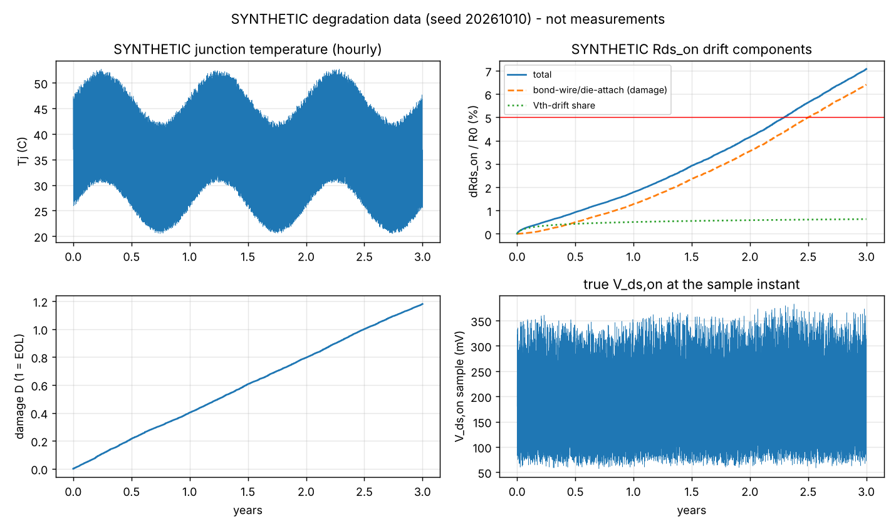
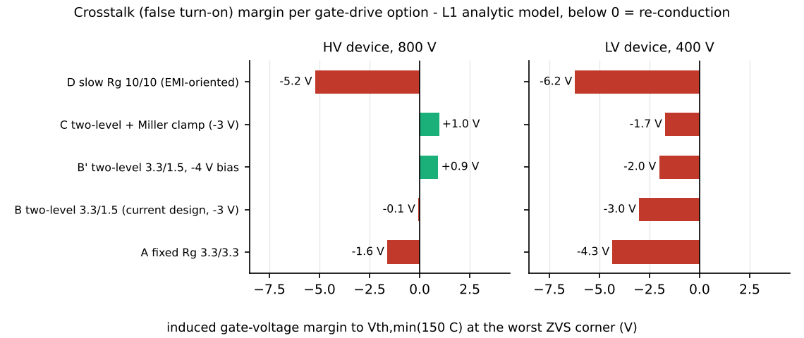
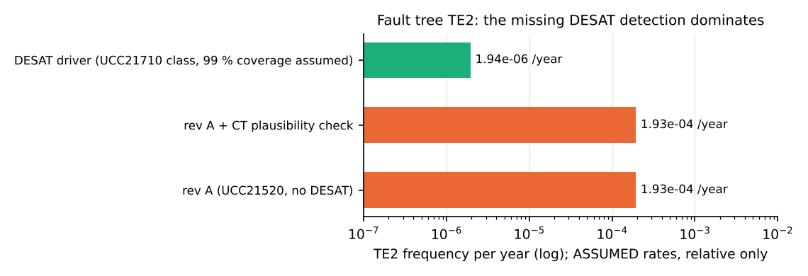

# 18 Health monitoring, gate drive, reliability and cybersecurity

> Reading time: ~45 min. Prerequisites: chapters 03 (SiC devices), 09 (state machine, protections),
> 10 (schematics), 12 (thermal) and 14 (safety, FMEA). Files covered:
> `Advanced_Research_2026/SiC_Health_Monitoring/`, `Advanced_Research_2026/Active_Gate_Drive/`,
> `Advanced_Research_2026/Reliability_Engineering/`, `Advanced_Research_2026/Cybersecurity/`,
> `Advanced_Research_2026/Verification_Evidence/KNOWN_ISSUES.md` (items 6-12).

## Overview

**Level 1 - Beginner:** A converter must not only work on day one; it must keep working safely for
years and must not be misused. This chapter covers four questions. Can we notice that a transistor is
slowly wearing out before it fails (health monitoring)? Is a clever "active" gate driver worth it, and is
the gate driver we chose safe against accidental turn-on (gate drive)? What combinations of part
failures could cause a hazard, and do our protections catch them (reliability)? Could someone on the
communication bus switch the converter on or keep it running when they should not (cybersecurity)?
Every answer here comes from calculations and simulations; the wear-out data are invented (SYNTHETIC)
because no device was ever aged, and no safety rating or certification is claimed.

**Level 2 - Engineering:** On SYNTHETIC data, a temperature-compensated Rds_on estimator with weekly
CUSUM detects a 1 % drift within 1-7 weeks with zero false alarms in 3 years - provided the temperature
reference drifts by less than ~1 K over life; a 2 K drift gives false alarms in every run. The gate-drive
study finds that under ZVS the node dv/dt is set by I / (2 Coss) (15-31 V/ns), not by Rg, so an active
gate driver is not worth it; the real finding is a crosstalk margin of about 0 V (HV) and negative (LV)
with the schematic's -3 V off bias, while `dabtools/dab/devices.py` assumed -4 V. The fault tree shows
that every leading cut set of the shoot-through top event contains "no DESAT"; a DESAT driver divides it
by ~99. The exhaustive check of 46 080 state-machine transitions finds 0 mismatches against
`SiC_6k6_Industrial_DAB/10_Firmware/src/dab_control.c`. The command interface is unauthenticated today;
an AES-128-CMAC frame with a replay counter is demonstrated in host Python.

**Level 3 - Research:** Condition monitoring of SiC MOSFETs (Rds_on, Vth, gate-switching signatures) is an
active field, but most papers rely on accelerated-test data the project does not have; the honest
deliverable here is a sensor requirement, not a remaining-useful-life (RUL) prediction. Active gate
drivers are a hot topic for hard-switched SiC; this study shows why they have little to act on in a ZVS
DAB. FTA and FMEDA use assumed class failure rates, so they rank weaknesses but give no SIL. IEC 62443
applicability is mapped at the component level, with a target security level proposed, not assessed.

## Topic 1: SiC health monitoring on SYNTHETIC data

### Rds_on drift estimators, CUSUM detection and the temperature-reference requirement
**What is it?** A feasibility study: could the project's sensing chain detect a 1 % rise of the
on-resistance of an HV MOSFET (C3M0032120K), the classic indicator of bond-wire and die-attach fatigue,
and what would a V_ds,on sensor need? All data are SYNTHETIC. `[Simulated]` (L2 on synthetic data)

**Why do we need it?** Power cycling ages the package; detecting the drift early would allow planned
maintenance. Before building sensors one must know whether the drift is even resolvable.

**How does it work?**
**Level 1 - Beginner:** A worn transistor gets slightly more resistive, like a garden hose getting
furred up. We measure the voltage across it while it conducts and the current through it, and divide.
The trouble is that the resistance also rises when the device is warm - by about 0.5 % per degree - so a
1-degree error in temperature looks like half the wear we want to detect. Averaging a week of
measurements removes random noise, but a slowly drifting thermometer cannot be averaged away.
**Level 2 - Engineering:** Generator (`Advanced_Research_2026/SiC_Health_Monitoring/01_generate_synthetic_data.py`):
3 years hourly mission, Tj from the thermal network (20-53 C - this converter runs cold), damage
N_f = A dTj^-4.4 exp(0.08 eV / kB Tm), dR/R0 = 0.05 D^1.5, A calibrated so D = 1 at 2.5 years (a scenario
choice, not a lifetime estimate), plus a Vth drift of 0.08 V log10(1 + t / 100 h). Estimators: R25_hat =
(V_ds / I_d) rds(25) / rds(T_meas) with samples below 40 % of nominal current discarded; 2-parameter RLS
(forgetting 0.9995) that also estimates the tempco; a Kalman filter on [level, rate]; CUSUM on weekly
means in relative units, g = max(0, g + (block / mu0 - 1) - k), k = 0.5 %, baseline the first 13 weeks.
**Level 3 - Research:** Bond-wire fatigue and gate-oxide Vth drift both raise Rds_on and cannot be
separated from Rds_on alone; the Vth share (~0.6 % of 7.1 % after 3 years) is below detection anyway.
A first CUSUM standardised with a 13-week sigma gave 60-90 % false alarms - a documented negative result
fixed by the relative-units design.

*Figure 18-1: SYNTHETIC degradation truth (module result figure) - generated, not measured.*

**Example from our converter:** `Advanced_Research_2026/SiC_Health_Monitoring/results/detection_tables.md`
(24 Monte-Carlo noise realisations, SYNTHETIC):

| temperature sensor | h | false alarms (healthy, 3 y) | detection | alarm vs 1 % crossing, mean / p90 (days) |
|---|---|---|---|---|
| heatsink NTC (current design) | 0.5 % | 0.00 | 1.00 | -3 / +8 |
| heatsink NTC | 2.0 % | 0.00 | 1.00 | +36 / +45 |
| case sensor | 0.5 % | 0.00 | 1.00 | +1 / +10 |
| junction model (1 K slow bias) | 0.5 % | 0.62 | 1.00 | -41 / +1 |
| junction model | 2.0 % | 0.00 | 1.00 | +26 / +90 |

Sensitivity (case sensor, h = 2 %): random temperature noise up to 10 K and load-dependent offsets are
harmless; a slow sensor drift of 1 K over 3 years gives 0 false alarms, **2 K gives false alarms in every
realisation**. `[Simulated]` (SYNTHETIC)

**Engineering calculations:** datasheet-typical R25 = 32 mOhm, R150 = 52 mOhm (`verified=False` in
`dabtools/dab/devices.py`): (52 - 32) / 32 / 125 K = 0.5 %/K of R25, so 1 K error = 0.5 % apparent drift,
one tenth of the 5 % end-of-life criterion. Sensor requirement (analytic 3-sigma of a weekly mean,
random errors only): 1 mV rms V_ds noise -> 0.20 % (0.5 K) to 1.09 % (10 K); 10 mV rms -> 1.36 % even at
0.5 K, i.e. a 10 mV-class channel cannot resolve 1 %. Modelled chain LSB 0.39 mV at the device.

**Design decision made in this project:** No V_ds,on sensor exists in rev A. A desaturation-detector-style
sense (1200 V diode, 1 mA source, ~5 V clamp, 1:4 divider, AMC1301, TLV9062, ADC sampled at mid-conduction
with >= 300 ns blanking) on at least Q1 and Q5 is proposed, with requirements <= 0.4 mV resolution,
< 50 ppm/K gain drift, a sampled instantaneous current within 0.5 % and a temperature reference within
1 K of Tj over the service life. `[Proposed]` (not in the schematic, not simulated at circuit level)

**Alternatives considered:** Vth measurement by a gate current source at turn-on or an off-line pulse
test at power-up (proposed only); junction-temperature estimation from a thermal model (worse: a 1 K slow
bias gives 62 % false alarms at h = 0.5 %); gate-signature methods from the literature (L12, L39, L40).

**How to verify it:** Run `Advanced_Research_2026/SiC_Health_Monitoring/02_estimators_and_detection.py`
(deterministic seeds, < 20 s) to reproduce the tables. Real verification needs power-cycled devices and
measured drift - none exist. `[Not yet tested]`

**Common mistakes:** Quoting the detection delay in days as a device property (it scales with the assumed
drift rate); using the Kalman rate for RUL (it extrapolates the assumed law); dropping the SYNTHETIC label.

**Interview explanation (30 s):** "On synthetic data, a temperature-compensated Rds_on estimator with a
weekly CUSUM detects a 1 percent drift in one to seven weeks with no false alarms in three years. The
catch is temperature: Rds_on moves 0.5 percent per kelvin, so the reference must not drift more than about
1 kelvin over life - at 2 kelvin every run false-alarms. We give a sensor requirement, not a lifetime
prediction."

**Research-level explanation:** The dominant risk is a slow systematic error - NTC ageing, thermal-interface
degradation changing the NTC-to-junction offset, or a sensor replacement - exactly what a synthetic study
cannot bound. A defensible research path is a power-cycling test with a reference V_ds,on measurement and
a periodic self-check of the temperature reference against the heatsink NTC; RUL claims must wait for
measured aging data (see L11, L41, L42 in the literature database).

## Topic 2: Active gate drive and the gate-bias discrepancy

### What sets dv/dt in a ZVS DAB, and the -3 V versus -4 V crosstalk margin
**What is it?** An analytic comparison of gate-drive options for the C3M0032120K (HV, 800 V) and
C3M0016120K (LV, 400 V): fixed Rg, the current two-level 3.3 / 1.5 Ohm network, the same with -4 V bias,
with a Miller clamp, slow 10 / 10 Ohm, and a multi-level active driver concept. `[Simulated]` (L1 analytic)

**Why do we need it?** dv/dt drives EMI and crosstalk; active gate drivers are often proposed to shape it.
We must know whether they help in a DAB, and whether the chosen driver keeps the off device off.

**How does it work?**
**Level 1 - Beginner:** When one transistor of a leg switches, the voltage across its partner changes very
fast. Through a tiny internal capacitance this pushes current into the partner's gate and can lift it
towards its turn-on threshold - an accidental turn-on. A negative off voltage on the gate is the safety
margin. In soft (ZVS) switching the speed of the voltage change is set by the load current charging the
device capacitances, not by the gate resistor, so a clever driver has little to control.
**Level 2 - Engineering:** Under ZVS the turn-off is capacitive: dv/dt = I_sw / (2 Coss,tr), independent of
Rg. Crosstalk: V_gs,ind = Voff + R_off (Qgd / V) dv/dt (1 - exp(-t_tr / tau_off)), margin to
Vth,min(150 C) = 1.8 V; Miller clamp modelled as R_off -> 1 Ohm + Rg_int. Hard-switched light-load points:
3 A (HV) and 6 A (LV), just above I_min = 2.0 / 3.1 A.
**Level 3 - Research:** The quasi-static gate-charge method is pessimistic at the start of the slope and
optimistic near its end; a transient Cgd(V) model would move margins by +/-1 V. In a ZVS leg an induced
bump re-conducts the device that just turned off (self-limiting, extra loss); in the hard-switched
light-load region it is genuine cross-conduction.

*Figure 18-2 (`img/make_figs_ch17_18.py`, data from the module's gate_drive_results.json): worst-corner
ZVS crosstalk margin per option.*

**Example from our converter:** `Advanced_Research_2026/Active_Gate_Drive/results/option_table.md`:

| option | HV margin ZVS nom / worst (V) | LV margin ZVS nom / worst (V) | HV hard E_on+off at 3 A (uJ) |
|---|---|---|---|
| B current 3.3 / 1.5 Ohm, -3 V | +2.3 / -0.1 | -0.4 / -3.0 | 91 |
| B' same with -4 V | +3.3 / +0.9 | +0.6 / -2.0 | 91 |
| C current + Miller clamp, -3 V | +2.9 / +1.0 | +0.9 / -1.7 | 91 |
| D slow 10 / 10 Ohm | -1.7 / -5.2 | -4.7 / -6.2 | 110 |

ZVS dv/dt 15 V/ns nominal, ~30 V/ns at the worst corners, on both bridges, for every option. `[Simulated]`

**Engineering calculations:** Hard turn-on at 3.3 Ohm: 31 V/ns and 91 uJ per on/off pair, i.e. 9.1 W per
edge position at 100 kHz if continuous; 10 Ohm costs +20 % energy for -40 % dv/dt. Ringing bound at the
end of a worst-corner capacitive commutation I sqrt(L_loop / C_leg) ~ 95 V (HV) / 90 V (LV), inside the
1200 V rating. ZVS turn-off loss by this model 0.16 / 0.31 uJ per edge, far below the conservative
0.35 x Eoff assumption of the loss model (19 / 42 uJ) - the truth is in between and needs measurement.

**Design decision made in this project:** Active gate drive is **not worth its complexity** for this
converter. Recommended instead: resolve the bias to -4 V (or -5 V) and move to a Miller-clamp + DESAT
driver (UCC21710 class), the documented upgrade path in `SiC_6k6_Industrial_DAB/16_BOM/bom.md`. Rev A uses
UCC21520DW (no DESAT, no Miller clamp), Rg_on 3.3 Ohm / Rg_off 1.5 Ohm and R12P21503D bias modules
(+15 / -3 V). `[Implemented]` (rev A as drawn) / `[Proposed]` (the change)

**Alternatives considered:** Rg_off below 1.5 Ohm (Rg_int dominates); snubber capacitance (costs ZVS range);
a closed-loop dv/dt driver (nothing to act on under ZVS).

**How to verify it:** `python3 Advanced_Research_2026/Active_Gate_Drive/gate_drive_analysis.py` (< 5 s, no
random numbers). Then measure v_GS of the off device at 25 / 50 / 100 % load (test plan step 8) - not done;
gate-loop SPICE also absent. `[Not yet tested]`

**Common mistakes:** Assuming Rg controls dv/dt in a ZVS converter; slowing the gate "for EMI" (option D
makes crosstalk worse: -5.2 / -6.2 V); trusting a negative-bias value from a model file instead of the
schematic; forgetting that Ciss, g_fs, Rg_int and Vth,min(150 C) in the script are recalled values to verify.

**Interview explanation (30 s):** "In a ZVS DAB the switching node slews at the load current divided by
twice Coss - 15 to 30 volts per nanosecond - whatever the gate resistor. So an active gate driver has
nothing to act on. The real finding was crosstalk: with the schematic's minus 3 volt bias the margin is
about zero on the HV side and negative on the LV side, so we recommend minus 4 volts and a Miller-clamp
plus DESAT driver."

**Research-level explanation:** The literature on active gate drivers (L21, L22, L44, L45) targets
hard-switched SiC where turn-on di/dt and overshoot are Rg-controlled. In a DAB the hard-switched region is
light load, where the loss penalty of a slow passive Rg is small in absolute terms. The open measurement
item is the LV device (Qgd 62 nC, low Rg_int), whose self-limiting dv/dt is only 12 V/ns at -3 V - below
the nominal 15 V/ns.

## Topic 3: Fault tree analysis (FTA)

### Minimal cut sets for four top events
**What is it?** Fault trees for TE1 hazardous voltage at an accessible part, TE2 overcurrent / shoot-through
not interrupted within the device withstand time, TE2b = TE2 and the fuse fails, and TE3 thermal runaway,
with 32 basic events and minimal cut sets by boolean expansion. `[Simulated]` (L1, assumed rates)

**Why do we need it?** An FMEA (chapter 14) looks at one failure at a time; a fault tree shows which
combinations lead to a hazard and which single item dominates.

**How does it work?**
**Level 1 - Beginner:** Start from the bad outcome ("an uncontrolled short circuit") and ask "what must go
wrong for this?" - one thing, or two things together. A "cut set" is a smallest group of failures that
together cause the outcome. If one missing feature appears in every important group, fixing it helps most.
**Level 2 - Engineering:** Rates in FIT (1e-9 / h) of the IEC TR 62380 / SN 29500 class, entered as
assumptions; detected failures repaired in 48 h, latent ones revealed by an annual proof test
(unavailability lambda T / 2); `NO_DESAT` is a house event (TRUE for the UCC21520); rare-event
approximation; Fussell-Vesely importance per basic event.
**Level 3 - Research:** A static FTA ignores sequence and repair-time distributions, and demand-type events
(ACCESS, SW_PWM, TZ_CFG) are placeholders. Its value is ranking, not absolute probability.

*Figure 18-3 (`img/make_figs_ch17_18.py`, data from the module's fta_cutsets.json): TE2 frequency for rev A,
with a CT plausibility check, and with a DESAT driver.*

**Example from our converter:** `Advanced_Research_2026/Reliability_Engineering/results/fta_cutsets.md`:

| top event | cut sets | lowest order | frequency (/year) | dominant cut sets |
|---|---|---|---|---|
| TE1 hazardous voltage | 6 | 1 | 1.4e-4 | ISO_BIAS 50 %, ISO_DRV 25 %, ISO_AMC 22 % |
| TE2 overcurrent not interrupted | 21 | 2 | 1.9e-4 | DRV_HIGH + NO_DESAT 36 %, MCU + NO_DESAT 23 %, XTALK + NO_DESAT 23 %, UVLO + NO_DESAT 18 % |
| TE2b and fuse fails | 21 | 3 | 1.7e-9 | FUSE + NO_DESAT + SW_PWM 51 % |
| TE3 thermal runaway | 15 | 3 | 1.7e-9 | FAN + NTC + HOST 74 % |

Variants: DESAT driver (99 % coverage assumed) 1.94e-6 / year (ratio 99.2); CT plausibility check leaves TE2
unchanged (1.93e-4); NTC plausibility check reduces TE3 to 3.8e-10 (4.4x). `[Simulated]`

**Engineering calculations:** TE2 rev A / DESAT = 1.93e-4 / 1.94e-6 = 99.2. Fussell-Vesely of NO_DESAT is
1.00 in rev A: every relevant TE2 cut set contains it. In TE1 the eight bias modules (ISO_BIAS, 7.0e-5 /
year) are the largest contributor - they are basic-class parts (R12P21503D, 5.2 kVDC), confirming open item
15.1-4 of `SiC_6k6_Industrial_DAB/15_Safety_Reliability/01_insulation_coordination.md`.

**Design decision made in this project:** Next hardware revision: DESAT-capable drivers, reinforced-rated
bias modules, an NTC plausibility check. `[Proposed]` (KNOWN_ISSUES item 9)

**Alternatives considered:** A leg-current shunt with a fast comparator instead of DESAT.

**How to verify it:** `python3 Advanced_Research_2026/Reliability_Engineering/fta.py` (< 2 s) regenerates
the cut sets; the trees are in `Advanced_Research_2026/Reliability_Engineering/results/fta_trees.md`. The
absolute numbers cannot be verified without manufacturer FIT data and field data. `[Simulated]`

**Common mistakes:** Reading 1.9e-4 / year as a real hazard rate; claiming a SIL from an FTA; forgetting
that the CT sees the inductor current, not the leg current, so only the fuse (milliseconds) stops a
shoot-through in rev A.

**Interview explanation (30 s):** "The fault tree for an uninterrupted shoot-through has 21 minimal cut
sets and every important one contains 'no desaturation detection'. With a DESAT driver the frequency
drops by about a hundred. For hazardous voltage the eight basic-class bias modules are the biggest
single-point contributor. The rates are assumptions, so this ranks weaknesses - it is not a safety rating."

**Research-level explanation:** Dynamic fault trees or Markov models would capture the repair and proof-test
sequence; common-cause beta factors (e.g. one supply feeding several drivers) are absent. The robust
conclusion survives any reasonable rate choice because it is structural: rev A has no detection path for
leg shoot-through below the fuse.

## Topic 4: FMEDA-lite and the LV-sensor common cause

### Diagnostic coverage of each protection function, and what the HIL fault injection added
**What is it?** A failure-modes, effects and diagnostic analysis of each protection chain (divider ->
AMC1301 -> TLV9062 -> LM393 / ADC -> 74HC32 / PROT_DIS -> driver DIS + TZ), classifying modes as safe (S),
dangerous detected (DD) or dangerous undetected (DU). `[Simulated]` (L1, assumed rates)

**Why do we need it?** A protection is only as good as its ability to notice its own failure. Diagnostic
coverage DC = DD / (DD + DU) and safe failure fraction SFF = (S + DD) / total show where self-tests pay off.

**How does it work?**
**Level 1 - Beginner:** A smoke detector with a flat battery is worse than useless if nobody knows the
battery is flat. For every protection we list how it can break, and whether anything would notice. "Silent"
failures are the dangerous ones.
**Level 2 - Engineering:** Class rates in FIT, mode splits by engineering judgement; no SIL assignment
(that needs certified data, systematic capability and an independent assessor).
**Level 3 - Research:** The key structural finding is common cause: regulation, firmware OV and hardware
OV of the LV link all read the same AMC1301 channel, so one gain fault blinds all three.

**Example from our converter:** `Advanced_Research_2026/Reliability_Engineering/results/fmeda_lite.md`:

| function | lambda_DU (FIT) | DC | SFF | main DU modes |
|---|---|---|---|---|
| OV HV | 36.8 | 35 % | 42 % | isolated 5 V loss, comparator no-trip, AMC gain drift |
| OV LV | 36.5 | 35 % | 41 % | AMC1301 gain drift: common cause for regulation, FW OV, HW OV |
| OC (inductor) | 16.6 | 38 % | 45 % | CT open / rectifier reads zero - single point for HW and FW |
| OT | 11.4 | 47 % | 49 % | NTC open reads cold |
| interlock | 17.5 | 0 % | 69 % | precharge-ok input stuck true |
| DESAT / short circuit | 3.0 | 0 % | 73 % | rev A has no detection at all |

SIL fault injection (`Advanced_Research_2026/HIL_Validation/README.md`, test T03): a -20 % gain fault on the
V2 sensor drives the true V2 to 473.9 V with no trip while the firmware reads 379 V; a -25 % fault would
exceed 480 V with nothing tripping. T10: the AMC1301 clips at 500 V, only 4 % above the 480 V trip. `[Simulated]`

**Engineering calculations:** OV LV: DC = 19.4 / (19.4 + 36.5) = 35 %. Gain fault: the reading is
0.8 x 473.9 V = 379 V, so the loop, the firmware OV check and the hardware OV comparator all see a
normal-looking voltage while the true link is 18 % above its 400 V reference.

**Design decision made in this project:** Proposed diagnostics, each converting named DU modes into DD:
CT plausibility (|i_pk| vs the SPS power model at the commanded phi); a comparator pulse test at start-up;
NTC plausibility; a V1 / V2 cross-check via the power balance; a parameter-block CRC; the DESAT driver
upgrade; and an independent OV comparator reference path for the LV link before HIL (KNOWN_ISSUES item 10).
`[Proposed]`

**Alternatives considered:** An independent LV divider and comparator; software-only plausibility (shares the MCU).

**How to verify it:** `python3 Advanced_Research_2026/Reliability_Engineering/fmeda_lite.py` and
`python3 Advanced_Research_2026/HIL_Validation/sil_fault_injection.py`; real coverage needs fault
insertion on hardware. `[Simulated]`

**Common mistakes:** Counting protections as independent when they share a sensor; quoting SFF as a SIL.

**Interview explanation (30 s):** "The FMEDA showed that the LV over-voltage protection in hardware and
firmware and the voltage regulation all read the same isolated amplifier. In simulation a 20 percent gain
fault pushed the real link to 474 volts with nothing tripping. Interlock and DESAT have zero diagnostic
coverage in rev A. Cheap plausibility checks and an independent comparator path fix most of it."

**Research-level explanation:** KNOWN_ISSUES item 11 adds a documentation-level hazard: the firmware README
says "AMC1311 0-2 V = 0-1000 V" (`SiC_6k6_Industrial_DAB/10_Firmware/README.md`), the schematic uses an
AMC1301 (+/-250 mV in, x8.2) with a TLV9062 stage, and `hal_adc_read` assumes 1000 V = 4096 counts at 3.3 V.
One scaling must be chosen and the I/O map written from it before HIL; a wrong scale is exactly a "gain
fault" by design.

## Topic 5: Exhaustive state-machine check against the C code

### 46 080 transitions, five properties, zero mismatches
**What is it?** The state machine of `dab_ctrl_step()` (5 states, 13 abstract boolean inputs, two timers
abstracted as "done" inputs, optional clear command) extracted into a Python model, checked exhaustively,
and compared case by case with the unmodified C code compiled by gcc. `[Verified]`

**Why do we need it?** Protection logic must be right for every input combination, not a few scenarios.

**How does it work?**
**Level 1 - Beginner:** Instead of testing a few situations, we try every possible combination of alarm
signals in every state of the controller and check simple rules such as "the gates are never on when a
fault is present". The same combinations are then fed to the real C code to be sure it behaves exactly
like the model.
**Level 2 - Engineering:** 4608 physically consistent input combinations x 5 states x clear / no clear =
46 080 transitions, by BFS from INIT. Properties: P1 every fault input leads to FAULT within one step;
P1' the same under documented conditions; P2 FAULT is left only by an explicit clear; P3 gates off outside
RUN / SOFTSTART and whenever a fault is detected; P4 no deadlock, RUN reachable; P5 gates imply enable.
**Level 3 - Research:** This is explicit-state model checking at small scale. Timers are abstracted and an
asynchronous clear arriving mid-step (interrupt interleaving) was not modelled - the next step would be a
model checker over the C code itself or a timed automaton.

**Example from our converter:** `Advanced_Research_2026/Reliability_Engineering/results/state_machine_report.md`:
P1 literal FAIL (456 transitions, all by documented design: v1_low / v2_low ignored outside RUN for the
dead-bus start, comm_lost ignored in INIT, pc_timeout active only in PRECHARGE_WAIT); P1', P2, P3, P4, P5
PASS. C conformance (`Advanced_Research_2026/Reliability_Engineering/sm_conformance.c` against
`SiC_6k6_Industrial_DAB/10_Firmware/src/dab_control.c`): 46 080 cases, **0 mismatches**. SIL harness
`SiC_6k6_Industrial_DAB/10_Firmware/sil/sil_main.c`: 30 PASS, 0 FAIL, no warnings with -Wall -Wextra. `[Verified]`

**Engineering calculations:** 13 boolean inputs give 8192 raw combinations; physical consistency (e.g. a
link cannot be both under- and over-voltage) leaves 4608; x 5 states x 2 = 46 080.

**Design decision made in this project:** The C core is the reference. The Python controller
`SiC_6k6_Industrial_DAB/dabtools/dab/control.py` differs in 71 mismatch classes over 23 040 cases: it has no
driver_fault / hw_trip inputs, no 5 s precharge timeout, and ignores enable = false in PRECHARGE_WAIT. This
is documented as KNOWN_ISSUES item 7 (documentation; Python used for plant simulation only); the README
count of "35 checks" was corrected to 30 (item 8, fixed). `[Implemented]`

**Alternatives considered:** Random testing (proves nothing exhaustive); a formal tool on the C source.

**How to verify it:** `python3 Advanced_Research_2026/Reliability_Engineering/state_machine_check.py` (< 30 s,
compiles into a temp dir; firmware tree read-only). `[Verified]`

**Common mistakes:** Treating a literal property failure as a bug without reading the design intent;
assuming the Python reference equals the C code because the control law is the same; forgetting that a
`clear` while the fault persists produces a harmless one-period INIT -> FAULT bounce.

**Interview explanation (30 s):** "We extracted the controller state machine and checked all 46 080
state-input combinations: faults latch, only an explicit clear leaves FAULT, gates are never on outside RUN
or soft start. The same cases fed to the real C code gave zero mismatches. The Python model differs in its
protection layer, which we documented rather than hid."

**Research-level explanation:** The check shows the value of an executable specification: the model found
three undocumented Python/C differences that scenario simulation (HIL T17: Python stays in PRECHARGE_WAIT,
C faults after 5 s) had only hinted at. Hardware-level evidence still requires timing and interrupt
interleaving tests on the MCU, which is uncompiled for the target.

## Topic 6: Cybersecurity - IEC 62443 applicability, STRIDE and authenticated commands

### Who can command the converter, and how to stop them
**What is it?** A component-level security analysis: zones and conduits under IEC 62443, a STRIDE threat
model of the CAN interface and update path, a secure-boot / signed-update proposal for the C2000, and a
host-Python demonstration of AES-128-CMAC command frames with replay counters. `[Proposed]` (document, L0-L1)
plus `[Verified]` (the demo's self-check)

**Why do we need it?** Today any node on the shared CAN bus (ID 0x200) or the service UART can enable the
converter, change mode or reference, clear faults, and forge the heartbeat.

**How does it work?**
**Level 1 - Beginner:** Commands are like letters. Today anyone can write one and sign with any name. A
message authentication code is a seal that only holders of a secret key can make; a counter in every letter
stops someone from posting an old letter again. The hardware protections are like a fuse box that no letter
can switch off.
**Level 2 - Engineering:** Frame (CAN FD, 16 bytes): command id, int24 argument, uint32 counter,
AES-128-CMAC over CAN_ID and bytes 0-7 truncated to 64 bits. Receiver: constant-time MAC compare, then
counter > last_accepted and counter - last_accepted <= 256; last_accepted persisted every 64 accepts and
advanced by 64 at boot. The converter is an IEC 62443-4-2 embedded-device component; proposed SL-T 1 in a
restricted cabinet and SL-T 2 for the CAN conduit if the bus is shared.
**Level 3 - Research:** A truncated MAC with a shared symmetric key gives no non-repudiation; keys must be
per device. Secure boot on the F28004x would need a two-stage boot (an immutable first-stage loader in an
execute-only, write-protected zone verifying an ECDSA P-256 or HMAC signature), since the boot ROM as
recalled does not verify signatures - all C2000 statements are marked "to verify against the current TRM".

**Example from our converter:** `Advanced_Research_2026/Cybersecurity/results/demo_log.md`: AES-128 FIPS-197
C.1 and four RFC 4493 CMAC vectors pass; valid frame accepted; replay, tampered argument, wrong key, rolled-back
counter and a +1000 counter jump rejected; a +10 gap accepted; after a simulated reboot the last valid frame is
rejected and a fresh frame ahead of the jump-ahead value accepted. `[Verified]` (host Python only)

STRIDE highlights (`Advanced_Research_2026/Cybersecurity/README.md`): spoofed 0x200 command and 0x7FF
heartbeat (no barrier today), firmware-image tampering (no barrier), replay (no barrier), JTAG elevation
(no lock), DoS (degrades to the safe FLT_COMM state after 500 ms - accepted). What an attacker on CAN
**cannot** do in rev A: change a protection threshold (resistors), disable PROT_DIS (wired-OR of comparator
outputs straight to the driver DIS pins), hold gates on against a hardware trip.

**Engineering calculations:** Counter persistence every 64 accepts at a 10 Hz command rate = one flash /
EEPROM write per 6.4 s, which needs wear-levelled emulation. Accepting at most +256 per frame tolerates
lost frames while forbidding far jumps without a resync handshake. Crypto in software runs in the
10-100 us class (recalled, to verify) - background task only, never in the 10 us ISR.

**Design decision made in this project:** Proposed: per-device keys provisioned before JTAG lock; CMAC +
counter on every command and the heartbeat; command whitelist per key; update accepted only in INIT / FAULT;
A/B image layout; a persistent 64-entry security log. Two weak points flagged for the design owner: keep
PROT_DIS wired directly (an AND gate with a software input could mask it), and recognise that the EPWM dead
band and the CMPSS threshold are software-configurable - secure boot, not CAN authentication, protects them.
`[Proposed]` - nothing is implemented in `SiC_6k6_Industrial_DAB/10_Firmware/src/dab_comm.c`.

**Alternatives considered:** Classic-CAN 8-byte variant (16-bit counter + 32-bit MAC, weaker); disabling the
UART in operation.

**How to verify it:** `python3 Advanced_Research_2026/Cybersecurity/cmac_replay_demo.py` (< 1 s; exit 0 only
if self-check and demo pass). A firmware implementation, key management and a penetration test do not
exist. `[Not yet tested]`

**Common mistakes:** Believing authentication makes a command safe (an authenticated CLR_FAULT is accepted;
the state machine re-faults if the condition persists); a counter kept only in RAM (a reboot re-accepts old
frames); claiming 62443 compliance from a design document.

**Interview explanation (30 s):** "Today anyone on the CAN bus can enable our converter or forge its
heartbeat. We propose AES-CMAC on every command with a monotonic, persisted counter, demonstrated against
the standard test vectors with replay, tamper and rollback all rejected. The protections that matter -
over-current and over-voltage comparators - are resistor-set and wired directly to the drivers, so no
message can disable them."

**Research-level explanation:** KNOWN_ISSUES item 12 records a naming inconsistency found here: the firmware
HAL targets the TMS320F280049C while some research documents assume the F2837x (the MPC and embedded-AI WCET
estimates use a 200 MHz F28379D class). Security features (DCSM zones, JTAGLOCK, boot-ROM behaviour) and
cycle budgets differ between families, so one target must be fixed before either analysis can mature.

## Open issues found by these modules (KNOWN_ISSUES items 6-12)

`Advanced_Research_2026/Verification_Evidence/KNOWN_ISSUES.md`:

| # | Finding | Module | State |
|---|---|---|---|
| 6 | Gate bias: schematic -3 V, `devices.py` -4 V; crosstalk margin ~0 (HV), negative (LV) at -3 V | Active_Gate_Drive | open: -4 V and/or Miller-clamp + DESAT driver |
| 7 | Python `control.py` lacks hw_trip / driver_fault, precharge timeout, disable in PRECHARGE_WAIT | Reliability_Engineering | open (documentation) |
| 8 | SIL harness runs 30 checks, READMEs said 35 | Reliability_Engineering | fixed |
| 9 | Interlock and DESAT DC 0 %; TE2 dominated by missing DESAT; bias-module isolation single-point for TE1 | Reliability_Engineering | open: next hardware revision |
| 10 | -20 % LV-sensor gain fault -> true V2 474 V, no trip (common cause); clip/trip margin 4 % | HIL_Validation | open: independent OV path |
| 11 | I/O scaling inconsistency AMC1311 / AMC1301 / `hal_adc_read` | HIL_Validation | open: resolve before HIL |
| 12 | Controller naming F280049C vs F2837x | Cybersecurity | open (documentation) |

A further inconsistency for item 6: the insulation coordination table of
`SiC_6k6_Industrial_DAB/15_Safety_Reliability/01_insulation_coordination.md` lists the bias modules as
"+15/-4 V", the BOM part R12P21503D gives -3 V. `[Implemented]` (documented, not fixed)

## Worked examples with real numbers

**Example 1 - how much temperature error is too much?** C3M0032120K: 0.5 %/K of R25 (from 32 -> 52 mOhm
over 125 K, datasheet-typical). Detection target 1 % drift, CUSUM slack k = 0.5 %. A slow reference drift of
1 K over 3 years adds 0.5 % - equal to k, still 0 false alarms; 2 K adds 1 % - equal to the drift to be
detected, and every realisation false-alarms (`Advanced_Research_2026/SiC_Health_Monitoring/results/detection_tables.md`).
`[Simulated]` (SYNTHETIC)

**Example 2 - what DESAT buys.** TE2 rev A 1.93e-4 / year; with DESAT (99 % coverage assumed) 1.94e-6 /
year. Over 10 years: P = 1.93e-3 vs 1.94e-5 (`Advanced_Research_2026/Reliability_Engineering/results/fta_cutsets.md`).
Relative, not absolute: the ratio follows from the 99 % coverage assumption. `[Simulated]`

## How this chapter connects to the files

| File | What it contains | Status |
|---|---|---|
| `Advanced_Research_2026/SiC_Health_Monitoring/README.md`, `Advanced_Research_2026/SiC_Health_Monitoring/results/detection_results.json` | SYNTHETIC generator, estimators, detection tables, sensor requirement, proposed V_ds,on sense | `[Simulated]` / `[Proposed]` |
| `Advanced_Research_2026/Active_Gate_Drive/gate_drive_analysis.py`, `Advanced_Research_2026/Active_Gate_Drive/results/gate_drive_results.json` | gate-drive options, dv/dt, losses, crosstalk | `[Simulated]` |
| `Advanced_Research_2026/Reliability_Engineering/fta.py`, `Advanced_Research_2026/Reliability_Engineering/results/fta_cutsets.json` | fault trees, cut sets, variants | `[Simulated]` |
| `Advanced_Research_2026/Reliability_Engineering/fmeda_lite.py`, `Advanced_Research_2026/Reliability_Engineering/results/fmeda_summary.json` | FMEDA-lite per protection function | `[Simulated]` |
| `Advanced_Research_2026/Reliability_Engineering/state_machine_check.py`, `Advanced_Research_2026/Reliability_Engineering/results/state_machine_results.json` | exhaustive check, C conformance, SIL run | `[Verified]` |
| `Advanced_Research_2026/Cybersecurity/README.md` | 62443 zones, STRIDE, secure boot, frame format | `[Proposed]` |
| `Advanced_Research_2026/Cybersecurity/cmac_replay_demo.py`, `Advanced_Research_2026/Cybersecurity/results/cmac_test_vectors.json` | AES / CMAC self-check and replay demo | `[Verified]` (host only) |
| `Advanced_Research_2026/HIL_Validation/results/sil_results.md` | sensor fault injection (T03, T10) | `[Simulated]` |
| `Advanced_Research_2026/Verification_Evidence/KNOWN_ISSUES.md` | items 6-12 | `[Implemented]` |
| `img/make_figs_ch17_18.py` | figures 18-2 and 18-3 | `[Implemented]` |

## Viva / interview questions

### Basic (10)

1. Why is Rds_on a health indicator?
   Bond-wire lift-off and die-attach fatigue raise the on-resistance; a slow rise signals package ageing.
2. Are the health-monitoring data measured?
   No. All data are SYNTHETIC, labelled as such, from assumed aging laws; no device was cycled.
3. Why is temperature the critical measurement?
   Rds_on rises 0.5 %/K, so a 1 K error looks like a 0.5 % drift - half of the 1 % to be detected.
4. What sets dv/dt in a ZVS DAB?
   The switched current charging the output capacitances, dv/dt = I / (2 Coss), not the gate resistor.
5. What is crosstalk (false turn-on)?
   A fast drain-voltage slope injects current through Cgd into the off device's gate and can lift it above
   threshold.
6. Which gate bias does the schematic use and which did the model assume?
   -3 V (R12P21503D) in the schematic, -4 V in `devices.py` - KNOWN_ISSUES item 6.
7. What is a minimal cut set?
   A smallest combination of basic failures that together cause the top event.
8. What does DESAT detection do and does rev A have it?
   It detects a device leaving saturation (short circuit) and turns it off in microseconds; the UCC21520 in
   rev A has none.
9. How many state-machine transitions were checked and with what result?
   46 080; all properties pass under the documented conditions, 0 mismatches against the C code.
10. Is the CAN command interface authenticated today?
    No; any node can enable, change mode, clear faults or forge the heartbeat.

### Intermediate (10)

1. Describe the CUSUM used and why the first version failed.
   Weekly means in relative units, g = max(0, g + (block / mu0 - 1) - k), k = 0.5 %; standardising by a
   13-week sigma estimated sigma too poorly and gave 60-90 % false alarms.
2. What happens with a 2 K slow drift of the temperature reference?
   False alarms in every realisation over 3 years; 1 K over 3 years still gives none.
3. Why can Rds_on not separate bond-wire fatigue from Vth drift?
   Both raise the on-resistance; a separate Vth measurement is needed, and the Vth share (~0.6 % of 7.1 %)
   is below detection anyway.
4. What V_ds noise is acceptable?
   ~1 mV rms resolves 0.2-0.3 % on weekly means; a 10 mV-class channel gives 1.36 % and cannot resolve 1 %.
5. Why is an active gate driver not worth it here?
   Under ZVS nothing is Rg-controlled; in the hard-switched light-load region a passive Rg gives the same
   dv/dt at a small absolute loss penalty.
6. What are the crosstalk margins at -3 V and the remedies?
   HV ~-0.1 V, LV -3.0 V at the worst corner; -4 V gives +0.9 / -2.0 V, a Miller clamp +1.0 / -1.7 V.
7. Why does a CT plausibility check not reduce TE2?
   The CT branch is already 4 orders below the NO_DESAT cut sets; the check improves OC diagnostic
   coverage instead.
8. Explain the LV-sensor common cause.
   Regulation, firmware OV and hardware OV all read one AMC1301 channel; a -20 % gain fault moved the true
   V2 to 473.9 V with no trip in SIL.
9. Why did property P1 fail literally?
   UV is ignored outside RUN (dead-bus start), comm_lost in INIT, pc_timeout outside PRECHARGE_WAIT - all by
   documented design; P1' passes.
10. How does the replay counter work?
    Accept only counter > last accepted and at most +256; persist every 64 accepts and advance by 64 at boot
    so a reboot never re-accepts an old frame.

### Advanced / research (10)

1. Why is no RUL claimed?
   The aging law, exponent and coefficients are assumed; a Kalman rate only extrapolates the assumed power
   law. RUL needs measured aging data and validated models.
2. What would you measure first to make health monitoring credible?
   A power-cycling test with a reference V_ds,on measurement and a life-stable temperature reference
   checked against the heatsink NTC, to bound slow systematic temperature errors.
3. Why is the quasi-static crosstalk estimate uncertain and how would you settle it?
   It ignores Cgd(V) dynamics (+/-1 V); settle by v_GS measurement of the off device at 25 / 50 / 100 % load
   with a high-CMRR probe, plus gate-loop SPICE.
4. Why does a slow-Rg "EMI" option make things worse here?
   ZVS dv/dt is unchanged while the off-state gate impedance rises, so crosstalk margins fall to -5.2 / -6.2 V.
5. Can an FTA with assumed FIT rates support a SIL claim?
   No: SIL needs certified failure data, systematic capability, common-cause analysis and an independent
   assessor; this FTA only ranks contributors.
6. How would you remove the LV-sensor common cause in hardware?
   An independent divider and comparator for the LV OV trip, or a cross-check of n V2 against V1 and the
   power balance with a separate channel.
7. What can the state-machine check not prove?
   Behaviour under interrupt interleaving, real timer behaviour, compiler differences on the C2000 and
   hardware latency; the HAL is uncompiled for the target.
8. Map the cybersecurity proposal onto IEC 62443 foundational requirements.
   FR1/FR2 per-device keys and CMAC with command whitelists; FR3 secure boot, signed update, parameter CRC;
   FR5 CAN-ID filtering; FR6 persistent security log; FR7 rate limiting with a safe-state DoS response.
9. Why must hardware protections stay software-independent even with secure boot?
   A compromised or buggy image could reconfigure the EPWM dead band or CMPSS threshold; resistor-set
   comparators wired to the driver DIS pins bound the damage regardless of firmware.
10. Which single design change addresses the most findings of this chapter?
    A Miller-clamp + DESAT driver (UCC21710 class) with -4 V or -5 V bias: crosstalk margin, TE2 dominance
    and DESAT coverage (items 6 and 9) at once.

## Pitches

**30 s:** We asked four reliability questions in simulation. On SYNTHETIC data a 1 percent Rds_on drift is
detectable, if the temperature reference stays within 1 kelvin over life. An active gate driver has
nothing to act on under ZVS, but our minus 3 volt bias leaves no crosstalk margin. The fault tree says
desaturation detection is the most valuable upgrade. The state machine matches the C code in all 46 080
cases. And the CAN commands need authentication, which we demonstrated. No SIL, no RUL, no certification.

**2 min:** Health monitoring: on SYNTHETIC data a temperature-compensated Rds_on estimator with a weekly
CUSUM detects a 1 percent drift in one to seven weeks with no false alarms in three years - but Rds_on moves
0.5 percent per kelvin, so a 2-kelvin drift of the temperature reference false-alarms every time; the
deliverable is a sensor requirement, not a lifetime prediction. Gate drive: under ZVS the node slews at 15
to 30 volts per nanosecond set by current and Coss, so active gate drive is not worth it; the schematic's
minus 3 volt bias leaves about zero crosstalk margin (HV) and negative (LV). Reliability: every leading
shoot-through cut set contains the missing DESAT; one isolated amplifier feeds regulation and both LV
over-voltage protections, and fault injection pushed the link to 474 volts with no trip. The state machine
matches the C code in all 46 080 cases. Security: CAN commands are unauthenticated; AES-CMAC with a
persisted counter rejects replay and tampering in the demo. All rates are assumptions; nothing is
certified or measured.

**10 min outline:**
* Maturity L1-L3; SYNTHETIC and assumed-rate caveats.
* Health monitoring: estimators, CUSUM negative result, temperature requirement, proposed V_ds,on sense.
* Gate drive: ZVS dv/dt physics, crosstalk at -3 V vs -4 V, recommendation.
* FTA: top events, cut sets, NO_DESAT dominance, bias modules, variants.
* FMEDA-lite: DC and SFF per function, the LV common cause, HIL T03 / T10, scaling inconsistency.
* State machine: model, properties, 0 mismatches, Python/C differences.
* Cybersecurity: 62443 zones, STRIDE, CMAC + counter demo, secure boot, hardware independence.
* KNOWN_ISSUES 6-12 and the single upgrade that closes most of them.

## Further reading

* The four module READMEs ("Not verified" sections) and `SiC_6k6_Industrial_DAB/15_Safety_Reliability/02_FMEA.md`.
* `Advanced_Research_2026/Literature_Database/literature_2022_2026.csv`, confirmed entries: L12 (gate-oxide
  monitoring via gate switching oscillation), L13 (complete condition monitoring of SiC MOSFETs), L39 and L40
  (online gate-oxide degradation monitoring), L41 (ageing forecasting methods compared), L42 (physics-informed
  condition monitoring of SiC modules), L21 and L22 (adaptive / multi-level active gate drivers). L11, L44
  and L45 are only partially confirmed.
