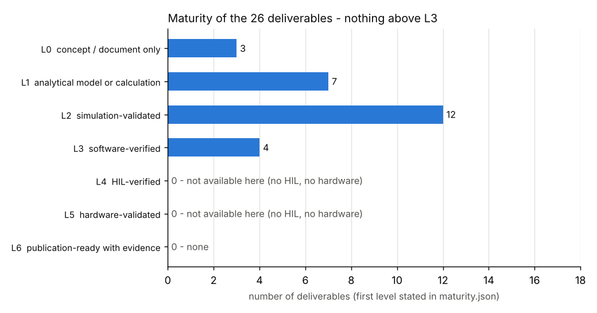
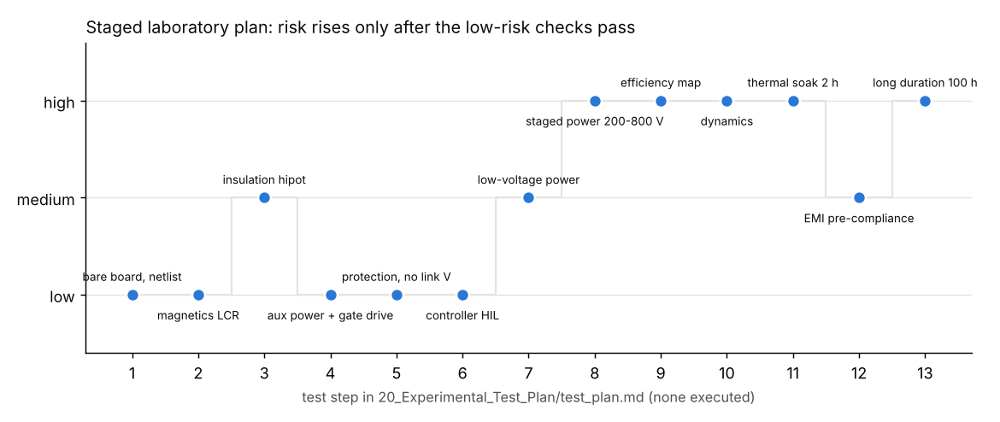

# 19 Testing, HIL, manufacturing, benchmarks and the research method

> Reading time: ~45 min. Prerequisites: chapters 08 (simulation), 09 (control and firmware),
> 11 (PCB layout), 14 (safety and FMEA); chapters 15-18 help for the research examples.
> Files covered: `SiC_6k6_Industrial_DAB/20_Experimental_Test_Plan/test_plan.md`,
> `SiC_6k6_Industrial_DAB/17_Manufacturing/` (stack-up, notes, `export_outputs.py`, outputs),
> `SiC_6k6_Industrial_DAB/18_Verification/verification_report.md`, `Advanced_Research_2026/HIL_Validation/`,
> `Advanced_Research_2026/Research_Benchmarks/`, `Advanced_Research_2026/Verification_Evidence/`,
> `Advanced_Research_2026/Research_Publications/`, `Advanced_Research_2026/Literature_Database/README.md`.

## Overview

**Level 1 - Beginner:** Designing a converter on a computer is half of the job; the other half is proving
that it works in a way someone else can believe. This chapter covers the laboratory test plan, the factory
files, the automatic checks, a "hardware-in-the-loop" bench, and the research method: write down how every number was obtained, let a
script reproduce it, say how mature each result is, and publish failures as well as successes. Nothing in
this repository has been built or measured, and this chapter shows how the project keeps that honest.

**Level 2 - Engineering:** The laboratory plan `20_Experimental_Test_Plan/test_plan.md` defines 13 staged tests
from bare-board inspection to a 100 h endurance run, with instruments, pass criteria and safety preconditions
`[Proposed]`. The manufacturing package is a 6-layer, 2 oz, 2.4 mm stack-up with Gerber X2, drill, placement
and PDF drawings generated by `export_outputs.py` `[Implemented]`. The verification report lists 22 passed
checks, 0 failed and 2 informational `[Verified]`. The HIL bench is an architecture on paper `[Proposed]`;
its acceptance tests run as a software-in-the-loop (SIL) fault-injection suite, 19 / 19 PASS `[Verified]`. The
benchmark table puts the calculated 98.66 % peak efficiency next to 12 literature entries and lists seven
reasons why the comparison is unequal.

**Level 3 - Research:** Around the design sits a research infrastructure: a manifest of 26 scripts in 16
modules run by `run_all.py`, which records exit codes, versions, the git commit and SHA-256 hashes of every
result; a `provenance.json` per module; a seven-level maturity scale (L0 concept to L6 publication-ready)
applied to 26 deliverables in `maturity.json`, none above L3; 14 known issues found in the baseline, ten still
open; a literature database whose 57 entries carry a verification status; and four manuscript outlines that
state their validation level. The open question is methodological: how to turn a software-only platform into
publishable evidence without overstating it.

## Topics

### The staged laboratory test plan

**What is it?** A written procedure, `SiC_6k6_Industrial_DAB/20_Experimental_Test_Plan/test_plan.md`, listing
instruments, 13 staged tests (conditions, expected values, pass criteria, risk level), measurement notes and a
reporting rule. `[Implemented]` as a document; every test is `[Proposed]` - none can run in this environment.

**Why do we need it?** An 850 V, 6.6 kW converter cannot be "switched on to see what happens". The plan orders
the tests so each is attempted only after the checks that make it safe have passed, and it fixes the pass
criteria in advance so that a result cannot be reinterpreted afterwards.

**How does it work?**
**Level 1 - Beginner:** Like commissioning a new lift: inspect the cables, test the brakes with nobody
inside, run it empty, then with a small load, and only at the end with a full cabin. Steps 1-6 never put
voltage on the power links; step 7 uses 50-100 V; only steps 8-13 reach full voltage and are marked "high" risk.
**Level 2 - Engineering:** (1) bare board and netlist test; (2) magnetics on an LCR meter at 100 kHz (Lm ~10 mH,
Llk 4 uH, L1 = 60 uH +/-5 %, pass within 10 %); (3) insulation type test 2.5 kVrms HV-LV 60 s, 4 kVrms HV-CTRL,
3 kVrms LV-CTRL, PE bonding < 0.1 Ohm, leakage < 1 mA; (4) aux rails and gate drive, timing within 10 ns;
(5) protections with injected signals (PROT_DIS at 2.0 V = 32 A, 920 V, 490 V; hardware within 1 us, firmware
within 10 us); (6) controller HIL within 5 % of SIL; (7) low-voltage power test; (8) staged power 200-800 V
with ZVS confirmed on all eight devices above 35 % load and case < 80 C; (9) efficiency map 9 corners x 5 loads,
both directions; (10) dynamics (dip < 3 %, reversal < 20 ms); (11) 2 h thermal soak; (12) EMI pre-compliance,
>= 6 dB margin to CISPR 11 class A; (13) 100 h at 80 % plus on/off cycling. Steps 5-10 require an independent
review, an approved procedure with an interlocked HV source, isolated instruments, an emergency stop that opens
both contactors and discharges the links, and two persons present.
**Level 3 - Research:** Two measurement notes carry research weight. ZVS is defined operationally - v_DS below
5 % of the link voltage when v_GS crosses the threshold, at 25/50/100 % load and all nine corners - the
experiment that would test the ZVS maps of `Advanced_Research_2026/Adaptive_MPC/` and the digital twin.
Efficiency uses two wattmeters with a +/-0.15 % budget at 97 %, which tells us in advance which simulated
loss differences could ever be resolved by measurement.

**Example from our converter:** Step 9 expects "calc 98.6 % nominal (expect 97-98 % measured)": the plan itself
warns that the 98.62 % of `04_Design_Calculations/design_values.json` `[Simulated]` is an upper bound. Step 2
expects L1 = 60 uH, the `L_ext` = 59.9 uH of the design values.

**Engineering calculations:** Step 5 injects 2.0 V into the CT burden: with the 1:100 CT and 6.2 Ohm burden
(chapter 10), 32 A / 100 x 6.2 Ohm = 1.98 V. The +/-0.15 % efficiency budget at 6.6 kW is about 10 W of loss -
more than the whole transformer copper loss (7.4 W in `design_values.json`).

**Design decision made in this project:** Records go to a dated folder under `20_Experimental_Test_Plan/`
(created only when a test runs), and `00_Requirements/03_RTM.csv` may change a status to "measured" only with a
record reference. Today all 30 RTM rows end in "(no hardware test)".

**Alternatives considered:** Full power at once (rejected at 850 V); a smoke test without criteria; a test
house (needed later for certification, not for development).

**How to verify it:** Software cannot execute it. What can be checked is that its expected values match the
design files (done above) and that step 6 has an executable specification
(`Advanced_Research_2026/HIL_Validation/sil_fault_injection.py`).

**Common mistakes:** Reporting the "expected" column as a result; skipping the hipot because DRC passed (DRC
checks copper distances, not the assembled insulation); probing a switch node with a grounded oscilloscope.

**Interview explanation (30 s):** "Risk rises only after the low-risk checks pass: inspection, magnetics,
hipot, gate drive and protection without link voltage, HIL, a 50-100 V test, then staged power to 800 V,
efficiency, dynamics, soak, EMI and endurance. Criteria are fixed in advance; nothing has been executed."

**Research-level explanation:** A test plan is a falsification plan: each simulated claim should map to a step
that could refute it. The mapping is incomplete - no step for the transition-time sensor proposed by the
digital twin, no calorimetric loss split, no loop-inductance measurement for
`Advanced_Research_2026/Parasitic_Extraction/`. Adding those steps is cheaper than adding simulations.

### The manufacturing package

**What is it?** What a fabricator and an assembler need: the stack-up and rules (`17_Manufacturing/stackup.md`),
assembly and mechanical notes (`17_Manufacturing/manufacturing_notes.md`) and the generated
`17_Manufacturing/outputs/`: 16 Gerber X2 files, Excellon drill file and map, a top-side placement file and five
PDF drawings. `[Implemented]`; the notes say "preliminary - do not release before the independent review".

**Why do we need it?** A KiCad project alone cannot be manufactured, and outputs exported by hand cannot be
reproduced. The script makes the fabrication data the same way every time.

**How does it work?**
**Level 1 - Beginner:** A board is a sandwich of copper and glass-fibre sheets. The factory needs one picture per
copper layer (Gerbers), a list of holes, a list of where the robot places each part, and a drawing - the script
"prints" all of these from the design file.
**Level 2 - Engineering:** Six 70 um layers, FR4 Tg >= 170 C, CTI >= 400 (material group II, needed for the
creepage values of the insulation study), ~2.4 mm: F.Cu components; In1 reference planes HV_N / GND / LV_N; In2
power planes HV_P / GND / LV_P; In3/In4 a duplicate pair; B.Cu switch-node strips. Rules: 0.2 mm track/space,
0.3 mm drill, 0.8/0.4 mm vias, 1.6 mm plated slots, ENIG. `export_outputs.py` loads the board with pcbnew to
count its copper layers, then calls kicad-cli for Gerbers (existing layers only, soldermask subtracted),
drill with map, a CSV position file, and PDFs of fab, copper, dimensions and schematic - for the DAB board and
the PSFB board (`hardware/outputs/`).
**Level 3 - Research:** Outputs are only as valid as the DRC state they came from, so the notes link them to
`18_Verification/`; an automated manufacturability check would be the natural extension.

**Example from our converter:** `outputs/gerbers/` holds F_Cu, In1_Cu to In4_Cu, B_Cu, masks, pastes,
silkscreens, Edge_Cuts, F_Fab, User_Drawings and the job file; `outputs/SiC_DAB_6k6-top.pos` is the placement.
Board 340 x 250 mm, six M4 holes; heat-sink bars 150 x 60 x 40 mm bonded to PE.

**Engineering calculations:** The field across the 0.5 mm core between HV_N and HV_P is 850 V / 0.5 mm =
1.7 kV/mm; `stackup.md` states "> 20 kV/mm margin" (a document statement, not a test). Production test: 24 V
aux < 300 mA idle, rails 12/5/3.3 V and 8 x +15/-3 V, PROT_DIS logic, hipot 2.5 kVrms HV-LV and 4 / 3 kVrms
to CTRL as a 1 s routine test.

**Design decision made in this project:** Six layers rather than four (LV planes would land on the component
layers) or eight (no routing need); 2 oz everywhere so the 450 V / 16.5 A LV link runs on planes; 50 um
acrylic conformal coating over HV and LV regions; top-side SMD only.

**Alternatives considered:** Hand export from the GUI (not reproducible); bus bars instead of planes; a
separate gate-drive daughterboard (rejected for loop inductance, chapter 11).

**How to verify it:** Re-run `python3 SiC_6k6_Industrial_DAB/17_Manufacturing/export_outputs.py` and compare;
view the Gerbers; the fab house's DRC and netlist test. No automated Gerber-versus-board comparison exists
`[Not yet tested]`.

**Common mistakes:** Exporting from a board with unconnected items; expecting a bare-board hipot between net
groups (not possible on the fab tester).

**Interview explanation (30 s):** "The manufacturing package is generated, not drawn: kicad-cli writes Gerber
X2, drill, placement and PDFs for a six-layer 2 oz board on CTI >= 400 FR4. It is preliminary - nothing is
ordered until the insulation open items are reviewed."

**Research-level explanation:** The 0.2 mm plane spacing sets the 27.9 nH commutation loop estimated in
`Advanced_Research_2026/Parasitic_Extraction/results/parasitics.json` `[Simulated]`; a ringing-frequency
measurement on a first board would validate stack-up and extraction together.

### The verification report: what ran and what passed

**What is it?** `SiC_6k6_Industrial_DAB/18_Verification/verification_report.md`, written by `run_verification.py`
with `verification_status.json`. It runs the design scripts, both simulators, the firmware SIL, the schematic
and netlist checks and the DRC of both boards, and refreshes the RTM. `[Verified]` for each PASS line.

**Why do we need it?** It is the single place showing which claims are backed by a check that ran, and which
lines are only informational. The script "never claims a tool passed unless" its exit code says so.

**How does it work?**
**Level 1 - Beginner:** A checklist that ticks itself: each line runs a program and writes PASS, FAIL or INFO
with a detail, and the last line counts them.
**Level 2 - Engineering:** The version read here (run 2026-10-10 07:48, KiCad 7.0.11, ngspice 42) has 22 PASS,
0 FAIL, 2 INFO: six design scripts exit 0; ngspice vs analytical dP = 0.5 %, dI_rms = 0.6 %; ZVS at all eight
edges (v_DS at turn-on 0.002-0.005 per unit); regulation 400.00 V (EL-08); 50 % load-step dip 0.37 % (EL-10);
reversal without fault, links within 797-803 V and 398-402 V (EL-11); dead-bus start peak 20.2 A, 90 % in 45 ms;
calculated efficiency 98.62 % / 98.66 % "not measured"; firmware SIL "ALL PASS"; C2000 HAL host syntax check
only; 261 symbols with netlist match; 0 pin mismatches; ERC-lite with nine reserved single-pin nets; DAB and PSFB
PCB DRC 0 errors, 0 unconnected (63 and 40 warnings). INFO: seven part types flagged for pinout verification;
30 RTM rows refreshed.
**Level 3 - Research:** The report is a regression test. When research modules found defects (the plant pulse
asymmetry, KNOWN_ISSUES #1; the missing gates-enable flag, #2), the fix was followed by a re-run and the dead-bus
check moved from FAIL (61.8 A, as described in chapter 08) to PASS (20.2 A). Keeping the old failure visible is
what makes the new PASS credible.

**Example from our converter:** "C2000 HAL host syntax check (not a target build) - PASS - gcc -fsyntax-only;
TI toolchain not available". A PASS whose detail limits the claim - hence the HAL is `[Not yet tested]` in chapter 09.

**Engineering calculations:** ngspice 6568 W vs 6600 W gives dP = 0.5 %; 9.17 A vs 9.23 A rms gives 0.6 %
(chapter 08). Load step: 0.37 % of 400 V = 1.5 V against the 3 % = 12 V requirement.

**Design decision made in this project:** INFO lines are counted apart from PASS; pinout flags stay until a
person checks the datasheets.

**Alternatives considered:** Unit tests only (would miss cross-tool checks such as netlist equivalence).

**How to verify it:** `python3 SiC_6k6_Industrial_DAB/18_Verification/run_verification.py` regenerates the report.

**Common mistakes:** Reading "22 passed" as "the converter works"; ignoring the detail column.

**Interview explanation (30 s):** "One script runs every design calculation, both simulators, the firmware SIL,
the schematic-netlist match and the DRC of both boards: 22 passes, no failures, two informational lines, and it
says plainly that no hardware test was done."

**Research-level explanation:** A report is only as strong as its oracles. Python vs ngspice share the device
data, so they catch implementation errors but not modelling errors. The research modules add independent
oracles - a 2-D field solver for the magnetics, an exhaustive state-machine check for the firmware - and the
methodological goal is that each claim passes at least one check that does not share its assumptions.

### HIL architecture and the SIL fault-injection suite

**What is it?** `Advanced_Research_2026/HIL_Validation/` holds (1) a proposed bench in which the real firmware on a
LAUNCHXL-F280049C controls a DAB plant simulated on an FPGA `[Proposed]`, L0; and (2) `sil_fault_injection.py`,
19 automated fault-injection tests on the Python plant and reference controller, 19 / 19 PASS `[Verified]`, L3.

**Why do we need it?** Between simulation and a powered prototype lies the real firmware, ADC scaling and timing.
HIL closes that gap without 850 V, and fault injection asks what normal simulations do not: what happens when a
sensor lies?

**How does it work?**
**Level 1 - Beginner:** The controller board is real, the power stage is a computer pretending to be it, fast
enough that the controller cannot tell. Then you break things on purpose - a sensor reading 20 % low, lost
communication - and watch the protection, with nothing able to explode.
**Level 2 - Engineering:** The bench needs a plant step <= 50 ns (the SIL plant uses Ts / 200), PWM edge capture
at >= 100 MHz (10 ns resolution), 12-bit DACs settling < 1 us for V1_SE, V2_SE, I_L peak and NTC, emulated
comparators (920 V / 490 V / 32 A) driving PROT_DIS, fault injection at the conditioning stage, and a latency of
<= 1.5 periods command-to-effect so that the 76 deg phase margin is not misreported. Acceptance: start-up, steps,
reversal and dead-bus start within 5 % of SIL; all 19 faults classified as in SIL. The SIL harness models the
sensing chain (gain, offset, stuck, clip, quantisation, noise) with the comparators on the same signals as the
ADC, so a chain fault hits firmware and hardware protection together (common cause).
**Level 3 - Research:** The suite found what ordinary simulations missed: a -20 % LV sensor gain fault (T03) lets
the true link reach 474 V with no trip, because regulation, firmware OV and hardware OV all read one AMC1301
chain; the LV clip/trip margin is 4 % (T10); 1 % full-scale ADC noise gives a 1.9 % deviation (T13) - KNOWN_ISSUES
#10 and #11. The database has DAB models for HIL (L52) and HIL gain verification (L53) but no DAB fault-injection
study.

**Example from our converter:** `results/sil_results.md` (seed 20261012, 51.8 s in `results/provenance.json`):
T07 HV ramp 800 -> 960 V - firmware V1_OV at 901 V within one period, before the 920 V comparator; T08 0.1 Ohm LV
short - V2_UV after 7 periods, peak 22.8 A, so the over-current path is never reached; T17 precharge never OK -
gates never enabled (the C core would fault after 5 s: a documented discrepancy).

**Engineering calculations:** T03: measured = 0.8 x true; the measured value ends at 379 V, so true =
379 / 0.8 = 474 V (file: v2_true_max 474, v2_meas_end 379). T10: (500 - 480) / 480 = 4.17 %. Latency: ADC ~1 us
+ ISR < 2 us + PWM latch <= 10 us + simulator I/O <= 1 us gives <= 1.5 Ts.

**Design decision made in this project:** Run the acceptance tests in SIL now so the HIL has an executable
specification; report every failure; keep HIL at L0 until a simulator, the TI toolchain and the LaunchPad exist.

**Alternatives considered:** The C plant on a second MCU (test step 6); a commercial real-time simulator;
skipping HIL (loses safe fault injection).

**How to verify it:** `python3 Advanced_Research_2026/HIL_Validation/sil_fault_injection.py` (about 1 min)
regenerates `results/sil_results.md`, the CSV/JSON twins, `fig_sil_traces.png` and the provenance.

**Common mistakes:** Calling SIL "HIL"; forgetting the Python controller is not the C code (KNOWN_ISSUES #7);
leaving the AMC1311 / AMC1301 / ADC scaling inconsistency (#11) to the bench.

**Interview explanation (30 s):** "HIL is proposed only. The acceptance set already runs in software - 19
fault-injection tests, all passing - and it found a real weakness: one LV sensor feeds regulation and both
over-voltage protections, so a 20 % gain error takes the link to 474 V without a trip."

**Research-level explanation:** Fault injection turns the FMEA of chapter 14 into experiments with pass criteria;
the common cause shows that diagnostic coverage must be argued per signal path, not per protection function.

### Benchmarks and why the comparison is unequal

**What is it?** `Advanced_Research_2026/Research_Benchmarks/benchmark_table.py` builds a 14-row table (12 literature
entries plus our DAB and PSFB) with the provenance of every number; `benchmark_methodology.md` defines a fair
measured comparison. Module L1 `[Implemented]`; project efficiencies `[Simulated]`.

**Why do we need it?** Every reviewer asks how the work compares with the state of the art. Here the honest
answer is mostly a list of what cannot yet be compared, and the module writes that list down.

**How does it work?**
**Level 1 - Beginner:** Comparing our calculated efficiency with someone's measured one is like comparing a car
brochure with another car's road test in different weather. The table shows both but marks which is which.
**Level 2 - Engineering:** A literature number enters the main columns only if its status starts with
"confirmed"; others go to an "unverified numbers" column and are drawn hollow. Result: 7 confirmed, 5 unverified;
only two confirmed rows carry an efficiency (L01 92.6 % at 1 kW, L23 99.1 % at 150 W); every 6.6 kW-class figure
(L06, L07, 98 %) is unverified. Ours: DAB 98.66 % peak at 80 % load, 98.62 % full load, 97.92 % at 850/300 V,
~1.1 kW/L boxed estimate; PSFB 97.59 % at 47 % load, 97.1 % full load, ~1.2 kW/L. Seven inequalities:
calculated vs measured, voltage range, topology and frequency, cooling, auxiliary power (ours includes 12 W),
volume definition, and peak vs full-load vs weighted.
**Level 3 - Research:** The methodology: 3 voltage pairs x 6 loads x 2 directions, CEC and EU weighted efficiency,
thermal steady state (< 1 K in 10 min), auxiliary power both ways, three repetitions, four-wire sensing, precision
shunts or zero-flux transducers, k = 2 uncertainty, and preferably the back-to-back loss-difference method. Its
key number: 0.1 % per channel gives u(eta) = 0.14 %, about 9 W at 6.6 kW, so differences below ~0.3 % are no ranking.

**Example from our converter:** `results/benchmark_summary.json`: DAB boxed volume 5.95 L; PSFB loss split fixed
13.7 W, linear 15.9 W, quadratic 61.5 W, total 91.1 W. The README calls the PSFB 47 % peak "a model artefact of
that split, not a measurement".

**Engineering calculations:** 6.6 kW / 5.95 L = 1.11 kW/L against the MEC-01 objective of 3 kW/L.
u(eta)/eta = sqrt(0.001^2 + 0.001^2) = 0.14 %; 0.0014 x 6.6 kW = 9.2 W.

**Design decision made in this project:** Never put an unverified number beside a confirmed one; label every
project number CALCULATED with its level; publish the inequality list in the README itself.

**Alternatives considered:** Vendor reference designs as competitors (L07 is kept, flagged); a combined figure of
merit (rejected: it would hide that the density is an L1 estimate).

**How to verify it:** `python3 Advanced_Research_2026/Research_Benchmarks/benchmark_table.py` (~2 s) regenerates
`results/` and `provenance.json` with input hashes.

**Common mistakes:** Claiming to beat the state of the art with a calculation; reading a 0.2 % difference as significant.

**Interview explanation (30 s):** "Our 98.66 % is a calculated peak; the 6.6 kW figures in our database are
unverified or from other topologies and frequencies. So the benchmark documents what cannot yet be compared,
and the methodology says how a fair measurement would be made, with ~0.14 % uncertainty."

**Research-level explanation:** Published efficiencies rarely state load, cooling, auxiliary power and
uncertainty; a reproducible benchmarking protocol, applied first to this platform's hardware, is a contribution.

### Reproducibility, provenance and the maturity scale L0-L6

**What is it?** The infrastructure that lets anyone regenerate every research result and know how mature it is:
`Advanced_Research_2026/Verification_Evidence/manifest.json` (module -> scripts), `run_all.py` (runner),
`run_log.json` / `run_report.md` (last run), a `provenance.json` per module, and the maturity data
`maturity.json` with its generated table `maturity_matrix.md`. `[Implemented]`; a script that returns 0 in a run
is `[Verified]` for that run.

**Why do we need it?** A number without its script, inputs and versions cannot be checked or corrected when an
upstream defect is found. Status tags describe one statement; the maturity level describes how far a whole
deliverable has travelled. Together they stop a simulated result from being read as a validated one.

**How does it work?**
**Level 1 - Beginner:** A recipe card stapled to every cake - which flour, which oven, which day - plus a grade
for how strongly it has been tested: an idea, a calculation, a simulation, a self-checking program, a test
against a fake power stage, a test on real hardware, a result ready to publish. No part is above the fourth grade.
**Level 2 - Engineering:** The manifest lists 16 modules and 26 scripts (Digital_Twin 3, Adaptive_MPC 4, ...).
`run_all.py [module ...]` runs each with a 30 min timeout, records PASS / FAIL / TIMEOUT / MISSING, wall time and
the output tail, hashes every file in each `results/` (first 16 hex digits of SHA-256), records python, numpy,
scipy, matplotlib, pandas and the git commit, and exits 1 on any failure. The scale: L0 concept / document; L1
analytical; L2 simulation-validated; L3 software-verified (automated checks pass); L4 HIL-verified; L5
hardware-validated; L6 publication-ready with evidence. Counting the first level stated in each of the 26 rows of
`maturity.json`: L0 3, L1 7, L2 12, L3 4 (PSFB design, DAB firmware core with SIL, DAB schematic and netlist, the
SIL fault-injection suite), L4-L6 0. Every row names its evidence and a "not verified" column.
**Level 3 - Research:** Provenance makes defect propagation tractable: when KNOWN_ISSUES #1 was fixed in
`sim_switched.py`, every result whose provenance lists the old hash of that file must be regenerated. The scale is
about evidence type, not effort: a heavily tested harness around assumed failure rates (the FTA) is L1, and a
manuscript outline is L0 however good its abstract. `Advanced_Research_2026/MODULE_CONVENTIONS.md` adds fixed
seeds, numpy/scipy/matplotlib/pandas only, under ~15 min per script, and SYNTHETIC labels on generated data.

**Example from our converter:** `run_report.md` at the time of writing records a run started 2026-10-10T07:57 UTC
(commit fe23bcde36) of Adaptive_MPC (4 scripts) and Embedded_AI (3), all PASS, 39 result files hashed - the runner
accepts a module list, so the log may hold a subset. The DAB PCB row of `maturity.json` was L2 with the note
"becomes L3 only at 0 DRC errors / 0 unconnected" until routing run 27 reached 0 / 0; the row was then raised to
L3 with the DRC summary and the verification report as evidence. The lesson: a maturity level is promoted only
when the evidence file named in its own criterion exists.

**Engineering calculations:** 3 + 7 + 12 + 4 = 26; 12 / 26 = 46 % at L2, 4 / 26 = 15 % at L3, none above
(figure at the top, `img/ch19_figures.py`).

**Design decision made in this project:** A failing script marks its module FAIL; hashes are stored instead of
copies; one JSON is the source of truth and the table is generated from it, ending with "No deliverable in this
repository is above L3".

**Alternatives considered:** Containers or lock files (versions are recorded instead); TRL 1-9 (blurs
simulation and laboratory evidence).

**How to verify it:** Run `python3 Advanced_Research_2026/Verification_Evidence/run_all.py` and compare hashes with
the previous log (a changed hash with unchanged inputs is non-determinism - a finding); run `maturity_matrix.py`
and check every L3 row has a passing script.

**Common mistakes:** Quoting a figure whose script has changed; reading PASS (exit code 0) as "correct"; calling
L2 "validated" without "simulation"; letting the matrix lag behind the verification report.

**Interview explanation (30 s):** "Every research number is regenerated by a script in a manifest; the runner
records versions, commit and result hashes, and each module writes its own provenance. Each of 26 deliverables
is graded L0-L6: 4 software-verified, 12 simulation-validated, 7 analytical, 3 concept, none HIL or hardware."

**Research-level explanation:** Reproducibility (same code and data, same numbers) is achievable here;
replicability (an independent team reaching the same conclusion) is not, and is approximated by independent
oracles. In planning, the matrix shows the cheapest path to evidence: the HIL bench with the TI toolchain would
lift the firmware core, the fault-injection set and the Embedded_AI timing (now L1) at once.

### Honest negative results, verified literature and the road to publication

**What is it?** Three connected records: `Advanced_Research_2026/Verification_Evidence/KNOWN_ISSUES.md` (14
findings the research modules made about the baseline, each with evidence and state); the literature database
(`Advanced_Research_2026/Literature_Database/literature_2022_2026.csv`, 57 entries with a verification status,
L0 record); and four manuscript outlines in `Advanced_Research_2026/Research_Publications/` `[Proposed]` (not
submitted). `[Implemented]` as records.

**Why do we need it?** A platform that reports only successes cannot be trusted; a paper that misquotes prior
work or exceeds its evidence fails review - or worse, passes it.

**How does it work?**
**Level 1 - Beginner:** Write your own mistakes on a list everyone can see; before saying "nobody has done this",
note which library books you could actually open; and when you write the paper, say clearly that the results
come from computers, not from a lab.
**Level 2 - Engineering:** Known issues - fixed: #1 plant pulse asymmetry (13 A DC inductor current for D < 1),
#2 missing gates-enable flag (62 A in the dead-bus start), #8 SIL check count (30, not 35); open: #3 leakage
7.6 vs 4.1 uH, #4 proximity factors 1.41/1.57 (copper loss 10.4 vs 7.4 W), #5 litz needs 12.8 mm in an 11.7 mm
window, #6 -3 V vs -4 V gate bias, #7 Python controller lacks C protections, #9 no DESAT, 0 % interlock coverage,
#10 LV sensor common cause, #11 I/O scaling, #12 controller naming, #13 light-load hard switching dominates thermal
cycling; documented: #14 reserved single-pin nets. Literature: about 75 searches on 2026-10-10, every full-text
fetch failed, so all evidence is search snippets; status confirmed (title + venue + year seen together), partially
confirmed or not found; result 43 / 12 / 2, with corrections (L03 is IECON 2024, not TIM 2025). Papers: 1 adaptive
soft-switching twin (L2/L3), 2 MPC feasibility and ZVS envelope (L2, timing L1), 3 magnetics verification (L1-L2),
4 robust design and UQ (L2); each names its missing step - HIL for 1 and 2, impedance-analyser / calorimetric
measurement for 3, measured tolerance data for 4.
**Level 3 - Research:** Module-level negative results are as informative: safe RL gives no rms benefit over PI +
EPS (`Safe_RL_Research/README.md`); the analytical TPS model (0.12 % of range) beats the best learned surrogate
(0.59 %) and the PINN physics loss did not help (`Physics_Informed_Models/`); the strict robust design variants are
empty (`Robust_Optimization/README.md`); active gate drive is "not worth it here" (`Active_Gate_Drive/`). The
publication method: state the gap only as far as confirmed sources support it (the database README lists gaps
with supporting ids); put the validation level in title and abstract; attach the reproducibility command; include
the negative results; match the venue to the evidence (conference or letter for L2, transactions after L4/L5);
plan the one experiment that lifts each paper.

**Example from our converter:** #3 changes a design value (L_ext must be re-trimmed by -3.5 uH) and #5 shows the
transformer as specified would not fit - both found by a 2-D solver before any copper was ordered. Paper 1's
draft abstract states L identifiable to 0.03 % from the existing sensors, Coss,er unobservable without a proposed
transition-time sensor (4.5 % with it, in simulation), hard-switched points 19 -> 16 of 27 with L 20 % low, and
"the title must not suggest an experimental result". Paper 2: MPC settles in < 0.25 ms vs 2.1 ms for the PI, but
only the explicit LUT (2.3 us, 23 % of the 10 us interrupt) fits the C2000 budget.

**Engineering calculations:** #4 adds 3.0 W to the 92.2 W budget: 6600 / (6600 + 95.2) = 98.58 % instead of
98.62 % - below the 0.14 % measurement uncertainty, yet a 40 % error on the copper-loss item. Literature:
43 / 57 = 75 % confirmed.

**Design decision made in this project:** Fix the baseline where the fix is software and re-verify; leave
hardware actions open with a named remedy; never delete a finding or an unverifiable reference (flag it); never
construct a DOI from a URL; cite partially confirmed work only with its qualifier ("98 % claimed in abstract" for L06).

**Alternatives considered:** Silent fixes (lose the history); the baseline's recalled 38-reference review
`01_Literature_Review/` (superseded).

**How to verify it:** Re-running the module named in each issue must reproduce the finding (`FEM_Magnetics` for
#3-#5, `HIL_Validation` for #10); the database README gives a one-line check (57 rows, 16 fields); each paper names
its `run_all.py` command.

**Common mistakes:** Hiding negative results; citing a snippet as if read; writing "validated" for simulated results.

**Interview explanation (30 s):** "Our modules found 14 issues in our own baseline - a simulator defect, a
transformer that would not fit, a sensor common cause - listed with evidence; ten are open. The literature is
marked confirmed, partial or not found, and the four paper outlines state L2/L3 evidence in the abstract and
name the experiment each still needs."

**Research-level explanation:** The method reduces to five rules: reproducible by script, traceable by provenance,
graded by maturity, positioned against verified sources, honest about negative results. They cost little in
software and turn a design repository into a research platform; the remaining gap is evidence above L3, and the
shortest path is the HIL bench followed by a de-rated (about 1 kW) bench test, as Paper 1 proposes.

## Worked example(s) with real numbers

**Worked example 1 - from a SIL finding to a new test step.** T03 of `HIL_Validation/results/sil_results.md`:

1. The LV chain gain drops by 20 % at 60 ms: v2_meas = 0.8 x v2_true.
2. The measured value ends at 379 V; the true link is 379 / 0.8 = 474 V (file: v2_true_max = 474).
3. Firmware OV (480 V) and hardware OV (490 V) both act on the faulty ~380 V reading: no trip. The harness result
   is `[Verified]`; the physics is `[Simulated]`.
4. The README warns that a -25 % fault would take the true link above 480 V with nothing tripping.
5. Consequence: test step 5 checks each comparator with an injected signal but would not reveal this common
   cause. A new step - a gain error injected into the LV chain while an independent reference measures the link -
   is needed, and the hardware remedy of KNOWN_ISSUES #10 must exist before step 8.

**Worked example 2 - can a measurement resolve a research finding?** KNOWN_ISSUES #4: copper loss 10.4 W, not 7.4 W.

1. Total loss +3.0 W on 92.2 W (`design_values.json`): 98.62 % -> 98.58 % `[Simulated]`.
2. Efficiency uncertainty from `benchmark_methodology.md`: 0.14 %, about 9 W at 6.6 kW.
3. 3 W lies inside 9 W: an efficiency map cannot confirm or refute #4.
4. A targeted measurement can: AC resistance at 100 kHz on an impedance analyser, or calorimetric / thermal-image
   loss attribution - the step Paper 3 names. Lesson: design the experiment around the claim.

## How this chapter connects to the files

| File | What it contains | Status |
|---|---|---|
| `SiC_6k6_Industrial_DAB/20_Experimental_Test_Plan/test_plan.md` | instruments, 13 staged tests, measurement notes, reporting rule | `[Implemented]` (document); tests `[Proposed]` |
| `SiC_6k6_Industrial_DAB/17_Manufacturing/stackup.md`, `manufacturing_notes.md` | 6-layer 2 oz stack-up, rules, assembly, production test | `[Implemented]` (preliminary) |
| `SiC_6k6_Industrial_DAB/17_Manufacturing/export_outputs.py`, `17_Manufacturing/outputs/` | kicad-cli export: Gerber, drill, pos, PDFs (DAB and PSFB) | `[Implemented]` |
| `SiC_6k6_Industrial_DAB/18_Verification/verification_report.md`, `verification_status.json` | 22 PASS / 0 FAIL / 2 INFO | `[Verified]` |
| `SiC_6k6_Industrial_DAB/00_Requirements/03_RTM.csv` | 30 requirements, status refreshed by the verification run | `[Implemented]` |
| `Advanced_Research_2026/HIL_Validation/README.md` | HIL architecture, I/O, latency budget, acceptance | `[Proposed]` |
| `Advanced_Research_2026/HIL_Validation/sil_fault_injection.py`, `results/sil_results.md` | 19 fault-injection tests, 19 / 19 PASS | `[Verified]` |
| `Advanced_Research_2026/Research_Benchmarks/benchmark_table.py`, `benchmark_methodology.md` | 14-row benchmark, inequalities, measurement protocol | `[Implemented]`; project numbers `[Simulated]` |
| `Advanced_Research_2026/Verification_Evidence/run_all.py`, `manifest.json`, `run_log.json` | runner, 16 modules / 26 scripts, last-run record | `[Implemented]` |
| `Advanced_Research_2026/Verification_Evidence/maturity.json`, `maturity_matrix.md` | L0-L6 scale, 26 deliverables, none above L3 | `[Implemented]` |
| `Advanced_Research_2026/Verification_Evidence/KNOWN_ISSUES.md` | 14 findings: 3 fixed, 10 open, 1 documented | `[Implemented]` |
| `Advanced_Research_2026/Literature_Database/README.md`, `literature_2022_2026.csv` | 57 entries with verification status | `[Implemented]` |
| `Advanced_Research_2026/Research_Publications/` | four manuscript outlines, not submitted | `[Proposed]` |
| `img/ch19_figures.py` | the two figures of this chapter | `[Implemented]` |

## Viva / interview questions

### Basic (10)

1. **Has this converter been tested in a laboratory?** No. `test_plan.md` is a procedure; it says none of its
   tests can run here and that its expected values come from calculation and simulation.
2. **Why are the laboratory tests staged?** So that each risky test follows the tests that make it safe:
   inspection, magnetics, hipot, gate drive and protection without link voltage, HIL, 50-100 V, then staged power.
3. **What must be in place before step 5?** Independent review, an approved procedure with an interlocked HV
   source, isolated instruments, an emergency stop that opens contactors and discharges links, two persons.
4. **What is a Gerber file?** The standard description of one PCB layer for the fabricator; `export_outputs.py`
   writes them with kicad-cli into `17_Manufacturing/outputs/gerbers/`.
5. **What is HIL?** Real controller, real-time simulated power stage. Here it is `[Proposed]`; its acceptance
   tests run in software (SIL).
6. **What does the verification report say?** 22 PASS, 0 FAIL, 2 INFO, and "No hardware test was performed".
7. **What is the maturity scale?** L0 concept, L1 analytical, L2 simulation, L3 software-verified, L4 HIL, L5
   hardware, L6 publication-ready with evidence; nothing here is above L3.
8. **What does reproducible mean here?** A listed script with a fixed seed regenerates the result, and the run
   records versions, commit and file hashes (`run_all.py`, `provenance.json`).
9. **Why is the benchmark "unequal"?** Ours is calculated, theirs measured; voltage range, topology, frequency,
   cooling, auxiliary power and volume definitions also differ.
10. **Why publish a negative result?** It bounds where a method helps (safe RL gave no rms benefit), saves others
    the effort, and proves the checks can fail.

### Intermediate (10)

1. **How is ZVS to be verified on hardware?** v_DS and v_GS on the same device; ZVS if v_DS < 5 % of the link when
   v_GS crosses threshold, at 25/50/100 % load and all nine corners.
2. **Why six layers of 2 oz copper?** Two plane pairs per region give low-inductance link loops (0.2 mm reference
   spacing) and carry the 16.5 A LV link on planes; four layers would put LV planes on component layers.
3. **Why is the HAL line a PASS but the HAL `[Not yet tested]`?** The check is gcc -fsyntax-only on a host; with no
   TI toolchain there is no target build or timing.
4. **What did T03 find?** A -20 % LV sensor gain fault takes the true link to 474 V without a trip: regulation and
   both OV protections share one AMC1301 chain (KNOWN_ISSUES #10).
5. **What latency must the HIL respect?** <= 1.5 periods command-to-effect; the PI design assumed 1.5 Ts, and
   more delay would misreport the 76 deg phase margin.
6. **How is efficiency uncertainty estimated?** Root-sum-square of the relative power uncertainties: 0.1 % per
   channel gives 0.14 %, ~9 W at 6.6 kW; differences below ~0.3 % are not significant.
7. **What does `run_all.py` record?** Status, wall time and output tail per script, result-file hashes, package
   versions and git commit; it exits 1 on any failure.
8. **Why is "confirmed" not "read" in the literature database?** Full-text access failed; confirmed means title,
   venue and year were seen together in a search snippet.
9. **When did the DAB PCB move from L2 to L3?** When routing run 27 reached 0 DRC errors and 0 unconnected
   items - the criterion written in its own `maturity.json` row. L3 means software-verified, not fabricated.
10. **What turned the dead-bus start from FAIL to PASS?** KNOWN_ISSUES #2: the Python controller got a
    gates-enable flag mirroring the C core; peak current fell from 61.8 A to 20.2 A.

### Advanced / research (10)

1. **Which checks are not independent, and why does it matter?** Python and ngspice share device data: they catch
   implementation, not modelling, errors. Modelling claims need independent oracles (field solver, C-vs-model check).
2. **Which single capability raises the most deliverables?** HIL with the TI toolchain: firmware core,
   fault-injection set and LUT/MPC timing (now L1) move to L4 together.
3. **Design a test to refute the twin's observability claim.** Change L by a measured amount and check that the RLS
   estimate from port sensors converges within its predicted bound; add the transition-time sensor for Coss,er.
4. **How would you fix and pre-test the LV common cause?** An independent OV path or a power-balance plausibility
   check; re-run T03/T04 at -20 % and -25 % in the SIL harness - both must trip.
5. **Why can an efficiency map not prove KNOWN_ISSUES #4?** 3 W is inside the ~9 W uncertainty; it needs an
   AC-resistance or calorimetric measurement.
6. **What makes a benchmark fair for 98 %-class converters?** Same operating matrix, thermal steady state,
   auxiliary power both ways, four-wire sensing, precision transducers, k = 2 uncertainty, loss-difference method.
7. **Reproducibility versus replicability?** Same code and data give the same numbers (achieved by seeds and
   provenance) versus an independent team reaching the same conclusion (only approximated here).
8. **How should a simulation-only paper be framed?** Validation level in title and abstract, gap stated against
   confirmed sources only, negative results included, reproducibility command, venue matched to L2, next experiment named.
9. **Why keep unverifiable references?** To preserve the record of earlier claims and stop them re-entering
   uncited; flagged entries are never used as evidence.
10. **Which directions did the platform close with negative results?** Safe RL modulation, PINN physics loss,
    strict robust ZVS at every corner under +/-15 % L, and active gate drive for this converter.

## Pitches

**30 s:** Nothing in this project has been built, so its testing story is about making every claim checkable. A
13-step laboratory plan with fixed pass criteria waits for hardware; the manufacturing data is generated by
script; a verification report shows 22 passing checks; the proposed HIL bench already has its 19 acceptance
tests running in software, and they found a real sensor common cause. Every research result is reproducible,
graded L0-L6 (nothing above L3), and the failures are published.

**2 min:** `run_verification.py` checks the baseline - design scripts, Python and ngspice simulations (power
within 0.5 %, ZVS at all eight edges), firmware SIL, schematic-netlist equivalence, DRC of both boards: 22 PASS,
0 FAIL. The fabrication data is exported by script but stays preliminary until the insulation items are
reviewed. The laboratory plan rises from inspection and hipot through protection tests without link voltage, HIL
and 50-100 V to staged power, efficiency, soak, EMI and 100 h. HIL is proposed; its acceptance set runs as SIL
fault injection, 19 / 19 pass, but T03 shows a -20 % LV sensor fault taking the link to 474 V without a trip.
Around it: 26 scripts with provenance and hashes, 26 deliverables graded (4 at L3, none above), 14 known issues
(10 open), 43 of 57 references confirmed, and four paper outlines that name the experiment each still needs.

**10 min outline:**
* The problem: a software-only platform must not be mistaken for a validated converter.
* Laboratory plan: 13 steps, preconditions, ZVS and efficiency definitions, records and RTM rule.
* Manufacturing: stack-up rationale, export script, what "preliminary" means.
* Verification report: what each line proves and does not (HAL syntax check, pinout flags).
* HIL architecture and SIL fault injection: latency budget, 19 tests, the common cause, the 4 % margin.
* Benchmarks: the table, seven inequalities, the 0.14 % / 9 W argument.
* Reproducibility, provenance, maturity L0-L6: manifest, hashes, 26 deliverables, the PCB bookkeeping example.
* Negative results, literature verification, four papers and the experiment each needs.

## Further reading

* `docs/07_testing_bringup.md` - the PSFB bring-up, a shorter example of the same staging.
* `Advanced_Research_2026/HIL_Validation/README.md` - architecture table and "not verified" list.
* `Advanced_Research_2026/Research_Benchmarks/benchmark_methodology.md` - the measured-comparison protocol.
* Literature database `Advanced_Research_2026/Literature_Database/literature_2022_2026.csv`: L52 (DAB model for
  control and HIL, confirmed), L53 (DAB DPS gain design with HIL simulation, confirmed), L19 (review of deep RL
  for converter control, confirmed), L01 and L23 (the two confirmed measured efficiencies of the benchmark); L06
  and L07 only with their "partially confirmed" qualifier.
