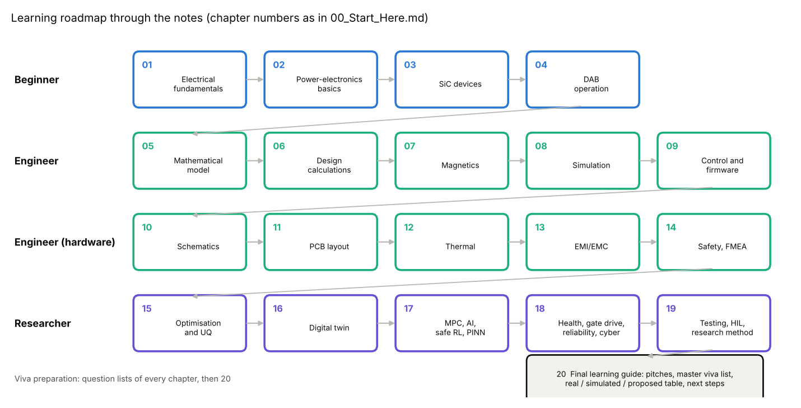

# 20 Final learning guide

> Reading time: ~40 min (plus the chapters it points to). Prerequisites: none to read it, all of 01-19 to
> answer every question. Files covered: `README.md` (repository root), `SiC_6k6_Industrial_DAB/README.md`,
> `Advanced_Research_2026/00_Gap_Analysis_and_Plan.md`, `Advanced_Research_2026/Verification_Evidence/maturity.json`,
> `Advanced_Research_2026/Verification_Evidence/KNOWN_ISSUES.md`, `SiC_6k6_Industrial_DAB/18_Verification/verification_report.md`.

## Overview

**Level 1 - Beginner:** This repository designs two machines that move electrical energy across an
insulating barrier: a 3 kW converter that turns 400 V into 48 V (the "PSFB", one direction only) and a
6.6 kW converter that moves energy both ways between an 800 V and a 400 V battery-like bus (the "DAB").
Everything was designed, calculated, simulated and checked by computer programs; nothing has been built,
switched on or measured. On top of the DAB sits a set of 2026 research studies that ask how the converter
could be made smarter, more robust and better understood. This chapter is the map: what the project is in
one page, how to explain it in 30 seconds, 2 minutes or 10 minutes, in what order to study the notes, the
30 questions that matter most, what is real, what is simulated, what is only proposed, and what to do next.

**Level 2 - Engineering:** The PSFB (`hardware/`, `docs/`, `tools/`) is a finished reference design: 370-420 V
in, 48 V / 62.5 A out, 100 kHz, C3M0060065K SiC primary, synchronous rectifiers, UCC28951 control, 4-layer
PCB with DRC 0 errors / 0 unconnected and gerbers, 97.1 % calculated full-load efficiency `[Simulated]`. The
DAB (`SiC_6k6_Industrial_DAB/`) is 650-850 V <-> 300-450 V, 6.6 kW, 100 kHz, n = 2, L = 64 uH, C3M0032120K /
C3M0016120K, E65/32/27 transformer, 6-layer PCB, C2000 firmware with a SIL-tested control core; 98.62 %
calculated at 800/400 V, 6.6 kW `[Simulated]`; its verification report has 22 PASS, 0 FAIL `[Verified]`.

**Level 3 - Research:** `Advanced_Research_2026/` adds 16 script-backed modules and records (digital twin,
adaptive MPC, embedded AI, safe RL, physics-informed models, robust optimisation, UQ, FEM-lite magnetics,
parasitics, health monitoring, gate drive, reliability, HIL, cybersecurity, multiphysics, benchmarks) plus a
verified literature database and four paper outlines. The primary contribution chosen in the gap analysis is
physics-informed adaptive soft-switching control. Every deliverable carries a maturity level; of 26 listed in
`maturity.json`, none is above L3 (software-verified), and 10 of 14 known issues are still open.

## The project on one page

| Item | PSFB 3 kW baseline | DAB 6.6 kW research platform |
|---|---|---|
| Where | `hardware/kicad/SiC_PSFB_3kW.kicad_pro`, `docs/`, `tools/`, `simulation/` | `SiC_6k6_Industrial_DAB/` (folders 00-20, `dabtools/`) |
| Ports | 370-420 V (320 V derated) -> 48 V, 62.5 A, unidirectional (`docs/01_specification.md`) | 650-850 V <-> 300-450 V, bidirectional (`design_values.json`) |
| Power, frequency | 3.0 kW, 100 kHz | 6.6 kW, 100 kHz, P_max 12.5 kW at 800/400 V |
| Devices | C3M0060065K x4 primary, IPP110N20N3 G SR, C3D04065A clamp diodes | C3M0032120K (HV), C3M0016120K (LV), TO-247-4, data `verified=False` |
| Magnetics | ETD59 3C95 18:3:3 transformer, 12 uH resonant inductor | E65/32/27 3C95 28:14, 0.132 T; E55 series inductor 59.9 uH; L = 64 uH total |
| Control | UCC28951 analogue PSFB controller | C2000 digital PI (crossover 612 Hz, PM 76 deg) + inverse-SPS feed-forward + EPS matching |
| Calculated efficiency | 97.1 % full load, 91.1 W loss (`docs/02_design_calculations.md`) | 98.62 % at 6.6 kW, 92.2 W loss; 98.66 % peak at 80 % load |
| PCB | 4 layers, DRC 0 errors / 0 unconnected, gerbers in `hardware/outputs/` | 6 layers 2 oz, 340 x 250 mm, DRC 0 errors / 0 unconnected, 63 warnings |
| Verification | maturity L3 (`maturity.json`) | 22 PASS / 0 FAIL / 2 INFO (`18_Verification/verification_report.md`) |
| Hardware | none built | none built |

Research layer (`Advanced_Research_2026/00_Gap_Analysis_and_Plan.md`): primary contribution A -
online estimation of the parameters that set the ZVS boundary (L, Coss,er) to keep both bridges soft-switched
with less circulating current than a fixed SPS/EPS schedule; secondary D - the same estimator extended to
Rds(on) and thermal drift for health monitoring; secondary B - reliability-aware modulation scored by junction
temperature swing over a mission profile. Toolchain: `Verification_Evidence/run_all.py` with provenance;
evidence ledger: `maturity.json`; findings ledger: `KNOWN_ISSUES.md`.

## Topics

### The whole converter in one picture

**What is it?** The DAB as one system: an 800 V full bridge (Q1-Q4) and a 400 V full bridge (Q5-Q8), each
making a 100 kHz square wave, joined by a 64 uH series inductance and a 28:14 transformer; power flows from the
leading bridge to the lagging one. Around the power stage: film DC links, isolated gate drivers, isolated
sensing, hardware comparators, a C2000 controller and three isolation regions (HV, control, LV). `[Implemented]`
as design files; behaviour `[Simulated]`.

**Why do we need it?** Every detail of chapters 01-19 hangs off this picture; a viva usually starts with "draw
your converter and explain the power flow".

**How does it work?**
**Level 1 - Beginner:** Two switch bridges chop their DC buses into square waves. If both waves are identical
and in step, nothing flows. Delay one slightly and the inductor between them sees a voltage difference, current
builds up, and energy moves from the earlier wave to the later one. The size of the delay sets the power; its sign
sets the direction. The transformer halves the voltage and provides the insulation.
**Level 2 - Engineering:** P = V1 V2' phi (pi - |phi|) / (2 pi^2 fs L) with V2' = n V2. At 800/400 V, n = 2,
L = 64 uH, fs = 100 kHz: P_max = V1 V2' / (8 fs L) = 800 x 800 / (8 x 1e5 x 64e-6) = 12.5 kW, and 6.6 kW needs
phi = 28.2 deg (`design_values.json`, phi_nom = 0.4916 rad). The nominal HV rms current is 9.23 A, peak 9.75 A;
the ZVS minimum currents are 2.0 A (HV) and 3.07 A (LV); dead time 150 ns. The firmware runs a PI voltage loop
whose output is a power command, inverted to a phase shift, with EPS voltage matching away from d = 1.
**Level 3 - Research:** The picture hides the parameters that move: L and Coss,er have 10-20 % tolerance and
drift, the voltage ratio d spans 0.71-1.38 over the envelope, and at light load the bridges lose ZVS. The
research layer treats the converter as a parametrised system to be estimated (digital twin), controlled under
constraints (MPC, safe RL), designed under uncertainty (robust optimisation, UQ) and monitored over life
(health monitoring, reliability).

**Example from our converter:** Loss budget at 800/400 V, 6.6 kW (`04_Design_Calculations/design_values.json`):
LV bridge conduction 12.5 W, HV bridge conduction 6.1 W, transformer 18.8 W, inductor 7.0 W, PCB copper and bus
bars (estimate) 26.4 W, auxiliary 12 W, others small: total 92.2 W, eta 98.62 % `[Simulated]`.

**Engineering calculations:** eta = 6600 / (6600 + 92.2) = 0.9862. The largest single item is an estimate (PCB
copper 26.4 W) - which is why every efficiency in this project is labelled calculated.

**Design decision made in this project:** DAB with SPS feed-forward plus EPS voltage matching at 100 kHz, SiC on
both bridges, an external inductor rather than integrated leakage, digital control on a C2000
(`SiC_6k6_Industrial_DAB/README.md`, `02_Topology_Comparison/`).

**Alternatives considered:** CLLC resonant converter, PSFB (unidirectional - the baseline), two- and three-phase
DAB (`02_Topology_Comparison/topology_comparison.py`, chapter 02); integrated-leakage transformer (evaluated as a
variant in `design_values.json`).

**How to verify it:** `python3 SiC_6k6_Industrial_DAB/04_Design_Calculations/dab_design.py` regenerates the
numbers; ngspice agrees within 0.5 % in power (verification report).

**Common mistakes:** Calling the transformer "the inductor"; forgetting the referred voltage V2' = n V2; quoting
98.62 % as measured.

**Interview explanation (30 s):** "Two SiC full bridges at 100 kHz, linked by 64 uH and a 2:1 transformer. The
phase shift between them sets power and direction: 28 degrees gives 6.6 kW at 800/400 V. A PI loop commands
power, the modulator inverts it to a phase shift, and EPS matching keeps rms current low away from d = 1."

**Research-level explanation:** The DAB is a good research platform precisely because its physics is simple and
its operating problem is not: the optimal modulation is a constrained optimisation over parameters that are
uncertain and drift, which is where estimation, robust design and learning methods can be tested honestly.

### How the design was verified

**What is it?** The chain of checks that stands behind each number: closed-form vs numerical model, Python
switched plant vs ngspice, firmware core vs SIL scenarios, schematic vs netlist export, PCB vs DRC, and the 2026
independent checks (2-D field solver, exhaustive state-machine check, SIL fault injection). `[Verified]` where a
check passes; the physics behind it remains `[Simulated]`.

**Why do we need it?** "How do you know?" is the second viva question after "what is it?". The honest answer is a
list of checks with their limits.

**How does it work?**
**Level 1 - Beginner:** Each important number is computed twice in different ways, and a program compares them.
Each drawing is converted to a list of connections and compared with the design database. The board is checked
for distances by KiCad's rule checker. None of these can find a mistake that every method shares - only a
measurement can.
**Level 2 - Engineering:** `18_Verification/run_verification.py` produced (run read for this chapter) 22 PASS,
0 FAIL, 2 INFO: ngspice vs analytical dP 0.5 %, dI_rms 0.6 %; ZVS at all 8 edges; regulation 400.00 V; 0.37 %
load-step dip; reversal without fault; dead-bus start peak 20.2 A; firmware SIL ALL PASS (30 checks); schematic
261 symbols with netlist match; DAB and PSFB DRC 0 errors / 0 unconnected. The C2000 HAL passes only a host
syntax check (`[Not yet tested]` on target).
**Level 3 - Research:** Independent oracles found what same-assumption checks could not: the 2-D solver found the
transformer leakage 7.6 uH instead of 4.1 uH and a litz bundle that does not fit; the state-machine check
compared 46,080 transitions of a model against the C code with 0 mismatches; SIL fault injection found the LV
sensor common cause. The SIL suite is also the executable specification of the proposed HIL bench.

**Example from our converter:** The dead-bus start check failed at 61.8 A peak until the Python controller got a
gates-enable flag mirroring the C core (KNOWN_ISSUES #2); after the fix it passes at 20.2 A - the old failure is
kept in the record (chapter 08 describes it).

**Engineering calculations:** Agreement figures: (6600 - 6568) / 6600 = 0.5 %; (9.23 - 9.17) / 9.23 = 0.6 %.
Maturity counts from `maturity.json`: 4 of 26 deliverables at L3, 12 at L2, 7 at L1, 3 at L0 (first stated level).

**Design decision made in this project:** Every check is scripted and re-runnable; INFO lines (seven part types
whose pinouts need datasheet verification) are not counted as passes; results carry the run date.

**Alternatives considered:** Manual review only (not reproducible); commercial FEM and HIL (not available in this
environment - replaced by a validated in-house 2-D solver and a SIL suite).

**How to verify it:** `python3 SiC_6k6_Industrial_DAB/18_Verification/run_verification.py` and
`python3 Advanced_Research_2026/Verification_Evidence/run_all.py`.

**Common mistakes:** "Verified" meaning "works"; overlooking the detail column; treating two models that share
device data as independent evidence.

**Interview explanation (30 s):** "Every number is backed by a script and, where possible, a second method: the
model against ngspice within 0.6 %, the firmware against 30 SIL checks, the schematic against its netlist, the
board against DRC. Twenty-two checks pass and none fail - but no check is a measurement."

**Research-level explanation:** Verification without measurement can only show internal consistency. The
research value lies in choosing checks that do not share assumptions, and in planning the measurements that
would break the remaining shared ones (device data, copper loss, parasitic capacitances).

### What is real, what is simulated, what is proposed

**What is it?** A classification of every deliverable by the evidence behind it, built from
`Advanced_Research_2026/Verification_Evidence/maturity.json` (table in the next section). "Real" here means a real
artefact in the repository whose automated check passes (L3) - never real hardware.

**Why do we need it?** Most misunderstandings of this project come from reading a simulated or proposed item as
real. A single table prevents that.

**How does it work?**
**Level 1 - Beginner:** Three boxes. Box 1: files that exist and that a program has checked (drawings, board,
firmware logic). Box 2: numbers that come from calculation or simulation. Box 3: ideas written down but not built
or run (the test bench, extra sensors, the lab tests, the papers). A fourth box, "measured on hardware", is empty.
**Level 2 - Engineering:** Mapping: L3 -> software-verified artefact (`[Verified]`); L1-L2 -> calculated or
simulated (`[Simulated]`); L0 -> document or proposal (`[Implemented]` as a record, `[Proposed]` as a plan);
L4-L6 -> empty. Mixed rows keep both levels, e.g. HIL_Validation "L3 (SIL); HIL L0".
**Level 3 - Research:** The classification is per deliverable, but a paper needs it per claim: Paper 1's L
estimation claim is L2 (simulation) with L3 code; its transition-time sensor is L0. Moving one claim up a level
needs a capability, not more work at the same level.

**Example from our converter:** The DAB 6-layer PCB row reads L2 in `maturity.json` ("becomes L3 only at 0 DRC
errors / 0 unconnected") while the verification report already shows 0 / 0 - the table below keeps the file's
conservative value and notes the lag.

**Engineering calculations:** 4 / 26 = 15 % of deliverables software-verified; 19 / 26 = 73 % calculated or
simulated (L1-L2); 3 / 26 = 12 % concept; 0 % HIL or hardware.

**Design decision made in this project:** One JSON file is the source of truth; the Markdown matrix and this
table are derived from it; each row names its evidence and what is not verified.

**Alternatives considered:** A single "status" per folder (hides mixed levels); TRL scale (blurs simulation and
laboratory).

**How to verify it:** `python3 Advanced_Research_2026/Verification_Evidence/maturity_matrix.py` regenerates
`maturity_matrix.md`; compare its rows with the table below.

**Common mistakes:** Saying "the converter achieves 98.6 %"; calling the SIL suite a HIL test; listing the
literature database as "verified literature" without the snippet-only caveat.

**Interview explanation (30 s):** "Real means a checked artefact - the schematic, the board, the firmware core.
Simulated means every efficiency, temperature, EMI and control-performance number. Proposed means the HIL bench,
the extra sensors, the lab tests and the papers. Measured: nothing yet."

**Research-level explanation:** Publishing from this platform requires stating the evidence class of each claim
in the abstract; the table is the first draft of every paper's limitations section.

### Where the research goes next

**What is it?** The next steps, from three sources: the open items of `KNOWN_ISSUES.md` (design actions), the
missing capabilities in `maturity.json` (HIL, toolchain, laboratory) and the validation steps the four paper
outlines name. `[Proposed]`.

**Why do we need it?** A research platform is defined as much by its open questions as by its results; a viva or
interview often ends with "what would you do next?".

**How does it work?**
**Level 1 - Beginner:** First fix the known mistakes in the design, then build the fake-power-stage test bench,
then build a small, safe version of the converter and measure the few things the computer models disagree about.
**Level 2 - Engineering:** Before any hardware: re-trim L_ext by -3.5 uH (#3), carry +3 W copper loss into the
budget (#4), re-specify the litz bundle (#5), move to -4 V gate bias or a Miller-clamp + DESAT driver (#6, #9),
add an independent OV path on the LV side (#10), fix the ADC scaling and controller naming (#11, #12), choose a
light-load strategy (#13). Then: compile the HAL with the TI toolchain, build the HIL bench, run the 19 acceptance
tests, and execute the staged lab plan.
**Level 3 - Research:** Contribution A needs a measurement of ZVS transitions with a known inductance change;
Paper 2 needs HIL timing; Paper 3 an impedance-analyser short-circuit test and calorimetric copper loss; Paper 4
measured tolerance statistics. The light-load problem (46 % of envelope cells hard-switch at nominal parameters
with SPS/EPS, Paper 2 outline) is the largest open technical question.

**Example from our converter:** KNOWN_ISSUES #9: the FMEDA-lite gives 0 % diagnostic coverage for the interlock
and DESAT, and the fault tree's "uncontrolled energy transfer" event is dominated by the absence of desaturation
detection - the next hardware revision must add DESAT-capable drivers.

**Engineering calculations:** Effect of #3 and #4 on the design values: L_ext 59.9 uH -> about 56.4 uH so that L
stays 64 uH with 7.6 uH leakage; loss 92.2 W -> 95.2 W, eta 98.62 % -> 98.58 % `[Simulated]`.

**Design decision made in this project:** Hardware actions stay open with a named remedy; software defects are
fixed and re-verified; no hardware build before an independent review (`README.md` safety note).

**Alternatives considered:** Building a prototype now and fixing issues later (rejected: #5 means the transformer
would not fit, #10 is a safety gap); more simulation studies (lower value than one HIL bench).

**How to verify it:** Each closed item must reproduce the module result that found it with the fix in place, and
the verification report must still show 0 FAIL.

**Common mistakes:** Presenting next steps without their order (safety-relevant items first); promising L5
results from an L3 platform.

**Interview explanation (30 s):** "Next: close the ten open design issues - transformer fit and leakage, gate bias
and DESAT, the LV sensor common cause - then compile the firmware for the target, build a HIL bench, and only then
a staged, de-rated prototype to measure ZVS transitions, losses and parasitics."

**Research-level explanation:** The shortest path to L4-L5 evidence is: HIL (lifts firmware, fault injection and
timing at once), then a 1 kW de-rated bench with the transition-time sensor on one leg (Paper 1's validation
plan), then the full staged plan. Each step should be chosen by how many open claims it can falsify.

## Learning roadmap

| Stage | Read | Goal | Check yourself with |
|---|---|---|---|
| Beginner | 01, 02, 03, 04 (Level 1 paragraphs first) | explain voltage, power, switching, ZVS, the DAB idea | Basic questions of 01-04, block 1 below |
| Engineer (design) | 05, 06, 07, 08, 09 | reproduce L = 64 uH, phi = 28 deg, 92.2 W, the PI design | run `dab_design.py`, `run_switched_sim.py`, `make test` in `10_Firmware/` |
| Engineer (hardware) | 10, 11, 12, 13, 14 | read the schematic, board, thermal, EMI and insulation choices | the verification report; Intermediate questions, block 2 |
| Researcher | 15, 16, 17, 18, 19 | understand each 2026 module's question, result, maturity and limits | `run_all.py`, `maturity_matrix.md`, block 3 below |
| Viva / interview | every chapter's question list, then this chapter | answer at three depths | the three pitches below |

Order of study for a researcher who already knows power electronics: 04 -> 05 -> 19 -> 16 -> 17 -> 15 -> 18,
then `Advanced_Research_2026/00_Gap_Analysis_and_Plan.md` and the paper outlines.

## Real, simulated and proposed: the evidence table

Built from `Advanced_Research_2026/Verification_Evidence/maturity.json` (26 rows, read for this chapter).

| Deliverable | Level (maturity.json) | Class | Tag |
|---|---|---|---|
| PSFB 3 kW: schematic, 4-layer PCB, gerbers | L3 | real artefact, DRC 0 errors | `[Verified]` |
| DAB requirements, envelope, RTM | L1 | document | `[Implemented]` |
| DAB model and design calculations | L2 | calculated | `[Simulated]` |
| DAB switched simulation and ngspice model | L2 | simulated | `[Simulated]` |
| DAB firmware core + SIL harness (30 checks) | L3 (HAL L0-L1) | real code, SIL passes; HAL never target-compiled | `[Verified]` / `[Not yet tested]` |
| DAB KiCad schematic and netlist consistency | L3 | real artefact | `[Verified]` |
| DAB 6-layer PCB | L2 (file not yet refreshed; DRC now 0 / 0) | real artefact | `[Verified]` (DRC) |
| Thermal, EMI, safety, FMEA, BOM, manufacturing outputs | L1-L2 | calculated / documents | `[Simulated]` / `[Implemented]` |
| Literature database | L0 (record) | record, snippet evidence | `[Implemented]` |
| Digital twin (observability, RLS/EKF, supervisory) | L2 (L3 code) | simulated; transition-time sensor proposed | `[Simulated]` / `[Proposed]` |
| FEM_Magnetics (2-D finite differences) | L1-L2 | simulated | `[Simulated]` |
| Parasitic extraction (27.9 nH loop) | L1 | calculated | `[Simulated]` |
| SiC health monitoring | L2 (synthetic) | simulated on SYNTHETIC data | `[Simulated]` |
| Active gate drive trade-off | L1 | calculated | `[Simulated]` |
| Reliability: FTA, FMEDA-lite, state-machine check | L1 / L3 | assumed rates; state machine checked vs C | `[Simulated]` / `[Verified]` |
| HIL architecture + 19 SIL fault-injection tests | L3 (SIL); HIL L0 | SIL passes; HIL proposed | `[Verified]` / `[Proposed]` |
| Cybersecurity (IEC 62443, STRIDE, CMAC demo) | L0-L1 | design proposed; demo vectors pass | `[Proposed]` / `[Verified]` |
| Multiphysics electro-thermal-aging model | L2 | simulated, ratios only | `[Simulated]` |
| Adaptive MPC benchmark, ZVS maps | L2 (WCET L1) | simulated | `[Simulated]` |
| Embedded AI (Q15 LUT vs MLP) | L2 (cycles L1) | simulated, no C port | `[Simulated]` |
| Robust optimisation (NSGA-II, GP-EI) | L2 | simulated | `[Simulated]` |
| Uncertainty quantification (MC, LHS, PCE, Sobol) | L2 | simulated | `[Simulated]` |
| Physics-informed surrogates | L2 | simulated | `[Simulated]` |
| Safe RL (CEM, REINFORCE behind a safety filter) | L2 (exploratory) | simulated, never for deployment | `[Simulated]` |
| Research benchmarks | L1 | ours calculated, theirs quoted | `[Implemented]` |
| Research publications (four outlines) | L0 | not submitted | `[Proposed]` |
| Anything measured on hardware | - | none | - |

## Next steps: the open issues

From `Advanced_Research_2026/Verification_Evidence/KNOWN_ISSUES.md` (state as read; #1, #2, #8 fixed, #14 cosmetic):

| # | Open issue | Next step |
|---|---|---|
| 3 | leakage 7.6 uH (2-D) vs 4.1 uH (closed form) | re-trim L_ext by -3.5 uH; update `06_Magnetics` |
| 4 | proximity factors 1.41 / 1.57, copper loss 10.4 W vs 7.4 W | carry +3 W into `04_Design_Calculations` |
| 5 | litz bundles need 12.8 mm in an 11.7 mm window | re-specify the bundle before ordering |
| 6 | gate bias -3 V (schematic) vs -4 V (model); crosstalk margin ~0 / negative | -4 V and/or Miller clamp + DESAT driver |
| 7 | Python controller lacks hw_trip, driver_fault, precharge timeout | document C core as reference |
| 9 | 0 % interlock and DESAT coverage; bias-module isolation single-point cut set | DESAT drivers, interlock self-test |
| 10 | -20 % LV sensor gain fault -> 474 V without trip; 4 % clip margin | independent OV reference path before HIL |
| 11 | AMC1311 / AMC1301 / `hal_adc_read` scaling inconsistency | resolve before HIL |
| 12 | F280049C vs F2837x naming | documentation fix |
| 13 | light-load hard switching dominates thermal cycling | TPS maps / burst light-load strategy |

Beyond the list: refresh `maturity.json` for the PCB, compile the HAL with the TI toolchain, verify the seven
flagged pinouts and the `verified=False` device data, obtain an independent review, then HIL and the staged lab plan.

## Worked example(s) with real numbers

**Worked example 1 - the nominal operating point end to end.** 800 V / 400 V, 6.6 kW (`design_values.json`).

1. Referred voltage V2' = 2 x 400 = 800 V, so d = 1.
2. Power equation: 6600 = 800 x 800 x phi (pi - phi) / (2 pi^2 x 1e5 x 64e-6) gives phi = 0.4916 rad = 28.2 deg.
3. Currents: HV rms 9.23 A, peak 9.75 A; LV rms 18.46 A, peak 19.5 A.
4. ZVS: edge currents above the minimum 2.0 A (HV) and 3.07 A (LV); ngspice v_DS at turn-on 0.002-0.005 per unit.
5. Loss 92.2 W, eta 98.62 %; Tj 49 C (HV) and 51 C (LV) at 45 C ambient.
6. Control: PI kp 1689 W/V, crossover 612 Hz, PM 76 deg; 50 % load step dip 0.37 % in simulation.
   All `[Simulated]`; the checks behind 4 and 6 are `[Verified]`.

**Worked example 2 - the same point under uncertainty.** `Uncertainty_Quantification` with +/-15 % L,
+/-20 % Coss, +0-30 % Rds(on), +/-25 % core loss, 25-55 C ambient: efficiency 98.61 +/- 0.05 % (MC mean and std);
the minimum ZVS margin over the corners has a mean of 0.89 A but a 5 % quantile of -1.13 A, i.e. some corners lose
ZVS; inductance dominates the ZVS margins. Robust optimisation adds the design consequence: ZVS at every
full-power corner can be guaranteed only for a +/-1.5 % inductance band (Paper 4 outline). `[Simulated]`

## How this chapter connects to the files

| File | What it contains | Status |
|---|---|---|
| `README.md` (repository root) | the two designs, status, safety note | `[Implemented]` |
| `SiC_6k6_Industrial_DAB/README.md` | DAB directory map, reproduce-everything commands, completion states | `[Implemented]` |
| `SiC_6k6_Industrial_DAB/04_Design_Calculations/design_values.json` | every DAB design number quoted here | `[Simulated]` |
| `SiC_6k6_Industrial_DAB/18_Verification/verification_report.md` | 22 PASS / 0 FAIL / 2 INFO | `[Verified]` |
| `docs/02_design_calculations.md`, `hardware/kicad/drc_summary.json` | PSFB loss budget (91.1 W, 97.1 %), DRC state | `[Simulated]` / `[Verified]` |
| `Advanced_Research_2026/00_Gap_Analysis_and_Plan.md` | audit, gap matrix, contributions A, D, B | `[Implemented]` |
| `Advanced_Research_2026/Verification_Evidence/maturity.json`, `maturity_matrix.md` | 26 deliverables with level, evidence, limits | `[Implemented]` |
| `Advanced_Research_2026/Verification_Evidence/KNOWN_ISSUES.md` | 14 findings, 10 open | `[Implemented]` |
| `Advanced_Research_2026/Research_Publications/README.md` | four paper outlines and their missing steps | `[Proposed]` |
| `img/ch20_figures.py` | the roadmap figure | `[Implemented]` |

## Viva / interview questions

The master list: the 30 most important questions across chapters 01-19, with the chapter in brackets.

### Basic (10)

1. **What does this project contain, and what is its status? (00, 20)** A 3 kW PSFB reference design and a
   6.6 kW bidirectional SiC DAB, both script-generated with calculations, simulations, firmware and PCBs, plus
   2026 research modules. Nothing has been built or measured.
2. **What is the difference between rms, average and peak current? (01)** Average sets charge transfer, rms
   sets heating (conduction loss goes with I_rms^2), peak sets device stress and trip levels. Nominal HV side:
   9.23 A rms, 9.75 A peak (`design_values.json`).
3. **What is ZVS and why does it matter? (02)** Turning a switch on after its voltage has fallen to zero, so its
   output-capacitance energy is not dissipated. It removes turn-on loss and reduces dv/dt-related stress and EMI.
4. **Why galvanic isolation? (02, 14)** Safety and system grounding: the two buses and the control electronics
   must not share a conductive path; the transformer gives basic HV-LV insulation, the control side needs reinforced.
5. **Why SiC MOSFETs? (03)** 1200 V devices with low Rds(on) (32 / 16 mOhm class) and small output charge allow
   100 kHz switching with low loss; device numbers are datasheet-typical, `verified=False` in `devices.py`.
6. **How does a DAB transfer power? (04)** A phase shift between two square-wave bridges drives current through
   the series inductance; power flows from the leading to the lagging bridge, direction set by the sign.
7. **What is the dead time and its value? (03, 06)** A short interval with both switches of a leg off, during which
   the inductor current charges and discharges Coss; 150 ns here.
8. **Why is a 64 uH series inductance chosen? (06)** It places the nominal 6.6 kW at phi = 28 deg with
   P_max 12.5 kW: enough margin for regulation and the voltage corners without excessive circulating current.
9. **Where does the 98.62 % come from? (06)** A 14-item loss budget at 800/400 V, 6.6 kW: 92.2 W, of which the
   largest item (26.4 W PCB copper) is an estimate. It is calculated, not measured.
10. **What do the status tags mean? (00, 19)** Implemented (exists), Simulated (from a simulation or
    calculation), Verified (an automated check passes), Proposed (on paper), Not yet tested (exists, no passing check).

### Intermediate (10)

1. **Write the SPS power equation and evaluate it. (04, 05)** P = V1 V2' phi (pi - |phi|) / (2 pi^2 fs L);
   at 800/800 V referred, 100 kHz, 64 uH: P_max = 12.5 kW at 90 deg, 6.6 kW at 28.2 deg.
2. **State the ZVS criterion and the project values. (05, 06)** The edge current must store enough energy to swap
   the capacitances: I >= sqrt(2 Coss,er V^2 / L) (plus winding capacitance) - 2.0 A HV, 3.07 A LV at nominal.
3. **Why EPS voltage matching? (04, 09)** Away from d = 1 the SPS current becomes triangular with high rms and
   backflow; setting the inner shift of the higher-voltage bridge so that D = d restores a flatter current.
4. **How was the PI loop designed? (09)** The modulator inverse linearises power vs phi; kp = 1689 W/V,
   ki = 1.27e6 W/(V s), crossover 612 Hz, phase margin 76 deg with a 1.5 Ts delay (`control_params.json`).
5. **Summarise the transformer design. (07)** E65/32/27 3C95, 28:14, 0.132 T, litz 294/588 strands, interleaved;
   11.4 W core, 7.4 W copper, 4.1 uH leakage closed form (7.6 uH by the 2-D solver, KNOWN_ISSUES #3).
6. **How were the simulations cross-checked? (08)** Python switched plant and ngspice behavioural model against the
   closed form: 6568 vs 6600 W, 9.17 vs 9.23 A rms, ZVS ratio < 0.005 at all eight edges.
7. **How are isolation distances enforced on the PCB? (11, 14)** Net classes become KiCad custom DRC rules (12 mm
   HV-LV and HV-control, 10 mm LV-control, PE distances); routing run 27 reached 0 errors, 0 unconnected.
8. **What junction temperatures are expected? (12)** Tj 49 / 51 C at nominal, 54 / 58 C at the worst corner with
   forced air at 45 C ambient; natural convection would reach 86 / 96 C. All calculated.
9. **What EMI filtering is needed? (13)** Against CISPR 11 class A with 6 dB margin: ~39 dB DM and ~57 dB CM
   attenuation; the proposed two-stage filter gives 52 / 56 dB calculated; Y1 4.7 nF capacitors are on the board.
10. **What are the top FMEA risks? (14)** HV MOSFET short (RPN 96), CT failure and loose connector (84 each), film
    capacitor ageing (72); the fault tree points to missing DESAT and the bias-module isolation.

### Advanced / research (10)

1. **Which parameters can the digital twin identify? (16)** L to 0.03 % (noise bound) from the existing sensors,
   because currents are affine in 1/L; Coss,er is unobservable without a proposed transition-time sensor (4.5 % with it).
2. **What does MPC buy over PI here? (17)** Load-step settling < 0.25 ms vs 2.1 ms, but no gain in reversal or soft
   start, and only the explicit LUT fits the 10 us interrupt (Paper 2 outline, `Adaptive_MPC/`).
3. **What did safe RL achieve? (17)** No benefit: mean rms current 8.118 A for PI + EPS, 8.182 A (CEM) and 8.121 A
   (REINFORCE), all behind a deterministic safety filter and fallback; simulation only.
4. **Do physics-informed networks beat the analytical model? (17)** No: the exact TPS closed form has 0.12 % RMSE
   (of range) against 0.59 % for the best learned surrogate; the PINN physics loss did not help.
5. **What did robust optimisation show about the baseline? (15)** Within 3 % of the nominal front in loss,
   dominated in magnetics volume, infeasible under robust and chance-constrained variants; corner ZVS needs a
   +/-1.5 % inductance band.
6. **What dominates the uncertainty? (15)** Nominal efficiency 98.61 +/- 0.05 % is driven by core loss and Rds(on);
   ZVS margins and corner efficiencies by the inductance; Tj by ambient.
7. **How far can health monitoring go without measured data? (18)** On SYNTHETIC data a 1 % drift is detected in
   1-7 weeks with 0 false alarms in 3 years given a stable temperature reference; no RUL claim, no real aging data.
8. **What did the formal reliability work find? (14, 18)** Fault-tree top events dominated by barrier components
   and missing DESAT; diagnostic coverage 35-47 %, no SIL claim; 46,080 state-machine transitions match the C code.
9. **What is the most important SIL fault-injection result? (19)** A -20 % LV sensor gain fault drives the link to
   474 V without a trip because one AMC1301 chain feeds regulation and both OV protections.
10. **What is needed to move this platform from L3 to publishable evidence? (19, 20)** The TI toolchain and a HIL
    bench (L4), then a de-rated prototype with the transition-time sensor and the staged lab plan (L5), with the
    validation level stated in every abstract.

## Pitches

**30 s:** I designed, in software, two isolated SiC DC-DC converters: a finished 3 kW 400-to-48 V phase-shifted
full bridge and a 6.6 kW bidirectional dual active bridge between 800 V and 400 V. Everything - calculations,
simulations, firmware, schematic, a DRC-clean six-layer board - is script-generated and checked: 22 passing
checks, 98.6 % calculated efficiency. On top I built research modules on digital twins, MPC and robust design,
each graded by evidence level; nothing has been built yet, and the open issues are listed.

**2 min:** The baseline is a 3 kW PSFB, 400 V to 48 V, with a UCC28951 controller and a 4-layer DRC-clean
board - calculated 97.1 %. The main design is a 6.6 kW SiC DAB, 650-850 V to 300-450 V, 100 kHz: two full
bridges, 64 uH and a 28:14 transformer; 28 degrees of phase shift give 6.6 kW. The design chain is fully
scripted: models checked against ngspice within 0.6 %, a 92 W loss budget (98.62 %), magnetics, thermal, EMI and
insulation studies, a C control core with 30 SIL checks, a generated schematic and a six-layer board with 0 DRC
errors. The research layer asks whether online estimation of L and Coss can keep the bridges in ZVS: L is
identifiable to 0.03 %, Coss needs a new sensor. MPC improves load steps but only a look-up table fits the
interrupt; safe RL and physics-informed networks bring no benefit here - published as negative results. Robust
optimisation shows corner ZVS needs a tight inductance tolerance. Fault injection found a sensor common cause.
Every result is reproducible and graded; nothing is above L3, and the next steps are HIL and a de-rated prototype.

**10 min outline:**
* Motivation: bidirectional 800 V / 400 V conversion, why SiC, why a DAB (chapters 02-04).
* The converter in one picture: power equation, phi_nom 28 deg, ZVS and dead time (04-06).
* Design numbers: L = 64 uH, devices, magnetics, 92.2 W loss budget, thermal (06, 07, 12).
* Control and firmware: PI with modulator inverse, EPS, state machine, SIL (09).
* Hardware design: schematic, isolation, six-layer board, EMI and safety (10, 11, 13, 14).
* Verification: 22 PASS, independent oracles, what is not verified (08, 19).
* Research: digital twin observability, MPC vs PI, negative results of RL and PINN (16, 17).
* Robustness: optimisation and UQ, the inductance-tolerance finding (15).
* Reliability and testing: health monitoring, FTA, fault injection, HIL plan (18, 19).
* Evidence ledger and next steps: maturity table, ten open issues, path to L4/L5 and four papers (19, 20).

## Further reading

* `Advanced_Research_2026/00_Gap_Analysis_and_Plan.md` - the audit and the reasoning behind contribution A.
* `Advanced_Research_2026/Research_Publications/README.md` - the four outlines and what each still needs.
* `SiC_6k6_Industrial_DAB/19_Research_Report/report.md` - the generated research report of the DAB.
* `SiC_6k6_Industrial_DAB/Legacy_PSFB_Baseline/README.md` - where the PSFB files live.
* Literature database `Advanced_Research_2026/Literature_Database/literature_2022_2026.csv`: L37 (review of TPS
  optimisation strategies for DAB, confirmed), L19 (deep RL for converter control review, confirmed), L51 (AI and
  digital twins for converter control review, confirmed), L31 (DAB family modelling, confirmed), L03 (DAB digital
  twin, IECON 2024, confirmed with corrected venue).
