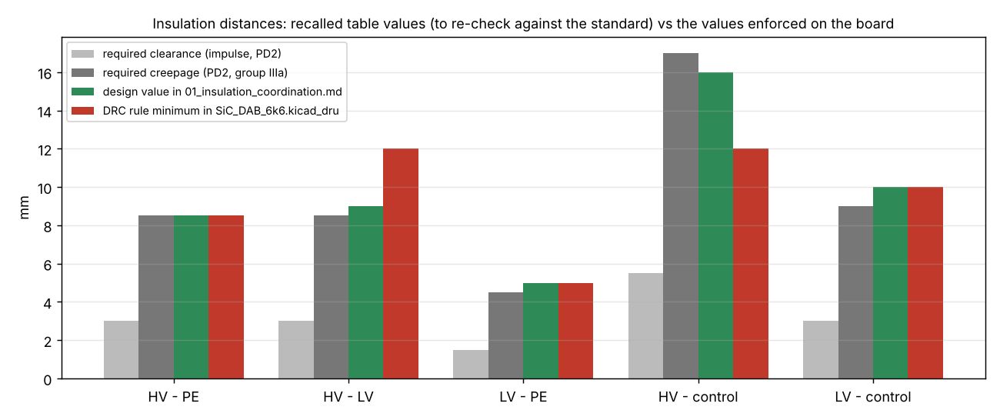
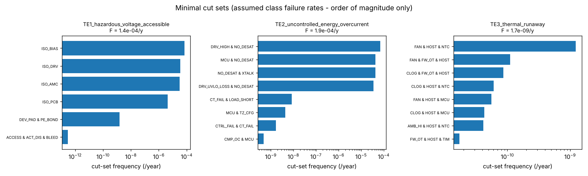

% Understanding the 6.6 kW SiC Dual Active Bridge Converter - From Electrical Fundamentals to Advanced 2026 Power Electronics Research
% Project learning notes (generated from 21_Human_Friendly_Learning_Notes)
% 2026-10-10

# Preface

This textbook is generated from the chapter files of `21_Human_Friendly_Learning_Notes/`. Every chapter is written on three levels (beginner, engineering, research) and every statement about the project carries a status tag; nothing in the project has been built or measured - all numbers are calculated or simulated. Rebuild with `python3 build_textbook.py`.

# 00 Start here - how to use these notes

> These notes explain the whole repository - the 3 kW PSFB reference design, the 6.6 kW SiC dual
> active bridge (DAB) research platform and the 2026 advanced-research modules - from first
> principles to research level. They are written to be read in order, but every chapter stands alone.

## Who this is for

* **Beginners** (students, technicians, software people meeting power electronics for the first
  time): read the `Level 1 - Beginner` paragraphs and the basic viva questions of each chapter.
* **Engineers** (designing, reviewing or building a converter): read `Level 2 - Engineering`, the
  worked examples and the "How this chapter connects to the files" tables.
* **Researchers / graduate students**: read `Level 3 - Research`, the advanced viva questions and
  the 2026 modules (chapters 15-19), then `Advanced_Research_2026/`.

## Status tags used everywhere

| Tag | Meaning in this project |
|---|---|
| `[Implemented]` | code, schematic, layout or document exists in the repository at the path given |
| `[Simulated]` | a result produced by a simulation script in the repository (no hardware) |
| `[Verified]` | an automated check runs and passes (DRC, netlist check, SIL tests, unit tests) |
| `[Proposed]` | designed on paper, not implemented (e.g. the transition-time sensor, the HIL bench) |
| `[Not yet tested]` | implemented but without a passing check (e.g. the C2000 HAL, never compiled) |

**Nothing in this repository has been built, energised or measured.** Every efficiency, temperature
and EMI number is calculated or simulated. The maturity scale used by the research modules
(L0 concept ... L6 publication-ready with evidence) is explained in chapter 19; no deliverable is above
L3 (software-verified).

## Reading paths

| Goal | Chapters |
|---|---|
| Understand what a DAB is and why SiC | 01, 02, 03, 04 |
| Reproduce the design numbers | 05, 06, 07, 12 |
| Understand the control and firmware | 09, 16, 17 |
| Review the schematic and PCB | 10, 11, 14 |
| Prepare a viva / interview | every chapter's question lists, then 20 |
| Start research on the platform | 15-19, then `Advanced_Research_2026/00_Gap_Analysis_and_Plan.md` |

## Chapter map

| # | Chapter | Main project files |
|---|---|---|
| 01 | Electrical fundamentals | - |
| 02 | Power-electronics basics | `SiC_6k6_Industrial_DAB/02_Topology_Comparison/` |
| 03 | SiC devices | `dabtools/dab/devices.py`, `09_Component_Libraries/` |
| 04 | Topology and DAB operation | `03_Mathematical_Models/`, `dabtools/dab/dab_model.py` |
| 05 | Mathematical model | `03_Mathematical_Models/` |
| 06 | Design calculations | `04_Design_Calculations/` |
| 07 | Magnetics | `06_Magnetics/`, `Advanced_Research_2026/FEM_Magnetics/` |
| 08 | Simulation | `05_Simulation/`, `dabtools/dab/sim_switched.py` |
| 09 | Control and firmware | `11_Control_Algorithms/`, `10_Firmware/` |
| 10 | Schematics walkthrough | `07_KiCad_Schematics/`, `dabtools/kicad_dab/design_dab.py` |
| 11 | PCB layout | `08_KiCad_PCB/`, `tools/kicad/` |
| 12 | Thermal management | `13_Thermal_Analysis/`, `Advanced_Research_2026/Multiphysics_Models/` |
| 13 | EMI/EMC and filters | `14_EMI_EMC/` |
| 14 | Safety, insulation, FMEA | `15_Safety_Reliability/`, `Advanced_Research_2026/Reliability_Engineering/` |
| 15 | Optimisation and uncertainty | `12_Optimization/`, `Advanced_Research_2026/Robust_Optimization/`, `Uncertainty_Quantification/` |
| 16 | Digital twin and estimation | `Advanced_Research_2026/Digital_Twin/` |
| 17 | Advanced control: MPC, embedded AI, safe RL, PINN | `Advanced_Research_2026/Adaptive_MPC/`, `Embedded_AI/`, `Safe_RL_Research/`, `Physics_Informed_Models/` |
| 18 | Health monitoring, gate drive, reliability, cybersecurity | `Advanced_Research_2026/SiC_Health_Monitoring/`, `Active_Gate_Drive/`, `Reliability_Engineering/`, `Cybersecurity/` |
| 19 | Testing, HIL, manufacturing, benchmarks, research method | `20_Test_Plan/`, `17_Manufacturing/`, `Advanced_Research_2026/HIL_Validation/`, `Research_Benchmarks/`, `Verification_Evidence/` |
| 20 | Final learning guide | everything: summary, pitches, roadmap, master question list |

The combined textbook *Understanding the 6.6 kW SiC Dual Active Bridge Converter - From Electrical
Fundamentals to Advanced 2026 Power Electronics Research* is generated from these chapters by
`build_textbook.py` (Markdown, HTML and DOCX via pandoc; PDF via headless Chromium where available).

## How the notes stay synchronised with the files

Each chapter ends with a table of the files it describes and their status tag. `check_notes.py`
verifies that every path quoted in the notes exists in the repository and that every topic carries
the mandatory headings; run it before trusting a chapter.

\newpage

# 01 Electrical fundamentals

> Reading time: ~45 min. Prerequisites: school physics (charge, energy, force) and algebra. Files covered:
> `SiC_6k6_Industrial_DAB/04_Design_Calculations/design_values.json`,
> `SiC_6k6_Industrial_DAB/05_Simulation/switched_results.json`,
> `SiC_6k6_Industrial_DAB/06_Magnetics/magnetics_design.md`, `SiC_6k6_Industrial_DAB/16_BOM/bom.md`,
> `SiC_6k6_Industrial_DAB/dabtools/dab/dab_model.py`.

## Overview

**Level 1 - Beginner:** Everything in this repository - the 3 kW PSFB and the 6.6 kW SiC dual active
bridge (DAB) - is built from five ideas: voltage pushes, current flows, power is the product of the two,
energy is power accumulated over time, and two kinds of component (inductors and capacitors) store
energy and resist sudden change. A converter is a machine that moves energy from one voltage level to
another by switching these storage elements on and off very quickly (100 000 times per second here).
If you understand why an inductor "fights" a change of current and a capacitor "fights" a change of
voltage, you already understand half of a DAB.

**Level 2 - Engineering:** The chapter states the laws we use every day - Ohm's law, the inductor law
v = L di/dt, the capacitor law i = C dv/dt, volt-second and charge balance, rms/average/peak, the
transformer turns ratio - and applies each of them to a real number from our files: the 64 uH series
inductor at 800 V and 100 kHz (slope 25 A/us, 9.75 A peak), the 120 uF LV link with its 0.11 V ripple
and 8.4 A rms current, the 28:14 transformer at 0.13 T. All numbers are calculated or simulated
`[Simulated]`; nothing has been measured.

**Level 3 - Research:** The same laws, written as a differential equation L di/dt = v1(t) - v2'(t), are
the whole electrical model of the DAB (chapter 05). Research questions start where the ideal laws stop:
the inductance that is not constant (core saturation, +/-5 % gap tolerance, +/-20 % leakage tolerance),
the capacitor whose ESR and ESL matter at 100 kHz, the "rms" that is defined per switching period and
then used as a parameter-estimation regressor in the 2026 digital twin (`Advanced_Research_2026/Digital_Twin/`).

## Voltage, current, power and energy

### Voltage, current, power, energy and their units
**What is it?** Voltage (V, volt) is the energy given to each coulomb of charge; current (I, ampere) is
the rate at which charge flows; power (P, watt) is the rate of energy transfer, P = V I; energy (J, joule
= watt-second) is power integrated over time, E = integral of P dt. The kilowatt-hour is 3.6 MJ.

**Why do we need it?** The whole specification of the DAB is written in these units: 6.6 kW between an
800 V bus and a 400 V bus (`SiC_6k6_Industrial_DAB/00_Requirements/01_requirements_specification.md`, EL-01 to EL-03).
Every loss, every rating and every efficiency figure is a ratio or product of these four quantities.

**How does it work?**
**Level 1 - Beginner:** Think of water: voltage is the pressure, current is the flow rate, power is
pressure times flow (how fast the water wheel turns), energy is how much work the wheel has done since
morning. A 6.6 kW converter is a "pump" moving 6600 joules every second from one tank to another.
**Level 2 - Engineering:** P = V I holds for instantaneous values; for periodic waveforms the average
power is the average of v(t) i(t) over a period, not the product of the averages. At the HV port
6600 W / 800 V = 8.25 A average; at the LV port 6600 W / 400 V = 16.5 A. The `DABPoint.P` property in
`dabtools/dab/dab_model.py` literally computes `np.mean(v1 * i)` over one switching period - the
textbook definition.
**Level 3 - Research:** Instantaneous power can be negative for part of the period even when the average
is positive. In the DAB this reactive or "backflow" power (301.6 W at nominal,
`04_Design_Calculations/design_values.json` -> `nominal.backflow`) circulates between the two DC links and costs conduction
loss without delivering energy; reducing it is the purpose of the DPS/TPS modulations of chapter 04.

**Example from our converter:** `[Simulated]` At 800/400 V and 6.6 kW the model gives an HV-side rms
current of 9.23 A and a peak of 9.75 A while the average HV port current is only 8.25 A
(`SiC_6k6_Industrial_DAB/04_Design_Calculations/design_values.json`, `nominal.Irms1`, `nominal.Ipk1`).
The difference between 8.25 A (what the bus sees on average) and 9.23 A (what heats the copper) is the
first lesson of power electronics.

**Engineering calculations:** Average port currents: I1 = P/V1 = 6600/800 = 8.25 A, I2 = P/V2 =
6600/400 = 16.5 A. Energy stored in the HV link at 800 V: E = 0.5 C V^2 = 0.5 x 80 uF x 800^2 = 25.6 J
(C1 = 80 uF, `04_Design_Calculations/design_values.json` -> `dclink.C1`); in the LV link 0.5 x 120 uF x 400^2 = 9.6 J. Energy in
the series inductor at the 9.75 A peak: 0.5 x 64 uH x 9.75^2 = 3.0 mJ. The link stores about 8000 times
more energy than the inductor; this is why the links are "stiff" and the inductor is the fast element.

**Design decision made in this project:** `[Implemented]` The requirements express every limit in
these base units with explicit service conditions (`00_Requirements/01_requirements_specification.md`), and the
calculation chain (`04_Design_Calculations/dab_design.py`) reports losses in watts per element so that
efficiency (98.62 % calculated at nominal, `04_Design_Calculations/design_report.md` section 4) is traceable to each term.

**Alternatives considered:** Expressing the design in per-unit (p.u.) quantities, as in machine
theory. Rejected for readability: the engineers reviewing the schematic think in volts and amperes.

**How to verify it:** `python3 SiC_6k6_Industrial_DAB/04_Design_Calculations/dab_design.py`
regenerates `04_Design_Calculations/design_values.json`; the identity P = mean(v1 i) is tested implicitly by the closed-form
cross-check in chapter 05 (`03_Mathematical_Models/dab_mathematical_model.md`, section 2).
`[Verified]` in the sense that the script runs; `[Not yet tested]` on hardware.

**Common mistakes:** Multiplying average voltage by average current to get power (wrong for switched
waveforms); confusing energy (J) with power (W); writing "kW/h" for energy.

**Interview explanation (30 s):** Voltage is energy per charge, current is charge per second, so their
product is energy per second - power. Our converter moves 6.6 kW: 8.25 A at 800 V in, 16.5 A at
400 V out, and the losses are the few tens of watts that do not arrive.

**Research-level explanation:** For switched converters the useful quantity is the period-average of
v(t) i(t); its decomposition into delivered and circulating parts (Krismer and Kolar 2010,
`01_Literature_Review/literature_review.md` [6]) is what every modulation-optimisation paper minimises.

### Ohm's law and resistance
**What is it?** V = I R: the voltage across a resistor is proportional to the current through it; the
power dissipated is P = I^2 R = V^2 / R.

**Why do we need it?** Every conduction loss in the converter is an I^2 R term: MOSFET channel
(Rds(on)), winding copper, shunt, bus bars. Every voltage divider and bleeder resistor is Ohm's law.

**How does it work?**
**Level 1 - Beginner:** A resistor is a narrow pipe: for the same pressure less water flows, and the
friction heats the pipe. Doubling the current makes four times the heat (I^2).
**Level 2 - Engineering:** Resistance depends on temperature. The SiC MOSFET C3M0032120K is entered
with 32 mOhm at 25 C and 52 mOhm at 150 C (`dabtools/dab/devices.py`, datasheet-typical values,
`verified=False`); the loss model interpolates linearly (`rds_on(dev, Tj)`). Copper rises ~0.4 %/K.
**Level 3 - Research:** At 100 kHz the resistance of a winding is not its DC value: skin and proximity
effects raise it (Rac/Rdc = 1.04 primary, 1.08 secondary in the interleaved transformer,
`06_Magnetics/magnetics_design.md`). The 2026 health-monitoring module asks whether a 1 % drift of
Rds(on) is detectable through the on-board sensing chain (`Advanced_Research_2026/SiC_Health_Monitoring/`).

**Example from our converter:** `[Simulated]` HV-bridge conduction loss at nominal: 6.1 W for four
devices (`04_Design_Calculations/design_values.json` -> `nominal.losses`). Check: device rms current = I_rms1 / sqrt(2) =
9.23 / 1.414 = 6.53 A (each device conducts half the period); 4 x 6.53^2 x Rds(49 C) = 4 x 42.6 x
0.0358 = 6.1 W. The 49 C is `nominal.Tj1`.

**Engineering calculations:** LV port current shunt R7 = 1 mOhm (`16_BOM/bom.md`): at 33 A it drops
33 mV and dissipates 33^2 x 0.001 = 1.1 W (rated 2 W). HV divider: 4 x 1 MOhm upper with 499 Ohm lower
(`16_BOM/bom.md` R129-R131): 1000 V full scale -> 1000 x 499 / (4 000 499) = 0.125 V... the BOM comment says
"1000 V FS -> 250 mV" because the AMC1301 input is differential; do the arithmetic yourself with the
schematic sheet `07_KiCad_Schematics/sensing_protection.kicad_sch` before trusting either number.

**Design decision made in this project:** `[Implemented]` Low-side shunt sensing on the LV port
(1 mOhm, Kelvin connected, `16_BOM/bom.md` R7, R139/R140) and a current transformer on the HV side (CT1 1:100,
burden 6.2 Ohm: 32 A -> 2.0 V comparator trip, `16_BOM/bom.md` R141).

**Alternatives considered:** Hall-effect sensors (no dissipation, but offset drift); higher-value
shunts (more signal, more loss).

**How to verify it:** The shunt loss is included in the loss model only as part of "PCB copper and bus
bars (est.) 26.4 W" (`04_Design_Calculations/design_report.md`), which is the most uncertain line of the budget; a bench
measurement is listed in `20_Experimental_Test_Plan/`. `[Not yet tested]`

**Common mistakes:** Using the 25 C Rds(on) for the loss at operating temperature; forgetting that each
device carries the current only half of the time (rms per device = total rms / sqrt(2) for a full bridge).

**Interview explanation (30 s):** Ohm's law gives the conduction losses: each SiC device carries 6.5 A
rms through 36 mOhm at 49 C, about 1.5 W each, 6.1 W for the HV bridge. Temperature raises the
resistance by 60 % between 25 and 150 C, so the thermal design feeds back into the loss.

**Research-level explanation:** The temperature coefficient of Rds(on) in SiC MOSFETs is dominated by
the drift region (positive) with a channel contribution that can be negative at low Vgs; the linear
two-point interpolation of `dabtools/dab/devices.py` is a model assumption to be replaced by datasheet curves.

### The inductor law and volt-second balance
**What is it?** v_L = L di/dt: the voltage across an inductor equals the inductance times the rate of
change of its current. Energy stored: E = 0.5 L I^2. In periodic steady state the average inductor
voltage is zero (volt-second balance), otherwise the current would ramp away.

**Why do we need it?** The series inductor is the heart of the DAB: the phase shift between the two
bridges puts a voltage across L, the current ramps, and that current carries the power. Equation (1) of
`03_Mathematical_Models/dab_mathematical_model.md`, L di/dt = v1(t) - v2'(t), is the whole plant.

**How does it work?**
**Level 1 - Beginner:** An inductor is a heavy flywheel for current: you cannot start or stop the
current instantly. Push with a voltage and the current ramps at a steady rate; push the other way and it
ramps back. Over one full cycle the pushes must cancel, or the flywheel would spin faster every cycle.
**Level 2 - Engineering:** With V1 = 800 V on one side and n V2 = 800 V on the other, during the phase
shift interval the bridges have opposite polarity, so v_L = V1 + V2' = 1600 V and di/dt = 1600 V /
64 uH = 25 A/us; after the second bridge switches, v_L = V1 - V2' = 0 and the current is flat. Figure
`img/ch01_inductor_voltseconds.png` (script `img/fig_ch01_fundamentals.py`) shows both the voltage areas
and the trapezoidal current.
**Level 3 - Research:** A DC volt-second error per period (for example from an asymmetric modulator)
drives a DC current limited only by the loop resistance. The 2026 twin study found exactly this defect
in the switched plant: a one-time-step asymmetry between the positive and negative pulses created a
13 A DC inductor current; the fix (rolling the negative pulse by exactly N_sub/2 cells) is documented in
`Advanced_Research_2026/Digital_Twin/README.md`, section 2, and in `dabtools/dab/sim_switched.py`.

**Example from our converter:** `[Simulated]` L = 64 uH referred to the HV side (`04_Design_Calculations/design_values.json`
-> `L`), made of 59.9 uH external gapped inductor (E55/28/21 pair, 17 turns, 2.10 mm gap) plus 4.1 uH
transformer leakage (`06_Magnetics/magnetics_design.md`). At phi_nom = 28.2 deg the ramp lasts
phi / omega = 0.4916 rad / (2 pi x 100 kHz) = 0.78 us, so the current swings 25 A/us x 0.78 us = 19.6 A,
from -9.8 A to +9.8 A: the model's I_pk1 = 9.75 A (`nominal.Ipk1`).

**Engineering calculations:** di/dt = (V1 + V2') / L = (800 + 800) / 64e-6 = 25.0 A/us during the shift
interval; (V1 - V2') / L = 0 outside it (d = 1). At the 850/300 V corner the second slope is
(850 - 600)/64e-6 = 3.9 A/us and the current becomes triangular with 19.6 A peak
(`04_Design_Calculations/design_report.md`, section 2). Stored energy at 1.2 x I_pk: 4.1 mJ (`04_Design_Calculations/design_values.json` ->
`inductor.E`), which sets the gapped core size.

**Design decision made in this project:** `[Implemented]` The baseline keeps the transformer leakage
small (interleaved winding, 4.1 uH) and sets L with a discrete gapped inductor whose value is defined by
the gap (+/-5 %) rather than by winding geometry (+/-20 %), because a 20 % error in L is a 20 % error in
the power capability (`06_Magnetics/magnetics_design.md`, section 3).

**Alternatives considered:** Integrated-leakage transformer (16.4 uH non-interleaved, ~40 uH with a
spacer) - kept as an optimisation variable in `12_Optimization/`.

**How to verify it:** Simulation: `05_Simulation/run_switched_sim.py` integrates the inductor law step
by step (`DABPlant.run_period` in `dabtools/dab/sim_switched.py`) and reproduces the trapezoid
(`05_Simulation/img/sim_switching_waveforms.png`). Bench: inductance at 0/10/20 A bias and gap
measurement (`06_Magnetics/magnetics_design.md`, section 6, item 7). `[Simulated]`, `[Not yet tested]`

**Common mistakes:** Forgetting that the LV-side quantities must be referred through n before they are
subtracted from V1; assuming the inductor "limits" current like a resistor (it limits di/dt, not i).

**Interview explanation (30 s):** The DAB works by putting a voltage across a 64 uH inductor for a short
time: 1600 V across it ramps the current at 25 A/us, and after 0.78 us the current has reached about
10 A, which the transformer carries to the other side. Volt-second balance keeps the average current
zero.

**Research-level explanation:** The inductor is linear only while the core is well below saturation
(Bpk = 0.116 T at 1.2 x I_pk against 0.41 T Bsat, `06_Magnetics/magnetics_design.md`); gap fringing and DC bias
change L by a few percent, which is why the 2026 twin estimates 1/L online (chapter 05, Level 3).

### The capacitor law and charge balance
**What is it?** i_C = C dv/dt; energy 0.5 C V^2. In periodic steady state the average capacitor
current is zero (charge balance), so the capacitor's job is to absorb the AC part of a pulsating current
and keep its voltage nearly constant.

**Why do we need it?** Both DC links of the DAB are fed by bridges that draw a pulsating current at
twice the switching frequency; the link capacitors convert that into a small voltage ripple.

**How does it work?**
**Level 1 - Beginner:** A capacitor is a water tank: a pulsating inflow and a steady outflow give a
level that wobbles a little. A bigger tank wobbles less.
**Level 2 - Engineering:** The ripple is the peak-to-peak integral of the AC capacitor current divided
by C: Delta V = max(integral of i_C dt) / C (`03_Mathematical_Models/dab_mathematical_model.md`,
section 8). The rms current heats the capacitor through its ESR: P = I_rms^2 ESR.
**Level 3 - Research:** At 100 kHz the equivalent series inductance of film capacitors and the loop
inductance to the bridge dominate the high-frequency behaviour; that is why each leg has a pair of
MLCC decoupling capacitors next to the devices (`16_BOM/bom.md`, C5-C8 100 nF/1 kV, C13-C16
220 nF/630 V) in addition to the bulk film capacitors.

**Example from our converter:** `[Simulated]` LV link C2 = 120 uF (4 x 30 uF / 700 V film, `16_BOM/bom.md`
C9-C12) with ESR 4 mOhm: capacitor rms current 8.38 A, ripple 0.108 V = 0.027 % at nominal and 0.09 %
at the worst corner, ESR loss 0.28 W (`04_Design_Calculations/design_values.json` -> `dclink.nom2`,
`dclink.worst_dV_pct_2`). The closed-loop switched simulation at 50 % load, with the 1 mF external bus
capacitance of APP-04 added to the 120 uF, reports a 6.1 mV peak-to-peak ripple on V2
(`05_Simulation/switched_results.json` -> `switching_50pct.v2_ripple_mV`). Requirement EL-13 asks for
<= 2 %: both numbers are two orders of magnitude inside it.

**Engineering calculations:** HV link C1 = 80 uF (4 x 20 uF / 1100 V film): I_rms = 4.17 A, ripple
0.081 V = 0.010 %, ESR loss 0.07 W (`dclink.nom1`). Voltage derating: 850 V on 1100 V = 77 % (HV),
450 V on 700 V = 64 % (LV) (`16_BOM/bom.md`, `13_Thermal_Analysis/thermal_report.md`, section 3).

**Design decision made in this project:** `[Implemented]` Film capacitors, not electrolytics, on both
links: low ESR at 100 kHz, no wear-out from electrolyte drying, 850 V capability; the bulk capacitance
required by the system (>= 500 uF HV, >= 1 mF LV) is external (APP-04), so the on-board links only
carry the switching ripple.

**Alternatives considered:** Electrolytic bulk capacitors (cheaper per joule, but ESR and lifetime at
100 kHz), larger MLCC banks (DC-bias derating, cracking risk on a 260 mm board).

**How to verify it:** `04_Design_Calculations/dab_design.py` computes the ripple from the waveform;
`05_Simulation/run_switched_sim.py` reproduces it in closed loop; the lab plan measures link ripple
with a differential probe (`20_Experimental_Test_Plan/`). `[Simulated]`, `[Not yet tested]`

**Common mistakes:** Sizing the link for energy (hold-up) when the requirement is ripple current and
rms heating; ignoring the ESL path and placing decoupling far from the switch node.

**Interview explanation (30 s):** The bridge draws its 8-16 A in 100 kHz pulses; the 120 uF film bank
absorbs the pulsating part with 8.4 A rms and keeps the 400 V bus within 0.1 V. The capacitor is sized
by ripple current and ESR heating, not by stored energy, because the bus itself holds the bulk energy.

**Research-level explanation:** The pulsating bridge current i1(t) = i(t) sgn(v1(t)) has a spectrum at
multiples of 2 fs; its distribution between the on-board film bank, the MLCC decoupling and the
external bus depends on the impedance of each path - a parasitic-extraction problem addressed in
`Advanced_Research_2026/Parasitic_Extraction/`.

### rms, average and peak values
**What is it?** For a periodic waveform x(t): peak is the maximum magnitude, average is the mean over a
period, rms (root mean square) is sqrt(mean(x^2)) - the DC value that would produce the same heating in
a resistor.

**Why do we need it?** Conduction loss uses rms, voltage and current ratings use peak, delivered power
uses the average of the product - three different numbers from one waveform.

**How does it work?**
**Level 1 - Beginner:** Peak is the highest wave; average is the water level; rms is the "effective"
height that would do the same work as the waves. For a steady DC current all three are equal.
**Level 2 - Engineering:** Sine: rms = peak / sqrt(2) = 0.707 peak. Square: rms = peak. Triangle: rms =
peak / sqrt(3) = 0.577 peak (`img/ch01_rms_avg_peak.png`). The DAB current is trapezoidal at d = 1
(rms close to the peak: 9.23 A vs 9.75 A) and triangular at d far from 1 (12.2 A rms vs 19.6 A peak at
850/300 V, `04_Design_Calculations/design_report.md`, section 2) - the second case has 60 % more peak for 32 % more rms, and
it is the peak that sets the inductor core and the device pulsed rating.
**Level 3 - Research:** The rms current per operating point is the objective of every modulation
optimisation (Krismer and Kolar 2012, closed-form minimum-conduction-loss modulation, reference [8] of
`01_Literature_Review/literature_review.md`); `dab_model.tps_search()` minimises `I_rms1` numerically.

**Example from our converter:** `[Simulated]` Nominal point: I_rms1 = 9.23 A, I_pk1 = 9.75 A, I_rms2 =
18.46 A, I_pk2 = 19.5 A (`04_Design_Calculations/design_values.json` -> `nominal`). The switched closed-loop model at 50 %
load gives I_pk = 4.96 A, I_rms = 4.42 A (`05_Simulation/switched_results.json` -> `switching_50pct`), close to the
analytical 4.44 A / 4.33 A at the same power from `dabtools/dab/dab_model.py` (the small difference is the 0.3 Ohm
loop resistance and the dead-time compensation of the closed-loop plant).

**Engineering calculations:** Device rms = bridge rms / sqrt(2): 6.53 A (HV), 13.05 A (LV). Ratings:
C3M0032120K Id = 63 A at 25 C, C3M0016120K 115 A (`dabtools/dab/devices.py`), used at a 9.75 / 19.5 A peak -
comfortable, which is why the cheaper 32 mOhm part is enough on the HV side.

**Design decision made in this project:** `[Implemented]` The protection chain uses peaks (24 A design
limit, 32 A hardware trip on the HV side, `04_Design_Calculations/design_report.md`, section 8), while the loss and thermal
chain uses rms; the firmware limiter works on the peak estimate per period (`dabtools/dab/control.py`).

**Alternatives considered:** Average-current limiting only (simpler, but it does not protect the
inductor core from saturation on a transient).

**How to verify it:** `DABPoint.I_rms1` / `I_peak1` in `dabtools/dab/dab_model.py` (numerical from the 4000-point
grid), cross-checked against the trapezoid integral in `03_Mathematical_Models`. `[Simulated]`

**Common mistakes:** Quoting an rms current without saying over which period; using the sine factor
0.707 for a non-sinusoidal waveform; using rms for a magnetic-saturation check (must be peak).

**Interview explanation (30 s):** Peak sizes the magnetics and the trip levels, rms sizes the copper
and the silicon, average times voltage is the power. Our inductor current is 9.75 A peak and 9.23 A rms
at nominal but 19.6 A peak and 12.2 A rms at the worst corner - the corner, not the nominal point,
sizes the hardware.

**Research-level explanation:** For a piecewise-linear current the rms has a closed form in (V1, V2',
phi, D1, D2); its gradient with respect to the modulation variables is what efficiency-optimal
modulation schemes set to zero subject to the ZVS constraints.

### AC, DC and the transformer turns ratio
**What is it?** DC is a constant voltage or current; AC changes sign periodically. A transformer couples
two windings through a shared magnetic flux: v1/v2 = N1/N2 = n, i2/i1 = n (ideal), and it transfers AC
only - the flux must alternate, so the average winding voltage must be zero.

**Why do we need it?** The ports are DC (800 V and 400 V), but galvanic isolation needs a transformer,
so each bridge first turns DC into a 100 kHz square wave, the transformer couples it, and the other
bridge turns it back. The turns ratio sets the voltage match d = n V2 / V1.

**How does it work?**
**Level 1 - Beginner:** A transformer is two coils on one iron (here ferrite) ring; a changing current
in one makes a changing magnetic field that pushes current in the other. It only works for changing
currents - a steady current makes a steady field, which pushes nothing. More turns on one side means
more volts on that side, in proportion.
**Level 2 - Engineering:** The flux density swing is set by the applied volt-seconds: Delta B = V T_half
/ (N1 Ae). With 800 V for 5 us on 28 turns and Ae = 540 mm^2: Delta B = 800 x 5e-6 / (28 x 5.4e-4) =
0.265 T, Bpk = 0.132 T (`04_Design_Calculations/design_values.json` -> `transformer.Bpk` = 0.1323 T; Bsat 0.41 T at 100 C).
Referring LV quantities to the HV side: V2' = n V2, I2 = n I1', L2' = L / n^2.
**Level 3 - Research:** The leakage inductance (flux that links only one winding) is the part of the
series inductance that the transformer contributes (4.1 uH interleaved, 16.4 uH non-interleaved); the
interwinding capacitance (631 pF) carries common-mode displacement current at every edge (20 V/ns ->
~12 A pulses, `06_Magnetics/magnetics_design.md`, section 5) - the EMI chapter starts here.

**Example from our converter:** `[Implemented]` n = N1/N2 = 28/14 = 2 on an E65/32/27 pair in 3C95
(`06_Magnetics/magnetics_design.md`, section 2). With n = 2, the nominal 800/400 V pair gives d = 1.00
(flat-topped current, minimum rms); the extreme corners give d = 0.71 (850/300 V) and d = 1.38
(650/450 V) (`02_Topology_Comparison/topology_comparison.md`, section 2).

**Engineering calculations:** Magnetising inductance ~10.9 mH ungapped, so the magnetising current
at 800 V for 5 us is 800 x 5e-6 / 10.9e-3 = 0.37 A peak - negligible against 9.75 A, which is why the
power model neglects it (`03_Mathematical_Models/dab_mathematical_model.md`, section 1). Core loss 11.4 W
(Steinmetz with an iGSE factor 1.22), copper loss 7.4 W, 36 K rise at 3 m/s.

**Design decision made in this project:** `[Implemented]` n = 2 chosen so that the nominal point sits
at d = 1 and the full 650-850 / 300-450 V window maps to 0.71 <= d <= 1.38
(`02_Topology_Comparison/topology_comparison.md`).

**Alternatives considered:** n = 1.51 would be the PSFB choice at the same specification (set by the
450 V output at 650 V input with 15 % duty loss) - see `02_Topology_Comparison/topology_comparison.md`, section 3; non-integer
ratios (e.g. 27:14) shift the d = 1 point but cost a non-symmetric winding.

**How to verify it:** Turns ratio and polarity test at 1 kHz (N1/N2 = 2.00 +/- 1 %), Lm and leakage
measurement, hipot 2.5 kVrms (`06_Magnetics/magnetics_design.md`, section 6). `[Not yet tested]`

**Common mistakes:** Treating the transformer as a DC converter; forgetting to refer L, C and V to the
same side before combining them; applying DC volt-seconds (flux walking) through an asymmetric
modulator.

**Interview explanation (30 s):** The transformer turns the 800 V and 400 V DC ports into two 100 kHz
square waves that see each other through n = 2; the voltage ratio d = n V2/V1 is 1 at the nominal point
and 0.71-1.38 over the window, and that ratio decides how much reactive current flows.

**Research-level explanation:** Flux-density swing, leakage, capacitance and loss are coupled through
the winding geometry; the 2026 FEM module (`Advanced_Research_2026/FEM_Magnetics/`) replaces the
analytical Dowell/leakage estimates by a 2-D field solution of the window.

### Basic circuit analysis: Kirchhoff's laws and energy bookkeeping
**What is it?** KCL: currents into a node sum to zero. KVL: voltages around a loop sum to zero. Energy
conservation: input power = output power + losses.

**Why do we need it?** The DAB has exactly one loop that matters (bridge 1 - inductor - transformer -
bridge 2) and two nodes that matter (the two DC links). KVL on the loop is the inductor equation; KCL
at the links is the capacitor equation; energy conservation is the efficiency.

**How does it work?**
**Level 1 - Beginner:** What flows in must flow out (KCL); going round a circuit and back to the start
you are at the same voltage (KVL). These two rules plus the component laws solve any circuit.
**Level 2 - Engineering:** KVL on the AC loop: v1(t) - L di/dt - R_s i - v2'(t) = 0, with R_s = 0.3 Ohm
the HV-referred loop resistance (two Rds of each bridge referred plus windings,
`dabtools/dab/sim_switched.py`). KCL at the LV link: C2 dv2/dt = n i(t) s2(t) - i_load. The switched
plant integrates exactly these two equations with a fixed step (200 sub-steps per period).
**Level 3 - Research:** Writing the plant as these two equations is the "L1 electrical layer" of the
digital twin; the lossy version solves the periodic steady state exactly as a geometric series
(`discrete_model_lossy` in `Advanced_Research_2026/Digital_Twin/twin.py`).

**Example from our converter:** `[Simulated]` Loss budget at 800/400 V, 6.6 kW: 92.2 W total, of which
semiconductors 25.5 W, magnetics 25.9 W, capacitors 0.4 W, auxiliary 12 W, PCB copper 26.4 W (estimate)
(`04_Design_Calculations/design_report.md`, section 4). Efficiency 6600 / (6600 + 92.2) = 98.62 %.

**Engineering calculations:** Efficiency eta = P_out / (P_out + P_loss). Peak calculated 98.66 % at
80 % load (`04_Design_Calculations/design_values.json` -> `eff_curves["800/400"]`); 89.2 % at 10 % load because the 12 W
auxiliary and the 26.4 W fixed estimate do not scale with power.

**Design decision made in this project:** `[Implemented]` The design targets (EL-06 >= 97.5 % peak,
EL-07 >= 96.5 % full load) are met on paper with margin; the margin is deliberately kept because the
device data are unverified and the copper estimate is coarse.

**Alternatives considered:** Not applicable - these are laws, not choices.

**How to verify it:** The loss budget is produced by `04_Design_Calculations/dab_design.py`; the thermal consequence by
`13_Thermal_Analysis/thermal_analysis.py`; a calorimetric or input-output power measurement is the
only real verification (`20_Experimental_Test_Plan/`). `[Simulated]`, `[Not yet tested]`

**Common mistakes:** Summing voltages with inconsistent sign conventions; forgetting the auxiliary
power when quoting efficiency; quoting "98.6 %" without the words "calculated, not measured".

**Interview explanation (30 s):** Two equations describe the converter: KVL round the AC loop gives the
inductor current, KCL at each DC link gives the bus voltages. Energy conservation closes the budget:
92 W of calculated loss on 6.6 kW is 98.6 % - on paper.

**Research-level explanation:** The two-equation plant is low-order enough for exact periodic
solutions, which makes it an ideal test bed for estimation and control research; its weakness is that
it hides the parasitics (device capacitance, loop inductance) that the hardware will not hide.

## Worked example(s) with real numbers

**Example 1 - the inductor ramp (inductor law).** `[Simulated]` From `04_Design_Calculations/design_values.json`: L = 64 uH,
fs = 100 kHz, phi_nom = 0.4916 rad (28.2 deg). The shift interval lasts t = phi / (2 pi fs) = 0.4916 /
628 318 = 0.782 us. The voltage across L in that interval is V1 + n V2 = 800 + 800 = 1600 V. The current
swing is 1600 V x 0.782 us / 64 uH = 19.6 A, symmetric about zero: +/-9.8 A. The file says I_pk1 = 9.75 A
(the 0.05 A difference is the 4000-point grid). Energy at the peak: 0.5 x 64e-6 x 9.75^2 = 3.0 mJ. At 100 kHz
that energy is exchanged twice per period, so the inductor handles 2 x 3.0 mJ x 100 kHz = 608 VA of
reactive throughput - a quarter of the number for the transformer, which is why the inductor core (E55) is
smaller than the transformer core (E65).

**Example 2 - the LV link ripple (capacitor law).** `[Simulated]` The LV bridge delivers a pulsating
current; its AC part has 8.38 A rms (`dclink.nom2.I_rms`). The charge moved into the capacitor in one
half period is roughly I_rms x T/4 = 8.38 x 2.5 us = 21 uC; divided by 120 uF that is 0.17 V, the same
order as the exact 0.108 V from the waveform integral in `04_Design_Calculations/dab_design.py`. ESR loss 8.38^2 x 0.004 =
0.28 W (`dclink.nom2.P_esr`). In the closed-loop switched model the external 1 mF bus (APP-04) is added:
C = 1.12 mF, and at 50 % load the simulated ripple is 6.1 mV (`05_Simulation/switched_results.json`).

**Example 3 - checking a BOM value with Ohm's law.** `[Implemented]` The HV bleeder chain is 4 x
680 kOhm, 2 W, 2512 (`16_BOM/bom.md`, R1-R4): 850 V / 4 = 212 V per resistor, below the 500 V rating;
current 850 / 2.72 MOhm = 0.31 mA; power 0.27 W total, 0.07 W per resistor. `04_Design_Calculations/design_values.json` ->
`dclink.R_bleed1` gives 1.41 MOhm as the value that discharges 80 uF to < 60 V in 5 min (SAF-04). With
2.72 MOhm the time constant is 2.72e6 x 80e-6 = 218 s and 850 -> 60 V takes ln(850/60) x 218 s = 578 s,
about 9.6 min. This is a real discrepancy between the calculated requirement and the BOM chain that a
reviewer should raise (the external active discharge of SAF-04, < 10 s, is a separate path). Nothing in
this note resolves it; it is listed so that the reader practises checking numbers rather than copying them.

## How this chapter connects to the files

| File | What it contains | Status |
|---|---|---|
| `SiC_6k6_Industrial_DAB/04_Design_Calculations/design_values.json` | L, phi_nom, currents, DC-link ripple, loss budget, transformer and inductor data | `[Simulated]` |
| `SiC_6k6_Industrial_DAB/04_Design_Calculations/design_report.md` | the same numbers as tables with the corner analysis | `[Simulated]` |
| `SiC_6k6_Industrial_DAB/05_Simulation/switched_results.json` | closed-loop switched results: 50 % load peak/rms current, V2 ripple 6.1 mV | `[Simulated]` |
| `SiC_6k6_Industrial_DAB/05_Simulation/run_switched_sim.py` | the simulation script (bus capacitances C1 + 500 uF, C2 + 1 mF) | `[Implemented]` |
| `SiC_6k6_Industrial_DAB/dabtools/dab/dab_model.py` | waveforms(), DABPoint: numerical v, i, P, rms, peak | `[Implemented]` |
| `SiC_6k6_Industrial_DAB/dabtools/dab/sim_switched.py` | DABPlant: KVL/KCL integration with R_s = 0.3 Ohm | `[Implemented]` |
| `SiC_6k6_Industrial_DAB/dabtools/dab/devices.py` | Rds(on) at 25/150 C, datasheet-typical, verified=False | `[Implemented]` |
| `SiC_6k6_Industrial_DAB/06_Magnetics/magnetics_design.md` | transformer 28:14, Bpk, leakage, inductor 59.9 uH | `[Simulated]` |
| `SiC_6k6_Industrial_DAB/16_BOM/bom.md` | capacitors, bleeders, shunt, CT burden | `[Implemented]` |
| `SiC_6k6_Industrial_DAB/00_Requirements/01_requirements_specification.md` | EL-01..EL-16, APP-04 bus capacitances, SAF-04 discharge | `[Implemented]` |
| `21_Human_Friendly_Learning_Notes/img/fig_ch01_fundamentals.py` | generates the two figures of this chapter from dab_model.py | `[Implemented]` |

## Viva / interview questions

### Basic (10)
1. What is the difference between power and energy?
   Power is the rate of energy transfer (W = J/s); energy is power accumulated over time (J). The DAB
   transfers 6600 J every second; its 80 uF HV link stores 25.6 J at 800 V.
2. State Ohm's law and give one use of it in this converter.
   V = I R. The 1 mOhm LV shunt drops 33 mV at 33 A (`16_BOM/bom.md` R7), which the AMC1301 isolated amplifier
   measures.
3. Why does an inductor resist a change of current?
   Because v = L di/dt: a finite voltage can only change the current at a finite rate. With 1600 V across
   64 uH the rate is 25 A/us.
4. Why does a capacitor resist a change of voltage?
   Because i = C dv/dt: a finite current can only change the voltage at a finite rate; the 120 uF LV link
   moves only 0.1 V under 8.4 A rms of ripple current.
5. What is volt-second balance?
   In steady state the average voltage across an inductor is zero over a period; otherwise the current
   would ramp up every cycle. The positive and negative areas in `img/ch01_inductor_voltseconds.png` are
   equal.
6. What are peak, average and rms, and which one heats a resistor?
   Peak is the maximum, average the mean, rms the square root of the mean square; rms heats the
   resistor (P = I_rms^2 R). Nominal inductor current: 9.75 A peak, 9.23 A rms, 0 A average.
7. Why does the DAB need a transformer if both ports are DC?
   For galvanic isolation (the HV bus and the LV port must not share a conductor) and to match 800 V
   to 400 V with n = 2. The bridges make the AC that the transformer needs.
8. What is the average HV port current at 6.6 kW and 800 V?
   8.25 A. The rms inductor current (9.23 A) is larger because the waveform is trapezoidal, not DC.
9. What is the turns ratio of our transformer and why?
   N1:N2 = 28:14, n = 2, so that 800 V / 400 V gives d = n V2 / V1 = 1 at the nominal point.
10. How much energy does the series inductor store at its nominal peak current?
    0.5 x 64 uH x 9.75^2 = 3.0 mJ; at 1.2 x I_pk the design file reports 4.1 mJ, which sizes the gapped
    E55 core.

### Intermediate (10)
1. Derive the inductor current slope during the phase-shift interval at 800/400 V.
   v_L = V1 + n V2 = 1600 V (bridges in anti-phase), di/dt = 1600 / 64e-6 = 25 A/us; after the LV bridge
   switches v_L = V1 - n V2 = 0 and the current is flat (d = 1).
2. Why is the current triangular at 850/300 V and trapezoidal at 800/400 V?
   At 850/300 V, V1 - n V2 = 250 V, so the second slope is 3.9 A/us instead of zero; the current keeps
   rising to 19.6 A peak and falls back, a triangle with 12.2 A rms (`04_Design_Calculations/design_report.md`).
3. Compute the HV-bridge conduction loss from the file values.
   Device rms 9.23 / sqrt(2) = 6.53 A; Rds(49 C) = 0.032 + 0.020 x 24/125 = 35.8 mOhm; 4 x 6.53^2 x
   0.0358 = 6.1 W, matching `nominal.losses`.
4. Why is the capacitor sized for ripple current rather than energy?
   The external bus (>= 500 uF / >= 1 mF per APP-04) holds the energy; the on-board film bank must
   survive 8.4 A rms at 100 kHz with low ESR (0.28 W) and keep the ripple (0.03 %) far below EL-13's 2 %.
5. Explain how the switched simulation applies KVL and KCL.
   `DABPlant.run_period` updates iL += (va - vb - R_s iL)/L dt (KVL on the AC loop) and v1, v2 with
   (i_source - i_bridge)/C dt (KCL at each link), 200 sub-steps per 10 us period.
6. What flux density does 800 V for a half period produce in the 28-turn primary?
   Delta B = V t / (N Ae) = 800 x 5e-6 / (28 x 5.4e-4) = 0.265 T, Bpk = 0.132 T, a third of Bsat.
7. Why does the model neglect the magnetising current?
   Lm ~ 10.9 mH gives 0.37 A peak against 9.75 A load current; it is kept only in the core-loss model.
8. The switched simulation gives 4.96 A peak at 50 % load; the analytical model 4.44 A. Why?
   The plant includes R_s = 0.3 Ohm, a dead-time compensation term and a time-quantised modulator, and
   the controller regulates to 400 V rather than fixing phi; the 12 % difference is the expected
   model-to-plant gap, not an error of either.
9. What is the relation between the leakage inductance and the series inductor?
   They add: L = L_lk + L_ext = 4.1 + 59.9 = 64 uH referred to the HV side; the gapped inductor is used
   because its tolerance (+/-5 %) is much better than that of leakage (+/-20 %).
10. Check the bleeder resistor against SAF-04.
    Time constant 2.72 MOhm x 80 uF = 218 s; 850 -> 60 V needs ln(14.2) = 2.65 time constants = 578 s,
    above the 5 min of SAF-04, whereas `R_bleed1` = 1.41 MOhm in `04_Design_Calculations/design_values.json` meets it. A real
    inconsistency to raise in review.

### Advanced / research (10)
1. Why is the period-average of v i the right definition of power, and when does it fail?
   It is the energy per period divided by the period; it fails only when the waveform is not periodic
   (transients), where energy bookkeeping per period must include the change of stored energy.
2. How does a DC volt-second asymmetry appear in a simulation, and how was it found here?
   It produces a DC inductor current limited by R_s; the 2026 twin study saw 13 A DC when the inner
   phase shift was below 1, traced it to a one-cell asymmetry in the plant's pulse generation, and fixed
   it (`Advanced_Research_2026/Digital_Twin/README.md`, section 2).
3. Why does "every current scales with 1/L" make L easy to estimate?
   The lossless plant is linear in 1/L for a fixed switching pattern, so the measured period-average
   current is a linear regression on 1/L with a known regressor - RLS converges in one sample
   (`Advanced_Research_2026/Digital_Twin/results/twin_study.json`, E1).
4. What limits the validity of the constant-L assumption?
   Core saturation (Bpk 0.116 T at 1.2 I_pk against 0.41 T), gap fringing, DC bias and temperature; a
   +/-5 % gap tolerance is assumed, which the online estimator is meant to absorb.
5. How would you measure Rac/Rdc = 1.04 of the primary and what does it tell you?
   Impedance analyser at 100 kHz vs DC on the assembled winding; the ratio quantifies skin and proximity
   loss (Dowell), and 1.04 means the 294 x 0.1 mm litz is well below the 0.24 mm skin depth.
6. The interwinding capacitance is 631 pF; what does 20 V/ns do to it?
   i = C dv/dt = 631e-12 x 20e9 = 12.6 A displacement-current pulses that return through the Y
   capacitors and chassis - the source of the common-mode EMI estimated in `14_EMI_EMC/`.
7. How is the rms current a research objective?
   The minimum-rms modulation (Krismer and Kolar 2012) chooses (D1, D2, phi) for a given power subject to
   ZVS; `tps_search()` does this numerically, and the twin's supervisor does it on the estimated L.
8. Why is the energy-per-period view central to reactive-power definitions in DC-DC converters?
   Because there is no sinusoid to define a phase angle; "reactive" power is defined as the energy that
   flows backwards within a period (Q_back in `DABPoint.Q_backflow`), 301.6 W at nominal.
9. What is the uncertainty on the 98.62 % calculated efficiency?
   The two largest and least verified lines are PCB copper (26.4 W, estimate) and device data
   (`verified=False`); `Advanced_Research_2026/Uncertainty_Quantification/` propagates these to an
   efficiency distribution.
10. How would you validate the capacitor-law ripple calculation on hardware without energising at
    850 V?
    Reduced-voltage back-to-back test with the same current (the ripple is current-driven), differential
    probe on the film bank, compare the waveform integral with `04_Design_Calculations/dab_design.py` at the same operating
    point (`20_Experimental_Test_Plan/`, staged plan).

## Pitches

**30 s:** A DC-DC converter moves energy with five laws: P = V I, V = I R, v = L di/dt, i = C dv/dt and
the transformer ratio. In our 6.6 kW DAB the series inductor of 64 uH sees 1600 V for 0.78 us and ramps
to 9.75 A, the transformer couples it at n = 2, and the 120 uF film link smooths the 100 kHz pulses to
0.1 V of ripple - all calculated, none yet measured.

**2 min:** Start from power and energy: 6.6 kW is 8.25 A at 800 V or 16.5 A at 400 V, while the links
store tens of joules and the inductor only millijoules - the links are the slow, stiff elements and the
inductor the fast one. Ohm's law turns rms currents into heat: 6.5 A rms per SiC device through 36 mOhm
at 49 C is 6.1 W for the HV bridge. The inductor law explains the DAB in one line: a phase shift puts
V1 + n V2 = 1600 V across 64 uH, the current ramps at 25 A/us for 0.78 us, and volt-second balance makes
the waveform a symmetric trapezoid with 9.23 A rms. The capacitor law sizes the links by ripple current,
8.4 A rms into 120 uF with 4 mOhm ESR, giving 0.1 V ripple and 0.3 W. The transformer couples two square
waves, 28:14 turns at 0.13 T peak flux, and its 4.1 uH leakage is part of the 64 uH. Everything is
traceable to `04_Design_Calculations/design_values.json` and `05_Simulation/switched_results.json`; the lab plan says how each number would
be measured.

**10 min outline:**
* Units and the four base quantities; average port currents 8.25 A / 16.5 A.
* Ohm's law and temperature: Rds(on) 32 -> 52 mOhm, device rms = bridge rms / sqrt(2), 6.1 W.
* Inductor law: 25 A/us, 0.78 us, +/-9.75 A, volt-second balance, 3.0 mJ; figure
  `img/ch01_inductor_voltseconds.png`.
* Capacitor law: 120 uF / 4 mOhm, 8.4 A rms, 0.108 V, 6.1 mV in closed loop with the 1 mF bus.
* rms/average/peak for sine, square, triangle, trapezoid; corner point 19.6 A peak vs 12.2 A rms.
* Transformer: 28:14, 0.132 T, Lm 10.9 mH, leakage 4.1 uH, interwinding 631 pF.
* KVL/KCL as the plant equations; loss budget 92.2 W, 98.62 % calculated.
* Worked example 3: the bleeder discrepancy - how to check a number.
* Status: all `[Simulated]` / `[Implemented]`; nothing measured.

## Further reading

* `SiC_6k6_Industrial_DAB/03_Mathematical_Models/dab_mathematical_model.md` - equation (1) and the
  period-average definitions used above.
* `SiC_6k6_Industrial_DAB/01_Literature_Review/literature_review.md` [2] Kheraluwala et al. 1992
  (the SPS power equation), [6] Krismer and Kolar 2010 (loss model structure).
* `Advanced_Research_2026/Literature_Database/literature_2022_2026.csv` L28, L29 (parameter
  estimation of converters, preprints, accessible) for the research view of "which L is really there".

\newpage

# 02 Power-electronics basics

> Reading time: ~50 min. Prerequisites: chapter 01. Files covered:
> `SiC_6k6_Industrial_DAB/02_Topology_Comparison/topology_comparison.md`,
> `SiC_6k6_Industrial_DAB/02_Topology_Comparison/topology_comparison.json`,
> `SiC_6k6_Industrial_DAB/02_Topology_Comparison/topology_comparison.py`, `docs/01_specification.md`,
> `docs/02_design_calculations.md`, `docs/03_component_selection.md`, `hardware/kicad/drc_summary.json`,
> `SiC_6k6_Industrial_DAB/dabtools/dab/losses.py`.

## Overview

**Level 1 - Beginner:** Power electronics is the art of moving energy between voltages with switches
instead of resistors. A switch that is fully on or fully off wastes almost nothing; the trick is to open
and close it so fast (100 000 times per second) and in such a pattern that, after filtering by an
inductor and a capacitor, the output looks like a clean DC voltage. Four switches make a "full bridge"
that can produce a square wave from a DC bus; two full bridges facing each other through a transformer
make the dual active bridge (DAB) of this project, which can push energy in either direction.

**Level 2 - Engineering:** This chapter introduces the vocabulary used by every later chapter: PWM, the
bridge leg and dead time, hard versus soft switching (ZVS, ZCS), galvanic isolation, the common
isolated converter families and the loss categories (conduction, switching, gate, magnetic, capacitor,
auxiliary). It then reads the project's own topology study, `02_Topology_Comparison/`, which compared
the PSFB, DAB, CLLLC, two-phase and three-phase DAB at 6.6 kW and 650-850 V <-> 300-450 V and selected the
single-phase DAB with a weighted score of 109 against 84 for the PSFB and 82 for the CLLLC; and it uses
the 3 kW PSFB design at the repository root (`docs/`, `hardware/`) as the worked baseline.

**Level 3 - Research:** The open problems of the field show up already at this level: soft switching
that is lost at light load and at voltage ratios far from 1 (the DAB's known weakness, 24-92 % minimum
ZVS load across the corners in `02_Topology_Comparison/topology_comparison.json`); the choice between phase-shift and resonant
topologies (TI's 6.6 kW CLLC reference at 500 kHz claims 98 % peak, literature id L07); and the
question of how far analytical loss models can be trusted before a prototype exists - which is exactly
what the 2026 uncertainty-quantification module asks.

## The power switch

### The ideal and the real switch
**What is it?** An ideal switch has zero resistance when on, infinite resistance when off, changes
state instantly and needs no energy to be driven. A real switch - here a SiC MOSFET - has an on-state
resistance Rds(on), an output capacitance Coss, finite switching times, a gate that must be charged and
discharged, a body diode and a maximum junction temperature.

**Why do we need it?** A linear regulator dropping 800 V to 400 V at 16.5 A would dissipate 6.6 kW; a
switch that is either on (small I^2 R) or off (no current) dissipates only the non-ideal residues. The
whole efficiency of the converter is the sum of these residues.

**How does it work?**
**Level 1 - Beginner:** A light switch does not get warm because it is either fully closed (no voltage
across it) or fully open (no current through it). Power loss needs voltage and current at the same
time; a switch avoids that - except in the instant of switching and through its small on-resistance.
**Level 2 - Engineering:** Four residues are modelled per device in `dabtools/dab/losses.py`: conduction
I_rms_dev^2 Rds(on)(Tj); turn-off energy Eoff(V, I) x fs x k_zvs (k_zvs = 0.35, an assumption that under
ZVS most of the datasheet Eoff is recycled Coss energy); hard-switching energy (Eon + Eoff + Coss,er V^2)
x fs when the ZVS criterion fails; body-diode conduction during dead time; and the gate charge loss
Qg (Vgs,on - Vgs,off) fs. For the C3M0032120K the datasheet-typical entries are Rds 32 mOhm (25 C),
Coss,er 170 pF, Eon 270 uJ / Eoff 55 uJ at 800 V 20 A, Qg 87 nC (`dabtools/dab/devices.py`,
`verified=False`).
**Level 3 - Research:** The residues are not independent: Rds(on) depends on Tj which depends on the
losses; Coss depends on voltage non-linearly (three different capacitance figures, Coss, Coss,er and
Coss,tr, describe the same device for different purposes); and the datasheet switching energies are
measured in a double-pulse set-up that does not represent a ZVS bridge - the k_zvs = 0.35 factor is a
literature-informed guess (Krismer and Kolar 2010) to be replaced by measurement.

**Example from our converter:** `[Simulated]` At 800/400 V, 6.6 kW the HV bridge loses 6.1 W in
conduction, 2.8 W in ZVS turn-off, 0.0 W in hard switching, 0.9 W in dead-time diode conduction; the
LV bridge 12.5 / 2.0 / 0.0 / 1.2 W; gate drive 2.0 W for both bridges
(`SiC_6k6_Industrial_DAB/04_Design_Calculations/design_report.md`, section 4).

**Engineering calculations:** Gate loss per device = Qg (Vgs,on - Vgs,off) fs = 87e-9 x 19 V x 1e5 =
0.165 W (HV), 180e-9 x 19 x 1e5 = 0.342 W (LV); 4 x (0.165 + 0.342) = 2.03 W, the "Gate drive (both
bridges)" line of `04_Design_Calculations/design_values.json` (2.0292 W). Note that the model uses
-4 V for Vgs,off while the schematic bias module gives -3 V (chapter 03 discusses this discrepancy).

**Design decision made in this project:** `[Implemented]` 1200 V SiC MOSFETs on both bridges
(C3M0032120K on the HV side at 850 V = 71 % of rating, C3M0016120K on the LV side at 450 V = 38 %,
`SiC_6k6_Industrial_DAB/16_BOM/bom.md`); the LV side uses a 1200 V part rather than a 650 V part because
the DAB's LV bridge sees the full 450 V plus ringing and because a common gate-drive and footprint
design simplifies the board.

**Alternatives considered:** Si IGBTs (too slow at 100 kHz, tail current); Si superjunction MOSFETs
(poor body diode, large Coss at 800 V); GaN HEMTs (no 1200 V discrete parts in TO-247 at this current);
paralleled devices (two-phase DAB fallback in `02_Topology_Comparison/topology_comparison.md`, section 6).

**How to verify it:** The device loss lines are produced by `dabtools/dab/losses.py` from the model
currents; the only real check is a double-pulse test and a calorimetric efficiency measurement, both in
`SiC_6k6_Industrial_DAB/20_Experimental_Test_Plan/test_plan.md`. `[Simulated]`, `[Not yet tested]`

**Common mistakes:** Using the 25 C Rds(on); forgetting gate loss (small per device, 2 W for eight);
charging the full datasheet Eon to a ZVS turn-on (there is none under ZVS); assuming a MOSFET body diode
is a good diode (Vsd = 4.0 V here, so dead time costs real loss).

**Interview explanation (30 s):** A real switch loses energy four ways: resistance while on, overlap
of voltage and current while switching, charging its own capacitances and gate, and conducting through
its body diode during dead time. Our model puts numbers on each: for the HV bridge 6.1 + 2.8 + 0 + 0.9 W
at full load, with 1200 V SiC devices used at 71 % of their voltage rating.

**Research-level explanation:** The honest statement is that every one of these numbers is a
datasheet-typical value entered from memory and flagged `verified=False`; the loss model exposes its
sensitivity to them so that a corrected value can be substituted and the chain re-run (docstring of
`dabtools/dab/devices.py`).

### PWM and the bridge leg
**What is it?** Pulse-width modulation (PWM) controls the average of a switched voltage by the fraction
of time it is high. A bridge leg (half bridge) is two switches in series across the DC link whose
midpoint is the output; a full bridge is two legs whose outputs form a differential output that can be
+V, 0 or -V (three-level voltage).

**Why do we need it?** The DAB needs a square-wave voltage of +/-V1 (and optionally a zero interval)
from the 800 V bus, so it uses a full bridge; the phase shift between the two bridges is the control
variable rather than the duty cycle, but the switches are still driven by a PWM peripheral.

**How does it work?**
**Level 1 - Beginner:** Flick a switch fast between two voltages and a sluggish load sees the average.
Two switches stacked on a battery, never both on at once, let the midpoint be either terminal; four of
them let the output be flipped in polarity, which is what a transformer needs.
**Level 2 - Engineering:** In each leg the two devices are complementary with a dead time in which both
are off, so that the link is never short-circuited (shoot-through). In the DAB each leg runs at 50 %
duty; the modulation variables are the outer phase shift phi between the two bridges and the inner
shifts D1, D2 between the two legs of each bridge (`03_Mathematical_Models/dab_mathematical_model.md`,
section 1). The C2000 ePWM generates these with 10 ns resolution, 1/1000 of the period or 0.36 deg
(`11_Control_Algorithms/control_design.md`, section 2). Dead time: 150 ns set by firmware
(`04_Design_Calculations/design_values.json` -> `t_dead`) plus a ~22 ns hardware interlock in the UCC21520 driver (2.2 k on
its DT pin, `16_BOM/bom.md` R101).
**Level 3 - Research:** The dead time is not free: during it the inductor current flows through body
diodes (Vsd 4.0-4.2 V) and the effective phase shift is reduced; `dabtools/dab/control.py` compensates
with a `phi_dead_comp` term (0.047 rad, `11_Control_Algorithms/control_params.json`). Adaptive dead time
that tracks the ZVS transition is a research topic of `Advanced_Research_2026/Adaptive_MPC/` and of
the proposed transition-time sensor in `Advanced_Research_2026/Digital_Twin/README.md`.

**Example from our converter:** `[Implemented]` HV bridge: Q1-Q4, legs A (Q1/Q2) and B (Q3/Q4), outputs
SW_A and SW_B on M6 studs J3/J4; LV bridge: Q5-Q8, legs C and D, outputs SW_C/SW_D (`16_BOM/bom.md`).
Each leg has one UCC21520DW dual isolated driver (U1-U4) and each device its own isolated bias module
(PS1-PS8).

**Engineering calculations:** At 100 kHz the period is 10 us and each half period 5 us; the 150 ns
dead time is 1.5 % of the period or 5.4 deg of phase - the same order as the smallest phase shift used
at light load, which is why it must be compensated. The modulator resolution of 10 ns corresponds to
0.36 deg, or 0.1 % of the nominal 28 deg shift.

**Design decision made in this project:** `[Implemented]` Full bridges on both sides (not half
bridges) so that both ports can produce three-level voltages, which the EPS/DPS/TPS modulations of
chapter 04 require; 150 ns firmware dead time, well above the 50 ns charge-based minimum of
`dab_model.dead_time_required()` at nominal current, to be optimised later.

**Alternatives considered:** Half-bridge DAB on one side (half the devices, twice the current, only
two-level voltage); three-phase DAB (six legs, smaller capacitors, scored 97 vs 109 in the decision
matrix).

**How to verify it:** The modulator is exercised in software-in-the-loop by `10_Firmware/` (35 SIL
checks pass, `SiC_6k6_Industrial_DAB/README.md`); the plant's pulse generation is in
`dabtools/dab/sim_switched.py` (`period_voltages`). `[Verified]` for the SIL harness; `[Not yet tested]`
on the C2000 (the HAL has never been compiled).

**Common mistakes:** Zero dead time in a simulation that is then trusted for hardware; forgetting that
dead time shortens the effective phase shift; letting both devices of a leg be on for even 10 ns.

**Interview explanation (30 s):** A bridge leg is two switches across the bus with a midpoint output;
a full bridge is two legs, giving +V, 0 or -V. Our DAB has two full bridges, eight SiC devices, each
leg at 50 % duty with 150 ns dead time, and the control acts on the phase between the bridges, not on
the duty cycle.

**Research-level explanation:** The three-level capability of each bridge adds two degrees of freedom
(D1, D2) that the modulation literature uses to extend the ZVS range and reduce rms current; the cost is
that the small-signal plant becomes pattern-dependent, which the 2026 twin handles by evaluating its
regressor on the applied PWM registers rather than on the ideal phase.

### Hard switching versus soft switching (ZVS and ZCS)
**What is it?** Hard switching: the device turns on or off while both voltage and current are present,
dissipating the overlap energy plus the stored Coss energy. Zero-voltage switching (ZVS): the device
turns on only after its drain-source voltage has been brought to zero by an external current (here the
inductor current discharging Coss during the dead time). Zero-current switching (ZCS): the device turns
off when its current is already zero (resonant converters).

**Why do we need it?** At 100 kHz and 800 V hard switching would cost (Eon + Eoff + Coss,er V^2) x fs
= (270 + 55 + 109) uJ x 1e5 = 43 W per device for the HV bridge alone - eight times the whole calculated
HV-bridge switching loss under ZVS (2.8 W). Soft switching is what makes 100 kHz at 800 V possible.

**How does it work?**
**Level 1 - Beginner:** Imagine closing a door while someone is pushing against it (hard) versus
waiting until the draught has already pulled it shut and only clicking the latch (soft). The DAB lets
the inductor current pull the switch voltage to zero before turning the switch on.
**Level 2 - Engineering:** When one device of a leg turns off, the inductor current has nowhere to go
except into the two output capacitances: it charges the one that turned off and discharges the other.
If the current is large enough to finish this within the dead time, the other device turns on at zero
voltage. The energy criterion used in this project: 0.5 L I_sw^2 >= Coss,er V^2 (+ 0.5 C_par V^2), giving
I_min = sqrt(2 E / L) = 2.0 A on the HV bridge and 3.07 A on the LV bridge (`04_Design_Calculations/design_values.json` ->
`nominal.Imin1`, `nominal.Imin2`). Figure `img/ch02_hard_vs_soft.png` sketches the two cases with the
project's edge current (9.75 A) and Coss,tr (320 pF): the capacitive transition takes about 2 Coss,tr
V / I = 52 ns.
**Level 3 - Research:** The energy criterion is conservative; the exact condition is charge based
(Everts et al. 2014, reference [14] in `01_Literature_Review/literature_review.md`) and depends on the
current trajectory during the transition. Under ZVS the node dv/dt is I_sw / (2 Coss,tr), 15 V/ns at
nominal and ~30 V/ns at the full-power corners, independent of the gate resistor - which is why an
active gate driver cannot slow a ZVS edge (`Advanced_Research_2026/Active_Gate_Drive/README.md`,
finding 1). Loss of ZVS at light load is the DAB's structural weakness: with SPS at 800/400 V ZVS
holds only above roughly 24-35 % load (24 % with L = 67.3 uH in `02_Topology_Comparison/topology_comparison.json`, 35 % with
the final 64 uH per `Advanced_Research_2026/Active_Gate_Drive/README.md`).

**Example from our converter:** `[Simulated]` ZVS margins at full power (edge current minus I_min):
HV 7.6 A and LV 8.2 A at 800/400 V, but only 0.7 A on the HV bridge at 650/450 V and 3.0 A on the LV
bridge at 850/300 V (`04_Design_Calculations/design_report.md`, section 2) - the corners of the voltage
window are where soft switching is nearly lost even at full load.

**Engineering calculations:** Coss energy per leg at 800 V: Coss,er V^2 = 170e-12 x 800^2 = 109 uJ;
inductor energy at I_min = 2.0 A: 0.5 x 64e-6 x 4 = 128 uJ >= 109 uJ + 0.5 x 60e-12 x 800^2 = 128 uJ.
Hard-switching penalty if ZVS is lost: `dabtools/dab/losses.py` adds (Eon + Eoff) x fs + Coss,er V^2 x fs per edge,
i.e. tens of watts per bridge - the thermal design (Tj < 70 C at 45 C ambient) has margin for this at
light load but not at full load.

**Design decision made in this project:** `[Implemented]` SPS as the control baseline with EPS
voltage matching (D of the higher-voltage bridge = d) as the firmware default, because it keeps ZVS at
light load without a look-up table (`11_Control_Algorithms/control_design.md`, section 3); TPS tables
as an option.

**Alternatives considered:** Resonant CLLLC with ZCS/ZVS over the whole load range - rejected for the
0.71-1.38 gain window (`02_Topology_Comparison/topology_comparison.md`, section 4); burst mode or
frequency modulation at light load (listed as needed in `Advanced_Research_2026/Digital_Twin/README.md`,
section 3).

**How to verify it:** `DABPoint.zvs_margin()` in `dabtools/dab/dab_model.py` for any modulation; the
ngspice model checks ZVS at all eight edges (`05_Simulation/gen_spice.py`,
`05_Simulation/img/spice_sps_waveforms.png`); on hardware, a drain-voltage probe at turn-on.
`[Simulated]`, `[Not yet tested]`

**Common mistakes:** Claiming ZVS from the full-load point alone; using Coss (small-signal) instead of
Coss,er (energy) or Coss,tr (time) in the wrong formula; forgetting the transformer capacitance C_par
(60 pF here) in the energy balance.

**Interview explanation (30 s):** Hard switching at 800 V and 100 kHz would cost about 43 W per device;
the DAB avoids it by letting the inductor current discharge the output capacitances in the dead time
so the device turns on at zero voltage. That needs at least 2 A of edge current on our HV bridge, which
SPS provides above about a third of full load at the nominal ratio but barely at the voltage corners.

**Research-level explanation:** ZVS boundaries over (V1, V2, P, Tj, modulation, tolerance) are mapped in
`Advanced_Research_2026/Adaptive_MPC/`; the observability study shows that Coss cannot be identified
from the period-average sensors on the board, so an adaptive ZVS law needs a transition-time sensor
that does not yet exist (`Advanced_Research_2026/Digital_Twin/README.md`, section 1).

## Isolation and converter families

### Galvanic isolation and why it is required
**What is it?** Two circuits are galvanically isolated when no conductor joins them; energy and
signals cross through magnetic (transformer), optical or capacitive couplers only. Insulation is
classed as functional, basic, double or reinforced depending on what it protects.

**Why do we need it?** The HV bus (850 V DC) and the LV port (450 V DC) are both hazardous and both
floating; the control electronics are accessible (CAN, UART, 24 V). Safety requires reinforced
insulation between either power circuit and the control circuit, and basic insulation between the two
power circuits (`SiC_6k6_Industrial_DAB/15_Safety_Reliability/01_insulation_coordination.md`, section 1).
Isolation also allows the two ports to sit at different ground references in a DC distribution system.

**How does it work?**
**Level 1 - Beginner:** A transformer passes energy through a magnetic field across a gap of
insulation, so a fault on one side cannot put dangerous voltage on the other. The same idea protects
the control board: the gate signals cross the barrier inside the driver chip, the measurements cross
inside the isolated amplifier.
**Level 2 - Engineering:** Barriers in this design: transformer HV-LV (basic, 850 V working, three
layers of 50 um polyimide, 2.5 kVrms test); eight UCC21520 gate drivers (5.7 kVrms reinforced); eight
isolated gate bias modules (currently a basic-class part, open item); three AMC1301 isolated amplifiers
(7 kVpk reinforced); CAN transceiver non-isolated in rev A with ISO1042 as upgrade (`16_BOM/bom.md`,
`15_Safety_Reliability/01_insulation_coordination.md`, section 4). PCB distances: 9 mm HV-LV barrier,
16 mm HV-control, 10 mm LV-control, with routed slots under the isolators.
**Level 3 - Research:** The barrier is also the EMI path: 631 pF of transformer interwinding
capacitance and the isolator parasitics carry common-mode current at every 15-30 V/ns edge; the Y
capacitors (4 x 4.7 nF Y1) return it. The reinforced rating of the bias modules is the one open safety
item that no simulation can close (`15_Safety_Reliability/01_insulation_coordination.md`, section 4).

**Example from our converter:** `[Implemented]` Three PE lugs (J20 PE, J21 PE_HV, J22 PE_LV) because
no copper may cross the two 16 mm barriers on the board; they are bonded through the chassis
(`16_BOM/bom.md`). The PSFB baseline used the same principle with a single 8 mm barrier at x = 130 mm
on a 260 x 200 mm board (`docs/01_specification.md`, Mechanical).

**Engineering calculations:** From the insulation study (recalled IEC 60664-1 values, to verify):
1000 V system, OVC II -> 4 kV impulse -> 3.0 mm clearance basic; reinforced uses the next impulse level
(6 kV -> 5.5 mm) and twice the creepage. The 850 V HV-control pair therefore needs 12-17 mm creepage
depending on the material group; the board uses 16 mm.

**Design decision made in this project:** `[Implemented]` Three isolation regions (HV, LV, control)
on a 6-layer board with reinforced isolators toward the control side and a basic transformer barrier;
the earlier PSFB had only two regions because its 48 V output is SELV.

**Alternatives considered:** Non-isolated bidirectional buck-boost (cheaper, no transformer) - fails the
isolation requirement SAF-01 and the 2:1 ratio with 850 V devices; a separate isolated DC-DC per
sensor instead of isolated amplifiers.

**How to verify it:** DRC rules `pe_to_hv`, `pe_to_lv` and the barrier rule areas
(`SiC_6k6_Industrial_DAB/07_KiCad_Schematics/SiC_DAB_6k6.kicad_dru`); hipot tests in
`20_Experimental_Test_Plan/test_plan.md`. `[Verified]` for the DRC rules that run; `[Not yet tested]`
for the withstand tests.

**Common mistakes:** Quoting one isolation voltage for the whole converter (the brief's 3 kVrms was
shown to be wrong for the reinforced barrier and unnecessary for the basic one); routing a ground pour
under an isolator; forgetting that the heatsink is at PE and therefore a third party to every barrier.

**Interview explanation (30 s):** Both ports are hazardous and floating, the control is touchable, so
the transformer provides basic insulation between the ports and the gate drivers and isolated
amplifiers provide reinforced insulation to the control side. On the board that is a 9 mm barrier
between HV and LV and 16 mm to the control region, with slots under every isolator.

**Research-level explanation:** Insulation coordination for 850 V DC in IEC 62477-1 terms (DVC C) is a
documented analysis here, not a certification; partial-discharge behaviour of the 150 um polyimide
barrier at 100 kHz square-wave stress is an open experimental question.

### Converter families: buck/boost, flyback, PSFB, LLC/CLLC, DAB
**What is it?** Non-isolated converters (buck, boost, buck-boost) use one inductor and one or two
switches; isolated converters put a transformer in the path: flyback (energy stored in the transformer
gap), forward and full-bridge PWM converters (PSFB = phase-shifted full bridge with a rectifier),
resonant converters (LLC, CLLC/CLLLC, gain set by frequency) and the dual active bridge (two active
bridges, gain set by phase shift).

**Why do we need it?** The topology decides what the hardware can do at all - direction of power flow,
voltage-ratio range, how soft switching is obtained, how the current is limited - before any component
is chosen. The project ran a quantitative comparison at the 6.6 kW specification and documented the
decision.

**How does it work?**
**Level 1 - Beginner:** A buck converter is a chopper plus a filter: lower voltage out. A flyback stores
a packet of energy in a coil and releases it on the other side. A full bridge makes an AC square wave
for a transformer and rectifies it afterwards (PSFB). A resonant converter lets an L-C tank ring and
picks the frequency that gives the right voltage. A DAB puts active bridges on both sides so that
either side can be the sender.
**Level 2 - Engineering:** The PSFB regulates by effective duty D_eff (0.56-0.85 needed over our window)
and loses duty to the current reversal in the resonant inductor (dD = 4 I_p L_r f / V_in, 0.12-0.16 in
the 3 kW design, `docs/02_design_calculations.md`, section 2). The CLLLC regulates by frequency; with
L_n = 5 and Q = 0.4 the first-harmonic gain cannot reach 1.38 at acceptable Q and reaching 0.71 needs
f/f_r = 2.0, far above resonance (`02_Topology_Comparison/topology_comparison.md`, section 4). The DAB
regulates by phase shift: d = 0.71-1.38 is reached with phi <= 63 deg at full power everywhere, and the
current is limited by the series inductor's di/dt.
**Level 3 - Research:** Resonant CLLC topologies win on efficiency at a fixed ratio (TI PMP21495, 6.6 kW,
500 kHz, 98 % peak vendor figure, literature id L07) but need a wide frequency sweep for a wide ratio;
phase-shift DABs win on ratio range and control simplicity but pay in circulating current at d != 1.
Reconfigurable DABs (APEC 2025, id L06) try to get both. The comparison in this repository is
analytical; its decision matrix weights are engineering judgement.

**Example from our converter:** `[Simulated]` Requirement filter (`02_Topology_Comparison/topology_comparison.md`, section 1):
the PSFB fails EL-01 (not bidirectional); the CLLLC fails EL-02/03 (gain range 0.71-1.38 needs
f/f_r = 2.00..0.48); the DAB passes; the two-phase DAB passes at 2x cost, the three-phase at 1.5x.
Decision matrix (section 5): PSFB 84, DAB 109, CLLLC 82, two-phase DAB 97, three-phase DAB 97.

**Engineering calculations:** PSFB at the 6.6 kW specification would need n = 1.51, cannot reach
650/400 V or 650/450 V (D_eff > 0.9) and stresses the synchronous rectifiers at 430-562 V plus ringing,
requiring 1200 V SiC on the secondary too (`02_Topology_Comparison/topology_comparison.md`, section 3). The 3 kW PSFB at
400 V -> 48 V uses n = 6 (18:3:3), L_r = 12 uH, 140 V rectifier stress, and reaches ZVS down to about
9 % load thanks to the 1.83 A minimum primary current (`docs/02_design_calculations.md`, sections 2-4).

**Design decision made in this project:** `[Implemented]` Single-phase DAB with SiC full bridges on
both ports, n = 2, external inductor plus leakage, SPS baseline with DPS/TPS extensions; PSFB retained as
the comparative baseline in `SiC_6k6_Industrial_DAB/Legacy_PSFB_Baseline/README.md`; two-phase DAB as
the fallback if the thermal budget had not closed (it did: Tj < 70 C).

**Alternatives considered:** All of the above, with scores; plus the three-phase DAB (smaller link
capacitors, three-phase magnetics, 2 in the transformer-requirements row).

**How to verify it:** `python3 SiC_6k6_Industrial_DAB/02_Topology_Comparison/topology_comparison.py`
regenerates the tables and figures (`02_Topology_Comparison/img/dab_sps_maps.png`,
`02_Topology_Comparison/img/clllc_gain.png`). `[Simulated]`

**Common mistakes:** Comparing topologies at their own best operating point instead of over the whole
required window; treating a synchronous-rectifier PSFB as bidirectional (its SR bridge cannot regulate
reverse flow without becoming a DAB); reading a vendor's 98 % as comparable to an analytical 98.6 %.

**Interview explanation (30 s):** At 6.6 kW with a 0.71-1.38 voltage-ratio window and bidirectional
flow, the PSFB fails on direction, the CLLC fails on gain range, and the DAB passes both with phase
shift below 63 deg everywhere; the weighted matrix gave it 109 points against 84 and 82. The 3 kW PSFB
at the repo root remains the baseline we compare against.

**Research-level explanation:** The comparison is first-harmonic and analytical; a research-grade
comparison would optimise each topology over its own design space (frequency, magnetics, devices)
before scoring, which `12_Optimization/` does for the DAB only.

### Bidirectional operation
**What is it?** A bidirectional converter can transfer power from port 1 to port 2 and from port 2 to
port 1 with the same hardware. In a DAB the direction is the sign of the phase shift: bridge 2 lagging
bridge 1 sends power 1 -> 2; leading sends it back.

**Why do we need it?** Requirement EL-01 (6.6 kW both directions) and EL-11 (0 -> full reverse in
< 20 ms without > 5 % over-voltage) come from the application: a battery string or LVDC port on one
side of an industrial DC bus that charges and discharges (APP-01, APP-03 in
`00_Requirements/01_requirements_specification.md`).

**How does it work?**
**Level 1 - Beginner:** Two people pushing a revolving door from opposite sides: whoever pushes
slightly ahead of the other drives the door. In the DAB the bridge that switches first "pushes".
**Level 2 - Engineering:** P = V1 V2' phi (pi - |phi|) / (2 pi^2 fs L) is odd in phi, so the same
equation gives negative power for negative phi. In CP (constant-power) mode the firmware feeds the
signed power reference through the modulator inverse, which returns a signed phi; the same PI trims the
regulated port (`11_Control_Algorithms/control_design.md`, section 5). The supervisory system commands
the direction over CAN; the converter never reverses autonomously (APP-03).
**Level 3 - Research:** Reversal is a transient in which both DC links must stay within limits while
the inductor current changes sign over a few periods; the switched simulation ramps the reference at
2 kW/ms. Which port is regulated in each direction, and how two converters on one bus avoid fighting,
is a system-level control question outside the converter model.

**Example from our converter:** `[Simulated]` Power reversal from +6.6 kW to -6.6 kW with a battery
(400 V, 0.1 Ohm) on the LV port: V1 stays within 797.2-802.6 V, V2 within 398.2-401.8 V, no fault
(`05_Simulation/switched_results.json` -> `reversal`; figure `05_Simulation/img/sim_reversal.png`); the
ramp takes 6.6 ms at the 2 kW/ms slew limit, inside the 20 ms of EL-11 with < 0.7 % excursion.

**Engineering calculations:** At the 2 kW/ms slew, 13.2 kW of change takes 6.6 ms = 660 switching
periods; the phase shift moves from +28 deg to -28 deg at 0.085 deg per period, 4 steps of the 0.36 deg
modulator resolution every 5 periods - smooth enough that the links barely notice.

**Design decision made in this project:** `[Implemented]` CV/CC regulation of the LV port in forward
mode, CP or HV-voltage regulation in reverse mode under supervisory command; power-reference slew
limited to 2 kW/ms (`11_Control_Algorithms/control_params.json` -> `slew_W_per_s`).

**Alternatives considered:** Autonomous droop-based reversal (rejected by APP-03 to avoid conflicting
regulators on a shared bus); a unidirectional PSFB plus a second converter for the return path (two
boxes, scored 1 for bidirectionality).

**How to verify it:** `05_Simulation/run_switched_sim.py`, case 3 ("reversal"); on hardware the
staged plan requires a bidirectional source/sink. `[Simulated]`, `[Not yet tested]`

**Common mistakes:** Assuming the converter can simply be "run backwards" without re-deciding which
port is regulated; ignoring the sign of the dead-time compensation on reversal; letting the reference
step instead of ramp.

**Interview explanation (30 s):** The DAB is bidirectional because power is odd in the phase shift:
make bridge 2 lead instead of lag and energy flows back. Our simulation reverses 6.6 kW in 6.6 ms with
less than 0.7 % bus excursion, under a supervisory CAN command, never autonomously.

**Research-level explanation:** Model-predictive control of the reversal transient, and the
estimation of the L and Coss that shift the ZVS boundaries differently in the two directions, are the
subjects of `Advanced_Research_2026/Adaptive_MPC/` and `Advanced_Research_2026/Digital_Twin/`.

### Efficiency and the loss types
**What is it?** Efficiency eta = P_out / P_in. Losses are grouped as semiconductor conduction,
semiconductor switching, gate drive, magnetic core and copper, capacitor ESR, auxiliary/bias/fans and
interconnect copper.

**Why do we need it?** The loss budget decides the heatsink (chapter 12), the enclosure, the fans and
the economics; its structure decides what to optimise. Requirements: >= 97.5 % peak and >= 96.5 % at
full load, calculated (EL-06, EL-07).

**How does it work?**
**Level 1 - Beginner:** Of every 100 W you put in, about 98.6 W come out and 1.4 W become heat in a
dozen places. Knowing where each tenth of a watt goes tells you which part to improve.
**Level 2 - Engineering:** The full-load budget at 800/400 V (`04_Design_Calculations/design_report.md`,
section 4): HV bridge 9.8 W, LV bridge 15.7 W, gate drive 2.0 W, transformer 18.8 W (11.4 core + 7.4
copper), series inductor 7.0 W (4.6 + 2.5), DC-link capacitors 0.4 W, auxiliary 12 W, PCB copper and bus
bars 26.4 W (estimate): total 92.2 W, 98.62 %. Peak 98.66 % at 80 % load; 89.2 % at 10 % load because the
38 W of fixed terms dominate there (`04_Design_Calculations/design_values.json` -> `eff_curves`).
**Level 3 - Research:** The 3 kW PSFB budget at the root (`docs/02_design_calculations.md`, section 9)
totals 91.1 W for 97.1 %: SR conduction 28.6 W and primary SiC conduction 18.2 W dominate, which is why
the 48 V output of a PSFB needs paralleled synchronous rectifiers and why a 400 V LV port (DAB) is so
much easier. Both budgets are analytical; their largest uncertainties are different (SR and snubbers in
the PSFB, PCB copper and device data in the DAB). The 2026 modules propagate the device-data
uncertainty (`Advanced_Research_2026/Uncertainty_Quantification/README.md`) and couple losses to
temperature and ageing (`Advanced_Research_2026/Multiphysics_Models/`).

**Example from our converter:** `[Simulated]` Worst-corner losses: 140 W at 650/300 V and 850/300 V
(97.9 %), because the triangular current raises the rms by 30 % and the backflow power to 1.3-1.5 kW
(`04_Design_Calculations/design_report.md`, section 2; `02_Topology_Comparison/topology_comparison.md`, section 2).

**Engineering calculations:** Semiconductor share at nominal: (9.8 + 15.7 + 2.0) / 92.2 = 30 %;
magnetics 28 %; fixed terms 42 %. The thermal chain scales the nominal split to the worst corner (HV
bridge 21.7 W, LV 34.9 W, transformer 41.7 W, `13_Thermal_Analysis/thermal_report.md`, section 1).

**Design decision made in this project:** `[Implemented]` Efficiency objectives met with margin on
paper; the design keeps 100 kHz (not higher) because magnetic and switching losses, not silicon cost,
set the optimum in `12_Optimization/optimization_report.md`.

**Alternatives considered:** Higher frequency for smaller magnetics (TI's CLLC at 500 kHz); lower
frequency for lower switching loss (the Inoue-Akagi DAB at 20 kHz, reference [3]).

**How to verify it:** `04_Design_Calculations/dab_design.py` (budget), `13_Thermal_Analysis/thermal_analysis.py`
(temperatures), input-output power measurement with class-0.1 power analysers in
`20_Experimental_Test_Plan/test_plan.md`. `[Simulated]`, `[Not yet tested]`

**Common mistakes:** Quoting efficiency without the operating point; including or excluding the
auxiliary power inconsistently; comparing a vendor's measured peak with an analytical full-load number.

**Interview explanation (30 s):** Our calculated full-load efficiency is 98.6 %: 92 W of loss, a third
in silicon, a third in magnetics, a third in fixed terms like fans and PCB copper. At the voltage
corners the triangular current adds 50 W. The PSFB baseline at 48 V loses 91 W on 3 kW - its rectifier
alone costs more than our whole LV bridge.

**Research-level explanation:** The calculated-versus-measured gap of DAB loss models is typically
dominated by magnetics (iGSE, fringing) and by the k_zvs assumption; the honest research path is to
report the model with its uncertainty bands, which the UQ module does, and to resist claiming the peak
value as a property of the converter.

## Worked example(s) with real numbers

**Example 1 - the price of hard switching.** `[Simulated]` HV device at 800 V and 20 A: Eon + Eoff =
270 + 55 = 325 uJ (datasheet test conditions, `dabtools/dab/devices.py`), plus the leg's Coss energy
Coss,er V^2 = 170e-12 x 640 000 = 109 uJ dumped at turn-on. Per edge, per device: 434 uJ; at 100 kHz:
43.4 W. Four devices: 174 W - nearly twice the whole calculated converter loss. Under ZVS the model
charges only Eoff x fs x k_zvs = 55e-6 x 1e5 x 0.35 = 1.9 W per device at 20 A; scaled linearly to the
9.75 A edge current and summed over the bridge this is the 2.8 W line of the budget. This is why a 2 A
ZVS threshold (I_min) matters more than a 2 mOhm change of Rds(on).

**Example 2 - reading the topology comparison.** `[Simulated]` At the 850/300 V corner
(`02_Topology_Comparison/topology_comparison.json`, row V1 = 850, V2 = 300, with L = 67.3 uH): d = 0.71,
P_max = 9.47 kW, phi at 6.6 kW = 40.5 deg, I_rms HV 12.2 A, I_pk 19.3 A, backflow 1464 W, ZVS on both
bridges only above 80 % load. At 800/400 V: d = 1.00, P_max = 11.9 kW, phi = 30.0 deg, 9.3 A rms, 9.9 A
peak, 327 W backflow, ZVS above 24 % load. The final design (`04_Design_Calculations/design_values.json`) lowered L to 64 uH,
which moves phi_nom to 28.2 deg and P_max to 12.5 kW; the pattern is unchanged.

**Example 3 - PSFB baseline sanity check.** `[Simulated]` 3 kW, 400 V -> 48 V, n = 6: reflected load
current 62.5/6 = 10.4 A, plus 0.85 A magnetising = 12.3 A primary peak, 10.1 A rms
(`docs/02_design_calculations.md`, section 3); ZVS energy for the lagging leg 20 uJ, I_zvs = 1.83 A,
ZVS down to ~9 % load; budget 91.1 W, 97.1 %; the PCB is generated, fully routed, 0 unconnected, 40
warnings all silkscreen (`hardware/kicad/drc_summary.json`). Everything is calculated or DRC-checked;
nothing is built.

## How this chapter connects to the files

| File | What it contains | Status |
|---|---|---|
| `SiC_6k6_Industrial_DAB/02_Topology_Comparison/topology_comparison.md` | requirement filter, DAB stress map, PSFB and CLLLC at the 6.6 kW spec, decision matrix, decision | `[Simulated]` |
| `SiC_6k6_Industrial_DAB/02_Topology_Comparison/topology_comparison.json` | the same numbers machine-readable (L = 67.3 uH baseline) | `[Simulated]` |
| `SiC_6k6_Industrial_DAB/02_Topology_Comparison/topology_comparison.py` | generator script | `[Implemented]` |
| `docs/01_specification.md` | PSFB 3 kW specification and architecture | `[Implemented]` |
| `docs/02_design_calculations.md` | PSFB duty, currents, ZVS boundary, magnetics, loss budget 91.1 W | `[Simulated]` |
| `docs/03_component_selection.md` | PSFB parts: C3M0060065K, IPP110N20N3 G, UCC28951, UCC21520, R12P21503D | `[Implemented]` |
| `hardware/kicad/drc_summary.json` | PSFB PCB DRC: 0 unconnected, 40 silkscreen warnings | `[Verified]` |
| `SiC_6k6_Industrial_DAB/dabtools/dab/losses.py` | the four semiconductor loss residues, k_zvs = 0.35 | `[Implemented]` |
| `SiC_6k6_Industrial_DAB/dabtools/dab/devices.py` | device parameters, verified=False | `[Implemented]` |
| `SiC_6k6_Industrial_DAB/04_Design_Calculations/design_report.md` | loss budget, ZVS margins at the corners | `[Simulated]` |
| `SiC_6k6_Industrial_DAB/11_Control_Algorithms/control_design.md` | modulation comparison, reverse power flow | `[Simulated]` |
| `SiC_6k6_Industrial_DAB/15_Safety_Reliability/01_insulation_coordination.md` | barriers, distances, open items | `[Implemented]` |
| `SiC_6k6_Industrial_DAB/05_Simulation/switched_results.json` | reversal transient results | `[Simulated]` |
| `21_Human_Friendly_Learning_Notes/img/fig_ch02_switching.py` | hard vs soft switching sketch | `[Implemented]` |

## Viva / interview questions

### Basic (10)
1. Why does a switching converter waste less than a linear regulator?
   A switch is either on (little voltage) or off (no current), so the v x i product is small except
   during the brief transitions; a linear regulator carries the full current with the full voltage
   difference across it.
2. What is PWM?
   Controlling the average of a chopped voltage through the fraction of time it is high. In the DAB
   each leg stays at 50 %; the control variable is the phase between bridges.
3. What is a half bridge and what is a full bridge?
   A half bridge is two switches in series across the DC link with the midpoint as output; a full
   bridge is two half bridges whose outputs together give +V, 0 or -V.
4. What is dead time and why is it needed?
   A short interval (150 ns here) in which both switches of a leg are off, so that they never conduct
   simultaneously and short the link.
5. What does ZVS mean?
   Zero-voltage switching: the switch turns on after its voltage has already been brought to zero by
   the inductor current discharging its output capacitance.
6. Why does the converter need a transformer?
   Galvanic isolation between the hazardous HV and LV ports (and both from the control circuits) and
   the 2:1 voltage match.
7. Name three isolated converter topologies.
   Flyback, phase-shifted full bridge (PSFB), LLC/CLLC resonant, dual active bridge (DAB).
8. What does bidirectional mean for the DAB?
   The sign of the phase shift sets the direction: bridge 2 lagging sends power HV -> LV, leading
   sends it LV -> HV, same hardware.
9. What is efficiency and what is ours on paper?
   P_out / P_in; 98.62 % calculated at 800/400 V full load, 98.66 % peak at 80 % load, nothing measured.
10. Name the loss types in a switching converter.
    Conduction, switching, gate drive, magnetic core and copper, capacitor ESR, auxiliary/bias/fans,
    interconnect copper.

### Intermediate (10)
1. Estimate the hard-switching loss of one HV device at 800 V, 20 A, 100 kHz.
   (Eon + Eoff + Coss,er V^2) fs = (270 + 55 + 109) uJ x 1e5 = 43 W, versus about 2 W under ZVS; this is
   why ZVS is mandatory at 800 V / 100 kHz.
2. State the ZVS energy criterion and the resulting minimum current for our HV bridge.
   0.5 L I^2 >= Coss,er V^2 + 0.5 C_par V^2; with L = 64 uH, Coss,er = 170 pF, C_par = 60 pF, V = 800 V:
   I_min = 2.0 A (`04_Design_Calculations/design_values.json` nominal.Imin1).
3. Why does the PSFB fail the 6.6 kW requirement filter?
   It is unidirectional (EL-01); the SR bridge cannot regulate reverse flow without becoming a DAB.
   It also cannot reach 650/400 V and 650/450 V with D_eff <= 0.9.
4. Why does the CLLLC fail?
   With L_n = 5, Q = 0.4 the FHA gain cannot reach 1.38, and 0.71 needs f/f_r = 2.0, far above
   resonance with poor regulation and ZVS loss on the LV bridge.
5. What is backflow power and where is it largest?
   The period-average of the negative part of v1 i, energy circulating back to the HV link; 327 W at
   800/400 V but 1464 W at 850/300 V (`02_Topology_Comparison/topology_comparison.json`), where d = 0.71.
6. Explain the dead-time compensation term in the controller.
   During the 150 ns dead time body diodes conduct and the effective phase shift is reduced by about
   0.5 x omega x t_dead = 0.047 rad; `dabtools/dab/control.py` adds this to the commanded phi.
7. Why are three PE lugs needed on the DAB board?
   No copper may cross the two 16 mm reinforced barriers, so each isolation region has its own PE lug
   and the three are bonded through the chassis.
8. How does the simulation show that the reversal requirement EL-11 is met?
   `05_Simulation/run_switched_sim.py` ramps +6.6 kW to -6.6 kW at 2 kW/ms with a 400 V / 0.1 Ohm battery: V1 within
   797-803 V, V2 within 398-402 V (< 0.7 %), no fault, 6.6 ms < 20 ms.
9. Compare the 3 kW PSFB and 6.6 kW DAB loss budgets.
   PSFB 91.1 W (97.1 %), dominated by SR conduction 28.6 W and primary SiC 18.2 W; DAB 92.2 W (98.62 %),
   dominated by the 26.4 W copper estimate, transformer 18.8 W and LV bridge 15.7 W.
10. What is k_zvs and why is it an assumption?
    The share of the datasheet turn-off energy really dissipated under ZVS (0.35); the datasheet Eoff is
    measured hard-switched in a double-pulse test, so under ZVS most of it is recycled Coss energy.

### Advanced / research (10)
1. Why is the energy-based ZVS criterion conservative, and what is the exact one?
   It requires the inductor energy to exceed the capacitor energy; the exact criterion is charge based
   (Everts et al. 2014) and accounts for the current changing during the transition.
2. Why can an active gate driver not slow a ZVS edge?
   Under ZVS the node slope is I_sw / (2 Coss,tr), set by the load current and the device
   capacitance, not by the gate resistor (`Advanced_Research_2026/Active_Gate_Drive/README.md`, finding 1): 15 V/ns nominal,
   ~30 V/ns at the corners.
3. What light-load strategy does the DAB need and why?
   SPS/EPS lose ZVS below roughly 25-35 % load even at d = 1 because the edge current scales with
   power; TPS search, frequency modulation or burst mode are the candidates
   (`Advanced_Research_2026/Digital_Twin/README.md`, section 3).
4. Discuss the fairness of the decision matrix.
   Weights and scores are engineering judgement; a fair comparison would optimise each topology over
   its own design space; the repository states the matrix is analytical and not measured.
5. How would you compare our 100 kHz phase-shift DAB with TI's 500 kHz CLLC?
   State the difference in topology and frequency first (L07); compare efficiency over the whole ratio
   window, not at the CLLC's resonant point; note that 98 % vendor-measured and 98.6 % calculated are
   not commensurable.
6. What makes the LV bridge of the DAB easier than the PSFB's rectifier?
   A 400 V port at 16.5 A instead of 48 V at 62.5 A: conduction loss scales with I^2, so 16 mOhm
   devices at 13 A rms each dissipate 12.5 W total versus 28.6 W in the PSFB's paralleled SRs.
7. Which loss lines carry the largest uncertainty and how is that treated?
   PCB copper (26.4 W, estimate) and device data (verified=False); `Uncertainty_Quantification/`
   propagates them to efficiency, ZVS margin and Tj distributions.
8. Why is the bias-module isolation an open safety item?
   The R12P21503D is a basic-class 5.2 kVDC part on a barrier that must be reinforced; no simulation can
   close this, only a reinforced-rated part or a certified transformer bias
   (`15_Safety_Reliability/01_insulation_coordination.md`, section 4).
9. How does the twin handle the pattern dependence of the plant?
   It evaluates the regressor on the applied PWM registers (the controller knows its own registers),
   removing the modulator's time quantisation; without it the estimate was 4-7 % off at small phase
   shifts (`Advanced_Research_2026/Digital_Twin/README.md`, section 2).
10. Where does the k_zvs = 0.35 assumption come from and how would you replace it?
    From the Krismer-Kolar loss-model structure (reference [6]); replace it by a calorimetric
    measurement of the bridge under ZVS at several edge currents, or by a transition-level SPICE model
    with the real Coss(v) curve.

## Pitches

**30 s:** Power electronics moves energy with switches: a full bridge turns DC into a 100 kHz square
wave, a transformer isolates it, and soft switching keeps the losses small. Our project compared five
isolated topologies at 6.6 kW and chose the dual active bridge because it is natively bidirectional
and covers the 0.71-1.38 voltage-ratio window with a phase shift below 63 deg; the 3 kW PSFB at the
repo root is the baseline it is measured against.

**2 min:** A real switch loses energy in conduction, switching, gate charge and body-diode conduction;
at 800 V and 100 kHz hard switching would cost about 43 W per SiC device, so the whole design rests on
zero-voltage switching, which needs at least 2 A of inductor current at every edge of the HV bridge and
3.1 A on the LV bridge. Two full bridges, each leg at 50 % duty with 150 ns dead time, make a DAB whose
power is odd in the phase shift and hence bidirectional; the simulation reverses 6.6 kW in 6.6 ms with
under 0.7 % bus excursion. Isolation is structured as basic between the two hazardous ports and
reinforced to the control side: 9 mm and 16 mm barriers on the board, 5.7 kVrms drivers, one open item
on the bias modules. The topology study scored PSFB 84, DAB 109, CLLLC 82: the PSFB cannot return
power, the CLLLC cannot span the gain range. The loss budget at nominal is 92 W, 98.6 % calculated, a
third silicon, a third magnetics, a third fixed terms; at the voltage corners the triangular current and
1.3-1.5 kW of backflow power add 50 W. Every number is calculated or simulated; the lab plan says how
each would be measured.

**10 min outline:**
* Ideal vs real switch; the four loss residues in `dabtools/dab/losses.py`; HV bridge 6.1 + 2.8 + 0 + 0.9 W.
* PWM, bridge leg, full bridge, dead time 150 ns + 22 ns interlock, modulator resolution 0.36 deg.
* Hard vs soft switching: 43 W vs 2 W per device; I_min 2.0 / 3.07 A; figure `img/ch02_hard_vs_soft.png`;
  dv/dt = I / (2 Coss,tr) under ZVS; light-load loss of ZVS.
* Isolation: DVC classes, basic HV-LV, reinforced to control, 9 / 16 / 10 mm, three PE lugs, open item.
* Families: buck/boost, flyback, PSFB (duty loss, 140 V SR stress at 3 kW), LLC/CLLC (gain by
  frequency), DAB (gain by phase); requirement filter and decision matrix 84 / 109 / 82 / 97 / 97.
* Bidirectional: sign of phi, CP mode, reversal simulation 797-803 V / 398-402 V.
* Efficiency: 92.2 W budget, corners 140 W, PSFB 91.1 W at 3 kW; uncertainty of the copper estimate.
* Status: everything `[Simulated]` or `[Implemented]`, PSFB PCB `[Verified]` by DRC only.

## Further reading

* `SiC_6k6_Industrial_DAB/01_Literature_Review/literature_review.md` [1], [2] De Doncker / Kheraluwala
  (DAB origin), [6] Krismer and Kolar 2010 (loss model), [14] Everts et al. 2014 (ZVS conditions),
  [15] Redl et al. 1991 (PSFB clamp), [18] Jung et al. 2013 (bidirectional CLLC).
* `Advanced_Research_2026/Literature_Database/literature_2022_2026.csv` L06 (6.6 kW reconfigurable DAB,
  APEC 2025, existence confirmed), L07 (TI PMP21495 6.6 kW CLLC, vendor page confirmed), L21 and L22
  (active gate drive).
* `docs/02_design_calculations.md` - the complete PSFB design chain at 3 kW as a worked contrast.

\newpage

# 03 SiC devices

> Reading time: ~50 min. Prerequisites: chapters 01, 02. Files covered:
> `SiC_6k6_Industrial_DAB/dabtools/dab/devices.py`, `SiC_6k6_Industrial_DAB/dabtools/dab/losses.py`,
> `SiC_6k6_Industrial_DAB/09_Component_Libraries/README.md`, `SiC_6k6_Industrial_DAB/16_BOM/bom.md`,
> `SiC_6k6_Industrial_DAB/13_Thermal_Analysis/thermal_report.md`,
> `Advanced_Research_2026/Active_Gate_Drive/README.md`, `Advanced_Research_2026/SiC_Health_Monitoring/README.md`.

## Overview

**Level 1 - Beginner:** The switches of this converter are silicon-carbide (SiC) MOSFETs: transistors
whose crystal is made of silicon and carbon instead of silicon alone. The harder crystal withstands
about ten times the electric field, so a 1200 V switch can be thin, fast and low in resistance. The
converter uses eight of them in TO-247 packages the size of a thumbnail, each bolted to a heatsink,
each with its own little isolated power supply and driver so that it can be switched on with +15 V and
held off with a negative voltage.

**Level 2 - Engineering:** The chapter walks through the datasheet-style parameters that the loss and
ZVS models consume: Rds(on) and its temperature coefficient (32 -> 52 mOhm for the C3M0032120K), the
three output-capacitance figures (Coss, Coss,er, Coss,tr) and the charge Qoss that set the ZVS current
and the dead time, the gate charge Qg and the UCC21520 driver with +15 V / -3 V (schematic) or -4 V
(model) bias, the body diode (Vsd 4.0 V) that conducts during dead time, the TO-247-4 Kelvin-source
package and the thermal chain RthJC 0.45 + TIM 0.35 + heatsink 0.22 K/W that puts Tj at 49 C. Every
device number is a datasheet-typical value entered from memory with `verified=False`
(`dabtools/dab/devices.py`), to be re-verified before procurement.

**Level 3 - Research:** Three research threads start at the device: (1) the Coss(v) non-linearity that
makes the energy-based ZVS criterion conservative and the dv/dt under ZVS independent of the gate
resistor (`Advanced_Research_2026/Active_Gate_Drive/`); (2) the drift of Rds(on) and Vth with
bond-wire fatigue and gate-oxide trapping as health indicators, and whether the on-board sensing can
see a 1 % change (`Advanced_Research_2026/SiC_Health_Monitoring/`); (3) the observability result that
Coss cannot be identified from period-average measurements at all
(`Advanced_Research_2026/Digital_Twin/README.md`, section 1).

## The device

### How a power MOSFET works, and SiC versus Si versus GaN
**What is it?** A MOSFET is a voltage-controlled switch: a positive gate-source voltage above the
threshold Vth creates a conducting channel between source and drain; below it the channel disappears
and the drift region blocks the voltage. Silicon carbide is a wide-bandgap semiconductor (about 3.3 eV
versus 1.1 eV for silicon) with roughly ten times the critical electric field, so the blocking region
can be ten times thinner for the same voltage and its resistance orders of magnitude lower. GaN HEMTs
are lateral wide-bandgap devices, excellent at 650 V and below, without mature 1200 V discrete parts
at this current.

**Why do we need it?** At 850 V DC the switch must block at least 1200 V with margin; at 100 kHz it
must switch in tens of nanoseconds; at 6.6 kW it must conduct 10-20 A with milliohm-class resistance.
Si IGBTs are too slow (tail current), Si superjunction MOSFETs have a poor body diode and large Coss at
this voltage; SiC MOSFETs do all three at once.

**How does it work?**
**Level 1 - Beginner:** A gate voltage opens a gate; current flows from drain to source through a
thin layer of crystal. In SiC the crystal is so strong that the layer can be thin, and a thin layer has
low resistance and little stored charge - so it is both efficient and fast.
**Level 2 - Engineering:** The device is characterised by: Vds rating (1200 V), Id rating (63 A /
115 A at 25 C), Rds(on) at 25 and 150 C, gate thresholds Vgs,th (2.5 V typ.), recommended Vgs,on (+15 V)
and Vgs,off (-4 V in the model), the gate charges Qg / Qgs / Qgd, the output capacitances and charge,
the switching energies Eon / Eoff at a test point, the body-diode drop Vsd, RthJC and Tj,max (175 C)
(`dabtools/dab/devices.py`). The datasheet links are given in the file; the values must be re-read from
the current datasheet revision.
**Level 3 - Research:** SiC MOSFET channels have lower mobility than Si, so the channel is a larger
share of Rds(on) and the threshold voltage shows hysteresis and drift under gate stress; this is what
makes Vth a degradation indicator (literature ids L11, L13) and what makes the -3 V / -4 V off-bias
question relevant (see the gate-drive topic).

**Example from our converter:** `[Implemented]` HV bridge Q1-Q4: Wolfspeed C3M0032120K, 1200 V,
32 mOhm, TO-247-4, used at 850 V (71 % of rating); LV bridge Q5-Q8: C3M0016120K, 1200 V, 16 mOhm, used at
450 V (38 %) (`16_BOM/bom.md`). The PSFB baseline uses the 650 V C3M0060065K at 420 V and 200 V silicon
synchronous rectifiers (`docs/03_component_selection.md`) - a reminder that the device choice follows
the port voltage.

**Engineering calculations:** Voltage margin HV: 1200 - 850 = 350 V for overshoot (loop inductance
15 nH assumed at 25 A/us... the ZVS edges have no hard di/dt, the overshoot concern is the hard-switched
light-load edge, `Advanced_Research_2026/Active_Gate_Drive/README.md`, section 2). Current margin:
9.75 A nominal peak and 19.6 A corner peak against 63 A (HV); 19.5 / 39.2 A against 115 A (LV).

**Design decision made in this project:** `[Implemented]` 1200 V C3M devices on both bridges, 32 mOhm
on the HV side (lower Coss, lower Qg, lower cost) and 16 mOhm on the LV side (twice the current); TO-247-4
with Kelvin source (MEC-03). Paralleling is not needed at 6.6 kW (`02_Topology_Comparison/topology_comparison.md`,
section 6).

**Alternatives considered:** C3M0016120K on both sides (lower conduction loss, higher Coss -> higher
ZVS threshold on the HV side); 650 V GaN or SiC on the LV bridge (450 V + ringing leaves too little
margin, and separate drive design); modules instead of discretes (cost, layout).

**How to verify it:** Every design pin is checked to exist in the symbol `Q_NMOS_KELVIN` and the
footprint `TO-247-4_Vertical` by `SiC_6k6_Industrial_DAB/18_Verification/run_verification.py`
(`09_Component_Libraries/README.md`); the electrical parameters are not verifiable without the datasheet
and a double-pulse test. `[Verified]` for the pin check; `[Not yet tested]` for the parameters.

**Common mistakes:** Treating a SiC MOSFET like a Si MOSFET at the gate (it needs +15 V, not +10 V, for
full enhancement and a negative off-bias for noise margin); using a 650 V part on a 450 V port with
20-30 V/ns edges; mixing Id at 25 C case with the real operating temperature.

**Interview explanation (30 s):** A SiC MOSFET blocks 1200 V with a drift region a tenth as thick as
silicon would need, so it has milliohm resistance, tiny stored charge and switches in nanoseconds. We
use 32 mOhm parts at 850 V and 16 mOhm parts at 450 V, eight in total, in Kelvin-source TO-247-4.

**Research-level explanation:** The honest statement of the project is that the device data are
datasheet-typical values from memory; the loss chain exposes its sensitivity so the numbers can be
swapped; the research modules then ask what happens when they drift (health monitoring), when they are
uncertain (UQ) and whether they can be estimated in operation (twin: L yes, Coss no).

### Rds(on) and its temperature dependence
**What is it?** The on-state resistance between drain and source with the channel fully enhanced;
it rises with junction temperature.

**Why do we need it?** It sets the conduction loss I_rms_dev^2 Rds(on)(Tj), the largest semiconductor
loss term in this converter (6.1 W HV, 12.5 W LV at nominal) and the thermal feedback loop
Tj -> Rds -> loss -> Tj.

**How does it work?**
**Level 1 - Beginner:** A warm wire resists more than a cold one; the same is true of the transistor
channel. If the device heats up, it loses more, which heats it further - the heatsink must stop that
spiral early.
**Level 2 - Engineering:** `dabtools/dab/devices.py` stores Rds_25 = 32 mOhm and Rds_150 = 52 mOhm for the
C3M0032120K (ratio 1.6), 16 and 27 mOhm for the C3M0016120K (1.7), and `rds_on(dev, Tj)` interpolates
linearly between them (extrapolating above 150 C). At the design Tj of 49 C (HV) the value is 35.8
mOhm; at 51 C (LV) 17.7 mOhm. Figure `img/ch03_rds_vs_tj.png` plots the three devices of the file with
the design points (`img/fig_ch03_devices.py`).
**Level 3 - Research:** The real curve is not linear and depends on Vgs (channel share); ageing
raises Rds(on) through bond-wire lift-off and die-attach fatigue (package) and through Vth drift
(channel). `Advanced_Research_2026/SiC_Health_Monitoring/README.md` models +7.1 % after three
synthetic years, of which only ~0.6 % is the Vth share, and asks whether the on-board chain can detect
a 1 % drift.

**Example from our converter:** `[Simulated]` HV bridge conduction 6.1 W = 4 x (9.23 / sqrt 2)^2 x
0.0358 Ohm; LV bridge 12.5 W = 4 x (18.46 / sqrt 2)^2 x 0.0177 Ohm (`04_Design_Calculations/design_values.json` -> `nominal`).
At the 650/300 V corner the currents rise to 13.7 / 27.5 A rms and the losses with their squares.

**Engineering calculations:** Thermal feedback at nominal: if Tj rose from 49 C to 150 C the HV
conduction loss would rise by 52/35.8 = 1.45x; with the 0.22 K/W heatsink that cannot happen (Tj < 70 C
at 45 C ambient, < 95 C even if the losses were twice the model, `13_Thermal_Analysis/thermal_report.md`,
section 2).

**Design decision made in this project:** `[Implemented]` Loss model evaluated with Rds at the
solved Tj (the design script iterates loss and temperature), not at 25 C; Tj limit 150 C in the
derating map although the device allows 175 C (`00_Requirements/01_requirements_specification.md`
design limits, `04_Design_Calculations/dab_design.py`).

**Alternatives considered:** Datasheet Rds(Tj) curve fit instead of two-point interpolation (to do
once the datasheet is archived); a positive-temperature-coefficient argument for paralleling (not
needed here).

**How to verify it:** Bench: Vds,on at known Id and Tcase after thermal soak; in operation: the
temperature-compensated estimator of `Advanced_Research_2026/SiC_Health_Monitoring/02_estimators_and_detection.py`
(synthetic data). `[Simulated]`, `[Not yet tested]`

**Common mistakes:** Loss at 25 C; forgetting the device rms is the bridge rms / sqrt(2); using Tcase
for Tj; assuming the temperature coefficient of SiC is as large as that of superjunction silicon (it
is smaller, 1.6x versus 2-2.5x).

**Interview explanation (30 s):** Rds(on) goes from 32 to 52 mOhm between 25 and 150 C; our devices
run at about 50 C so we use 36 mOhm, giving 6.1 W for the HV bridge. The positive coefficient is a
feedback loop that the 0.22 K/W heatsinks keep harmless.

**Research-level explanation:** Separating package ageing from gate-oxide ageing needs Vth or the
body-diode drop as a second indicator (L13); Rds(on) alone cannot, and the project's synthetic study
finds that the Vth share is below the detection floor anyway.

### Output capacitance Coss, Qoss and the ZVS current
**What is it?** The drain-source capacitance of the off device, strongly voltage dependent. Three
figures summarise it: Coss (small-signal, at a given voltage), Coss,er (the constant capacitance that
stores the same energy up to Vds), Coss,tr (the constant capacitance that stores the same charge, i.e.
gives the same transition time), and the charge Qoss(V) = integral of Coss dv.

**Why do we need it?** The ZVS condition is an energy (or charge) balance between the inductor and the
two output capacitances of a leg; the dead time must be long enough for the inductor current to move
2 Qoss; and under ZVS the switching-node dv/dt equals I / (2 Coss,tr). Coss therefore sets the
light-load limit of soft switching, the dead time and the EMI slope.

**How does it work?**
**Level 1 - Beginner:** Each switch carries a small invisible capacitor across it. Before a switch can
turn on without a bang, that capacitor must be emptied - by the inductor current, during the dead time.
Little current, slow emptying; too little current, not emptied in time, bang.
**Level 2 - Engineering:** HV device: Coss 100 pF at 800 V, Coss,er 170 pF, Coss,tr 320 pF, Qoss 200 nC
at 800 V; LV device: 200 / 350 / 650 pF, Qoss 420 nC (`dabtools/dab/devices.py`). Energy criterion (`dab_model.zvs_current_min`):
I_min = sqrt(2 (Coss,er V^2 + 0.5 C_par V^2) / L) = 2.0 A at 800 V with L = 64 uH and C_par = 60 pF;
3.07 A on the LV bridge (`04_Design_Calculations/design_values.json` -> `nominal.Imin1/2`). Charge-based dead time
(`dab_model.dead_time_required`): t_d >= 2 Qoss / I = 2 x 200 nC / 9.75 A = 41 ns at nominal; the
function floors it at 50 ns and the firmware uses 150 ns. Figure `img/ch03_zvs_current_min.png` shows
I_min over the voltage range of each bridge.
**Level 3 - Research:** The energy criterion is conservative against the exact charge-based condition
(Everts et al. 2014, reference [14]); the relevant capacitance includes the transformer winding
capacitance referred to the bridge (C_par) and the heatsink/PCB stray capacitance, which the
`Advanced_Research_2026/Parasitic_Extraction/` module estimates from the board geometry. The
observability study of the twin finds that period-average measurements have zero sensitivity to Coss,
so an online Coss estimate requires a transition-time sensor (proposed, not built).

**Example from our converter:** `[Simulated]` ZVS margins at nominal 7.6 A (HV) and 8.2 A (LV); the
tightest full-power corners are 0.7 A (HV at 650/450 V) and 3.0 A (LV at 850/300 V)
(`04_Design_Calculations/design_report.md`, section 2). Under ZVS the node slope is I / (2 Coss,tr) =
9.75 / (2 x 320 pF) = 15 V/ns at nominal and ~30 V/ns at the corners, on both bridges
(`Advanced_Research_2026/Active_Gate_Drive/README.md`, section 3).

**Engineering calculations:** Coss energy per leg at 800 V: 170 pF x 800^2 = 109 uJ; dumped at every
hard-switched turn-on it costs 10.9 W per leg at 100 kHz, which `dabtools/dab/losses.py` adds whenever the edge
current is below I_min. Transition time by charge: 2 Qoss / I = 41 ns at 9.75 A, 20 ns at 19.6 A, 200 ns
at 2 A (just at the ZVS limit, the 150 ns dead time is then too short - the energy criterion and the
dead time must be checked together).

**Design decision made in this project:** `[Implemented]` Fixed 150 ns dead time with energy-based
ZVS maps for the envelope; EPS voltage matching in firmware to keep the edge currents above I_min at
light load; adaptive dead time left to research (`Advanced_Research_2026/Adaptive_MPC/`).

**Alternatives considered:** Larger L (more ZVS energy, less power capability); devices with smaller
Coss on the LV side (C3M0032120K: 170 pF Coss,er versus 350 pF, at twice the conduction loss); external
snubber capacitors to slow dv/dt (would raise I_min further).

**How to verify it:** `DABPoint.zvs_margin()` per edge in `dabtools/dab/dab_model.py`; the ngspice
model with Coss (`05_Simulation/gen_spice.py`); on hardware a drain-voltage probe at turn-on and a
transition-time measurement. `[Simulated]`, `[Not yet tested]`

**Common mistakes:** Using Coss at 800 V (100 pF) in the energy balance instead of Coss,er (170 pF);
forgetting that two devices per leg take part (one charging, one discharging); fixing a dead time
without checking the slowest (lowest-current) edge in the envelope.

**Interview explanation (30 s):** Each SiC device has about 100-300 pF of output capacitance holding
109 uJ at 800 V. The inductor current must discharge it in the dead time: that needs at least 2 A on
the HV bridge and gives a 15 V/ns edge at nominal current, independent of the gate resistor. Below
roughly a third of full load the current is too small and ZVS is lost.

**Research-level explanation:** Coss(v) is the quantity that no sensor on the board can identify; the
Fisher-information study ranks the sensors and shows a transition-time sensor would make Coss
identifiable to 0.03 % after 1000 periods, which is the hardware proposal E3 of the twin.

## Driving and protecting the device

### Gate charge, the UCC21520 driver and the +15 V / negative bias
**What is it?** Qg is the charge that must be moved into the gate to swing it from Vgs,off to Vgs,on
(87 nC for the C3M0032120K, 180 nC for the C3M0016120K, at +15 / -4 V in `dabtools/dab/devices.py`); Qgs and Qgd are
the gate-source and Miller (gate-drain) portions. The gate driver supplies this charge quickly from an
isolated bias supply; the UCC21520DW is a dual-channel reinforced-isolated driver (5.7 kVrms, 4 A source
/ 6 A sink) with a programmable interlock dead time.

**Why do we need it?** The gate must move 87-180 nC in a few tens of nanoseconds (amperes of peak
current) from a supply that floats at the switch-node potential (0-850 V), with reinforced isolation to
the controller; and SiC gates need +15 V for full enhancement and a negative off-bias so that the Miller
current at 15-30 V/ns cannot lift the gate above threshold (crosstalk).

**How does it work?**
**Level 1 - Beginner:** The gate is a small bucket that must be filled to turn the switch on and
emptied to turn it off; the driver is a fast pump, with its own little floating battery, controlled
through an insulating window by the controller.
**Level 2 - Engineering:** Each leg has one UCC21520DW (U1-U4) powered from +5 V on the logic side and
from an isolated module per device on the output side: RECOM R12P21503D, 12 V in, +15 V / -3 V out, 2 W
(PS1-PS8, pinout not yet verified), with 10 uF / 1 uF on +15 V and 4.7 uF / 1 uF on -3 V (`16_BOM/bom.md`).
Gate network: Rg,on 3.3 Ohm, Rg,off 1.5 Ohm through an SS14 steering diode, 10 k gate-source bleed;
interlock dead time ~22 ns from a 2.2 k resistor on DT. Gate loss per device Qg (Vgs,on - Vgs,off) fs =
0.165 W (HV) and 0.342 W (LV) with the model's 19 V swing; 2.03 W total in the budget. Average gate
current at 100 kHz: 87 nC x 1e5 = 8.7 mA; peak during the 50 ns edge about 1.7 A, within the 4/6 A driver.
**Level 3 - Research:** Discrepancy to resolve: the schematic bias is +15 / -3 V while the loss model
assumes -4 V (`Advanced_Research_2026/Active_Gate_Drive/README.md`, section 1 lists it). The gate-drive
study shows why it matters: with -3 V the crosstalk margin at the worst ZVS corner is -0.1 V on the HV
bridge and -3.0 V on the LV bridge (the induced gate voltage reaches the 1.8 V minimum threshold at
150 C), while -4 V or a Miller clamp restores a positive margin; the LV bridge self-limits its dv/dt at
12 V/ns with -3 V. Active gate drive (multi-level, adaptive, L21 / L22) cannot help under ZVS because
dv/dt is set by I / (2 Coss,tr), not by the gate.

**Example from our converter:** `[Implemented]` Four UCC21520DW, eight R12P21503D, sixteen gate
resistors (R102.., R103..), eight SS14, 2.2 k DT resistors (`16_BOM/bom.md`); the driver is described as
"DESAT-type driver (UCC21710) is the documented upgrade path" because the UCC21520 has no DESAT and no
Miller clamp.

**Engineering calculations:** Gate resistor power is the same 0.165 W per HV device (it is where the
Qg x V x fs energy ends up, split between on and off resistors and the driver); bias module load 0.17-0.34 W
plus the driver's own quiescent, well inside 2 W. Miller-induced gate voltage at the worst corner:
V_off + R_off (Qgd / V) dv/dt (1 - exp(-t_tr / tau)) as in the study - the sign of the result is what the
-3 V / -4 V choice decides.

**Design decision made in this project:** `[Implemented]` Asymmetric 3.3 / 1.5 Ohm gate network with
negative off-bias; reinforced-isolated drivers; one bias module per device referenced to the Kelvin
source. `[Proposed]` upgrade to a DESAT / Miller-clamp driver (UCC21710) and to a reinforced-rated bias
module (open safety item 15.1).

**Alternatives considered:** -5 V bias (Murata MGJ2D121505SC is a drop-in with -5 V,
`docs/03_component_selection.md`); Miller-clamp drivers; slower 10 / 10 Ohm resistors (worse crosstalk
margin, more hard-switching loss - option D of the study); transformer-coupled gate drive.

**How to verify it:** `python3 Advanced_Research_2026/Active_Gate_Drive/gate_drive_analysis.py`
(analytic, datasheet-model based, < 5 s); on hardware, gate-voltage probing at the Kelvin pins during
the fastest edge. `[Simulated]`, `[Not yet tested]`

**Common mistakes:** Referencing the gate return to the power source instead of the Kelvin source;
counting gate loss in the device (it is in the resistors and driver); forgetting that the bias module's
isolation must match the barrier class; assuming a slower gate resistor slows a ZVS edge.

**Interview explanation (30 s):** Each SiC gate needs 87-180 nC moved in tens of nanoseconds from a
supply floating at up to 850 V, so every device has its own isolated +15 / -3 V module and shares a
reinforced-isolated UCC21520 with its leg partner, through 3.3 Ohm on and 1.5 Ohm off. The whole gate
budget is 2 W; the open question is whether -3 V is enough off-bias at 30 V/ns, where the model says
the margin is slightly negative.

**Research-level explanation:** The gate-drive study is a datasheet-model analysis (L1 maturity): its
conclusion that under ZVS the gate resistor has no influence on dv/dt, and that the crosstalk margin
rather than switching loss is the design driver, should be tested with a gate-loop SPICE model
including the extracted loop inductance before a hardware decision on the bias voltage.

### The body diode and dead time
**What is it?** Every MOSFET contains a p-n body diode from source to drain. In SiC it has a high
forward drop (Vsd = 4.0 V at 20 A for the C3M0032120K, 4.2 V for the C3M0016120K, with Vgs = -4 V) but
negligible reverse recovery. It conducts during the dead time, when the inductor current must flow
through the leg while both channels are off.

**Why do we need it?** We do not want it, but it is there and it is useful: it clamps the switch node
after the ZVS transition so that the channel can be turned on at zero voltage; the price is Vsd x I for
the remainder of the dead time.

**How does it work?**
**Level 1 - Beginner:** When both switches of a leg are off for a moment, the inductor current still
has to go somewhere; it pushes open a one-way valve inside the switch. That valve drops 4 V, like
pushing water through a stiff flap, so the dead time should be as short as safely possible.
**Level 2 - Engineering:** `dabtools/dab/losses.py` charges P_diode = Vsd x I x t_dead x fs x 0.5 per ZVS edge:
0.87 W for the HV bridge and 1.23 W for the LV bridge at nominal with t_dead = 150 ns
(`04_Design_Calculations/design_values.json` -> `nominal.losses`). The dead time also reduces the effective phase shift, which
the controller compensates (phi_dead_comp = 0.047 rad). The charge-based minimum dead time is
2 Qoss / I (41 ns at nominal, 200 ns at the 2 A ZVS limit).
**Level 3 - Research:** With a trapezoidal current the diode conduction interval is the dead time
minus the transition time, both current dependent; an adaptive dead time (per edge, per operating
point) would recover most of the 2.1 W and extend the ZVS range at light load, but needs either a map
(Adaptive_MPC zvs maps) or a transition-time sensor (Digital_Twin E3). Reverse recovery of the SiC body
diode is small but not zero and is not in the model.

**Example from our converter:** `[Simulated]` Dead time 150 ns (`04_Design_Calculations/design_values.json` -> `t_dead`) is
1.5 % of the period; at the 2 A HV ZVS limit the charge-based transition alone takes 2 x 200 nC / 2 A =
200 ns, longer than the dead time - so at the ZVS boundary the device turns on with residual voltage
even though the energy criterion is just met. This is why the derating map's ZVS boundary should be
read with a margin.

**Engineering calculations:** Diode energy per edge at nominal: 4.0 V x 9.75 A x (150 - 41) ns ~ 4.3 uJ;
two edges per device per period... the model's 0.5 factor approximates the share of the dead time in
diode conduction; 0.87 W per bridge is the result. Not large, but comparable to the ZVS turn-off loss
(2.8 W) and larger than the gate loss per bridge.

**Design decision made in this project:** `[Implemented]` 150 ns firmware dead time plus 22 ns hardware
interlock; dead-time compensation in the modulator inverse (`dabtools/dab/control.py`).
`[Proposed]` adaptive dead time.

**Alternatives considered:** Anti-parallel SiC Schottky diodes (lower drop, extra Coss and cost -
used in the PSFB only as clamp diodes); synchronous turn-on earlier (channel conducts in reverse at
I x Rds instead of 4 V, which is exactly what happens after the dead time ends).

**How to verify it:** Body-diode conduction appears in the ngspice model (`05_Simulation/gen_spice.py`);
on hardware, the Vds waveform during dead time shows the -4 V plateau. `[Simulated]`, `[Not yet tested]`

**Common mistakes:** Dead time so long that the body diode conducts for most of the transition (loss)
or so short that the leg is not fully commutated (partial hard switching); forgetting that the SiC body
diode drop is 4 V, not 0.7 V, when estimating dead-time loss.

**Interview explanation (30 s):** During the 150 ns dead time the inductor current flows through the
SiC body diode at about 4 V, costing roughly 2 W for both bridges and slightly shortening the phase
shift, which the controller compensates. The minimum dead time is set by the charge 2 Qoss / I: 41 ns at
full load but 200 ns at the ZVS limit.

**Research-level explanation:** The charge-based dead-time rule and the energy-based ZVS rule disagree
exactly at light load, where the DAB is weakest; a per-edge adaptive dead time driven by an estimated
or measured transition time is the research item that links the gate drive, the twin and the MPC
modules.

### TO-247-4 Kelvin source, mounting and thermal resistance
**What is it?** The TO-247-4 package has a fourth pin, the Kelvin source, connected to the die's source
separately from the power source pin so that the gate loop does not include the power lead's
inductance. The thermal path is die -> case (RthJC 0.45 K/W HV, 0.30 K/W LV) -> thermal interface pad
(0.35 K/W) -> heatsink (0.22 K/W per bridge at 3 m/s) -> ambient (45 C).

**Why do we need it?** At 10-20 A changing in tens of nanoseconds, a few nanohenries of common
source inductance would induce volts of negative feedback into the gate loop and slow or destabilise
switching; the Kelvin pin removes this. Thermally, each device must stay below 150 C (design limit)
with margin for the unverified loss data.

**How does it work?**
**Level 1 - Beginner:** The chip sits on a metal tab that is screwed to a finned aluminium bar with a
soft heat-conducting pad in between; a fan blows air over the fins. The fourth pin is a "quiet" wire
to the chip for the gate signal, separate from the "noisy" wire that carries the big current.
**Level 2 - Engineering:** Steady-state temperatures: T_sink = T_amb + P_bridge x 0.22; T_j = T_sink +
P_device x (0.35 + RthJC). HV: 45 + 9.8 x 0.22 = 47.2 C; + 2.45 x 0.80 = 49.1 C (`04_Design_Calculations/design_values.json`
-> `nominal.Tj1` = 49.1). LV: 45 + 15.7 x 0.22 = 48.5 C; + 3.93 x 0.65 = 51.0 C (`nominal.Tj2` = 51.0).
Worst corner at 55 C ambient: 64 / 68 C (`13_Thermal_Analysis/thermal_report.md`, section 2). Symbol
pins: 1 G, 2 D, 3 KS, 4 S (`dabtools/kicad_dab/design_dab.py`); footprint `TO-247-4_Vertical`; the
devices stand vertically along the heatsink bars (two 150 x 60 x 40 mm extrusions).
**Level 3 - Research:** The thermal numbers are catalogue-class assumptions; the 2026 thermal twin
(E4) finds a 1.1 K rms / 14 K peak Tj estimation error dominated by a +15 % RthJC and +10 % loss-model
error, not by sensor noise - only hardware calibration can reduce it
(`Advanced_Research_2026/Digital_Twin/results/twin_study.json`, E4). Power-cycling lifetime is not a
concern at dTj ~ 4 K per cycle (`13_Thermal_Analysis/thermal_report.md`, section 4).

**Example from our converter:** `[Simulated]` Cooling options compared: natural convection gives Tj
71 / 86 C at 45 C ambient and is insufficient at 55 C; forced air 3 m/s gives 54 / 58 C; a cold plate
50 / 52 C. Selected: forced air 3 m/s, two 80 mm fans (`13_Thermal_Analysis/thermal_report.md`, sections 2 and 6). Heatsink
NTCs (J18, J19) trip at 95 C sink temperature, about 110 C junction at the modelled losses.

**Engineering calculations:** Thermal margin: if the real losses were twice the model, Tj would be
45 + 19.6 x 0.22 + 4.9 x 0.80 = 53 C for the HV bridge at nominal - the report's "< 95 C" statement is for
the worst corner at 55 C ambient. Per-device junction-to-ambient resistance (sharing the sink): 0.80 +
4 x 0.22 = 1.68 K/W (HV).

**Design decision made in this project:** `[Implemented]` TO-247-4 Kelvin source required by MEC-03;
one extruded heatsink per bridge with 0.35 K/W silicone pads (electrically insulating, heatsink at PE);
no thermal vias needed under the devices because they sit on the bar (`13_Thermal_Analysis/thermal_report.md`, section 2).

**Alternatives considered:** Cold plate (only for a sealed enclosure); natural convection (fails at
55 C); SMD packages (TOLL, D2PAK-7) with PCB cooling - rejected for the heatsink-bar mechanical
concept and the 850 V creepage.

**How to verify it:** `13_Thermal_Analysis/thermal_analysis.py` (steady state);
`Advanced_Research_2026/Multiphysics_Models/` (transient Foster network); thermocouple under the pad
and NTC readings in the lab plan. `[Simulated]`, `[Not yet tested]`

**Common mistakes:** Returning the gate driver to the power source pin on a TO-247-4; forgetting the
pad's 0.35 K/W (comparable to RthJC); using the heatsink's 0.22 K/W per device instead of per bridge;
confusing Tj,max (175 C) with the design limit (150 C) and the NTC trip (95 C sink).

**Interview explanation (30 s):** The Kelvin-source pin keeps the big current's lead inductance out
of the gate loop, essential at 15-30 V/ns. Thermally each device sees 0.45 K/W to its case, 0.35 K/W
through the pad and a shared 0.22 K/W heatsink at 3 m/s, which puts the junctions at about 49-51 C at
45 C ambient - far below the 150 C design limit.

**Research-level explanation:** The junction temperature is not measurable on hardware; it is
estimated. The twin's thermal observer error is dominated by model parameters, which makes RthJC
calibration (a controlled power-cycling measurement with the body-diode drop as a temperature-sensitive
parameter) the first experimental task for any health-monitoring claim.

## Worked example(s) with real numbers

**Example 1 - from datasheet numbers to the loss lines.** `[Simulated]` HV device: I_rms_dev = 9.23 /
sqrt(2) = 6.53 A; Rds(49.1 C) = 0.032 + (0.052 - 0.032) x (49.1 - 25)/125 = 35.9 mOhm; P_cond = 6.53^2 x
0.0359 = 1.53 W per device, 6.1 W per bridge. Turn-off: Eoff scaled from 55 uJ at 800 V / 20 A to the
9.75 A edge: 55 x 9.75/20 = 26.8 uJ; x fs x k_zvs = 26.8e-6 x 1e5 x 0.35 = 0.94 W per edge-device; the
model sums over the edges of the bridge to 2.8 W. Diode: 0.87 W. Gate: 4 x 0.165 = 0.66 W (in the
resistors). Bridge total 9.8 W; the loss file agrees (`04_Design_Calculations/design_report.md`).

**Example 2 - is 150 ns the right dead time?** `[Simulated]` Charge-based transition time
2 Qoss / I: at 19.6 A (850/300 V corner) 20 ns; at 9.75 A 41 ns; at 4.4 A (50 % load, `05_Simulation/switched_results.json`
gives 4.96 A peak at 50 %) 90 ns; at the 2.0 A ZVS limit 200 ns. The 150 ns dead time therefore covers
ZVS down to about 2.7 A of edge current (2 x 200 nC / 150 ns), slightly above the energy-criterion
limit of 2.0 A. The LV bridge, with Qoss 420 nC at 800 V (less at 400 V, value not in the file), needs
2 x 420 / 19.5 = 43 ns at nominal and 150 ns at 5.6 A. Conclusion: 150 ns is reasonable for the
full-power envelope and slightly short at the ZVS boundary - exactly where an adaptive dead time
would help.

**Example 3 - the thermal chain.** `[Simulated]` Worst corner (650/300 V, 140 W total): HV bridge 21.7 W,
LV bridge 34.9 W (`13_Thermal_Analysis/thermal_report.md`, section 1). At 55 C ambient: HV sink 55 +
21.7 x 0.22 = 59.8 C, Tj = 59.8 + 5.4 x 0.80 = 64 C; LV sink 55 + 34.9 x 0.22 = 62.7 C, Tj = 62.7 + 8.7 x
0.65 = 68 C. The report's table gives 64 / 68 C. The NTC trip at 95 C sink would need about 180 W in one
bridge - a fault, not an operating point.

## How this chapter connects to the files

| File | What it contains | Status |
|---|---|---|
| `SiC_6k6_Industrial_DAB/dabtools/dab/devices.py` | C3M0032120K, C3M0016120K, C3M0060065K parameters, datasheet-typical, verified=False; rds_on(Tj) | `[Implemented]` |
| `SiC_6k6_Industrial_DAB/dabtools/dab/losses.py` | conduction, ZVS turn-off (k_zvs 0.35), hard switching, dead-time diode, gate loss | `[Implemented]` |
| `SiC_6k6_Industrial_DAB/dabtools/dab/dab_model.py` | zvs_current_min(), dead_time_required() | `[Implemented]` |
| `SiC_6k6_Industrial_DAB/04_Design_Calculations/design_values.json` | Imin1/2, ZVS margins, Tj1/2, loss lines, t_dead | `[Simulated]` |
| `SiC_6k6_Industrial_DAB/16_BOM/bom.md` | Q1-Q8, U1-U4 UCC21520DW, PS1-PS8 R12P21503D, gate resistors, SS14, DT resistors, NTC headers | `[Implemented]` |
| `SiC_6k6_Industrial_DAB/09_Component_Libraries/README.md` | symbol/footprint generation and the pin-existence check | `[Verified]` |
| `SiC_6k6_Industrial_DAB/dabtools/kicad_dab/design_dab.py` | pin map G/D/KS/S, bias +15/-3 V text, driver description | `[Implemented]` |
| `SiC_6k6_Industrial_DAB/13_Thermal_Analysis/thermal_report.md` | heat sources, cooling options, Tj, capacitors, cycling | `[Simulated]` |
| `SiC_6k6_Industrial_DAB/15_Safety_Reliability/01_insulation_coordination.md` | isolator ratings, bias-module open item | `[Implemented]` |
| `Advanced_Research_2026/Active_Gate_Drive/README.md` | Rg / bias / Miller-clamp trade-off, dv/dt under ZVS, -3 V vs -4 V discrepancy | `[Simulated]` |
| `Advanced_Research_2026/SiC_Health_Monitoring/README.md` | Rds_on / Vth drift indicators on synthetic data | `[Simulated]` |
| `Advanced_Research_2026/Digital_Twin/README.md` | Coss not observable; E3 transition-time sensor proposal; E4 thermal twin | `[Simulated]` / `[Proposed]` |
| `docs/03_component_selection.md` | PSFB devices and bias modules for comparison | `[Implemented]` |
| `21_Human_Friendly_Learning_Notes/img/fig_ch03_devices.py` | Rds(Tj) and I_min figures from devices.py | `[Implemented]` |

## Viva / interview questions

### Basic (10)
1. What does "SiC" change compared with silicon in a power MOSFET?
   A wider bandgap and about ten times the critical field: the blocking layer can be ten times thinner,
   so a 1200 V device has milliohm resistance, little stored charge and fast switching.
2. Which devices does the DAB use and at what voltage?
   C3M0032120K (1200 V, 32 mOhm) on the HV bridge at up to 850 V; C3M0016120K (1200 V, 16 mOhm) on the LV
   bridge at up to 450 V; four of each.
3. What is Rds(on) and how does it change with temperature?
   The on-state resistance; 32 mOhm at 25 C rising to 52 mOhm at 150 C for the HV device (1.6x).
4. What is Coss and why does it matter?
   The output capacitance of the off device; the inductor current must discharge it during the dead
   time for ZVS, and it sets the dv/dt of the switching edge.
5. What gate voltages does a SiC MOSFET need?
   About +15 V on for full enhancement and a negative off-bias (-3 V in our schematic, -4 V in the
   model) for noise margin against the Miller effect.
6. What is the gate driver in this design?
   TI UCC21520DW: dual channel, reinforced isolated (5.7 kVrms), 4 A source / 6 A sink, with a
   programmable interlock dead time (~22 ns here).
7. What is the body diode and when does it conduct?
   The internal source-drain p-n diode (Vsd about 4 V in SiC); it carries the inductor current during
   the 150 ns dead time.
8. What is the Kelvin source pin for?
   It gives the gate loop its own return to the die, removing the power lead's inductance from the gate
   circuit so that fast edges do not feed back into the gate.
9. What are the thermal resistances in the chain?
   RthJC 0.45 K/W (HV) / 0.30 K/W (LV), thermal pad 0.35 K/W, heatsink 0.22 K/W per bridge at 3 m/s.
10. Are the device numbers in this project verified?
    No: `dabtools/dab/devices.py` marks them `verified=False`; they are datasheet-typical values from memory to be
    re-read from the current datasheet before procurement or test.

### Intermediate (10)
1. Compute the HV-bridge conduction loss at the design Tj.
   Rds(49 C) = 35.9 mOhm; I_dev = 9.23 / sqrt 2 = 6.53 A; 4 x 6.53^2 x 0.0359 = 6.1 W.
2. Why are three different Coss figures given, and which one goes where?
   Coss (small-signal, for impedance), Coss,er (energy-equivalent, for the ZVS energy criterion and the
   hard-switching loss Coss,er V^2 fs), Coss,tr (time-equivalent, for the transition time and dv/dt =
   I / (2 Coss,tr)).
3. Derive the minimum ZVS current for the HV bridge.
   E = Coss,er V^2 + 0.5 C_par V^2 = 170 pF x 640 kV^2 + 0.5 x 60 pF x 640 kV^2 = 109 + 19 = 128 uJ;
   I_min = sqrt(2 x 128e-6 / 64e-6) = 2.0 A.
4. How long is the charge-based transition at nominal and at the ZVS limit?
   2 Qoss / I = 2 x 200 nC / 9.75 A = 41 ns; at 2.0 A, 200 ns - longer than the 150 ns dead time.
5. What is the gate-drive loss and where is it dissipated?
   Qg (Vgs,on - Vgs,off) fs per device: 0.165 W (HV), 0.342 W (LV), 2.03 W total, dissipated in the gate
   resistors and the driver output stage, supplied by the bias modules.
6. Why is there a discrepancy between -3 V and -4 V and why does it matter?
   The R12P21503D module gives +15 / -3 V (schematic, BOM) while `dabtools/dab/devices.py` assumes -4 V; the gate-drive
   study finds the crosstalk margin at the worst ZVS corner is -0.1 V (HV) and -3.0 V (LV) with -3 V and
   positive with -4 V or a Miller clamp.
7. Why does the gate resistor not set dv/dt under ZVS?
   The node is discharged by the inductor current through the two Coss before the channel turns on:
   dv/dt = I_sw / (2 Coss,tr) = 15 V/ns at 9.75 A, 320 pF; the gate only affects hard-switched edges.
8. Explain the dead-time diode loss line.
   Vsd x I x t_dead x fs x 0.5 per edge; 0.87 W (HV) and 1.23 W (LV) at nominal with 4.0 / 4.2 V and
   150 ns; it is comparable to the ZVS turn-off loss.
9. Compute Tj of the LV devices at nominal.
   T_sink = 45 + 15.7 x 0.22 = 48.5 C; T_j = 48.5 + 3.93 x (0.35 + 0.30) = 51.0 C.
10. Why is the UCC21710 named as the upgrade path?
    It adds DESAT short-circuit detection, a Miller clamp and isolated analog sensing; the UCC21520 has
    none, so short-circuit protection relies on the shunt/CT comparators (32 A trip).

### Advanced / research (10)
1. Why is the energy-based ZVS criterion conservative and when does it fail on the unsafe side?
   It ignores the current change during the transition (charge criterion, Everts 2014); it fails
   unsafely when the dead time is shorter than 2 Qoss / I even though the energy balance holds - the
   light-load case shown in worked example 2.
2. Why can Coss not be estimated from the on-board sensors?
   Period-average currents and voltages have zero sensitivity to Coss (Fisher information rank 2 with
   all board sensors, `Advanced_Research_2026/Digital_Twin/README.md`, section 1); only a transition-time measurement adds the
   Coss direction.
3. How would the proposed transition-time sensor estimate Coss, and what limits it?
   t_tr = 2 Coss,er V / |I_edge| with I_edge from the model using the estimated L; E3 shows +4.5 % error
   with the estimated L and -11.6 % with the nominal L, so the two estimators must run together.
4. Which degradation mechanisms raise Rds(on) and how could they be separated?
   Bond-wire / die-attach fatigue (package) and gate-oxide trapping (Vth drift); Rds(on) alone cannot
   separate them; Vth or the body-diode drop is the second indicator (L13); the Vth share here is ~0.6 %
   of 7.1 %, below detection.
5. What is the self-limiting dv/dt and why is it different for the two bridges?
   The slope at which the Miller-induced gate voltage reaches Vth,min and the channel re-conducts,
   slowing the edge: 29 V/ns HV, 12 V/ns LV at -3 V, because the LV device has a larger Qgd/Coss ratio
   and lower Rds; it converts a shoot-through risk into loss in a ZVS leg.
6. Critically assess the k_zvs = 0.35 factor.
   It assigns 35 % of the double-pulse Eoff to real dissipation under ZVS; the rest is Coss energy
   recycled to the link. It is an assumption from the Krismer-Kolar model structure; its true value
   depends on the current tail during the capacitive transition and needs calorimetry.
7. How does the thermal twin estimate Tj and what dominates its error?
   A 2-node Foster network per bridge with a Kalman observer from the case NTC and the loss estimate;
   E4 gives 1.1 K rms, 14 K peak during a loss step, dominated by RthJC (+15 %) and loss-model (+10 %)
   errors, not by the 1 K NTC noise.
8. What would an adaptive dead time need and what would it gain?
   Either a ZVS map over the envelope (Adaptive_MPC) or a measured transition time per edge
   (Digital_Twin E3); gain: most of the 2.1 W of diode loss and a few percent of ZVS range at light
   load, plus removal of the partial-hard-switching band at the boundary.
9. Should the LV bridge use a 650 V device?
   450 V plus 30 V/ns ringing and a 32 A trip leave too little margin on a 650 V part, and separate drive
   and footprint design would be needed; the 1200 V C3M0016120K at 38 % of rating is the conservative
   choice, at the cost of higher Coss (350 pF Coss,er) and a 3.07 A ZVS threshold.
10. Which single measurement would most reduce the uncertainty of this chapter?
    A double-pulse test of each device type at 800 V / 400 V with the project's gate network,
    yielding Eon/Eoff, Coss(v), Qoss and the transition time, followed by a calorimetric bridge
    measurement under ZVS to fix k_zvs.

## Pitches

**30 s:** Eight 1200 V SiC MOSFETs switch this converter: 32 mOhm parts at 850 V and 16 mOhm parts at
450 V, in Kelvin-source TO-247-4 on two fan-cooled heatsinks that keep the junctions near 50 C. Each has
its own isolated +15 / -3 V supply and a reinforced-isolated driver. The device numbers in the model are
datasheet-typical and flagged unverified; the open items are the off-bias voltage and the dead time at
light load.

**2 min:** SiC's tenfold critical field gives a 1200 V MOSFET with milliohm resistance and nanosecond
switching, which is why 100 kHz at 800 V is possible at all. The loss model reads six numbers per
device from `dabtools/dab/devices.py` - Rds(on) at 25 and 150 C, Coss,er / Coss,tr / Qoss, Eon / Eoff, Qg, Vsd, RthJC
- and turns them into 9.8 W for the HV bridge and 15.7 W for the LV bridge at nominal: conduction 6.1 /
12.5 W, ZVS turn-off 2.8 / 2.0 W, dead-time diode 0.9 / 1.2 W, gate drive 2 W. Coss decides the ZVS
threshold (2.0 A HV, 3.07 A LV) and the 15-30 V/ns edge slope, which the gate resistor cannot change
under ZVS; the gate-drive study shows the -3 V schematic bias leaves a slightly negative crosstalk
margin at the worst corner, where -4 V or a Miller clamp would fix it. The 150 ns dead time covers
the full-power envelope but is shorter than the 200 ns charge-based transition at the ZVS limit.
Thermally, 0.45 + 0.35 + 0.22 K/W put Tj at 49 / 51 C with margin for a twofold loss error. All of
this is model; the first experiments would be a double-pulse test and RthJC calibration.

**10 min outline:**
* MOSFET operation; SiC vs Si vs GaN; why 1200 V SiC on both bridges; PSFB contrast (650 V SiC + 200 V Si).
* `dabtools/dab/devices.py` parameters, `verified=False`; the sensitivity argument.
* Rds(on)(Tj): 32 -> 52 mOhm; 6.1 / 12.5 W; thermal feedback; figure `img/ch03_rds_vs_tj.png`.
* Coss, Coss,er, Coss,tr, Qoss: I_min 2.0 / 3.07 A; dv/dt 15 / 30 V/ns; figure `img/ch03_zvs_current_min.png`;
  Coss unobservable from period averages.
* Gate: Qg 87 / 180 nC, UCC21520, R12P21503D, 3.3 / 1.5 Ohm, 2 W; -3 V vs -4 V; crosstalk margins.
* Body diode 4.0 V, dead time 150 ns vs 41-200 ns charge-based; 2.1 W; adaptive dead time.
* TO-247-4 Kelvin source; thermal chain; 49 / 51 C nominal, 64 / 68 C worst; cooling options.
* Research: health monitoring (+7.1 % synthetic), gate-drive study, thermal twin E4.
* Status: `[Implemented]` parts, `[Simulated]` numbers, `[Proposed]` sensor and driver upgrade.

## Further reading

* `SiC_6k6_Industrial_DAB/01_Literature_Review/literature_review.md` [20] Millan et al. 2014 (wide
  bandgap survey), [21] [22] Wolfspeed datasheets (to be archived), [23] UCC21710 datasheet, [14] Everts
  et al. 2014 (charge-based ZVS).
* `Advanced_Research_2026/Literature_Database/literature_2022_2026.csv` L11 (SiC prognosis review,
  accessible), L13 (Ugur et al. 2020, condition monitoring, confirmed), L21 and L22 (active gate drive).
* `Advanced_Research_2026/Active_Gate_Drive/README.md` - the full option table and the dv/dt argument.

\newpage

# 04 Topology and DAB operation

> Reading time: ~55 min. Prerequisites: chapters 01-03. Files covered:
> `SiC_6k6_Industrial_DAB/03_Mathematical_Models/dab_mathematical_model.md`,
> `SiC_6k6_Industrial_DAB/dabtools/dab/dab_model.py`, `SiC_6k6_Industrial_DAB/dabtools/dab/control.py`,
> `SiC_6k6_Industrial_DAB/04_Design_Calculations/design_report.md`,
> `SiC_6k6_Industrial_DAB/11_Control_Algorithms/control_design.md`,
> `SiC_6k6_Industrial_DAB/05_Simulation/switched_results.json`.

## Overview

**Level 1 - Beginner:** A dual active bridge is two identical "square-wave makers" (full bridges)
facing each other through a transformer, with a coil (the series inductor) in between. Both make the
same 100 kHz square wave; the only thing the controller changes is the small delay between them.
Delay the second bridge and energy flows from the first to the second; let it run ahead and energy
flows back. The coil is what turns a delay into a current, and the current into power.

**Level 2 - Engineering:** With single phase shift (SPS) the power is P = V1 V2' phi (pi - |phi|) /
(2 pi^2 fs L), maximum at phi = pi/2; our design uses L = 64 uH and phi_nom = 28.2 deg at 800/400 V,
6.6 kW, with P_max = 12.5 kW. The inductor current is trapezoidal at d = n V2 / V1 = 1 and triangular
away from it, which raises rms current, peak current and backflow power at the corners of the
650-850 / 300-450 V window (d = 0.71-1.38). Extended (EPS), dual (DPS) and triple (TPS) phase shift add
the inner shifts D1, D2 to reduce this; the firmware default is EPS voltage matching. The same equation
with negative phi gives reverse power; the closed-loop switched simulation shows start-up, load steps,
a 10 % HV dip, reversal and a short circuit.

**Level 3 - Research:** The DAB's open problems are all visible in this chapter: ZVS is lost at light
load (below 24-35 % at d = 1 with SPS, worse at the corners), the optimal modulation is a
constrained optimisation that depends on parameters (L, Coss) that drift or are unknown, and the
light-load regime needs a different strategy (TPS search, frequency modulation, burst) than the
full-power envelope. The 2026 modules treat these as adaptive ZVS maps (`Advanced_Research_2026/Adaptive_MPC/`),
online estimation of L (`Advanced_Research_2026/Digital_Twin/`) and a supervisor that chooses (D1, D2)
on the estimated parameters.

## Structure and principle

### The DAB circuit: two bridges, series inductor, transformer
**What is it?** Bridge 1 (HV, Q1-Q4) across the 800 V link produces v1(t) in {+V1, 0, -V1}; bridge 2
(LV, Q5-Q8) across the 400 V link produces v2(t) in {+V2, 0, -V2}; the transformer (n = N1/N2 = 2)
couples them and the series inductance L (external inductor plus leakage, 64 uH referred to the HV
side) links the two voltages: L di/dt = v1(t) - n v2(t).

**Why do we need it?** Two active bridges give bidirectional flow and three-level voltages on both
sides; the inductor is the energy-transfer element whose current is set by the phase shift; the
transformer gives isolation and the 2:1 ratio.

**How does it work?**
**Level 1 - Beginner:** Two paddle wheels in one channel: each pushes the water with the same rhythm;
if the second paddles a little later than the first, water (energy) is pushed from the first to the
second. The coil is the water's inertia: it takes a moment to get going and a moment to stop.
**Level 2 - Engineering:** Referring everything to the HV side (V2' = n V2, L on the HV side), the
equivalent circuit is two square-wave sources with an inductor between them (section 1 of
`03_Mathematical_Models/dab_mathematical_model.md`). The magnetising inductance (~10.9 mH) is neglected
for power transfer; the loop resistance R_s ~ 0.3 Ohm is neglected in the analytical model and included
in the switched plant (`dabtools/dab/sim_switched.py`). Physical connections: HV bridge outputs SW_A ->
external inductor L1 (through the CT loop) and SW_B -> transformer primary; LV bridge outputs SW_C,
SW_D -> transformer secondary (`16_BOM/bom.md`, J3, J4, J7, J8, J9, CT1).
**Level 3 - Research:** Every current in the lossless model scales with 1/L, which makes L the one
parameter identifiable from port measurements; Coss enters only through the switching edges and is
not identifiable from averages (`Advanced_Research_2026/Digital_Twin/README.md`, section 1). The
transformer's interwinding capacitance (631 pF) and the inductor's gap field are the parasitics that the
lumped model hides.

**Example from our converter:** `[Implemented]` L = 64 uH = 59.9 uH (E55/28/21 gapped inductor, 17 turns)
+ 4.1 uH (E65/32/27 transformer leakage, 28:14 interleaved) (`04_Design_Calculations/design_report.md`,
sections 1, 5, 6). Figure `04_Design_Calculations/img/sps_waveforms.png` shows the analytical waveforms
at nominal; `05_Simulation/img/sim_switching_waveforms.png` the closed-loop switched waveforms at 50 %
load; `05_Simulation/img/spice_sps_waveforms.png` the ngspice check.

**Engineering calculations:** The design equation for L from the power equation: L = V1 V2' phi_nom
(pi - phi_nom) / (2 pi^2 fs P) = 800 x 800 x 0.4916 x 2.650 / (2 x 9.870 x 1e5 x 6600) = 64.0 uH (the
design script rounds L and recomputes phi_nom = 28.17 deg, `04_Design_Calculations/design_values.json` -> `phi_nom`).

**Design decision made in this project:** `[Implemented]` phi_nom = 28 deg at the nominal point
(spec `phi_nom_deg`: 28), leaving a factor 1.9 between 6.6 kW and P_max = 12.5 kW so that the phase
shift stays below 60 deg at every corner (57.1 deg at 650/300 V is the largest, `04_Design_Calculations/design_report.md`,
section 2) with control margin to the pi/2 maximum.

**Alternatives considered:** Larger phi_nom (smaller L, higher P_max but lower ZVS energy and faster
di/dt); integrated leakage (chapter 01); three-phase DAB (`02_Topology_Comparison/topology_comparison.md`).

**How to verify it:** `python3 SiC_6k6_Industrial_DAB/04_Design_Calculations/dab_design.py` reproduces
L and the corner table; `05_Simulation/run_switched_sim.py` and `05_Simulation/gen_spice.py` confirm the
waveforms. `[Simulated]`

**Common mistakes:** Forgetting to refer V2 and L to the same side; treating the magnetising
inductance as part of L; thinking the transformer "stores" the energy (the inductor does; the
transformer only couples).

**Interview explanation (30 s):** Two SiC full bridges make 100 kHz square waves on an 800 V and a
400 V link; a 2:1 transformer couples them and a 64 uH inductor between them turns the phase shift into
a current. The equation is one line, L di/dt = v1 - n v2, and everything else in the design follows
from it.

**Research-level explanation:** The lumped model is exact for the lossless, parasitic-free circuit and
is used as the physics prior of the twin; what remains unmodelled - Coss(v), winding capacitance, loop
inductance, core non-linearity - is precisely what the 2026 modules attempt to extract, estimate or
bound.

### Phase-shift power transfer: the SPS power equation
**What is it?** With both bridges producing full square waves (D1 = D2 = 1) and bridge 2 lagging
bridge 1 by the angle phi, the average power is
P = V1 V2' phi (pi - |phi|) / (2 pi^2 fs L), |phi| <= pi/2, with P_max = V1 V2' / (8 fs L) at phi = pi/2
(equations (4) and (5) of `03_Mathematical_Models/dab_mathematical_model.md`).

**Why do we need it?** It is the control law (power from phi), the design equation (L from the nominal
phi) and the feasibility check (P_max at every corner).

**How does it work?**
**Level 1 - Beginner:** The longer the delay between the two bridges, the longer the coil is pushed
hard and the more current it carries - up to a point: beyond a quarter period the push starts to
cancel itself, so there is a maximum at 90 deg.
**Level 2 - Engineering:** Figure `img/ch04_power_vs_phi.png` (script `img/fig_ch04_dab_operation.py`)
plots P(phi) for five voltage pairs with L = 64 uH: at 800/400 V the curve reaches 6.6 kW at 28.2 deg
and peaks at 12.5 kW; at 650/300 V (lowest V1 V2' product) 6.6 kW needs 57.1 deg and P_max is only
8.0 kW-class (7.2 kW with the 67.3 uH of the topology study). The firmware inverts the equation:
phi = (pi - sqrt(pi^2 - 4 c)) / 2 with c = 2 pi^2 fs L |P| / (V1 V2'), the smaller root
(`dab_model.sps_phi_for_power`, `dabtools/dab/control.py` `phi_from_power`).
**Level 3 - Research:** The equation assumes constant L and lossless bridges. Because P is
proportional to 1/L, a 20 % error in L is a 20 % error in the delivered power for a given phi; the PI
loop hides this in closed loop, but the ZVS boundaries and current limits computed from the nominal L
are wrong by the same 20 % - the motivating observation of the twin's supervisory study (the nominal
model under-predicts rms current by 10.5 % on average when L is 20 % low,
`Advanced_Research_2026/Digital_Twin/README.md`, section 3).

**Example from our converter:** `[Simulated]` Phase shift at 6.6 kW for the nine corners
(`04_Design_Calculations/design_report.md`, section 2): 57.1, 36.7, 31.5 deg at V1 = 650 V (V2 = 300, 400, 450 V); 41.0, 28.2,
24.4 deg at 800 V; 37.7, 26.2, 22.8 deg at 850 V. All below 60 deg, so full power is reachable everywhere
with control margin (`04_Design_Calculations/design_values.json` -> `corners[].Pmax_frac` = 1.0).

**Engineering calculations:** P_max at 800/400 V = 800 x 800 / (8 x 1e5 x 64e-6) = 12.5 kW
(`04_Design_Calculations/design_values.json` -> `Pmax_nom`). The numerical engine gives 12.51 kW at phi = pi/2 (grid effect).
The closed-form cross-check at 800/400 V, 6.6 kW: numerical P = 6595 W vs 6600 W closed form
(`03_Mathematical_Models/dab_mathematical_model.md`, section 2).

**Design decision made in this project:** `[Implemented]` SPS is the control baseline; the controller
output is a power command converted by the modulator inverse, so the loop gain does not depend on V1
or on the operating phase shift (`11_Control_Algorithms/control_design.md`, section 1); phi is limited to
60 deg (`11_Control_Algorithms/control_params.json` -> `phi_max_deg`).

**Alternatives considered:** Direct phi control with a PI (gain varies +/-15 % over the voltage range);
current-mode control from the CT.

**How to verify it:** `DABPoint.P` vs `sps_power()` in `dabtools/dab/dab_model.py`; the ngspice model's
measured power (`05_Simulation/gen_spice.py`). `[Simulated]`

**Common mistakes:** Using the larger root of the quadratic (phi > pi/2, same power, far higher
current); forgetting the sign convention (bridge 2 lags for 1 -> 2); applying the SPS formula when
D1 or D2 < 1.

**Interview explanation (30 s):** Power in a DAB is V1 V2' phi (pi - phi) over 2 pi^2 f L: linear in the
phase shift at first, peaking at 90 deg. We size L = 64 uH so that 6.6 kW needs 28 deg at the nominal
voltages and at most 57 deg at the worst corner, leaving a factor 1.9 to the 12.5 kW maximum.

**Research-level explanation:** The SPS equation is the special case D1 = D2 = 1 of a family whose
general member has no convenient closed form for every region of (D1, D2, phi); the project's engine
computes <v1 i> numerically for any pattern and uses the closed form only as a cross-check and as the
firmware inverse.

### Voltage matching d = n V2 / V1 and the shape of the current
**What is it?** d is the ratio of the referred LV voltage to the HV voltage. At d = 1 the inductor sees
V1 + V2' during the shift interval and zero outside it: trapezoidal current. At d != 1 the second slope
is (V1 - V2') / L, non-zero, and the current is triangular with higher peak and rms.

**Why do we need it?** The voltage window 650-850 / 300-450 V spans d = 0.71 to 1.38, so the converter
must work well away from d = 1; rms current, peak current, backflow power and the ZVS range all depend
on d.

**How does it work?**
**Level 1 - Beginner:** If both bridges push with the same strength (d = 1), the coil's current rises,
then stays flat, then falls - a smooth, efficient shape. If one bridge is stronger, the current keeps
rising until the weaker bridge flips - a sharp triangle with a higher peak that heats everything more.
**Level 2 - Engineering:** Figure `img/ch04_waveforms_three_ratios.png` shows 800/400 V (d = 1.00,
phi 28.2 deg, 9.8 A peak, 9.2 A rms), 850/300 V (d = 0.71, 37.7 deg, 19.6 A peak, 12.2 A rms) and
650/450 V (d = 1.38, 31.5 deg, 18.7 A peak, 11.3 A rms), all at 6.6 kW with L = 64 uH. Backflow power
(`02_Topology_Comparison/topology_comparison.json`, L = 67.3 uH): 327 W at d = 1.00, 1464 W at 0.71,
28 W at 1.38 - asymmetric because backflow is defined at port 1. The edge currents I0 (HV) and I1 (LV)
move in opposite directions with d: at 850/300 V I0 = 19.6 A but I1 = 4.2 A; at 650/450 V I0 = 2.5 A but
I1 = 18.7 A (closed form (2)-(3), figure `img/ch04_edge_currents_vs_d.png`).
**Level 3 - Research:** The asymmetry means that at each corner one bridge is far inside ZVS and the
other at the limit; EPS voltage matching (set the inner duty of the higher-voltage bridge to d so that
the applied volt-seconds match) removes most of the circulating current; the question of the optimal
(D1, D2, phi) for minimum rms subject to ZVS at every edge is the classical TPS problem (Krismer and
Kolar 2012, reference [8]).

**Example from our converter:** `[Simulated]` ZVS "both bridges down to (% load)" with SPS
(`02_Topology_Comparison/topology_comparison.md`, section 2): 24 % at 800/400 V, 26 % at 650/300 V, 64 % at 650/400 V, 92 % at
650/450 V, 66 % at 800/300 V, 64 % at 800/450 V, 80 % at 850/300 V, 38 % at 850/400 V, 50 % at 850/450 V.
The corners are the problem; the nominal point is fine.

**Engineering calculations:** Ideal (energy-free) ZVS conditions, equations (6)-(7): HV bridge needs
phi > pi (d - 1) / (2 d), LV bridge phi > pi (1 - d) / 2. At d = 1.38 the HV bridge needs phi > 25.0 deg
(we use 31.5 deg at full power, margin 0.7 A); at d = 0.71 the LV bridge needs phi > 26.5 deg (we use
37.7 deg, margin 3.0 A). At half load the phase shifts drop to roughly 17 deg and both corners lose ZVS
on one bridge.

**Design decision made in this project:** `[Implemented]` n = 2 puts d = 1 at the nominal 800/400 V
point; the full-power envelope requirement EL-04 is stated for 0.86 <= d <= 1.16, with the derating
map (`04_Design_Calculations/img/derating_map.png`) covering the rest; EPS voltage matching
(D of the higher-voltage bridge = d) as the firmware default (`dabtools/dab/control.py`, `11_Control_Algorithms/control_params.json`
`tps_table_note`).

**Alternatives considered:** Non-integer n to centre the window (d range 0.71-1.38 is centred at
1.0 geometrically, so n = 2 is already the centre); variable-frequency operation to keep ZVS at light
load.

**How to verify it:** `04_Design_Calculations/dab_design.py` derating and ZVS maps
(`04_Design_Calculations/design_values.json` -> `derating.zvs_sps`); `11_Control_Algorithms/control_design.py` modulation
table (`11_Control_Algorithms/img/modulation_rms.png`). `[Simulated]`

**Common mistakes:** Reading backflow power as a loss (it is circulating power; the loss is the extra
I^2 R it causes); assuming ZVS at full load implies ZVS at light load; ignoring that the two bridges
lose ZVS at opposite corners.

**Interview explanation (30 s):** d = n V2 / V1 is 1 at our nominal point, where the current is a flat
trapezoid; at the corners it is 0.71 or 1.38 and the current becomes a triangle with twice the peak
and 1.5 kW of circulating power. One bridge then sits at the ZVS limit even at full load, which is why
the firmware uses EPS voltage matching rather than plain SPS.

**Research-level explanation:** The d-dependence couples the modulation problem to parameter
knowledge: the edge currents at the corners are small differences of large terms (equations (2)-(3)),
so a 20 % error in L or an unmodelled Coss moves a bridge from ZVS to hard switching without any
visible change at the ports - the observability argument in one sentence.

## Modulation and operating modes

### SPS, EPS, DPS and TPS modulation
**What is it?** Single phase shift (SPS): D1 = D2 = 1, one variable phi. Extended phase shift (EPS):
one bridge three-level (D < 1), the other square. Dual phase shift (DPS): both bridges with the same
inner shift D1 = D2. Triple phase shift (TPS): independent D1, D2 and phi (section 5 of
`03_Mathematical_Models/dab_mathematical_model.md`).

**Why do we need it?** The inner shifts insert zero-voltage intervals that reshape the inductor
current: they can match the volt-seconds of the two bridges at d != 1, reduce rms and backflow and
keep the edge currents above the ZVS threshold at light load.

**How does it work?**
**Level 1 - Beginner:** Instead of only choosing when the second bridge flips, you can also make each
bridge pause briefly at zero in the middle of its stroke; a well-placed pause lets the stronger bridge
push less so that the two match, and the current stays smooth.
**Level 2 - Engineering:** The numerical engine (`dabtools/dab/dab_model.py`, `three_level()`,
`waveforms()`) builds any pattern and computes P, rms, peak, backflow and the edge currents with sign;
`tps_search()` runs a 13 x 13 grid over (D1, D2) with bisection on phi for the target power, keeps only
points with ZVS margin >= 0 on every edge of both bridges, and returns the minimum-rms point. Results at
the corners (`04_Design_Calculations/design_report.md`, section 3): at 850/300 V TPS with D1 = 0.78 cuts backflow from 1417 W to
225 W at equal rms (12.1 A) and extends ZVS to 100 % of the load range; at 800/300 V D1 = 0.93 cuts
backflow 1231 -> 754 W; at 800/400 V nothing changes (D1 = D2 = 1 is already optimal). Modulation
comparison at 850/300 V, 25 % load (`11_Control_Algorithms/control_design.md`, section 3): SPS 6.1 A rms,
1378 W backflow, ZVS margin -7.9 A; EPS 4.8 A, 376 W, -1.0 A; DPS 5.3 A, 150 W, -5.9 A; TPS 4.4 A, 196 W,
+1.0 A.
**Level 3 - Research:** TPS gives the lowest rms, but the gain over EPS is small in this ratio range;
EPS needs no table and is the firmware default. The optimal modulation depends on L and Coss: the
twin's supervisor re-optimises (D1, D2) on a 16-candidate grid around EPS matching using the estimated
L, with a 1 A ZVS margin and the 32 A peak limit, and falls back to the fixed EPS schedule when the
estimate is untrusted; it reduced hard-switched edges from 61 to 56 over 27 points and rms by 2.3 % on
average, but did not remove light-load hard switching (`Advanced_Research_2026/Digital_Twin/README.md`,
section 3). AI-based TPS models (L02) and hybrid-shift MPC (L01) are the 2026 literature's answers;
both are prototype-scale.

**Example from our converter:** `[Simulated]` EPS voltage matching in the switched simulation: the
dead-bus start case (LV link at 0 V, 2 mF, 10 % load) uses D1 = n V2 / V1 so that the HV bridge's
volt-seconds match the rising LV voltage (`05_Simulation/run_switched_sim.py`, case 5); the latest run
ends with an I_PK fault at 61.8 A peak and V2 = 93 V (`05_Simulation/switched_results.json` ->
`dead_bus_start`) - a documented negative result: the current-limited ramp from a dead bus is not yet
solved by EPS matching alone and needs the CC start-up logic to be revisited.

**Engineering calculations:** EPS matching rule: the bridge with the higher referred voltage gets
D = d (or 1/d) so that V1 D1 ~ n V2 D2; at 850/300 V, d = 0.71, the HV bridge runs with D1 = 0.71 - the
TPS search found 0.78 optimal, close to it. The D floor is 0.12 and the V2 floor 40 V in the firmware
(`11_Control_Algorithms/control_params.json` -> `D_min`, `V2_floor`).

**Design decision made in this project:** `[Implemented]` SPS baseline, EPS voltage matching as the
firmware default (no table), TPS as an optional look-up table over (d, P) generated in
`12_Optimization/` (`11_Control_Algorithms/control_params.json` -> `tps_table_note`). `[Proposed]` adaptive (D1, D2) from the
twin's supervisor.

**Alternatives considered:** DPS (Bai and Mi 2008, reference [10]): worse ZVS margin than EPS in the
project's table; frequency modulation; burst mode at light load.

**How to verify it:** `dab_model.tps_search()`; `11_Control_Algorithms/control_design.py`; modulation
changes are applied at the period boundary in the firmware's modulator and exercised by the SIL
harness (`10_Firmware/`). `[Simulated]`, `[Verified]` for the SIL checks.

**Common mistakes:** Changing D in the middle of a period (volt-second asymmetry -> DC current);
using the SPS power formula with D < 1; optimising rms without the ZVS constraint (the minimum-rms
point without ZVS is often hard switched).

**Interview explanation (30 s):** SPS uses one knob, the phase between the bridges; EPS, DPS and TPS
add zero intervals inside each bridge's square wave. At the voltage corners EPS matching cuts the
circulating power by a factor of three to six and keeps ZVS at light load; TPS does slightly better at
the cost of a table. Our firmware defaults to EPS because it needs no table.

**Research-level explanation:** Minimum-conduction-loss modulation has a closed form (Krismer and
Kolar 2012); the project uses a bounded numerical search instead and validates against the
qualitative behaviour; the research question is not the optimum for known parameters but the optimum
under parameter uncertainty and drift, with ZVS as a hard constraint - a robust or adaptive
optimisation problem.

### Forward and reverse power flow, start-up and transients
**What is it?** Forward: HV -> LV, the LV port regulated (CV with current limit, CC/CV for a
battery); reverse: LV -> HV with the HV voltage or power regulated as commanded over CAN (APP-03).
Transients: soft start from a precharged link, load steps, HV-bus dips, reversal, short circuit and
dead-bus start.

**Why do we need it?** The requirements EL-08 to EL-12 (regulation +/-1 %, ripple <= 1 %, 50 % step
with <= 3 % deviation and < 5 ms recovery, reversal in < 20 ms with < 5 % overshoot, cycle-by-cycle
current limit) must be shown before any hardware exists.

**How does it work?**
**Level 1 - Beginner:** The controller watches the output voltage once every switching cycle and
nudges the delay between the bridges up or down to hold it at 400 V; to send energy back it simply
makes the delay negative. Starting is done gently (soft start) and every dangerous event (too much
current, too high or too low a voltage) switches everything off.
**Level 2 - Engineering:** The controller runs once per period (one-period delay, chapter 05): PI on
the voltage error produces a power command (limited to +/-1.1 P_rated, slew 2 kW/ms), the modulator
inverse returns phi (plus dead-time compensation), EPS matching sets D1/D2, limits and the state machine
(INIT, PRECHARGE_WAIT, SOFTSTART, RUN, FAULT) wrap it (`dabtools/dab/control.py`). Results of
`05_Simulation/run_switched_sim.py` (`05_Simulation/switched_results.json`): start-up from 380 V to
400.0 V with 0.38 % overshoot and 40 ms rise (50 ms soft start); 50 -> 100 % load step with 0.37 % dip;
HV dip 800 -> 720 V for 20 ms: V2 stays within 399.86-400.11 V; reversal +6.6 -> -6.6 kW: V1 within
797.2-802.6 V, V2 within 398.2-401.8 V, no fault; LV short through 0.5 Ohm: phi saturates at 60 deg, peak
31.2 A (below the 32 A hardware trip), V2_UV fault, V2 collapses to 0.5 V.
**Level 3 - Research:** The one-period delay and the 612 Hz crossover (`11_Control_Algorithms/control_params.json`) make
the PI slow compared with what an MPC could do (0.1 V dip vs 1.5 V on a 50 % step in
`11_Control_Algorithms/control_design.md`, section 4); the MPC relies on a load estimate and plant
parameters, which links control performance to the twin. Which port is regulated in each direction
and how several converters share a bus is a system-level question outside the model.

**Example from our converter:** `[Simulated]` Figures: `05_Simulation/img/sim_startup_loadstep.png`,
`05_Simulation/img/sim_v1_dip.png`, `05_Simulation/img/sim_reversal.png`,
`05_Simulation/img/sim_deadbus_start.png`. The load-step dip of 0.37 % (0.49 % in the earlier run
logged in `05_Simulation/switched_run.log`) is far inside the 3 % of EL-10.

**Engineering calculations:** Reversal ramp: 13.2 kW / (2 kW/ms) = 6.6 ms = 660 periods; link energy
exchanged during the reversal is small compared with the 25.6 J / 9.6 J stored, which is why the
excursions are < 0.7 %. Short-circuit peak 31.2 A at phi = 60 deg and V2 ~ 0: the inductor alone limits
the current, di/dt = 800 / 64e-6 = 12.5 A/us for the whole half period gives 62 A without the phase
limit - the 60 deg phase cap and the 32 A trip are what keep it at 31 A.

**Design decision made in this project:** `[Implemented]` Power-command control with modulator
inverse and feedforward; EPS matching; phase cap 60 deg; hardware comparator trip at 32 A HV / 64 A LV,
OV 900 / 480 V, UV 600 / 250 V, NTC 95 C (`11_Control_Algorithms/control_params.json` -> `limits`,
`04_Design_Calculations/design_report.md`, section 8); direction commanded by the supervisory system only.

**Alternatives considered:** Explicit MPC with disturbance observer (documented research option);
current-mode inner loop; autonomous droop reversal (rejected, APP-03).

**How to verify it:** `05_Simulation/run_switched_sim.py` (all cases); `10_Firmware/` SIL harness
(35 checks) exercises the same control core in C; the staged lab plan
(`20_Experimental_Test_Plan/test_plan.md`) repeats each case at reduced voltage first. `[Simulated]`,
`[Verified]` SIL, `[Not yet tested]` hardware.

**Common mistakes:** Testing transients only at the nominal ratio; forgetting the external bus
capacitance of APP-04 (the simulation adds 500 uF / 1 mF); claiming the dead-bus start works when the
result file says I_PK fault.

**Interview explanation (30 s):** The controller runs once per 10 us period: a PI turns the voltage
error into a power command, the inverse of the power equation turns that into a phase shift, and the
sign of the shift sets the direction. In simulation a 50 % load step dips the output 0.4 %, a 10 % HV
dip is invisible, a full reversal takes 6.6 ms with under 0.7 % excursion, and a short trips at 31 A.

**Research-level explanation:** The transients are where parameter error matters least (the loop
absorbs it) and where constraint handling matters most (current limit, ZVS boundary during the
reversal); constrained MPC and safe-RL policies with a deterministic fallback are the 2026 research
directions (`Advanced_Research_2026/Adaptive_MPC/`, `Advanced_Research_2026/Safe_RL_Research/`).

### Light-load loss of ZVS and its mitigation
**What is it?** Because the edge currents scale with power, below a certain load the inductor current
at the switching instant falls under the ZVS threshold (2.0 A HV, 3.07 A LV) and one or both bridges
switch hard; the loss then rises sharply and the efficiency curve collapses (89 % at 10 % load in
`04_Design_Calculations/design_values.json` -> `eff_curves`).

**Why do we need it?** Industrial converters spend much of their life at partial load; EL-04a asks for
ZVS above 25 % load within the full-power envelope, and the thermal design must survive hard
switching below it.

**How does it work?**
**Level 1 - Beginner:** Soft switching needs enough current to "pull the door shut"; at light load
there is not enough, and the door slams (hard switching) - noisy, lossy, but survivable if the heatsink
has margin.
**Level 2 - Engineering:** ZVS boundaries with SPS over the (V1, V2) grid
(`04_Design_Calculations/design_values.json` -> `derating.zvs_sps`): 30 % of load at 800/400 V, 20 % at 650/325 V, up to
100 % at 650/450 V and 85 % at 850/300 V. With EPS matching and the TPS search the corners improve
(`04_Design_Calculations/design_report.md`, section 3: ZVS down to 35 % at 800/400 and 650/300 V, 100 % remains at 650/450 V
and 850/300 V even with TPS at full power - the table's "ZVS down to" column is the load fraction below
which ZVS is lost). The hard-switching penalty in the loss model is (Eon + Eoff + Coss,er V^2) fs per
edge, i.e. tens of watts, which the 0.22 K/W heatsink absorbs at light load (losses are then small
anyway) but not at full load.
**Level 3 - Research:** The twin's supervisor could not remove light-load hard switching: 16 of 27
operating points still had at least one hard-switched edge with the adaptive (D1, D2), against 19 with
the fixed schedule - "a property of the DAB at 10-30 % load with SPS/EPS"
(`Advanced_Research_2026/Digital_Twin/README.md`, section 3). The candidates are a TPS search over the
whole (D1, D2, phi) space, frequency reduction at light load (more volt-seconds per edge) and burst
mode; their ZVS maps are in `Advanced_Research_2026/Adaptive_MPC/`. The ZVS boundary itself is
uncertain by the Coss and L tolerances (`Advanced_Research_2026/Uncertainty_Quantification/`).

**Example from our converter:** `[Simulated]` Efficiency curve at 800/400 V (`eff_curves["800/400"]`):
89.2 % (10 %), 94.8 % (20 %), 98.2 % (30 %), 98.4 % (40 %), 98.6-98.7 % (50-100 %). The step between 20 and
30 % is the ZVS boundary; below it the fixed losses (12 W auxiliary + 26.4 W copper estimate) and the
hard-switching term dominate.

**Engineering calculations:** At 800/400 V the edge current is I0 = V1 phi / (omega L) for d = 1; it
equals 2.0 A at phi = 2.0 x 40.2 / 800 = 0.10 rad = 5.8 deg, i.e. at P = 800 x 800 x 0.10 x 3.04 / (2 x
9.87 x 1e5 x 64e-6) = 1.5 kW = 23 % of rated - consistent with the 24-30 % boundary of the maps (the maps
include C_par and the grid).

**Design decision made in this project:** `[Implemented]` Accept hard switching below ~25-35 % load
at d = 1 and below higher fractions at the corners, with the thermal margin to absorb it; EPS matching
as the default mitigation; `[Proposed]` light-load strategy (TPS search, frequency modulation, burst).

**Alternatives considered:** Larger L (raises ZVS energy, lowers P_max); auxiliary resonant
circuits (component count); CLLC resonant topology (ZVS over the whole range at a fixed ratio only).

**How to verify it:** ZVS maps from `04_Design_Calculations/dab_design.py`; per-edge margins from `DABPoint.zvs_margin()`;
hard-switching detection on hardware by drain-voltage probing or the proposed transition-time sensor.
`[Simulated]`, `[Proposed]`

**Common mistakes:** Quoting the full-load ZVS margin as if it applied to the whole range; assuming
EPS alone solves light load (it helps at the corners, not at d = 1); forgetting that losing ZVS also
means a hard-switched dv/dt that the gate resistor now does control (31 V/ns at turn-on with 3.3 Ohm,
`Advanced_Research_2026/Active_Gate_Drive/README.md`).

**Interview explanation (30 s):** Below roughly a quarter of full load the inductor current at the
switching instant drops under the 2-3 A the output capacitances need, and the bridges switch hard;
efficiency falls from 98 % to 89 % at 10 % load. EPS matching fixes the voltage corners but not light
load at d = 1; that needs a frequency or burst strategy, which is research, not baseline.

**Research-level explanation:** Light-load ZVS is a constrained-optimisation problem whose constraint
(the ZVS boundary) depends on unobservable parameters; the honest research path combines a conservative
map, an estimator for what can be estimated (L) and a sensor proposal for what cannot (Coss), rather
than claiming a modulation that "guarantees" ZVS.

## Worked example(s) with real numbers

**Example 1 - from specification to L and phi.** `[Simulated]` Spec: 6.6 kW, 800/400 V, n = 2, 100 kHz,
phi_nom = 28 deg (`04_Design_Calculations/design_values.json` -> `spec`). L = 800 x 800 x 0.4887 x (3.1416 - 0.4887) / (2 x
9.8696 x 1e5 x 6600) = 63.7 uH -> rounded to 64 uH, phi_nom recomputed to 28.17 deg. P_max = 640 000 /
(8 x 1e5 x 64e-6) = 12.5 kW. Edge currents I0 = I1 = (V1 pi + V2' (2 phi - pi)) / (2 omega L) = 800 x 2
x 0.4916 / (2 x 628 318 x 64e-6) = 9.78 A (closed form) vs 9.75 A (numerical). ZVS margins 9.75 - 2.0 =
7.7 A (HV), 9.75 - 3.07 ... referred to the LV side the margin is 8.2 A (`04_Design_Calculations/design_values.json` ->
`nominal.zvs1`, `nominal.zvs2`).

**Example 2 - the worst corner.** `[Simulated]` 850/300 V: d = 0.706, V2' = 600 V. phi for 6.6 kW:
c = 2 pi^2 x 1e5 x 64e-6 x 6600 / (850 x 600) = 1.635; phi = (pi - sqrt(pi^2 - 6.54)) / 2 = 0.658 rad =
37.7 deg. I0 = (850 pi + 600 (2 x 0.658 - pi)) / (2 x 628 318 x 64e-6) = (2670 - 1095) / 80.4 = 19.6 A;
I1 = (850 (1.316 - 3.142) + 600 pi) / 80.4 = (-1552 + 1885) / 80.4 = 4.1 A. The HV bridge has 17.3 A of
margin, the LV bridge 3.0 A at full load and loses ZVS below 80 % load with SPS; TPS with D1 = 0.78
holds ZVS to 100 % of load... that is, over the whole range, with backflow cut from 1417 W to 225 W
(`04_Design_Calculations/design_report.md`, sections 2-3).

**Example 3 - reading the switched simulation at 50 % load.** `[Simulated]` Closed loop at 800/400 V,
3.3 kW: I_pk = 4.96 A, I_rms = 4.42 A, V2 ripple 6.1 mV (`05_Simulation/switched_results.json` ->
`switching_50pct`). Analytical at the same power: phi = 12.8 deg, I_pk = 4.44 A, I_rms = 4.33 A
(`dabtools/dab/dab_model.py`). The plant's higher peak comes from the 0.3 Ohm loop resistance (the controller must
raise phi to deliver the same power) and the dead-time compensation; the 50 % point is comfortably
inside ZVS (4.4 A > 2.0 A).

## How this chapter connects to the files

| File | What it contains | Status |
|---|---|---|
| `SiC_6k6_Industrial_DAB/03_Mathematical_Models/dab_mathematical_model.md` | circuit, SPS equations (1)-(5), ZVS (6)-(9), modulations, averaged model | `[Implemented]` |
| `SiC_6k6_Industrial_DAB/dabtools/dab/dab_model.py` | three_level(), waveforms(), DABPoint, sps_* closed forms, zvs_current_min, dead_time_required, tps_search | `[Implemented]` |
| `SiC_6k6_Industrial_DAB/dabtools/dab/control.py` | PI, modulator inverse, EPS matching, state machine, limits | `[Implemented]` |
| `SiC_6k6_Industrial_DAB/dabtools/dab/sim_switched.py` | DABPlant with R_s, pattern generation | `[Implemented]` |
| `SiC_6k6_Industrial_DAB/04_Design_Calculations/design_report.md` | L, phi corners, TPS table, ZVS margins, protection thresholds | `[Simulated]` |
| `SiC_6k6_Industrial_DAB/04_Design_Calculations/design_values.json` | all numbers incl. derating.zvs_sps, tps, eff_curves | `[Simulated]` |
| `SiC_6k6_Industrial_DAB/02_Topology_Comparison/topology_comparison.json` | SPS stress map at L = 67.3 uH: backflow, ZVS min load | `[Simulated]` |
| `SiC_6k6_Industrial_DAB/11_Control_Algorithms/control_design.md` | modulation comparison table, MPC alternative, reverse flow | `[Simulated]` |
| `SiC_6k6_Industrial_DAB/11_Control_Algorithms/control_params.json` | phi_max 60 deg, D_min, limits, slew | `[Implemented]` |
| `SiC_6k6_Industrial_DAB/05_Simulation/run_switched_sim.py` | the six closed-loop cases | `[Implemented]` |
| `SiC_6k6_Industrial_DAB/05_Simulation/switched_results.json` | start-up, load step, dip, reversal, short, dead-bus start results | `[Simulated]` |
| `SiC_6k6_Industrial_DAB/05_Simulation/img/sim_switching_waveforms.png` | closed-loop waveforms, 50 % load | `[Simulated]` |
| `SiC_6k6_Industrial_DAB/04_Design_Calculations/img/sps_waveforms.png` | analytical waveforms at nominal | `[Simulated]` |
| `Advanced_Research_2026/Digital_Twin/README.md` | supervisor results, light-load statement, plant defect fix | `[Simulated]` |
| `21_Human_Friendly_Learning_Notes/img/fig_ch04_dab_operation.py` | P(phi), edge currents vs power, waveforms at three ratios | `[Implemented]` |

## Viva / interview questions

### Basic (10)
1. What are the three main parts of a DAB?
   Two full bridges (HV and LV), a series inductor and a high-frequency transformer; in our design
   64 uH and 28:14 turns.
2. What does the controller change to control the power?
   The phase shift phi between the two bridges' square waves; 28.2 deg gives 6.6 kW at 800/400 V.
3. How does the DAB send power backwards?
   With a negative phase shift (bridge 2 leading): the power equation is odd in phi.
4. What is the maximum power and where?
   P_max = V1 V2' / (8 fs L) at phi = 90 deg; 12.5 kW at 800/400 V with L = 64 uH.
5. What is d and what is special about d = 1?
   d = n V2 / V1; at d = 1 the inductor current is a trapezoid with the lowest rms and peak for a given
   power and both bridges have equal ZVS margin.
6. Name the four modulation schemes.
   SPS (phi only), EPS (one bridge three-level), DPS (both bridges, same inner shift), TPS (all three
   independent).
7. Why does the DAB lose ZVS at light load?
   The edge currents scale with power; below about a quarter load they fall under the 2-3 A needed to
   discharge the device capacitances.
8. What is backflow power?
   Energy that flows back into the HV link during part of each period; 302 W at nominal, 1.4 kW at the
   850/300 V corner; it costs conduction loss without delivering energy.
9. What does the switched simulation show for a 50 % load step?
   A 0.37 % dip on the 400 V port against the 3 % allowed, with recovery essentially immediate.
10. Is any of this measured?
    No. Every number is calculated (`04_Design_Calculations/dab_design.py`) or simulated (`05_Simulation/run_switched_sim.py`, ngspice).

### Intermediate (10)
1. Derive L from the nominal phase shift.
   L = V1 V2' phi (pi - phi) / (2 pi^2 fs P) = 800 x 800 x 0.4887 x 2.653 / (2 x 9.87 x 1e5 x 6600) =
   63.7 uH, rounded to 64 uH.
2. Why choose 28 deg and not 45 deg at nominal?
   28 deg leaves P_max / P = 1.9 and keeps every corner below 60 deg (57.1 deg at 650/300 V); 45 deg would
   halve L, double di/dt and push the corners toward the 90 deg maximum with no control margin.
3. Write the edge currents I0 and I1 and explain their asymmetry with d.
   I0 = [V1 pi + V2' (2 phi - pi)] / (2 omega L), I1 = [V1 (2 phi - pi) + V2' pi] / (2 omega L); for d < 1
   I0 grows and I1 shrinks, for d > 1 the opposite, so the bridge on the lower-voltage side loses ZVS
   first at the corners.
4. Give the ideal ZVS conditions.
   HV: phi > pi (d - 1) / (2 d); LV: phi > pi (1 - d) / 2; both are automatically satisfied at d = 1 for
   any phi > 0; with finite Coss the energy criterion adds I_min = 2.0 / 3.07 A.
5. What does EPS voltage matching do and why is it the firmware default?
   Sets the inner duty of the higher-voltage bridge to d so the applied volt-seconds match; it removes
   most circulating power at d != 1 and keeps ZVS at light load without a look-up table.
6. Quote the TPS gain at the 850/300 V corner.
   Backflow 1417 -> 225 W, rms 12.2 -> 12.1 A, D1 = 0.78, ZVS over the whole load range
   (`04_Design_Calculations/design_report.md`, section 3).
7. How does the firmware obtain phi from the power command?
   phi = (pi - sqrt(pi^2 - 4 c)) / 2 with c = 2 pi^2 fs L |P| / (V1 V2'), signed by P, plus the dead-time
   compensation, capped at 60 deg.
8. What limits the short-circuit current in the simulation?
   The 60 deg phase cap and the inductor's di/dt (12.5 A/us at 800 V across 64 uH): the peak reaches
   31.2 A, below the 32 A comparator trip; the V2_UV fault then shuts down.
9. What does the dead-bus start case show?
   With EPS matching from V2 = 0 the latest run trips I_PK at 61.8 A with V2 at 93 V: a documented
   negative result that the current-limited ramp needs rework.
10. Why is the closed-loop peak current at 50 % load (4.96 A) above the analytical 4.44 A?
    The plant includes the 0.3 Ohm loop resistance and dead-time compensation, so the controller raises
    phi to deliver the same power; the difference is the expected model-plant gap.

### Advanced / research (10)
1. Why can the SPS formula not be used for D1, D2 < 1, and what does the project do instead?
   The piecewise-linear current has more segments and region-dependent closed forms (Zhao 2012 for
   DPS); the engine integrates (v1 - v2') / (omega L) numerically on a 4000-point grid and uses the
   closed form only for the SPS check (< 0.1 %).
2. What is the role of the sign convention in `switching_currents()`?
   Each edge is evaluated with the sign that makes "positive = favourable for ZVS" for the device that
   turns on, with port 2 inverted; this lets the same test work for any modulation.
3. Explain why the twin's supervisor could not remove light-load hard switching.
   At 10-30 % load with SPS/EPS the edge currents are below I_min for any (D1, D2) in the 16-candidate
   grid; the model's ZVS feasibility also differs from the plant's at the inner edges, so two points got
   worse - a larger margin or the lossy model is recommended (`Advanced_Research_2026/Digital_Twin/README.md`, section 3).
4. How does a 20 % error in L change the picture?
   Every current scales with 1/L, so phi for a given power, the ZVS boundaries and the rms prediction
   all move by ~20 %; the nominal model under-predicted rms by 10.5 % on average in the supervisory
   study. In closed loop the voltage is still regulated, but the constraints are evaluated wrongly.
5. Compare EPS, DPS and TPS at 850/300 V, 25 % load from the project's table.
   SPS 6.1 A / 1378 W / -7.9 A; EPS 4.8 A / 376 W / -1.0 A; DPS 5.3 A / 150 W / -5.9 A; TPS 4.4 A / 196 W /
   +1.0 A - only TPS achieves ZVS, EPS is close, DPS minimises backflow but not ZVS.
6. What is the backflow definition used and why is it asymmetric in d?
   Q_back = -<min(v1 i, 0)> at port 1; the circulating interval after each bridge-1 edge is long when
   V2' < V1 (d < 1) and short when V2' > V1, so 850/300 V shows 1464 W and 650/450 V only 28 W.
7. How does the modulator's time quantisation affect modulation research?
   The C2000 ePWM has 10 ns steps (0.36 deg); the plant has 200 steps per period; the twin evaluates
   its regressor on the applied pattern to remove the quantisation error, which otherwise biased the
   estimate by 4-7 % at small phase shifts.
8. Why is burst mode or frequency modulation proposed for light load rather than more TPS?
   Because the ZVS energy per edge depends on volt-seconds per edge, which TPS cannot raise at d = 1;
   lower frequency or bursts of full-current periods do; both are listed as needed, neither is in the
   baseline.
9. What would the APEC 2025 reconfigurable 6.6 kW DAB (L06) change?
   Switching between bridge configurations extends the voltage-ratio range without a wide phase or
   frequency sweep; its efficiency is not captured in the database, so it is a benchmark to read, not
   a number to quote.
10. What would be the first hardware experiment for this chapter?
    Open-loop SPS at reduced voltage (e.g. 100/50 V) and fixed phi, measuring i_L with the CT and the
    port powers, to validate P(phi) and the edge currents against `dabtools/dab/dab_model.py` before any ZVS claim.

## Pitches

**30 s:** The dual active bridge is two SiC full bridges, a 2:1 transformer and a 64 uH inductor; the
phase shift between the bridges sets the power, P = V1 V2' phi (pi - phi) / (2 pi^2 f L), 6.6 kW at 28 deg
and 12.5 kW maximum. Its weakness is light load and the voltage corners, where the current turns
triangular and soft switching is lost; extended phase shift fixes the corners and research is working on
light load.

**2 min:** Both bridges make 100 kHz square waves; bridge 2 lags by phi, the inductor sees V1 + n V2
during the lag and V1 - n V2 afterwards, and the resulting trapezoid of current delivers
V1 V2' phi (pi - phi) / (2 pi^2 f L). Designing for 28 deg at 800/400 V gives L = 64 uH and a 1.9x margin to
the 12.5 kW maximum; at the worst corner (650/300 V) the shift is 57 deg, still under the 60 deg cap.
Away from d = n V2 / V1 = 1 the current becomes a triangle: 19.6 A peak instead of 9.8 A, 1.4 kW of
circulating power, and one bridge at the ZVS limit even at full load - at 850/300 V the LV bridge has
3 A of margin and loses ZVS below 80 % load. EPS voltage matching (inner duty of the stronger bridge
set to d) is the firmware default and cuts circulating power by a factor of three to six; TPS does
slightly better with a table. Negative phi reverses the flow: the switched simulation reverses 6.6 kW in
6.6 ms with under 0.7 % bus excursion, holds a 50 % load step to 0.4 %, ignores a 10 % HV dip and trips
a short at 31 A. What remains open is light load at d = 1, where ZVS is lost below about a quarter load
and the 2026 supervisor could not recover it; frequency modulation or burst mode is the next step.

**10 min outline:**
* Circuit: two bridges, L = 59.9 + 4.1 uH, n = 2; equivalent circuit and the one-line equation.
* SPS power equation, P_max, firmware inverse, the 60 deg cap; corner phase shifts 22.8-57.1 deg;
  figure `img/ch04_power_vs_phi.png`.
* d and current shape: trapezoid vs triangle; figure `img/ch04_waveforms_three_ratios.png`; backflow
  327 / 1464 / 28 W; edge-current asymmetry, figure `img/ch04_edge_currents_vs_d.png`.
* Modulations: SPS/EPS/DPS/TPS, `tps_search()`, the 850/300 V 25 % table, EPS as default, TPS table.
* Operating modes: control structure, six simulation cases with numbers, dead-bus negative result.
* Light-load ZVS loss: maps, efficiency curve 89 -> 98 %, supervisor result 19 -> 16 of 27, candidates.
* Research links: twin (1/L), Adaptive_MPC maps, L01/L02/L06.
* Status: `[Simulated]` throughout; first hardware test is open-loop P(phi) at reduced voltage.

## Further reading

* `SiC_6k6_Industrial_DAB/01_Literature_Review/literature_review.md` [2] Kheraluwala et al. 1992 (SPS
  equation and ZVS boundaries), [4] Zhao et al. 2014 (DAB overview), [5] Hou and Li 2020 (modulation
  and control comparison), [8] Krismer and Kolar 2012 (minimum-conduction-loss modulation), [10] Bai
  and Mi 2008 (DPS), [12] Oggier et al. 2009, [13] Jain and Ayyanar 2011 (PWM control of the DAB).
* `Advanced_Research_2026/Literature_Database/literature_2022_2026.csv` L01 (hybrid-shift MPC with
  online identification, confirmed abstract), L02 (AI model of TPS, confirmed venue), L06 (6.6 kW
  reconfigurable DAB), L15-L17, L26, L27 (MPC with EPS/TPS).
* `SiC_6k6_Industrial_DAB/11_Control_Algorithms/control_design.md` - the modulation table and the MPC
  alternative.

\newpage

# 05 Mathematical model

> Reading time: ~60 min. Prerequisites: chapters 01, 04; calculus (integration of piecewise-linear
> functions), basic Laplace transforms for the control section. Files covered:
> `SiC_6k6_Industrial_DAB/03_Mathematical_Models/dab_mathematical_model.md`,
> `SiC_6k6_Industrial_DAB/dabtools/dab/dab_model.py`, `SiC_6k6_Industrial_DAB/dabtools/dab/losses.py`,
> `SiC_6k6_Industrial_DAB/11_Control_Algorithms/control_design.md`,
> `Advanced_Research_2026/Digital_Twin/README.md`, `Advanced_Research_2026/Digital_Twin/twin.py`,
> `Advanced_Research_2026/Digital_Twin/results/observability.json`.

## Overview

**Level 1 - Beginner:** The whole converter is described by one equation - the inductor law with two
square-wave voltages on either side. Because square waves are constant between edges, the current is a
chain of straight lines; the model is the geometry of that zig-zag: where it crosses zero, how high it
peaks, what its average and "heating value" are. Every design number in this project is read off that
zig-zag. The chapter shows the derivations, then checks them against a computer that simply adds up
the current step by step, and finally shows how the same zig-zag lets a computer estimate the inductor
value from measurements while the converter runs.

**Level 2 - Engineering:** Starting from L di/dt = v1 - v2' the chapter derives the piecewise-linear
SPS current, the edge currents I0 and I1 (equations (2)-(3)), the power (4)-(5), the ZVS energy criterion
I >= sqrt(2 Coss V^2 / L) (8) and the charge-based dead time t_d >= 2 Qoss / I (9), the rms current and
the backflow power, the loss-model structure, and the averaged (period) model I2 = n V1 phi (pi - phi) /
(2 pi^2 fs L) with its small-signal gain K_phi and the one-period delay T_d = 1.5 Ts that the PI design
in `11_Control_Algorithms/` uses. Each derivation is cross-checked against the numerical engine of
`dabtools/dab/dab_model.py` (P 6595 W vs 6600 W; I0 9.65 A vs 9.57-9.63 A at nominal).

**Level 3 - Research:** The lossless model has a structural property - every current is proportional
to 1/L for a fixed switching pattern - that turns parameter estimation into linear regression. The 2026
digital twin (`Advanced_Research_2026/Digital_Twin/`) builds its regressor on this, estimates 1/L with
RLS and EKF to 0.25 % on simulated data, and proves with a Fisher-information analysis which parameters
the board's sensors can identify at all: L yes (0.03 % after 1000 periods), the loss resistance weakly,
Coss not at all without a new sensor.

## Derivations

### Piecewise-linear inductor current and the edge currents I0, I1
**What is it?** For SPS (D1 = D2 = 1), over a half period 0 <= theta < pi (theta = omega t) the
inductor current obeys di/dtheta = (V1 + V2') / (omega L) for 0 <= theta < phi and di/dtheta =
(V1 - V2') / (omega L) for phi <= theta < pi, with half-wave symmetry i(theta + pi) = -i(theta). The
current at the bridge-1 edge is -I0 (theta = 0) and at the bridge-2 edge +I1 (theta = phi).

**Why do we need it?** I0 and I1 are the currents at the switching instants: they decide ZVS, the dead
time and the turn-off loss. The peak current is max(I0, I1); the rms follows from the trapezoid.

**How does it work?**
**Level 1 - Beginner:** Draw the two square waves, subtract them, and you get a voltage that is +big
for a short while, then +small (or zero), then -big, then -small. The current is the running total of
that: a steep ramp, a gentle ramp, a steep ramp down, a gentle ramp down - a zig-zag that repeats.
**Level 2 - Engineering:** Integrate the two slopes: i(phi) = -I0 + (V1 + V2') phi / (omega L);
i(pi) = i(phi) + (V1 - V2') (pi - phi) / (omega L). Half-wave symmetry gives i(pi) = +I0. Solving the two
equations: I0 = [V1 pi + V2' (2 phi - pi)] / (2 omega L) (2) and I1 = i(phi) = [V1 (2 phi - pi) + V2' pi] /
(2 omega L) (3) (`03_Mathematical_Models/dab_mathematical_model.md`, section 2). At d = 1 both reduce to
V1 phi / (omega L) = 800 x 0.4916 / (628 318 x 64e-6) = 9.78 A. The engine `sps_switching_currents()`
in `dabtools/dab/dab_model.py` implements exactly (2)-(3); `DABPoint.switching_currents()` reads the
same currents off the numerical waveform at every edge with the sign convention "positive = favourable
for ZVS".
**Level 3 - Research:** For D1, D2 < 1 the half period has up to five segments and the closed forms
depend on the ordering of the edges (region-dependent expressions, Zhao et al. 2012 for DPS); the
project avoids transcribing them by integrating numerically on a 4000-point grid, which serves SPS,
EPS, DPS and TPS with one code path. The price is a quantisation of edge positions to 2 pi / 4000 =
0.09 deg, visible at very small phase shifts.

**Example from our converter:** `[Simulated]` Nominal 800/400 V, 6.6 kW: closed form I0 = I1 = 9.78 A;
numerical edge currents 9.69-9.75 A (`04_Design_Calculations/design_values.json` -> `nominal.Ipk1` = 9.75 A); the model
document quotes 9.65 A vs 9.57-9.63 A for an earlier evaluation - all within the grid resolution.
Worst corner 850/300 V: I0 = 19.6 A, I1 = 4.1 A (worked example 2 of chapter 04).

**Engineering calculations:** Zero crossing of the current (needed for the backflow interval):
theta_zc = I0 omega L / (V1 + V2') = 9.78 x 40.2 / 1600 = 0.246 rad = 14.1 deg at nominal, half the
phase shift, as symmetry requires at d = 1.

**Design decision made in this project:** `[Implemented]` The closed forms are used in the firmware
(modulator inverse) and as the regression check; the design and optimisation scripts use the numerical
engine so that modulations can be changed without new algebra.

**Alternatives considered:** Full closed-form TPS expressions (Krismer and Kolar 2012); state-space
averaging (loses the intra-period information that ZVS needs); generalised averaging with harmonics
(first-harmonic approximation is poor at d != 1).

**How to verify it:** The cross-check in section 2 of `03_Mathematical_Models/dab_mathematical_model.md`;
figure `img/ch05_closed_vs_numeric.png` (script `img/fig_ch05_model.py`) compares (2) and (4) with the
engine over phi: 0.8 % maximum power error for phi >= 5 deg, 5.7 % below 5 deg where the grid
quantisation of the edge position dominates. `[Simulated]`

**Common mistakes:** Forgetting half-wave symmetry (the DC component must be zero in steady state);
sign errors in which edge sees which current; evaluating the current "at the edge" on the wrong side of
the discontinuity in a numerical waveform.

**Interview explanation (30 s):** The current is straight lines between the bridge edges; integrating
the two slopes over a half period and requiring the waveform to repeat with opposite sign gives the
two edge currents in closed form. At our nominal point both are 9.8 A; at the 850/300 V corner one is
19.6 A and the other only 4.1 A.

**Research-level explanation:** The edge currents at the corners are small differences of large terms
(V1 pi and V2' pi), which is why the ZVS boundary is so sensitive to L and to any unmodelled
volt-second asymmetry; the twin's plant defect (a one-cell asymmetry giving 13 A of DC current) was
found through exactly this sensitivity.

### Power: the closed form and the numerical cross-check
**What is it?** The period-average power P = <v1 i> = V1 V2' phi (pi - |phi|) / (2 pi^2 fs L) for
|phi| <= pi/2 (4), with P_max = V1 V2' / (8 fs L) at phi = pi/2 (5).

**Why do we need it?** It is the design equation for L, the control inverse and the feasibility
check; its agreement with the numerical engine validates the engine for the modulations that have no
closed form.

**How does it work?**
**Level 1 - Beginner:** Multiply the HV square wave by the zig-zag current and average: during the
positive half of v1 the current is mostly positive, so the product is mostly positive - energy goes
out of bridge 1 - except for a short interval right after the edge, where the current has not yet
reversed and energy flows back.
**Level 2 - Engineering:** Over the half period 0..pi with v1 = +V1: P = (V1 / pi) integral of i
dtheta. The integral of the trapezoid from -I0 to +I1 (slope (V1 + V2') / omega L over phi) and from
I1 to I0 (slope (V1 - V2') / omega L over pi - phi), substituting (2)-(3), collapses to
V2' phi (pi - phi) / (2 pi omega L) ... times V1 and with omega = 2 pi fs gives (4). The engine computes
`np.mean(self.v1 * self.i)` and also `P2 = np.mean(v2 * i)`; in the lossless model P = P2.
**Level 3 - Research:** The formula is proportional to 1/L and to the product V1 V2'; the firmware
inverts it per period, so an error in L shows up as a steady-state gain error that the PI removes but
that corrupts every open-loop quantity (ZVS maps, current limits). The twin's E1 study demonstrates
that the inversion can be corrected online.

**Example from our converter:** `[Simulated]` Cross-check at 800/400 V, 6.6 kW: P = 6595 W numerical
vs 6600 W closed form, I0 = I1 = 9.65 A vs 9.57-9.63 A (`03_Mathematical_Models/dab_mathematical_model.md`,
section 2, "grid resolution"). Re-running `DABPoint(800, 400, 2, 64e-6, 1e5, 0.4916).P` with the current
code gives 6585 W (0.2 %). P_max numerical 12.51 kW vs 12.50 kW closed form.

**Engineering calculations:** dP/dphi = V1 V2' (pi - 2 phi) / (2 pi^2 fs L): 13.4 kW/rad at nominal
(phi = 0.4916), zero at pi/2; the control gain therefore falls with load, from 16.4 kW/rad at phi = 0 to
zero at the maximum, and would be negative beyond - the reason for the 60 deg cap.

**Design decision made in this project:** `[Implemented]` The numerical engine is the reference for
every modulation; the closed form is retained for the firmware inverse (`phi_from_power` in
`dabtools/dab/control.py`) and as a regression test of the engine (< 0.1 % at the SPS special case,
`SiC_6k6_Industrial_DAB/README.md`, directory map row 03).

**Alternatives considered:** Fundamental-harmonic model P = (8 / pi^2) V1 V2' sin(phi) / (omega L)
(simpler, 5-10 % error at large phi, used for the CLLLC comparison).

**How to verify it:** `python3 21_Human_Friendly_Learning_Notes/img/fig_ch05_model.py` prints the
maximum error; `03_Mathematical_Models/dab_mathematical_model.md` section 2 states the design-point
numbers. `[Simulated]`

**Common mistakes:** Using |phi| > pi/2 (same power, much higher current, negative gain); confusing
P (port-1 average) with P2 (port-2 average), equal only without losses; comparing the closed form with
the plant that includes R_s.

**Interview explanation (30 s):** Averaging v1 times the zig-zag current over a period gives
V1 V2' phi (pi - phi) over 2 pi^2 f L. Our numerical engine, which just sums the current step by step,
reproduces this to 0.1-0.2 % at the design point and within 0.8 % over the whole phase range; the small
deviation is the 0.09 deg grid.

**Research-level explanation:** The agreement of the closed form with the engine is a code
verification, not a model validation; validation against the switched plant with losses (0.3 Ohm) and
against hardware is a separate step with its own error budget (the 50 % load case shows a 12 % peak
current gap to the lossy plant, chapter 04).

### ZVS criterion and charge-based dead time
**What is it?** A leg switches softly when the inductor energy at the edge is at least the energy
needed to charge one device's output capacitance and discharge the other's: 0.5 L I_sw^2 >= Coss,er V^2
(+ 0.5 C_par V^2), hence I_min = sqrt(2 E / L) (8). The dead time must let the current move the charge
of both devices: t_dead >= 2 Qoss(V) / I_sw (9).

**Why do we need it?** (8) gives the ZVS maps and the hard-switching penalty of the loss model;
(9) gives the dead time and its light-load limit.

**How does it work?**
**Level 1 - Beginner:** The inductor is a flywheel, the two device capacitors are two buckets to be
filled and emptied; the flywheel must have enough energy to do it (criterion 8) and enough time to do
it at its current rate (criterion 9).
**Level 2 - Engineering:** `zvs_current_min(Coss_er, Vdc, L, C_par)` returns sqrt(2 (Coss,er V^2 +
0.5 C_par V^2) / L): 2.0 A for the HV bridge (170 pF, 800 V, 64 uH, 60 pF) and 3.07 A for the LV bridge
(350 pF, 400 V, L/n^2 = 16 uH on the LV side, referred back through n) (`04_Design_Calculations/design_values.json` ->
`nominal.Imin1`, `nominal.Imin2`). `dead_time_required(Qoss, I_sw)` returns max(50 ns, 2 Qoss / I_sw):
41 ns -> 50 ns at 9.75 A, 200 ns at 2.0 A. The two criteria are evaluated per edge by
`DABPoint.zvs_margin(port, I_min)` = min over edges of (i_edge - I_min).
**Level 3 - Research:** (8) is conservative against the exact charge-based condition (Everts et al.
2014, [14]), because the current changes during the transition; (8) and (9) disagree at light load,
where the energy is just sufficient but the time is not (chapter 03, worked example 2). Coss,er depends
on the voltage swing non-linearly; the uncertainty module propagates a Coss tolerance into the ZVS
boundary, and the twin's observability study shows Coss cannot be identified from the board's
sensors - the transition time t_tr = 2 Coss,er V / |I_edge| would be the direct measurement (E3).

**Example from our converter:** `[Simulated]` ZVS margins at the nine full-power corners
(`04_Design_Calculations/design_report.md`, section 2): HV from 0.7 A (650/450 V) to 17.3 A (850/300 V),
LV from 3.0 A (850/300 V) to 16.9 A (650/450 V); all positive at full power, so the hard-switching line
of the loss budget is 0.0 W at every corner at 6.6 kW.

**Engineering calculations:** Energy balance at the HV ZVS limit: 0.5 x 64e-6 x 2.0^2 = 128 uJ =
170e-12 x 800^2 + 0.5 x 60e-12 x 800^2 = 109 + 19 uJ. LV bridge in LV-side quantities: L/n^2 = 16 uH,
I_min,LV = sqrt(2 x 350e-12 x 400^2 / 16e-6) = 2.65 A on the LV side = 1.32 A referred to the HV side
without C_par; the design script's 3.07 A includes the parasitic-capacitance term for that bridge.

**Design decision made in this project:** `[Implemented]` Energy criterion for all maps and the loss
model (conservative); fixed 150 ns dead time; `[Proposed]` charge-based adaptive dead time and the
transition-time sensor.

**Alternatives considered:** Exact charge-based ZVS condition with Coss(v) curves (needs the
datasheet curve, which is not archived); ideal ZVS conditions (6)-(7) (energy-free, too optimistic by
2-3 A).

**How to verify it:** `zvs_current_min()` and `dead_time_required()` are two-line functions; the
ngspice model with Coss confirms the ZVS edges (`05_Simulation/gen_spice.py`); hardware: drain-voltage
waveform at turn-on. `[Simulated]`, `[Not yet tested]`

**Common mistakes:** Using Coss at V instead of Coss,er; forgetting the factor two in 2 Qoss (two
devices per leg); applying I_min referred to the wrong side.

**Interview explanation (30 s):** ZVS needs 0.5 L I^2 of inductor energy to exceed Coss,er V^2 of
capacitor energy - 2 A on our HV bridge - and a dead time of at least 2 Qoss / I - 41 ns at full load
but 200 ns at the limit, longer than our 150 ns. The energy test sets the maps; the charge test says
where the maps are optimistic.

**Research-level explanation:** The ZVS boundary is a constraint whose location depends on Coss(v),
L and C_par; only L is identifiable from the ports, so a research-grade adaptive ZVS law needs either a
conservative margin (the supervisor uses 1 A) or a transition-time sensor - the central conclusion of
the observability study.

### RMS current, backflow power and the loss model
**What is it?** The rms current of the trapezoid, I_rms = sqrt(mean(i^2)); the backflow (circulating)
power Q_back = -<min(v1 i, 0)> and its time fraction; and the loss model that turns these into watts:
conduction I_dev,rms^2 Rds(Tj), ZVS turn-off Eoff(V, I) fs k_zvs, hard switching (Eon + Eoff + Coss,er V^2)
fs, dead-time diode Vsd I t_dead fs x 0.5, gate Qg (Vgs,on - Vgs,off) fs; magnetics by Steinmetz / iGSE and
Dowell; capacitors I_rms^2 ESR (`03_Mathematical_Models/dab_mathematical_model.md`, sections 3 and 6).

**Why do we need it?** The efficiency, the thermal design and the modulation optimisation all run on
these quantities.

**How does it work?**
**Level 1 - Beginner:** The heating value of the zig-zag (rms) and the fraction of each cycle in which
energy flows the wrong way (backflow) are the two numbers that say how "wasteful" an operating point
is; the loss model multiplies them by the component properties.
**Level 2 - Engineering:** For the SPS trapezoid the rms can be written in closed form by integrating
the two linear segments; the engine takes sqrt(mean(i^2)) on the grid (`DABPoint.I_rms1`), 9.23 A at
nominal, and I_rms2 = n I_rms1 = 18.46 A. Device rms = I_rms / sqrt(2) because each device conducts half
the period. Backflow at nominal: 301.6 W (`04_Design_Calculations/design_values.json` -> `nominal.backflow`), and the period
fraction with negative port-1 power is 7.8 % (`DABPoint.backflow`). Loss lines at nominal: HV bridge
6.1 + 2.8 + 0 + 0.9 W, LV bridge 12.5 + 2.0 + 0 + 1.2 W, gate 2.0 W, transformer 18.8 W, inductor 7.0 W,
capacitors 0.4 W, auxiliary 12 W, PCB copper 26.4 W (estimate): 92.2 W, 98.62 %
(`04_Design_Calculations/design_report.md`, section 4). Rds is interpolated between 25 and 150 C and
iterated with the thermal model.
**Level 3 - Research:** The loss model's structure follows Krismer and Kolar 2010 ([6]); its weakest
assumptions are k_zvs = 0.35 (share of the double-pulse Eoff that is really dissipated under ZVS), the
iGSE multiplier for triangular flux and the PCB copper estimate. These are the quantities the
uncertainty-quantification module varies; the health-monitoring module asks whether the conduction-loss
residual can reveal Rds(on) drift.

**Example from our converter:** `[Simulated]` Backflow and rms over the voltage window with L =
67.3 uH (`02_Topology_Comparison/topology_comparison.json`): I_rms HV 8.4-14.3 A, backflow 28-1464 W;
with TPS at the corners (`04_Design_Calculations/design_report.md`, section 3) the backflow at 850/300 V falls from 1417 W to
225 W at nearly unchanged rms (12.2 -> 12.1 A), showing that backflow and rms are related but not
identical objectives.

**Engineering calculations:** Why rms and backflow differ: rms counts I^2 over the whole period;
backflow counts energy in the interval after each bridge-1 edge before the current reverses (theta_zc =
14.1 deg at nominal, i.e. 2 x 14.1 / 360 = 7.8 % of the period). Reducing the circulating interval
lowers backflow directly; it lowers rms only if the peak also drops.

**Design decision made in this project:** `[Implemented]` Numerical rms and backflow for every
modulation; `tps_search()` minimises rms subject to ZVS (not backflow), because conduction loss is
I^2 R; loss model with explicit assumptions flagged in the docstrings.

**Alternatives considered:** Closed-form rms for SPS only (implemented implicitly as a check);
minimising backflow (DPS literature, Bai and Mi 2008) - gives worse ZVS margin in the project's table.

**How to verify it:** `04_Design_Calculations/dab_design.py` produces the budget; the UQ module
(`Advanced_Research_2026/Uncertainty_Quantification/README.md`) its spread; calorimetry on hardware.
`[Simulated]`, `[Not yet tested]`

**Common mistakes:** Treating backflow power as a loss in watts (it is circulating power; the loss is
the extra I^2 R); forgetting that device rms is bridge rms / sqrt(2); using Rds at 25 C.

**Interview explanation (30 s):** The rms of the current zig-zag heats the copper and the silicon; the
backflow is the share of each period in which energy flows backwards - 7.8 % and 300 W at our nominal
point, 1.4 kW at the worst corner. The loss model multiplies rms^2 by resistances, edge currents by
switching energies and adds magnetics: 92 W, 98.6 % calculated.

**Research-level explanation:** rms and backflow are two of several possible objectives (others:
peak current, ZVS margin, total loss with temperature feedback); the minimum-rms-with-ZVS problem has a
closed form for SPS/TPS but the project solves it numerically so that the same code can be run on an
estimated L inside the twin.

## The model used for control

### Averaged (period) model, small-signal model and the one-period delay
**What is it?** For control bandwidths far below fs the DAB is a current source into the LV link
controlled by phi: I2(phi) = P / V2 = n V1 phi (pi - phi) / (2 pi^2 fs L) (10); its small-signal gain is
K_phi = dI2/dphi = n V1 (pi - 2 phi) / (2 pi^2 fs L) (11); with the link capacitance C2 and a load R the
plant is G(s) = V2(s) / phi(s) = K_phi R / (1 + s R C2) (12), multiplied by the digital delay e^{-s T_d}
with T_d ~ 1.5 Ts (sample, compute, update at the next period) (`03_Mathematical_Models/dab_mathematical_model.md`,
section 7).

**Why do we need it?** The PI controller, the feedforward and the stability margins are designed on
this model; the switched simulation then validates it.

**How does it work?**
**Level 1 - Beginner:** Seen slowly (hundreds of times slower than the switching), the converter is
just a tap that pours current into the output capacitor; the phase shift opens the tap. The controller
measures the level once per cycle and adjusts the tap for the next cycle - one cycle late.
**Level 2 - Engineering:** At nominal, I2 = 16.5 A at phi = 0.4916 rad; evaluating (11) gives K_phi =
2 x 800 x (3.1416 - 0.9832) / (2 x 9.8696 x 1e5 x 64e-6) = 27.3 A/rad; over the voltage range
`11_Control_Algorithms/control_design.md` reports 26.6-36.6 A/rad, a +/-15 % variation that the design
removes by letting the PI output a power command and inverting (10) in the modulator (`phi_from_power`),
so the loop sees a constant gain. Plant pole: 1 / (2 pi R C2) with R = 400^2 / 6600 = 24.2 Ohm and C2 =
1.12 mF (120 uF on board + 1 mF external) = 5.9 Hz ("6 Hz"). PI: kp = 1689 W/V, ki = 1.27e6 W/(V s), zero at
120 Hz, crossover 612 Hz, phase margin 76 deg, gain margin infinite, T_d = 15 us; the delay costs 360 x
612 x 15e-6 = 3.3 deg of phase at crossover (`11_Control_Algorithms/control_params.json`,
`11_Control_Algorithms/img/loop_bode.png`). Figure `img/ch05_averaged_gain.png` plots (10) and (11).
**Level 3 - Research:** The averaged model loses everything inside the period (ZVS, peak current),
so constraints must be handled outside the loop (limiter, maps); an MPC on the same averaged model with
a disturbance observer gives 0.1 V instead of 1.5 V of dip on a 50 % step (`11_Control_Algorithms/control_design.md`,
section 4) but depends on C2, the delay and a load estimate. The twin's EKF uses the same discrete model
v2(k+1) = v2(k) + Ts / C2 (g theta - i_load) with theta = 1/L as a state (`Advanced_Research_2026/Digital_Twin/twin.py`,
`EKF_L`).

**Example from our converter:** `[Simulated]` Validation of (12) by the switched simulation: 50 % load
step -> 0.37 % dip (EL-10 allows 3 %), start-up overshoot 0.38 %, 10 % HV dip -> 0.03 % V2 deviation
(`05_Simulation/switched_results.json`). The controller runs once per period and sets the phase for
the next one (`dabtools/dab/sim_switched.py` docstring: "one-period delay").

**Engineering calculations:** Crossover check: open-loop gain at fc for a power-command loop is
kp x (1 / (s C2)) in the region above the plant pole: 1689 / (2 pi x 612 x 1.12e-3) = 0.39... the design
script includes the integral term and the exact plant; the point is that fc = fs / 167 keeps the
delay's phase lag at 3 deg and the quantisation negligible (10 ns ePWM steps, 12-bit ADC = 0.25 V on
850 V).

**Design decision made in this project:** `[Implemented]` Power-command PI with modulator inverse
and feedforward phi_ff = f^-1(P_ref, V1, V2); clamping anti-windup; output limits +/-1.1 P_rated, slew
2 kW/ms; crossover ~600 Hz (`11_Control_Algorithms/control_params.json`). MPC documented as a research option, not baseline.

**Alternatives considered:** Direct phi PI (gain varies with V1 and phi); higher crossover (delay
phase and ripple sensitivity); explicit MPC (implemented in `11_Control_Algorithms/control_design.py`,
30 multiply-adds, but parameter dependent).

**How to verify it:** `11_Control_Algorithms/control_design.py` (Bode, margins);
`05_Simulation/run_switched_sim.py` (closed-loop steps); `10_Firmware/` SIL harness (35 checks) runs the
C implementation of the same loop. `[Simulated]`, `[Verified]` SIL.

**Common mistakes:** Designing the loop on K_phi at one operating point without the inverse (gain
error +/-15 %); forgetting the external bus capacitance in C2; ignoring the 1.5 Ts delay (harmless at
600 Hz, fatal at 10 kHz).

**Interview explanation (30 s):** Averaged over a period the DAB is a current source of
n V1 phi (pi - phi) / (2 pi^2 f L) into the output capacitor; the PI sees a single pole at 6 Hz, a 15 us
delay and, thanks to the modulator inverse, a constant gain. We close the loop at 612 Hz with 76 deg of
phase margin and the switched simulation confirms 0.4 % dips on 50 % steps.

**Research-level explanation:** The averaged model is exact for the mean of the lossless switched
model and is the physics prior of the twin; its parameters (L through g, C2) are the first targets of
online identification, and its omission of intra-period constraints is why the research control
modules pair an MPC with ZVS maps rather than relying on the loop alone.

### The 2026 digital-twin regressor and the observability result
**What is it?** For a fixed switching pattern (s1, s2 arrays of +/-1/0 over one period, as the PWM
registers define them) the lossless model gives every current as a known function of the pattern and
the voltages divided by L: I2_avg = g(phi, D1, D2, V1, V2) x (1/L). Measuring I2_avg and computing g
from the applied pattern makes 1/L a scalar linear regression (`Advanced_Research_2026/Digital_Twin/twin.py`,
`regressor_I2`, `discrete_model`). The observability study (`Advanced_Research_2026/Digital_Twin/observability.py`)
computes the Fisher information of p = [L, Coss,er1, Coss,er2, R_s] for each sensor set.

**Why do we need it?** The inductance has a +/-5 % tolerance (gap) and drifts with temperature and
bias; an online estimate corrects the modulator inverse, the ZVS maps and the current limits. The
observability result says which of these corrections are possible with the existing board.

**How does it work?**
**Level 1 - Beginner:** If you know the pattern of pushes and the voltages, the only unknown in how
much current results is the coil; so from the measured current you can work out the coil - but only
the coil: the tiny capacitors in the switches leave no trace in the averaged current, so no amount of
averaging will reveal them.
**Level 2 - Engineering:** `discrete_model` builds di = (s1 V1 - s2 n V2) / L dt, cumulates it, removes
the mean and returns i2_avg = mean(i s2 n) and the HV edge current; with L = 1 H the result is g, and
I2 = g / L. Figure `img/ch05_regressor_1_over_L.png` shows I2 against 1/L for three patterns: straight
lines through the origin, as the model asserts. The full-load regressor is g = I2 L = 16.5 A x 64 uH =
1.06e-3 A H; the RLS gates updates when |g| < 2.5e-4 A H (about 25 % load) because at light load the
information per sample is small and the lossless-regressor bias (R_s = 0.3 Ohm is not in g) dominates
(`Advanced_Research_2026/Digital_Twin/twin.py`, `RLS`). Estimators: RLS with forgetting 0.995, EKF with joint state [v2, i_load, 1/L],
sequential grid Bayes as reference, and a Coss estimator for a proposed transition-time sensor
(t_tr = 2 Coss,er V / |I_edge|).
**Level 3 - Research:** Results on simulated data (`Advanced_Research_2026/Digital_Twin/README.md`,
section 2; `results/twin_study.json`): E1 - true L = 0.8 L_nom then +15 % drift: RLS and EKF converge
within the first logged sample (< 0.1 ms) and track to 0.24 % / 0.25 % final error, RLS 1-sigma 0.86 %;
the grid Bayes assumes a constant parameter and fails on the drift (-11.2 %). E2 - steady state at 100 /
30 / 10 % load with L = 0.9 L_nom: bias +0.6 / -0.9 / -0.5 % from the neglected R_s; gating holds the
estimate at 10 % load (141 of 4000 updates). E3 - Coss,er = 1.2 x datasheet with a synthetic 5 ns rms
transition-time sensor: +4.5 % error with the estimated L, -11.6 % with the nominal L (the Coss
estimate inherits the L error). Observability (`results/observability.json`, 36 operating points,
sensor noise 1-sigma: I2_avg 0.085 A, I1_avg 0.082 A, I_pk 0.3 A, t_tr 5 ns): with the LV shunt only,
rank 2, Cramer-Rao relative std after 1000 periods L 0.03 %, R_s 8 %, Coss not identifiable
(information exactly zero); adding the HV CT and the peak detector keeps rank 2 (R_s improves to
0.7 %); the proposed HV transition-time sensor raises the rank to 3 (Coss,er1 0.03 %, R_s 0.06 %); both
transition-time sensors give rank 4 with condition number 49.

**Example from our converter:** `[Simulated]` The twin found a defect in the switched plant: a one-cell
asymmetry between the positive and negative pulses created a DC volt-second and, through R_s, a 13 A DC
inductor current whenever D < 1; the fix (negative pulse = positive pulse rolled by N_sub/2) moved the
headline simulation results by < 0.3 V / < 0.1 % (`Advanced_Research_2026/Digital_Twin/README.md`, section 2). The supervisory
study on the estimated L (`results/supervisory_study.json`) reduced rms by 2.3 % on average and
hard-switched edges from 61 to 56 over 27 points; the nominal-parameter model under-predicted rms by
10.5 % on average (22.6 % max) when L was 20 % low.

**Engineering calculations:** Information per period from the shunt alone: with sigma = 0.085 A and
g = 1.06e-3 A H, the Cramer-Rao bound on 1/L per sample is sigma / g = 80 H^-1 against 1/L = 15 625 H^-1,
i.e. 0.5 %; after N = 1000 periods it shrinks by sqrt(1000) to 0.016 %, the same order as the 0.03 % of
the study (which averages over 36 operating points with different g). The light-load regressor at
10 % load is 1.06e-4 A H, below the 2.5e-4 gate.

**Design decision made in this project:** `[Proposed]` The twin runs on a host from 1 kHz telemetry
frames (`Advanced_Research_2026/Digital_Twin/interface.md`), sends advisory (D1, D2) that pass the same
limiter as the fixed schedule and is ignored unless its status is TRUSTED (sigma_L / L <= 5 %, fresh
frame, CRC ok); hardware protections are untouched. `[Simulated]` All results are from the switched
plant with modelled sensors, labelled SIMULATED in `Advanced_Research_2026/Digital_Twin/provenance.json`.

**Alternatives considered:** Lossy regressor (removes the 0.6-0.9 % bias at the cost of knowing
R_s); differentiable-simulator estimation (L28) and uncertainty-aware estimation (L29) as gradient-based
alternatives to RLS/EKF; a firmware RLS (~30 multiply-adds per period,
`Advanced_Research_2026/Embedded_AI/`).

**How to verify it:** `python3 Advanced_Research_2026/Digital_Twin/observability.py` (~10 s),
`run_twin_study.py` (~45 s), `Advanced_Research_2026/Digital_Twin/supervisory.py` (~6 s) regenerate every number and figure
(`results/E1_L_identification.png`, `results/E3_Coss_identification.png`). `[Simulated]`; the deterministic
estimator tests give it L3 maturity for the code, L2 for the results; `[Not yet tested]` on hardware.

**Common mistakes:** Evaluating g on the ideal phase instead of the applied PWM registers (4-7 %
error at small shifts); updating the estimator at light load (bias and spread); claiming Coss
identification without the sensor; forgetting that the estimate's 1-sigma, not its mean, decides
whether the supervisor may act.

**Interview explanation (30 s):** Because the lossless DAB's currents are proportional to 1/L for a
known switching pattern, measuring the average output current gives the inductance by linear
regression: our estimator converges in one sample and tracks a 15 % drift to 0.25 %. The Fisher
information shows the board can identify L and weakly the loss resistance but not the device
capacitances - for those a transition-time sensor is proposed.

**Research-level explanation:** The observability result is the module's main scientific statement:
period-average sensing has zero sensitivity to Coss, so "adaptive ZVS control" claims that rely on
port measurements alone are not identifiable in this plant; the proposal is a drain-voltage
transition-time measurement, whose 5 ns noise figure is assumed, and whose estimate inherits the L
error one-to-one, so the two estimators must run jointly.

## Worked example(s) with real numbers

**Example 1 - deriving I0, P and rms at nominal by hand.** `[Simulated]` V1 = V2' = 800 V, omega L =
628 318 x 64e-6 = 40.21 Ohm, phi = 0.4916 rad. (2): I0 = [800 pi + 800 (0.9832 - pi)] / (2 x 40.21) =
800 x 0.9832 / 80.42 = 9.78 A; (3) gives the same. Zero crossing at theta_zc = phi / 2 = 0.2458 rad.
Power (4): 800 x 800 x 0.4916 x 2.650 / (2 x 9.8696 x 1e5 x 64e-6) = 833 900 / 126.3 = 6602 W. rms of the
trapezoid: segments of length phi (linear from -9.78 to +9.78) and pi - phi (constant 9.78); mean square
= [phi x 9.78^2 / 3 + (pi - phi) x 9.78^2] / pi = 9.78^2 x (0.1639 + 2.650) / 3.1416 = 95.6 x 0.8957 = 85.6
A^2; rms = 9.25 A - the engine says 9.23 A (`04_Design_Calculations/design_values.json` -> `nominal.Irms1`). Device rms 6.54 A;
conduction 4 x 6.54^2 x 35.9 mOhm = 6.1 W.

**Example 2 - ZVS energy and dead time at half load.** `[Simulated]` At 3.3 kW, phi = 12.8 deg =
0.2232 rad, I0 = 800 x 0.2232 / 40.21 = 4.44 A (engine 4.44 A; closed-loop plant 4.96 A). Energy 0.5 x
64e-6 x 4.44^2 = 631 uJ against 128 uJ required: margin factor 4.9 in energy, 2.4 A in current. Charge
time 2 x 200 nC / 4.44 A = 90 ns, inside the 150 ns dead time. At 23 % load (I0 = 2.0 A) the energy is just
sufficient and the charge time is 200 ns: the maps say ZVS, the dead time says partial hard switching.

**Example 3 - loop gain and the delay.** `[Simulated]` C2 = 1.12 mF, R = 24.2 Ohm at full load: pole
5.9 Hz. Power-command loop: the plant from power to V2 is 1 / (V2 C2 s) above the pole (a 16.5 A current
source per 6.6 kW); crossover 612 Hz with kp = 1689 W/V and the PI zero at 120 Hz; delay phase 3.3 deg;
phase margin 76 deg (`11_Control_Algorithms/control_params.json`). The switched simulation's 0.37 % dip for a 50 % step
(3.3 kW into 1.12 mF at 612 Hz: dI / (2 pi fc C2) = 8.25 / (3846 x 1.12e-3) = 1.9 V = 0.5 % as a
back-of-envelope estimate) agrees.

**Example 4 - one RLS update.** `[Simulated]` Pattern at nominal: g = 1.056e-3 A H (16.5 A x 64 uH).
Suppose the true L is 0.8 x 64 = 51.2 uH: the measured I2 is 16.5 / 0.8 = 20.6 A. Starting from theta =
1/64e-6 = 15 625 H^-1 with a large P0, the first RLS step moves theta to y / g = 20.6 / 1.056e-3 = 19 530
H^-1, i.e. L = 51.2 uH, in one update - which is why E1 reports convergence "within the first logged
sample"; subsequent samples only average the 0.085 A noise and the 0.6-0.9 % R_s bias.

## How this chapter connects to the files

| File | What it contains | Status |
|---|---|---|
| `SiC_6k6_Industrial_DAB/03_Mathematical_Models/dab_mathematical_model.md` | derivations (1)-(12), loss model structure, DC-link ripple | `[Implemented]` |
| `SiC_6k6_Industrial_DAB/dabtools/dab/dab_model.py` | numerical engine and closed forms; zvs_current_min, dead_time_required, tps_search | `[Implemented]` |
| `SiC_6k6_Industrial_DAB/dabtools/dab/losses.py` | semiconductor loss model with k_zvs = 0.35 | `[Implemented]` |
| `SiC_6k6_Industrial_DAB/dabtools/dab/control.py` | PI, modulator inverse (phi_from_power), one-period structure | `[Implemented]` |
| `SiC_6k6_Industrial_DAB/dabtools/dab/sim_switched.py` | switched plant (R_s = 0.3 Ohm, one-period delay, pattern fix) | `[Implemented]` |
| `SiC_6k6_Industrial_DAB/04_Design_Calculations/design_values.json` | nominal I0/I1, rms, backflow, Imin, margins, losses | `[Simulated]` |
| `SiC_6k6_Industrial_DAB/11_Control_Algorithms/control_design.md` | averaged-model PI design, K_phi range, MPC alternative | `[Simulated]` |
| `SiC_6k6_Industrial_DAB/11_Control_Algorithms/control_params.json` | kp, ki, fc, pm, Td, C2 | `[Implemented]` |
| `SiC_6k6_Industrial_DAB/05_Simulation/switched_results.json` | closed-loop validation of the averaged model | `[Simulated]` |
| `Advanced_Research_2026/Digital_Twin/README.md` | twin layers, observability table, E1-E4, supervisor, defect report | `[Simulated]` |
| `Advanced_Research_2026/Digital_Twin/twin.py` | regressor, RLS, EKF, Bayes grid, Coss estimator, thermal twin | `[Implemented]` |
| `Advanced_Research_2026/Digital_Twin/observability.py` | Fisher information / Cramer-Rao study | `[Implemented]` |
| `Advanced_Research_2026/Digital_Twin/results/observability.json` | ranks, eigenvalues, CRLB per sensor set | `[Simulated]` |
| `Advanced_Research_2026/Digital_Twin/results/twin_study.json` | E1-E4 numbers | `[Simulated]` |
| `Advanced_Research_2026/Digital_Twin/interface.md` | telemetry frame and advisory command interface | `[Proposed]` |
| `21_Human_Friendly_Learning_Notes/img/fig_ch05_model.py` | closed-form vs numeric, K_phi, 1/L regressor figures | `[Implemented]` |

## Viva / interview questions

### Basic (10)
1. What single equation describes the DAB power stage?
   L di/dt = v1(t) - v2'(t): the series inductor driven by the difference of the two bridge voltages
   (referred to one side).
2. Why is the inductor current piecewise linear?
   Because the bridge voltages are constant between edges, so di/dt is constant on each segment.
3. What are I0 and I1?
   The current magnitudes at the HV-bridge edge and the LV-bridge edge; 9.8 A each at nominal.
4. State the SPS power equation.
   P = V1 V2' phi (pi - |phi|) / (2 pi^2 fs L); 6.6 kW at phi = 28.2 deg with L = 64 uH at 800/400 V.
5. What is the ZVS energy criterion?
   0.5 L I^2 >= Coss,er V^2 (+ 0.5 C_par V^2), so I >= sqrt(2 E / L); 2.0 A on the HV bridge.
6. What is the charge-based dead time?
   t_dead >= 2 Qoss / I_sw; 41 ns at 9.75 A, 200 ns at 2 A, versus the 150 ns used.
7. How does the numerical engine compute the power?
   It builds v1, v2' and i on a 4000-point grid, cumulates (v1 - v2') / (omega L), removes the mean and
   takes mean(v1 i).
8. What is the averaged model?
   I2 = n V1 phi (pi - phi) / (2 pi^2 fs L): a phi-controlled current source into the LV capacitor,
   valid for control bandwidths far below fs.
9. What is the one-period delay?
   The controller measures in period k and applies the phase in period k+1: T_d ~ 1.5 Ts = 15 us.
10. What does "every current scales with 1/L" mean for the twin?
    For a fixed switching pattern the lossless currents are proportional to 1/L, so 1/L can be found
    by linear regression from the measured average current.

### Intermediate (10)
1. Derive I0 from the two slopes and half-wave symmetry.
   i(phi) = -I0 + (V1 + V2') phi / (omega L); i(pi) = i(phi) + (V1 - V2')(pi - phi) / (omega L) = +I0;
   solving, I0 = [V1 pi + V2' (2 phi - pi)] / (2 omega L).
2. Show that P = <v1 i> gives equation (4) at d = 1.
   With I0 = I1 = V1 phi / (omega L), the trapezoid's mean over the half period is I0 (1 - phi / (2 pi))
   ... = V1 phi (pi - phi) / (pi omega L) ... times V1 and omega = 2 pi fs gives V1^2 phi (pi - phi) /
   (2 pi^2 fs L).
3. How good is the numerical cross-check and where is it worst?
   < 0.2 % at the design point, < 0.8 % for phi >= 5 deg, 5.7 % below 5 deg where the 0.09 deg grid
   quantises the edge position; the model document quotes 6595 vs 6600 W.
4. Compute I_min for the LV bridge in LV-side quantities.
   L/n^2 = 16 uH, Coss,er = 350 pF, V = 400 V: sqrt(2 x 350e-12 x 1.6e5 / 16e-6) = 2.65 A on the LV side;
   the design script adds the parasitic term and reports 3.07 A referred to the HV side.
5. What is the difference between rms and backflow as objectives?
   rms counts I^2 over the period (conduction loss); backflow counts the energy returned during the
   circulating interval; TPS at 850/300 V cuts backflow 1417 -> 225 W while rms barely moves.
6. Compute K_phi at nominal and explain why the loop does not see it.
   K_phi = n V1 (pi - 2 phi) / (2 pi^2 fs L) = 27.3 A/rad; the PI outputs a power command and the
   modulator inverts (10), so the loop gain is constant over V1 and phi (26.6-36.6 A/rad otherwise).
7. Where does the 6 Hz plant pole come from?
   1 / (2 pi R C2) with R = V2^2 / P = 24.2 Ohm and C2 = 1.12 mF (120 uF on board + 1 mF bus).
8. How much phase does the 15 us delay cost at crossover?
   360 x 612 Hz x 15e-6 s = 3.3 deg; the 76 deg phase margin is therefore set by the PI zero, not the
   delay.
9. Why does the RLS gate updates at light load?
   The regressor g shrinks with load (1.06e-3 A H at full load, 1.06e-4 at 10 %), so noise and the
   R_s bias dominate; below 2.5e-4 A H the estimate is held (141 of 4000 updates at 10 % load).
10. Why does the Coss estimate depend on the L estimate?
    t_tr = 2 Coss,er V / |I_edge| and I_edge comes from the model with the estimated L: E3 shows +4.5 %
    error with the estimated L and -11.6 % with the nominal L.

### Advanced / research (10)
1. Why does the energy criterion disagree with the charge criterion at light load?
   The energy test is met at 2.0 A, but moving 2 Qoss = 400 nC at 2 A takes 200 ns > 150 ns dead time;
   the exact condition (Everts 2014) tracks the current during the transition and lies between them.
2. State the observability result and its consequence.
   With the board's sensors the Fisher information of [L, Coss1, Coss2, R_s] has rank 2: L to 0.03 %,
   R_s to 0.7-8 %, Coss information exactly zero; an adaptive-ZVS law needs a transition-time sensor
   (rank 3 with one, rank 4 with two).
3. How does the averaged model relate to the EKF of the twin?
   The EKF propagates v2(k+1) = v2(k) + Ts / C2 (g theta - i_load) with theta = 1/L and i_load as random
   walks - the discrete form of (10)-(12) with the regressor replacing the closed-form current.
4. What is the bias of the lossless regressor and how could it be removed?
   R_s = 0.3 Ohm is not in g, giving +0.6 / -0.9 / -0.5 % bias at 100 / 30 / 10 % load; the lossy
   discrete model (`discrete_model_lossy`) with the geometric-series steady state would remove it at
   the cost of knowing R_s, which is itself only weakly observable.
5. Why does the sequential grid Bayes fail in E1?
   It assumes a constant parameter; its posterior collapses on the initial 0.8 L_nom and cannot follow
   the +15 % drift (-11.2 % final error, zero credible width) - a reference, not a tracker.
6. Discuss the plant defect found by the twin and what it teaches about models.
   Two independent floating-point comparisons generated pulses that could differ by one cell, injecting
   a DC volt-second per period; through R_s this became a 13 A DC current. A model with an exact
   symmetry (zero mean current) exposed a numerical artefact of the plant - models can validate
   simulators as well as the reverse.
7. How would you extend the derivations to EPS/DPS/TPS analytically, and would it be worth it?
   Region-wise piecewise integration over up to five segments per half period; closed forms exist
   (Krismer-Kolar 2012 for the optimum) but the numerical engine already reproduces the SPS case to
   < 0.1 % and runs inside the twin on an estimated L, so the analytical forms add insight, not
   capability.
8. What is the Cramer-Rao bound and what did it give here?
   The minimum variance of any unbiased estimator, the inverse of the Fisher information; after 1000
   periods L is bounded at 0.03 % with the shunt alone, R_s at 8 % (0.7 % with the peak detector), Coss
   unbounded (zero information).
9. What would a hardware validation of the twin's L estimate look like?
   Run the converter at reduced voltage with a known inductor swap (e.g. 51 vs 64 uH), log the telemetry
   frames of `interface.md`, and compare the RLS estimate with an impedance-analyser measurement at
   the operating current and temperature; the expected bias is the 0.6-0.9 % of E2 plus sensor gain
   errors.
10. Where does the differentiable-simulation approach (L28) fit relative to RLS/EKF?
    It optimises parameters by gradients through a simulator and can handle non-linear parameters
    (Coss(v)) in principle, but it inherits the same observability limits: with zero sensitivity in the
    measurements, no estimator - gradient or recursive - can identify Coss from port averages.

## Pitches

**30 s:** The DAB model is one inductor equation with square-wave inputs; integrating it gives the edge
currents, the power V1 V2' phi (pi - phi) / (2 pi^2 f L), the ZVS criterion and the rms current in closed
form, which our numerical engine reproduces to 0.2 %. Averaged over a period the converter is a
current source, so the control loop is a first-order design with a 15 us delay. The same structure makes
the inductance identifiable online - and shows that the device capacitances are not.

**2 min:** Start from L di/dt = v1 - v2'. With single phase shift the current is a trapezoid; half-wave
symmetry fixes its two edge currents I0 = [V1 pi + V2' (2 phi - pi)] / (2 omega L) and I1 = [V1 (2 phi - pi) +
V2' pi] / (2 omega L), both 9.8 A at our nominal point. Averaging v1 i gives the power equation,
6.6 kW at 28.2 deg with L = 64 uH; our numerical engine, which just sums the current on a 4000-point grid,
matches it to 0.2 % and extends to EPS, DPS and TPS without new algebra. ZVS needs 0.5 L I^2 >= Coss,er V^2,
i.e. 2.0 A on the HV bridge and 3.1 A on the LV bridge, and a dead time of 2 Qoss / I - 41 ns at full
load but 200 ns at the limit, which is where our fixed 150 ns is optimistic. The rms (9.23 A) and the
backflow (300 W, 7.8 % of the period) feed a loss model whose weakest links are the ZVS share of Eoff
and the copper estimate. For control, the period-average model is a current source
n V1 phi (pi - phi) / (2 pi^2 f L) into 1.12 mF with a 6 Hz pole and a 15 us delay; the PI closes at
612 Hz with 76 deg margin and the switched simulation shows 0.4 % dips. Finally, because every lossless
current is proportional to 1/L, the 2026 twin estimates 1/L by recursive least squares in one sample and
tracks drift to 0.25 %, while a Fisher-information analysis proves that the board's sensors carry no
information about Coss - the honest limit of adaptive ZVS control without a new sensor.

**10 min outline:**
* Equation (1), slopes, half-wave symmetry; derivation of (2)-(3); 9.78 A; corner asymmetry.
* Power (4)-(5) by averaging; cross-check 6595/6600 W, figure `img/ch05_closed_vs_numeric.png`; grid
  quantisation at small phi; dP/dphi and the 60 deg cap.
* ZVS energy (8) and charge (9): 2.0 / 3.07 A, 41-200 ns; conservative vs exact; C_par.
* rms by hand (9.25 vs 9.23 A), backflow 7.8 % / 302 W, loss model structure and its assumptions.
* Averaged model (10)-(12): K_phi 27.3 A/rad, modulator inverse, 6 Hz pole, 612 Hz / 76 deg, 15 us delay,
  figure `img/ch05_averaged_gain.png`; validation by the switched simulation; MPC alternative.
* Twin regressor: I2 = g / L, figure `img/ch05_regressor_1_over_L.png`; RLS/EKF/Bayes; E1-E3 numbers;
  gating; plant defect.
* Observability: Fisher rank 2 -> 3 -> 4; CRLB 0.03 % for L; Coss zero information; sensor proposal.
* Status: `[Implemented]` code, `[Simulated]` results, `[Proposed]` sensor; nothing measured.

## Further reading

* `SiC_6k6_Industrial_DAB/01_Literature_Review/literature_review.md` [2] Kheraluwala et al. 1992
  (SPS derivation), [6] [7] [8] [9] Krismer and Kolar (loss model, optimisation, closed-form TPS, thesis),
  [11] Zhao et al. 2012 (DPS power characterisation), [14] Everts et al. 2014 (charge-based ZVS).
* `Advanced_Research_2026/Literature_Database/literature_2022_2026.csv` L03 (digital-twin models for
  the DAB, closest match only - not confirmed as the cited TIM paper), L04 (one-cycle multiparameter
  identification, citation only), L05 (PINN parameter estimation, to verify before claiming novelty),
  L28 and L29 (differentiable and uncertainty-aware estimation, accessible preprints).
* `Advanced_Research_2026/Digital_Twin/README.md` sections 1-3 and 5 ("What was NOT verified").

\newpage

# 06 Design calculations

> Reading time: ~45 min. Prerequisites: chapters 03 (SiC devices), 04 (DAB operation), 05 (mathematical
> model). Files covered: `04_Design_Calculations/dab_design.py`, `04_Design_Calculations/design_values.json`,
> `04_Design_Calculations/design_report.md`, `00_Requirements/01_requirements_specification.md`,
> `00_Requirements/02_operating_envelope.md`, `dabtools/dab/dab_model.py`, `dabtools/dab/losses.py`,
> `dabtools/dab/devices.py`.

## Overview

**Level 1 - Beginner:** A converter design is a chain of choices that must all fit together: how much
energy the series inductor may hold, how many turns the transformer has, how fast the switches toggle,
which transistors can carry the current, how much capacitance keeps the DC voltages steady and how long
the two transistors of one leg must both be off so that they never short the bus. In this project all
those choices are made by one Python script, `04_Design_Calculations/dab_design.py`, which reads the
specification, works through the equations of chapter 05 and writes every result into a single file,
`04_Design_Calculations/design_values.json`. Think of it as the recipe card of the converter: every
later step (simulation, magnetics, firmware, schematic) reads its numbers from that card instead of
retyping them.

**Level 2 - Engineering:** The script fixes the series inductance from the nominal phase shift
(phi_nom = 28 deg at 800 V / 400 V, 6.6 kW -> L = 64 uH, P_max = 12.5 kW), chooses the SiC devices
(C3M0032120K on the 800 V bridge, C3M0016120K on the 400 V bridge, `dabtools/dab/devices.py`,
all values flagged `verified=False`), sets the dead time to 150 ns, evaluates every operating point of
the 650-850 V x 300-450 V envelope with the numerical waveform model, iterates the electro-thermal
loop six times per point, sizes the magnetics and the DC links, and produces the loss budget at nominal
(92.2 W, calculated efficiency 98.62 %), the derating map, the SPS light-load ZVS map, a TPS search at
the nine voltage corners, and the protection thresholds (24 A design limit, 32 A hardware trip). All
of this is `[Simulated]` or, more exactly, analytical: nothing has been measured.

**Level 3 - Research:** The chain is deterministic and single-sourced, which is what makes it a
research platform: `Advanced_Research_2026/Robust_Optimization/` and
`Advanced_Research_2026/Uncertainty_Quantification/` re-run the same functions with parameter
distributions instead of point values, `Advanced_Research_2026/Digital_Twin/` identifies L on the switched
plant that consumes this JSON, and `Advanced_Research_2026/FEM_Magnetics/` revisits the leakage and
proximity estimates that enter the loss budget. The open research questions are the ones the script
exposes rather than hides: device data from memory, a fixed k_zvs = 0.35 share of the datasheet turn-off
energy, a 0.4 % flat allowance for copper and bus bars, and ZVS judged by an energy criterion instead of
the charge-based condition.

*Figure 06-1 (sketch, `img/make_figs_06_10.py`): the order in which `04_Design_Calculations/dab_design.py`
produces the numbers; every box corresponds to a section of the script.*

## Topic 1: Series inductance and nominal phase shift

### Series inductance L and phi_nom
**What is it?** L is the total inductance in series with the transformer (external inductor plus
transformer leakage), referred to the HV side. phi_nom is the phase shift between the two bridge
voltages at the nominal operating point.

**Why do we need it?** In a DAB the inductance is the "resistor" that sets how much power flows for a
given phase shift. Too small and a tiny phase error produces a huge current; too large and the
converter cannot reach rated power at the worst voltage corner.

**How does it work?**
**Level 1 - Beginner:** Imagine two water tanks connected by a pipe; the pipe diameter is the
inductance. A thinner pipe (larger L) needs a bigger height difference (phase shift) to push the same
flow. The designer picks a pipe that gives a comfortable height difference at normal load, leaving room
for the worst case.
**Level 2 - Engineering:** From equation (4) of `03_Mathematical_Models/dab_mathematical_model.md`,
P = V1 n V2 phi (pi - phi) / (2 pi^2 fs L). Solving for L at phi_nom = 28 deg, V1 = 800 V,
n V2 = 800 V, fs = 100 kHz and P = 6600 W gives 63.7 uH, rounded to 64 uH in the script
(`L = round(L * 1e6) * 1e-6`). With that L, the maximum SPS power at nominal voltage is
P_max = V1 n V2 / (8 fs L) = 12.5 kW, so the nominal point sits at 53 % of the theoretical maximum.
**Level 3 - Research:** The choice of 28 deg is a trade-off between reactive current (grows with phi)
and controllability margin (phi <= 60 deg is enforced by the envelope rule). The 2026 modules treat L as
an uncertain parameter (+/-20 % for an integrated leakage, +/-5 % for a gapped inductor, see chapter 07)
and the digital twin estimates it online because every current in the converter scales with 1/L.

**Example from our converter:** `04_Design_Calculations/design_values.json` -> `"L": 6.4e-05`,
`"phi_nom": 0.4916` rad (28.17 deg at exactly 6600 W with the rounded L), `"Pmax_nom": 12500.0`,
`"L_ext": 5.99e-05` (external inductor after subtracting the 4.1 uH transformer leakage). `[Simulated]`

**Engineering calculations:** L = 800 * 800 * 0.4887 * (3.1416 - 0.4887) / (2 * 9.8696 * 1e5 * 6600)
= 6.37e-5 H -> 64 uH. P_max = 800 * 800 / (8 * 1e5 * 64e-6) = 12 500 W. Source:
`04_Design_Calculations/dab_design.py`, section 1, and `dabtools/dab/dab_model.py` (`sps_max_power`).

**Design decision made in this project:** L = 64 uH HV-referred, split as 4.1 uH transformer
leakage (interleaved winding) + 59.9 uH external gapped inductor. `[Implemented]` in the design chain,
not built.

**Alternatives considered:** A larger phi_nom (30 deg is the default mentioned in
`03_Mathematical_Models/dab_mathematical_model.md`) would allow a larger L and lower peak currents at
the voltage-matched point but less margin at the 650/300 V corner (57 deg required, see the corner
table). Integrating the whole 64 uH into the transformer leakage was rejected because of the +/-20 %
manufacturing tolerance that maps one-to-one into power capability (`06_Magnetics/magnetics_design.md`,
section 3).

**How to verify it:** The ngspice model (`05_Simulation/spice/spice_results.json`) delivers 6568 W at the
designed phi with the same L, within 0.5 % of 6600 W `[Simulated]`; on hardware, the inductance of the
assembled module would be measured at 0, 10 and 20 A bias per `06_Magnetics/magnetics_design.md`
section 6 `[Proposed]`.

**Common mistakes:** Forgetting that L is referred to the HV side (the LV-side value is L / n^2 = 16 uH);
forgetting the transformer leakage when ordering the external inductor; using the small-angle
approximation P ~ phi so that the inverse becomes wrong above ~30 deg.

**Interview explanation (30 s):** "We chose the series inductance so that rated power needs 28 degrees
of phase shift at the nominal voltages. That gives 64 microhenry and a theoretical maximum of 12.5
kilowatts, so even the worst corner at 650 and 300 volts still fits below the 60-degree limit we impose
for controllability."

**Research-level explanation:** The design equation is the lossless SPS closed form; the numerical
`DABPoint` engine in `dabtools/dab/dab_model.py` reproduces it to < 0.1 %. The research question is not
the value of L but its uncertainty: the Digital Twin study (chapter 16) shows that a 20 % low L makes the
nominal model under-predict the rms current by 10 % on average and shifts every ZVS boundary.

## Topic 2: Device selection and dead time

### SiC MOSFET choice and dead time
**What is it?** The two bridges use different 1200 V SiC MOSFETs from `dabtools/dab/devices.py`:
C3M0032120K (32 mOhm) for the 800 V bridge and C3M0016120K (16 mOhm) for the 400 V bridge. The dead
time t_dead is the interval during which both devices of a leg are off.

**Why do we need it?** The LV bridge carries twice the current (n = 2), so it needs half the on-resistance
for the same conduction loss. The dead time prevents shoot-through and gives the inductor current time to
swing the switch node (ZVS transition).

**How does it work?**
**Level 1 - Beginner:** Two switches in a leg are like two doors of an airlock: both must never be open
at once. The dead time is the pause between closing one and opening the other. Too short and the doors
collide (shoot-through); too long and you waste time with the current flowing through the body diode,
which is a lossy path.
**Level 2 - Engineering:** The conduction loss of a bridge is 4 I_dev,rms^2 Rds(Tj) with I_dev,rms =
I_rms / sqrt(2). With 9.23 A rms on the HV side and 18.46 A rms on the LV side the resistances 32 and
16 mOhm give nearly the same loss per bridge (6.1 W vs 12.5 W because the LV current is doubled and the
resistance only halved). The required dead time is charge based, t_dead >= 2 Qoss / I_sw (equation (9)
of the model document): with Qoss(800 V) = 200 nC and the nominal edge current 9.6 A it is 42 ns; at
2.7 A it reaches 150 ns, the value chosen so that ZVS completes down to the light-load ZVS limit.
**Level 3 - Research:** The datasheet numbers in `dabtools/dab/devices.py` are explicitly
`verified=False` (entered from memory); the loss model applies k_zvs = 0.35 to the datasheet turn-off
energy (assumption). Both are sensitivity inputs for `Advanced_Research_2026/Uncertainty_Quantification/`;
adaptive dead time as a function of the measured edge current is studied in
`Advanced_Research_2026/Adaptive_MPC/` and `Advanced_Research_2026/Active_Gate_Drive/`.

**Example from our converter:** `"dev1": "C3M0032120K"`, `"dev2": "C3M0016120K"`, `"t_dead": 1.5e-07`
in `04_Design_Calculations/design_values.json`; junction temperatures at nominal 49.1 C (HV) and
51.0 C (LV) with a 45 C ambient. `[Simulated]`

**Engineering calculations:** Rds(49.1 C) = 0.032 + (0.052 - 0.032) * (49.1 - 25) / 125 = 35.9 mOhm;
P_cond,HV = 4 * (9.229^2 / 2) * 0.0359 = 6.11 W, exactly the JSON value 6.108 W. Gate loss
= 4 Qg (Vgs,on - Vgs,off) fs = 4 * 87 nC * 19 V * 100 kHz = 0.66 W (HV) + 1.37 W (LV) = 2.03 W.
Sources: `dabtools/dab/losses.py`, `dabtools/dab/devices.py`.

**Design decision made in this project:** Two different die sizes per bridge, TO-247-4 with Kelvin
source, t_dead = 150 ns fixed, dead-time compensation of 0.047 rad in the modulator
(`11_Control_Algorithms/control_params.json`, `phi_dead_comp_rad`). `[Implemented]`

**Alternatives considered:** The same 16 mOhm device on both bridges (more Coss on the HV side, which
raises the ZVS minimum current from 2.0 A); 650 V devices on the LV side (rejected: 450 V working voltage
plus overshoot leaves too little margin, and the two bridges share one device family for the BOM);
adaptive dead time (research option).

**How to verify it:** Hard-switching losses are zero in the budget only because every edge satisfies
the energy criterion; the ngspice model confirms ZVS at all eight edges at nominal (v_ds / V_dc at
turn-on < 0.005, `05_Simulation/spice/spice_results.json`) `[Simulated]`. Datasheet re-verification before
procurement is listed in `16_BOM/bom.md`. `[Not yet tested]`

**Common mistakes:** Using the 25 C Rds(on) for the loss budget (SiC roughly 1.6x at 150 C); mixing the
energy-related Coss (used for ZVS energy) with the time-related Coss (used for dv/dt); treating the dead
time as free (every nanosecond of body-diode conduction costs Vsd * I).

**Interview explanation (30 s):** "The high-voltage bridge uses 32-milliohm 1200-volt SiC, the
low-voltage bridge 16 milliohm because it carries twice the current. Dead time is 150 nanoseconds, set
from the charge of the output capacitances divided by the lightest current at which we still want zero
voltage switching, and the modulator compensates the phase it removes."

**Research-level explanation:** The electro-thermal loop (`evaluate()` iterates Tj six times) couples
Rds(Tj) to the losses; it converges because the thermal gain Rth * dP/dTj is far below one at these
loss levels. The twin's thermal observer (chapter 16) extends this with a Foster network and a Kalman
estimate of Tj from the heatsink NTC.

## Topic 3: Zero-voltage switching criterion

### ZVS minimum current I_min and the parasitic capacitance C_par
**What is it?** I_min is the smallest inductor current at a switching edge that can fully charge and
discharge the leg capacitances during the dead time; C_par is the transformer winding capacitance seen by
a bridge (60 pF estimate).

**Why do we need it?** Below I_min the device turns on with voltage across it and dissipates the full
Coss energy plus E_on; the whole efficiency argument of a SiC DAB rests on avoiding that.

**How does it work?**
**Level 1 - Beginner:** To open a heavy door without a bang you need enough momentum. The inductor
current is the momentum; the capacitors on the switch node are the heavy door. If the current is too
small the door is still half open when the transistor forces it, and the energy becomes heat.
**Level 2 - Engineering:** Energy criterion (equation (8) of the model): 0.5 L I_sw^2 >= Coss,er V^2 +
0.5 C_par V^2, so I_min = sqrt(2 E / L). For the HV bridge: E = 170 pF * 800^2 + 0.5 * 60 pF * 800^2
= 128 uJ, I_min = sqrt(2 * 128e-6 / 64e-6) = 2.0 A. For the LV bridge the same calculation with
Coss,er = 350 pF, 400 V, L / n^2 = 16 uH and C_par n^2 gives 3.07 A in LV amperes. The margin reported
per bridge is min(I_edge) - I_min: 7.67 A (HV) and 8.22 A (LV) at nominal.
**Level 3 - Research:** The energy criterion is conservative compared with the charge-based condition
(Everts et al., cited in the model document) and it ignores the non-linear Coss(V). The project keeps it
because it errs on the safe side; `Advanced_Research_2026/Adaptive_MPC/` builds ZVS maps over V1, V2,
power, temperature and direction, and the Digital Twin shows that Coss is not identifiable with the
sensors on the board (a transition-time sensor is `[Proposed]`).

**Example from our converter:** `"Imin1": 2.0`, `"Imin2": 3.066`, `"zvs1": 7.67`, `"zvs2": 8.22`
(amperes) in the `nominal` block of `04_Design_Calculations/design_values.json`; the corner 650/450 V
has only 0.73 A of HV margin at full power, and 850/300 V only 3.0 A on the LV side. `[Simulated]`

**Engineering calculations:** see above; implemented in `dabtools/dab/dab_model.py`
(`zvs_current_min`, `DABPoint.zvs_margin`).

**Design decision made in this project:** C_par = 60 pF is a design assumption (comment in
`04_Design_Calculations/dab_design.py`); the margins are evaluated with it at every grid point and the
light-load ZVS limit is mapped (Topic 6).

**Alternatives considered:** Charge-based criterion with Qoss(V) (more accurate, needs the Coss curve);
adding external snubber capacitance to reduce turn-off loss (increases I_min, rejected for a 100 kHz
design with small datasheet E_off).

**How to verify it:** `05_Simulation/gen_spice.py` samples v_ds 10 ns before every gate turn-on and reports
the ratio to V_dc; all four leg checks are < 0.005 at nominal `[Simulated]`. On hardware: drain voltage
probe at the dead-time end (`20_Experimental_Test_Plan/test_plan.md`). `[Proposed]`

**Common mistakes:** Checking ZVS only at nominal and only for the HV bridge; forgetting that the LV
bridge sees n times the current but has a larger Coss; evaluating the edge current with the wrong sign
convention (the model returns "positive = favourable").

**Interview explanation (30 s):** "A leg switches softly when half L I squared exceeds the energy of
the two output capacitances at the bus voltage. For our 800-volt bridge that is two amps; at nominal
power the edge current is almost ten, so the margin is large, but at light load and at the voltage-ratio
corners it collapses, which is why we map it over the whole envelope."

**Research-level explanation:** ZVS feasibility is the binding constraint for modulation research: the
TPS search in `dabtools/dab/dab_model.py` is a constrained minimum-rms problem with the energy
criterion at every edge, and the 2026 supervisory layer keeps a 1 A margin on both bridges.

## Topic 4: DC-link capacitors and bleeders

### DC-link capacitance, ripple current and discharge resistors
**What is it?** Four 20 uF / 1100 V film capacitors on the HV link (80 uF) and four 30 uF / 700 V on the
LV link (120 uF), each with a passive bleeder chain.

**Why do we need it?** The bridges draw a pulsating current from the links; the capacitors supply the
pulses so that the port voltage stays smooth, and they must survive the resulting rms current. The
bleeders make a disconnected converter safe to touch within a defined time.

**How does it work?**
**Level 1 - Beginner:** The capacitor is a small water reservoir next to a pump that takes water in
gulps; the reservoir smooths the gulps into a steady stream from the main pipe. The bleeder is a tiny
leak that empties the reservoir after switch-off so nobody gets a shock.
**Level 2 - Engineering:** `dc_link()` in `04_Design_Calculations/dab_design.py` takes the bridge current
i_br = i_L * sign(v_bridge), subtracts its mean and computes the rms of the remainder (capacitor current)
and the peak-to-peak charge excursion divided by C (voltage ripple). The bleeder is sized from
R = t / (C ln(V0 / 60 V)) with t = 300 s.
**Level 3 - Research:** The film capacitor ESR of 4 mOhm is a class assumption (comment "verify ESR");
capacitor ageing enters `Advanced_Research_2026/Reliability_Engineering/`. The external bus capacitance
(>= 500 uF on the HV side, >= 1 mF on the LV side, APP-04) dominates the control dynamics, not these
on-board links.

**Example from our converter:** `dclink` block of `04_Design_Calculations/design_values.json`:
HV I_rms = 4.17 A, ripple 0.081 V (0.010 %), worst corner 0.036 %, ESR loss 0.07 W; LV I_rms = 8.38 A,
ripple 0.108 V (0.027 %), worst 0.090 %, ESR loss 0.28 W; bleeders 1.41 MOhm (0.51 W at 850 V) and
1.24 MOhm (0.16 W). `[Simulated]`

**Engineering calculations:** R_bleed1 = 300 / ln(850 / 60) / 80e-6 = 1.41 MOhm; P = 850^2 / 1.41e6 =
0.51 W. Requirement EL-13 (<= 2 % ripple) is met by two orders of magnitude; SAF-04 (< 60 V in 5 min).

**Design decision made in this project:** 80 uF film (HV) and 120 uF film (LV) on the board, the rest
of the energy storage in the external bus (APP-04). `[Implemented]` in the schematic as C1-C4 and C9-C12
(`dabtools/kicad_dab/design_dab.py`).

**Alternatives considered:** Electrolytic capacitors (higher energy density, worse ripple-current
rating and lifetime at 850 V); larger on-board film banks (more volume, no control benefit because the
external bus dominates).

**How to verify it:** The switched simulation reports a 6.1 mV peak-to-peak LV ripple at 50 % load with
the external 1 mF included (`05_Simulation/switched_results.json`, `switching_50pct`) `[Simulated]`.
Discharge time would be measured per `20_Experimental_Test_Plan/test_plan.md`. `[Proposed]`

**Common mistakes:** The schematic bleeder chain is 4 x 680 kOhm = 2.72 MOhm on the HV link and 2 x 1 MOhm
on the LV link (`dabtools/kicad_dab/design_dab.py`, R1-R4 and R5-R6), which gives 577 s and 484 s to
60 V with the on-board capacitance alone, i.e. slower than the 300 s used in the calculation. The
schematic values must be reconciled with `04_Design_Calculations/design_values.json` before a safety review (the external active
discharge of SAF-04 is a separate function). This is an inconsistency between two repository files, not
a measured fault.

**Interview explanation (30 s):** "The on-board links are film capacitors, 80 and 120 microfarad; their
job is the 100-kilohertz ripple current of four and eight amps rms, not energy storage, which the cabinet
bus provides. The bleeders bring the links below 60 volts in five minutes."

**Research-level explanation:** The capacitor rms current is computed from the actual waveform rather
than from a sinusoidal approximation, so it stays valid for EPS and TPS where the bridge current is no
longer a trapezoid; this is the same waveform engine the research modules reuse.

## Topic 5: Loss budget and calculated efficiency

### The 14-item loss budget at 800 V / 400 V, 6.6 kW
**What is it?** The itemised list of power losses at the nominal point, from which the calculated
efficiency follows.

**Why do we need it?** Requirements EL-06 (peak >= 97.5 %) and EL-07 (full load >= 96.5 %) are
efficiency objectives; the budget shows where the watts go and which items are assumptions.

**How does it work?**
**Level 1 - Beginner:** Add up every place where electrical energy turns into heat: transistors while
conducting, transistors while switching, the transformer core and copper, the inductor, the capacitors,
the circuit board copper and the "housekeeping" (fans, gate drivers, controller). Efficiency is output
divided by output plus all those losses.
**Level 2 - Engineering:** The values come from `nominal.losses` in
`04_Design_Calculations/design_values.json`:

| Item | W |
|---|---|
| HV bridge conduction | 6.11 |
| HV bridge switching (ZVS turn-off) | 2.80 |
| HV bridge hard switching | 0.00 |
| HV bridge dead-time diode | 0.87 |
| LV bridge conduction | 12.46 |
| LV bridge switching (ZVS turn-off) | 2.05 |
| LV bridge hard switching | 0.00 |
| LV bridge dead-time diode | 1.23 |
| Gate drive (both bridges) | 2.03 |
| Transformer | 18.83 |
| Series inductor | 7.04 |
| DC-link capacitors | 0.35 |
| Auxiliary / bias / fans | 12.00 |
| PCB copper and bus bars (est.) | 26.40 |
| Total | 92.17 |

Calculated efficiency eta = 6600 / (6600 + 92.17) = 98.62 % (`"eta": 0.98623`). The calculated peak over
the three efficiency curves is 98.66 % at 80 % load, 800/400 V (`"eta_peak"`). These are calculated
values; no efficiency has been measured.
**Level 3 - Research:** Two items are flat assumptions (12 W auxiliary, 0.4 % of power for copper and bus
bars = 26.4 W, together 42 % of the budget), one is a modelling constant (k_zvs = 0.35) and the transformer
copper loss is revised upward by the 2026 finite-difference study (10.4 W instead of 7.4 W, see chapter
07). The honest statement is therefore "about 98.6 % with an uncertainty that the 2026 modules quantify".

**Example from our converter:** `04_Design_Calculations/img/loss_budget.png` (bar chart) and
`04_Design_Calculations/img/efficiency_vs_load.png` (three curves, 800/400, 650/450, 850/300 V). `[Simulated]`

**Engineering calculations:** `budget()` in `04_Design_Calculations/dab_design.py` scales the
transformer core loss with (V1 / V1_nom)^beta and the copper loss with (I_rms / I_rms,nom)^2 when it
evaluates other points; the inductor core loss scales with (I_pk / I_pk,nom)^2.5.

**Design decision made in this project:** The budget is accepted against EL-06/EL-07 with margin, and
the efficiency curves are generated for three voltage ratios to show the light-load collapse (89 % at
10 % load because the fixed 12 W plus the ZVS-lost edges dominate). `[Simulated]`

**Alternatives considered:** A 60 kHz switching frequency (lower switching and core loss, larger
magnetics) and 150 kHz are the optimisation range of EL-05; `12_Optimization/optimize.py` explores them.

**How to verify it:** `18_Verification/run_verification.py` checks that the analytical efficiency meets the
objectives (eta_nom >= 96.5 %, peak >= 97.5 %) and labels the result "not measured" `[Verified]` as a
software check; calorimetric or input-output measurement is a laboratory task `[Proposed]`.

**Common mistakes:** Quoting 98.6 % without the word "calculated"; adding the gate-drive loss twice
(once as gate loss and once inside the 12 W auxiliary - the script keeps them separate: the 2.03 W is
energy dissipated in the gate resistors, the 12 W is the bias and fan input power); forgetting that the
LV bridge conducts twice the current.

**Interview explanation (30 s):** "At nominal we calculate 92 watts of loss, so 98.6 percent. A third is
magnetics, a quarter is semiconductors, and the rest are flat allowances for auxiliaries and copper.
Hard-switching loss is zero because every edge is soft at this point. Nothing has been measured."

**Research-level explanation:** The budget is a point estimate; the research modules turn it into a
distribution (uncertainty quantification), into a function of ageing (reliability), and into an
objective for the magnetics co-optimisation (FEM and robust optimisation).

## Topic 6: Operating envelope, derating and ZVS maps

### Derating map and SPS light-load ZVS limit
**What is it?** Two maps over the 9 x 7 grid of (V1, V2): the maximum allowed power fraction and the
minimum load at which both bridges still switch softly with single phase shift.

**Why do we need it?** EL-04 requires full power only inside a ratio window; outside it the converter
must know how much to derate, and the control must know where SPS loses ZVS.

**How does it work?**
**Level 1 - Beginner:** A car has a map of which gears work at which speeds; here the map says at which
pair of input and output voltages you may run full power, and below which load the switches start to
"bang" instead of switching softly.
**Level 2 - Engineering:** For every grid point the script searches downward from 100 % load until a
point satisfies |phi| <= 60 deg, I_pk <= 24 A and Tj <= 150 C (derating), and downward from 100 % until an
edge loses ZVS (ZVS map). Result: the derating map is 100 % everywhere in the envelope
(`"frac"` all 1.0); the SPS ZVS limit ranges from 20 % load near voltage matching to 100 % at the far
corners (e.g. 850/300 V needs 85 % load for full ZVS with SPS).
**Level 3 - Research:** The map is the input to the modulation research: EPS voltage matching (chapter
09) extends ZVS at light load without a table, the TPS search gives the lowest rms current, and the 2026
ZVS maps add temperature and parameter tolerance.

**Example from our converter:** `derating.zvs_sps` in `04_Design_Calculations/design_values.json`:
row V1 = 800 V -> [0.75, 0.65, 0.55, 0.40, 0.30, 0.50, 0.70] for V2 = 300 ... 450 V, i.e. 30 % load at
800/400 V. The TPS table shows the extension at the corners: 850/300 V from 100 % (SPS) to 100 % (TPS,
no gain), 800/300 V to 75 %, 800/400 V to 35 %. `[Simulated]`

**Engineering calculations:** `00_Requirements/02_operating_envelope.md` lists the four checks; the
corner table in `04_Design_Calculations/design_report.md` gives phi, currents, margins, Tj and efficiency at
the nine corners (e.g. 650/300 V: phi 57.1 deg, 13.7 A rms, 97.92 %).

**Design decision made in this project:** Full power guaranteed over the whole 650-850 x 300-450 V
envelope (derating map 100 %), with the peak-current limit of 24 A as the design envelope and 32 A as the
hardware trip. `[Simulated]`

**Alternatives considered:** Frequency modulation or burst mode for light load (not implemented; the
Digital Twin README identifies them as the remaining light-load strategy).

**How to verify it:** Re-running `04_Design_Calculations/dab_design.py` regenerates the maps (the
verification script runs it and reports exit status) `[Verified]` as reproducibility; the physical
envelope test is in `20_Experimental_Test_Plan/test_plan.md`. `[Proposed]`

**Common mistakes:** Reading the ZVS map as a hard limit (below it the converter still works, with
hard-switching loss that the thermal model absorbs); assuming ZVS at light load because it holds at
nominal.

**Interview explanation (30 s):** "We evaluate a 63-point grid of input and output voltages. Full power
is feasible everywhere, but with single phase shift the soft-switching region shrinks to 30 percent load
at the nominal ratio and to full load at the extreme ratios, which is why the firmware uses voltage
matching and why TPS is a documented option."

**Research-level explanation:** Light-load hard switching is a structural property of the DAB under
SPS/EPS, confirmed by the 2026 supervisory study (19 of 27 points with at least one hard-switched edge
under the fixed schedule); the maps are the baseline against which any new modulation is benchmarked.

## Topic 7: Protection thresholds derived from the design

### Current limit, hardware trip and voltage windows
**What is it?** The numeric thresholds that the firmware and the hardware comparators use: 24 A design
envelope peak (HV side), 32 A hardware trip (= 64 A on the LV side), OV 900 V / 480 V, UV 600 V / 280 V in
the design report and 250 V in the control parameters, NTC trip at 95 C.

**Why do we need it?** Protection must sit above the worst-case normal operation and below the device
limits, otherwise it either trips in normal use or fails to protect.

**How does it work?**
**Level 1 - Beginner:** A fuse must be bigger than the biggest normal current and smaller than the wire
can take. The same logic sets every trip level here.
**Level 2 - Engineering:** Worst-corner peak current is 19.6 A (850/300 V); 24 A is 1.25x that, 32 A adds
a further 33 % and stays below the device pulsed rating. OV trips sit 6 % (HV) and 7 % (LV) above the
maximum port voltage. The comparator in the schematic implements 32 A as 2.0 V across the CT burden
(chapter 10).
**Level 3 - Research:** The twin's limiter passes advisory commands through the same limits; safe
reinforcement learning (`Advanced_Research_2026/Safe_RL_Research/`) treats them as hard constraints.

**Example from our converter:** `"I_limit_pk": 24.0`, `"I_trip_hw": 32.0` in
`04_Design_Calculations/design_values.json`; `limits` in `11_Control_Algorithms/control_params.json`
(v1_ov 900, v1_uv 600, v2_ov 480, v2_uv 250, i_pk_hv 32, T_max 95). `[Implemented]`

**Engineering calculations:** `04_Design_Calculations/design_report.md`, section 8.

**Design decision made in this project:** Two-level current protection (firmware limit via phi_max and
the 24 A envelope, hardware comparator at 32 A). Note the UV value: the report says 280 V, the control
parameters and the firmware header use 250 V; the firmware value is the one that is executed.

**Alternatives considered:** Cycle-by-cycle current-mode control (EL-12 asks for a cycle-by-cycle peak
limit; the board provides it through the C2000 CMPSS on the CT signal, the Python controller only
latches a fault).

**How to verify it:** SIL scenario 3 injects i_pk = 40 A and expects FLT_I_PK `[Verified]`; the switched
simulation short-circuit case reaches 31.2 A before the V2_UV fault (`05_Simulation/switched_results.json`)
`[Simulated]`.

**Common mistakes:** Setting the hardware trip from the device continuous rating instead of from the
worst-case peak plus margin; forgetting the turns ratio when the trip is sensed on the other side.

**Interview explanation (30 s):** "The worst corner peaks at about 20 amps, so the firmware envelope is
24 and the hardware comparator trips at 32 on the high-voltage side, well below the pulsed rating of the
device. Over- and under-voltage windows sit a few percent outside the specified port ranges."

**Research-level explanation:** The threshold set is the "safety envelope" that every learning or
adaptive controller in the 2026 modules must respect; it is deliberately derived from the design
calculation, not tuned in the lab.

## Worked example with real numbers

Start from the specification in `04_Design_Calculations/dab_design.py`: P = 6600 W, V1 = 800 V,
V2 = 400 V, n = 2, fs = 100 kHz, phi_nom = 28 deg = 0.4887 rad.

1. Inductance: L = 800 * 800 * 0.4887 * (pi - 0.4887) / (2 pi^2 * 1e5 * 6600) = 63.7 uH -> 64 uH.
2. Maximum power at nominal: 800 * 800 / (8 * 1e5 * 64e-6) = 12.5 kW. Actual phi at 6600 W with
   64 uH: solve phi (pi - phi) = 2 pi^2 fs L P / (V1 n V2) -> phi = 0.4916 rad = 28.2 deg.
3. Currents from the numerical waveform (`nominal` block): I_rms1 = 9.23 A, I_pk1 = 9.75 A,
   I_rms2 = 18.46 A, I_pk2 = 19.5 A, circulating (backflow) power 302 W.
4. ZVS: I_min,HV = sqrt(2 (170 pF * 800^2 + 30 pF * 800^2) / 64 uH) = 2.0 A; edge currents are 9.6-9.7 A,
   margin 7.7 A. LV: I_min = 3.07 A, margin 8.2 A.
5. Dead time: 2 Qoss / I_sw = 2 * 200 nC / 9.6 A = 42 ns at nominal; 150 ns chosen to cover edges down to
   2.7 A.
6. Conduction loss HV: Rds(49 C) = 35.9 mOhm; 4 * (9.23 / sqrt 2)^2 * 0.0359 = 6.11 W.
7. Thermal: Ts = 45 + P_bridge * 0.22; Tj = Ts + P_dev * (0.45 + 0.35) -> 49.1 C (HV), 51.0 C (LV).
8. Budget: 92.17 W -> eta = 98.62 % calculated; peak 98.66 % at 80 % load.
9. DC link: HV I_rms 4.17 A, ripple 0.01 %; bleeder 1.41 MOhm (0.51 W).
10. Protection: worst peak 19.6 A -> limit 24 A, hardware trip 32 A.

Every number above is in `04_Design_Calculations/design_values.json`; running the script reproduces
them (it takes a few minutes because of the 63-point grid with electro-thermal iterations).

## How this chapter connects to the files

| File | What it contains | Status |
|---|---|---|
| `04_Design_Calculations/dab_design.py` | the complete calculation chain (L, devices, evaluate(), magnetics call, DC link, budget, maps, TPS, plots, JSON, report) | `[Implemented]` |
| `04_Design_Calculations/design_values.json` | all numbers used by later folders (spec, L, nominal, transformer, inductor, dclink, corners, derating, tps, eff_curves, limits) | `[Simulated]` |
| `04_Design_Calculations/design_report.md` | human-readable report with the corner, TPS, loss and magnetics tables | `[Simulated]` |
| `04_Design_Calculations/img/derating_map.png`, `04_Design_Calculations/img/loss_budget.png`, `04_Design_Calculations/img/efficiency_vs_load.png`, `04_Design_Calculations/img/sps_waveforms.png` | the four figures of the report | `[Simulated]` |
| `00_Requirements/01_requirements_specification.md` | EL-01..EL-16, SAF, APP requirements the calculation answers | `[Implemented]` |
| `00_Requirements/02_operating_envelope.md` | the four envelope checks and the dynamic limits | `[Implemented]` |
| `dabtools/dab/dab_model.py` | DABPoint, SPS closed forms, ZVS minimum current, dead time, TPS search | `[Implemented]` |
| `dabtools/dab/losses.py` | bridge_losses with k_zvs = 0.35, capacitor_loss | `[Implemented]` |
| `dabtools/dab/devices.py` | device parameters, `verified=False` | `[Not yet tested]` |
| `18_Verification/run_verification.py` | re-runs the script and checks the efficiency objectives (analytical only) | `[Verified]` |

## Viva / interview questions

### Basic (10)

1. What single equation fixes the series inductance of the DAB?
   P = V1 n V2 phi (pi - phi) / (2 pi^2 fs L); solved for L at the nominal point (28 deg, 800/400 V,
   6.6 kW) it gives 64 uH.
2. Why is phi_nom chosen around 28 deg and not 80 deg?
   Power is maximal at 90 deg; beyond ~60 deg the reactive current grows fast and the control loses
   margin, so the nominal point is placed at about half the maximum power.
3. Which two devices are used and why are they different?
   C3M0032120K (32 mOhm) on the 800 V bridge, C3M0016120K (16 mOhm) on the 400 V bridge; the LV bridge
   carries twice the current, so it needs the lower resistance.
4. What is the dead time and how was it sized?
   150 ns; from t_dead >= 2 Qoss / I_sw with Qoss = 200 nC at the lightest edge current for which ZVS is
   still wanted (about 2.7 A).
5. What does the file design_values.json do for the rest of the project?
   It is the single source of numbers for simulation, magnetics, firmware parameters, control design and
   the KiCad generator.
6. What efficiency is calculated at nominal and what does "calculated" mean here?
   98.62 % from a 92 W loss budget; no hardware exists, so the number is analytical only.
7. How much on-board capacitance is on each link?
   80 uF (4 x 20 uF / 1100 V film) on the HV link, 120 uF (4 x 30 uF / 700 V film) on the LV link.
8. Which loss item is the largest at nominal?
   The flat 0.4 % allowance for PCB copper and bus bars (26.4 W), followed by the transformer (18.8 W).
9. What is the ZVS minimum current of the HV bridge at 800 V?
   2.0 A from the energy criterion with Coss,er = 170 pF and C_par = 60 pF.
10. What are the two current protection levels?
    24 A design envelope (HV side) and 32 A hardware comparator trip (64 A on the LV side).

### Intermediate (10)

1. Derive P_max for the nominal voltages.
   P_max = V1 n V2 / (8 fs L) = 640000 / (8 * 1e5 * 64e-6) = 12.5 kW.
2. Why does the script round L to a whole microhenry and then recompute phi?
   A round value is what a magnetics vendor builds; the exact nominal phi (28.17 deg) is then the
   consequence, stored as phi_nom.
3. Explain the electro-thermal iteration in evaluate().
   Tj starts at 100 C; losses are computed with Rds(Tj), Tj is recomputed from the heatsink model
   (0.22 K/W per bridge, 0.35 K/W TIM, RthJC), six passes converge because the thermal feedback gain is
   small.
4. Why is the LV ZVS minimum current expressed in LV amperes in the JSON but compared with HV-referred
   margins in the evaluator?
   The evaluator divides by n to refer it to the HV side; the JSON stores Imin2 = 3.07 A for the LV bridge
   so that a hardware test can compare it with a measured LV edge current.
5. What is k_zvs and what happens to the budget if it is wrong?
   The share (0.35) of the datasheet E_off assumed to be dissipated under ZVS; the switching items (2.8 W
   and 2.0 W) scale linearly with it.
6. Why is the derating map 100 % everywhere although some corners have hard-switched edges?
   The derating criteria are phi <= 60 deg, I_pk <= 24 A and Tj <= 150 C; hard switching only raises Tj,
   and the thermal margin absorbs it at 45 C ambient.
7. How is the DC-link rms current obtained without a closed-form formula?
   From the numerical waveform: bridge current i_L sign(v), minus its mean, rms of the remainder.
8. Where does the 1.5 Ts loop delay of chapter 09 originate in this chapter?
   Not here; this chapter only fixes fs = 100 kHz, which sets Ts = 10 us; the delay is a property of the
   once-per-period controller.
9. What inconsistency exists between the bleeder calculation and the schematic?
   The calculation needs 1.41 / 1.24 MOhm for 300 s; the schematic uses 2.72 / 2.0 MOhm, giving about
   577 / 484 s to 60 V with the on-board capacitance alone.
10. How much of the loss budget rests on flat assumptions?
    12 W auxiliary plus 26.4 W copper = 38.4 W, 42 % of the 92 W total.

### Advanced / research (10)

1. Compare the energy-based ZVS criterion with a charge-based one.
   Energy: 0.5 L I^2 >= Coss,er V^2 (conservative, ignores Coss(V) shape); charge-based: the inductor
   must deliver 2 Qoss(V) within the dead time, which depends on the current trajectory during the
   transition and is exact for a given Coss(V) curve.
2. Why is Coss not identifiable from the period-average measurements on the board?
   Period-average quantities (I2_avg, I1_avg, peak) have zero sensitivity to Coss; only a transition-time
   or dv/dt measurement carries that information (Digital Twin observability study).
3. How would a 20 % lower L change the design numbers?
   All currents scale with 1/L: 20 % more rms and peak current, 44 % more conduction loss, every ZVS
   boundary moves to lighter load; the twin reports a 10 % mean under-prediction of rms by the nominal
   model.
4. The budget scales transformer core loss with (V1/V1_nom)^beta. Why is that correct for a DAB and not
   for a PSFB?
   In a DAB with D1 = 1 the transformer always sees a full square wave of V1, so Bpk is proportional to V1
   only; in a PSFB the duty cycle also changes the volt-seconds.
5. Propose a way to replace the 0.4 % copper allowance by a model.
   Extract the DC resistance of the bus-bar and plane paths from the PCB (chapter 11) and add I_rms^2 R
   with the AC factor of the 100 kHz loops; the 2026 parasitic-extraction module provides the starting
   point.
6. What does the TPS search minimise and what does it constrain?
   It minimises the HV-side rms current at a given power over (D1, D2, phi) subject to the energy ZVS
   criterion at every edge of both bridges.
7. Why does TPS give no gain at 850/300 V light load in the table while it gives a large backflow
   reduction at full load?
   At light load no (D1, D2) combination satisfies ZVS on both bridges, so the constrained search returns
   the SPS point; at full load the edge currents are large enough and D1 = 0.78 removes most of the
   circulating power (1417 W -> 225 W).
8. How does the budget's treatment of auxiliary power affect the light-load efficiency curve?
   The 12 W is fixed, so at 10 % load (660 W) it alone costs 1.8 points of efficiency, which is why the
   curves fall to 87-89 %.
9. Which design parameters would a robust optimisation vary and which would it keep fixed?
   Vary L (tolerance), Coss, Rds(on) and the magnetic material coefficients; keep fs, n, the device family
   and the thermal interface as design decisions.
10. How would you turn the calculated 98.62 % into a validated number?
    Build the stage, measure input and output power with a precision power analyser at the nominal point,
    separate the magnetics by calorimetry, and compare item by item with the budget; the test plan in
    `20_Experimental_Test_Plan/test_plan.md` stages this.

## Pitches

**30 s:** One script turns the specification into every number of the converter: 64 microhenry of series
inductance for 28 degrees at nominal, 1200-volt SiC devices sized per bridge, 150 nanoseconds of dead
time, film DC links, a 92-watt loss budget giving a calculated 98.6 percent, and maps that show where
soft switching holds. All results live in one JSON file that the rest of the project reads.

**2 min:** The design starts from the lossless DAB power equation and places the nominal point at 28
degrees, which gives 64 microhenry and a theoretical maximum of 12.5 kilowatts; the worst voltage corner
needs 57 degrees, within the 60-degree envelope rule. Devices are chosen per bridge by current (32 and
16 milliohm SiC), the dead time from the output-capacitance charge at the lightest soft-switched edge.
Every operating point on a 63-point voltage grid is evaluated with the numerical waveform model, including
an electro-thermal iteration on the junction temperature. The loss budget at nominal lists fourteen items
(92 watts, 98.6 percent calculated); 42 percent of it is flat allowances, which the 2026 modules replace by
models and distributions. The derating map is 100 percent everywhere; the single-phase-shift ZVS map
collapses to 30 percent load at the nominal ratio and to full load at the extreme ratios, which motivates
voltage matching in the firmware and the TPS search. Protection levels (24 and 32 amps, OV/UV windows) are
derived here, not tuned later. Nothing is measured; the device data are flagged as unverified.

**10 min outline:**
* Specification and envelope (EL-01..EL-07, APP-04, the four envelope checks).
* The power equation and the choice of phi_nom; L = 64 uH, P_max = 12.5 kW, corner table.
* Device choice, Rds(Tj), gate charge, k_zvs assumption; dead time from Qoss.
* ZVS energy criterion, I_min per bridge, C_par; the ngspice confirmation at nominal.
* DC links: waveform-based rms current, ripple, bleeders; the schematic inconsistency.
* Loss budget table, calculated efficiency, light-load curves; what is assumption and what is model.
* Derating and ZVS maps, TPS search at the corners.
* Protection thresholds and how they propagate to firmware and schematic.
* Reproducibility: run the script, compare JSON; what the verification script checks.
* Research hooks: uncertainty, twin identification of L, FEM revision of the magnetics loss.

## Further reading

* `03_Mathematical_Models/dab_mathematical_model.md` - the equations used by the script (SPS closed forms,
  ZVS, loss model), with the references it cites (Kheraluwala 1992, Krismer and Kolar 2010/2012, Everts
  2014).
* `Advanced_Research_2026/Literature_Database/literature_2022_2026.csv`: L06 (APEC 2025, 6.6 kW
  reconfigurable DAB, confirmed from the programme) and L07 (TI 6.6 kW bidirectional CLLC reference
  design, vendor page confirmed) as comparable power-level designs; L16 and L17 (confirmed via index) for
  TPS-based modulation that the TPS search approximates.
* `12_Optimization/optimization_report.md` - the design-space exploration that reuses the same evaluator.
* `Advanced_Research_2026/Digital_Twin/README.md` - what happens to these numbers when L is wrong.

\newpage

# 07 Magnetics

> Reading time: ~45 min. Prerequisites: chapters 01 (fundamentals), 05 (model), 06 (design calculations).
> Files covered: `06_Magnetics/magnetics_design.md`, `06_Magnetics/transformer_design.py`,
> `dabtools/dab/magnetics.py`, the `transformer` and `inductor` blocks of
> `04_Design_Calculations/design_values.json`, `Advanced_Research_2026/FEM_Magnetics/README.md`.

## Overview

**Level 1 - Beginner:** Two magnetic parts sit between the bridges: a transformer that isolates the
800 V side from the 400 V side and converts 2:1, and a series inductor that stores a little energy
each half cycle and sets how much power flows. Both are built from ferrite cores (a ceramic that
conducts magnetic flux) and litz wire (hundreds of thin insulated strands twisted together so that
100 kHz current spreads evenly). The transformer is a pair of E65/32/27 cores with 28 and 14 turns;
the inductor is a pair of E55/28/21 cores with a 2.1 mm air gap and 17 turns.

**Level 2 - Engineering:** `dabtools/dab/magnetics.py` contains the design routines: turns from Faraday's
law for a square wave, Steinmetz core loss with an iGSE multiplier for the triangular flux, skin depth
and Dowell's AC-resistance ratio applied at the strand level for litz, a window fill check, and
closed-form leakage and inter-winding capacitance estimates (Hurley and Woelfle). The selected
transformer runs at 0.132 T peak, loses 11.4 W in the core and 7.4 W in the copper (design estimate), has
4.1 uH of leakage with the interleaved P/2-S-P/2 winding and about 631 pF of inter-winding capacitance,
and rises 36 K at 3 m/s. The inductor stores 4.1 mJ, loses 7.0 W and is gapped to 59.9 uH. The core
comparison table in `06_Magnetics/magnetics_design.md` explains why E65 was chosen over E55, ETD59, PQ65
and E70. All numbers are `[Simulated]` (analytical), nothing has been wound.

**Level 3 - Research:** In 2026 an in-house 2-D finite-difference magnetostatic solver
(`Advanced_Research_2026/FEM_Magnetics/README.md`) checked the closed forms: the interleaved leakage comes
out at 7.6 uH instead of 4.1 uH (+86 %, mostly because the winding only fills 70 % of the window height
and the margin field stores energy), the proximity factors at 100 kHz are 1.41 / 1.57 instead of
1.04 / 1.08 (the strand-level Dowell shortcut under-estimates thick litz bundles), and the four bundle
layers need 12.8 mm radially against an 11.7 mm window, so the bundles must be compressed to a packing
factor of 0.61. The copper loss at nominal rises from 7.4 to 10.4 W. A planar PCB-winding alternative was
shown to be 2-4x lossier at this turn count. These are predictions (maturity L2); no transformer exists.

*Figure 07-1 (sketch, `img/make_figs_06_10.py`): the two winding arrangements modelled in
`dabtools/dab/magnetics.py` for the E65/32/27 window.*

## Topic 1: Core selection and area product

### Core selection by area product and loss
**What is it?** The area product Ap = Ae * Aw (core cross-section times window area) is the first
estimate of how big a core must be for a given power, flux density and current density; the final choice
compares core loss, copper loss, fill factor and leakage for several candidates.

**Why do we need it?** A core that is too small saturates or overheats; one that is too large wastes
volume and, at a fixed flux density, needs fewer turns but has more core loss per watt transferred.

**How does it work?**
**Level 1 - Beginner:** The core must be fat enough to carry the magnetic flux without "overflowing"
(saturation) and have a window wide enough for all the copper. Multiplying the two areas gives one
number to compare cores with.
**Level 2 - Engineering:** `area_product_required(P, Bpk, J, f, Ku, Kf)` returns
Ap = P / (Kf Ku 2 Bpk f J); with 6600 VA, 0.13 T, 4 A/mm2, 100 kHz, Ku = 0.3 and Kf = 4 that is
5.3e-8 m^4 = 5.3 cm^4. The E65/32/27 has Ae = 540 mm2 and Aw = 394 mm2, Ap = 21 cm^4, four times the
minimum - the extra room is used by the 50 % litz packing, the 1 mm reinforced insulation and the margins.
`06_Magnetics/transformer_design.py` then runs `design_transformer` for five cores and two materials and
tabulates loss, fill, leakage and temperature rise.
**Level 3 - Research:** The 2026 study found that even the E65 window is marginal in the radial
direction once real bundle diameters are used (12.8 mm needed vs 11.7 mm available), which the fill
factor of 0.66 did not reveal because the fill check is an area ratio, not a geometric stack-up.

**Example from our converter:** Table in `06_Magnetics/magnetics_design.md`, section 1: E55/28/21 fills
1.45 (does not fit), ETD59 1.06 (does not fit), E65/32/27 0.66 with 18.8 W total, PQ65/60 0.81 (flag),
E70/33/32 0.50 with 18.8 W but 102 cm3 instead of 79 cm3. Selection: E65/32/27 pair, 3C95. `[Simulated]`

**Engineering calculations:** Ap as above; core data in `dabtools/dab/magnetics.py` (`CORES`), material
data in `MATERIALS` (3C95: k = 1.63, alpha = 1.42, beta = 2.55, Bsat 0.41 T at 100 C, mu_i = 3000).

**Design decision made in this project:** 2 x E65/32/27, 3C95, ungapped (Lm about 10.9 mH), bobbin
winding. `[Implemented]` in the design chain and listed as an off-board item in
`16_BOM/off_board_items.md`.

**Alternatives considered:** N97 (3-4 % lower core loss, same geometry); planar E64 with PCB windings
(rejected in section 1 of the magnetics report: 28 turns of 2 mm2 would need more than 24 layers; the
2026 study quantifies it as 2-4x the copper loss).

**How to verify it:** `06_Magnetics/transformer_design.py` regenerates the table (listed as PASS in
`18_Verification/verification_report.md`) `[Verified]` as reproducibility; the physical check is the
test procedure in section 6 of the magnetics report (turns ratio, Lm, leakage, resistance, hipot,
thermal run). `[Proposed]`

**Common mistakes:** Comparing cores at the same turns instead of the same flux density; forgetting
that litz packing halves the copper fill; ignoring the radial stack-up of the layers.

**Interview explanation (30 s):** "The area product says we need about five centimetres to the fourth;
the E65 pair has twenty, which pays for litz packing and a millimetre of reinforced insulation. Among
five candidate cores it gives the lowest total loss that actually fits the window."

**Research-level explanation:** Area-product sizing is a heuristic; the real constraint set is loss,
temperature, insulation distance and manufacturability. The finite-difference study turned the area
check into a geometric one and found the window is tighter than the fill factor suggested.

## Topic 2: Turns, flux density and core loss

### Turns ratio, peak flux and Steinmetz / iGSE core loss
**What is it?** N1 and N2 set the voltage ratio and, with the core area and frequency, the peak flux
density; core loss follows a Steinmetz power law corrected for the non-sinusoidal flux.

**Why do we need it?** Too few turns push the flux towards saturation and raise core loss steeply
(B^2.55); too many turns add copper loss and leakage.

**How does it work?**
**Level 1 - Beginner:** Each turn of wire "catches" a share of the voltage; the more turns, the less
flux each volt-second produces in the core. Ferrite heats up in proportion to how far and how fast the
flux swings, so the designer keeps the swing at about a third of the saturation level.
**Level 2 - Engineering:** For a square wave the flux rises linearly for a half period, so
Bpk = V1 D / (4 fs N1 Ae). `design_transformer` chooses N1 = ceil(V1 / (4 fs Bpk_target Ae)) = 29 for
0.13 T, rounds N2 = 14 to keep the exact ratio and recomputes N1 = 28, giving Bpk = 800 / (4 * 1e5 * 28
* 5.4e-4) = 0.132 T. Core loss: Pv = k f^alpha B^beta = 1.63 * (1e5)^1.42 * 0.1323^2.55 = 118 kW/m3,
times Ve = 79.3 cm3 gives 9.4 W, times the iGSE multiplier 1 + 0.4 (beta - 2) = 1.22 for triangular
flux gives 11.4 W.
**Level 3 - Research:** The Steinmetz coefficients are curve fits of the published 100 C loss charts
(docstring in `dabtools/dab/magnetics.py`: "re-fit from the datasheet before relying on absolute
numbers"); the iGSE multiplier is a simplified closed form rather than the full Venkatachalam integral.
Under EPS/TPS the flux waveform becomes trapezoidal with flat segments, where the iGSE gives a different
factor; the research modules reuse the same function, so this is an identified limitation.

**Example from our converter:** `transformer` block of `04_Design_Calculations/design_values.json`:
N1 = 28, N2 = 14, Bpk = 0.1323 T, P_core = 11.42 W, Ae = 5.4e-4 m2, Ve = 7.93e-5 m3. `[Simulated]`

**Engineering calculations:** as above; functions `turns_for_flux`, `peak_flux`, `steinmetz_loss`,
`igse_correction` in `dabtools/dab/magnetics.py`.

**Design decision made in this project:** 28:14 turns, Bpk 0.132 T (32 % of Bsat at 100 C) at 800 V;
at 850 V it rises to 0.141 T, still far from saturation. `[Implemented]`

**Alternatives considered:** 24:12 on a PQ65 or E70 (Bpk 0.12 T, lower copper loss, more volume);
a lower Bpk target to cut core loss at the price of more turns and leakage.

**How to verify it:** Core loss cannot be verified without hardware (calorimetric or B-H loop
measurement); the design chain only checks consistency. `[Proposed]`

**Common mistakes:** Using the sinusoidal Steinmetz loss for a square-wave transformer without the
waveform correction; using 25 C ferrite data (3C95 is designed for its loss minimum near 100 C);
forgetting that the DAB transformer sees the full square wave at all loads, so core loss is constant
from no load to full load.

**Interview explanation (30 s):** "Twenty-eight to fourteen turns put the peak flux at 0.13 tesla,
a third of saturation. Steinmetz with the triangular-flux correction gives about eleven watts of core
loss, independent of load, which is why the transformer loss dominates at light load."

**Research-level explanation:** Core loss under the three-level voltages of EPS/TPS requires the full
iGSE or a loss-map approach; coupling the loss to temperature (Steinmetz coefficients drift with T) is
the subject of the multiphysics module. No core-loss measurement exists in this repository.

## Topic 3: Windings - skin and proximity effect, litz wire

### Skin depth, Dowell's ratio and the litz approximation
**What is it?** At 100 kHz current crowds into a skin depth of 0.24 mm (copper at 100 C) and the field of
neighbouring layers pushes it further to the layer edges (proximity effect). Litz wire of 0.1 mm strands
keeps each strand below the skin depth; Dowell's formula gives the AC/DC resistance ratio Fr.

**Why do we need it?** Copper loss is I_rms^2 R_dc Fr; a wrong Fr can double the winding loss and the
hot-spot temperature.

**How does it work?**
**Level 1 - Beginner:** Fast-changing current prefers the outside of a conductor, like traffic that
only uses the outer lanes; splitting the wire into hundreds of insulated strands gives every strand its
own small road, and twisting them makes each strand take every lane position in turn.
**Level 2 - Engineering:** delta = sqrt(rho / (pi f mu0)) = 0.239 mm at 100 kHz, 100 C. Strand count from
J = 4 A/mm2: A1 = 9.23 A / 4 = 2.31 mm2 -> 294 strands of 0.1 mm; A2 = 4.62 mm2 -> 588 strands.
`litz_rac_ratio` calls `dowell_rac_ratio` with an effective foil thickness of 0.886 d_strand, an
effective layer count m sqrt(n_strands) / 2 and porosity 0.5; for the interleaved arrangement the
physical layers (2 + 2) count as half, giving Fr1 = 1.038 and Fr2 = 1.077. R1dc = 41.1 mOhm, R2dc = 10.3
mOhm, P_cu = 9.23^2 * 0.0411 * 1.038 + 18.46^2 * 0.0103 * 1.077 = 3.63 + 3.78 = 7.41 W.
**Level 3 - Research:** `Advanced_Research_2026/FEM_Magnetics/README.md` evaluates the same windings with
the 2-D field of the window and Ferreira's strand-level factors: Fr1 = 1.41, Fr2 = 1.57 at 100 kHz
(4.70 / 6.09 at 300 kHz), copper loss 10.4 W instead of 7.41 W; for the non-interleaved P-S arrangement
2.06 / 2.54 and 16.1 W. A 1-D "Sullivan" estimate (1.28) lands between the two, so the design's strand-
level Dowell shortcut under-estimates (Fr - 1) by roughly a factor of ten for these thick bundles. The
third harmonic of the trapezoidal current adds only about 4 % to the fundamental loss.

**Example from our converter:** `"delta": 2.39e-4`, `"strands1": 294`, `"strands2": 588`,
`"Fr1": 1.038`, `"Fr2": 1.077`, `"P_cu": 7.41` in the `transformer` block; non-interleaved variant
`"Fr1": 1.153`, `"Fr2": 1.307`, `"P_cu": 8.62`. `[Simulated]`

**Engineering calculations:** functions `skin_depth`, `dowell_rac_ratio`, `litz_rac_ratio` in
`dabtools/dab/magnetics.py`; Dowell 1966 and Hurley and Woelfle 2013 are the cited sources.

**Design decision made in this project:** Litz 294 x 0.1 mm (primary, 2 layers) and 588 x 0.1 mm
(secondary, 2 layers), P/2-S-P/2 interleaving, 4 A/mm2. `[Implemented]` in the design; the loss budget
of chapter 06 uses the 7.41 W design value, which the 2026 study revises to 10.4 W.

**Alternatives considered:** Foil windings (lower DC resistance, strong proximity loss at two or more
layers, hard to insulate for 850 V); thinner strands (0.05 mm: better at 300 kHz, worse packing);
non-interleaved winding to gain leakage (Topic 5).

**How to verify it:** The finite-difference solver is validated against Dowell to 0.02 % for foil layers
(`Advanced_Research_2026/FEM_Magnetics/results/validation_dowell.csv`) `[Verified]` as a software check;
the winding resistance at DC (4-wire) and AC (impedance analyser) is a bench test. `[Proposed]`

**Common mistakes:** Applying Dowell with the number of bundle layers only (ignores strand-level
proximity inside a thick bundle); using 20 C copper resistivity (31 % low at 100 C); not interleaving
and then wondering why the secondary runs hot.

**Interview explanation (30 s):** "Skin depth is a quarter millimetre at 100 kilohertz, so we use
0.1-millimetre litz, 294 strands on the primary and 588 on the secondary, and interleave the primary
around the secondary. The closed-form estimate gives AC-to-DC ratios near 1.05; the 2026 field solver
says 1.4 to 1.6, which raises the copper loss from 7 to 10 watts - a known revision."

**Research-level explanation:** Thick litz bundles are a known weak point of Dowell-type models; the
2-D magnetostatic field plus Ferreira strand factors is the standard semi-analytical remedy, and the
remaining gap to a measurement is the bundle-level circulating current that neither model includes.

## Topic 4: Leakage inductance and inter-winding capacitance

### Leakage inductance Llk and inter-winding capacitance C_iw
**What is it?** Llk is the part of the winding inductance whose flux does not link both windings; it
adds to the external inductor. C_iw is the capacitance between primary and secondary across the
insulation; it carries common-mode displacement current at every voltage edge.

**Why do we need it?** Llk is part of the 64 uH design value and a tolerance source; C_iw drives the
common-mode EMI (chapter 13) and the Y-capacitor current.

**How does it work?**
**Level 1 - Beginner:** Some magnetic field lines slip through the gap between the two windings
instead of going through the core; that stray field behaves like a small extra inductor. The two
windings are also two metal surfaces close together - a capacitor.
**Level 2 - Engineering:** Hurley and Woelfle: Llk = mu0 N1^2 lw / hw (h_ins + (h1 + h2) / 3), with
h_ins = 1 mm, h1 and h2 the radial winding thicknesses and hw the window height; interleaving P/2-S-P/2
divides it by about 4. Result 4.10 uH interleaved, 16.4 uH non-interleaved. C_iw as a parallel plate
with eps_r 3.5 across 1 mm: 631 pF interleaved (two interfaces), 316 pF non-interleaved. The
displacement current at a 20 V/ns edge is i = C dv/dt = 0.6 nF x 20 V/ns = 12 A peak pulses, returned by
the Y capacitors (`06_Magnetics/magnetics_design.md`, section 5).
**Level 3 - Research:** The finite-difference study decomposes the +86 % leakage discrepancy
(`Advanced_Research_2026/FEM_Magnetics/README.md`, section 4): with the actual layer thicknesses and
0.15 mm of insulation the 1-D value is 3.2 uH; using the real winding height of 30.7 mm instead of the
44.2 mm window gives 4.6 uH; the fringing field in the 6.7 mm end margins brings the 2-D result to
7.6 uH (mesh convergence +/-2 %). Non-interleaved: 20.4 uH, and a 1 mm spacer adds only 4.5 uH, so the
"~40 uH with a 3 mm spacer" of the design note is not reachable in this window. The README recommends
relaxing the acceptance test from "< 6 uH" to about 8 +/- 2 uH.

**Example from our converter:** `"Llk": 4.098e-06`, `"C_iw": 6.31e-10` (interleaved) and
`"Llk": 1.639e-05`, `"C_iw": 3.16e-10` (non-interleaved) in `04_Design_Calculations/design_values.json`;
`L_ext = L - Llk = 59.9 uH`. 2026 values 7.61 uH (P/2-S-P/2), 20.4 uH (P-S), 7.35 uH (P-S-P-S) in
`Advanced_Research_2026/FEM_Magnetics/results/fem_results.json`. `[Simulated]`

**Engineering calculations:** code lines in `design_transformer` (`dabtools/dab/magnetics.py`);
the 2-D solver `Advanced_Research_2026/FEM_Magnetics/fd_magnetostatic.py` computes L = 2 W' lw / I^2
from the stored field energy with balanced ampere-turns.

**Design decision made in this project:** Keep the leakage small (interleaved) and put the inductance
in a gapped external inductor whose value is set by the gap (+/-5 %), because leakage of a hand-wound
bobbin has +/-20 % tolerance that maps directly into power capability. With the 2026 value, the external
inductor would be 56.4 uH instead of 59.9 uH to keep 64 uH total - a parameter change, not a redesign.
`[Implemented]` as design intent.

**Alternatives considered:** Integrated-leakage transformer (non-interleaved plus spacer), kept as an
optimisation variable in `12_Optimization/optimize.py` with +/-20 % tolerance; the 2026 study caps it at
20-25 uH, which is 31-39 % of the required inductance.

**How to verify it:** Short-circuit inductance measurement at 100 kHz with the secondary shorted
(`06_Magnetics/magnetics_design.md`, section 6, item 2) `[Proposed]`; the Digital Twin estimates the total
L online from the switched plant with 0.24 % final error on simulated data (`[Simulated]`, chapter 16).

**Common mistakes:** Using the full window height for a winding that fills 70 % of it; forgetting the
fringing in the end margins; treating the leakage as a free design variable with 5 % tolerance.

**Interview explanation (30 s):** "The interleaved transformer leaks about four microhenry by the
closed form and about eight by the two-dimensional field solution, because the winding does not fill the
window height and the margin field stores energy. Either way it is a small part of the 64 microhenry, so
the gapped external inductor sets the value. The inter-winding capacitance of about 0.6 nanofarad is the
common-mode EMI source."

**Research-level explanation:** Leakage integration is attractive for volume (L23 in the literature
database, open access, optimised coil arrangement) but costs tolerance and proximity loss; the project
quantifies both and keeps the discrete inductor. The 3-D end effects (+/-10-20 % per the README) are the
remaining uncertainty before a measurement.

## Topic 5: The series inductor

### E55/28/21 gapped inductor, 59.9 uH
**What is it?** A gapped ferrite inductor carrying the full HV-side current (9.2 A rms, 9.75 A peak at
nominal, up to 19.6 A peak at the worst corner) and providing the external part of the 64 uH.

**Why do we need it?** It is the power-transfer element of the DAB; its value must be stable (gap
defined) and it must not saturate at the hardware current trip.

**How does it work?**
**Level 1 - Beginner:** An air gap in the ferrite core is where the energy is actually stored; the gap
makes the inductance depend on the geometry rather than on the ferrite, which keeps it stable and
prevents saturation at high current.
**Level 2 - Engineering:** `design_inductor(L, I_pk, I_rms, fs, core, Bpk_max)` with I_pk = 1.2 x
9.75 A = 11.7 A and Bpk_max = 0.12 T: N = ceil(L I_pk / (Bpk Ae)) = ceil(59.9e-6 * 11.7 / (0.12 *
3.54e-4)) = 17; Bpk = L I_pk / (N Ae) = 0.116 T; gap = mu0 N^2 Ae / L - le / mu_r = 2.10 mm (fringing
ignored, to be corrected at build); stored energy 0.5 L I^2 = 4.1 mJ; core loss (Steinmetz with the full
Bpk as the AC swing - conservative) 4.6 W; copper 2.5 W with 294 x 0.1 mm litz, 2 layers, Fr = 1.50
including a +30 % allowance for the fringing field near the gap; fill 0.28.
**Level 3 - Research:** The inductor is not covered by the 2026 field study; its gap fringing loss and
the DC-bias behaviour up to 32 A are open items. The test procedure asks for L at 0, 10, 20 A DC bias
(must stay within -10 % at 24 A).

**Example from our converter:** `inductor` block: core E55/28/21, N = 17, Bpk = 0.1165 T, gap 2.105 mm,
P_core = 4.58 W, P_cu = 2.47 W, Rdc = 19.3 mOhm, Fr = 1.50, E = 4.1 mJ, fill 0.28. `[Simulated]`

**Engineering calculations:** as above; `gap_for_inductance`, `design_inductor` in
`dabtools/dab/magnetics.py`. Bpk at the 32 A trip: 0.116 x 32 / 11.7 = 0.32 T, below Bsat 0.41 T at
100 C.

**Design decision made in this project:** 2 x E55/28/21, 3C95, centre-leg gap 2.10 mm, 17 turns of the
same litz as the primary, kept 3 mm from the gap. `[Implemented]` as design; off-board item L1.

**Alternatives considered:** Powder-core toroid (soft saturation, distributed gap, higher core loss at
100 kHz); integrating the inductance into the transformer leakage (Topic 4).

**How to verify it:** Inductance vs bias and hipot per section 6 of the magnetics report `[Proposed]`;
the loss budget scales inductor core loss with (I_pk / I_pk,nom)^2.5 across the envelope `[Simulated]`.

**Common mistakes:** Sizing the gap without a fringing correction (real inductance comes out higher,
the gap must be opened); placing turns next to the gap (fringing-field eddy loss); designing for the
nominal peak instead of the current-limit peak.

**Interview explanation (30 s):** "Sixty microhenry on a gapped E55 pair: 17 turns, a 2.1-millimetre
gap, 0.12 tesla at 1.2 times the nominal peak and 0.32 at the 32-amp trip, 4 millijoules stored, about
seven watts of loss. The gap sets the value to a few percent, which is why we did not integrate the
inductance into the transformer."

**Research-level explanation:** The inductor's non-linearity under bias and temperature is one of the
parameter drifts that the digital twin tracks as 1/L; the gapped-ferrite choice keeps the drift small by
construction.

## Topic 6: Thermal and insulation of the magnetics

### Temperature rise and the insulation system
**What is it?** The simple surface-cooling estimate of the temperature rise and the insulation build
(polyimide tape, margins, triple-insulated lead-outs) that makes the transformer safe at 850 V working
voltage.

**Why do we need it?** Ferrite loss rises steeply above ~120 C and litz insulation has a temperature
class; the insulation must satisfy the basic-insulation requirement HV-LV (chapter 14).

**How does it work?**
**Level 1 - Beginner:** The heat has to leave through the surface of the core and winding into the air
stream from the fans; the insulation is tape layers and spacing that keep 850 V from reaching the
400 V side even if one layer fails.
**Level 2 - Engineering:** dT = (P_core + P_cu) / (h A) with h = 12 W/m2K (3 m/s) and an approximate
surface area gives 35.7 K for the interleaved design (38 K non-interleaved). Insulation: 3 x 50 um
polyimide between P and S (each layer rated > 5 kV), 6 mm margin tape, creepage along the bobbin > 12 mm,
triple-insulated wire for the primary exits, core bonded to PE through a thermal pad so that winding-to-
core insulation is also basic (850 V / 450 V).
**Level 3 - Research:** The thermal model is a lumped estimate; the multiphysics module couples losses
and temperature. With the 2026 copper loss (10.4 W) the rise becomes about 41 K by the same formula.
Partial-discharge inception across 150 um polyimide at the 100 kHz square voltage is "not expected below
1 kV peak but must be tested" (magnetics report, section 5).

**Example from our converter:** `"dT": 35.7` K in the `transformer` block; insulation and test
procedure in sections 5 and 6 of `06_Magnetics/magnetics_design.md`. `[Simulated]` / `[Proposed]`

**Engineering calculations:** `design_transformer` thermal lines in `dabtools/dab/magnetics.py`.

**Design decision made in this project:** Forced air at 3 m/s across the magnetics (same fans as the
heatsinks, `13_Thermal_Analysis/thermal_report.md`), single bobbin with tape insulation (interleaving
needs one bobbin), hipot 2.5 kVrms 60 s P-S and P-core. `[Proposed]` as procedure.

**Alternatives considered:** Split bobbin (simpler insulation, no interleaving, higher leakage and
proximity loss); potting (better cooling, worse serviceability).

**How to verify it:** Thermal run with a thermocouple under the outer layer, hipot and partial-discharge
screening (section 6 of the magnetics report). `[Proposed]`

**Common mistakes:** Quoting a temperature rise without the airflow assumption; placing the secondary
litz exit through the primary margin; assuming the core is floating (it is earthed, so both windings need
basic insulation to it).

**Interview explanation (30 s):** "About 36 kelvin rise at three metres per second from nineteen
watts, insulated with three layers of polyimide tape and six-millimetre margins for basic insulation at
850 volts; the primary exits in triple-insulated wire and the core is earthed."

**Research-level explanation:** The real questions are the hot spot inside the litz bundle and the
partial-discharge behaviour of tape insulation under 20 V/ns square edges, both outside the current
model and listed for test.

## Worked example with real numbers

Transformer at 800 V, 100 kHz (all inputs from `04_Design_Calculations/design_values.json`):

1. Turns: N1 = ceil(800 / (4 * 1e5 * 0.13 * 5.4e-4)) = ceil(28.5) = 29 -> N2 = round(29 / 2) = 14,
   N1 = 28 to keep n = 2. Bpk = 800 / (4 * 1e5 * 28 * 5.4e-4) = 0.1323 T.
2. Core loss: Pv = 1.63 * 1e5^1.42 * 0.1323^2.55 = 1.18e5 W/m3; x 7.93e-5 m3 = 9.36 W; x 1.22 (iGSE) =
   11.42 W.
3. Skin depth: rho(100 C) = 1.72e-8 (1 + 0.00393 * 80) = 2.26e-8 Ohm m; delta = sqrt(2.26e-8 / (pi * 1e5 *
   4 pi e-7)) = 0.239 mm.
4. Strands: 9.23 A / 4 A/mm2 = 2.31 mm2 / (pi * 0.05^2 mm2) = 294; secondary 588.
5. DC resistance: R1 = 2.26e-8 * 28 * 0.150 / 2.31e-6 = 41.1 mOhm; R2 = 10.3 mOhm.
6. Copper loss (design): 9.23^2 * 0.0411 * 1.038 + 18.46^2 * 0.0103 * 1.077 = 7.41 W.
   Copper loss (2026 field solution): 10.4 W with Fr 1.41 / 1.57.
7. Leakage (design): mu0 * 28^2 * 0.150 / 0.0442 * (1e-3 + (h1 + h2) / 3) / 4 = 4.10 uH; 2-D: 7.61 uH.
8. Temperature rise: (11.42 + 7.41) / (12 * A) = 35.7 K with the surface estimate.

Inductor: N = 17, gap 2.10 mm, Bpk 0.116 T at 11.7 A, 4.1 mJ, 7.0 W; L_ext = 64 - 4.1 = 59.9 uH.

## How this chapter connects to the files

| File | What it contains | Status |
|---|---|---|
| `dabtools/dab/magnetics.py` | materials, cores, Steinmetz/iGSE, skin depth, Dowell, litz ratio, area product, turns, gap, `design_transformer`, `design_inductor` | `[Implemented]` |
| `06_Magnetics/transformer_design.py` | core comparison table, selected transformer, integrated-leakage option, inductor, insulation, test procedure (writes the report) | `[Implemented]` |
| `06_Magnetics/magnetics_design.md` | the generated magnetics report | `[Simulated]` |
| `04_Design_Calculations/design_values.json` (`transformer`, `transformer_integrated_leakage`, `inductor`) | all magnetic design numbers | `[Simulated]` |
| `16_BOM/off_board_items.md` | T1, L1 and the CT core as off-board items | `[Implemented]` |
| `Advanced_Research_2026/FEM_Magnetics/README.md` | purpose, method, validation, wound and planar results, Pareto study, limitations | `[Simulated]` |
| `Advanced_Research_2026/FEM_Magnetics/fd_magnetostatic.py` | 2-D finite-difference magnetostatic solver and loss post-processing | `[Implemented]` |
| `Advanced_Research_2026/FEM_Magnetics/run_fem_magnetics.py` | the study script (validation, wound, planar, Pareto) | `[Implemented]` |
| `Advanced_Research_2026/FEM_Magnetics/results/fem_results.json`, `Advanced_Research_2026/FEM_Magnetics/results/pareto_variants.csv`, `Advanced_Research_2026/FEM_Magnetics/results/validation_dowell.csv`, `Advanced_Research_2026/FEM_Magnetics/results/validation_leakage_convergence.csv` | numerical results and solver validation | `[Simulated]` / `[Verified]` (validation against closed forms) |
| `Advanced_Research_2026/FEM_Magnetics/results/fig_field_wound_interleaved.png`, `Advanced_Research_2026/FEM_Magnetics/results/fig_pareto.png` | field maps and Pareto figure | `[Simulated]` |

*Figure 07-2: field magnitude and flux lines of the interleaved E65 window from the 2-D solver
(`Advanced_Research_2026/FEM_Magnetics/results/fig_field_wound_interleaved.png`).*

## Viva / interview questions

### Basic (10)

1. What are the two magnetic components and their cores?
   Transformer on 2 x E65/32/27 (3C95, 28:14) and series inductor on 2 x E55/28/21 (3C95, gapped 2.1 mm,
   17 turns).
2. Why litz wire?
   The skin depth at 100 kHz is 0.24 mm; 0.1 mm strands keep the current uniform and twisting cancels the
   proximity effect between strands.
3. What is the peak flux density of the transformer and how far from saturation is it?
   0.132 T at 800 V, against 0.41 T saturation at 100 C.
4. Why does the DAB transformer have constant core loss at all loads?
   Both bridges apply a full square wave (D = 1), so the volt-seconds and the flux swing do not depend on
   the power.
5. What does the air gap in the inductor do?
   It stores the energy and sets the inductance by geometry, keeping it stable and preventing saturation.
6. How much leakage inductance does the design estimate and how much the 2026 solver?
   4.1 uH (closed form, interleaved) vs 7.6 uH (2-D finite difference).
7. What is the inter-winding capacitance and why does it matter?
   About 631 pF; at a 20 V/ns edge it conducts about 12 A of common-mode displacement current.
8. What temperature rise does the design predict for the transformer?
   About 36 K at 3 m/s airflow (surface-cooling estimate).
9. Which insulation makes the transformer safe for 850 V?
   Three 50 um polyimide layers between windings, 6 mm margins, triple-insulated primary exits, earthed
   core.
10. Has any magnetic component been built or measured?
    No; all values are calculated, and the test procedure is only a plan.

### Intermediate (10)

1. Derive the number of primary turns for 0.13 T.
   N1 = V1 / (4 fs Bpk Ae) = 800 / (4 * 1e5 * 0.13 * 5.4e-4) = 28.5 -> 29, then 28 after fixing N2 = 14.
2. What is the iGSE multiplier used and where does it come from?
   1 + 0.4 (beta - 2) = 1.22 for 3C95; a simplified closed form for triangular flux relative to a sinusoid
   of the same peak.
3. Explain why interleaving reduces both leakage and proximity loss.
   It halves the peak MMF in the window: leakage energy falls by about 4, and each layer sees half the
   field, so the proximity term (which scales with field squared) drops.
4. How does `litz_rac_ratio` approximate litz wire?
   It calls Dowell with an effective foil thickness 0.886 d_strand, porosity 0.5 and an effective layer
   count m sqrt(n_strands) / 2.
5. Why is the design copper loss 7.4 W but the 2026 estimate 10.4 W?
   The strand-level Dowell shortcut gives Fr about 1.04-1.08; the 2-D field with Ferreira strand factors
   gives 1.41 / 1.57 because the field inside thick bundles is much higher than the 1-D layer model
   assumes.
6. Where does the +86 % leakage discrepancy come from, step by step?
   Actual layer thickness and 0.15 mm insulation: 3.2 uH; real winding height 30.7 mm instead of 44.2 mm:
   4.6 uH; fringing into the 6.7 mm margins (2-D): 7.6 uH.
7. What does the window geometry check of the 2026 study say?
   The four bundle layers need 12.8 mm radially but the window is 11.7 mm; the bundles must be
   compressed to packing 0.61.
8. How was the inductor gap computed and what is missing?
   gap = mu0 N^2 Ae / L - le / mu_r = 2.10 mm; the fringing correction is left for the build.
9. What is the inductor flux at the 32 A hardware trip?
   0.116 T x 32 / 11.7 = 0.32 T, below the 0.41 T saturation.
10. Why was the integrated-leakage transformer rejected?
    Hand-wound leakage has +/-20 % tolerance that maps into +/-20 % power capability, and the 2026 study
    shows it reaches only 20-25 uH anyway, at 1.5-2x the copper loss.

### Advanced / research (10)

1. What are the limitations of the 2-D magnetostatic approach?
   Translational symmetry (no end windings or 3-D fringing), AC resistance from the DC field (Dowell/
   Ferreira assumption), uniformly distributed perfectly transposed strands, fundamental only, rasterised
   layer edges (+/-2 % mesh uncertainty).
2. How was the solver validated without a commercial FEM package?
   Against the closed-form foil leakage (error -0.04 % at h = 0.05 mm), against Dowell for foil layers
   (-0.02 / -0.03 %), and by energy consistency 0.5 sum B.H vs 0.5 sum A J.
3. Why does the planar alternative lose at 28:14 turns?
   2 oz PCB copper cannot provide 2.3 / 4.6 mm2 per turn inside a 10 mm window; even two stacked cores
   with three paralleled boards give 2-4x the copper loss, while leakage and Fr are excellent.
4. What does the Pareto study conclude?
   W1 (P/2-S-P/2) and W3 (P-S-P-S) are equivalent within model error (21.9 vs 21.8 W, 7.6 vs 7.4 uH);
   planar variants win only on volume (P1) or leakage (P5) at much higher loss and cost.
5. How should the acceptance test for leakage be updated?
   From "< 6 uH" to about 8 +/- 2 uH, and the external inductor nominal from 59.9 to about 56.4 uH if the
   2-D value is adopted.
6. Why does the third harmonic contribute only ~4 % to copper loss despite Fr = 4.7 at 300 kHz?
   The trapezoidal current's third harmonic has about 1/9 of the fundamental amplitude, so its loss is
   (1/81) x (4.7 / 1.41) of the fundamental loss.
7. How would core loss under EPS/TPS differ from the square-wave case?
   The flux becomes trapezoidal with flat segments; the iGSE integral over the actual dB/dt gives a
   different multiplier, and the three-level voltages also introduce minor loops at light load.
8. What is the common-mode consequence of the 631 pF inter-winding capacitance and how is it managed?
   Displacement current of about 12 A peak at the edges returns through the Y1 capacitors
   (chapter 10) and the EMI filter (chapter 13); shielding or a lower-capacitance winding would reduce it.
9. Which parameters of the magnetics are identifiable online with the sensors on the board?
   The total series inductance L (0.24 % final error in simulation); core loss, Lm and C_iw are not
   observable from the period-average measurements.
10. Propose a measurement campaign to close the model gap.
    Open/short-circuit impedance vs frequency (Llk, Lm, C_iw), 4-wire DC resistance, impedance-analyser
    AC resistance up to 1 MHz, calorimetric loss at rated square-wave excitation, thermal imaging of the
    hot spot, partial-discharge test at 1.5 x working voltage.

## Pitches

**30 s:** The transformer is an E65 pair with 28 to 14 turns of 0.1-millimetre litz, interleaved for low
leakage and proximity loss, running at 0.13 tesla with about nineteen watts of calculated loss; the
series inductor is a gapped E55 pair at 60 microhenry. A 2026 field solver revised the leakage from four
to eight microhenry and the copper loss from seven to ten watts and found the window radially tight -
all predictions, nothing wound yet.

**2 min:** Magnetics design in this project is a chain of closed forms in one Python module: area product
to shortlist cores, Faraday's law for turns at 0.13 tesla, Steinmetz with an iGSE multiplier for the
triangular DAB flux, skin depth and strand-level Dowell for litz, a window-fill check, Hurley-Woelfle
leakage and a parallel-plate inter-winding capacitance, and a surface-cooling temperature rise. The E65
pair with 3C95 wins the comparison at 18.8 watts and a feasible fill. The leakage is kept small by
interleaving so that a gapped E55 inductor, whose value is set by its 2.1-millimetre gap, provides the
64 microhenry with a few percent tolerance. In 2026 a two-dimensional finite-difference magnetostatic
solver was validated against the foil and Dowell closed forms and applied to the real window: the
leakage comes out at 7.6 microhenry because the winding fills only 70 percent of the window height and
the margin field stores energy; the proximity factors are 1.4 and 1.6 instead of 1.04 and 1.08 because
thick litz bundles sit in a much stronger field than the layer model assumes; and the four bundle
layers need 12.8 millimetres against an 11.7-millimetre window. The consequences are small for the
converter (adjust the external inductor, accept ten watts of copper loss, relax the leakage acceptance
test) but important for the method: the shortcuts are now bounded. A planar PCB-winding alternative was
shown to be two to four times lossier at this turn count. Nothing has been built or measured.

**10 min outline:**
* Roles of transformer and inductor in a DAB; why leakage and external inductance add.
* Area product and the five-core comparison; why E65/3C95.
* Turns, flux density, Steinmetz and iGSE; constant core loss vs load.
* Skin depth, Dowell, the litz approximation; strand counts and DC resistances.
* Interleaving: MMF diagram, leakage / 4, proximity reduction.
* Leakage and inter-winding capacitance closed forms; the displacement-current consequence.
* The gapped inductor: turns, gap, flux at trip, fringing allowance.
* Thermal estimate, insulation build, test procedure.
* The 2026 finite-difference study: method, validation, leakage decomposition, proximity revision, window
  geometry finding, planar comparison, Pareto; limitations.
* What a measurement campaign must deliver before the numbers are trusted.

## Further reading

* `dabtools/dab/magnetics.py` docstrings cite Dowell (1966), Hurley and Woelfle (2013) and Venkatachalam et
  al. (2002, iGSE); `Advanced_Research_2026/FEM_Magnetics/README.md` cites Ferreira (1994) for the strand
  factors.
* `Advanced_Research_2026/Literature_Database/literature_2022_2026.csv`: L23 (Yadollahi and Zakipour 2025,
  Scientific Reports, open access) on coil arrangements for leakage integration - the alternative this
  project quantified and rejected; L06 and L07 for comparable 6.6 kW designs.
* `06_Magnetics/magnetics_design.md`, section 6 - the test procedure that would turn these predictions into
  measurements.
* `14_EMI_EMC/emi_report.md` - where the inter-winding capacitance enters the common-mode estimate.

\newpage

# 08 Simulation

> Reading time: ~40 min. Prerequisites: chapters 04, 05, 06. Files covered:
> `dabtools/dab/sim_switched.py`, `05_Simulation/run_switched_sim.py`, `05_Simulation/gen_spice.py`,
> `05_Simulation/spice/dab_sps.cir`, `05_Simulation/switched_results.json`,
> `05_Simulation/spice/spice_results.json`, `05_Simulation/img/`, `10_Firmware/hal/sil/plant.c`,
> `Advanced_Research_2026/Digital_Twin/README.md` (section 2).

## Overview

**Level 1 - Beginner:** Before anything is built, the converter is "run" twice in software. The first
run is a Python program that steps through time in 50-nanosecond slices, switches the two bridges
exactly as the firmware would, and lets the digital controller adjust the phase shift once every 10
microseconds; this shows how the output voltage behaves at start-up, when the load jumps, when the
input dips, when the power reverses and when something goes wrong. The second run is an electrical
circuit simulator (ngspice) with transistors modelled as switches plus body diodes and output
capacitances; it looks at a few switching cycles in detail and checks that every transistor turns on
with (almost) no voltage across it.

**Level 2 - Engineering:** `dabtools/dab/sim_switched.py` is a fixed-step switched plant (dt = Ts / N_sub,
N_sub = 200), with ideal three-level bridge voltages, L, R_s = 0.3 Ohm loop resistance, an ideal
transformer, both DC links with their external bus capacitance (580 uF HV, 1.12 mF LV) and a load
callable; the controller of `dabtools/dab/control.py` runs once per period and its output is applied in
the next period. `05_Simulation/run_switched_sim.py` executes six cases (start-up with load steps, HV
dip, reversal, short circuit, dead-bus start, last-two-period waveforms) and writes
`05_Simulation/switched_results.json`. `05_Simulation/gen_spice.py` generates an ngspice netlist with
behavioural switches (Ron = Rds at 150 C, Roff = 10 MOhm), body diodes and Coss, runs 40 periods and
reports power, currents and the v_ds / V_dc ratio 10 ns before every turn-on. Results: regulation
400.0 V, 0.37 % dip on a 50 % load step, reversal with < 0.7 % link excursion, ngspice 6568 W and 9.17 A
rms versus 6600 W and 9.23 A analytical, ZVS ratio < 0.005 at all eight edges. The dead-bus case fails
the hardware current limit (61.8 A peak, I_PK fault), which the verification report lists as FAIL. All
`[Simulated]`.

**Level 3 - Research:** The switched plant is the "ground truth" of every 2026 module (digital twin,
MPC benchmarks, safe RL, embedded AI), which is why a modelling defect found by the twin study
mattered: the positive and negative pulses of a three-level voltage were built by two independent
floating-point comparisons that could differ by one cell when an edge fell on a cell centre, producing a
DC volt-second per period and, through R_s, a 13 A DC inductor current at inner phase shifts below one.
The fix (negative pulse = positive pulse rolled by exactly N_sub / 2 cells) is documented in the code
comment of `period_voltages` and in `Advanced_Research_2026/Digital_Twin/README.md`, section 2. The
limits of the plant - ideal switches, no dead time in the Python plant, no parasitics, 200-step time
quantisation of the modulator - define what the research results can and cannot claim.

*Figure 08-1 (sketch, `img/make_figs_06_10.py`): the once-per-period controller with one-period delay
(top) and the pulse-asymmetry defect fixed in 2026 (bottom).*

## Topic 1: The Python switched plant

### DABPlant: fixed-step switched model with a controller in the loop
**What is it?** A class that integrates the three state variables of the DAB (inductor current, HV link
voltage, LV link voltage) with a fixed time step inside one switching period, driven by the commanded
(phi, D1, D2).

**Why do we need it?** The averaged model of chapter 05 cannot show switching ripple, peak currents, the
one-period controller delay, saturation of the modulator or protection trips; the SPICE model is too slow
for 160 ms of closed-loop behaviour. The switched plant sits between them.

**How does it work?**
**Level 1 - Beginner:** The program cuts every 10-microsecond period into 200 slices. In each slice it
asks "which bridge switches are on?", computes the voltage across the inductor, updates the current by
a small step (V = L di/dt turned around), and updates the two capacitor voltages by the charge that
flowed in or out. After 200 slices the controller looks at the result and decides the phase shift for
the next period.
**Level 2 - Engineering:** `period_voltages(phi, D1, D2)` builds two arrays s1, s2 in {-1, 0, +1} over
the N_sub cells (positive pulse centred on pi/2 with width D pi, negative pulse rolled by N_sub / 2).
`run_period` then iterates: iL += (s1 v1 - s2 n v2 - R_s iL) / L dt; v1 += (i_src - iL s1) / C1 dt with
i_src = (V1_src - v1) / R1_src (stiff bus through 0.3 Ohm); v2 += (iL s2 n - load(v2, t)) / C2 dt. The
peak |iL| of the period is tracked as `ipk` and fed to the controller as the measured peak current.
With dt = 50 ns and L = 64 uH the explicit Euler step is stable (the largest time constant ratio is
L / R_s = 213 us >> dt). R_s = 0.3 Ohm represents 2 Rds1 + 2 n^2 Rds2 + winding resistance referred to
the HV side.
**Level 3 - Research:** The 2026 library (`Advanced_Research_2026/Adaptive_MPC/dab_mpc_lib.py`) wraps
this plant as `MeasuredDABPlant` with period-average accumulators and a 12-bit ADC model, and validates
its own piecewise-linear period model against `DABPoint`; the plant therefore defines the simulation
ground truth for every controller benchmark. Its 200-cell quantisation of the switching instants
(50 ns, 1.8 deg) is coarser than the C2000 ePWM (10 ns), which the twin handles by evaluating its
regressor on the applied pattern rather than on the commanded phase.

**Example from our converter:** `DABPlant(L, n, fs, C1, C2, 800.0, 0.3, load_fn, N_sub=200)` in
`05_Simulation/run_switched_sim.py` with C1 = 80 uF + 500 uF and C2 = 120 uF + 1 mF (APP-04 bus
capacitances). `[Implemented]`

**Engineering calculations:** dt = 10 us / 200 = 50 ns; one 16 000-period start-up case is 3.2 million
Euler steps in pure Python (minutes, not seconds).

**Design decision made in this project:** Explicit Euler, fixed step, pure Python (no compiled
dependency) so that the firmware SIL plant in C (`10_Firmware/hal/sil/plant.c`) can be a line-by-line
port with the same equations. `[Implemented]`

**Alternatives considered:** Event-driven switching (exact edge times, more code); a state-space
averaged model (no ripple); a commercial circuit simulator (not available, not scriptable here).

**How to verify it:** The last two periods of the start-up case at 50 % load give iL_pk = 4.96 A,
iL_rms = 4.42 A and 6.1 mV LV ripple (`05_Simulation/switched_results.json`, `switching_50pct`); the
analytical 50 % point in `11_Control_Algorithms/control_design.md` gives 4.3 A rms (SPS) - consistent
with the EPS inner shift and R_s. `[Simulated]`

**Common mistakes:** Building the two half-period pulses independently (the 2026 defect, Topic 4);
feeding the controller the current state instead of the previous period's state (hides the delay);
forgetting that `ipk` is reset every period, so a fault check must run every period.

**Interview explanation (30 s):** "Fixed-step Euler with 200 cells per period, ideal three-level bridge
voltages, series L and R, both DC links with the cabinet bus capacitance, and a controller that runs once
per period and acts one period later, exactly like the ISR. It is the plant that every controller in
the project, including the 2026 research controllers, is tested against."

**Research-level explanation:** The plant has no dead time, no Coss, no parasitics and ideal switches,
so it cannot tell ZVS from hard switching; that information comes from the analytical ZVS criterion or
from ngspice. Research on soft-switching control therefore uses the plant for dynamics and the
analytical maps for ZVS, a split the twin README states explicitly.

## Topic 2: The simulation cases and how to read the plots

### The six closed-loop cases of run_switched_sim.py
**What is it?** Scripted scenarios that map to requirements: start-up with 50-100-50 % load steps
(EL-08, EL-10), switching waveforms, HV bus dip (APP-04), power reversal (EL-11), LV short through 0.5
Ohm (EL-12), dead-bus start (APP-05 variant with the LV link at 0 V).

**Why do we need it?** Each requirement with "sim" in its verification column needs a repeatable
numerical test with a pass criterion that the verification script can read.

**How does it work?**
**Level 1 - Beginner:** Every case is a short story: "the output is precharged to 380 V, the converter is
enabled, the reference ramps to 400 V in 50 ms, then the load doubles at 80 ms and halves at 120 ms".
The plots show the output voltage, the commanded power and the phase shift over time; a good result is
a flat 400 V line with small bumps at the load steps.
**Level 2 - Engineering:** Case 1 (`05_Simulation/img/sim_startup_loadstep.png`, three panels V2, P_cmd, phi): v2 reaches
396 V at 40.05 ms (the soft-start ramp from v2_start = 380 V), overshoot 0.38 %, final 400.0016 V; the
50 % step dips 0.37 %. Case 2 (`05_Simulation/img/sim_switching_waveforms.png`): bridge voltages, inductor current and the
pulsating link currents of the last two periods. Case 3 (`05_Simulation/img/sim_v1_dip.png`): V1 800 -> 720 V for 20 ms,
V2 stays within 399.86-400.11 V because the modulator inverse uses the measured v1 (feedforward). Case
4 (`05_Simulation/img/sim_reversal.png`): P_ref ramped +6.6 -> -6.6 kW at 2 kW/ms into a 400 V / 0.1 Ohm battery; V1
797.2-802.6 V, V2 398.2-401.8 V, no fault. Case 5 (short): phi saturates at 60 deg, peak 31.2 A, then
V2_UV fault - the controller cannot hold the voltage, as expected; the 32 A hardware trip is assumed.
Case 6 (`05_Simulation/img/sim_deadbus_start.png`): LV link from 0 V with 10 % load and EPS matching - the current peak
reaches 61.8 A and the controller faults with I_PK after v2 reaches only 93 V.
**Level 3 - Research:** The dead-bus failure is the honest result of the current Python run and is
reported as FAIL in `18_Verification/verification_report.md`; the C SIL harness runs the same scenario
with its own plant and reports 20.2 A peak and a clean start (chapter 09). The two plants are no longer
identical: `10_Firmware/hal/sil/plant.c` still builds the pulses from two independent comparisons while
the Python plant has the 2026 roll fix, and the metric `rec_ms` of case 1 is degenerate (1.8e-9 ms,
because the recovery band of 4 V is never left). Both are open items, not hidden.

**Example from our converter:** `05_Simulation/switched_results.json`: `startup.v2_final` 400.0016,
`startup.overshoot_pct` 0.377, `load_step.dip_pct` 0.374, `v1_dip` 399.86/400.11,
`reversal` 797.2/802.6/398.2/401.8 with `fault: null`, `short.ipk_max` 31.2 with `fault: V2_UV`,
`dead_bus_start.ipk_max` 61.8 with `fault: I_PK`. `[Simulated]`

**Engineering calculations:** EL-10 requires <= 3 % deviation and < 5 ms recovery for a 50 % step; the
simulated dip of 0.37 % with a 612 Hz loop (chapter 09) is consistent with the 1.12 mF link:
a 8.25 A load step held for roughly 1 / (4 fc) = 0.4 ms draws 3.4 mC, i.e. 3 V, about 0.75 %; the PI
with feedforward does better because the modulator inverse acts within one period.

**Design decision made in this project:** Cases are chosen to mirror the SIL scenarios one to one so that
the Python reference controller and the C control core can be compared (chapter 09). `[Implemented]`

**Alternatives considered:** Monte-Carlo over parameter tolerances (done in
`Advanced_Research_2026/Uncertainty_Quantification/`); longer thermal-time-scale runs (the plant has no
thermal model; `Advanced_Research_2026/Digital_Twin/` adds a Foster network).

**How to verify it:** `18_Verification/run_verification.py` reads the JSON and checks EL-08 (|v2 - 400| <
4 V: PASS), EL-10 (dip < 3 %: PASS), EL-11 (no fault, v1_max < 840 V: PASS) and the dead-bus limit
(FAIL). `[Verified]` for the three passing checks, `[Simulated]` with a failing check for the dead-bus
case.

**Common mistakes:** Reading the recovery-time metric without checking its band; comparing the
closed-loop 50 % waveforms (EPS, D1 < 1) with the SPS analytical point; treating the short-circuit case
as a pass because "the controller saturated" (it faults on under-voltage, which is the intended outcome
only if the hardware trip is independently present).

**Interview explanation (30 s):** "Six scripted cases: start-up with load steps, a bus dip, a power
reversal, a short circuit and a dead-bus start, plus the switching waveforms. Regulation, step response
and reversal meet the requirements in simulation; the dead-bus start currently exceeds the hardware
current limit in the Python run and is flagged as a failed check."

**Research-level explanation:** The cases are the regression suite of the research platform; the 2026
twin re-ran them after the plant fix and reported changes below 0.3 V / 0.1 % for the headline cases,
with the EPS/dead-bus cases being the sensitive ones - which is exactly where the remaining FAIL sits.

## Topic 3: The ngspice behavioural model

### gen_spice.py: switches, body diodes, Coss and the ZVS check
**What is it?** A generated netlist of the full DAB power stage with eight voltage-controlled switches,
eight body diodes, eight Coss capacitors, the series inductor, a behavioural ideal transformer, both DC
links with their source impedances and the designed dead time.

**Why do we need it?** To see what the Python plant cannot: the switch-node transitions during the
dead time, body-diode conduction, and whether each device turns on at zero voltage.

**How does it work?**
**Level 1 - Beginner:** A circuit simulator solves the real circuit equations at nanosecond resolution.
Each transistor is a switch with a small on-resistance, a diode in parallel (the body diode) and a small
capacitor (its output capacitance). The gate pulses are generated with the designed 150 ns gaps, and we
watch the voltage across each switch at the moment it is told to turn on.
**Level 2 - Engineering:** `bridge()` emits, per switch, a PULSE source (period Ts, width Ts/2 - t_dead,
5 ns edges), `S` (SW model, Ron = Rds_150 = 52 mOhm HV / 27 mOhm LV, Roff = 1e7, Vt 0.5 V), a body
diode (Is 1e-12, N = 2, Rs 10 mOhm) and a capacitor Coss,er (170 / 350 pF). The LV bridge pulses are
delayed by phi / (2 pi) Ts = 0.782 us (28.2 deg). The transformer is Ep = n v(s1, s2) and Gs = n i(Ep)
with 1 GOhm references. `.tran 2n 400u 360u 2n uic` simulates 40 periods and records the last four.
Post-processing: P_in = -mean(v_hv i(V1)); ZVS check samples |v_rail - v_node| / V_dc 10 ns before each
gate turn-on; values below 0.05 count as ZVS.
**Level 3 - Research:** The model has no package inductance, no gate-loop dynamics and a constant Coss,
so it validates the ZVS criterion only at the energy level; the 5.4 deg "phase loss equivalent" of the
dead time (360 fs t_dead) reported in `05_Simulation/spice/spice_results.json` is the number behind the
firmware's dead-time compensation (half of it, 0.047 rad, applied in `phi_from_power`).
`Advanced_Research_2026/Parasitic_Extraction/` is the module that would add layout parasitics.

**Example from our converter:** `05_Simulation/spice/spice_results.json`: P_in 6568 W, iL_pk 10.01 A,
iL_rms 9.169 A (analytical 9.229 A), dead time 150 ns, phase-loss equivalent 5.4 deg, ZVS ratios A1
0.0021, A2 0.0021, B1 0.0046, B2 0.0045. `[Simulated]`

**Engineering calculations:** dP = |6568 - 6600| / 6600 = 0.5 %, dI_rms = 0.6 % - both below the 5 %
acceptance of the verification script. The small power deficit is the dead time (each half period loses
150 ns of applied voltage) and the loop resistances.

**Design decision made in this project:** Behavioural switches instead of vendor SPICE models (not
available offline; the device data are unverified anyway), so that the simulation is reproducible from
the repository alone. `[Implemented]`

**Alternatives considered:** Vendor models with full Coss(V) curves (better transition fidelity,
convergence issues, licensing); LTspice (not scriptable here).

**How to verify it:** `18_Verification/run_verification.py` lists "ngspice vs analytical" PASS (0.5 %,
0.6 %) and "ngspice ZVS at all 8 edges" PASS. `[Verified]` as software checks; a bench measurement of
v_ds at turn-on is `[Proposed]`.

**Common mistakes:** Forgetting `uic` with initial conditions on the link capacitors (the first periods
would otherwise charge from zero); sampling the switch voltage after the gate edge (it is always low
then); reading the ngspice run log and missing that no compatibility mode was selected (harmless here).

**Interview explanation (30 s):** "The ngspice model uses behavioural switches with body diodes and
output capacitances, the real dead time and the designed inductance. It delivers 6.57 kilowatts and
9.17 amps rms against 6.6 and 9.23 analytical, and every one of the eight switches sees less than half a
percent of the bus voltage at turn-on - zero voltage switching confirmed at the nominal point."

**Research-level explanation:** Confirming ZVS at one point is necessary, not sufficient; the research
value of the SPICE model is as a reference for the transition-time sensor proposal of the twin (the
dv/dt during the dead time is exactly what that sensor would measure).

## Topic 4: Limitations and the 2026 defect story

### What the simulations do not model, and the pulse-asymmetry defect
**What is it?** An explicit list of what both simulation levels leave out, and the record of a modelling
defect found and fixed in 2026.

**Why do we need it?** A simulation result is only as good as its stated limits; a research platform
must document its own bugs so that earlier results can be re-interpreted.

**How does it work?**
**Level 1 - Beginner:** The Python model has perfect switches, no pause between the two switches of a
leg, no stray inductance and capacitance; the circuit model has the pause and the capacitances but no
circuit-board effects. Neither has heat. In 2026 a researcher noticed a steady current flowing in the
inductor that should average to zero, traced it to a rounding subtlety in how the model drew the pulses,
and fixed it.
**Level 2 - Engineering:** Python plant: ideal switches (no Rds except as the lumped R_s), no dead time
(`dead_time` is accepted by the constructor but not used in the integration), no Coss, no parasitics, no
thermal model, no measurement noise (the 2026 library adds ADC quantisation), 50 ns time quantisation
of the switching instants. ngspice: constant Coss, no package or layout parasitics, no gate-driver
dynamics, open loop at a fixed phase. The defect: `three()` used to build the positive pulse with one
comparison on x and the negative pulse with a second comparison on a shifted x; when an edge fell on a
cell centre the two pulses could differ by one cell (50 ns x V1 = 40 uVs per period); the loop
resistance R_s = 0.3 Ohm then integrates the DC volt-second into a DC current up to 13 A at inner duty
below one. Fix: `v[np.roll(pos, N_sub // 2)] = -amp`, so both half periods have the same cell count by
construction (comment in `period_voltages`, `dabtools/dab/sim_switched.py`).
**Level 3 - Research:** The twin study (E3) was the detector because an estimator that assumes <i> = 0
diverged; `Advanced_Research_2026/Digital_Twin/README.md`, section 2, records the symptom, cause, fix and
the re-run ("headline results move by < 0.3 V / < 0.1 %; the affected cases were the EPS/dead-bus
ones"). The second artefact it names, the 200-step time quantisation, is handled by evaluating the
regressor on the applied pattern. The C plant of the SIL harness still has the old construction, which
is a traceable inconsistency to resolve.

**Example from our converter:** the comment block in `period_voltages` of `dabtools/dab/sim_switched.py`
and the paragraph "Baseline defect found by this study" in `Advanced_Research_2026/Digital_Twin/README.md`.
`[Implemented]` fix, `[Simulated]` re-run.

**Engineering calculations:** one extra cell of +V1 for 50 ns per 10 us period is a mean voltage of
800 x 0.005 = 4 V; divided by R_s = 0.3 Ohm it is 13.3 A of DC current - the magnitude reported.

**Design decision made in this project:** Keep the plant simple and explicit; document limits in the
module docstring; fix defects at the source and record them in the research README rather than
patching results. `[Implemented]`

**Alternatives considered:** Event-driven edges (would remove the quantisation and the defect class
entirely at the cost of complexity); using the SPICE model for closed loop (too slow).

**How to verify it:** A unit check is simple: `sum(s1) == 0` and `sum(s2) == 0` for every (phi, D1, D2)
after `period_voltages` - true by construction after the fix. Such a check is not yet in the repository.
`[Proposed]`

**Common mistakes:** This is the "common mistakes" example of the chapter: two code paths that must
produce symmetric results computed independently with floating-point comparisons. The symptom (a DC
inductor current) looks like a physical effect (transformer saturation would be the hardware analogue)
and can be misread as a control problem. The lesson generalises: whenever a model has a symmetry
(half-wave, balanced ampere-turns, charge conservation), enforce it structurally and test it. A second
lesson from the same episode: when a defect is fixed in one plant, fix its port (`10_Firmware/hal/sil/plant.c`)
in the same change.

**Interview explanation (30 s):** "The Python plant has ideal switches, no dead time and no parasitics;
SPICE adds the dead time and capacitances but no layout. In 2026 the digital-twin estimator exposed a
DC inductor current caused by the two half-period pulses differing by one time step; the negative pulse
is now the positive one rolled by exactly half a period, and the regression cases were re-run."

**Research-level explanation:** The episode is an example of model-based estimation acting as a
model-validation tool: an estimator with a physically justified structural assumption (zero mean
current) is a sensitive detector of modelling errors, which is one argument for physics-informed
estimators over black-box ones (literature database L05, L10, L28).

## Topic 5: How to run and reproduce

### Running the simulations
**What is it?** The commands, run times and outputs of the two simulation levels.

**Why do we need it?** Reproducibility is the only verification available without hardware.

**How does it work?**
**Level 1 - Beginner:** Two commands, each writes pictures and a results file; the verification script
reads the results files and prints PASS or FAIL per requirement.
**Level 2 - Engineering:** From `SiC_6k6_Industrial_DAB`: `python3 05_Simulation/run_switched_sim.py`
(pure Python, numpy, matplotlib; several minutes; writes `05_Simulation/switched_results.json` and five
PNGs in `05_Simulation/img/`) and `python3 05_Simulation/gen_spice.py` (needs ngspice on the PATH;
writes `05_Simulation/spice/dab_sps.cir`, `05_Simulation/spice/dab_sps.csv`,
`05_Simulation/spice/ngspice.log`, `05_Simulation/spice/spice_results.json` and
`05_Simulation/img/spice_sps_waveforms.png`). Both read `04_Design_Calculations/design_values.json` and
the switched case reads `11_Control_Algorithms/control_params.json`, so the design chain must have been
run first. `05_Simulation/switched_run.log` holds the console output of the last run with `EXIT=0`.
**Level 3 - Research:** The 2026 modules import the same plant and controller through
`dabtools.dab` and write their own provenance (python and package versions, git commit, input hashes),
following `Advanced_Research_2026/MODULE_CONVENTIONS.md`.

**Example from our converter:** `18_Verification/verification_report.md` run of 2026-10-10 07:43 lists
the ngspice and switched-simulation checks with their numbers. `[Verified]`

**Engineering calculations:** none beyond the run-time estimate (16 000 periods x 200 cells).

**Design decision made in this project:** No binary artefacts are required; everything regenerates from
scripts. `[Implemented]`

**Alternatives considered:** Caching results in a database; a notebook interface (not used, scripts
only).

**How to verify it:** Run both scripts and diff the JSON files against the committed ones (expected
differences are at the 1e-6 level from library versions). `[Verified]` in the current report.

**Common mistakes:** Running the SPICE generator from a different working directory (it writes absolute
paths into the `wrdata` line); interrupting the long switched run and trusting a partial JSON.

**Interview explanation (30 s):** "Two scripts, both driven by the design JSON: the Python closed-loop
run takes minutes and writes the case results; the ngspice run takes seconds and writes the ZVS check.
The verification script turns both into PASS/FAIL lines against the requirement IDs."

**Research-level explanation:** Deterministic, script-only reproduction is the maturity-L3 criterion of
the research conventions; the plant's defect history shows why hash-tracked provenance matters when a
ground-truth model changes.

## Worked example with real numbers

Reading the 50 % load switching waveforms (`05_Simulation/img/sim_switching_waveforms.png`) and
`switching_50pct` in `05_Simulation/switched_results.json`:

1. Operating point: 800 V / 400 V, 3.3 kW, closed loop, EPS matching active (D1 = n v2 / v1 ~ 1.0 at
   voltage match, so the waveform is practically SPS).
2. Phase shift from the inverse power equation: I2 = 3300 / 400 = 8.25 A; c = 2 pi^2 fs L I2 / (n V1) =
   2 x 9.87 x 1e5 x 64e-6 x 8.25 / 1600 = 0.651; phi = (pi - sqrt(pi^2 - 4 x 0.651)) / 2 = 0.218 rad
   = 12.5 deg, plus 0.047 rad dead-time compensation = 15.2 deg. The SIL log of the same case shows
   13.4-13.5 deg in steady state at 50 % (`10_Firmware/sil/sil_results.csv`), the difference being the
   PI trimming the losses.
3. Peak and rms current: iL_pk = 4.96 A, iL_rms = 4.42 A from the plant; the analytical SPS 50 % point
   gives 4.3 A rms (`11_Control_Algorithms/control_design.md`, 800/400 table).
4. LV ripple: 6.1 mV peak-to-peak on 1.12 mF - consistent with Q = I_ripple / (2 fs): roughly 4 A x
   5 us / 1.12 mF = 18 mV as an upper bound (triangular approximation).
5. ngspice at full load: P_in 6568 W, iL_rms 9.17 A, iL_pk 10.0 A; the analytical values are 6600 W,
   9.23 A, 9.75 A; the 2.6 % higher peak comes from the dead-time step in the current.
6. ZVS: HV legs 0.2 % of 800 V, LV legs 0.5 % of 400 V remaining at turn-on.

## How this chapter connects to the files

| File | What it contains | Status |
|---|---|---|
| `dabtools/dab/sim_switched.py` | DABPlant: fixed-step plant, period_voltages with the 2026 roll fix, run_period, state | `[Implemented]` |
| `dabtools/dab/control.py` | reference controller used in the loop (chapter 09) | `[Implemented]` |
| `05_Simulation/run_switched_sim.py` | the six cases, plots and results JSON | `[Implemented]` |
| `05_Simulation/switched_results.json` | start-up, load step, switching, dip, reversal, short, dead-bus numbers | `[Simulated]` |
| `05_Simulation/switched_run.log` | console output of the last run | `[Simulated]` |
| `05_Simulation/img/sim_startup_loadstep.png`, `05_Simulation/img/sim_switching_waveforms.png`, `05_Simulation/img/sim_v1_dip.png`, `05_Simulation/img/sim_reversal.png`, `05_Simulation/img/sim_deadbus_start.png` | case plots | `[Simulated]` |
| `05_Simulation/gen_spice.py` | netlist generator, ngspice batch run, ZVS post-processing | `[Implemented]` |
| `05_Simulation/spice/dab_sps.cir`, `05_Simulation/spice/ngspice.log`, `05_Simulation/spice/spice_results.json`, `05_Simulation/img/spice_sps_waveforms.png` | netlist, log, results, figure | `[Simulated]` |
| `10_Firmware/hal/sil/plant.c` | C port of the plant for the SIL harness (pulse construction not yet aligned with the 2026 fix) | `[Implemented]` |
| `Advanced_Research_2026/Digital_Twin/README.md` | section 2: the defect record and re-run statement | `[Simulated]` |
| `18_Verification/verification_report.md` | PASS/FAIL lines for both simulation levels | `[Verified]` |

## Viva / interview questions

### Basic (10)

1. What are the two simulation levels in the project?
   A Python fixed-step switched plant with the digital controller in the loop, and an ngspice model with
   behavioural switches for the switching transitions.
2. How many time steps per switching period does the Python plant use?
   N_sub = 200, i.e. 50 ns at 100 kHz.
3. When does the controller run and when is its output applied?
   Once per period, using the previous period's measurements; the command acts in the next period
   (one-period delay).
4. Which cases does the closed-loop script simulate?
   Start-up with 50-100-50 % load steps, switching waveforms, HV bus dip, power reversal, short circuit,
   dead-bus start.
5. What did ngspice confirm at the nominal point?
   6568 W delivered, 9.17 A rms, and v_ds / V_dc below 0.005 at all eight turn-on instants (ZVS).
6. What does the Python plant not model?
   Dead time, Coss, parasitics, switching loss, temperature, measurement noise; switches are ideal.
7. What is the measured dip for a 50 % load step in simulation?
   0.37 % (EL-10 allows 3 %).
8. Which simulated case currently fails its check?
   The dead-bus start: 61.8 A peak and an I_PK fault in the Python run.
9. What was the 2026 defect in the plant?
   The positive and negative pulses could differ by one cell, producing a DC volt-second and a DC inductor
   current through R_s.
10. How is it fixed?
    The negative pulse is the positive pulse rolled by exactly N_sub / 2 cells.

### Intermediate (10)

1. Why is explicit Euler acceptable at dt = 50 ns?
   The fastest plant time constant (L / R_s = 213 us) is thousands of steps long and the inputs are
   piecewise constant; stability and accuracy are not an issue at this ratio.
2. What does R_s = 0.3 Ohm represent?
   The HV-referred AC loop resistance: 2 Rds1 + 2 n^2 Rds2 + winding resistances.
3. Why does the HV dip barely disturb V2?
   The modulator inverse uses the measured v1, so the feedforward corrects phi within one period.
4. Explain the ZVS check in gen_spice.py.
   The gate turn-on times are known from the PULSE sources; the script samples the switch voltage 10 ns
   before each and normalises by the bus voltage; < 0.05 is counted as ZVS.
5. Why does ngspice deliver 32 W less than 6600 W at the designed phase shift?
   The 150 ns dead time removes applied volt-seconds (5.4 deg equivalent) and the loop resistances
   dissipate power; the firmware compensates half the dead-time phase.
6. How does the plant feed the current limit to the controller?
   `ipk`, the maximum |iL| of the previous period, is passed as `i_pk`; the controller faults above 32 A.
7. Why are the switched 50 % waveforms not identical to the SPS analytical point?
   The closed loop runs EPS matching and the PI trims phi for the losses; the analytical table is SPS,
   lossless.
8. What is degenerate about the load-step recovery metric?
   It searches for the first sample within 4 V of 400 V, which is the very first sample, so it reports
   ~0 ms; a proper metric needs a band left and re-entered.
9. Why does the SIL C plant give a different dead-bus result than the Python plant?
   The C plant (`10_Firmware/hal/sil/plant.c`) still builds pulses from two comparisons and has its own
   state handling; the two plants diverged after the 2026 fix - an open inconsistency.
10. What is the magnitude of the DC current the defect produced and why?
    One extra 50 ns cell of 800 V per 10 us is 4 V mean, divided by 0.3 Ohm gives about 13 A.

### Advanced / research (10)

1. Why can the Python plant not distinguish ZVS from hard switching, and what are the consequences for
   research on soft-switching control?
   It has no Coss and no dead time; ZVS must be judged by the analytical criterion on the plant's edge
   currents, so controllers optimising ZVS are evaluated on a model-based margin, not on a simulated
   transition.
2. How does the 50 ns quantisation of the modulator bias a parameter estimator?
   The applied phase differs from the commanded one by up to 1.8 deg; an estimator using the commanded
   phase sees a 4-7 % error at small phase shifts; evaluating the regressor on the applied pattern
   removes it.
3. Propose an event-driven alternative and its trade-offs.
   Integrate analytically between edges (piecewise-linear current) with exact edge times; removes
   quantisation and the symmetry defect class, but needs edge sorting for three-level waveforms and
   complicates the load model.
4. Why is an estimator a good model-validation tool?
   A structural assumption (zero mean current, balanced ampere-turns) makes the estimator diverge when
   the model violates it, which is more sensitive than visual inspection of waveforms.
5. What would a dead-time-aware Python plant need?
   During the dead time the switch node is driven by the current sign through the body diodes; the plant
   would need per-leg states and a Coss charge model to reproduce partial transitions.
6. How would you add the thermal dimension to the switched simulation?
   Couple a per-device loss estimate (from edge currents and rms) to a Foster network per period, as the
   Digital Twin's thermal layer does, and feed Rds(Tj) back into R_s.
7. Which parasitics matter most in a SPICE model of this stage and why?
   The bridge commutation-loop inductance (overshoot at turn-off), the Kelvin-source loop and the
   transformer inter-winding capacitance (common-mode current); the parasitic-extraction module is the
   source.
8. What is the correct interpretation of the short-circuit case ending in V2_UV?
   The firmware cannot regulate into 0.5 Ohm; the cycle-by-cycle hardware limit at 32 A must protect the
   devices, and the firmware's role is to latch a fault - both behaviours are seen.
9. How should the dead-bus failure be investigated?
   Compare the Python and C plants period by period at the first periods (D1 = 0.12, v2 = 0), check the
   EPS inner duty and the V2_FLOOR current interpretation, and verify whether the controller's i_pk
   limit is evaluated on the correct side (HV-referred); then align both plants.
10. Why do the research conventions require provenance hashes of the design JSON and the plant?
    Because the plant is the ground truth; a changed plant (as in 2026) silently changes every benchmark
    unless the input hashes expose it.

## Pitches

**30 s:** We simulate at two levels: a Python switched plant with the real digital controller in the
loop, and an ngspice model that checks the switching transitions. Regulation, load steps, a bus dip and
a full power reversal meet their requirements in simulation; ngspice confirms zero-voltage switching at
the nominal point. The dead-bus start currently fails the current limit, and a modelling defect found in
2026 is documented and fixed.

**2 min:** The Python plant is a fixed-step integrator with 200 cells per period, ideal three-level
bridge voltages, the series inductance and loop resistance, and both DC links with the cabinet bus
capacitance; the controller runs once per period and acts one period later, exactly like the C2000 ISR.
Six scripted cases map to requirements and write a results file the verification script reads:
regulation to 400.0 V, a 0.37 % dip for a 50 % load step, no reaction to a 10 % bus dip thanks to the
modulator feedforward, a 6.6 ms power reversal with under 0.7 % link excursion, a short-circuit case that
ends in an under-voltage fault, and a dead-bus start that currently exceeds the 32 A hardware limit and
is honestly reported as a failed check. The ngspice model adds behavioural switches, body diodes, Coss
and the 150 ns dead time, reproduces the analytical power and rms current within 0.6 %, and shows every
switch turning on below half a percent of its bus voltage. The limits are explicit: no dead time, Coss or
parasitics in the Python plant, no layout parasitics in SPICE, no thermal model in either. In 2026 the
digital-twin estimator exposed a plant defect - half-period pulses built by independent comparisons
could differ by one cell and create a DC inductor current - which is now fixed structurally and recorded.
The C plant of the firmware SIL harness has not yet received the same fix.

**10 min outline:**
* Why two levels: dynamics vs transitions; what each can and cannot show.
* DABPlant internals: period_voltages, run_period, state, N_sub, R_s, bus capacitances.
* Controller-in-the-loop timing: one-period delay, 1.5 Ts in the loop design.
* The six cases and their requirement IDs; reading each plot; the numbers in the JSON.
* The failing dead-bus case and the Python/C plant inconsistency.
* ngspice: netlist structure, switch models, transformer behavioural sources, ZVS sampling; results.
* The 2026 defect: symptom, cause, magnitude, fix, re-run; lessons on symmetry and ports.
* Limitations list; what the research modules add (ADC model, thermal, parasitics).
* Running and reproducing; verification lines.
* Open items: event-driven plant, dead-time-aware plant, recovery metric, unit test on pulse symmetry.

## Further reading

* `Advanced_Research_2026/Digital_Twin/README.md` - section 2 (defect record) and section 5 (what was not
  verified).
* `Advanced_Research_2026/MODULE_CONVENTIONS.md` - the plant API used by all research modules and the
  provenance rules.
* `Advanced_Research_2026/Literature_Database/literature_2022_2026.csv`: L10 (physics-embedded neural
  ODEs for converters, accessible preprint) and L28 (parameter estimation with differentiable physics
  simulation, accessible preprint) for simulation-as-estimator approaches; L03 (digital twin models for
  DAB, closest match, not confirmed) as a caution on provenance.
* `11_Control_Algorithms/control_design.md` - the analytical tables the closed-loop results are compared with.

\newpage

# 09 Control and firmware

> Reading time: ~50 min. Prerequisites: chapters 05 (averaged model), 06, 08. Files covered:
> `11_Control_Algorithms/control_design.md`, `11_Control_Algorithms/control_design.py`,
> `11_Control_Algorithms/control_params.json`, `dabtools/dab/control.py`, `10_Firmware/README.md`,
> `10_Firmware/src/dab_control.c`, `10_Firmware/src/dab_control.h`, `10_Firmware/src/dab_params.h`,
> `10_Firmware/src/dab_comm.c`, `10_Firmware/sil/sil_main.c`, `10_Firmware/sil/sil_results.csv`,
> `10_Firmware/hal/c2000/hal_f28004x.c`, `10_Firmware/hal/c2000/main.c`, `Advanced_Research_2026/Adaptive_MPC/`.

## Overview

**Level 1 - Beginner:** The converter is controlled by a small computer (a TI C2000 microcontroller)
that, 100 000 times per second, reads the two DC voltages and the inductor current, decides how much
power should flow, converts that into a phase shift between the two bridges, and updates the PWM
generators. A state machine makes sure it only starts when the capacitors are precharged, ramps the
output gently, and shuts everything off and remembers why if a limit is exceeded. The same algorithm
exists twice: once in Python (the reference) and once in portable C (the firmware), and a test program
runs the C code against a simulated converter to show that both behave the same.

**Level 2 - Engineering:** The voltage loop is a PI whose output is a power command; the modulator
inverse `phi_from_power` linearises the DAB so that the loop gain does not depend on V1 or the operating
phase shift. Design values (`11_Control_Algorithms/control_params.json`): kp = 1689 W/V, ki = 1.27e6
W/(V s), crossover 612 Hz, phase margin 76 deg, gain margin infinite, with a 1.5 Ts delay and the 1.12 mF
LV capacitance. EPS voltage matching (D of the higher-voltage bridge = d) is the default modulation; soft
start ramps the reference from the precharged voltage in 50 ms; the state machine has five states; eight
protections latch a FAULT with a ring log; telemetry is an ASCII line with CRC-16/CCITT-FALSE. The SIL
harness (`10_Firmware/sil/sil_main.c`) runs five scenario groups and reports RESULT: ALL PASS with 30
PASS lines and 0 failures (`[Verified]`, gcc on the host). The C2000 HAL is written against the driverlib
API but has never been compiled with the TI toolchain (`[Not yet tested]`; only a gcc syntax check passes).

**Level 3 - Research:** The baseline documents an explicit one-step MPC with a disturbance observer that
gives a 0.1 V dip instead of 1.5 V on the averaged model, kept as an option because the PI already meets
the requirements. `Advanced_Research_2026/Adaptive_MPC/` goes further: a CCS-MPC with box constraints,
an explicit look-up-table version (33 x 9 x 23 nodes, 27.3 kB in float32 or 13.7 kB in Q15), an
adaptive variant with RLS on 1/L and a robust variant, all benchmarked on the switched plant. The open
questions are the ones a simulation cannot close: ISR timing on the real MCU, the ADC chain's real gain
errors, and the dead-bus start that fails in the Python plant.

*Figure 09-1 (sketch, `img/make_figs_06_10.py`): state machine and the per-period control path.*

## Topic 1: Voltage-loop design

### PI voltage loop with modulator feedforward
**What is it?** A proportional-integral controller on the LV port voltage whose output is a power
command, followed by the inverse of the DAB power equation that turns the command into a phase shift.

**Why do we need it?** EL-08 (+/- 1 % regulation), EL-10 (50 % step: <= 3 %, < 5 ms) and APP-04 (10 %
port steps) need a closed loop; the feedforward makes one set of gains valid over 650-850 V.

**How does it work?**
**Level 1 - Beginner:** The controller compares the measured output voltage with 400 V. If it is low,
it asks for more power; the integral part keeps nudging until the error is exactly zero. Because the
relation between phase shift and power is curved and depends on the input voltage, the controller
thinks in watts and a small formula converts watts to degrees.
**Level 2 - Engineering:** Averaged plant (chapter 05, equation 12): the DAB is a current source into
C2 with a load R; with the power-normalised controller the plant seen by the PI is G = (R / V2) /
(1 + s R C2) e^(-s Td), R = 400^2 / 6600 = 24.2 Ohm, C2 = 120 uF + 1 mF = 1.12 mF (pole at 5.9 Hz),
Td = 1.5 Ts = 15 us. Design in `11_Control_Algorithms/control_design.py`: target fc = 600 Hz, so kp =
(V2 / R) |1 + j fc / fz| = 16.5 x 102.4 = 1689 W/V; PI zero at fc / 5 = 120 Hz, ki = 2 pi 120 x 1689 =
1.27e6 W/(V s). Result: fc = 612 Hz, PM = 76 deg, GM infinite (the delay lag at 612 Hz is only 3.3 deg).
Without the feedforward, K_phi varies from 26.6 to 36.6 A/rad across V1, a +/-15 % gain change.
**Level 3 - Research:** The loop bandwidth of fs / 167 is conservative; the research question is not the
PI but the plant uncertainty: C2 is the cabinet capacitance (>= 1 mF per APP-04, unknown exactly), the
load may be a battery with 20-200 mOhm internal resistance (a much faster plant), and L drift changes
the feedforward accuracy, which the adaptive MPC addresses by estimating 1/L.

**Example from our converter:** `11_Control_Algorithms/control_params.json`: `kp` 1689.0, `ki` 1273477,
`fc` 612.2, `pm` 76.15, `gm` Infinity, `Td` 1.5e-5, `C2` 0.00112. The same numbers appear as
`DAB_KP_W_PER_V` and `DAB_KI_W_PER_VS` in `10_Firmware/src/dab_params.h`. `[Implemented]`

**Engineering calculations:** see above; the Bode plot is `11_Control_Algorithms/img/loop_bode.png`.

**Design decision made in this project:** Power-normalised PI with clamping anti-windup (integrate
only when the output is not saturated), output limits +/- 1.1 P_rated (7260 W), slew limit 2 kW/ms in CP
mode. `[Implemented]` in `dabtools/dab/control.py` (class `PI`) and `10_Firmware/src/dab_control.c`
(`dab_pi_step`).

**Alternatives considered:** Gain scheduling on V1 instead of feedforward (more tables, same result);
a current inner loop (needs a fast inductor-current measurement; the board has a peak detector only);
explicit MPC (Topic 7).

**How to verify it:** Switched simulation: 0.37 % dip, 400.0 V steady (`[Simulated]`); SIL scenario 1:
"steady-state regulation within +/-1 % (EL-08)" and "50 % load step deviation < 3 % (EL-10)" PASS
(`[Verified]`); the design script itself runs in the verification report (`[Verified]`).

**Common mistakes:** Designing the loop for the on-board 120 uF instead of the 1.12 mF with the cabinet
bus (10x bandwidth error); forgetting the half-period PWM delay (1.5 Ts, not 1 Ts); letting the
integrator wind up during soft start or saturation.

**Interview explanation (30 s):** "A PI in watts, then the inverse DAB equation to get degrees. Gains
1689 watts per volt and 1.27 million watts per volt-second give a 612-hertz crossover with 76 degrees of
phase margin on the 1.1-millifarad link with a 15-microsecond delay. The feedforward removes the
input-voltage dependence of the gain."

**Research-level explanation:** The baseline loop is linear and time-invariant by construction of the
feedforward; the research modules keep the same structure and change what sits in front of it (MPC) or
what feeds it (estimated parameters), which keeps the comparison fair.

## Topic 2: The modulator inverse

### phi_from_power and dead-time compensation
**What is it?** The function that converts a power command into the outer phase shift by inverting the
SPS power equation in its current form, I2 = n V1 phi (pi - phi) / (2 pi^2 fs L).

**Why do we need it?** It is the feedforward that linearises the plant, and it must stay defined when the
LV voltage is zero (dead-bus start) and bounded when the command exceeds what the stage can deliver.

**How does it work?**
**Level 1 - Beginner:** Power equals voltage times current; if the output voltage is near zero the
controller would ask for an infinite current. The firmware therefore pretends the output is at least
40 V when converting watts to amps, and never asks for more than 98 % of the maximum current the
inductor can carry at that phase shift.
**Level 2 - Engineering:** I2 = P / max(v2, 40 V); Imax = n v1 / (8 fs L) (the value at phi = pi / 2);
clamp I2 to +/- 0.98 Imax; c = 2 pi^2 fs L |I2| / (n v1); phi = (pi - sqrt(pi^2 - 4 c)) / 2 (the smaller
root); add the dead-time compensation phi_dead_comp = 0.5 x 2 pi fs t_dead = 0.047 rad (half the 5.4
deg phase the 150 ns dead time removes, chapter 08); limit to phi_max = 60 deg; sign from I2. Returns 0
if v1 < 50 V. Identical code in `dabtools/dab/control.py` (`phi_from_power`) and
`10_Firmware/src/dab_control.c` (`dab_phi_from_power`).
**Level 3 - Research:** The inverse is exact for lossless SPS only; under EPS (D < 1) the power at a
given phi is lower, so the PI absorbs the mismatch. The 2026 MPC library linearises around
phi0 = phi_ff(P_hat, V1) and uses the same inverse as its operating point; the twin's RLS estimate of
1/L would directly correct the constant c.

**Example from our converter:** at 800 V / 400 V and 6600 W: I2 = 16.5 A; Imax = 2 x 800 / (8 x 1e5 x
64e-6) = 31.25 A; c = 2 pi^2 x 1e5 x 64e-6 x 16.5 / 1600 = 1.303; phi = 0.4916 rad; plus 0.047 =
0.539 rad = 30.9 deg commanded. `[Implemented]`

**Engineering calculations:** as above; `DAB_PHI_DEAD_COMP 4.712389e-02`, `DAB_V2_FLOOR_V 40.0`,
`DAB_PHI_MAX_RAD 1.047198` in `10_Firmware/src/dab_params.h`.

**Design decision made in this project:** Current-form inverse with a 40 V floor and a 98 % current
clamp, fixed dead-time compensation. `[Implemented]`

**Alternatives considered:** Table look-up of phi(P, V1, V2) (more memory, allows EPS/TPS-exact
inverses); no feedforward (gain varies +/-15 %).

**How to verify it:** SIL scenario 5 parses commands and the start-up scenario drives the inverse over
the whole soft-start range; the CP command "$C,MODE,CP,-3000" is parsed and sets a negative reference
(`[Verified]`). Reverse power: switched case 4 and SIL scenario 2 reach the full reverse phase shift
within 20 ms (`[Simulated]`, `[Verified]`).

**Common mistakes:** Taking the larger root of the quadratic (phi > 90 deg, unstable branch);
forgetting the sign for reverse power; compensating the full dead-time phase on both edges (the
compensation is 0.5 x by design).

**Interview explanation (30 s):** "We invert the DAB power equation in current form so it stays defined
at zero output voltage, clamp to 98 % of the maximum current, add half the dead-time phase, and limit to
60 degrees. The sign of the current command sets the power direction."

**Research-level explanation:** The inverse is a static map; its error under parameter drift is the
disturbance the loop must reject, and it is the first place where an online estimate of L pays off.

## Topic 3: Modulation in firmware - EPS voltage matching

### eps_matching and the modulation comparison
**What is it?** Extended phase shift with the inner duty of the higher-voltage bridge reduced to
d = n v2 / v1 (minimum 0.12), so that the two bridge voltages match in volt-seconds.

**Why do we need it?** When the voltage ratio is far from 1 (battery at low state of charge, dead-bus
start), SPS circulates large reactive currents and loses ZVS at light load; EPS removes most of the
circulating power without a table.

**How does it work?**
**Level 1 - Beginner:** If one bridge pushes with 800 V and the other with only 600 V (referred), the
inductor current grows too fast in one direction. Shortening the pulse of the stronger bridge so that
both deliver the same volt-seconds keeps the current balanced.
**Level 2 - Engineering:** `eps_matching(v1, v2)`: d = n v2 / v1; if d < 1 then D1 = max(0.12, d),
D2 = 1; else D1 = 1, D2 = max(0.12, 1 / d). The comparison table in
`11_Control_Algorithms/control_design.md` at 850/300 V, 25 % load: SPS 6.1 A rms / 1378 W backflow /
ZVS margin -7.9 A; EPS 4.8 A / 376 W / -1.0 A; TPS 4.4 A / 196 W / +1.0 A. At 800/400 V all modulations
coincide. TPS gives the lowest rms but the gain over EPS is small at this ratio range, so it is kept as
an optional table (`tps_table` hook in the Python controller, not generated: `10_Firmware/README.md`).
**Level 3 - Research:** The 2026 supervisory layer (chapter 16) selects (D1, D2) from a 16-candidate grid
around EPS matching using the estimated L and a 1 A ZVS margin; the honest result is a modest 2.3 %
mean rms reduction and 16 instead of 19 points with hard-switched edges out of 27 - light-load hard
switching is structural for SPS/EPS and needs a different strategy (TPS search, frequency modulation or
burst mode).

**Example from our converter:** `DAB_D_MIN 0.120` in `10_Firmware/src/dab_params.h`; the SIL start-up log
`10_Firmware/sil/sil_results.csv` shows d1 = 0.949 at t = 0.1 ms with v2 = 379.5 V (d = 2 x 379.5 / 800)
rising to 1.000 at 400 V. `[Verified]`

**Engineering calculations:** the comparison uses `DABPoint` with bisection on phi for each (D1, D2)
(`_solve` in `11_Control_Algorithms/control_design.py`).

**Design decision made in this project:** EPS matching as the firmware default; TPS as a documented
look-up option; all modulation changes applied at the period boundary with the same feedforward.
`[Implemented]`

**Alternatives considered:** DPS (D1 = D2, no benefit in the table); TPS table from
`12_Optimization/optimize.py` (not generated); frequency modulation (not studied).

**How to verify it:** SIL scenario 4 (dead-bus start with EPS matching) reports 20.2 A peak, below the
32 A limit, and reaches 400 V (`[Verified]` on the C plant); the Python plant run of the same case fails
(chapter 08) - the discrepancy is open.

**Common mistakes:** Implementing the inner duty by changing the pulse width of one leg instead of
shifting leg B (the leg-shift method keeps every leg at 50 % so the dead band stays symmetric);
forgetting the D_min floor (the modulator inverse assumes a non-zero pulse).

**Interview explanation (30 s):** "The firmware shortens the pulse of whichever bridge has the higher
referred voltage so that both apply the same volt-seconds. That cuts the circulating power from 1.4
kilowatts to 0.4 at the worst corner and keeps soft switching to lighter loads, with no table. Triple
phase shift would do slightly better and is kept as an option."

**Research-level explanation:** EPS matching is a one-parameter heuristic; the Krismer-Kolar optimal
modulation (cited in the model document) and the TPS search are the references; the 2026 result that a
supervisor around EPS gains little at light load is a negative result worth stating.

## Topic 4: Soft start and the state machine

### INIT, PRECHARGE_WAIT, SOFTSTART, RUN, FAULT
**What is it?** The sequence logic of the controller and the 50 ms soft-start ramp.

**Why do we need it?** APP-05 forbids enabling the stage before both links are precharged; EL-08/10
expect no overshoot; SAF-07 requires a safe latched state on any fault.

**How does it work?**
**Level 1 - Beginner:** Off, waiting for the "capacitors are charged" signal, ramping up gently, running,
or stopped because something went wrong - and once stopped it stays stopped until someone clears the
fault and the cause has gone.
**Level 2 - Engineering:** From `10_Firmware/src/dab_control.c`: INIT (gates off) -> PRECHARGE_WAIT on
enable; -> SOFTSTART when precharge_ok and v1 > 600 V (the PI integrator is reset and v2_start = the
measured v2); FLT_PRECHARGE if 5 s pass without it; SOFTSTART ramps ss_scale = t / 0.05 s and the CV
reference from v2_start to v2_ref (CP: P_ref x scale) -> RUN at scale 1; enable = 0 from any running
state returns to INIT with gates off; any protection -> FAULT with gates off, integrator reset, entry in
an 8-deep ring log of (fault << 24 | period counter); `dab_ctrl_clear_fault` returns to INIT only from
FAULT, and the next step re-faults if the condition persists. UV checks are active in RUN only (so a
discharged link does not fault during start-up).
**Level 3 - Research:** The state machine is the safety envelope the research controllers plug into:
the twin's advisory commands and the MPC variants replace only the regulation step, never the state
logic; a cyber-security module (chapter 18) treats the command parser and the enable path as the attack
surface.

**Example from our converter:** `10_Firmware/sil/sil_results.csv`: state 1 (PRECHARGE_WAIT) at period 0,
state 2 (SOFTSTART) from period 10 (0.1 ms), state 3 (RUN) from period 5010 (50.1 ms). `[Verified]`

**Engineering calculations:** `DAB_SOFT_START_S 0.0500`; the precharge timeout is hard-coded as 5.0 s
in the C core.

**Design decision made in this project:** Reference ramp from the precharged voltage (not from zero),
5 s precharge timeout, latched faults with a ring log, re-fault on clear while the condition persists.
`[Implemented]`

**Alternatives considered:** Current-limited soft start (the modulator floor and EPS matching provide a
form of it); automatic fault retry (rejected: APP-03 says the supervisory system decides).

**How to verify it:** SIL scenario 1 ("reaches RUN without fault", "start-up overshoot < 5 %") and
scenario 3 (five injected faults each latch, stay latched for 200 periods, re-fault after clear; precharge
timeout -> FLT_PRECHARGE) PASS. `[Verified]`

**Common mistakes:** Ramping from 0 V when the link is already at 380 V (a step down, then up);
checking UV before the stage runs; clearing the integrator only on fault and not on SOFTSTART entry.

**Interview explanation (30 s):** "Five states. The stage waits for the precharge feedback, then ramps
the reference from the actual link voltage to 400 volts in 50 milliseconds, then runs. Any of eight
protections latches a fault with gates off and a logged period counter, and the fault can only be
cleared explicitly and only if the cause has gone."

**Research-level explanation:** Formal verification of the state machine (model checking of the
transition table against SAF-07) would be the natural next step; the SIL harness is a scenario test,
not a proof.

## Topic 5: Protections, limits and the hardware/firmware split

### check_protection and the limit set
**What is it?** The per-period check of eight conditions against the limits of
`11_Control_Algorithms/control_params.json`, plus the hardware trip path that works without firmware.

**Why do we need it?** SAF-06 requires hardware protection independent of firmware; SAF-07 requires
firmware protection with a latched log.

**How does it work?**
**Level 1 - Beginner:** Every 10 microseconds the firmware asks: is a voltage too high or too low, is
the current too high, is a heatsink too hot, has a gate driver complained, has the hardware tripped, has
the supervisor gone silent? Any "yes" stops the converter. Separately, a comparator on the board stops
it even if the firmware is frozen.
**Level 2 - Engineering:** Order in `check_protection`: hw_trip, driver_fault, v1 > 900 V, v2 > 480 V,
v1 < 600 V (RUN only), v2 < 250 V (RUN only), |i_pk| > 32 A, temp > 95 C, comm lost (not in INIT).
The HAL maps TZ1 to the OC comparator, TZ2 to the drivers' FLT wired-OR and TZ3 to the OV comparator
as one-shot trips on all four EPWMs; CMPSS on the inductor current gives cycle-by-cycle limiting
(`10_Firmware/hal/c2000/hal_f28004x.h`). The firmware peak limit (32 A) equals the hardware trip; the
design envelope (24 A) is enforced indirectly through phi_max and the current clamp.
**Level 3 - Research:** The 2026 safe-RL and MPC modules use the same limits as hard constraints and
report constraint violations as a metric; health monitoring (chapter 18) would add slowly varying
thresholds (Rds drift) on top of the fixed ones.

**Example from our converter:** `limits` block of `11_Control_Algorithms/control_params.json` and
`LIM_*` macros in `10_Firmware/src/dab_params.h`; SIL scenario 3 injects v1 = 950 V, i_pk = 40 A,
driver_fault, comm_ok = false and temp = 110 C after 7000 periods. `[Verified]`

**Engineering calculations:** the limits are derived in chapter 06 (Topic 7); note the UV discrepancy
(280 V in the design report, 250 V in the parameters and firmware).

**Design decision made in this project:** Two independent layers; firmware latches and logs, hardware
trips the PWM through the trip zones; comm loss = no heartbeat for 500 ms (CAN mapping in
`10_Firmware/README.md`, to be confirmed). `[Implemented]` core, `[Not yet tested]` HAL.

**Alternatives considered:** Firmware-only protection (rejected by SAF-06); a separate safety MCU
(not required for this maturity level).

**How to verify it:** SIL scenario 3: 15 PASS lines for the five injections plus the precharge timeout.
`[Verified]`. The hardware path (comparators, trip zones) is `[Not yet tested]`.

**Common mistakes:** Checking UV in all states (false fault at start-up); unlatching a fault by
re-enabling; not resetting the PI integrator on fault (wind-up into the next start).

**Interview explanation (30 s):** "Eight firmware checks every period - hardware trip, driver fault,
over- and under-voltage on both links, 32-amp peak, 95-degree heatsink, communication loss - each
latches a fault with gates off and a logged period counter. In parallel, comparators on the board drive
the C2000 trip zones so that protection does not depend on the firmware running."

**Research-level explanation:** The limit set is fixed by design; adaptive limits driven by estimated
device health are a research direction, with the constraint that the hardware trip remains the last
line.

## Topic 6: Telemetry, commands and the SIL harness

### CRC-16 telemetry, command parser and software-in-the-loop test
**What is it?** An ASCII line protocol ("$T,..." telemetry with a CRC-16/CCITT-FALSE suffix, "$C,..."
commands) and a gcc-built harness that runs the C control core against a C port of the plant.

**Why do we need it?** EL-15 asks for telemetry at >= 10 Hz; the SIL harness is the only executable test
of the firmware without hardware.

**How does it work?**
**Level 1 - Beginner:** The firmware prints a line of numbers (state, fault, voltages, current, power,
phase) ten times a second with a checksum at the end so a corrupted line is detected; it accepts simple
text commands to enable, set the mode or clear a fault. The test program feeds the firmware a simulated
converter and checks a list of expected outcomes.
**Level 2 - Engineering:** `dab_comm_build_telemetry` formats period counter, state, fault, mode, v1, v2,
i_pk, temp, p_cmd, phi, d1, d2 and appends "*XXXX" with the CRC over the preceding bytes
(polynomial 0x1021, init 0xFFFF). Commands: "$C,EN,0|1", "$C,CLR", "$C,MODE,CV,<250..460 V>",
"$C,MODE,CP,<-7000..7000 W>"; returns -1 for unknown, -2 for out-of-range. The harness
(`10_Firmware/sil/sil_main.c`) runs: scenario 1 start-up + load steps (4 checks), scenario 2 reversal
(3), scenario 3 protections (5 injections x 3 + precharge timeout = 16), scenario 4 dead-bus start (2),
scenario 5 comm (5): 30 PASS lines, "RESULT: ALL PASS (0 failures)", exit code 0. The CSV
`10_Firmware/sil/sil_results.csv` logs every 10th period of scenario 1 (1600 rows).
**Level 3 - Research:** The twin interface (`Advanced_Research_2026/Digital_Twin/interface.md`)
extends the frame with the applied PWM registers at 1 kHz; the cyber-security module treats the
unauthenticated command parser as a finding.

**Example from our converter:** running the compiled `10_Firmware/sil/sil_test` prints "startup:
v2_end=400.00 overshoot=0.4% step dip=0.37%", "reversal: v1 798.3..802.6 v2 398.2..401.1", "dead-bus:
v2_end=400.0 ipk_max=20.2 A fault=0". `[Verified]` (gcc host build; `10_Firmware/README.md` quotes
35 checks, the current harness prints 30 PASS lines - the README count is stale).

**Engineering calculations:** none; the harness uses the same plant parameters as
`05_Simulation/run_switched_sim.py` (C1 = 580 uF, C2 = 1.12 mF, R_s = 0.3 Ohm, N_sub = 200).

**Design decision made in this project:** Portable C core without MCU dependencies; parameters generated
into `10_Firmware/src/dab_params.h` by `10_Firmware/tools/gen_params.py` from the design and control
JSON files (single source of truth); host build with `make test` (`10_Firmware/Makefile`). `[Implemented]`

**Alternatives considered:** Binary CAN frames only (the README maps IDs 0x100/0x101/0x200/0x7FF, to be
confirmed); a unit-test framework (a plain CHECK macro was enough).

**How to verify it:** `18_Verification/verification_report.md` line "firmware control core SIL (gcc)":
PASS, "RESULT: ALL PASS (0 failures)". `[Verified]`

**Common mistakes:** Computing the CRC over the "*" and checksum characters; reading the README's
check count instead of the harness output; assuming the SIL plant equals the Python plant (it has not
received the 2026 pulse fix).

**Interview explanation (30 s):** "The control core is portable C, built with gcc and run against a C
plant in five scenario groups - start-up, reversal, five fault injections, dead-bus start and protocol
round trip - thirty checks, all passing. Telemetry is a CRC-16-protected ASCII line at 10 hertz."

**Research-level explanation:** SIL proves algorithmic equivalence between the Python reference and the
C core on the same scenarios; it says nothing about timing, numerical precision on the target or the
ADC chain, which are HIL questions (`Advanced_Research_2026/HIL_Validation/`, proposal only).

## Topic 7: The C2000 HAL and the explicit MPC alternative

### C2000 HAL [Not yet tested] and explicit MPC [Proposed]
**What is it?** `10_Firmware/hal/c2000/hal_f28004x.c` implements the PWM phase-shift scheme, dead band,
trip zones, ADC start-of-conversion and scaling for the TMS320F280049C with driverlib calls, guarded by
`__TMS320C28XX__`; `10_Firmware/hal/c2000/main.c` is the ISR/main skeleton. The explicit MPC is the
research alternative to the PI.

**Why do we need it?** The HAL is what turns the portable core into firmware on the LaunchPad; the MPC
shows what a model-based controller could gain.

**How does it work?**
**Level 1 - Beginner:** The HAL is the glue between the algorithm and the chip's PWM and ADC hardware;
it has been written but never compiled for the chip because the TI tools are not available here.
Explicit MPC means pre-computing the best control move for every situation into a table so that the
chip only looks it up.
**Level 2 - Engineering:** EPWM1-4 at 100 MHz TBCLK, up-down count, TBPRD = 500 (100 kHz); EPWM1 is the
master, EPWM2 = HV leg B shifted by D1 x 180 deg (leg-shift method for the inner duty), EPWM3 = LV leg A
at phi + (1 - D2) x 90 deg, EPWM4 = EPWM3 + D2 x 180 deg; dead band DBRED/DBFED = 150 ns; TZ1-3 one-shot;
ADC-A SOC0-3 on EPWM1 SOCA with 12-bit results scaled 1000 V / 4096 (V1), 500 V / 4096 (V2), 40 A / 4096
(I_L); 10 ns phase resolution = 0.36 deg = 0.5 % of rated power. Timing budget: ~120 floating-point
operations per step, < 2 us, under 5 % of the period (`10_Firmware/README.md`). Status: syntax-checked
with gcc only; pin mapping of the BoosterPack headers to be verified. The explicit MPC of
`11_Control_Algorithms/control_design.py`: one-step prediction with the delay model and a load observer,
quadratic cost with a closed-form minimiser; 0.1 V dip vs 1.5 V (PI) and 0.0 ms vs 1.28 ms settling on
the averaged model, ~30 multiply-adds per ISR.
**Level 3 - Research:** `Advanced_Research_2026/Adaptive_MPC/build_explicit_mpc.py` tabulates a CCS-MPC
law (horizon N = 8, weights q = 1, r = 16) on a 33 x 9 x 23 grid of (voltage error -12..12 V, V1
650..850 V, estimated load power -7260..7260 W): 6831 entries, 27 324 bytes in float32 or 13 662 in Q15;
30 % of the nodes are at the constraint, the 600- vs 1200-iteration convergence check differs by 2.4e-4
deg, and trilinear interpolation between nodes has an rms error of 0.14 deg (max 0.85 deg, p99 0.55 deg)
against the 0.36 deg PWM step (`Advanced_Research_2026/Adaptive_MPC/results/empc_lut_meta.json`). The
library also provides FCS-MPC, adaptive (RLS on 1/L) and robust (L in 0.8-1.2 L_nom) variants
benchmarked on the switched plant; a README for the module does not exist yet, so the numbers above are
taken from the result files and the script docstrings.

**Example from our converter:** `HAL_TBPRD 500u`, `rad_to_counts()` and `hal_pwm_apply()` in
`10_Firmware/hal/c2000/hal_f28004x.c`; the MPC class in `11_Control_Algorithms/control_design.py`
(section 5). HAL `[Not yet tested]`, MPC `[Proposed]` (baseline) / `[Simulated]` (2026 module).

**Engineering calculations:** phase counts = phi / (2 pi) x 2 TBPRD = phi / (2 pi) x 1000; 28.2 deg ->
78 counts.

**Design decision made in this project:** Leg-shift implementation of the inner duty so that every leg
runs at 50 % and the hardware dead band stays symmetric; PI remains the baseline controller because it
meets EL-08/EL-10 in simulation. `[Implemented]` / `[Proposed]`

**Alternatives considered:** Pulse-width implementation of D (asymmetric dead band); FCS-MPC
(candidate enumeration, higher ISR cost); PI plus observer feedforward (the "optional load-current
feedforward" hook in the Python controller).

**How to verify it:** `18_Verification/verification_report.md`: "C2000 HAL host syntax check (not a
target build)" PASS with gcc -fsyntax-only; a CCS build and a LaunchPad PWM capture are
`[Not yet tested]`. The explicit MPC table's interpolation error is reported in its meta file
(`[Simulated]`).

**Common mistakes:** Treating a syntax check as a build; forgetting that TBPHS counts in up-down mode
span 2 TBPRD per period; assuming a 25 kB table fits the F280049C's RAM without checking the memory
map (not done here); comparing the MPC on the averaged model with the PI on the switched plant.

**Interview explanation (30 s):** "The HAL maps the four EPWMs with the leg-shift scheme, a 150-
nanosecond dead band and three trip zones, and scales the ADC readings; it is written against the
driverlib API but has only passed a gcc syntax check. An explicit MPC was evaluated - ten times smaller
dip on the averaged model - and the 2026 module tabulates a constrained version in 25 kilobytes; the PI
stays the baseline."

**Research-level explanation:** The explicit-MPC interpolation error (rms 3.8 deg against a 0.36 deg PWM
step) is the kind of honest metric that decides whether a table-based law is viable on a 12 kB budget;
the saturation fraction of 97 % says most of the table is the constraint boundary, which points to a
hybrid (analytic law plus table near the boundary).

## Worked example with real numbers

A 50 % load step at 800 V / 400 V, following `10_Firmware/sil/sil_results.csv` and the design files:

1. Before the step the converter delivers 3300 W; the PI output is about 2780 W (the CSV column p_cmd
   shows 2776-2783 W at t = 159.8-159.9 ms after the load returns to 50 %; the shortfall against 3300 W is
   the lossless feedforward being trimmed by the PI for the plant's R_s and EPS inner duty).
2. The step to 6600 W draws an extra 8.25 A from the 1.12 mF link; in the 1.5 Ts delay plus roughly one
   crossover quarter-period (0.4 ms) the link loses about 3 mC, i.e. 3 V worst case; the simulated dip is
   1.5 V (0.37 %), because the PI's proportional path (1689 W/V) commands +2.5 kW per volt of error.
3. phi: the inverse at 6600 W gives 28.2 deg + 2.7 deg = 30.9 deg; the CSV shows 13.4-13.5 deg at 50 %.
4. Soft start: v2_start = 380 V, ramp 50 ms, RUN at period 5010; d1 = 0.949 at 379.5 V rising to 1.0.
5. Loop numbers: fz = 1 / (2 pi x 24.2 x 1.12e-3) = 5.9 Hz; kp = 400 / 24.2 x sqrt(1 + (600 / 5.9)^2) =
   1689 W/V; ki = 2 pi x 120 x 1689 = 1.27e6; delay lag at 612 Hz = 360 x 612 x 15e-6 = 3.3 deg; PM 76 deg.

## How this chapter connects to the files

| File | What it contains | Status |
|---|---|---|
| `11_Control_Algorithms/control_design.py` | loop design, gain sensitivity, modulation comparison, MPC alternative, parameter export | `[Implemented]` |
| `11_Control_Algorithms/control_design.md` | the generated design note with the PI table, modulation table, MPC result, reverse flow | `[Simulated]` |
| `11_Control_Algorithms/control_params.json` | kp, ki, fc, pm, gm, Td, C2, phi_max, D_min, V2_floor, dead-time compensation, soft start, slew, limits | `[Implemented]` |
| `11_Control_Algorithms/img/loop_bode.png`, `11_Control_Algorithms/img/modulation_rms.png`, `11_Control_Algorithms/img/mpc_vs_pi.png` | figures | `[Simulated]` |
| `dabtools/dab/control.py` | Python reference controller (PI, phi_from_power, eps_matching, state machine, protections) | `[Implemented]` |
| `10_Firmware/src/dab_control.c`, `10_Firmware/src/dab_control.h` | portable C control core | `[Verified]` (SIL) |
| `10_Firmware/src/dab_params.h` | generated parameters (from `10_Firmware/tools/gen_params.py`) | `[Implemented]` |
| `10_Firmware/src/dab_comm.c`, `10_Firmware/src/dab_comm.h` | telemetry, CRC-16, command parser | `[Verified]` (SIL scenario 5) |
| `10_Firmware/sil/sil_main.c`, `10_Firmware/sil/sil_results.csv`, `10_Firmware/Makefile` | SIL harness, log of scenario 1, host build | `[Verified]` |
| `10_Firmware/hal/sil/plant.c`, `10_Firmware/hal/sil/plant.h` | C plant for SIL | `[Implemented]` |
| `10_Firmware/hal/c2000/hal_f28004x.c`, `10_Firmware/hal/c2000/hal_f28004x.h`, `10_Firmware/hal/c2000/main.c` | C2000 HAL and application skeleton | `[Not yet tested]` |
| `10_Firmware/README.md` | status table, CAN mapping, timing budget, known limitations | `[Implemented]` |
| `Advanced_Research_2026/Adaptive_MPC/dab_mpc_lib.py`, `Advanced_Research_2026/Adaptive_MPC/build_explicit_mpc.py`, `Advanced_Research_2026/Adaptive_MPC/results/empc_lut_meta.json` | MPC library, explicit table builder and its metadata | `[Simulated]` |

## Viva / interview questions

### Basic (10)

1. What does the voltage loop control and what is its output?
   The LV port voltage (400 V reference); the PI output is a power command in watts.
2. Why does the controller work in watts rather than degrees?
   The inverse DAB equation then linearises the plant, so the loop gain does not depend on V1 or on the
   operating phase shift.
3. State the PI gains and the loop figures.
   kp = 1689 W/V, ki = 1.27e6 W/(V s); crossover 612 Hz, phase margin 76 deg, gain margin infinite.
4. What is EPS voltage matching?
   The bridge with the higher referred voltage gets its inner duty reduced to d = n v2 / v1 (minimum 0.12)
   so both bridges apply equal volt-seconds.
5. List the five states.
   INIT, PRECHARGE_WAIT, SOFTSTART, RUN, FAULT.
6. How long is the soft start and where does the ramp begin?
   50 ms, from the measured (precharged) LV voltage to the reference.
7. Which protections exist in firmware?
   Hardware trip, driver fault, V1/V2 over-voltage, V1/V2 under-voltage (RUN only), 32 A peak current,
   95 C heatsink, communication loss.
8. How is telemetry protected against corruption?
   A CRC-16/CCITT-FALSE over the ASCII frame, appended as "*XXXX".
9. What is the status of the C2000 HAL?
   Written against driverlib, syntax-checked with gcc, never compiled with the TI toolchain, never run.
10. How many SIL checks pass?
    30 PASS lines, 0 failures, exit code 0 (the README's "35" is stale).

### Intermediate (10)

1. Derive kp from the target crossover.
   |Gc Gp| = 1 at fc with Gc ~ kp: kp = (V2 / R) |1 + j fc / fz| = 16.5 x 102.4 = 1689 W/V.
2. Why is the PI zero placed at fc / 5?
   Fast integral recovery with about 11 deg of phase-margin cost; the resulting PM is 76 deg.
3. Why does the loop design use 1.12 mF and not the on-board 120 uF?
   APP-04 guarantees >= 1 mF on the LV port (battery or load capacitance); the external capacitance
   dominates the plant pole.
4. Explain the dead-time compensation value.
   The 150 ns dead time removes 360 x fs x t_dead = 5.4 deg of effective phase; half of it (0.047 rad)
   is added in the inverse because only one edge per half period is affected on average.
5. What does the 98 % current clamp protect against?
   The square root in the inverse becoming imaginary when the command exceeds the SPS maximum current;
   it also keeps phi below 90 deg.
6. How is the inner duty implemented on the C2000?
   By shifting leg B of a bridge by D x 180 deg instead of 180 deg (leg-shift method), so each leg stays
   at 50 % duty and the dead-band submodule stays symmetric.
7. Why are UV faults masked outside RUN?
   During PRECHARGE_WAIT and SOFTSTART the links may legitimately be below the UV thresholds.
8. What does the SIL dead-bus scenario show and how does it compare with the Python run?
   20.2 A peak and a clean 400 V on the C plant; the Python plant run faults at 61.8 A - an open
   inconsistency between the two plants.
9. Which CP command values are accepted?
   -7000 to 7000 W; out of range returns -2.
10. What is the ISR timing budget?
    ~120 floating-point operations including one sqrt, under 2 us, under 5 % of the 10 us period (estimate,
    not measured).

### Advanced / research (10)

1. Why does the explicit one-step MPC achieve a 0.1 V dip on the averaged model and why is that not the
   whole story?
   It uses a load observer and the delay model to cancel the disturbance within one step; on the
   switched plant with EPS, quantisation and parameter error the advantage shrinks, and it depends on C2
   and the delay being known.
2. Interpret the explicit-MPC table metadata.
   6831 nodes, 27.3 kB float32 or 13.7 kB Q15; 30 % of nodes at the constraint; rms interpolation error
   0.14 deg (max 0.85 deg) against a 0.36 deg PWM step - fine enough, because the error axis was narrowed
   to +/-12 V where the law is unsaturated (an earlier +/-60 V grid saturated at 97 % of its nodes).
3. How would an adaptive MPC use the twin's 1/L estimate?
   The linearisation gain g = dI2 / dphi and the feedforward phi0 scale with 1/L; updating them per
   period keeps the prediction unbiased under drift (E1 of the twin: 0.24 % final error on simulated data).
4. What is the structural reason light-load hard switching persists under EPS?
   At light load the edge currents fall below I_min on at least one bridge for any (D1, D2) around
   voltage matching; only TPS with reduced duties on both bridges, frequency modulation or burst mode
   restores ZVS.
5. What would formal verification of the state machine involve?
   A model of the transition table with the enable, precharge, timeout and fault inputs, and
   model-checking properties such as "gates_enabled implies state in {SOFTSTART, RUN}" and "FAULT is
   left only via clear_fault".
6. Why is the hardware trip level equal to the firmware peak limit?
   Both are 32 A so that the firmware latches a fault whenever the hardware would trip, keeping the logs
   consistent; the 24 A design envelope is enforced by phi_max and the clamp.
7. Which parts of the control chain cannot be verified without hardware?
   ISR timing, ADC gain and offset errors, PWM phase resolution in practice, trip-zone latency, the
   BoosterPack pin mapping, and the CAN driver (placeholder).
8. How would you detect a stale parameter header?
   Compare the `DAB_*` macros with the JSON sources (the generator is deterministic); a hash of the
   inputs in the header would make it self-checking.
9. What is the security exposure of the command parser?
   Unauthenticated ASCII commands over UART (and CAN later) can enable the stage or change the mode;
   the cyber-security module treats this as a finding to be mitigated with authentication and rate
   limiting.
10. Propose a HIL test that closes the gap between SIL and hardware.
    Run the C core on the LaunchPad with the HAL against a real-time plant emulator fed by the PWM
    outputs, measure ISR duration with a GPIO toggle, inject the five faults through the trip-zone pins,
    and compare the telemetry with the SIL log period by period (`Advanced_Research_2026/HIL_Validation/`
    is the placeholder).

## Pitches

**30 s:** A PI in watts with the inverse DAB equation as feedforward, 612 hertz crossover and 76 degrees
of margin, voltage-matching modulation, a five-state machine with soft start and latched faults, and a
CRC-protected telemetry line. The algorithm exists in Python and in portable C; thirty software-in-the-
loop checks pass. The C2000 layer is written but never compiled; an explicit MPC is the documented
alternative.

**2 min:** Control starts from the averaged model: the DAB is a current source into the LV link, so a PI
whose output is a power command, followed by the inverse power equation in current form, gives a
linear loop independent of the input voltage. The gains are 1689 watts per volt and 1.27 million watts
per volt-second, giving a 612-hertz crossover and 76 degrees of phase margin with the 1.5-period delay
and the 1.1-millifarad link. Modulation is extended phase shift with voltage matching, which removes most
of the circulating power at the voltage corners without a table; triple phase shift is kept as an option.
The state machine waits for precharge, ramps the reference from the actual link voltage in 50
milliseconds, runs, and latches any of eight faults with gates off and a logged period counter; hardware
comparators trip the PWM independently. The core is portable C generated from the design JSON, built
with gcc and run against a C plant in five scenario groups: start-up and load steps, power reversal, five
fault injections plus a precharge timeout, a dead-bus start and the protocol round trip - thirty checks,
all passing. The C2000 HAL implements the leg-shift PWM scheme, dead band, trip zones and ADC scaling but
has only passed a syntax check. An explicit MPC was evaluated on the averaged model and, in 2026,
tabulated as a constrained law in 25 kilobytes with an honest interpolation-error figure; the PI stays
the baseline because it already meets the requirements in simulation.

**10 min outline:**
* Plant for control: averaged model, 1.12 mF, 5.9 Hz pole, 1.5 Ts delay.
* Power-normalised PI: why, gains, Bode, margins, anti-windup, limits, slew.
* phi_from_power: current form, floor, clamp, dead-time compensation, sign.
* EPS matching: the comparison table, why not DPS, TPS as option, the 2026 negative result.
* State machine: transitions, soft start from v2_start, precharge timeout, fault latch and log.
* Protections and limits: order of checks, hardware trip path, discrepancies (UV 250/280 V).
* Telemetry and commands: frame, CRC, parser, CAN mapping to confirm.
* SIL: scenarios, checks, numbers, the plant inconsistency with Python.
* C2000 HAL: PWM scheme, ADC scaling, trip zones, status and what cannot be verified here.
* MPC: baseline explicit one-step, 2026 CCS/explicit/adaptive/robust variants, table metadata; research
  directions (formal verification, HIL, security).

## Further reading

* `11_Control_Algorithms/control_design.md` - sections 1-5 (plant, PI, modulation, MPC, reverse flow).
* `10_Firmware/README.md` - status table, CAN mapping, timing budget, limitations.
* `Advanced_Research_2026/Digital_Twin/README.md` - sections 3 and 4 (supervisory self-optimisation and
  the software interface to the firmware).
* `Advanced_Research_2026/Literature_Database/literature_2022_2026.csv`: L16 (moving discretized control-set
  MPC for DAB with TPS, confirmed via index), L17 (MPC with TPS, confirmed via index), L26 and L27 (MPC
  with PWM plus TPS, turn-off loss optimisation, confirmed via index), L01 and L02 (2026 hybrid-phase-shift
  MPC and AI-based TPS control, confirmed) - the context for the Adaptive_MPC module.

\newpage

# 10 Schematics walkthrough

> Reading time: ~55 min. Prerequisites: chapters 03, 06, 09. Files covered:
> `07_KiCad_Schematics/SiC_DAB_6k6.kicad_sch`, `07_KiCad_Schematics/hv_bridge.kicad_sch`,
> `07_KiCad_Schematics/lv_bridge.kicad_sch`, `07_KiCad_Schematics/gate_drive.kicad_sch`,
> `07_KiCad_Schematics/sensing_protection.kicad_sch`, `07_KiCad_Schematics/control_aux.kicad_sch`,
> `dabtools/kicad_dab/design_dab.py`, `dabtools/kicad_dab/gen_sch_dab.py`, `dabtools/kicad_dab/bom_dab.py`,
> `16_BOM/bom.md`, `16_BOM/off_board_items.md`, `08_KiCad_PCB/README.md`,
> `18_Verification/run_verification.py`, `18_Verification/verification_report.md`,
> `07_KiCad_Schematics/drc_summary.json`.

## Overview

**Level 1 - Beginner:** The schematic is the wiring diagram of the power board. It is drawn on five
sheets: the 800 V side with its four transistors and capacitors, the 400 V side with the same, the
gate-driver sheet that lets the microcontroller switch transistors sitting at hundreds of volts, the
sensing sheet that measures voltages and currents safely and stops the converter in hardware when a
limit is passed, and the controller sheet with the plug-in TI LaunchPad, the auxiliary power supplies,
CAN, relays and fans. The transformer and inductor are not on the board; they bolt to M6 studs.

**Level 2 - Engineering:** The schematic is not drawn by hand: `dabtools/kicad_dab/design_dab.py` is a
Python design database (261 components, 193 nets, five sheets) from which
`dabtools/kicad_dab/gen_sch_dab.py` writes the KiCad 7 project, `dabtools/kicad_dab/bom_dab.py` writes
`16_BOM/bom.md` and the PCB generator places and routes the board. Every component carries a `pin_verified`
flag; seven part types are flagged for datasheet verification (AMC1301, the three BoosterPack headers, the
1 W isolated 5 V modules, R12P21503D, TCAN332). Key blocks: Q1-Q4 C3M0032120K and Q5-Q8 C3M0016120K,
C1-C4 20 uF / 1100 V and C9-C12 30 uF / 700 V film links, UCC21520DW dual isolated drivers U1-U4 with
R12P21503D bias modules PS1-PS8 (+15 / -3 V), AMC1301 isolated amplifiers U5-U7 on resistive dividers
(1000 V and 500 V full scale to 250 mV) and a 1 mOhm shunt, a 1:100 current transformer with a 6.2 Ohm
burden (32 A = 2.0 V), TLV9062 op-amps U8/U9, LM393 comparators U10/U11 wired-OR into PROT_DIS,
BoosterPack headers J10-J12, TCAN332 CAN transceiver, ULN2003A relay/fan driver, PC817 interlock inputs,
TRACO 12 V / 5 V modules and an AMS1117 3.3 V LDO, four 4.7 nF Y1 capacitors and three PE lugs.
Verification status (`18_Verification/verification_report.md`, 2026-10-10 07:43): schematic generation
plus kicad-cli netlist export matches the design database (261 symbols) `[Verified]`; every design pin
exists in its symbol and footprint `[Verified]`; ERC-lite "no single-pin nets" FAIL (nine unconnected
header pins); PCB DRC 0 errors, 0 unconnected, 63 warnings `[Verified]`.

**Level 3 - Research:** A generated schematic is a research asset because it is diffable and
re-generable: the insulation coordination study (`15_Safety_Reliability/01_insulation_coordination.md`)
turned into net-class rules, the parasitic-extraction module reads the same database, and open items
are explicit in the file itself (the bias modules are basic-class isolation where reinforced is required;
the sensor supplies PS9/PS10 have no selected part; several documents still name AMC1311 and UCC21710
while the database uses AMC1301 and UCC21520). The research question behind the board is how far a
design can be verified by software alone: netlist equivalence and DRC are automated, ERC is a
substitute check, and everything electrical remains `[Not yet tested]`.

*Figure 10-1 (sketch, `img/make_figs_06_10.py`): the five sheets, the three isolation regions and the
signals that cross between them.*

## Topic 1: HV sheet - port, DC link and HV bridge

### hv_bridge.kicad_sch: J1/J2, F1, C1-C4, R1-R4, CY1/CY2, Q1-Q4, C5-C8, J3/J4
**What is it?** The 650-850 V port and the first SiC full bridge.

**Why do we need it?** It converts the HV DC bus into the 100 kHz square wave applied to the series
inductor and transformer primary, and it stores the HF ripple energy of the bridge.

**How does it work?**
**Level 1 - Beginner:** Power enters through two bolts (J1 HV+, J2 HV-), passes a fuse, charges four
film capacitors, and feeds four transistors arranged as two "legs". Each leg's midpoint (SW_A, SW_B)
swings between 0 and 800 V; the inductor and transformer hang between the two midpoints. Small
capacitors right next to the transistors supply the fastest current pulses, and two safety capacitors
to earth tame interference.
**Level 2 - Engineering:** From `dabtools/kicad_dab/design_dab.py`: J1 (HV_IN) -> F1 16 A / 1000 V
semiconductor fuse (Bussmann FWP class, to verify) -> HV_P; C1-C4 20 uF / 1100 V film (TDK B32778
class, 77 % voltage utilisation per `16_BOM/bom.md`); bleeder chain R1-R4 4 x 680 kOhm 2 W in series
(212 V per resistor, 500 V rating); CY1/CY2 4.7 nF Y1 (Vishay VY1472M63Y5UQ63V0) from HV_P and HV_N to
PE_HV with the PE lug J21; Q1 (HV_P -> SW_A), Q2 (SW_A -> HV_N), Q3 (HV_P -> SW_B), Q4 (SW_B -> HV_N),
each with gate G_Qn and Kelvin source KS_Qn; C5-C8 100 nF / 1 kV X7T MLCC (85 % utilisation, BOM
suggests a 2 kV part) one pair per leg; J3 SW_A to the external inductor L1 (via the CT on the sensing
sheet, J9), J4 SW_B to the transformer primary; test points TP1-TP3.
**Level 3 - Research:** The commutation loop (C5-C8, Q-pairs, planes In2/In4) is the main parasitic of
interest for the gate-drive and EMI modules; the Y-capacitor return through PE_HV is where the
transformer's inter-winding displacement current (chapter 07) closes.

**Example from our converter:** `16_BOM/bom.md` rows for C1-C4, C5-C8, Q1-Q4, R1-R4, CY1-CY4, F1;
PCB region 5-118 mm in `08_KiCad_PCB/README.md`. `[Implemented]`

**Engineering calculations:** bleeder power 850^2 / 2.72e6 = 0.27 W; discharge to 60 V with the on-board
80 uF alone: 2.72e6 x 80e-6 x ln(850 / 60) = 577 s (chapter 06 discusses the 300 s target and the
1.41 MOhm calculation); ripple current 4.17 A rms over four capacitors (1.04 A each).

**Design decision made in this project:** Film DC link, one 2220 MLCC pair per leg, Y1 capacitors at the
port, the three PE lugs joined through the chassis only ("no copper may cross the isolation barriers",
J21 description). `[Implemented]`

**Alternatives considered:** Electrolytic link (rejected, chapter 06); snubber networks on the switch
nodes (not fitted; 2 kV MLCC suggested by the BOM as a derating improvement).

**How to verify it:** Netlist match and pin check `[Verified]`; voltage derating noted in the BOM;
hipot and functional tests `[Proposed]` (`20_Experimental_Test_Plan/test_plan.md`).

**Common mistakes:** Bleeder chain slower than the calculated 300 s target (open reconciliation);
85 % voltage utilisation of the 1 kV MLCCs; placing the HF decoupling far from the legs (the PCB README
puts them in the bridge region).

**Interview explanation (30 s):** "Studs, a 16-amp semiconductor fuse, four 20-microfarad 1100-volt
film capacitors with a bleeder chain, Y1 capacitors to a dedicated earth lug, and four 32-milliohm 1200-volt
SiC MOSFETs with Kelvin sources and a 100-nanofarad ceramic pair per leg. The two leg midpoints go to studs
for the external inductor and transformer."

**Research-level explanation:** The sheet defines the HV isolation region; its boundary (16 mm barrier)
is enforced on the PCB by net classes derived from the insulation study, which is the mechanism that
lets a software DRC stand in for part of a safety review.

## Topic 2: LV sheet - port, DC link, shunt and LV bridge

### lv_bridge.kicad_sch: J5/J6, F2, C9-C12, R5/R6, CY3/CY4, R7, Q5-Q8, C13-C16, J7/J8
**What is it?** The 300-450 V port and the second SiC full bridge, with the port current shunt.

**Why do we need it?** It is the regulated port in forward mode and the source in reverse mode; the shunt
gives the average port current for telemetry and the twin.

**How does it work?**
**Level 1 - Beginner:** A mirror image of the HV sheet at half the voltage and twice the current:
bigger transistors (16 mOhm), 30 uF capacitors rated 700 V, and a 1 milliohm resistor in the negative
lead that turns 33 A into 33 mV for measurement.
**Level 2 - Engineering:** J5 (LV_IN) -> F2 32 A / 700 V -> LV_P; C9-C12 30 uF / 700 V film (64 %
utilisation); R5/R6 2 x 1 MOhm bleeder; CY3/CY4 4.7 nF Y1 to PE_LV (lug J22); R7 1 mOhm Vishay
WSBS8518L1000JK (0.5 %, 2 W) between LV_N and SH_N, J6 LV- behind the shunt; Q5 (LV_P -> SW_C), Q6
(SW_C -> LV_N), Q7 (LV_P -> SW_D), Q8 (SW_D -> LV_N) C3M0016120K; C13-C16 220 nF / 630 V X7T (71 %
utilisation); J7/J8 SW_C/SW_D to the transformer secondary; TP4-TP6.
**Level 3 - Research:** The shunt's Kelvin lines (SH_P, SH_NS) float at LV_N potential and are classed
LV_GATE on the PCB; the shunt average current I2_avg is the main regressor of the twin's L estimator
(chapter 16), so its 0.5 % tolerance and the AMC1301 gain error are directly in the estimate's bias
budget.

**Example from our converter:** `16_BOM/bom.md` rows R7, C9-C12, C13-C16, Q5-Q8, F2; PCB region
221-335 mm. `[Implemented]`

**Engineering calculations:** shunt dissipation at 16.5 A average: 16.5^2 x 1e-3 = 0.27 W; at the 33 A
LV peak scale 33 mV, which is 13 % of the AMC1301 +/-250 mV range - adequate for telemetry, coarse for
estimation (12-bit ADC after a gain of 8.2).

**Design decision made in this project:** Shunt in the negative lead (common-mode at LV_N potential,
sensed through an isolated amplifier); LV port fuse 32 A. `[Implemented]`

**Alternatives considered:** Hall sensor (no isolation amplifier needed, offset drift); shunt in the
positive lead (same isolation need).

**How to verify it:** Netlist and pin checks `[Verified]`; shunt and amplifier gain calibration
`[Proposed]`.

**Common mistakes:** Routing the shunt Kelvin lines with the power copper (the PCB README gives them
their own class); forgetting that J6 is behind the shunt (LV_N and SH_N differ by the shunt drop).

**Interview explanation (30 s):** "Same structure as the high-voltage sheet at 400 volts and 33 amps:
32-amp fuse, four 30-microfarad 700-volt film capacitors, 16-milliohm SiC devices with 220-nanofarad
decoupling per leg, and a one-milliohm shunt in the negative lead feeding an isolated amplifier."

**Research-level explanation:** The LV port carries the twin's most informative measurement; the
observability study ranks sensor sets by what they can identify, and the shunt alone already gives L to
0.03 % (noise only) but nothing about Coss.

## Topic 3: Gate-drive sheet

### gate_drive.kicad_sch: U1-U4 UCC21520DW, PS1-PS8, gate networks
**What is it?** Four dual-channel isolated gate drivers, one per leg, each with two isolated bias
supplies and the gate resistor networks of its two MOSFETs.

**Why do we need it?** The controller's 3.3 V PWM signals must drive gates that sit at up to 850 V with
+15 V on and a negative off bias, with reinforced isolation to the control region and with a
hardware disable input.

**How does it work?**
**Level 1 - Beginner:** Each driver chip is an isolated bridge: the PWM comes in on the safe side,
crosses an insulation barrier inside the package, and comes out as a strong pulse referenced to the
transistor's source. A tiny isolated power module gives each transistor its own +15 V / -3 V supply.
Resistors and a diode set how fast the gate charges and discharges.
**Level 2 - Engineering:** From `dabtools/kicad_dab/design_dab.py`: U1 (Q1/Q2, PWM1A/B), U2 (Q3/Q4,
PWM2A/B), U3 (Q5/Q6, PWM3A/B), U4 (Q7/Q8, PWM4A/B); VCCI = +5 V with 1 uF; pin 5 DIS = PROT_DIS (high
= drivers disabled); DT pin with 2.2 kOhm to GND for ~22 ns of interlock dead time (the operational 150
ns dead time comes from the C2000 dead-band submodule); outputs VDD_Qn / GD_Qn / VEE_Qn per channel.
Per MOSFET: PSn R12P21503D (SIP-7, +12 V in, +15 V / -3 V out referenced to KS_Qn, 10 uF input
capacitor), 10 uF + 1 uF on VDD-KS, 4.7 uF + 1 uF on KS-VEE; Rg,on 3.3 Ohm (GD -> G), Rg,off 1.5 Ohm in
series with an SS14 Schottky steering diode (GD -> RGOFF -> G), 10 kOhm gate-source bleed. Total 92
components on the sheet. Isolation: UCC21520 5.7 kVrms reinforced; R12P21503D 5.2 kVDC "basic-class
component - open item 15.1" (`16_BOM/bom.md`); DESAT-capable UCC21710 is "the documented upgrade path".
**Level 3 - Research:** `Advanced_Research_2026/Active_Gate_Drive/` studies multi-level and adaptive
gate drive on top of this baseline; the fixed 3.3 / 1.5 Ohm split is the reference point. Note that
`dabtools/dab/devices.py` models Vgs,off = -4 V while the bias module delivers -3 V, and the insulation
document lists +15 / -4 V - a parameter alignment to make before any hardware.

**Example from our converter:** `16_BOM/bom.md` rows U1-U4, PS1-PS8, R102-R128 (3.3 R, 1.5 R, 10 k),
D21-D28 SS14, R101/R108/R115/R122 2.2 k; the PCB places U1/U2 and PS1-PS4 straddling barrier 1, U3/U4 and
PS5-PS8 barrier 2, with a 1.6 mm milled slot in the module pin gap (`08_KiCad_PCB/README.md`).
`[Implemented]`

**Engineering calculations:** gate charge per device 87 nC (HV) / 180 nC (LV) at 18 V swing; bias power
per module at 100 kHz: Qg x 18 V x fs = 0.16 W (HV) / 0.32 W (LV) plus driver quiescent, well inside the
2 W module rating; the eight modules draw roughly 1.3 A from the 12 V rail at full rating.

**Design decision made in this project:** Non-DESAT dual driver per leg with a hardware DIS input,
isolated bias per device with negative turn-off bias, split on/off gate resistors. `[Implemented]`; the
reinforced-rated bias module is an open item `[Not yet tested]`.

**Alternatives considered:** UCC21710 single-channel DESAT drivers (eight devices, built-in short-circuit
protection, the upgrade path); bootstrap supplies for the high-side devices (not acceptable at 850 V with
long on-times and negative bias); transformer-based bias (reinforced construction, more parts).

**How to verify it:** Pin-existence check PASS; the R12P21503D and PS9/PS10 pinouts are flagged
`pin_verified=False` (`[Not yet tested]`); gate waveform and dead-time measurements are
`[Proposed]`.

**Common mistakes:** Relying on the driver's interlock dead time (22 ns) instead of the PWM dead band;
using a basic-class bias module where reinforced isolation to SELV is required (the open item);
forgetting the gate-source bleed (floating gates during bias ramp-up).

**Interview explanation (30 s):** "Four UCC21520 dual drivers, one per leg, 5.7-kilovolt reinforced
isolation, with a hardware disable line from the protection comparators. Each MOSFET has its own isolated
plus-15 minus-3 volt module, 3.3 ohms on, 1.5 ohms off through a Schottky, and a 10-kilohm bleed. The
bias modules are basic-class and must be replaced by reinforced-rated parts before a safety review."

**Research-level explanation:** The gate loop (driver, resistors, Kelvin source, package inductance) is
the physical plant of active gate-drive research and the sensing point for health monitoring (gate
switching oscillations, L12 in the literature database).

## Topic 4: Sensing and hardware protection sheet

### sensing_protection.kicad_sch: AMC1301 x3, PS9/PS10, CT1, TLV9062 x2, LM393 x2, 74HC32
**What is it?** The measurement chain for V1, V2, the port current I2 and the inductor current I_L, and
the hardware comparators that disable the drivers.

**Why do we need it?** The firmware needs isolated, scaled measurements (EL-14); SAF-06 needs
over-current and over-voltage trips independent of firmware.

**How does it work?**
**Level 1 - Beginner:** High voltages are divided down to a quarter of a volt and sent across isolating
amplifier chips; the inductor current is sensed by a small transformer whose output is rectified; two
comparator chips watch these signals and pull a shared "stop" line if anything is too high. That line
goes straight to the gate drivers and to the microcontroller's trip input.
**Level 2 - Engineering:** V1: 2 x 1 MOhm (R129, R130) and 499 Ohm (R131) divide 1000 V to 249 mV at
U5 AMC1301 (gain 8.2, reinforced, 7 kVpk), supplied by PS9 (1 W isolated 5 V, part TBD, SIP-7 with
>= 7.6 mm pin gap), HV_ISOGND tied to HV_N by a 0 Ohm link, 1 nF input filter. V2: 2 x 1 MOhm and 1
kOhm give 250 mV at 500 V into U6, supplied by PS10. I2: U7 on the shunt via 10 Ohm Kelvin resistors and
a 10 nF differential filter. U8 TLV9062 converts the V1/V2 differential outputs to single-ended V1_SE /
V2_SE (10 k networks; the description notes the gain and the AMC1301's 2 V p-p around 1.44 V as a point
to review), U9 does the same for I2 with a 1.65 V reference. CT1: 1:100 toroid (Magnetics ZW42908TC
with 100 turns AWG32) around a one-turn insulated lead from J3 to J9, BAV99 rectifier, 6.2 Ohm burden:
32 A -> 0.32 A x 6.2 = 1.98 V, 40 A full scale = 2.48 V, 1 k / 220 pF filter to I_L. Comparators: U10 OC
(I_L > OC_REF = 5 x 6.8 / 16.8 = 2.02 V) and HV OV (V1_SE > 2.25 V, labelled 920 V), U11 LV OV (V2_SE
> 2.5 V, labelled 490 V), open-collector outputs wired-OR on PROT_DIS with a 10 k pull-up to +5 V (high =
disabled); U12 74HC32 forms DIS_ALL = PROT_DIS OR DSP_DIS (reserved; the drivers use PROT_DIS directly
in rev A). TP7-TP10.
**Level 3 - Research:** The sensing chain fixes what the twin can observe: 12-bit ADC, 0.3-1 % gain
classes (observability study in `Advanced_Research_2026/Digital_Twin/README.md`); the peak detector on
the CT gives I_pk, but no transition-time or dv/dt signal exists, which is why Coss is unobservable and a
sensor is `[Proposed]`.

**Example from our converter:** `16_BOM/bom.md` rows U5-U7, U8/U9, U10/U11, U12, CT1, R141 (6.2 R),
R131 (499 R), R157 (6.8 k), R159 (8.2 k); `10_Firmware/hal/c2000/hal_f28004x.c` scales V1 as 1000 V
/ 4096 counts, V2 as 500 V / 4096, I_L as 40 A / 4096. `[Implemented]`

**Engineering calculations:** divider power at 850 V: 850^2 / 2e6 = 0.36 W over two 1206 resistors (to
check against their power and voltage rating); OC threshold 2.02 V corresponds to 32.6 A, matching the
32 A design trip.

**Design decision made in this project:** Resistive dividers plus AMC1301 for both links (the firmware
README and the insulation document still say AMC1311, which is a 0-2 V input part - the database is the
source of truth and uses AMC1301 with 250 mV dividers); CT with a one-turn lead for the inductor current
(isolation by the lead insulation, no shunt in the HF loop); comparators wired-OR into one disable line.
`[Implemented]`

**Alternatives considered:** AMC1311 with a 2 V divider (fewer microvolts of offset sensitivity, higher
divider current); Hall sensor for I_L (bandwidth); digital isolators plus an isolated ADC (more flexible,
more parts).

**How to verify it:** Netlist and pin checks `[Verified]`; the ERC-lite check reports I2_REF_OUT (U9 pin
7) as a single-pin net - the reference buffer output is unconnected in rev A (FAIL line in
`18_Verification/verification_report.md`); threshold and gain calibration `[Proposed]`.

**Common mistakes:** The single-pin I2_REF_OUT net; the V1/V2 single-ended stage described in the
database itself as a "simplified representation" of a true difference amplifier; sensing-ground links
(0 Ohm) that create a second ground path if also tied elsewhere; mixing up AMC1301 and AMC1311 ranges.

**Interview explanation (30 s):** "Both link voltages go through two-megohm dividers into AMC1301
isolated amplifiers at a quarter of a volt full scale, the port current through a one-milliohm shunt into
a third, and the inductor current through a 1-to-100 current transformer with a 6.2-ohm burden so that
32 amps is two volts. Two LM393 comparators watch the current and both voltages and pull a shared disable
line that goes to every gate driver and to the DSP trip-zone input."

**Research-level explanation:** The chain's gain classes and 12-bit quantisation bound every estimator on
the board; the Cramer-Rao analysis of the twin quantifies that bound and shows which added sensor would
unlock which parameter.

## Topic 5: Controller, auxiliary power, communication and interlocks

### control_aux.kicad_sch: J10-J12, U13-U15, U16, U17-U19, J13-J20
**What is it?** The LaunchPad interface, the 24 V to 12 / 5 / 3.3 V supply chain, CAN, the relay and fan
driver, the optocoupled interlock inputs, NTC inputs, PE and mounting.

**Why do we need it?** EL-14 (C2000 control), EL-15 (CAN plus UART), EL-16 (24 V aux), APP-05 (precharge
interface), SAF-05 (PE bonding).

**How does it work?**
**Level 1 - Beginner:** The microcontroller board plugs into three pin headers; a 24 V supply from the
cabinet is turned into 12 V for the gate-bias modules, 5 V for the logic and 3.3 V for references; a CAN
chip talks to the supervisor; a driver chip switches the precharge contactors and the fans; two
optocouplers read "precharge done" and "enable" from the cabinet; two thermistors report heatsink
temperatures.
**Level 2 - Engineering:** J10 (BoosterPack pins 1-20: +3V3, V1_SE, UART, GPIO_EN_IN, V2_SE, SPI,
GPIO_PRE_FB, I2C, GPIO_DIS_OUT, GPIO_FAN, RESET_N, GPIO_LED, I2_SE, GPIO_RELAY1, GND), J11 (pins 21-40:
+5V, I_L, TEMP1/2, GPIO_RELAY2, GPIO_TZ_IN, CAN_RX/TX, PWM3A/B, PWM4A/B), J12 (PWM1A/B, PWM2A/B,
GPIO_SYNC) - all three `pin_verified=False`, "F280049C GPIO mapping to be verified against SPRUII7".
0 Ohm links: GPIO_DIS_OUT -> DSP_DIS, PROT_DIS -> GPIO_TZ_IN. Power: J13 24 V in, D32 SMBJ33A TVS, D33 SS34
reverse-polarity series diode, 100 uF bulk, U13 TSR 3-24120 (12 V / 3 A for the eight bias modules), U14
TSR 1-2450 (5 V / 1 A), U15 AMS1117-3.3. U16 TCAN332 (3.3 V, non-isolated; ISO1042 is the upgrade),
120 Ohm termination R164, J14; J15 service UART; D34 status LED, D35 fault LED on PROT_DIS. U17
ULN2003A (RELAY1, RELAY2, FAN outputs to J16 with 24 V, 500 mA each); U18/U19 PC817 on 4.7 k from the
24 V contacts (precharge feedback, external enable) to J17; J18/J19 NTC headers with 10 k pull-ups to
3.3 V; J20 PE lug with R173 0 Ohm GND-PE bond ("fit 0 R or 1 nF / 1 MOhm per EMC test"); H1-H6 M4
mounting holes; TP11-TP13.
**Level 3 - Research:** The unauthenticated UART/CAN command path is the cyber-security module's
subject; the 24 V contact interlocks are the system-level safety hooks the FMEA (chapter 14) relies on;
the non-isolated CAN transceiver is acceptable only because the control ground is SELV and
PE-referenced.

**Example from our converter:** `16_BOM/bom.md` rows J10-J12 (PINOUT TO VERIFY), U13-U17, U16 (PINOUT TO
VERIFY), U18/U19, D32/D33; PCB control region 134-205 mm. `[Implemented]`

**Engineering calculations:** 12 V rail: 8 modules x up to 2 W / 12 V = 1.3 A of the 3 A module;
5 V rail: drivers' VCCI, three AMC1301 secondaries, two PS9/PS10 primaries (1 W each), comparators,
LaunchPad - under the 1 A rating with margin to be confirmed; the 12 W "auxiliary" item of the loss
budget (chapter 06) is the input-side allowance for this chain plus fans.

**Design decision made in this project:** LaunchPad on headers rather than a soldered MCU (research
platform flexibility); SIP regulator modules rather than discrete converters; contactors and fans driven
through a Darlington array from 24 V. `[Implemented]`

**Alternatives considered:** Isolated CAN (ISO1042) - named as the upgrade; on-board MCU (fixed pinout,
less flexible); PWM fan control with tachometer (not in rev A; fan failure is detected via the NTC rise,
`13_Thermal_Analysis/thermal_report.md`).

**How to verify it:** Netlist and pin checks `[Verified]`; the ERC-lite FAIL lists eight single-pin header
nets (SPI_CLK, I2C_SCL, I2C_SDA, SPI_CS, SPI_MISO, SPI_MOSI, RESET_N, GPIO_SYNC) - header pins that are
intentionally brought out but connect to nothing else, which the check cannot distinguish from an error;
BoosterPack mapping `[Not yet tested]`.

**Common mistakes:** Trusting the BoosterPack pin functions without the LaunchPad user's guide; sharing
GND_EXT of the interlock inputs with the control GND (they are kept separate through the optocouplers);
forgetting the TVS on a cabinet 24 V bus.

**Interview explanation (30 s):** "Three headers take the F280049C LaunchPad; a 24-volt input with TVS
and reverse protection feeds TRACO 12-volt and 5-volt modules and a 3.3-volt LDO. CAN through a TCAN332,
a ULN2003 for two contactor coils and the fans, two PC817 optocouplers for precharge feedback and external
enable, two NTC inputs, and a single-point ground-to-PE bond at the earth lug."

**Research-level explanation:** The header-based controller interface is what allows the C2000 HAL,
an embedded-AI variant or an HIL emulator to be swapped without a board change - the enabling choice for
the firmware-side research modules.

## Topic 6: Isolation structure, Y capacitors and PE

### Three isolation regions, Y1 capacitors CY1-CY4 and PE lugs J20-J22
**What is it?** The partition of the schematic into HV (850 V), LV (450 V) and control (SELV) regions,
the components allowed to bridge them, and the earth connections.

**Why do we need it?** SAF-01 to SAF-05: basic insulation HV-LV, reinforced insulation from both ports
to the control circuits, and PE bonding for touch current.

**How does it work?**
**Level 1 - Beginner:** The board is three islands. Only certified components (gate drivers, isolated
amplifiers, bias modules, the CT lead, optocouplers) are allowed to span the water between them, and the
earth connections of the islands are joined only through the metal chassis, never by copper on the
board.
**Level 2 - Engineering:** `net_class()` in `dabtools/kicad_dab/design_dab.py` assigns every net to
HV_POWER, HV_GATE, LV_POWER, LV_GATE, PE, CTRL_POWER or CTRL_SIGNAL by prefix rules (gate nets by Q1-Q4
vs Q5-Q8, isolated sensor nets HV_ISO5V / LV_ISOGND, shunt Kelvin nets as LV_GATE); the PCB rules
(`07_KiCad_Schematics/SiC_DAB_6k6.kicad_dru`) enforce 12 mm HV-LV and HV-control, 10 mm LV-control,
8 mm gate-signal, 5.5 mm bias-module pairs, 8.5 / 5 mm PE to HV / LV, with two 16 mm copper-free barriers
and slots under the SIP modules (`08_KiCad_PCB/README.md`). Straddlers: U1/U2, PS1-PS4, CT1, U5, PS9
(barrier 1); U3/U4, PS5-PS8, U6/U7, PS10 (barrier 2). Y1 capacitors 4.7 nF (500 Vac, Y1 class) from each
port rail to its own PE lug (J21 PE_HV, J22 PE_LV), the control PE at J20; the three are "joined through
the chassis, not on the PCB".
**Level 3 - Research:** The insulation study's open items are visible in the database: bias modules
basic-class (reinforced required), sensor supplies TBD; the common-mode path through CY1-CY4 and the
transformer C_iw is the EMI module's model (chapter 13).

**Example from our converter:** `16_BOM/bom.md` rows CY1-CY4 (Vishay VY1472M63Y5UQ63V0, "Y1 safety
capacitor, 500 Vac"), J20-J22 (Lug_M5). `[Implemented]`

**Engineering calculations:** displacement current per edge through 0.6 nF at 20 V/ns is about 12 A peak
(chapter 07); the Y capacitors (4.7 nF per rail) provide the low-impedance return; their 50 Hz leakage
current is not applicable on a DC bus but matters for the touch-current test with the system's
grounding scheme.

**Design decision made in this project:** Three PE nets, four Y1 capacitors, certified straddlers only,
DRC-enforced distances. `[Implemented]` / `[Verified]` by DRC (0 errors).

**Alternatives considered:** A single PE net across the board (rejected: would carry copper across the
barriers); X-capacitors across the ports (differential-mode, handled in the external EMI filter per
`16_BOM/off_board_items.md`).

**How to verify it:** DRC 0 errors / 0 unconnected / 63 warnings (`07_KiCad_Schematics/drc_summary.json`,
routing run 27) `[Verified]`; hipot and partial-discharge tests `[Proposed]`.

**Common mistakes:** Bonding PE_HV and PE_LV on the board; a Y capacitor rated for mains (500 Vac) used
without checking the 850 V DC working voltage against its DC rating; forgetting the slot under a SIP
module whose pin pitch is below the creepage rule.

**Interview explanation (30 s):** "Three isolation regions with 16-millimetre copper-free barriers;
only the certified drivers, bias modules, isolated amplifiers, the CT lead and the optocouplers cross
them. Each port has Y1 capacitors to its own earth lug, and the three lugs meet in the chassis, not in
copper. The DRC enforces the distances from the insulation study."

**Research-level explanation:** Encoding insulation coordination as net-class DRC rules is what makes
the layout re-generable under design changes; the remaining gap to a safety review is component-level
(basic vs reinforced modules) rather than geometric.

## Topic 7: Checks - netlist equivalence, ERC-lite and DRC

### run_verification.py: what is checked and what it found
**What is it?** The automated checks of `18_Verification/run_verification.py` that concern the
schematic and board, and their results in `18_Verification/verification_report.md`.

**Why do we need it?** KiCad 7's command line has no ERC, so the project substitutes a netlist-equivalence
check (generated schematic -> kicad-cli netlist export -> compare with the design database), a pin-
existence check and a single-pin-net check, plus the real KiCad DRC on the board.

**How does it work?**
**Level 1 - Beginner:** The computer draws the schematic from the database, asks KiCad to read it back
as a list of connections, and checks that the list is identical to the database; it checks that every
pin used exists in the symbol and footprint; it flags wires that go nowhere; and it runs KiCad's own
rule check on the board.
**Level 2 - Engineering:** Report of 2026-10-10 07:43: "DAB schematic generation + kicad-cli netlist
export + match" PASS ("schematic: 261 symbols; netlist match: True"); "symbol/footprint pin mapping"
PASS (0 mismatches); INFO: pinouts flagged for verification (AMC1301, BoosterPack J1/J3, J2/J4, PWM, ISO
5V/5V 1W SIP-7, R12P21503D, TCAN332); "ERC-lite: no single-pin nets" FAIL with nine nets (I2_REF_OUT,
SPI_CLK, I2C_SCL, I2C_SDA, SPI_CS, SPI_MISO, SPI_MOSI, RESET_N, GPIO_SYNC); "DAB PCB: KiCad DRC errors"
PASS (errors 0, unconnected 0; warnings: silk_overlap 11, silk_over_copper 27, silk_edge_clearance 16,
track_dangling 9); "DAB PCB: unrouted connections" PASS. The netlist comparison logic is in
`tools/kicad/check_netlist.py` (nets by pin set, components by reference).
**Level 3 - Research:** The DAB board reached 0 errors / 0 unconnected in routing run 27 - the earlier
snapshot in this session showed 40 unconnected items and a failed +5V terminal, which illustrates that
the generated layout converges iteratively and that the summary file is a snapshot of the latest run.
What software cannot check is listed in the report header: no hardware test was performed.

**Example from our converter:** `18_Verification/verification_report.md` ("2 failed checks, 20 passed,
2 informational") and `07_KiCad_Schematics/drc_summary.json` (`"severities": {"warning": 63}`,
`"unconnected": 0`, `"failed_terminals": []`). `[Verified]` / FAIL where stated.

**Engineering calculations:** none.

**Design decision made in this project:** Generated schematic with a database as the single source,
netlist equivalence instead of ERC, pin-existence check, DRC with project rules. `[Implemented]`

**Alternatives considered:** Running ERC in the KiCad GUI (manual, not reproducible here); a newer
kicad-cli with ERC (the audit in `00_Requirements/00_existing_project_audit.md` notes it was not
available).

**How to verify it:** `python3 18_Verification/run_verification.py` from the DAB folder regenerates the
report and status JSON (it re-runs the whole design chain and the SIL test, so it takes a while).
`[Verified]`

**Common mistakes:** Reading a PASS on netlist equivalence as "the circuit is right" (it only proves the
drawing equals the database); dismissing the ERC-lite FAIL as all-intentional (eight header pins are,
I2_REF_OUT is not); quoting the 259-symbol count of the project README (the current database has 261).

**Interview explanation (30 s):** "The schematic is generated from a Python database, exported back as
a netlist by KiCad and compared: identical, 261 symbols. Every pin exists in symbol and footprint. A
single-pin-net check flags nine nets, eight of them intentional header pins and one a real unconnected
reference output. The board passes DRC with zero errors and zero unconnected items after routing run 27."

**Research-level explanation:** Software verification of a power board stops at topology and geometry;
the missing layers (electrical ERC with pin types, SPICE of the sensing chain, thermal and insulation
tests) are the gap between L3 and L5 maturity that chapter 19 describes.

## Worked example with real numbers

Follow the inductor current from the stud to the trip:

1. SW_A leaves the HV bridge at J3, passes once through CT1 (1:100) and reaches L1 via J9; at the 32 A
   hardware trip the secondary carries 0.32 A.
2. Rectified by D30/D31 (BAV99) into the 6.2 Ohm burden R141: 0.32 x 6.2 = 1.98 V on CT_RECT; filtered
   by 1 k / 220 pF (0.7 us) to I_L.
3. U10 compares I_L with OC_REF = 5 V x 6.8 / (10 + 6.8) = 2.02 V (32.6 A); above it the open-collector
   output pulls PROT_DIS low... note the polarity convention of the database: PROT_DIS is pulled high by
   10 k and "high = drivers disabled", so the comparator network must be read with the LM393's
   open-collector behaviour and the DIS input polarity of the UCC21520 in mind - a review item.
4. PROT_DIS reaches pin 5 (DIS) of U1-U4 and, through a 0 Ohm link, GPIO_TZ_IN on J11 -> C2000 TZ1
   one-shot trip; the fault LED D35 lights; the firmware latches FLT_HW_TRIP (chapter 09).
5. In parallel I_L goes to the ADC (40 A / 4096 counts = 9.8 mA per count) and the CMPSS for
   cycle-by-cycle limiting (HAL).
6. Voltage path for comparison: 850 V on HV_P -> 2 MOhm / 499 Ohm -> 212 mV -> AMC1301 gain 8.2 ->
   1.74 V differential -> U8 -> V1_SE -> ADC (1000 V / 4096 = 0.24 V per count) and U10's OV input
   against 2.25 V (labelled 920 V).

## How this chapter connects to the files

| File | What it contains | Status |
|---|---|---|
| `dabtools/kicad_dab/design_dab.py` | design database: sheets, 261 components, pins, nets, net classes, pin_verified flags | `[Implemented]` |
| `dabtools/kicad_dab/gen_sch_dab.py` | schematic and library generation, kicad-cli netlist export and match | `[Verified]` |
| `dabtools/kicad_dab/libs_dab.py` | the 19 additional symbols/footprints for the DAB | `[Implemented]` |
| `dabtools/kicad_dab/bom_dab.py` | BOM generator with ratings, derating and verification flags | `[Implemented]` |
| `07_KiCad_Schematics/SiC_DAB_6k6.kicad_sch` and the five sheet files | the KiCad 7 schematic | `[Verified]` (netlist equivalence) |
| `07_KiCad_Schematics/netlist_export.net` | the kicad-cli netlist used for the comparison | `[Verified]` |
| `07_KiCad_Schematics/SiC_DAB_6k6.kicad_pcb`, `07_KiCad_Schematics/SiC_DAB_6k6.kicad_dru` | board and rules (chapter 11) | `[Verified]` (DRC) |
| `07_KiCad_Schematics/drc_report.txt`, `07_KiCad_Schematics/drc_summary.json` | DRC results of the latest routing run | `[Verified]` |
| `16_BOM/bom.md`, `16_BOM/bom.csv`, `16_BOM/off_board_items.md` | BOM with flags; off-board magnetics, heatsinks, fuses, LaunchPad | `[Implemented]` |
| `08_KiCad_PCB/README.md` | floor plan, barriers, straddlers, layer use | `[Implemented]` |
| `15_Safety_Reliability/01_insulation_coordination.md` | the distances and component ratings behind the net classes; open item on bias modules | `[Implemented]` |
| `18_Verification/run_verification.py`, `18_Verification/verification_report.md` | the checks and the latest results | `[Verified]` |
| `tools/kicad/check_netlist.py` | netlist comparison logic | `[Implemented]` |

## Viva / interview questions

### Basic (10)

1. How many sheets does the schematic have and what is on each?
   Five: HV port and bridge, LV port and bridge, gate drive and isolated bias, sensing and hardware
   protection, controller interface with aux power and comms.
2. Where are the transformer and inductor?
   Off-board, connected to M6 studs J3/J4 (primary side, via the CT stud J9) and J7/J8 (secondary).
3. Which gate driver is used and how many?
   UCC21520DW dual isolated driver, four pieces (U1-U4), one per leg.
4. What supplies the gate bias of each MOSFET?
   An isolated SIP module PS1-PS8 (R12P21503D class) giving +15 V / -3 V referenced to the Kelvin source.
5. How are the link voltages measured?
   Two-megohm dividers to 250 mV into AMC1301 isolated amplifiers (U5 for V1, U6 for V2) with their own
   isolated 5 V supplies (PS9, PS10).
6. How is the inductor current measured?
   A 1:100 current transformer on a one-turn lead with a 6.2 Ohm burden after a BAV99 rectifier; 32 A gives
   2.0 V.
7. What does PROT_DIS do?
   It is the wired-OR hardware fault line from the LM393 comparators: it disables all gate drivers and
   trips the C2000 trip zone.
8. What are the Y capacitors and where do they return?
   Four 4.7 nF Y1 capacitors from each port rail to the port's own PE lug (J21 HV, J22 LV).
9. Where does the controller sit?
   On a LAUNCHXL-F280049C plugged into headers J10-J12.
10. What is the DRC status of the board?
    0 errors, 0 unconnected items, 63 warnings (silkscreen and dangling-track classes) after routing run
    27.

### Intermediate (10)

1. Why is the schematic generated from a database rather than drawn?
   Single source for schematic, PCB and BOM; reproducible; diffable; netlist equivalence can be checked
   automatically because the reference is machine-readable.
2. Explain the role of the DT pin resistor on the UCC21520.
   2.2 k sets an interlock dead time of about 22 ns inside the driver as a last-resort shoot-through
   guard; the real 150 ns dead time is generated by the C2000 dead-band submodule.
3. Why split gate resistors with a Schottky diode?
   3.3 Ohm for turn-on and a faster 1.5 Ohm path for turn-off through the SS14, giving independent
   control of dv/dt at turn-on and of turn-off delay/overshoot.
4. What is the open item on the bias modules?
   R12P21503D is a basic-class (5.2 kVDC) part while the gate-drive secondary to control barrier must be
   reinforced; a reinforced-rated module or a transformer-based bias is required (insulation study, open
   item 15.1).
5. Why are there three PE lugs?
   Each isolation region needs a Y-capacitor return, and no copper may cross the barriers; the lugs are
   bonded through the chassis.
6. Which nets does the ERC-lite check flag and which one is a real issue?
   Nine single-pin nets; eight are header pins (SPI, I2C, RESET_N, GPIO_SYNC) brought out unused,
   I2_REF_OUT (U9 pin 7) is an unconnected reference-buffer output.
7. How does the OC comparator threshold relate to the design trip?
   OC_REF = 2.02 V from a 10 k / 6.8 k divider; with the 6.2 Ohm burden and 1:100 ratio that is 32.6 A,
   matching the 32 A hardware trip of the design.
8. What is inconsistent between the sensing sheet and some documents?
   The database uses AMC1301 (+/-250 mV) with 250 mV dividers; the firmware README and the insulation
   document mention AMC1311 (0-2 V); the insulation table also lists UCC21710 where the database has
   UCC21520.
9. Why is the CAN transceiver not isolated and what would change that?
   The control ground is SELV and PE-referenced, so a TCAN332 is acceptable for a first revision; ISO1042
   is the named upgrade for a galvanically isolated bus.
10. What is the difference between the 259 symbols in the project README and the 261 of the report?
    The README is an older snapshot; the current database and the netlist check report 261.

### Advanced / research (10)

1. What does netlist equivalence prove and not prove?
   That the KiCad drawing equals the Python database pin for pin; not that the database is electrically
   correct (pin types, polarities, thresholds), which an ERC or a review must cover.
2. How is insulation coordination encoded for software verification?
   Net-class prefixes in the database map every net to HV, LV, gate, PE or control classes; the DRU file
   turns the IEC 60664-1 distances into clearance rules; barriers and slots are rule areas.
3. Critique the V1/V2 single-ended conversion stage.
   The database itself notes that the 10 k networks are a simplified representation; a true difference
   amplifier needs the divided OUTP at the non-inverting input; gain and common-mode (2 V p-p around
   1.44 V) must be designed to the ADC range before layout is trusted.
4. Which sensing additions would the digital twin need, and where would they attach?
   A transition-time or dv/dt comparator on a drain node (HV and ideally LV) feeding a C2000 capture input;
   it would raise the Fisher-information rank from 2 to 3-4 and make Coss identifiable.
5. Why does the board use a CT for the inductor current rather than the LV shunt?
   The shunt measures the port average current; the CT sees the HF inductor current with isolation by
   the lead insulation and feeds the peak detector and the cycle-by-cycle comparator.
6. What review items follow from the gate-drive bias voltages?
   The modules deliver -3 V, the device model assumes -4 V and the insulation document lists -4 V; the
   choice affects dv/dt immunity (Miller turn-on) and must be aligned with the device's negative gate
   rating.
7. How would you close the ERC gap properly?
   Export the schematic to a KiCad version with command-line ERC, or add pin-type data to the database
   and check output-output conflicts, unpowered power-in pins and unconnected inputs programmatically.
8. What is the EMC role of R173 (0 Ohm GND-PE)?
   It defines the single-point bond of the control ground to PE; the alternative 1 nF / 1 MOhm option
   decouples at DC to avoid ground loops with the cabinet while keeping an HF return - to be decided by
   test.
9. How does the generated-board workflow affect research reproducibility?
   Changing a component in the database regenerates schematic, PCB and BOM; provenance of research
   results can cite a database commit rather than a hand-edited file.
10. Which parts of this board are at maturity L3 and which at L0-L1?
    Topology/netlist/DRC are software-verified (L3); component selection of unverified pinouts, the
    reinforced bias modules and the sensor supplies are open design items (L0-L1); nothing is L4 or above.

## Pitches

**30 s:** Five generated sheets: two SiC bridges with film links, four isolated dual gate drivers with
per-device isolated bias, an isolated sensing chain with hardware comparators on one disable line, and
a LaunchPad interface with aux power, CAN, relays and interlocks. The drawing equals the design database
pin for pin, the board passes DRC with zero errors, and the open items - bias-module isolation class,
unverified pinouts, one unconnected reference output - are written in the files.

**2 min:** The schematic is generated from a Python design database of 261 components on five sheets.
The HV sheet carries the 16-amp fuse, four 20-microfarad 1100-volt film capacitors, a bleeder chain, Y1
capacitors to a dedicated earth lug and the four 32-milliohm SiC devices with ceramic decoupling per leg;
the LV sheet mirrors it at 400 volts with 16-milliohm devices and a one-milliohm shunt. The gate-drive
sheet uses four UCC21520 dual drivers that straddle the isolation barriers, eight isolated bias modules,
split gate resistors and a hardware disable line. The sensing sheet divides both link voltages to a
quarter volt into AMC1301 isolated amplifiers, reads the shunt through a third, senses the inductor
current with a one-to-one-hundred current transformer scaled so that 32 amps is two volts, and feeds LM393
comparators whose open-collector outputs form the PROT_DIS line to every driver and to the DSP trip zone.
The controller sheet holds the LaunchPad headers, the 24-to-12-to-5-to-3.3-volt chain, a CAN transceiver,
a Darlington array for contactors and fans, optocoupled precharge and enable inputs, NTC inputs and the
earth bond. Three isolation regions are enforced as DRC net classes; the three earth lugs meet only in
the chassis. Verification: netlist equivalence and pin existence pass, the ERC substitute flags nine
single-pin nets of which one is real, and the board reached zero DRC errors and zero unconnected items in
routing run 27. Open items are stated in the files: basic-class bias modules where reinforced is needed,
sensor supply parts to be selected, seven pinouts to verify, document references to AMC1311 and UCC21710
that differ from the database. Nothing has been built.

**10 min outline:**
* Generated design: database, generators, BOM, PCB; why and how the checks work.
* HV sheet component by component; derating notes; the bleeder reconciliation.
* LV sheet; the shunt and its Kelvin lines; fuse.
* Gate drive: driver, DIS, DT, bias modules, gate network; the isolation open item; bias voltage
  alignment.
* Sensing: dividers, AMC1301, isolated supplies, CT and burden, op-amp stages, comparator thresholds,
  PROT_DIS logic, trip-zone link; the I2_REF_OUT finding.
* Controller sheet: headers and the pin-verification flag, power chain, CAN, relays, interlocks, NTC,
  PE bond.
* Isolation regions, barriers, straddlers, Y capacitors, three PE nets.
* Verification results: netlist, pins, ERC-lite, DRC; what they prove.
* Document inconsistencies and how to resolve them (database as source of truth).
* Research hooks: sensing additions for the twin, gate-loop research, security of the command path.

## Further reading

* `15_Safety_Reliability/01_insulation_coordination.md` - the distances and component ratings behind the
  net classes (and the open items on bias and sensor supply modules).
* `08_KiCad_PCB/README.md` - how the sheets map to board regions (chapter 11 continues there).
* `00_Requirements/00_existing_project_audit.md` - why netlist equivalence replaces ERC (kicad-cli 7 has
  no ERC) and how the generator was reused from the PSFB design.
* `Advanced_Research_2026/Digital_Twin/README.md`, section 1 - which parameters the sensing chain on this
  board can identify.
* `Advanced_Research_2026/Literature_Database/literature_2022_2026.csv`: L13 (Ugur et al. 2020, condition
  monitoring of SiC MOSFETs, confirmed) and L22 (Zhao et al. 2020, adaptive multi-level active gate
  drivers) for what the gate-drive and sensing sheets would need for health monitoring and active gate
  drive research.

\newpage

# 11 PCB layout

> Reading time: ~45 min. Prerequisites: chapters 02 (switching), 03 (SiC devices), 10 (schematics).
> Files covered: `SiC_6k6_Industrial_DAB/08_KiCad_PCB/README.md`, `SiC_6k6_Industrial_DAB/17_Manufacturing/stackup.md`,
> `SiC_6k6_Industrial_DAB/dabtools/kicad_dab/gen_pcb_dab.py`, `SiC_6k6_Industrial_DAB/07_KiCad_Schematics/SiC_DAB_6k6.kicad_dru`,
> `SiC_6k6_Industrial_DAB/07_KiCad_Schematics/drc_summary.json`, `tools/kicad/README.md`, `tools/kicad/router.py`,
> `tools/kicad/boardgen.py`, `docs/05_pcb_layout_guide.md`, `hardware/kicad/drc_summary.json`,
> `Advanced_Research_2026/Parasitic_Extraction/results/parasitics.json`.

## Overview

**Level 1 - Beginner:** A printed circuit board is the floor of a house: every component has its room,
and the copper tracks are the corridors. Fast-switching power electronics adds two house rules. First,
the corridors that carry the switched current must be as short and as "folded back on themselves" as
possible, because a long loop of fast-changing current behaves like a coil and produces voltage spikes
and radio noise. Second, the high-voltage rooms must be kept far from the rooms people can touch, with
a gap of bare board - or even a milled slot - between them, so that no spark or dirty surface can
bridge the gap. The 6.6 kW DAB board in this repository is laid out exactly like that: a high-voltage
wing, a low-voltage wing and a control wing in the middle, separated by two 16 mm copper-free strips.

**Level 2 - Engineering:** The board is 340 x 250 mm, six layers, 70 um copper on every layer, 2.4 mm
FR4 Tg 170 (`17_Manufacturing/stackup.md`). Each power region has two plane pairs (reference plane
0.2 mm under the outer layer and a power plane 0.5 mm below it), so the half-bridge commutation loop
closes through plane pairs rather than tracks. Clearance classes by net name (HV_POWER, HV_GATE,
LV_POWER, LV_GATE, CTRL_POWER, CTRL_SIGNAL, PE) are turned into KiCad custom DRC rules: 12 mm HV-LV,
12 mm HV-control, 10 mm LV-control, 8 mm gate-signal, 5.5 mm gate-bias-module pairs, 8.5 mm and
5 mm PE to HV and LV (`gen_pcb_dab.py`, `pair_clearance()`). The whole board - placement, planes,
stubs, routing, zone fill and DRC - is generated by Python; nothing is drawn by hand. The signal
routing uses an in-house negotiated-congestion router (PathFinder idea) that treats the isolation
distances as hard obstacles. Routing run 27 reached 0 DRC errors and 0 unconnected items
(`07_KiCad_Schematics/drc_summary.json`, 63 warnings, all silkscreen or dangling stubs on reserved
header pins); the preceding runs 24-26 had one auxiliary net (`+5V`) left open, and the fix history is
part of this chapter.

**Level 3 - Research:** Layout is where the idealised converter model meets parasitics. The
`Parasitic_Extraction` module computes partial inductances of the generated geometry in closed form:
28 nH (36 nH upper bound) per half-bridge commutation loop, dominated by the TO-247 leads (25 nH of
the 28 nH), and a 109 nH gate loop because the drivers straddle the isolation barrier about 100 mm
from the gates. Those numbers feed the overshoot and ringing estimates (54 V overshoot at 800 V,
9.75 A and 5 ns fall time) and are the honest boundary of what a script can tell you: a field solver
or a measurement is needed to go further. The router itself is a small research object: the halo
construction makes the DRC clearance an exact conflict criterion on a 0.25 mm grid, and the three-round
hard pass (hard re-route, bounded rip-up, region re-route) is what remains after negotiation fails.

## Topics

### Floor plan: HV | barrier | control | barrier | LV

**What is it?** The division of the 340 x 250 mm board into five vertical bands: HV region
x = 5-118 mm, barrier 1 x = 118-134 mm, control region x = 134-205 mm, barrier 2 x = 205-221 mm,
LV region x = 221-335 mm (`gen_pcb_dab.py`, constants `HV_X2, C_X1, C_X2, LV_X1`;
`08_KiCad_PCB/README.md` floor-plan table). `[Implemented]`

**Why do we need it?** The insulation study (chapter 14) requires reinforced insulation between
either power circuit and the touchable control circuit, and basic insulation between HV and LV. On a
PCB the cheapest and most robust way to get it is geometry: keep every HV copper feature on one side
of a line and every control feature on the other side, and leave the strip between them empty on all
six layers.

**How does it work?**
**Level 1 - Beginner:** Think of three rooms in a row with two empty corridors between them. The only
things that may stand in the corridors are the certified "doors": the gate drivers, the isolated bias
modules, the isolated amplifiers and the current transformer. Each of these is a component whose body
spans the gap and whose datasheet guarantees the insulation.
**Level 2 - Engineering:** The barrier is a rule area (keep-out) on every copper layer, built by
`barrier_keepouts()` in `gen_pcb_dab.py` with cut-outs for the straddling components listed in
`STRADDLE_HV` and `STRADDLE_LV`: U1/U2 (drivers at y = 20 and 34 mm), PS1-PS4 (bias modules at
y = 48-78 mm), CT1 (y = 100 mm), U5 (y = 124 mm) and PS9 (y = 136 mm) on the HV barrier, and the
mirror set U3/U4, PS5-PS8, U6/U7, PS10 on the LV barrier. `via_forbidden()` additionally forbids any
via within 0.6 mm of the barrier edges. Within each region the power planes are rectangles that stop
5 mm from the board edge (`HVR`, `CR`, `LVR` in the `ZONES` table).
**Level 3 - Research:** The barrier width (16 mm) is larger than the 12 mm reinforced-insulation
creepage required for material group II at 850 V (chapter 14) because the design value in
`01_insulation_coordination.md` was chosen to cover material group IIIa (17 mm) with a margin left for
the slots. The open research question is not the distance but the field: a copper-free strip with a
cut-out around a SOIC-16W driver has an inhomogeneous field at the cut-out corners, and only a
partial-discharge test at > 1.1 x working peak voltage (type test in chapter 14) tells whether the
component's 8 mm package creepage plus the slot is enough.

**Example from our converter:** HV bridge Q1-Q4 at x = 30, 52, 76, 98 mm, y = 14 mm on heat-sink
bar A; LV bridge Q5-Q8 at x = 246, 268, 292, 314 mm on bar B (`gen_pcb_dab.py` placement table).
The three PE lugs J21 (14, 125), J20 (150.5, 242) and J22 (270, 241) are one per region because no
copper may cross a barrier (`16_BOM/bom.md`, rows J20-J22). `[Implemented]`

**Engineering calculations:** Region width available for the HV link: 118 - 5 = 113 mm; the four
57.5 x 35 mm film capacitors C1-C4 (footprint `C_Film_P52.5`, `libs_dab.py`) stack vertically at
x = 60 mm, y = 100-217 mm. Barrier width 16 mm minus two 0.5 mm cut-out margins (`barrier_keepouts()`,
`+/- 0.5`) leaves 15 mm of copper-free FR4 between a component cut-out and the next.

**Design decision made in this project:** One board for both bridges plus the control circuit, with
geometry (not components) providing the PCB part of the insulation, and three separate PE nets bonded
through the chassis. `[Implemented]`

**Alternatives considered:** Two boards (power and control) with a cable harness - simpler insulation,
but the gate loops would cross a connector; a single PE net with a copper bridge across the barriers -
rejected because it would make the barrier creepage equal to the PE-to-HV distance (8.5 mm) instead of
16 mm.

**How to verify it:** KiCad DRC with the custom rules (`SiC_DAB_6k6.kicad_dru`) reports every copper
pair that violates a class distance; the barrier rule areas are listed in the board file.
`drc_summary.json` holds the counts. `[Verified]` for the clearance rules (0 clearance errors in the
committed summary); the floor plan itself has no automated check beyond that.

**Common mistakes:** Letting a silkscreen or a mounting hole be the only thing that "marks" the
barrier; forgetting internal layers (a plane that quietly continues under the barrier); placing a
connector or test point so that a probe tip can bridge the gap.

**Interview explanation (30 s):** "The DAB board is split into an 850 V wing, a 450 V wing and a
SELV control wing by two 16 mm copper-free barriers on all six layers. Only certified isolators
straddle the barriers, sitting in cut-outs of the keep-out, with a milled slot under the SIP modules.
The distances are enforced by KiCad custom rules generated from the net classes, so the DRC, not a
reviewer's eye, proves the geometry."

**Research-level explanation:** The barrier is a geometric realisation of the IEC 60664-1 creepage
and clearance requirements for an inhomogeneous field at pollution degree 2; the remaining
uncertainty is the local field at the straddler cut-outs and the slot edges, which is why the
insulation study calls for a PD type test and an independent review before any energisation.

### Stack-up and plane pairs

**What is it?** Six copper layers of 70 um (2 oz): F.Cu components and pours, In1 reference planes
(HV_N | GND | LV_N), In2 power planes (HV_P | GND | LV_P), In3 and In4 duplicates of In1 and In2,
B.Cu switch-node strips and signals (`17_Manufacturing/stackup.md`; `ZONES` in `gen_pcb_dab.py`).
`[Implemented]`

**Why do we need it?** The half-bridge commutation loop (DC-link capacitor -> high-side switch ->
low-side switch -> capacitor) carries the full switched current with edges of a few nanoseconds. Its
inductance sets the drain-source overshoot, the ringing frequency and the common-mode noise. A pair
of wide planes 0.5 mm apart is the lowest-inductance structure a PCB can offer.

**How does it work?**
**Level 1 - Beginner:** Two sheets of copper, one carrying current out and the one directly beneath
carrying it back, cancel each other's magnetic field almost completely. The closer the sheets, the
better the cancellation. It is the same reason a twisted pair of wires radiates less than two wires
far apart.
**Level 2 - Engineering:** The loop inductance of a plane pair of spacing h, length l and effective
width w is roughly L = mu0 h l / w (formula list in
`Advanced_Research_2026/Parasitic_Extraction/extract_parasitics.py`). For the HV leg A loop the
module reports h = 0.57 mm, l = 24 mm, w_eff = 51 mm and two pairs in parallel: 0.17 nH
(`results/loop_segments.csv`, row "HV_P/HV_N plane pair"). That is negligible next to the four
TO-247 leads (9.6 nH self-inductance each, partially cancelled by -3.3 nH mutual coupling to the
neighbouring lead). The total reported loop is 27.9 nH, upper bound 36.2 nH
(`results/parasitics.json`, `loops.HV_leg_A`). `[Simulated]` (closed-form, no field solver).
**Level 3 - Research:** The plane spacing sensitivity in `parasitics.json` (`loop_sensitivity`) shows
the loop moving only from 27.86 nH at h = 0.2 mm to 29.10 nH at h = 2.3 mm: the PCB is not the lever,
the package is. That is the quantitative argument for the literature's move to SMD packages
(TO-263-7, 5-15 nH loops) and power modules with integrated DC-link (2-10 nH), see
`results/literature_comparison.csv`. For a TO-247-4 design the remaining levers are the MLCC
placement (C5-C8 at y = 38 mm, 24 mm from the devices at y = 14 mm) and the lead length above the
board.

**Example from our converter:** HV bridge HF decoupling C5-C8 (100 nF / 1 kV, 2220) at
x = 36, 46, 82, 96 mm, y = 38 mm, chosen "clear of the SW_B strip so the plane via fits"
(`gen_pcb_dab.py` placement comment). LV side C13-C16 (220 nF / 630 V) at y = 38 mm. `[Implemented]`

**Engineering calculations:** Overshoot estimate from `results/overshoot.csv`, HV leg A, 800 V,
9.75 A (nominal peak), 5 ns fall: di/dt = 1.95 A/ns, V_os = L di/dt = 54 V, V_ds,peak = 854 V,
margin to 1200 V = 346 V, ringing 73 MHz. At the 32 A hardware trip level and 5 ns: 179 V overshoot,
979 V peak. These are `[Simulated]` closed-form figures with every input an assumption
(`parasitics.json`, `assumptions.note`).

**Design decision made in this project:** Six layers instead of four so that each region has a plane
pair under each outer layer and the 450 V / 16.5 A LV link can run on planes rather than bus bars
(`stackup.md`, "Justification"). `[Implemented]`

**Alternatives considered:** Four layers (planes on outer layers, where the components sit - rejected);
eight layers (no routing need, higher cost - rejected); laminated bus bar for the DC links (mechanical
complexity - rejected for a research board).

**How to verify it:** Geometry: `extract_parasitics.py --board <file>` recomputes the loops from the
board file and cross-checks pad positions with pcbnew (731 pads, 0.0 mm deviation reported in
`parasitics.json`). Electrical: a double-pulse test with a 1 GHz-class probe is the only real
verification. `[Not yet tested]`

**Common mistakes:** Splitting the reference plane under the switch node; routing the gate return on a
layer without a plane beneath it; counting the plane pair as "the loop" while the package leads
dominate.

**Interview explanation (30 s):** "Two plane pairs per region, 0.5 mm core between HV_P and HV_N,
2 oz copper everywhere. The extracted commutation loop is about 28 nH, of which 25 nH is the TO-247
package pair, so the planes are already better than the package allows; the remaining overshoot at
nominal current is about 54 V on 800 V."

**Research-level explanation:** The partial-inductance decomposition (Ruehli/Hoer-Love bars, Grover
mutuals, image-plane microstrip) is a first-order PEEC; the next steps documented in the module are a
field solver on the real geometry and a double-pulse measurement, and the DRC-clean board file is the
geometry input for both.

### Clearance classes and DRC rules

**What is it?** A function `pair_clearance(a, b)` that returns the minimum copper distance for any two
nets from their classes, and `dru_rules()` that writes the same table into KiCad's custom rule file
`SiC_DAB_6k6.kicad_dru` (`gen_pcb_dab.py`). `[Implemented]`

**Why do we need it?** The router must know the same distances KiCad's DRC will check; otherwise the
router produces copper the DRC rejects, or wastes space. One table feeds both.

**How does it work?**
**Level 1 - Beginner:** Every wire on the board gets a label: "high-voltage power", "high-voltage
gate", "low-voltage power", "control" or "earth". A small table says how far apart two labels must
stay. The software reads the table while drawing and the checker reads the same table afterwards.
**Level 2 - Engineering:** Classes come from `design_dab.net_class()`: HV_POWER / LV_POWER by name
list, HV_GATE / LV_GATE by the pattern `(G|GD|RGOFF|KS|VDD|VEE)_Q[1-4]` or `[5-8]` plus the sensing
nets of each side, PE for `PE, PE_HV, PE_LV`, CTRL_POWER for `GND, +12V, +5V, +3V3, +24V`, everything
else CTRL_SIGNAL. `pair_clearance()` then returns: PE to HV 8.5 mm, PE to LV 5.0 mm, HV to LV 12 mm,
HV_POWER to control 12 mm, LV_POWER to control 10 mm, gate side to CTRL_POWER 5.5 mm (the bias-module
pairs), gate side to CTRL_SIGNAL 8 mm, HV_POWER to HV_POWER 1.5 mm, power to its own gate class
0.5 mm, within a gate class 0.3 mm, CTRL_POWER 0.3 mm, otherwise 0.2 mm. The `.kicad_dru` file holds
twelve rules in that order ("later rules take precedence"): `pe_to_lv` 5.0, `pe_to_hv` 8.5,
`ctrl_power` 0.3, `gate` 0.3, `power_to_gate` 0.5, `hv_to_hv` 1.5, `lv_to_lv` 1.5,
`iso_gate_bias_modules` 5.5, `iso_gate_signal` 8.0, `iso_lv_power_ctrl` 10.0,
`iso_hv_power_ctrl` 12.0, `iso_hv_lv` 12.0.
**Level 3 - Research:** The 5.5 mm module rule is the interesting one: the SIP-7 bias modules give
only about 5.9 mm between their input and output pin rows, which is less than the 8 mm gate-signal
rule, so the rule is relaxed to 5.5 mm for exactly those pairs and the lost creepage is bought back
with a 1.6 mm milled slot under each module (`slots` list in `config()`: slot rectangles at
BAR1 + 0.47 ... BAR1 + 2.07 mm for y = 48, 58, 68, 78 mm). This is a general technique - distance on
the component replaced by distance along a slot edge - and its validity is a question for the
insulation review, not for the DRC.

**Example from our converter:** `pair_clearance("HV_P", "GND")` returns 12.0 mm;
`pair_clearance("G_Q1", "GND")` returns 5.5 mm (gate class to CTRL_POWER, the bias-module case);
`pair_clearance("G_Q1", "PWM1")` returns 8.0 mm. `[Implemented]`

**Engineering calculations:** Track widths from `track_width()`: 0.5 mm for the `+12V, +24V, +5V`
rails (the comment cites IPC-2221, about 2.6 A at 20 K rise on 70 um copper, and the 1.27 mm SOIC
fan-out pitch), 0.5 mm for gate nets, 0.8 mm for relay and fan outputs, 0.3 mm for everything else.
Fabrication minimums: 0.2 mm track and space, 0.3 mm drill, 0.8/0.4 mm via with 0.2 mm annular ring,
0.5 mm copper to edge (`stackup.md`).

**Design decision made in this project:** One Python table is the single source of truth for the
router, the DRC rules and the documentation; the `.kicad_dru` header states its origin. `[Implemented]`

**Alternatives considered:** KiCad net classes with per-class clearance (cannot express pair-wise
distances such as "gate side to control signal 8 mm but gate side to control power 5.5 mm"); manual
rule areas per pair (unmaintainable with 259 components).

**How to verify it:** The DRC run at the end of `boardgen.main()` writes `drc_report.txt` and
`drc_summary.json`; the `drc_kinds` dictionary lists every violation type. A clearance violation
would appear as `clearance` - the committed summary has none. `[Verified]` for the rule set as a
whole; the correctness of the distances themselves is reviewed in chapter 14.

**Common mistakes:** Giving a net the wrong class by naming it badly (a net called `KS_Q9` would be
CTRL_SIGNAL); forgetting that KiCad applies the last matching rule; measuring creepage as a straight
line when the real path bends around a slot.

**Interview explanation (30 s):** "Clearances are a function of two net classes. The generator writes
that function once as Python, once as a KiCad rule file. The router rasterises other-net copper
dilated by the clearance plus half its own width, so the big isolation distances are walls, not
costs, and the DRC afterwards confirms zero clearance violations."

**Research-level explanation:** Pair-wise clearance tables are the PCB equivalent of insulation
coordination's "circuit pairs"; the open methodological question is how to carry the creepage path
(a surface quantity, including slots) into a DRC that only knows straight-line clearance - the
project handles it by designing every slot so that straight-line clearance after the slot is at least
the required creepage.

### Switching-loop and switch-node layout

**What is it?** The B.Cu switch-node strips SW_A, SW_B, SW_C, SW_D that connect each TO-247 pair to
its stud and to the series-inductor terminal, plus the plane pairs that close the commutation loop
(`ZONES` list in `gen_pcb_dab.py`; `08_KiCad_PCB/README.md`, "Layers"). `[Implemented]`

**Why do we need it?** The switch node is the only node whose voltage jumps by the full link voltage
every half period (about 20 V/ns in the EMI estimate, chapter 13). Its copper area is a capacitor
plate against everything nearby, and its length is inductance in the commutation loop.

**How does it work?**
**Level 1 - Beginner:** The switch node is the "noisy" wire. You want it short, not too wide and
away from sensitive things, but still wide enough to carry the current without heating.
**Level 2 - Engineering:** Each strip is a set of rectangles on B.Cu with priority 2 and solid pad
connection, e.g. SW_A: pad stubs (32-36.2, 11-20) and (49-52.6, 11-20), a cross bar (32-52.6, 17-20),
a 4.5 mm wide run down to y = 100 mm, and a 16 x 38 mm landing under the J3 stud. The comment gives
the current ratings: 10 A rms on the HV side, 20 A rms on the LV side. The strip runs over In4 (power
plane), so the extraction treats it as a microstrip 0.27 mm above an image plane: 1.6 nH, against a
free-standing upper bound of 10 nH (`loop_segments.csv`, "SW_A strip B.Cu").
**Level 3 - Research:** The switch-node strip is also the dominant CM source: the EMI estimate
assumes about 100 pF per switching node to the earthed heat sink through the TO-247 insulating pad
(chapter 13). Reducing that capacitance (thicker pad, smaller tab area) raises RthJC (chapter 12) -
the classic layout trade-off that a coupled electro-thermal-EMI model would optimise; the repository
treats the two separately and says so.

**Example from our converter:** The HV series-inductor return goes from the SW_A stud J3 through the
current transformer CT1 (one-turn insulated lead) to J9, with a dedicated `SW_A_CT` pour on F.Cu
(rectangles (92, 90, 114, 100), (92, 142, 108, 158), (103, 95, 109, 150)) so that the CT primary
lead is a board-level feature rather than a flying wire (`gen_pcb_dab.py`, comment on `SW_A_CT`;
`manufacturing_notes.md`, assembly step 4). `[Implemented]`

**Engineering calculations:** Current density check for the SW_A strip, 4.5 mm wide, 70 um:
cross-section 0.315 mm2; at 10 A rms that is 32 A/mm2 - high for a track but acceptable for a short
strip over a plane with the 2 oz copper acting as a spreader (the `stackup.md` justification). The LV
strips SW_C/SW_D are 6 mm wide for 20 A rms.

**Design decision made in this project:** Switch nodes on the bottom layer directly under the devices,
DC-link planes inside, HF MLCCs on top within 24 mm of the device row. `[Implemented]`

**Alternatives considered:** Switch node as a top-layer pour next to the devices (would push the
gate clusters away); vertical bus bars (not for a PCB-only prototype).

**How to verify it:** Geometry and inductance: `extract_parasitics.py` (`[Simulated]`). Thermal and
electrical: double-pulse and thermal-camera tests in `20_Experimental_Test_Plan/test_plan.md`,
steps 7-8 (`[Not yet tested]`).

**Common mistakes:** Making the switch node a huge pour "for cooling" (it is a CM antenna); routing a
sensitive signal on In1 directly under a switch-node strip; letting two switch nodes' strips run in
parallel.

**Interview explanation (30 s):** "Each half-bridge has its switch node as a 4.5-6 mm strip on the
bottom layer, over the power plane, running straight from the TO-247 pads to the M6 stud. The
commutation loop closes through the HV_P/HV_N plane pair and the 2220 MLCCs on top. Extracted loop:
about 28 nH, mostly the package."

**Research-level explanation:** The strip-over-plane geometry trades loop inductance for CM
capacitance to the reference plane; the quantitative balance between the two is exactly what a
PEEC-plus-field model would give and what the project's closed-form extraction only brackets.

### Gate loop and Kelvin source

**What is it?** For each of the eight TO-247-4 devices, a gate cluster of turn-on resistor (3.3 ohm,
1206), turn-off resistor (1.5 ohm) with a Schottky steering diode SS14, a 10 kohm gate-source bleed
and four bias capacitors (10 uF + 1 uF on +15 V, 4.7 uF + 1 uF on the -3 V rail), all referenced to
the Kelvin-source pin KS_Qn (`design_dab.py`, gate sheet). `[Implemented]`

**Why do we need it?** A SiC MOSFET switching 10 A in 5 ns has di/dt of 2 A/ns. If the gate driver's
return shared the power-source lead (about 10 nH), the voltage L di/dt = 20 V would appear in the
gate loop and either slow the switch or turn it back on. The fourth pin (Kelvin source) gives the
gate loop its own return that carries no load current.

**How does it work?**
**Level 1 - Beginner:** Imagine shouting instructions to someone across a factory floor while a
forklift drives between you. The Kelvin source is a private phone line that bypasses the noise.
**Level 2 - Engineering:** `place_generated()` in `gen_pcb_dab.py` puts each cluster directly below
its MOSFET: resistors and the diode in a row at y = 22 mm (x offsets -8.5, -3, +3, +8.5 mm around
the device, "fits the 22 mm MOSFET pitch"), capacitors at y = 28 mm. The driver outputs GD_Qn,
however, come from U1-U4 at the barrier (x = 126 / 213 mm), roughly 100 mm away. The gate loop
extraction in `parasitics.json` (`gate_loops.Q1`) reports: go path 102 mm, return 93 mm, pair
spacing 1.0 mm, trace pair 80 nH, package gate-KS 12.6 nH, local 16 nH: total 109 nH. With
R_total = 6.9 ohm (driver 1 ohm + 3.3 ohm external + 2.6 ohm internal) and Ciss = 1.9 nF this gives a
damping ratio of 0.45 and an 11 MHz ring, against a critical resistance of 15.2 ohm.
`[Simulated]`
**Level 3 - Research:** The literature range for a TO-247-4 gate loop with the driver within 20 mm is
10-30 nH (`literature_comparison.csv`); this board's 109 nH is the price of putting the drivers on
the barrier. The gate-sensitivity table shows the pair spacing lever: 0.5 mm spacing gives 82 nH
(damping 0.52), 5 mm gives 170 nH (0.36). Note also that `14_EMI_EMC/emi_report.md` section 4 says
the drivers sit "within 15 mm of the gates" - that sentence describes the intention of the pre-layout
stage, and the generated placement does not meet it. The notes record the discrepancy rather than hide
it; the fix (drivers next to the devices, with the barrier moved to the driver's input side) is a
layout revision item.

**Example from our converter:** Q1 cluster at x = 30 mm: R turn-on 3.3 ohm, R turn-off 1.5 ohm, D
SS14, R 10 k at y = 22 mm; C 10 uF/1 uF/4.7 uF/1 uF at y = 28 mm; KS_Q1 is pin 3 of the
`TO-247-4_Vertical` footprint (`design_dab.py`, `add("Q1", ...)` pin map 1 G, 2 D, 3 KS, 4 S).
`[Implemented]`

**Engineering calculations:** Critical damping R_crit = 2 sqrt(L/C) = 2 sqrt(109e-9 / 1.9e-9)
= 15.2 ohm (matches `R_critical_ohm`). Ring frequency f = 1 / (2 pi sqrt(L C))
= 1 / (2 pi sqrt(109e-9 x 1.9e-9)) = 11.1 MHz (matches `f_ring_MHz`).

**Design decision made in this project:** Kelvin-source referenced clusters at the device, separate
turn-on and turn-off resistors with a steering diode, negative turn-off bias (-3 V) from the isolated
modules PS1-PS8 (`design_dab.py`). `[Implemented]`

**Alternatives considered:** Drivers at the devices with the isolation on the PWM side (better gate
loop, but each driver would need its own barrier cut-out next to a hot device); gate ferrite beads
(damping without loss in the resistor - not used).

**How to verify it:** Gate-loop inductance from `extract_parasitics.py` (`[Simulated]`); gate
waveform with an isolated probe in test step 8 of `test_plan.md` (`[Not yet tested]`).

**Common mistakes:** Connecting the bias capacitors to the power source pin instead of KS; routing
GD_Qn and KS_Qn on different layers far apart (the pair spacing is the inductance lever); forgetting
that the -3 V rail also needs a local capacitor.

**Interview explanation (30 s):** "Every device has its gate cluster at the Kelvin-source pin, 8 mm
below the package: 3.3 ohm on, 1.5 ohm off through a Schottky, 10 k bleed, local +15 V and -3 V
capacitors. The weak point is the driver distance: the drivers straddle the isolation barrier about
100 mm away, so the extracted gate loop is 109 nH with a damping ratio of 0.45."

**Research-level explanation:** The active-gate-drive module (chapter 18) assumes the gate loop can be
driven at defined di/dt and dv/dt; a 109 nH loop with 0.45 damping sets a floor on how fast the gate
can be slewed without ringing, which is why the extraction's sensitivity tables matter for the
research modules and not only for EMI.

### Fan-out stubs, corridors, private regions and stitching vias

**What is it?** The pre-routing structures that `boardgen.py` adds before the router runs: alternating
short/long stubs on fine-pitch ICs and 2.54 mm headers, a hard keep-out over the pad field, a
horizontal-only via-free corridor, a soft "mouth" band, private regions for the bias-module pin
fields, exit bands at the module output faces, and plane-stitching vias (`boardgen.py`,
`fanout_stubs()`, `stitch_vias()`; `gen_pcb_dab.py`, `fan`, `priv`, `exit_bands`). `[Implemented]`

**Why do we need it?** A grid router with a 0.25 mm grid and 0.3 mm tracks can seal a SOIC pin by
running a neighbour's track past it. Stubs push every pin's "terminal" out of the pad field and the
corridor guarantees that nothing crosses the exits.

**How does it work?**
**Level 1 - Beginner:** Every chip pin gets a short straight leg sticking out, alternately short and
long like the teeth of a zip, so that each leg can be reached from the side without crossing another.
A no-parking zone around the legs keeps other wires out.
**Level 2 - Engineering:** For U1-U7 (SOIC-16W drivers and SOIC-8W isolated amplifiers) the stub pair
is (2.2, 4.4) mm at 0.3 mm width, for U8-U12, U16, U17 (1.8, 3.6) mm, and for the headers J10/J12
(2.0, 4.0) mm (`fan` dict in `config()`). `fanout_stubs()` draws the stub on F.Cu, registers it as an
obstacle of that net, and - for plane nets such as GND - adds a via 1.2 mm beyond the long stub so the
pin lands in the plane. Then it adds a keep-out from the pad edge to `short - 0.7` mm, a horizontal-only
corridor out to `long + 1.5` mm, and a soft band 1.5 mm further where vertical moves are penalised
(`MOUTH_COST = 40` in `router.py`). `TERM_COST = 15` is added to every cell within 1 mm of any
terminal so that routes prefer to pass at least 1 mm from another net's exit. The bias-module pin
fields are private rectangles ((118.5, 42, 133.5, 84) for PS1-PS4, etc.) that only those modules'
nets may enter; `exit_bands` are 1.5 mm bands at the module output faces where tracks may only run
straight out.
**Level 3 - Research:** These are heuristics discovered by failure analysis of routing runs - the
placement comments in `gen_pcb_dab.py` document each one ("the sense-signal tracks between them
sealed the U9 +5V stub at 22 mm pitch", "14 mm exit channel", "4 mm exit channel"). Formally they
convert a global routability problem into local constraints; a research router would instead
reserve escape capacity per pin (escape routing, as in BGA fan-out literature). The project's choice is
transparent: every heuristic is a named rectangle in the configuration.

**Example from our converter:** `stitch_vias()` adds one via next to every SMD pad of a plane net
that is not in the fan-out list (0.95 mm from the pad edge, 0.8/0.4 mm via), never inside another
net's priority pour (expanded by 1 mm) and never in `via_forbidden()` zones. The DRC summary of the
PSFB board records the same mechanism working with 0 unconnected items. `[Implemented]`

**Engineering calculations:** SOIC-16W pin pitch 1.27 mm, stub width 0.3 mm, clearance 0.3 mm
(CTRL_POWER rule): three features per pitch (0.3 + 0.3 + 0.3 = 0.9 mm) fit, with 0.37 mm to spare;
alternating stub lengths 2.2/4.4 mm make the effective exit pitch 2.54 mm per row of ends.

**Design decision made in this project:** Deterministic, named pre-routing structures rather than
router cleverness; the plane nets are reached through stitch vias so that the router only handles
signal and auxiliary-power nets. `[Implemented]`

**Alternatives considered:** Letting the router fan out (tried and documented as sealing pins);
blind/buried vias (cost; the two-layer router works on F.Cu/B.Cu only).

**How to verify it:** The DRC (`unconnected_items` and `track_dangling` counts in
`drc_summary.json`) shows stubs without a route. Run 27: 0 unconnected items and 9 dangling-track
warnings, all of them fan-out stubs on reserved header pins (SPI_CLK/CS/MISO/MOSI, I2C_SCL/SDA,
RESET_N, GPIO_SYNC, I2_REF_OUT - nets with a single terminal on the BoosterPack headers, so the stub
has nothing to reach). The run-24 summary had 26 dangling stubs on `+5V`. `[Verified]`

**Common mistakes:** A corridor that opens onto another chip's corridor (the "exit channel" comments
are about exactly that); a stitching via placed inside a switch-node pour; a private region that
accidentally blocks a non-module net that must pass.

**Interview explanation (30 s):** "Before routing, every fine-pitch pin gets an alternating 2.2/4.4 mm
stub with a keep-out and a horizontal-only via-free corridor, plane pins get a via beyond the stub,
and every plane-net SMD pad gets a stitching via. The router then only sees stub ends as terminals
and cannot seal a pin."

**Research-level explanation:** This is escape routing by construction; the corridor and mouth-band
costs implement a soft version of the "no track parallel to a pin row" rule from assembly-oriented
design guides, and the remaining failure (`+5V`) shows where fixed stubs are not enough: a net with
many terminals in several corridors needs a tree, not a chain.

### The negotiated-congestion router

**What is it?** `tools/kicad/router.py`: a two-layer (F.Cu, B.Cu) A* grid router on a 0.25 mm grid
with negotiated congestion (PathFinder), a three-round hard pass and rip-up; `boardgen.py` calls it
after placing stubs and stitch vias, then fills zones and runs KiCad DRC (`tools/kicad/README.md`).
`[Implemented]`

**Why do we need it?** Two boards with 259 and about 150 components are regenerated from design
tables whenever a value changes; hand-routing would break that reproducibility. KiCad 7 has no
scriptable autorouter, so the project wrote one that uses the same clearance function as the DRC.

**How does it work?**
**Level 1 - Beginner:** Imagine many people who each have to walk from one door to another in a
crowded hall without touching. First everyone walks their shortest path and ignores collisions. Then
the places where people collided become "expensive", and everyone who collided re-plans, paying more
to walk through crowded spots. After a few rounds the crowd sorts itself out. The few who still
collide are handled one at a time with the rest standing still.
**Level 2 - Engineering:** `Router.build_blocked(net)` rasterises every item of another net dilated by
`clearance(net, other) + width/2` per layer (hard obstacles) and a no-via map dilated by
`clearance + via/2`; keep-outs, private regions and a 1 mm board-edge band are added. In
`NegotiatedRouter`, every net also marks a full halo of radius r = ceil((w/2 + clearance/2)/grid) and a
small halo r - 1 on each path cell (a via marks both layers). Two nets conflict when a cell lies in
one net's full halo and the other's small halo, i.e. exactly when their centre lines are closer than
w_a/2 + w_b/2 + clearance (`_halo_cells()` docstring). The A* cost of a cell is the Chebyshev
max-filter of (usage x `pres_fac` + history + terminal cost) over the net's own radius, so a net
"sees" its own halo. `route_all()` runs up to `max_iter` = 14 iterations (`max_passes=14` in
`gen_pcb_dab.py`), with `pres_fac` growing by 1.7 each iteration and `hist_fac` = 0.5 added to every
overlapped cell; via cost 25, turn cost 0.6, at most 2.5 million A* nodes per net. Nets still in
conflict go to `hard_pass()`: round 1 re-routes each pending net against all other routed copper as
hard obstacles, most-terminals first; round 2 is a depth-4 rip-up-and-retry on at most 12 victims,
accepted only if every victim re-routes cleanly; round 3 is the region re-route, which rips up every
net with copper within 3, then 5, then 8 mm of the failing net's terminals (at most 40 nets), routes
the failing net first and then the victims one by one. A net that still fails is left unrouted, so
the DRC reports it as an unconnected item - "the router never emits copper that violates its
clearance model" (`tools/kicad/README.md`).
**Level 3 - Research:** PathFinder (McMurchie and Ebeling, 1995) was designed for FPGA routing where
resources are discrete; the halo construction is the project's adaptation to a geometric clearance
rule, and the docstring gives the proof that the criterion is never permissive and at most one cell
conservative for mixed widths (r = ceil(x) satisfies ceil(x_A) + ceil(x_B) >= ceil(x_A + x_B)). The
remaining research gaps are visible in the log vocabulary: "unreachable terminals (static enclosure,
usually a placement problem)" and the `ROUTER_DUMP` / `ROUTER_RESUME` environment variables that let a
one-hour negotiation state be replayed into a new hard pass. A placement-aware router, or a router
that may move a component, is the obvious next step.

**Example from our converter:** `route_priority={"+12V": 0, "+5V": 1, "+3V3": 2, "+24V": 3,
"PROT_DIS": 4}` in `gen_pcb_dab.py` routes the auxiliary rails first; `+5V` was the last net to
close: runs 24-26 reported `failed_terminals: [["+5V", 0, 0]]` and 40 unconnected items, run 27
reports `failed_terminals: []`. `[Implemented]`

**Engineering calculations:** Grid 0.25 mm on 340 x 250 mm: W = 1361, H = 1001 cells, two layers,
1.36 million cells per layer. Halo radius for a 0.3 mm track at 0.3 mm clearance: x = (0.15 + 0.15)/
0.25 = 1.2, r = 2 cells; for a 0.5 mm track: x = (0.25 + 0.15)/0.25 = 1.6, r = 2 cells; via of 0.8 mm
at 0.3 mm clearance: x = (0.4 + 0.15)/0.25 = 2.2, r = 3 cells.

**Design decision made in this project:** Soft negotiation for the bulk, hard obstacles for the
isolation distances, an escalating hard pass for the residue, and KiCad's own DRC as the final judge.
`[Implemented]`

**Alternatives considered:** FreeRouting (external Java tool, not scriptable inside the generator at
the time); KiCad's interactive router (manual); a pure rip-up-and-retry router (the PathFinder history
term converges better on dense boards).

**How to verify it:** Every run ends in `pcbnew.WriteDRCReport()`; `drc_summary.json` is the
machine-readable result. The PSFB board shows the full pipeline succeeding: 72 nets, 0 unconnected,
0 errors (`docs/05_pcb_layout_guide.md`; `hardware/kicad/drc_summary.json`: only 40 silkscreen
warnings), and the DAB board reaching the same state in run 27. `[Verified]` on both boards.

**Common mistakes:** Treating a soft-cost router's output as DRC-clean without the final check;
raising `pres_fac` too fast (nets jump around, history never settles); running the hard pass without
protecting the ripped victims' old space (`avoid_hard=True` in `_route_hard()` keeps it free).

**Interview explanation (30 s):** "It is a PathFinder-style negotiated-congestion router on a 0.25 mm
grid. Other nets' copper is a soft cost that grows by 1.7 per iteration; isolation distances are hard
walls. Nets that cannot negotiate go through a hard pass: re-route alone, then bounded rip-up, then a
region re-route with 3/5/8 mm reach. KiCad DRC judges the result; both boards are at 0 errors."

**Research-level explanation:** The halo formulation turns a continuous clearance DRC into an exact
grid conflict test, which is what makes negotiated congestion applicable to PCBs with pair-wise
clearance classes; remaining open problems are placement-routing co-optimisation and multi-terminal
nets whose Steiner structure the sequential A* cannot discover.

### DRC status of the two boards

**What is it?** The machine-written summary of KiCad's DRC after each generation run:
`SiC_6k6_Industrial_DAB/07_KiCad_Schematics/drc_summary.json` (DAB) and
`hardware/kicad/drc_summary.json` (PSFB). `[Verified]` as a check that runs.

**Why do we need it?** It is the only objective statement of layout maturity in a repository where
nothing is built: a board with zero errors and zero unconnected items is "software-verified" (L3 in
the maturity scale of chapter 19); anything else is work in progress.

**How does it work?**
**Level 1 - Beginner:** The checker counts problems by type. "Unconnected" means a wire the schematic
says must exist but the board does not have yet. "Silkscreen" problems are about printed labels and
are cosmetic.
**Level 2 - Engineering:** The current DAB summary (routing run 27, DRC report created 2026-10-10
03:26:20) reads: `failed_terminals: []`, `drc_kinds: silk_overlap 11, silk_over_copper 27,
silk_edge_clearance 16, track_dangling 9`, `severities: warning 63`, `unconnected: 0`. So: 0 errors,
0 unconnected items, 0 clearance, hole-clearance, courtyard or copper-to-edge violations; 63
warnings, of which 54 are silkscreen (reference designators over neighbouring pads in the dense
passive rows, the HV warning legends over the mounting-hole circles) and 9 are dangling fan-out
stubs on reserved BoosterPack header pins (SPI, I2C, RESET_N, GPIO_SYNC, I2_REF_OUT: nets with one
terminal, so the stub cannot go anywhere). For comparison, the run-24 summary committed on
2026-10-10 02:34 UTC read `failed_terminals: [["+5V", 0, 0]]`, `unconnected_items 40,
track_dangling 26, starved_thermal 2, courtyards_overlap 1`, `warning 83, error 43`. The fix history
between the two: the driver-side exit channels were widened, J3 and TP2 were moved clear of the fuse
holder F1, U10 and U11 were spaced 8 mm wider to open the exit channel for the `+5V` stubs, and the
router gained the region re-route with 3/5/8 mm reach (`hard_pass()` round 3 in `router.py`). The
PSFB summary: `failed_terminals: []`, `silk_overlap 13, silk_over_copper 18, silk_edge_clearance 9`,
`warning 40`, `unconnected 0` - no errors.
**Level 3 - Research:** `Advanced_Research_2026/00_Gap_Analysis_and_Plan.md` rates the DAB PCB "L2 ->
L3 when 0 errors" and lists finishing it as task 1 of the plan; run 27 meets that criterion. Because the whole chain is
scripted, every run is a reproducible experiment on the router; the sequence of commit messages is in
effect a lab notebook of router heuristics.

**Example from our converter:** `+5V` feeds the AMC1301 secondary sides (U5-U7 pin 8), the TLV9062,
LM393, 74HC32 and the 100 nF decouplers across the control region (`design_dab.py`), i.e. it has
dozens of terminals in several fan-out corridors - the hardest net for a sequential router and the
last one to close (run 27). `[Implemented]`

**Engineering calculations:** Warning accounting for run 27: 11 + 27 + 16 + 9 = 63, matching the
report header "Found 63 DRC violations" and `severities: warning 63`. Run 24 for comparison:
40 + 2 + 1 = 43 errors, 13 + 28 + 16 + 26 = 83 warnings; that report header said 86 violations
because KiCad counts unconnected items separately from DRC violations (86 + 40 = 126).

**Design decision made in this project:** Publish every run's summary as it is, with the failing net
named while there was one, rather than hand-finish the board in the GUI (which would break
regeneration). `[Implemented]`

**Alternatives considered:** Routing the last net by hand - rejected for reproducibility; declaring
`+5V` a plane (a sixth plane net) - possible, discussed in the generator comments as "solid GND pads"
for specific parts.

**How to verify it:** Re-run `python3 dabtools/kicad_dab/gen_pcb_dab.py` (long) and read the new
`drc_summary.json`; for the PSFB board `python3 -m tools.kicad.gen_pcb`.

**Common mistakes:** Quoting a number from the working tree while a run is rewriting it (give the
run number and the report date); counting silkscreen warnings as errors; forgetting that
`starved_thermal` and `courtyards_overlap` are error classes here (run 24 had 2 and 1 of them).

**Interview explanation (30 s):** "PSFB board: 0 errors, 0 unconnected, 40 silkscreen warnings. DAB
board after run 27: 0 errors, 0 unconnected, 63 warnings - 54 silkscreen and 9 dangling stubs on
reserved header pins. Zero clearance violations in every run, so the isolation geometry was proven
before the last auxiliary net closed."

**Research-level explanation:** A DRC summary is a verification artefact with provenance (commit, run
number, date); the research modules follow the same convention with `provenance.json` files, so the
PCB's maturity can be stated with the same honesty as a simulation result.

### The PSFB 3 kW board as the finished example

**What is it?** `hardware/kicad/SiC_PSFB_3kW.kicad_pcb`: 260 x 200 mm, four layers, 2 oz, 2.0 mm
FR4, generated by `tools/kicad/gen_pcb.py` on the same `boardgen.py` and `router.py`
(`docs/05_pcb_layout_guide.md`). `[Implemented]` and `[Verified]` (DRC 0 errors, 0 unconnected).

**Why do we need it?** It proves the generator chain end to end, and it is the simpler board to learn
the layout rules on: one barrier instead of two, a VBUS/PGND plane pair instead of four planes.

**How does it work?**
**Level 1 - Beginner:** Same idea, smaller: a 400 V half on the left, a 48 V half on the right, one
copper-free strip of 9 mm between them, and the transformer as the only big thing crossing it.
**Level 2 - Engineering:** Layers: F.Cu pours and gate drive, In1 PGND | SGND planes, In2 VBUS |
SGND/VOUT planes, B.Cu SW_A/SW_B pours and signals. The plane pair VBUS/PGND is 0.2 mm apart; the
bridge drain/source pins go straight into the planes. Barrier: no copper in x = 125.5-134.5 mm on all
four layers (9 mm), DRC rule `isolation_primary_secondary` 8 mm, `isolation_gate_bias` 5.5 mm with
1.6 x 8 mm slots under the SIP-7 modules (5.9 mm pin gap), raising the creepage to > 12 mm.
Straddlers: T1 (44 mm between pin rows), CT1 (28 mm), U2/U3 (SOIC-16W, pads spread to 10.2 mm),
CY1/CY2 (12.5 mm pitch), PS1-PS4. Design rules table: 0.2/0.2 mm signals, PRI_GATE 0.5 mm track /
0.3 mm clearance, PRI_POWER to PRI_POWER 1.0 mm, PRI_POWER to PRI_GATE 0.5 mm, SEC_POWER to anything
0.5 mm, vias 0.8/0.4 mm signals and 1.2/0.6 mm power stitching, copper to edge 0.5 mm. Power paths:
SEC_A/SEC_B 38 mm wide pours on both outer layers for 41 A rms, VOUT 36 mm wide on F.Cu, B.Cu and In2.
Status: all 72 signal/auxiliary nets routed, 0 unconnected, 0 DRC errors, 40 silkscreen warnings
(KiCad 7.0.11).
**Level 3 - Research:** The PSFB board is the control experiment for the DAB board: same code, half
the nets, one barrier - and the router converges. The difference that matters is the number of nets
with many terminals spread over several corridors (the DAB `+5V` case), which argues for a
multi-terminal Steiner-tree stage before the sequential A*.

**Example from our converter:** Top and bottom copper renders `docs/img/psfb_top-copper.png`,
`docs/img/psfb_bottom-copper.png`, fab drawing `docs/img/psfb_F_Fab.png`; outputs (gerbers, drill,
pick-and-place) in `hardware/outputs/`. `[Implemented]`

**Engineering calculations:** Secondary pour: 38 mm x 70 um = 2.66 mm2 for 41 A rms, i.e.
15 A/mm2 - comfortable for a pour on both outer layers (two in parallel: 7.7 A/mm2).

**Design decision made in this project:** Keep the PSFB board as the preserved baseline
(`Legacy_PSFB_Baseline/`), untouched, as the regression test of the generator. `[Implemented]`

**Alternatives considered:** Re-generating the PSFB board with the six-layer DAB stack-up - no need,
the 4-layer board meets its DRC.

**How to verify it:** `python3 -m tools.kicad.gen_pcb` prints the DRC summary and writes
`hardware/kicad/drc_report.txt`. `[Verified]`

**Common mistakes:** Assuming the 4-layer PSFB rules (8 mm barrier) apply to the 850 V DAB (12-16 mm);
treating the 40 silkscreen warnings as a fabrication blocker (they are cosmetic, to be tidied).

**Interview explanation (30 s):** "The 3 kW PSFB board is the finished example: 4 layers, 260 x 200 mm,
one 9 mm barrier with 8 mm DRC rules, slots under the bias modules, VBUS/PGND plane pair 0.2 mm apart,
72 nets routed by the same router, 0 DRC errors."

**Research-level explanation:** Two boards generated by one code base give a controlled comparison of
router behaviour against board complexity; the PSFB result bounds what the heuristics can do and the
DAB result shows where they stop.

## Worked example(s) with real numbers

**1. From loop inductance to overshoot (HV leg A).** Inputs from
`Advanced_Research_2026/Parasitic_Extraction/results/parasitics.json`: L_loop = 27.9 nH, V_dc = 800 V,
I = 9.75 A (nominal HV peak, `design_values.json` `nominal.Ipk1`), t_fall = 5 ns. di/dt = 9.75 / 5e-9
= 1.95 A/ns; V_os = L di/dt = 27.9e-9 x 1.95e9 = 54 V; V_ds,peak = 854 V; margin to the 1200 V rating
346 V. Ringing: f = 1 / (2 pi sqrt(L C_oss)) with C_oss(800 V) = 170 pF (energy-related, `devices.py`,
`verified=False`): 1 / (2 pi sqrt(27.9e-9 x 170e-12)) = 73 MHz - matches `f_ring_MHz` in
`overshoot.csv`. At the 32 A trip level the same arithmetic gives 179 V and 979 V. `[Simulated]`

**2. Does the 0.3 mm CTRL_POWER clearance fit the SOIC-16W fan-out?** Pitch 1.27 mm, stub 0.3 mm
wide; neighbour stubs are 1.27 - 0.3 = 0.97 mm apart edge to edge, more than the 0.3 mm rule. For the
router: halo radius of a 0.3 mm track at 0.3 mm clearance is r = ceil((0.15 + 0.15)/0.25) = 2 cells;
two such tracks conflict when their centres are closer than 2 + 2 = 4 cells = 1.0 mm; the DRC limit is
0.3 + 0.15 + 0.15 = 0.6 mm, so the router is 0.4 mm conservative for this pair (one cell per halo, as
the docstring states "at most one cell conservative"). `[Implemented]`

**3. Reading the DRC summaries.** Run 24: 43 errors = 40 unconnected (`+5V`) + 2 starved thermal +
1 courtyard; 83 warnings = 57 silkscreen + 26 dangling stubs; 0 clearance violations. Run 27: 0
errors, 63 warnings = 54 silkscreen + 9 dangling stubs on single-terminal header pins. Maturity: L2
in the gap analysis, L3 (software-verified) by its own criterion "0 errors". `[Verified]`

## How this chapter connects to the files

| File | What it contains | Status |
|---|---|---|
| `SiC_6k6_Industrial_DAB/08_KiCad_PCB/README.md` | floor plan table, layer usage, isolation features, fan-out description | `[Implemented]` |
| `SiC_6k6_Industrial_DAB/17_Manufacturing/stackup.md` | six-layer stack-up, materials, fabrication rules, justification | `[Implemented]` |
| `SiC_6k6_Industrial_DAB/17_Manufacturing/manufacturing_notes.md` | heat-sink bar positions, assembly, conformal coating, production test | `[Implemented]` |
| `SiC_6k6_Industrial_DAB/dabtools/kicad_dab/gen_pcb_dab.py` | placement, zones, barrier keep-outs, `pair_clearance()`, `dru_rules()`, slots, fan-out, private regions | `[Implemented]` |
| `SiC_6k6_Industrial_DAB/dabtools/kicad_dab/design_dab.py` | net classes (`net_class()`), gate clusters, PE nets, straddling components | `[Implemented]` |
| `SiC_6k6_Industrial_DAB/07_KiCad_Schematics/SiC_DAB_6k6.kicad_dru` | the twelve generated clearance rules | `[Implemented]` |
| `SiC_6k6_Industrial_DAB/07_KiCad_Schematics/SiC_DAB_6k6.kicad_pcb` | the generated six-layer board (rewritten by every run) | `[Implemented]` |
| `SiC_6k6_Industrial_DAB/07_KiCad_Schematics/drc_summary.json`, `drc_report.txt` | run 27 DRC: 0 errors, 0 unconnected, 63 warnings (54 silkscreen, 9 dangling stubs on reserved header pins) | `[Verified]` |
| `tools/kicad/README.md` | generator and router description | `[Implemented]` |
| `tools/kicad/router.py` | A* grid router, PathFinder halos, hard pass, rip-up, region re-route | `[Implemented]` |
| `tools/kicad/boardgen.py` | `BoardConfig`/`BoardGen`: pours, stubs, stitch vias, routing call, zone fill, DRC | `[Implemented]` |
| `tools/kicad/plot_board.py` | matplotlib render of a board region for review | `[Implemented]` |
| `docs/05_pcb_layout_guide.md`, `docs/img/psfb_*.png` | PSFB board description, renders, DRC status | `[Implemented]` |
| `hardware/kicad/drc_summary.json` | PSFB DRC: 0 errors, 0 unconnected, 40 silkscreen warnings | `[Verified]` |
| `Advanced_Research_2026/Parasitic_Extraction/extract_parasitics.py`, `results/parasitics.json` | closed-form loop and gate inductances, overshoot, sensitivities | `[Simulated]` |
| `21_Human_Friendly_Learning_Notes/img/make_figures_ch11_14.py` | sketches used in this chapter | `[Implemented]` |

## Viva / interview questions

### Basic (10)

1. Why is a long loop of switched current a problem?
   A loop has inductance proportional to its area; with di/dt of amperes per nanosecond the voltage
   L di/dt appears as overshoot on the switch and the loop radiates. The project's loop is about 28 nH,
   giving 54 V overshoot at nominal current.
2. What is a creepage distance, and what is a clearance?
   Creepage is the shortest path along the surface between two conductors; clearance is the shortest
   path through air. Surfaces collect dirt and moisture, so creepage requirements are larger.
3. What is in the 16 mm barrier of the DAB board?
   Nothing: no copper on any of the six layers, except the certified components that straddle it in
   cut-outs (drivers, bias modules, isolated amplifiers, CT).
4. Why are there three PE lugs on the board?
   Because earth copper may not cross the barriers either; PE_HV, PE and PE_LV are bonded together
   through the heat sinks and the enclosure.
5. What does the Kelvin-source pin do?
   It gives the gate driver a return path that carries no load current, so the source-lead voltage
   L di/dt does not appear in the gate loop.
6. How many layers does the DAB board have and why not four?
   Six, so that each region has a reference plane under each outer layer and the links run on planes;
   four would push the LV planes to the outer layers where components sit.
7. What is a stitching via?
   A via next to a plane-net pad that connects it to the inner plane, so the router does not have to
   route plane nets.
8. What did "unconnected items: 40" in the run-24 DRC summary mean, and what does run 27 say?
   Forty connections required by the netlist had no copper yet, all on the `+5V` net; run 27 reports
   0 unconnected items.
9. Where is the switch node routed and how wide is it?
   On B.Cu as 4.5 mm (HV) and 6 mm (LV) strips over the power plane, from the TO-247 pads to the stud.
10. Which board in the repository has a clean DRC?
    The PSFB 3 kW board: 0 errors, 0 unconnected, 40 silkscreen warnings.

### Intermediate (10)

1. Derive the router's halo radius for a 0.5 mm gate track at 0.3 mm clearance.
   x = (0.25 + 0.15)/0.25 = 1.6, r = ceil(1.6) = 2 cells; two such tracks conflict when closer than
   4 cells = 1.0 mm, the DRC limit being 0.8 mm.
2. Why is the gate-bias-module clearance rule 5.5 mm when the gate-signal rule is 8 mm?
   The SIP-7 modules only provide about 5.9 mm between pin rows; the rule is relaxed for those pairs
   and a 1.6 mm slot under each module restores the creepage along the surface.
3. Explain the order of the `.kicad_dru` rules.
   Later rules take precedence in KiCad; the generator writes the small intra-class clearances first
   and the large isolation distances last so the isolation always wins for cross-side pairs.
4. What limits the commutation-loop inductance on this board?
   The four TO-247 leads (9.6 nH self, -3.3 nH mutual each, 25 nH of the 28 nH total); the plane
   pair contributes 0.17 nH.
5. Why is the extracted gate loop 109 nH, and what is the consequence?
   The drivers straddle the barrier about 100 mm from the gates: the trace pair alone is 80 nH. With
   6.9 ohm and 1.9 nF the damping ratio is 0.45 (ringing at 11 MHz); 15.2 ohm would be critical.
6. What are the three rounds of the router's hard pass?
   (1) re-route each pending net against the others as hard obstacles, (2) bounded rip-up-and-retry
   (depth 4, at most 12 victims), (3) region re-route of every net within 3/5/8 mm of the failing
   terminals (at most 40 nets).
7. Why does the generator add stubs to the 2.54 mm headers J10 and J12 but not J11 or J16?
   J11 faces the barrier and J16 carries one net on alternate pins; stubs there would seal nothing
   and waste corridor space (comment in `config()`).
8. What does `via_forbidden()` do?
   Rejects any via within 0.6 mm of a barrier edge so the barrier stays copper-free on all layers
   including the via barrels.
9. How is the DC-link capacitor current path arranged?
   The film capacitors feed the HV_P/HV_N planes (In2/In4 and In1/In3); the 2220 MLCCs C5-C8 on
   F.Cu at 24 mm from the devices close the HF loop through the plane pair.
10. What is the difference between `track_dangling` and `unconnected_items` in the summary?
    A dangling track is a stub with nothing at one end (warning); an unconnected item is a missing
    netlist connection (error). Run 24's 26 dangling stubs were `+5V` fan-out stubs the router had
    not reached; run 27's 9 are stubs on single-terminal header pins.

### Advanced / research (10)

1. Prove that the halo conflict test is never permissive.
   With r = ceil(x), x = (half-width + clearance/2)/grid, nets conflict when d <= r_A + r_B - 1. Since
   ceil(x_A) + ceil(x_B) >= ceil(x_A + x_B), any pair with d x grid < hw_A + hw_B + clearance is
   flagged; the test can only be one cell conservative.
2. Why does the Chebyshev max-filter of the usage map appear in the A* cost?
   A path cell puts the net's halo over a (2r+1)^2 window; it conflicts with every other halo in that
   window, so the cost seen must be the maximum of the usage over the window, not the cell value.
3. Why was `+5V` the last net to close on the DAB board, when the PSFB board routed in one go?
   `+5V` has dozens of terminals in several fan-out corridors; a sequential A* builds a chain, not a
   Steiner tree, and the stubs of later terminals got fenced by the chain itself until the exit
   channels were widened (U10/U11 spaced 8 mm wider) and the region re-route was added.
4. Discuss the trade-off between CM capacitance and RthJC at the TO-247 tab.
   The insulating pad sets both: thinner pad, lower RthJC but higher Cp (about 100 pF assumed) and
   more CM current I = Cp dv/dt; a coupled electro-thermal-EMI optimisation is the research step.
5. How would a field solver change the loop figure?
   It would resolve current crowding at the plane edges and the mutuals between all segments; the
   closed-form value brackets the loop (28-36 nH) but cannot resolve the 10-20 % the literature range
   suggests.
6. Explain the slot-versus-distance trick in insulation terms.
   Creepage follows the surface; a slot adds twice its depth-equivalent to the surface path, so a
   5.9 mm pin gap plus a 1.6 mm wide through-slot gives a creepage path > 12 mm while the straight-line
   clearance stays at 5.5 mm.
7. What would be needed to move the drivers next to the devices?
   The barrier cut-outs would move to the HV side of the drivers, the PWM inputs would cross the
   barrier as signal nets of the drivers' input side, and the bias modules would need a second barrier
   crossing; the gate loop would drop from 109 nH toward the 10-30 nH literature range.
8. Where does the router's model diverge from KiCad's DRC?
   Rasterisation to 0.25 mm cells (conservative), rectangular approximation of pads and pours, no
   knowledge of zone fill results (thermal reliefs, slivers) - hence the final DRC run.
9. What are the research questions for placement-routing co-design on this board?
   "Unreachable terminals" are placement problems; an optimiser that moves gate clusters, corridors
   and exit channels against a routability metric (overlap cells per iteration, available in the debug
   maps) is the natural extension.
10. How is layout maturity stated honestly in a repository without hardware?
    By the committed DRC summary with its date and commit, the error classes, and the maturity level
    (L2 until zero errors), never by claiming the board "works".

## Pitches

**30 s:** "The 6.6 kW DAB board is a 340 x 250 mm six-layer board generated entirely by Python:
HV, control and LV regions separated by two 16 mm copper-free barriers that only certified isolators
straddle, plane pairs for the commutation loops, Kelvin-source gate clusters at the devices, and a
negotiated-congestion router whose clearances are the same table as the KiCad DRC rules. Both
boards pass KiCad DRC with zero errors and zero unconnected items."

**2 min:** Start with the three rooms and two corridors picture; then the stack-up (two plane pairs
per region, 2 oz, 0.5 mm core) and the extracted 28 nH loop, 25 nH of it package; then the clearance
class table (12/12/10/8/5.5/8.5/5 mm) written once in Python and once as KiCad rules; then the
pre-routing structures (stubs, corridors, private regions, stitch vias) and the PathFinder router with
halos and the three-round hard pass; finish with the DRC status, quoting the numbers (run 27: 0 errors, 63 warnings; run 24: 43 errors,
40 of them `+5V`; PSFB 0 errors) and the gate-loop finding (109 nH because the drivers sit at the
barrier) as the next revision item.

**10 min outline:**
* Floor plan and barriers: regions, straddlers, PE nets, slots (figure `ch11_dab_floorplan.png`)
* Stack-up: why six layers, plane pairs, 2 oz, material (Tg 170, CTI >= 400)
* Clearance classes: `net_class()`, `pair_clearance()`, the twelve `.kicad_dru` rules
* Commutation loop: switch-node strips, MLCC placement, parasitic extraction numbers and overshoot
* Gate loop: Kelvin source, cluster placement, the 109 nH finding and its sensitivity
* Pre-routing: fan-out stubs, keep-outs, corridors, mouth bands, private regions, exit bands, stitch vias
* Router: halos (figure `ch11_router_halos.png`), negotiation, hard pass rounds, DRC as judge
* DRC status: run 27 numbers with date, the run-24 to run-27 fix history, PSFB result, maturity levels
* Open items: driver placement, silkscreen tidy-up, field-solver and double-pulse verification

## Further reading

* `tools/kicad/README.md` - the router and generator description (names McMurchie and Ebeling 1995 as
  the PathFinder source).
* `Advanced_Research_2026/Parasitic_Extraction/extract_parasitics.py` - formula list (Hoer and Love
  1965, Ruehli 1972, Grover) and `results/literature_comparison.csv` for typical loop ranges.
* `docs/05_pcb_layout_guide.md` - the PSFB board as the worked, DRC-clean example.
* `SiC_6k6_Industrial_DAB/15_Safety_Reliability/01_insulation_coordination.md` - the origin of the
  clearance classes (chapter 14).
* Literature database: `Advanced_Research_2026/Literature_Database/literature_2022_2026.csv` entries
  L21 and L22 (active gate drive, where the gate-loop inductance matters) and L11 (SiC prognosis).

\newpage

# 12 Thermal management

> Reading time: ~35 min. Prerequisites: chapters 03 (SiC devices), 06 (design calculations, loss budget),
> 11 (PCB layout). Files covered: `SiC_6k6_Industrial_DAB/13_Thermal_Analysis/thermal_analysis.py`,
> `SiC_6k6_Industrial_DAB/13_Thermal_Analysis/thermal_report.md`,
> `SiC_6k6_Industrial_DAB/04_Design_Calculations/design_values.json`,
> `SiC_6k6_Industrial_DAB/dabtools/dab/devices.py`, `Advanced_Research_2026/Digital_Twin/twin.py`,
> `Advanced_Research_2026/Digital_Twin/README.md` (section E4), `Advanced_Research_2026/Multiphysics_Models/`.

## Overview

**Level 1 - Beginner:** Every watt the converter loses becomes heat, and heat has to travel from the
tiny silicon-carbide chip, through the package, through a soft insulating pad, into an aluminium bar
with fins, and finally into the air that a fan blows past. Each step resists the flow of heat a bit,
like a chain of narrow pipes, and the temperature rises at every step. The chip must stay below its
limit (the device data say 175 C, the design uses 150 C as its own limit and keeps a large margin),
otherwise its resistance rises, its losses rise, and the loop runs away. Our converter loses about
92 W at nominal load and up to 140 W in the worst corner; with two finned bars and two 80 mm fans the
chips are calculated to sit below 60 C in a 45 C cabinet.

**Level 2 - Engineering:** `13_Thermal_Analysis/thermal_analysis.py` takes the loss split of
`04_Design_Calculations/design_values.json`, scales it to the worst corner of the operating envelope
by the squared rms-current ratio (2.22), and pushes the bridge losses through a two-resistance chain
per device (RthJC 0.45 / 0.30 K/W from `dabtools/dab/devices.py`, 0.35 K/W silicone pad) and one heat
sink per bridge (0.22 K/W at 3 m/s, catalogue class). Result at 45 C ambient: Tj 54 C (HV) and 58 C
(LV) at the worst corner; natural convection would reach 86 C and 96 C; a cold plate 50 C and 52 C.
The firmware limit is a heat-sink NTC trip at 95 C (`LIM_T_MAX_C` in
`10_Firmware/src/dab_params.h`); the required linear derating above 55 C ambient (APP-06) is a
requirement, not yet code.

**Level 3 - Research:** Steady-state chains say nothing about transients, cycling or the fact that
Tj cannot be measured. The digital-twin module adds a two-node thermal network per bridge with a
Kalman observer that estimates Tj from the case NTC and the loss model (`Digital_Twin/twin.py`,
`ThermalTwin`); on simulated load steps with a deliberately wrong RthJC (+15 %) and loss estimate
(+10 %) the observer is 1.1 K rms off, 1.6 K in steady state and 14 K at the step peak - the model
error, not the sensor noise, dominates. The planned `Multiphysics_Models` module (coupled
electro-thermal-ageing loop over a mission profile) has only an empty results folder today, so it is
`[Proposed]`; the gap analysis lists it at target maturity L2.

## Topics

### Heat sources and the loss-to-temperature chain

**What is it?** The steady-state thermal model: a loss P per device enters at the junction and flows
through RthJC (junction to case), the thermal-interface material (TIM) to the heat sink, and the heat
sink to ambient; the temperature at each node is the sum of P x Rth over the path
(`13_Thermal_Analysis/thermal_analysis.py`, function `tj()`). `[Simulated]`

**Why do we need it?** The device limit (Tj,max 175 C in `dabtools/dab/devices.py`, design limit
150 C in `design_values.json` `spec.Tj_max`) is a hard boundary for lifetime and for the loss model
itself (Rds(on) rises about 1.6x from 25 C to 150 C). Every cooling decision - fan, extrusion size,
cold plate - is taken against this chain.

**How does it work?**
**Level 1 - Beginner:** Think of heat as water and temperature as pressure. Each stage of the path
is a pipe with a resistance; the pressure (temperature) at the start equals the pressure at the end
plus flow x resistance for each pipe. Ohm's law for heat: dT = P x Rth.
**Level 2 - Engineering:** For one bridge with four devices on one bar:
T_sink = T_amb + P_bridge x Rth_sink; T_j = T_sink + (P_bridge/4) x (RthJC + Rth_tim). The script's
heat sources (worst corner of the envelope, scaled from the nominal loss split by
`scale_worst` = max over corners of (Irms1/Irms1,nom)^2 = (13.74 A / 9.23 A)^2 = 2.22): HV bridge
9.8 W nominal -> 21.7 W worst, LV bridge 15.7 -> 34.9 W, transformer 18.8 -> 41.7 W, series inductor
7.0 -> 15.6 W, DC-link capacitors 0.4 -> 0.8 W, auxiliary 12 W (table 1 of
`13_Thermal_Analysis/thermal_report.md`). The nominal bridge split from `design_values.json`
`nominal.losses`: HV conduction 6.11 W + ZVS turn-off 2.80 W + dead-time diode 0.87 W = 9.8 W; LV
conduction 12.46 W + turn-off 2.05 W + diode 1.23 W = 15.7 W; hard-switching terms are zero at
nominal (full ZVS).
**Level 3 - Research:** The chain hides three assumptions that the repository labels as such:
RthJC is a datasheet-typical value entered from memory (`verified=False` in `devices.py`), the TIM
value is a generic silicone-pad figure, and the heat-sink value is a catalogue-class number for a
150 x 60 x 40 mm extrusion. None of them is a measurement, and the loss model behind P is itself
unverified (chapter 06). Research-grade thermal work therefore starts with calibration: a thermal
transient measurement (structure function) on the real assembly gives RthJC and the TIM contribution
separately, which is exactly what the twin's observer error analysis asks for (E4 note: "calibration
need").

**Example from our converter:** Selected cooling, 3 m/s forced air, 45 C ambient, worst corner: HV
T_sink = 45 + 21.7 x 0.22 = 49.8 C, T_j = 49.8 + 5.43 x (0.45 + 0.35) = 54.1 C; LV T_sink = 45 +
34.9 x 0.22 = 52.7 C, T_j = 52.7 + 8.73 x (0.30 + 0.35) = 58.4 C - the table in the report rounds to
54 / 58 C. At nominal load the design calculation gives Tj 49.1 C (HV) and 51.0 C (LV)
(`design_values.json` `nominal.Tj1`, `nominal.Tj2`; `design_values.json` `heatsink` holds
`Rth_sink 0.22`, `Rth_tim 0.35`). `[Simulated]`

**Engineering calculations:** Per-device figures: HV 5.4 W, LV 8.7 W at the worst corner. The
junction-to-sink resistance per device is 0.80 K/W (HV) and 0.65 K/W (LV); four devices in parallel
on one bar give 0.20 / 0.16 K/W, comparable to the sink's 0.22 K/W, so the sink and the package each
take about half of the junction-to-ambient rise.

**Design decision made in this project:** TO-247-4 devices on two extruded bars (one per bridge),
insulated silicone pads, no thermal vias under the devices (they are not needed because the tabs are
on the bar), 2 oz copper on all layers to spread the lead heat (`thermal_report.md` section 2;
MEC-03 in `00_Requirements/01_requirements_specification.md`). `[Implemented]` in the layout.

**Alternatives considered:** Surface-mount devices with thermal vias to a bottom-side heat sink
(lower loop inductance, chapter 11, but the PCB becomes the thermal path); a cold plate (see the next
topic); one shared bar for both bridges (would bring HV and LV tabs onto one earthed metal part - fine
for insulation since both are basic to PE, but the mechanical layout of the floor plan favours two).

**How to verify it:** Today: `python3 13_Thermal_Analysis/thermal_analysis.py` regenerates the
tables and `img/thermal.png` (`[Simulated]`). On hardware: thermocouples under the clip of each
TO-247 tab, IR camera for PCB hot spots, thermal soak 2 h at full load with pass criteria "sink
< 60 C, transformer < 100 C" (`20_Experimental_Test_Plan/test_plan.md`, step 11).
`[Not yet tested]`

**Common mistakes:** Using the per-bridge loss in the per-device RthJC term (a factor of four);
forgetting the TIM; taking RthJC from a different package variant; ignoring that Rds(on) at the
computed Tj is higher than at 25 C (the loss model in chapter 06 iterates this).

**Interview explanation (30 s):** "Loss to temperature is a resistance chain: junction to case
0.45 K/W, pad 0.35 K/W, sink 0.22 K/W at 3 m/s. The worst-corner HV bridge dissipates 21.7 W,
5.4 W per device, so the junction sits about 9 K above ambient plus the sink rise: 54 C at 45 C
ambient. All three resistances are catalogue-class values, flagged for verification."

**Research-level explanation:** The chain is the zero-frequency limit of a Cauer network; its
parameters are the ones a structure-function measurement identifies, and until that measurement
exists the thermal margin is a model statement with an unquantified uncertainty - which the
uncertainty-quantification module (chapter 15) treats by sampling RthJC and the loss parameters.

### Cooling options and the selection

**What is it?** The comparison of five cooling options in `thermal_analysis.py` (`options` dict):
natural convection 1.0 K/W, forced air 2 m/s 0.30 K/W, 3 m/s 0.22 K/W, 5 m/s 0.16 K/W, cold plate at
45 C inlet 0.05 K/W, each at 45 C and 55 C ambient; the selection is forced air at 3 m/s with two
150 x 60 x 40 mm extrusions and two 80 mm fans (`thermal_report.md` sections 2 and 6; APP-08 in
`00_Requirements/01_requirements_specification.md`). `[Simulated]`

**Why do we need it?** The cooling method sets the enclosure concept (open with airflow vs sealed
IP54), the acoustic noise, the cost and the failure modes (fans). It must be fixed before the
mechanical layout of the board (chapter 11: bars along the top edge, x = 20-110 mm and 236-326 mm).

**How does it work?**
**Level 1 - Beginner:** A heat sink is a radiator: more fins and more air give lower temperature.
Still air is the worst case; a fan at a few metres per second cuts the sink resistance by four to
five; a water-cooled plate cuts it by twenty but needs pumps and a sealed design.
**Level 2 - Engineering:** The table in the report (Tj HV / Tj LV at 45 C and 55 C ambient): natural
71/86 and 81/96 C; 2 m/s 56/61 and 66/71 C; 3 m/s 54/58 and 64/68 C; 5 m/s 53/56 and 63/66 C; cold
plate 50/52 and 60/62 C. Every option satisfies the "Tj <= 125 C" column, so the choice is made on
margin: the report's argument is that at 3 m/s "if the real losses were 2x the model, Tj would still
be < 95 C", and that going from 3 to 5 m/s buys only 1-2 K. Note the honest wrinkle in the report:
the table marks natural convection as "yes" against 125 C, while the text says natural convection
"is not sufficient at 55 C" - the text applies the project's own margin policy (FMEA: "Tj < 75 C at
full load"), not the device limit.
**Level 3 - Research:** A cold plate "is only justified for a sealed (IP54 without airflow)
enclosure; it also cools the magnetics through the chassis". The research-level trade is between
fan reliability (FMEA row "Fans": S5 O3 D3, RPN 45, "no tachometer in rev A") and the sealed-enclosure
derating of the magnetics; a mission-profile study (`Multiphysics_Models`, `[Proposed]`) would decide
it by lifetime rather than by steady-state temperature.

**Example from our converter:** Two 80 mm fans of about 60 m3/h each across the 60 mm fin height give
about 3 m/s over the fins; the pressure drop is small because the extrusions are open; fan failure is
detected by the NTC rise and reported over CAN (`thermal_report.md` section 6). `[Simulated]` for the
air speed; `[Proposed]` for the fan monitoring, which has no tachometer input in rev A.

**Engineering calculations:** Air-speed estimate: 60 m3/h = 0.0167 m3/s per fan; through a duct of
150 mm length x 60 mm fin height minus fin area - the report simply states "about 3 m/s" for the
pair; with a free cross-section of 150 x 40 mm = 0.006 m2 one fan alone would give 2.8 m/s, so the
figure is plausible but is a stated estimate. Required sink resistance for Tj = 125 C at 55 C and
34.9 W (LV, the worse bridge): (125 - 55 - 8.73 x 0.65) / 34.9 = 1.84 K/W - natural convection would
in fact suffice for the device limit, which is why the selection is a margin choice.

**Design decision made in this project:** Forced air 3 m/s, two extrusions, two fans, open
enclosure with 45 C full-power ambient and derating to 55 C (APP-06, APP-08). `[Implemented]` as a
specification; `[Simulated]` as temperatures.

**Alternatives considered:** Natural convection (meets the device limit, fails the margin policy at
55 C); 5 m/s (noise for 1-2 K); cold plate (sealed enclosure only).

**How to verify it:** The script for the model; test step 11 (thermal soak) and the IR camera for the
assembly; anemometer reading of the real fin velocity is not in the test plan and should be added.
`[Not yet tested]`

**Common mistakes:** Reading a catalogue Rth that was measured at a different fin length or with a
centred heat source; forgetting the magnetics (41.7 W worst corner, more than either bridge) which
sit in the same air stream; placing the NTC far from the devices.

**Interview explanation (30 s):** "Five options were tabulated; all meet the 125 C device limit. We
chose 3 m/s forced air on two extrusions because it holds Tj under 60 C at 45 C ambient with a 2x
loss margin, costs 1-2 K against 5 m/s, and keeps the enclosure open so the magnetics are cooled for
free. The cold plate is the sealed-enclosure fallback."

**Research-level explanation:** The option table is a one-dimensional sweep of Rth_sink; a research
treatment would couple air speed, fan reliability, acoustic noise and magnetics temperature in one
objective and would use the uncertainty of the loss model (chapter 15) rather than a fixed 2x factor.

### Foster and Cauer networks: transient junction temperature

**What is it?** Dynamic thermal models made of thermal resistances and capacitances: a Cauer
(ladder) network has physical nodes with capacitances to ambient; a Foster network is a chain of
parallel R-C pairs fitted to a measured step response and has no physical node meaning. The twin
module implements a two-node ladder per bridge, Tj -(RthJC, CthJ)- Tc -(RthCA, CthC)- Tamb
(`Advanced_Research_2026/Digital_Twin/twin.py`, class `ThermalTwin`). `[Simulated]`

**Why do we need it?** Load steps, start-up and power cycling produce temperature swings that the
steady-state chain cannot show. Lifetime models (power cycling) need dTj per cycle, and a Tj observer
needs a dynamic model to combine a slow case sensor with a fast loss estimate.

**How does it work?**
**Level 1 - Beginner:** Heat does not arrive instantly: the chip is small and heats in milliseconds,
the heat sink is big and heats in minutes. A thermal model with "capacitors" (heat storage) captures
both time scales, like a small cup and a large bucket connected by pipes.
**Level 2 - Engineering:** `ThermalTwin` uses RthJC from `devices.py` (0.45 K/W for the HV device),
RthCA = 0.35 K/W, CthJ = 0.05 J/K, CthC = 60 J/K, sample time 1 ms, Tamb 45 C; the capacitances and
RthCA are labelled ESTIMATE in the docstring. The discrete state matrix (`A_B()`) is the explicit
Euler form: a11 = 1 - Ts/(RthJC CthJ), a12 = Ts/(RthJC CthJ), a21 = Ts/(RthJC CthC),
a22 = 1 - Ts/(RthJC CthC) - Ts/(RthCA CthC), input B = [Ts/CthJ, 0], ambient term
c = [0, Ts/(RthCA CthC) Tamb]. Time constants: tau_J = RthJC x CthJ = 22.5 ms; tau_C = RthCA x CthC
= 21 s. A Kalman filter (`step()`) with process noise Q = diag(0.5, 0.05), measurement noise from the
NTC (1 K) and initial covariance 25 corrects the state from the measured case temperature only
(H = [0, 1]).
**Level 3 - Research:** Two remarks for the reader who looks at the code. First, the docstring and
the E4 figure title call the network "Foster", but the structure - node capacitances to ambient,
series resistances - is a Cauer ladder; it is the better choice for an observer because its nodes are
physical (case temperature is a state), and the naming should be corrected. Second, a two-node model
cannot represent the die-attach and the base-plate layers separately; a measured Foster fit with
four to six pairs, converted to Cauer form, is the standard next step and needs the structure-function
measurement mentioned in the previous topic.

**Example from our converter:** Study E4 (`Advanced_Research_2026/Digital_Twin/run_twin_study.py`,
results in `Advanced_Research_2026/Digital_Twin/results/twin_study.json`): loss steps of 6 -> 14 ->
4 W per device, observer with +15 % RthJC error and +10 % loss-estimate error, NTC noise 1 K.
Tj error: 1.14 K rms, 1.65 K steady state after the step, 14.4 K peak during the step. The README
reads it honestly: the peak is observer lag plus model error; the NTC noise is not the limit.
`[Simulated]`

**Engineering calculations:** Steady-state check of the twin: at 14 W per device, Tj - Tc = 14 x
0.45 = 6.3 K; Tc - Tamb = 14 x 0.35 = 4.9 K (one device's share of the bar in the twin's
simplification). A +15 % RthJC error alone gives 0.95 K steady error at 14 W, and the +10 % loss
error 0.63 K - together consistent with the 1.65 K reported. During a step the junction settles in
about 5 tau_J = 0.11 s while the case needs about 100 s; the observer, which trusts the case sensor,
lags during those 0.1 s, hence the 14 K peak.

**Design decision made in this project:** Tj is estimated, not measured; the heat-sink NTC (J18/J19,
10 k NTC with 10 k pull-up to +3V3, `dabtools/kicad_dab/design_dab.py`) is the only thermal sensor;
the hardware trip is on the sink temperature (95 C). `[Implemented]` for the sensing chain;
`[Simulated]` for the observer.

**Alternatives considered:** Temperature-sensitive electrical parameters (Vsd at low current, Rds(on)
via the health-monitoring module, chapter 18) as a Tj measurement - proposed in
`Advanced_Research_2026/SiC_Health_Monitoring/`; a case thermocouple per device (test only).

**How to verify it:** `python3 Advanced_Research_2026/Digital_Twin/run_twin_study.py` reproduces E4
(about 45 s); on hardware the observer can be checked against a thermocouple under the TO-247 clip
(test step 11) and, for Tj, only against a TSEP calibration. `[Not yet tested]`

**Common mistakes:** Fitting a Foster network and then reading its intermediate nodes as physical
temperatures; using an Euler step larger than tau_J (here Ts = 1 ms vs 22.5 ms, stable); feeding the
observer with the nominal loss model while the device has aged (the health-monitoring link).

**Interview explanation (30 s):** "The twin has a two-node thermal ladder per bridge - junction
0.45 K/W and 0.05 J/K, case to ambient 0.35 K/W and 60 J/K - and a Kalman observer that corrects it
from the heat-sink NTC. With a deliberately wrong RthJC and loss estimate it tracks Tj to about 1 K
rms and 1.6 K steady, but it lags 14 K at a load step because the junction time constant is 20 ms and
the case sensor is slow."

**Research-level explanation:** Observer-based Tj estimation is limited by the parameter error of the
thermal network, not by sensor noise; the research path is joint estimation of RthJC and the loss
scale (the health-monitoring question) and a higher-order Cauer model identified by thermal
transient testing.

### Magnetics, capacitors, derating and thermal cycling

**What is it?** The non-semiconductor parts of the thermal budget: transformer and inductor
dissipation, film-capacitor hot-spot temperature, the ambient derating rule and the junction
temperature swing per power cycle (`thermal_report.md` sections 1, 3, 4, 5;
`design_values.json` `transformer`, `inductor`, `dclink`). `[Simulated]`

**Why do we need it?** The magnetics are the largest loss items (transformer 18.8 W nominal, 41.7 W
worst corner - more than either bridge), and the film capacitors' lifetime is a temperature and
voltage function; both are cooled by the same air stream as the bars.

**How does it work?**
**Level 1 - Beginner:** Transformers and inductors get warm from their copper and from the magnetic
material; capacitors get warm from the ripple current through their small internal resistance.
Running parts at lower voltage and temperature than their rating ("derating") makes them last longer.
**Level 2 - Engineering:** Transformer: E65/32/27 core, 3C95, 28:14 turns, core loss 11.4 W, copper
7.4 W, total 18.8 W nominal (`design_values.json` `transformer.P_core`, `P_cu`, `P_total`); the
magnetics design records a 35.7 K rise (`transformer.dT`), whereas the thermal report's text states
a 14 K rise at 3 m/s - two different models (the first without the forced-air assumption), to be
settled by the test. Inductor: E55/28/21, 17 turns, 2.1 mm gap, 7.0 W. Film capacitors: ESR loss
0.35 W total over eight parts, 0.04 W each, 15 K/W catalogue-class thermal resistance: hot spot
45 + 0.044 x 15 = 45.7 C, i.e. 46 C against an 85 / 105 C rating - "lifetime not limited by
temperature". Voltage derating: 850 V / 1100 V = 77 % (HV), 450 V / 700 V = 64 % (LV). Thermal
cycling: dTj per full on/off cycle = (21.7 / 4) x (0.45 + 0.35) = 4.3 K for the HV device, "far below
the 40-60 K swings where power-cycling lifetime becomes the limiting factor"; daily cycling for 10
years is 3650 cycles. Derating: the requirement APP-06 asks for full power to 45 C and a linear
derating to 70 % between 45 and 55 C; the script's own derating curve (allowed bridge loss for
Tj <= 125 C at 3 m/s) stays at 100 % up to 70 C because the devices are so lightly loaded, so the
APP-06 derating is a system policy, not a thermal necessity of the semiconductors.
**Level 3 - Research:** The 4 K swing is a steady-state number per on/off event; real mission
profiles (chapter 15 and the proposed multiphysics loop) add many small swings from load variation,
and the power-cycling models (Coffin-Manson-type lifetime vs dTj, with Tj,mean and heating time as
further parameters) are strongly non-linear, so a rain-flow count over a profile is needed before
any lifetime statement. The repository makes none: "manufacturer power-cycling curves to be
consulted for the exact device".

**Example from our converter:** NTC trip at 95 C sink temperature, "Tj about 110 C at the modelled
losses" (`thermal_report.md` section 5); firmware constant `LIM_T_MAX_C` = 95.0 in
`10_Firmware/src/dab_params.h` and `T_max: 95` in `11_Control_Algorithms/control_params.json`;
the fault code is `FLT_OT` in `10_Firmware/src/dab_control.h`. `[Implemented]` in the firmware
(SIL-tested, chapter 09); the linear derating above 55 C is `[Proposed]` (no code found for it).

**Engineering calculations:** Capacitor ripple current from `design_values.json` `dclink`: HV
4.17 A rms over four 20 uF parts, ESR 4 mohm: 4.17^2 x 0.004 = 0.070 W total (`nom1.P_esr`); LV
8.38 A rms over four 30 uF: 0.281 W (`nom2.P_esr`); sum 0.35 W as in the loss table. Bleeder
dissipation is separate: 0.51 W (HV) and 0.16 W (LV) at the design bleeder values (`R_bleed1`,
`P_bleed1`), see chapter 14 for the bleeder sizing question.

**Design decision made in this project:** Film capacitors only in the power path (no electrolytics),
77 / 64 % voltage derating, magnetics in the fan air stream, thermal NTC trip at 95 C sink
(`15_Safety_Reliability/02_FMEA.md`, "Reliability assessment"). `[Implemented]` as design values.

**Alternatives considered:** Electrolytic DC-link (cheaper per uF, but lifetime-limited by
temperature - rejected); mounting the magnetics on the heat sink / chassis (the cold-plate variant).

**How to verify it:** Thermocouples on the transformer outer winding, inductor core and two link
capacitors in test step 11; capacitance monitoring via ripple as a host function (FMEA row "DC-link
film capacitor", RPN 72). `[Not yet tested]`

**Common mistakes:** Treating the magnetics' temperature as the PCB's problem (the report notes the
PCB carries that heat); confusing the device-limit derating (flat here) with the system derating
policy (APP-06); forgetting that a 4 K steady swing says nothing about mission-profile cycling.

**Interview explanation (30 s):** "Beyond the bridges, the transformer is the biggest heater at
19-42 W; film capacitors sit at 46 C with 77 and 64 % voltage derating; the junction swing per
on/off cycle is only 4 K, so power cycling is not the lifetime limiter. The firmware trips at 95 C
sink temperature; the 55-70 C linear derating of the requirement is still to be coded."

**Research-level explanation:** Lifetime needs a mission profile, a rain-flow count and a
device-specific power-cycling model, all of which the proposed multiphysics module is meant to
provide; until then the project states derating factors and temperatures, not lifetimes.

### The electro-thermal twin and the multiphysics module (Level 3)

**What is it?** The coupling of the loss model, the thermal network and the device parameters into
one loop: losses heat the junction, the junction temperature raises Rds(on) (and shifts Coss and the
ZVS boundary), which changes the losses. Implemented in part as the twin's thermal layer (E4,
`Advanced_Research_2026/Digital_Twin/README.md` section 2) and planned as
`Advanced_Research_2026/Multiphysics_Models/` (gap-analysis rows 13 and 21: "coupled
electro-thermal-ageing loop, mission profile, coupling diagram" and "electro-thermal transient
(Foster), cycling, cooling comparison", target maturity L2). `[Simulated]` for E4; `[Proposed]` for
the module, whose folder holds only an empty `results/` directory at the time of writing.

**Why do we need it?** The steady-state analysis is open-loop: it takes losses at an assumed Tj.
Closing the loop is what makes a derating curve, a thermal runaway analysis (FTA top event TE3,
chapter 14) and a reliability-aware modulation (gap analysis "Contribution B") possible.

**How does it work?**
**Level 1 - Beginner:** Hotter chips lose more, more loss makes them hotter. Normally this settles at
a stable temperature; if the cooling is too weak it does not, and the chip runs away. A coupled model
finds the settling point - or the lack of one.
**Level 2 - Engineering:** The loss model already contains the temperature dependence
(`dabtools/dab/devices.py` `rds_on(dev, Tj)` linear between Rds_25 and Rds_150: 32 -> 52 mohm for
the HV device, 16 -> 27 mohm for the LV device); chapter 06's design script iterates Tj and Rds(on)
to the fixed point that gives Tj 49 / 51 C at nominal. A thermal-runaway criterion follows from the
loop gain: with dP/dTj = P_cond x (Rds_150 - Rds_25) / (125 K x Rds(Tj)) and the junction-to-ambient
resistance R_ja, the loop is stable when R_ja x dP/dTj < 1. HV device at the worst corner:
P_cond per device about 3.4 W (6.11 W x 2.22 / 4), dP/dTj = 3.4 x 0.020 / (125 x 0.035) = 0.0155 W/K,
R_ja per device = 0.80 + 4 x 0.22 = 1.68 K/W: loop gain 0.026, far from runaway.
**Level 3 - Research:** The twin's E4 study is the first element; the planned module adds ageing
(Rds(on) and RthJC drift as health indicators, shared with `SiC_Health_Monitoring`), a mission
profile and the cooling comparison under cycling. Its stated purpose in the gap analysis is to use
the electro-thermal twin "to score" modulation choices by lifetime - reliability-aware modulation. The
honest status: nothing of this exists as code yet; E4 and the health-monitoring module are the
building blocks.

**Example from our converter:** E4 results: Tj error 1.14 K rms, 1.65 K steady, 14.4 K peak
(`Advanced_Research_2026/Digital_Twin/results/twin_study.json`, key `E4`), figure
`Advanced_Research_2026/Digital_Twin/results/E4_thermal_twin.png`. `[Simulated]`

**Engineering calculations:** Loop-gain example above; for the LV device at the worst corner:
P_cond 6.9 W per device, dP/dTj = 6.9 x 0.011 / (125 x 0.018) = 0.034 W/K, R_ja = 0.65 + 0.88 =
1.53 K/W, loop gain 0.05. Even with natural convection (R_ja = 0.65 + 4.0 = 4.65 K/W) the LV loop gain
is 0.16: the design has no thermal-runaway risk at the modelled losses, which is why the FTA's TE3
frequency is tiny (1.7e-9 per year, chapter 14).

**Design decision made in this project:** Keep the thermal layer of the twin simple (two nodes,
Kalman) and label every capacitance as an estimate; defer the coupled mission-profile model to a
separate module with its own provenance file. `[Simulated]` / `[Proposed]`.

**Alternatives considered:** Finite-element thermal simulation of the board and bars (needs the
mechanical model; not in the repository); lumped three-dimensional network from the board copper
(possible from the generated geometry, as the parasitic extraction does for inductance).

**How to verify it:** For E4, re-run the twin study; for the module, nothing yet. Hardware
verification would be the thermal soak and TSEP-based Tj measurements. `[Not yet tested]`

**Common mistakes:** Claiming a lifetime from a steady-state temperature; coupling the models with
inconsistent operating points (loss at nominal, temperature at worst corner); forgetting that the
loss model's own uncertainty (chapter 15) is larger than the thermal network's.

**Interview explanation (30 s):** "The electro-thermal loop is closed in the design script - Rds(on)
rises 1.6x from 25 to 150 C and the Tj fixed point is 49-51 C - and in the twin, where a two-node
observer estimates Tj from the sink NTC. The loop gain is below 0.1 even with natural convection, so
runaway is not a risk; the coupled mission-profile and ageing module is planned, not written."

**Research-level explanation:** Reliability-aware operation needs the chain loss -> Tj -> ageing ->
loss to be closed over a mission profile with quantified uncertainty; the repository has the first
link simulated and the rest specified, which is the correct state to report for a module at L0-L1.

## Worked example(s) with real numbers

**1. Junction temperature at the worst corner, LV bridge, forced air 3 m/s, 55 C ambient.**
P_bridge = 15.7 W x 2.22 = 34.9 W (`thermal_report.md` table 1). T_sink = 55 + 34.9 x 0.22 = 62.7 C.
Per device 8.73 W; T_j = 62.7 + 8.73 x (0.30 + 0.35) = 68.4 C - the table says 68 C. Margin to the
design limit 150 C: 82 K; to the device limit 175 C: 107 K. `[Simulated]`

**2. What loss would bring the HV junction to 125 C at 45 C ambient with the selected cooling?**
P_allowed = (125 - 45) / (0.22 + (0.45 + 0.35)/4) = 80 / 0.42 = 190 W per bridge, 8.8 times the
worst-corner model value (the script's `P_allowed()`); that is why its derating curve is flat to 70 C.
`[Simulated]`

**3. Observer error budget (E4).** Steady state at 14 W per device: RthJC error 0.15 x 0.45 x 14 =
0.95 K; loss error 0.10 x 14 x 0.45 = 0.63 K; sum 1.6 K, matching the reported 1.65 K. Step
transient: the junction reaches 63 % of its new value after tau_J = 22.5 ms while the case has moved
by only 22.5 ms / 21 s = 0.1 %; the Kalman gain on the case measurement cannot see the junction
change yet, hence the 14 K peak error at the 8 K per-device step (6 -> 14 W: dTj,steady = 8 x 0.45 =
3.6 K through RthJC plus the case rise). `[Simulated]`

## How this chapter connects to the files

| File | What it contains | Status |
|---|---|---|
| `SiC_6k6_Industrial_DAB/13_Thermal_Analysis/thermal_analysis.py` | loss scaling, five cooling options, derating curve, capacitor and cycling notes, writes the report and figure | `[Simulated]` |
| `SiC_6k6_Industrial_DAB/13_Thermal_Analysis/thermal_report.md` | generated tables: heat sources, cooling options, selection, capacitors, cycling, airflow | `[Simulated]` |
| `SiC_6k6_Industrial_DAB/13_Thermal_Analysis/img/thermal.png` | Tj by option, derating vs ambient | `[Simulated]` |
| `SiC_6k6_Industrial_DAB/04_Design_Calculations/design_values.json` | nominal loss split, corners, `heatsink` (0.22 / 0.35 K/W), transformer and inductor losses, DC-link ripple | `[Simulated]` |
| `SiC_6k6_Industrial_DAB/dabtools/dab/devices.py` | RthJC 0.45 / 0.30 K/W, Tj_max 175 C, Rds(on) vs Tj, all `verified=False` | `[Implemented]` (datasheet-typical from memory) |
| `SiC_6k6_Industrial_DAB/00_Requirements/01_requirements_specification.md` | APP-06 (ambient, derating), APP-08 (cooling baseline), MEC-03 | `[Implemented]` |
| `SiC_6k6_Industrial_DAB/10_Firmware/src/dab_params.h`, `10_Firmware/src/dab_control.h` | `LIM_T_MAX_C` 95 C, `FLT_OT` | `[Verified]` (SIL harness, chapter 09) |
| `SiC_6k6_Industrial_DAB/20_Experimental_Test_Plan/test_plan.md` | step 11 thermal soak, thermocouple placement | `[Proposed]` |
| `Advanced_Research_2026/Digital_Twin/twin.py` | `ThermalTwin`: two-node ladder, Kalman observer | `[Simulated]` |
| `Advanced_Research_2026/Digital_Twin/run_twin_study.py`, `results/twin_study.json`, `results/E4_thermal_twin.png` | E4 study and its numbers | `[Simulated]` |
| `Advanced_Research_2026/Digital_Twin/README.md` | section 2 table (E4 row), section 5 "what was not verified" | `[Implemented]` |
| `Advanced_Research_2026/Multiphysics_Models/` | empty `results/` folder; module specified in `Advanced_Research_2026/00_Gap_Analysis_and_Plan.md` rows 13 and 21 | `[Proposed]` |
| `21_Human_Friendly_Learning_Notes/img/make_figures_ch11_14.py` | the thermal-chain sketch | `[Implemented]` |

## Viva / interview questions

### Basic (10)

1. What is RthJC?
   The thermal resistance from the junction (the chip) to the case (the package tab), in K/W; 0.45 K/W
   for the HV device and 0.30 K/W for the LV device in `devices.py` (datasheet-typical, unverified).
2. Why is there a silicone pad between the TO-247 and the heat sink?
   The tab is at drain potential; the pad insulates it from the earthed bar (basic insulation to PE) at
   the cost of 0.35 K/W and about 100 pF of capacitance (chapter 13).
3. How much does the converter lose at nominal load?
   92.2 W for 98.6 % calculated efficiency; the bridges 9.8 W and 15.7 W, the transformer 18.8 W.
4. What cooling was selected?
   Forced air, 3 m/s, two 150 x 60 x 40 mm extrusions (0.22 K/W each), two 80 mm fans.
5. What is the calculated junction temperature at nominal load?
   49 C (HV) and 51 C (LV) at 45 C ambient.
6. What is the worst-corner junction temperature with the selected cooling?
   54 C (HV) and 58 C (LV) at 45 C; 64 / 68 C at 55 C.
7. What does the heat-sink NTC do?
   It trips the firmware at 95 C sink temperature (`FLT_OT`) and is the only thermal sensor; Tj is
   estimated, not measured.
8. Why are film capacitors used instead of electrolytics?
   Their lifetime is not limited by temperature at 46 C hot spot and they are voltage-derated to
   77 / 64 %; no electrolytics in the power path is a stated reliability choice.
9. What is a Foster network, what is a Cauer network?
   Both are R-C ladders for transient heat flow; Cauer nodes are physical (capacitance to ambient),
   Foster pairs are a mathematical fit of a step response with no physical nodes.
10. Is natural convection enough?
    It meets the 125 C device limit (86 / 96 C at 45 / 55 C) but not the project's margin policy, so
    the report calls it insufficient at 55 C.

### Intermediate (10)

1. Derive the worst-corner scaling factor.
   Conduction loss scales with Irms^2; the worst corner has Irms1 = 13.74 A against 9.23 A nominal,
   so the factor is (13.74 / 9.23)^2 = 2.22, applied by the script to all bridge and magnetics losses.
2. Compute T_j for the HV bridge at 45 C with forced air 3 m/s.
   T_sink = 45 + 21.7 x 0.22 = 49.8 C; T_j = 49.8 + 5.43 x 0.80 = 54.1 C.
3. Why does the script's derating curve stay at 100 % to 70 C ambient?
   The allowed bridge loss for Tj = 125 C is 190 W against a 21.7 W worst-corner model; the devices
   are lightly loaded, so the APP-06 derating is a system policy rather than a semiconductor limit.
4. What are the two time constants of the twin's thermal model?
   tau_J = 0.45 x 0.05 = 22.5 ms (junction) and tau_C = 0.35 x 60 = 21 s (case / sink).
5. Why is the observer's peak error 14 K although its steady error is 1.6 K?
   During a step the junction moves within 0.1 s while the case sensor has not moved; the Kalman
   correction only acts on the case state, so the junction estimate relies on the (wrong) model until
   the case catches up.
6. How is the dTj per on/off cycle computed and what does it mean?
   (P_bridge / 4) x (RthJC + Rth_tim) = 5.43 x 0.80 = 4.3 K; it is far below the 40-60 K regime where
   power-cycling lifetime limits, but it ignores mission-profile cycling.
7. Which loss item is the largest and where is it cooled?
   The transformer (18.8 W nominal, 41.7 W worst corner), cooled in the same 3 m/s air stream; its
   calculated rise is quoted as 35.7 K in the magnetics design and 14 K in the thermal text - an
   inconsistency to settle by test.
8. What does "catalogue-class" mean for the heat-sink Rth?
   A value typical of a 150 x 60 x 40 mm extrusion from vendor tables, not the chosen part's datasheet
   and not a measurement; the report flags it "verify with the chosen part".
9. What is the capacitor hot-spot calculation?
   45 C + (0.35 W / 8) x 15 K/W = 45.7 C, i.e. 46 C; the 15 K/W is itself a catalogue-class value.
10. What would the twin need from hardware to improve?
    A calibration of RthJC and the loss scale (thermal transient test, TSEP), because the error is
    dominated by those parameters, not by the NTC noise.

### Advanced / research (10)

1. Derive a thermal-runaway criterion and evaluate it for this design.
   Loop gain G = R_ja x dP/dTj with dP/dTj = P_cond x (Rds_150 - Rds_25) / (125 K x Rds); HV device
   at the worst corner: 1.68 K/W x 0.0155 W/K = 0.026; LV with natural convection 0.16. Stable
   everywhere (G < 1), consistent with the FTA's tiny TE3 frequency.
2. Why is the twin's network a Cauer rather than a Foster network, despite its name?
   Its capacitances connect the nodes to ambient and the resistances are in series between physical
   nodes (junction, case); a Foster network would have each R in parallel with its C and no physical
   intermediate node. The observer needs the physical case node.
3. How would you identify a higher-order thermal model for the assembly?
   Thermal transient testing: heat with a known power, record the cooling curve via a TSEP, compute
   the structure function, fit a Foster series and convert to Cauer; this separates die attach, pad
   and sink.
4. What uncertainty dominates the Tj estimate, and how would UQ treat it?
   RthJC (unverified) and the loss model (unverified device parameters); chapter 15's uncertainty
   module samples these and propagates them to Tj and efficiency distributions.
5. Why can a derating curve not be taken from the semiconductor limit alone?
   Magnetics (41.7 W, 35.7 K rise), capacitors, fan reliability and enclosure temperature limits
   enter; the APP-06 policy (70 % at 55 C) is the system-level envelope.
6. Sketch the planned multiphysics loop.
   Operating point -> loss model (Tj-dependent) -> thermal network (transient) -> Tj and dTj
   history -> ageing model (Rds(on), RthJC drift) -> back into the loss model; evaluated over a
   mission profile with rain-flow counting; outputs lifetime consumption per modulation choice.
7. How does the thermal model link to the FTA top event TE3 (thermal runaway)?
   TE3's cut sets need a loss of cooling and a failed OT trip and a loss of derating; the low loop
   gain makes the hazard rate 1.68e-9 per year in the FTA - under the stated rate assumptions.
8. What is wrong with using one NTC per bar for eight devices?
   It averages four devices and cannot see one device with a degraded TIM or a bond-wire lift; the
   health-monitoring module proposes per-device electrical indicators instead.
9. Where would an SMD-package redesign change the thermal picture?
   The PCB becomes the thermal path (thermal vias to a bottom-side sink): lower loop inductance but
   RthJC-equivalent dominated by the via field and the board; the trade-off with chapter 11.
10. How should a thermal statement be phrased in a repository without hardware?
    As "calculated with stated parameters and tags": Tj 54 C `[Simulated]`, RthJC unverified, heat
    sink catalogue class, observer `[Simulated]`, module `[Proposed]` - never as a measured margin.

## Pitches

**30 s:** "Thermal design here is a resistance chain with honest labels: 0.45 K/W junction to case,
0.35 K/W pad, 0.22 K/W extrusion at 3 m/s. The worst-corner bridges lose 22 and 35 W, so the
junctions sit at 54-58 C in a 45 C cabinet with a 2x loss margin. The twin adds a two-node observer
that estimates the unmeasurable Tj within 1-2 K in steady state; the coupled ageing model is the next
module."

**2 min:** Open with the heat-source table (bridges, transformer as the biggest, capacitors small),
then the chain and the worked number for the HV bridge, then the five-option table and why 3 m/s was
chosen (margin, not limit; natural convection meets 125 C but not the policy), then the capacitor and
cycling notes (46 C, 77/64 % derating, 4 K swing), then the firmware side (95 C NTC trip exists;
55-70 C linear derating is still a requirement), and close with the twin's E4 study (1.1 K rms, 14 K
step peak, model error dominates) and the empty multiphysics folder as the honest frontier.

**10 min outline:**
* Heat sources: nominal vs worst-corner losses and the 2.22 scaling
* The chain: RthJC, TIM, sink; per-device vs per-bridge; the figure `img/ch12_thermal_chain.png`
* Cooling options table; selection logic; airflow estimate; fan failure detection
* Magnetics and capacitors: losses, hot spots, voltage derating, the two transformer-rise figures
* Thermal cycling: dTj per cycle, why mission profiles are needed for lifetime
* Firmware: NTC trip, `FLT_OT`, APP-06 derating status
* Transient models: Cauer vs Foster, the twin's two-node observer, E4 numbers and their reading
* Electro-thermal coupling: Rds(on)(Tj), loop-gain runaway criterion, link to FTA TE3
* Multiphysics module: what is specified, what exists (nothing yet), how it connects to health monitoring
* Verification: what the script proves, what only test step 11 and a TSEP calibration can prove

## Further reading

* `SiC_6k6_Industrial_DAB/13_Thermal_Analysis/thermal_report.md` - the generated analysis with its
  verification flags.
* `Advanced_Research_2026/Digital_Twin/README.md` sections 2 and 5 - the E4 study and the list of
  what was not verified.
* `Advanced_Research_2026/00_Gap_Analysis_and_Plan.md` rows 13 and 21 - the multiphysics plan.
* Literature database `Advanced_Research_2026/Literature_Database/literature_2022_2026.csv`: L11
  (review of prognosis approaches for SiC MOSFETs, accessible), L13 and L14 (condition monitoring
  and online Rds(on) estimation) for the temperature-sensitive electrical parameters that a Tj
  measurement would use.

\newpage

# 13 EMI/EMC and filters

> Reading time: ~35 min. Prerequisites: chapters 02 (switching), 04 (DAB operation), 11 (PCB layout).
> Files covered: `SiC_6k6_Industrial_DAB/14_EMI_EMC/emi_analysis.py`,
> `SiC_6k6_Industrial_DAB/14_EMI_EMC/emi_report.md`, `SiC_6k6_Industrial_DAB/14_EMI_EMC/img/emi_estimate.png`,
> `SiC_6k6_Industrial_DAB/04_Design_Calculations/design_values.json`, `SiC_6k6_Industrial_DAB/16_BOM/bom.md`,
> `SiC_6k6_Industrial_DAB/06_Magnetics/magnetics_design.md`, `SiC_6k6_Industrial_DAB/20_Experimental_Test_Plan/test_plan.md`,
> `Advanced_Research_2026/Parasitic_Extraction/results/parasitics.json`.

## Overview

**Level 1 - Beginner:** A converter that switches 800 V in a few tens of nanoseconds is a small radio
transmitter whether it wants to be or not. The noise leaves in two ways: as a ripple current that goes
out on one DC wire and back on the other ("differential mode"), and as a current that goes out on both
wires together and returns through the earth ("common mode"). Standards set how much of each may
appear on the cables; filters - coils and capacitors at the ports - and careful layout keep the
converter under the line. Everything in this chapter is calculated: no EMI has been measured, because
nothing has been built.

**Level 2 - Engineering:** `14_EMI_EMC/emi_analysis.py` computes the differential-mode spectrum of
the HV-bridge input current from the DAB model (4.2 A rms pulsating at 2 fs), the voltage this makes
across a 100 ohm DC-LISN behind the DC-link capacitors (106 dBuV at 800 kHz without a filter), and
a common-mode envelope from four switching nodes at 20 V/ns through about 100 pF each to the earthed
heat sink (124 dBuV at 150 kHz). Against the CISPR 11 class A group 1 quasi-peak limits (79 dBuV
below 500 kHz, 73 dBuV above) with 6 dB margin, that needs 39 dB of DM and 57 dB of CM attenuation
between 150 kHz and 2 MHz. The proposed two-stage filter - per stage 10 uH + 2.2 uF X2 for DM and a
3 mH nanocrystalline choke + 2 x 4.7 nF Y1 for CM - gives a calculated 52 dB (DM) and 56 dB (CM) at
150 kHz. On the board, the first CM elements are the Y1 capacitors CY1-CY4 (4.7 nF) from each rail to
the regional PE lug.

**Level 3 - Research:** The CM estimate stands or falls with three capacitances that nobody has
measured: the device-to-heat-sink capacitance through the pad (assumed 100 pF per node), the
transformer interwinding capacitance (631 pF from the winding geometry, 12.6 A displacement-current
pulses at 20 V/ns) and the isolation capacitance of the bias modules (< 10 pF each, claimed). The
parasitic-extraction module gives the inductive side (28 nH commutation loop, 73 MHz ring) that sets
the radiated-band content above 30 MHz, which the script does not model at all. Active gate drive
(chapter 18) is the research route to lower dv/dt at a loss cost; the trade-off cannot be settled
without a LISN measurement, which is test step 12 of the test plan.

## Topics

### Standards, limits and what is being promised

**What is it?** The applicable emission and immunity standards for an industrial-cabinet DC-DC
converter as listed in `14_EMI_EMC/emi_report.md` section 1: emission CISPR 11 / EN 55011 class A
group 1 (conducted 150 kHz - 30 MHz on the DC ports with a DC LISN per CISPR 16-1-2, radiated 30 MHz -
1 GHz at 10 m), IEC 61800-3 category C3 "by analogy"; immunity IEC 61000-6-2 (ESD 4/8 kV, RF 10 V/m,
EFT 2 kV on power ports, surge 1/2 kV, conducted RF 10 V). `[Implemented]` as a documented
assumption.

**Why do we need it?** A limit line turns "noisy" into a number. The filter is sized against the
limit minus a margin, and the pre-compliance test (step 12) is judged by the same line.

**How does it work?**
**Level 1 - Beginner:** Standards say how loud you may be at each frequency, measured in a defined
way with a defined "ear" (the LISN and the receiver). Industrial equipment (class A) may be louder
than household equipment (class B) because it lives in cabinets, not living rooms.
**Level 2 - Engineering:** The script codes the class A group 1 conducted quasi-peak limit as
79 dBuV from 150 to 500 kHz and 73 dBuV from 0.5 to 30 MHz (average 66 / 60 dBuV, noted in a
comment, `limit_qp()` in `emi_analysis.py`). Required attenuation = max over the band of (estimate -
limit) + 6 dB margin. The DC-port measurement uses a DC LISN; the script models the LISN as 100 ohm
differential (2 x 50 ohm) for DM and 25 ohm for CM (two 50 ohm in parallel).
**Level 3 - Research:** Two honest limitations are stated in the report itself: compliance "is
demonstrated only by test in an accredited lab", and the choice of CISPR 11 class A for a DC-port
converter is an engineering mapping (IEC 61800-3 C3 "by analogy"), not a product-standard citation.
Research-grade work would also address the 9-150 kHz band (below the switching frequency of 100 kHz
the fundamental ripple sits at 200 kHz, but the 2 fs component and its sub-harmonics from modulation
matter for newer DC-grid standards), which the script does not evaluate.

**Example from our converter:** Required attenuation with 6 dB margin: DM 39 dB, CM 57 dB in
150 kHz - 2 MHz (`emi_report.md` section 3). Pre-compliance plan: conducted emissions on both DC
ports, QP and AV, at 25/50/100 % load, both power directions; radiated pre-scan with near-field probes;
immunity with the functional criterion "no fault trip, < 1 % regulation disturbance"
(`emi_report.md` section 5; `20_Experimental_Test_Plan/test_plan.md` step 12, pass criterion
"margin >= 6 dB"). `[Proposed]`

**Engineering calculations:** dBuV conversion: 20 log10(V / 1 uV); 79 dBuV = 8.9 mV, 73 dBuV =
4.5 mV across the LISN. The DM estimate of 106 dBuV is 200 mV - 27 dB above the 79 dBuV line at
800 kHz (where the limit is 73 dBuV, so 33 dB over; plus 6 dB margin gives the 39 dB requirement).

**Design decision made in this project:** Design to class A group 1 with a 6 dB margin at the
pre-compliance stage, both ports treated as DC ports with a DC LISN. `[Implemented]` as a decision.

**Alternatives considered:** Class B (household, 13 dB tighter below 500 kHz) - not the installation;
IEC 61800-3 C2 - would apply to a drive in a public network; neither chosen.

**How to verify it:** Only by measurement (test step 12 with two DC LISNs and an EMI receiver
9 kHz - 30 MHz, instruments listed in `test_plan.md`). The script `[Simulated]`; compliance
`[Not yet tested]`.

**Common mistakes:** Comparing an average-detector estimate with a quasi-peak limit; forgetting the
margin; assuming a DC port is measured like an AC mains port.

**Interview explanation (30 s):** "We design to CISPR 11 class A group 1 conducted limits on the DC
ports, 79 dBuV below 500 kHz and 73 above, quasi-peak, with 6 dB margin, and IEC 61000-6-2 for
immunity. The analysis gives the required attenuation - 39 dB DM, 57 dB CM - and the report says in
its first lines that compliance is only demonstrated by test."

**Research-level explanation:** The mapping of a DC-DC converter onto CISPR 11 and 61800-3 is itself
an engineering judgement; emerging DC-grid EMC practice extends the band downward and defines the
DC LISN differently, so the standard choice should be re-validated at the independent review.

### Differential-mode noise and the DC link

**What is it?** The spectrum of the pulsating current that the HV bridge draws from its DC link and
the voltage it produces on the port through the capacitor impedance (`emi_analysis.py`: `i_br = pt.i *
np.sign(pt.v1)`, FFT, capacitor impedance ESR + j(2 pi f ESL - 1/(2 pi f C))). `[Simulated]`

**Why do we need it?** The DC-link capacitors are the first DM filter; whatever they do not absorb
appears on the cable. The estimate tells how much the external filter must add.

**How does it work?**
**Level 1 - Beginner:** The bridge takes current from the capacitors in gulps, twice per switching
period. A big capacitor smooths the gulps, but every real capacitor has a little resistance and a
little inductance, so a small ripple voltage survives and travels down the cable.
**Level 2 - Engineering:** The DAB model (`dabtools/dab/dab_model.py`, `DABPoint(800, 400, n, L,
fs, phi_nom, N=8192)`) gives the inductor current i(t); the bridge input current is i(t) times the
sign of the bridge voltage, with its mean removed: 4.2 A rms, consistent with the 4.17 A rms DC-link
ripple current of `design_values.json` (`dclink.nom1.I_rms`). Its FFT is a line spectrum at
multiples of 2 fs = 200 kHz. The capacitor bank: C1 = 80 uF (4 x 20 uF), ESR 4 mohm, ESL 20 nH
(assumed in the script); the LISN 100 ohm sits in parallel. The voltage is spec x (Zc || 100 ohm):
at 200 kHz |Zc| is about 10 mohm (capacitive 10 mohm, inductive 25 mohm, net 15 mohm), so almost
all current flows in the capacitor and the LISN sees a few millivolts; the bank's self-resonance is
at 1/(2 pi sqrt(20e-9 x 80e-6)) = 126 kHz, above which the ESL dominates and the voltage rises with
frequency - hence the maximum of 106 dBuV at 800 kHz (fourth harmonic of 2 fs).
**Level 3 - Research:** The 20 nH ESL is the lever and the unknown: it is the capacitor's own ESL
plus the loop from the capacitor terminals to the port, which the layout (chapter 11: film capacitors
feeding the planes, HV_IN pour (8-40, 64-76) on both outer layers) keeps short but which only an
impedance measurement of the assembled link gives. The parasitic-extraction module quantifies the
commutation loop (28 nH) but not the link-to-port loop; extending it to that loop is a small, useful
step.

**Example from our converter:** "The HV-bridge input current is pulsating at 2 fs with 4.2 A rms;
the link capacitors (4 x 20 uF, ESR 4 mOhm, ESL 20 nH) absorb it but the residual voltage across a
100 Ohm LISN reaches 106 dBuV at 800 kHz without a filter" (`emi_report.md` section 2).
`[Simulated]`

**Engineering calculations:** Bank impedance at 800 kHz: capacitive 1/(2 pi x 8e5 x 8e-5) =
2.5 mohm, inductive 2 pi x 8e5 x 2e-8 = 100 mohm, ESR 4 mohm: |Zc| = 98 mohm. A harmonic of 2 A
amplitude at 800 kHz would give 0.2 V = 106 dBuV across Zc || 100 ohm - the order of the reported
peak. Filter: two stages of 10 uH + 2.2 uF, each 20 log10((2 pi f)^2 L C) above resonance
(f0 = 1/(2 pi sqrt(10e-6 x 2.2e-6)) = 34 kHz): at 150 kHz 25.8 dB per stage, 52 dB for two
(`lc_att()`); at 800 kHz 54 dB per stage.

**Design decision made in this project:** Film DC link with four parallel parts per side (ESR and
ESL in parallel), HF 2220 MLCCs at the devices for the commutation loop, external two-stage LC for the
port. `[Implemented]` for the link and MLCCs (schematic, chapter 10); `[Proposed]` for the external
filter (not on the board, not in the BOM).

**Alternatives considered:** Larger link capacitance (the ripple is already 0.01 %, chapter 06; it
does not help above the self-resonance); a single filter stage (would need 39 dB at 150 kHz from one
LC: f0 would have to be below 15 kHz, i.e. a large choke).

**How to verify it:** Impedance analyser on the assembled link (the instrument list has a
100 Hz - 1 MHz LCR for magnetics; the link needs a wider range) and the LISN measurement.
`[Not yet tested]`

**Common mistakes:** Modelling the link as an ideal capacitor (the ESL makes it inductive above
126 kHz); forgetting that a DAB's input current has a 2 fs fundamental, not fs; using the LISN's
50 ohm per line as if the capacitor were absent.

**Interview explanation (30 s):** "DM noise is the 2 fs pulsating bridge current, 4.2 A rms, into a
link whose impedance turns inductive above about 130 kHz because of 20 nH of ESL. The model shows
106 dBuV at 800 kHz on a DC LISN without a filter; two 10 uH / 2.2 uF stages give 52 dB at 150 kHz,
more at the peak frequency."

**Research-level explanation:** The DM estimate is a linear circuit calculation with an assumed ESL;
its uncertainty is dominated by the link-to-port loop, which is a geometry quantity that the
parasitic-extraction approach could compute from the board file.

### Common-mode noise: dv/dt and parasitic capacitances

**What is it?** The current that the switching-node voltage edges push through parasitic
capacitances to earth: the device tab to the heat sink through the insulating pad, the transformer
primary to secondary, the bias modules' isolation capacitance (`emi_analysis.py`: `dvdt = 20e9`,
`Cp = 50e-12 * 2`, trapezoid envelope). `[Simulated]`

**Why do we need it?** CM current closes through PE and the cables; it is the dominant conducted
emission of fast SiC converters and the hardest to filter, because the CM choke must carry the full
DC current and the Y capacitance is limited by safety.

**How does it work?**
**Level 1 - Beginner:** Every metal part at switching potential is one plate of a capacitor whose
other plate is the earthed heat sink or the other winding. When the voltage jumps, a current spike
flows through that capacitor - the faster the jump, the bigger the spike - and it has to find its
way back through the earth wire.
**Level 2 - Engineering:** With dv/dt = 20 V/ns and 800 V, the edge lasts tr = 40 ns; the CM pulse
is I = Cp dv/dt = 100 pF x 20 V/ns = 2.0 A peak per node, four pulses per period from the four
switching nodes (two per bridge). The script's trapezoid-pulse envelope for the harmonic amplitude is
env(f) = 2 I tr fs x min(1, 1/(pi f tr)) x 4, converted with the 25 ohm CM LISN impedance:
124 dBuV at 150 kHz, falling at -20 dB/decade above 1/(pi tr) = 8 MHz. The transformer couples HV-side
CM to the LV port through C_iw = 631 pF (`design_values.json` `transformer.C_iw`); the magnetics
design (`06_Magnetics/magnetics_design.md`, insulation section) estimates i = C dv/dt of about 12 A
peak displacement pulses through that capacitance.
**Level 3 - Research:** All three capacitances are assumptions: the pad capacitance (100 pF per
node is a round number for a TO-247 tab on a silicone pad), C_iw from a parallel-plate estimate of the
interleaved P/2-S-P/2 winding, and the module isolation capacitance from datasheets. The research
frontier is twofold: measurement (a CM current probe on the PE strap, a network analyser on the
transformer) and mitigation at the source - the shield foil between primary and secondary tied to the
HV link midpoint, listed in the EMI report as an option "specified in 06_Magnetics", and the
active-gate-drive module that trades dv/dt for switching loss (literature L21, L22). The project's
Parasitic_Extraction module gives the inductive partner of this picture: a 28 nH loop with 170 pF
Coss rings at 73 MHz, which is where the radiated band begins and which the conducted script does not
cover.

**Example from our converter:** "Four switching nodes with ~20 V/ns edges drive 2.0 A peak pulses
through ~100 pF per node to the earthed heatsink; the transformer interwinding capacitance (631 pF)
couples HV-side CM noise to the LV port. Envelope estimate: 124 dBuV at 150 kHz" (`emi_report.md`
section 2). `[Simulated]`

**Engineering calculations:** Envelope at 150 kHz: 2 x 2.0 A x 40e-9 s x 1e5 Hz x 4 = 0.064 A
(below the corner, min(...) = 1); across 25 ohm: 1.6 V = 124 dBuV. Required CM attenuation: 124 - 79
+ 6 = 51 dB at 150 kHz, but the maximum of (estimate - limit) over the band is at 500 kHz where the
limit steps to 73 dBuV and the envelope is still flat (124 dBuV): 124 - 73 + 6 = 57 dB - the
reported requirement. CM filter: 3 mH choke with 2 x 4.7 nF to PE per stage, f0 = 1/(2 pi sqrt(3e-3
x 9.4e-9)) = 30 kHz, 28 dB per stage at 150 kHz, 56 dB for two - 1 dB short of the 57 dB target at
150 kHz, i.e. 5 dB rather than 6 dB margin at the band edge; the report states both numbers without
drawing attention to the gap.

**Design decision made in this project:** Accept the 20 V/ns edges (set by the gate resistors,
chapter 11: 3.3 ohm on / 1.5 ohm off) and filter; keep the CM sources local with Y capacitors at each
rail and PE lugs per region; isolate the sensing with AMC1301 amplifiers so no HV reference enters the
control ground. `[Implemented]` for the on-board parts.

**Alternatives considered:** Slower gates (lower dv/dt, more loss: the dead-time and ZVS budget of
chapter 04 limits this); shield foil in the transformer (option, costs leakage and capacitance to the
shield); balanced (split) inductor on both HV rails for CM symmetry (not in the design).

**How to verify it:** CM current probe on the PE strap and the LISN CM measurement (test step 12);
transformer C_iw by LCR at 100 kHz (test step 2 item 4 in `20_Experimental_Test_Plan/test_plan.md`).
`[Not yet tested]`

**Common mistakes:** Treating the heat sink as "ground" rather than as the CM return (it is bonded to
PE through straps whose inductance matters); summing CM sources without their phases; forgetting the
LV side (the transformer carries HV-side CM to the LV port).

**Interview explanation (30 s):** "CM comes from 20 V/ns edges through about 100 pF per switching
node into the earthed heat sink - 2 A pulses, 124 dBuV envelope at 150 kHz - plus the transformer's
631 pF to the LV side. We need 57 dB; two stages of a 3 mH nanocrystalline choke with 4.7 nF Y1
capacitors give a calculated 56 dB at 150 kHz, so the band edge is the critical point."

**Research-level explanation:** CM prediction at the design stage is bounded by unmeasured
capacitances; the research value of the module lies in making the sensitivity explicit (dv/dt, Cp,
C_iw, Y limit) so that a measurement on the first prototype can be attributed, and in connecting to
active gate control as the only source-side lever.

### Y capacitors, CM chokes and the PE structure

**What is it?** The on-board CM elements - CY1/CY2 (HV_P and HV_N to PE_HV), CY3/CY4 (LV_P and LV_N
to PE_LV), 4.7 nF Y1 safety capacitors, Vishay VY1472M63Y5UQ63V0, 500 Vac - and the off-board CM
chokes of the proposed filter; the three PE nets and the single-point control-ground bond R173
(`dabtools/kicad_dab/design_dab.py` lines for CY1-CY4, J20-J22, R173; `16_BOM/bom.md`).
`[Implemented]` on the board; chokes `[Proposed]`.

**Why do we need it?** A Y capacitor gives the CM current a short local return to earth before it
reaches the cable; a CM choke raises the impedance of the cable path; together they form the CM
L-C filter. Where the PE connections are made decides whether the CM current circulates locally or
through the control ground.

**How does it work?**
**Level 1 - Beginner:** The Y capacitor is a short-cut for the fast noise current back to the metal
box, placed right where the cable leaves. The CM choke is a ring of magnetic material around both
wires that lets the wanted current (out on one, back on the other) pass but blocks current that goes
the same way on both.
**Level 2 - Engineering:** Y1 class capacitors are used because they sit across a basic-insulation
barrier (power circuit to PE); 4.7 nF per rail is the first stage of the CM filter in the report
("2 x 4.7 nF Y1 to PE" per stage). The CM choke of 3 mH (nanocrystalline, 20 A) and the Y pair of
9.4 nF form each stage. The report notes that the Y-capacitor leakage-current limit of mains
equipment does not apply here: the current at 100 kHz is driven by the converter, not the mains, but
"the PE current must be bonded (SAF-05)". On the board, PE_HV (lug J21 at (14, 125)), PE (J20,
control region, with the 0 R / optional 1 nF + 1 Mohm bond R173 from GND to PE) and PE_LV (J22) are
separate nets because no copper may cross the barriers (chapter 11); the three lugs are bonded through
the heat sinks and enclosure, and the bonding resistance test (< 0.1 ohm, test step 3) covers it. The
report's layout list: control ground is one plane under the DSP, connected to PE at one point
(star); heat sinks bonded to PE with short straps; Y capacitors at the port connectors.
**Level 3 - Research:** The choice of the control-ground bond (0 R, or 1 nF in parallel with 1 Mohm
"per EMC test", `16_BOM/bom.md` row R173) is deliberately left to measurement: a hard bond gives the
lowest CM impedance for the control circuit but lets heat-sink CM current flow through the control
plane if the strap inductances are unbalanced; a capacitive bond breaks low-frequency loops. This is
a classic research question in multi-ground converters and the repository treats it as a test
variable, which is the right status.

**Example from our converter:** CY1 `{1: "HV_P", 2: "PE_HV"}`, CY2 `{1: "HV_N", 2: "PE_HV"}`, CY3/CY4
on LV_P/LV_N to PE_LV; footprint `C_Y1_P12.5` (12.5 mm pitch) placed at y = 241 mm on the bottom
edge next to the PE lugs (`gen_pcb_dab.py` placement). DRC rules `pe_to_hv` 8.5 mm and `pe_to_lv`
5.0 mm keep the earthed copper at basic-insulation distance (`SiC_DAB_6k6.kicad_dru`).
`[Implemented]`

**Engineering calculations:** CM current carried by the Y pair at the fundamental: the 124 dBuV
envelope corresponds to 64 mA harmonic amplitude at 150 kHz; the Y pair's impedance at 150 kHz is
1/(2 pi x 1.5e5 x 9.4e-9) = 113 ohm against the 25 ohm LISN, so the Y capacitors alone divert little
at 150 kHz - the choke is essential; at 5 MHz the Y pair is 3.4 ohm and takes most of it. Choke
saturation: 20 A rated against 16.5 A LV link current (chapter 06) and 8.25 A HV - adequate for the LV
port, generous for the HV port.

**Design decision made in this project:** Y1 capacitors on board at each rail of each port, PE lug per
region, control-ground bond as a fit option; CM chokes external. `[Implemented]` / `[Proposed]`.

**Alternatives considered:** Y capacitors from the switch nodes' midpoint (not for a DAB with a
floating bus); larger Y values (limited by the 100 kHz displacement current in the PE path and the
capacitor's pulse rating); a single PE net across the barriers (rejected, insulation).

**How to verify it:** PE bonding resistance test (step 3), LISN measurement with and without the
optional R173 fit (step 12). `[Not yet tested]`

**Common mistakes:** Using X2 capacitors for a line-to-PE position (must be Y1 across a basic barrier
here; Y2 would be the usual choice across basic insulation in mains equipment, the project chose Y1);
placing the Y capacitors far from the port; bonding the control ground at two points.

**Interview explanation (30 s):** "Each rail of each port has a 4.7 nF Y1 capacitor to its own PE lug
right at the port; the three PE lugs are bonded through the chassis because no copper may cross the
isolation barriers. The control ground meets PE at one point through a 0 R that can be swapped for
1 nF plus 1 Mohm after the EMC test. The 3 mH CM chokes are in the external filter."

**Research-level explanation:** Multi-region grounding on an isolated converter is a CM-loop
topology problem; the test variable R173 and the three-lug structure make the loops explicit, and a
CM equivalent circuit with measured strap inductances would be the next modelling step.

### Layout measures: what the board does for EMC

**What is it?** The EMI report's section 4 list of construction measures and how they appear in the
generated layout: HF decoupling at each leg, planes fed by the film capacitors, Kelvin-source gate
loops, isolated bias modules with low isolation capacitance, isolated sensing, single-point control
ground, Y capacitors at the ports, heat sinks bonded to PE (`emi_report.md` section 4;
`08_KiCad_PCB/README.md`). `[Implemented]` with one documented exception.

**Why do we need it?** Filters treat symptoms; layout treats causes. Loop area sets the magnetic
(DM and radiated) emission, switch-node area sets the capacitive (CM) emission, and ground
structure decides where the CM current flows.

**How does it work?**
**Level 1 - Beginner:** Keep the fast loops tiny, keep the jumping copper small, give the noise
current a short way home, and keep the quiet (control) part on its own island with one bridge to the
noisy part.
**Level 2 - Engineering:** Measure by measure, with the chapter 11 evidence: (1) "each half-bridge
leg has its 2220 MLCC decoupling within 10 mm of the drain/source pins" - the generated placement
puts C5-C8 at y = 38 mm with the devices at y = 14 mm, i.e. 24 mm pad to pad, so the 10 mm figure is
not met literally; the extracted loop is nevertheless 28 nH, with the package dominating. (2) The film
capacitors feed the planes - yes (chapter 11 stack-up). (3) The transformer and inductor are the only
components crossing the HV/LV barrier - in the schematic sense; on the board the barrier crossers are
the isolators. (4) "Gate loops are referenced to the Kelvin source; the drivers sit within 15 mm of
the gates" - the Kelvin reference is implemented, but the drivers straddle the barrier about 100 mm
away (109 nH gate loop, chapter 11); the 15 mm statement is a pre-layout intention. (5) Bias modules
with < 10 pF isolation capacitance - datasheet claim, to verify. (6) Control ground as one plane
under the DSP with a single PE point - yes (GND planes on In1-In4 of the control region, R173).
(7) Isolated sensing with AMC1301 (the report writes AMC1311; the schematic uses AMC1301) - yes.
(8) Heat sinks bonded to PE, Y capacitors at the ports - yes.
**Level 3 - Research:** The discrepancy between the measure list and the generated board is itself
a finding: generated layouts make such comparisons mechanical, and a research extension would check
each layout measure as a geometric assertion on the board file (distance from device pad to MLCC
pad, driver-to-gate distance, switch-node area) in the same way `check_netlist.py` checks the
schematic. The Parasitic_Extraction module is the first step: it reads the board and reports the
loops.

**Example from our converter:** HV switch-node strips SW_A/SW_B on B.Cu, 4.5 mm wide, over the In4
plane; CM capacitance of the strip to the plane is wanted (it is the plane, not earth) while the tab
capacitance to the heat sink is not. `[Implemented]`

**Engineering calculations:** Switch-node copper area as a CM plate against the heat sink is not the
issue for a vertical TO-247 (the tab is); the strip area (about 4.5 x 85 mm = 380 mm2 for SW_A) over
the In4 plane at 0.27 mm gives roughly C = eps0 eps_r A / d = 8.85e-12 x 4.5 x 3.8e-4 / 2.7e-4 =
56 pF to HV_P - an intra-circuit capacitance that adds to Coss, not to CM.

**Design decision made in this project:** Planes and strips as in chapter 11; the measure list is
kept in the EMI report as the target; the deviations are recorded here. `[Implemented]`

**Alternatives considered:** Drivers at the devices with the barrier on their input side (would
restore measure 4; layout revision item); MLCCs directly between the TO-247 pins on B.Cu (would meet
measure 1, but the pin field is the gate cluster's space).

**How to verify it:** Geometric: `extract_parasitics.py` on the board; electrical: near-field probe
scan (test step 12 item 2). `[Simulated]` / `[Not yet tested]`

**Common mistakes:** Writing layout rules in a report and never checking the board against them;
treating "within 10 mm" as satisfied by a schematic; routing the NTC or CAN lines across the heat-sink
strap area.

**Interview explanation (30 s):** "The EMI report lists eight layout measures. The generated board
implements the planes, the Kelvin gate clusters, the isolated sensing, the single-point control
ground, and the Y capacitors at the ports; two statements are not met literally - the MLCCs are
24 mm from the devices, not 10, and the drivers are at the barrier, not within 15 mm - and we say so."

**Research-level explanation:** Layout rules should be machine-checkable assertions on the board
geometry; the gap between the report's list and the generated placement shows why, and the
extraction module is the seed of such a checker.

### What is calculated and what would need a measurement

**What is it?** A map of the EMI/EMC claims by evidence type: analytical model, assumption, or test
only (`emi_report.md` header: "analytical pre-estimate, not a measurement"). `[Implemented]` as a
statement; this topic is the reading guide.

**Why do we need it?** The reader must not take "52 dB insertion loss" as a property of a filter in
a cabinet. It is a textbook LC formula with ideal components; the real filter has self-resonances,
coupling and saturation, and the real converter has sources the model does not contain.

**How does it work?**
**Level 1 - Beginner:** A calculation tells you what to expect if everything behaves as the formulas
say; a measurement tells you what actually happens. For EMI the gap between the two is often 10-20 dB,
which is why pre-compliance testing exists.
**Level 2 - Engineering:** Calculated: DM spectrum from the DAB model and a three-element capacitor
model; CM envelope from a trapezoid pulse with assumed Cp and dv/dt; required attenuation against a
coded limit line; insertion loss of ideal LC stages. Assumed: ESL 20 nH, Cp 100 pF per node, dv/dt
20 V/ns, C_iw 631 pF (geometric estimate), module isolation < 10 pF, LISN 100 / 25 ohm. Not modelled:
anything above about 10 MHz (the conducted band to 30 MHz is covered by the envelope formula only,
without the 73 MHz commutation ring or cable resonances), radiated emission, filter component
parasitics (choke winding capacitance, Y capacitor ESL), magnetic coupling between filter stages,
immunity. Measurement only: everything in the pre-compliance plan - QP/AV conducted on both ports at
three loads in both directions, radiated pre-scan, ESD/EFT/surge/conducted RF.
**Level 3 - Research:** The literature on SiC-converter EMI is clear that the 1-30 MHz conducted
region is governed by parasitics the design-stage model lacks; the repository's reply is to provide
the geometry (board file), the extraction code and the test plan, and to tag every number. Research
directions available in the repository: active gate drive to shape dv/dt (chapter 18), the shield-foil
option of the transformer (chapter 07), and the ground-bond experiment (R173).

**Example from our converter:** The EMI figure `14_EMI_EMC/img/emi_estimate.png` shows DM points
from the model, the CISPR 11 A QP line and the two filtered curves; the generated report calls them
"model" and "envelope" in the legends. `[Simulated]`

**Engineering calculations:** Sensitivity of the CM requirement to the assumptions: the envelope
scales linearly with Cp x dv/dt x tr x fs = Cp x V x fs (since dv/dt x tr = V), so it is independent
of dv/dt below the corner 1/(pi tr) and proportional to Cp: halving Cp to 50 pF saves 6 dB; dv/dt
only moves the corner (8 MHz at 20 V/ns, 4 MHz at 10 V/ns), i.e. slower edges help only above a few
megahertz in this envelope model.

**Design decision made in this project:** Publish the estimate with its assumptions, size a filter
with margin, and plan the measurement rather than claim compliance. `[Implemented]`

**Alternatives considered:** A SPICE-level EMI simulation with parasitic models (needs measured
component models; premature); omitting the EMI chapter until hardware exists (rejected: the filter
volume and the Y/PE structure must be known for the mechanical design).

**How to verify it:** Test step 12 and the immunity sequence; comparison of measured and calculated
spectra would be the first calibration of the model. `[Not yet tested]`

**Common mistakes:** Quoting the insertion loss as a guarantee; forgetting that the envelope model
cannot show a resonance peak; running an EMC test without the final cable lengths and enclosure.

**Interview explanation (30 s):** "Everything in the EMI chapter is calculated: DM from the DAB model
and the link's ESL, CM from a trapezoid envelope with 100 pF per node and 20 V/ns, insertion loss
from ideal LC formulas. The assumptions are listed and the 1-30 MHz region and radiated emission are
not modelled. The test plan has the LISN measurement at three loads in both directions."

**Research-level explanation:** Design-stage EMI prediction for SiC converters is an open accuracy
problem; the repository's contribution is traceability - every number has a formula and a tag - so
that the first measurement can be turned into a model correction rather than a surprise.

## Worked example(s) with real numbers

**1. CM requirement and filter margin.** Envelope at f < 8 MHz: V_cm = 25 ohm x 2 x I_pk x tr x fs x 4
= 25 x 2 x 2.0 x 40e-9 x 1e5 x 4 = 1.6 V = 124 dBuV. Limit 79 dBuV below 500 kHz, 73 above; worst
excess 124 - 73 = 51 dB at 500 kHz - 2 MHz; plus 6 dB: 57 dB. Two CM stages at 150 kHz: per stage
20 log10((2 pi x 1.5e5)^2 x 3e-3 x 9.4e-9) = 20 log10(25.0) = 28.0 dB; total 56 dB. At 500 kHz:
20 log10(278) = 48.9 dB per stage, 98 dB total - ample where the requirement is set; at the 150 kHz
band edge the margin is 5 dB instead of 6. `[Simulated]`

**2. DM filter resonance and damping.** f0 = 1/(2 pi sqrt(10e-6 x 2.2e-6)) = 33.9 kHz per stage; the
characteristic impedance sqrt(L/C) = 2.13 ohm. With a 100 ohm LISN the stage is lightly damped at
resonance; a damping branch (R-C across the X capacitor) is standard practice and is not in the
report - a review item. `[Proposed]`

**3. Displacement current through the transformer.** i = C_iw dv/dt = 631e-12 x 20e9 = 12.6 A peak
during the 40 ns edge, four times per period; the charge per edge is C V = 631e-12 x 800 = 0.5 uC,
average current 4 x 0.5e-6 x 1e5 = 0.2 A circulating as CM through the Y capacitors and PE
(`06_Magnetics/magnetics_design.md` quotes "~12 A peak pulses"). `[Simulated]`

## How this chapter connects to the files

| File | What it contains | Status |
|---|---|---|
| `SiC_6k6_Industrial_DAB/14_EMI_EMC/emi_analysis.py` | DM spectrum, CM envelope, limit line, required attenuation, two-stage filter insertion loss, figure and report | `[Simulated]` |
| `SiC_6k6_Industrial_DAB/14_EMI_EMC/emi_report.md` | standards, noise sources, filter proposal, layout measures, pre-compliance plan | `[Simulated]` |
| `SiC_6k6_Industrial_DAB/14_EMI_EMC/img/emi_estimate.png` | DM and CM estimates vs CISPR 11 A with and without filter | `[Simulated]` |
| `SiC_6k6_Industrial_DAB/04_Design_Calculations/design_values.json` | `dclink` (C1 80 uF, ESR 4 mohm, I_rms 4.17 A), `transformer.C_iw` 631 pF, `L`, `phi_nom` | `[Simulated]` |
| `SiC_6k6_Industrial_DAB/dabtools/dab/dab_model.py` | `DABPoint` waveform source for the DM spectrum | `[Verified]` (closed form vs numeric, chapter 05) |
| `SiC_6k6_Industrial_DAB/dabtools/kicad_dab/design_dab.py` | CY1-CY4, J20-J22, R173, AMC1301 isolated sensing | `[Implemented]` |
| `SiC_6k6_Industrial_DAB/16_BOM/bom.md` | Y1 capacitor part, R173 fit note, PE lugs | `[Implemented]` |
| `SiC_6k6_Industrial_DAB/06_Magnetics/magnetics_design.md` | interwinding capacitance, displacement current, PD note, hipot | `[Simulated]` |
| `SiC_6k6_Industrial_DAB/20_Experimental_Test_Plan/test_plan.md` | step 12 EMI pre-compliance, instruments (DC LISNs, receiver, probes) | `[Proposed]` |
| `SiC_6k6_Industrial_DAB/00_Requirements/01_requirements_specification.md` | SAF-05 (PE bonding) | `[Implemented]` |
| `Advanced_Research_2026/Parasitic_Extraction/results/parasitics.json` | loop 28 nH, ring 73 MHz, gate loop 109 nH | `[Simulated]` |
| `21_Human_Friendly_Learning_Notes/img/make_figures_ch11_14.py` | DM/CM path sketch | `[Implemented]` |

## Viva / interview questions

### Basic (10)

1. What is the difference between differential-mode and common-mode noise?
   DM flows out on one conductor and back on the other (like the load current); CM flows the same way
   on both and returns through earth.
2. What is a LISN and why is it needed?
   A line impedance stabilisation network gives the measurement a defined source impedance
   (50 ohm per line) and a measuring port, so results are comparable between labs.
3. Which standard and class does the project design to?
   CISPR 11 / EN 55011 class A group 1, conducted 150 kHz - 30 MHz, quasi-peak 79 / 73 dBuV.
4. Where does the DM noise of a DAB come from?
   The bridge draws a pulsating current from its DC link at twice the switching frequency; what the
   link capacitors do not absorb appears on the port.
5. Where does the CM noise come from?
   The switching-node edges (20 V/ns) push current through parasitic capacitances to the earthed
   heat sink (about 100 pF per node) and through the transformer to the other port (631 pF).
6. What are Y capacitors and where are they on this board?
   Safety-rated capacitors from each rail to PE at the ports: CY1-CY4, 4.7 nF Y1, next to the PE lugs
   on the bottom edge.
7. What does a common-mode choke do?
   It presents high impedance to currents flowing the same way on both conductors and almost none
   to the DM current; here 3 mH nanocrystalline, 20 A.
8. How much attenuation is required?
   39 dB DM and 57 dB CM in 150 kHz - 2 MHz with 6 dB margin.
9. Has any EMI been measured?
   No. The report's first line says it is an analytical pre-estimate; the test plan has the
   measurement as step 12.
10. Why does the control ground connect to PE at only one point?
    To avoid a loop through which heat-sink CM current could flow across the control plane; the bond
    is R173 (0 R or 1 nF / 1 Mohm after test).

### Intermediate (10)

1. Why does the DM voltage peak at 800 kHz rather than at 200 kHz?
   The link bank resonates at 1/(2 pi sqrt(20 nH x 80 uF)) = 126 kHz; above that it is inductive
   and the impedance rises with frequency, so higher harmonics of the 2 fs current make more voltage.
2. Compute the CM pulse current.
   I = Cp dv/dt = 100 pF x 20 V/ns = 2.0 A peak for tr = 800 V / 20 V/ns = 40 ns.
3. Why is the CM requirement set at 500 kHz - 2 MHz and not at 150 kHz?
   The envelope is flat up to 8 MHz while the limit drops from 79 to 73 dBuV at 500 kHz, so the
   excess is 6 dB larger there.
4. Insertion loss of one LC stage above resonance?
   20 log10((2 pi f)^2 L C); DM 10 uH / 2.2 uF: 25.8 dB at 150 kHz; CM 3 mH / 9.4 nF: 28 dB.
5. What is the margin of the CM filter at 150 kHz?
   56 dB calculated against 57 dB required (51 dB excess + 6 dB), i.e. 5 dB margin at the band edge.
6. Why does the Y-capacitor leakage limit not apply to the DC ports?
   The report argues the 100 kHz CM current is driven by the converter, not the mains, so the mains
   touch-current rule is not the applicable constraint; PE bonding (SAF-05) is.
7. What does the transformer's interwinding capacitance do to EMC?
   It couples HV-side CM to the LV port: 631 pF at 20 V/ns gives 12.6 A displacement pulses; a shield
   foil tied to the HV midpoint is the listed option.
8. Which two layout statements of the EMI report are not met by the generated board?
   MLCC decoupling "within 10 mm" (24 mm) and drivers "within 15 mm of the gates" (about 100 mm,
   at the barrier).
9. How does the gate resistor choice enter the EMI picture?
   It sets dv/dt (20 V/ns assumed); slower edges move the CM envelope corner down (8 MHz -> 4 MHz at
   10 V/ns) but cost switching loss and dead-time budget.
10. What is the role of the three PE nets?
    Each region's Y capacitors return to their own lug; the lugs are bonded through the chassis
    because copper may not cross the isolation barriers.

### Advanced / research (10)

1. Why is the CM envelope independent of dv/dt below its corner frequency?
   The harmonic amplitude scales with I_pk x tr = Cp x dv/dt x tr = Cp x V; only the corner 1/(pi tr)
   moves with dv/dt, so faster edges add content above a few megahertz, not at 150 kHz.
2. What does the model miss between 1 and 30 MHz?
   The commutation-loop ring (28 nH with 170 pF: 73 MHz, with harmonic content down into the band),
   filter component parasitics, cable and strap resonances, and the gate-loop ring at 11 MHz.
3. How would you attribute a measured CM spectrum to its sources?
   Current probe on each PE strap and on the transformer secondary, switching one bridge at a time,
   comparing with the envelope's Cp x V scaling; vary R173 to separate control-ground paths.
4. Discuss the shield-foil option.
   A foil between primary and secondary tied to the HV midpoint returns the primary's displacement
   current locally; it adds capacitance to the primary (Coss-like loss) and reduces coupling to the
   LV port; its effect on leakage inductance must be checked against the integrated-leakage design
   (chapter 07).
5. What is the relation between active gate drive and EMC here?
   Active control of dv/dt per edge (literature L21/L22, chapter 18) can lower the CM corner and the
   ring excitation at light load where ZVS is lost, trading switching loss; the 109 nH gate loop limits
   how fast the gate can be shaped.
6. Why is a damping network needed on the DM filter?
   Each LC stage has a 34 kHz resonance with characteristic impedance 2.1 ohm; with a low-impedance
   source the input filter can interact with the converter's negative input impedance - a damped
   R-C branch across the X capacitor is standard and not yet in the proposal.
7. How should the PE structure be modelled for CM?
   As a mesh: three lugs, two heat-sink straps, chassis, Y capacitors and the control bond, with
   strap inductances (tens of nH) and the pad capacitances; the resulting CM transfer function sets
   which path the 2 A pulses take.
8. What would an on-board geometric EMC check look like?
   Assertions on the board file: distance from each device's drain/source pads to the nearest
   same-leg MLCC, driver-to-gate distance, switch-node copper area, via count on the heat-sink straps -
   the parasitic-extraction parser already reads the required objects.
9. How does uncertainty in Cp propagate to the filter choice?
   Linearly in dB: +3 dB per doubling of Cp; a 100 -> 200 pF error consumes the entire 6 dB margin
   and the band-edge shortfall becomes 7 dB - the first prototype measurement must fix Cp.
10. What is the honest statement of EMC maturity for this design?
    L1-L2 in the gap analysis: sources and filter calculated with stated assumptions, nothing
    measured, compliance claim impossible before an accredited test.

## Pitches

**30 s:** "EMI here is a calculated picture: the DAB's 2 fs input current makes 106 dBuV of DM
noise through 20 nH of link ESL, and 20 V/ns edges through about 100 pF per switching node make a
124 dBuV CM envelope. Against CISPR 11 class A we need 39 and 57 dB; two LC stages give 52 and 56 dB
at 150 kHz. Y1 capacitors and per-region PE lugs are on the board; the chokes are external; nothing
is measured yet."

**2 min:** Begin with the two paths (figure `img/ch13_dm_cm_paths.png`); the DM source and why the
peak is at 800 kHz (link self-resonance at 126 kHz); the CM source, its envelope and the three assumed
capacitances; the limit line and the 6 dB margin giving 39 / 57 dB; the two-stage filter and the
honest 5 dB band-edge margin on CM; the on-board measures (Y1 capacitors, three PE lugs, single-point
control bond, isolated sensing) and the two layout statements the generated board does not meet; end
with what only test step 12 can tell and the research levers (active gate drive, shield foil, ground
bond experiment).

**10 min outline:**
* Standards: CISPR 11 A group 1, 61800-3 C3 by analogy, 61000-6-2 immunity; what "class A" means
* DM: bridge current spectrum, link model (C, ESR, ESL), self-resonance, 106 dBuV peak
* CM: dv/dt, Cp, trapezoid envelope, 124 dBuV; transformer C_iw and the 12.6 A displacement pulses
* Required attenuation: 39 / 57 dB; why the CM requirement is set at 500 kHz
* Filter proposal: two stages, insertion-loss formula, 52 / 56 dB, resonances, missing damping
* On-board CM elements: Y1 capacitors, PE_HV / PE / PE_LV, R173 bond option, heat-sink straps
* Layout measures vs generated board: what is met, what is not (MLCC distance, driver distance)
* Parasitic extraction link: 28 nH loop, 73 MHz ring, 109 nH gate loop
* Calculated vs measured: the assumption list, the unmodelled 1-30 MHz region, test step 12
* Research levers: active gate drive, shield foil, ground-bond experiment, geometric EMC checker

## Further reading

* `SiC_6k6_Industrial_DAB/14_EMI_EMC/emi_report.md` - the generated estimate and its plan.
* `SiC_6k6_Industrial_DAB/06_Magnetics/magnetics_design.md` section 5 - interwinding capacitance,
  displacement current, partial-discharge note.
* `Advanced_Research_2026/Parasitic_Extraction/extract_parasitics.py` - the inductive side of the
  parasitic picture, with its formula list.
* Literature database `Advanced_Research_2026/Literature_Database/literature_2022_2026.csv`: L21
  (adaptive active gate driver chip, 2026) and L22 (adaptive multi-level active gate drivers for SiC,
  2020) as the dv/dt-control route; L23 (leakage-integrated transformer coil arrangement, accessible)
  for the interaction between winding arrangement and interwinding capacitance.

\newpage

# 14 Safety, insulation and FMEA

> Reading time: ~45 min. Prerequisites: chapters 10 (schematics), 11 (PCB layout), 12 (thermal).
> Files covered: `SiC_6k6_Industrial_DAB/15_Safety_Reliability/01_insulation_coordination.md`,
> `SiC_6k6_Industrial_DAB/15_Safety_Reliability/02_FMEA.md`, `SiC_6k6_Industrial_DAB/15_Safety_Reliability/02_FMEA.csv`,
> `SiC_6k6_Industrial_DAB/00_Requirements/01_requirements_specification.md` (SAF-01 to SAF-08),
> `SiC_6k6_Industrial_DAB/04_Design_Calculations/design_report.md` (protection thresholds),
> `SiC_6k6_Industrial_DAB/10_Firmware/src/dab_control.h`, `SiC_6k6_Industrial_DAB/20_Experimental_Test_Plan/test_plan.md`,
> `Advanced_Research_2026/Reliability_Engineering/` (FTA, FMEDA-lite, state-machine check).

## Overview

**Level 1 - Beginner:** Safety in a converter with an 850 V bus is about three things: keeping the
dangerous voltage away from anything a person can touch (insulation), making sure that when something
goes wrong the converter switches itself off faster than the damage can happen (protection), and
thinking in advance about what can fail and what then happens (the FMEA). Insulation is mostly
distance - through air and along surfaces - plus certified components where the distance must be
bridged. Protection is layered: a hardware comparator in under a microsecond, the firmware in ten
microseconds, the system (fuse, contactor) as the last line. None of this has been tested on
hardware, and no certification is claimed anywhere in the repository.

**Level 2 - Engineering:** The insulation study applies the IEC 62477-1 / IEC 60664-1 method:
decisive voltage class C for both power circuits, class A (SELV) for the control circuit, hence
reinforced insulation from either power circuit to control and basic insulation HV-LV and to PE.
With pollution degree 2, overvoltage category II, altitude <= 2000 m and material group II (CTI
>= 400), the recalled table values give 5.5 mm clearance and 12-17 mm creepage for HV-control
(reinforced), 3.0 / 6-8.5 mm for HV-LV and HV-PE (basic); the design uses 16 mm barriers, 12 mm DRC
rules, 8.5 / 5.0 mm to PE and milled slots under the SIP modules. Protection thresholds come from the
design calculation: hardware trip at 32 A (HV side), OV comparators 920 / 490 V, firmware OV
900 / 480 V, UV 600 / 280 V, NTC trip 95 C, DESAT as an upgrade path. The FMEA has 19 rows with
S x O x D scoring; the highest RPN items are the HV MOSFET short (96), the CT failure and the loose
connector (84 each) and the film capacitor ageing (72).

**Level 3 - Research:** The 2026 reliability module turns the FMEA into three quantitative objects:
a fault tree with minimal cut sets and Fussell-Vesely importances (top event "hazardous voltage at an
accessible part" at 1.4e-4 per year, 97 % of it from the three classes of barrier components;
"uncontrolled energy transfer" at 1.9e-4 per year, every leading cut set containing NO_DESAT), an
FMEDA-lite with diagnostic coverage per protection function (35-47 %, no SIL claimed) and an
exhaustive state-machine model check of the firmware (46,080 transitions, C conformance pass, one
literal property failing by design). All rates are stated class values; the module's value is the
structure of the argument, not the numbers.

## Topics

### Circuits, decisive voltage classes and insulation types

**What is it?** The first step of insulation coordination: list every circuit with its working
voltage and its accessibility, assign a decisive voltage class (DVC) and derive the required
insulation type between each pair (`15_Safety_Reliability/01_insulation_coordination.md`
section 1). `[Implemented]` as analysis.

**Why do we need it?** The required distances depend on three things: the working voltage across the
pair, whether a person can touch one side, and whether a single failure must be tolerated. The
circuit table fixes those before any number is looked up.

**How does it work?**
**Level 1 - Beginner:** Rooms are sorted by danger: the HV bus (850 V), the LV bus (450 V) and the
control electronics (24 V, which a technician may touch through the service port). Between a
dangerous room and a touchable room the wall must survive one failure - "reinforced" - which in
practice means twice the distance or a certified double barrier. Between two dangerous rooms that
nobody touches, a single "basic" wall is enough, provided each room is protected separately.
**Level 2 - Engineering:** HV port and bridge: 850 V DC max (nominal 800 V), floating, not accessible
(enclosure, tool access): DVC C. LV port and bridge: 450 V DC, floating: DVC C. Gate-drive secondary
sides: at switch-node potential (0-850 V / 0-450 V). Control, DSP, CAN, 24 V aux: DVC A (SELV / PELV),
earthed at one point, accessible (connectors, service port). Heat sinks, core, chassis: PE,
accessible. Consequences (IEC 62477-1 4.4.7): reinforced (or double) insulation between either power
circuit and the control circuit; basic insulation between HV and LV (both DVC C, both inaccessible,
"the system must provide protection on each"); basic insulation to PE for each power circuit.
Requirement SAF-01 in `00_Requirements/01_requirements_specification.md` says the same and notes
that the user brief's single "3 kVrms" figure is reviewed in the study.
**Level 3 - Research:** The subtle point is the gate-drive secondary sides: eight floating circuits
that follow their switch nodes, each needing reinforced isolation to the control side through its
driver and its bias module. The study flags the bias modules (RECOM R12P2 / Murata MGJ2 class,
5.2 kVDC / 1 min, "basic-class component") as an open item: a reinforced-rated module or a
transformer-based bias with reinforced construction is required. The FTA (below) shows why this is
the single most important decision: the bias-module isolation is 50 % of the top-event frequency
for hazardous voltage at an accessible part.

**Example from our converter:** Test voltages derived from the pairs: HV-LV 2.5 kVrms 60 s (type) or
1 s routine, or 3.5 kV DC; HV-control 4.0 kVrms 60 s; LV-control 3.0 kVrms; HV-PE 2.5 kVrms, LV-PE
1.5 kVrms; partial-discharge extinction > 1.1 x working peak for the reinforced barriers
(`01_insulation_coordination.md` section 5; test step 3 in `20_Experimental_Test_Plan/test_plan.md`:
"2.5 kVrms HV-LV 60 s; 4 kVrms HV-CTRL; 3 kVrms LV-CTRL; PE bonding < 0.1 Ohm", leakage < 1 mA).
`[Proposed]` (a test procedure).

**Engineering calculations:** System voltage class: the next step above 850 V DC is the 1000 V class;
rated impulse withstand for OVC II 4 kV, for OVC III 6 kV. Reinforced insulation uses the clearance
of the next higher impulse level (6 kV -> 5.5 mm) and twice the creepage of basic insulation
(2 x 6.0 = 12 mm for group II, 2 x 8.5 = 17 mm for group IIIa at 850 V).

**Design decision made in this project:** The control circuit is designed as an SELV island with
reinforced isolation on every path from either power circuit (drivers, bias modules, isolated
amplifiers, isolated 5 V supplies, CAN isolator as an upgrade), and the single brief figure of 3 kVrms
is replaced by pair-specific test voltages. `[Implemented]` as a design rule.

**Alternatives considered:** Treating the whole converter as inaccessible (no SELV requirement;
rejected because the service port and connectors are touchable); double insulation by two basic
components in series (the study notes that two bias modules in series "are not used").

**How to verify it:** Review of the circuit table by an independent engineer (SAF-08, section 7 of
the study: no energisation before that review); hipot and PD type tests on the assembled board.
`[Not yet tested]`

**Common mistakes:** Assigning SELV to a circuit that is referenced to a power bus through a sensing
divider (the project uses isolated amplifiers precisely to avoid this); assuming "basic" between HV
and LV is enough without the system-level protection on each port; forgetting the PE-to-winding
insulation of the transformer core (core bonded to PE: basic to both windings).

**Interview explanation (30 s):** "Two power circuits at 850 and 450 V, DVC C, inaccessible; one SELV
control circuit, DVC A, accessible. So: reinforced from each power circuit to control, basic HV-LV and
basic to PE. Test voltages 4 kV, 3 kV and 2.5 kV rms respectively, not the single 3 kV of the brief.
The eight floating gate-drive secondaries make the bias modules the critical components."

**Research-level explanation:** Insulation coordination of multi-port isolated converters is a
graph problem - circuits as nodes, insulation types as edges - and the project's open item (basic-class
bias modules) is a missing reinforced edge that the FTA identifies as the dominant hazard path.

### Overvoltage category, pollution degree, altitude and material group

**What is it?** The environmental inputs of IEC 60664-1 as fixed in section 2 of the study: pollution
degree 2 (cabinet, no conductive pollution), overvoltage category II assumed for the DC ports
(sources are converters with surge limitation), altitude <= 2000 m (APP-07; correction factor 1.29 on
clearances for 4000 m), material group II for FR4 with CTI >= 400 (IIIa if only CTI >= 175 is
guaranteed). `[Implemented]` as assumptions.

**Why do we need it?** Each input moves a table column: OVC sets the impulse voltage (4 kV vs 6 kV),
pollution degree sets the creepage row, the material group sets the creepage column, altitude scales
the clearance.

**How does it work?**
**Level 1 - Beginner:** Dirt and humidity make surfaces conductive (pollution degree); lightning and
switching surges set how big a spike the air gap must survive (overvoltage category); thin air at
altitude breaks down more easily (altitude correction); some plastics track more easily than others
(material group). Each assumption makes the required distance larger or smaller.
**Level 2 - Engineering:** OVC II at 1000 V system voltage: 4 kV impulse; clearance for 4 kV in an
inhomogeneous field at PD2: 3.0 mm; for 6 kV (reinforced, or OVC III): 5.5 mm. Creepage at 850 V,
PD2: 6.0 mm (group II) / 8.5 mm (group IIIa); at 450 V: 3.2 / 4.5 mm. If the HV bus were fed from a
mains rectifier without surge limitation, OVC III would apply and the impulse level would step from
6 kV to 8 kV for the 1000 V class - "clearances below would then need recalculation". The stack-up
specifies FR4 with CTI >= 400 (`17_Manufacturing/stackup.md`; MEC-02 in the requirements), i.e.
material group II, and the study designs for the IIIa column anyway (17 mm reinforced creepage
against a 16 mm barrier plus slots).
**Level 3 - Research:** The study is explicit that its table values are "recalled from the standard's
tables (F.1, F.2, F.4, F.5) and must be re-checked against the current edition before release". This
is the correct research posture: the method is reproducible, the constants are flagged. A second
research-level question is the DC working voltage: IEC 60664-1 creepage tables are written for rms
values and the treatment of DC with ripple, and of the 100 kHz square voltage on the gate-drive
barriers (high-frequency stress, partial discharge), goes beyond the base tables - the magnetics
design notes that "partial-discharge inception is not expected below 1 kV peak across 150 um
polyimide but must be tested".

**Example from our converter:** APP-07: "<= 2000 m without derating; 2000-4000 m with clearance
correction factor per IEC 60664-1 Table A.2 (1.29 at 4000 m) and 10 % power derating per 1000 m"
(`00_Requirements/01_requirements_specification.md`). `[Implemented]` as a requirement.

**Engineering calculations:** Altitude scaling of the reinforced clearance: 5.5 mm x 1.29 = 7.1 mm
at 4000 m - still far inside the 16 mm barrier; the 3.0 mm basic clearance becomes 3.9 mm, inside
the 8.5 mm PE rule. The barrier therefore has altitude margin; the component packages (8 mm driver
creepage) are the tighter constraint.

**Design decision made in this project:** PD2, OVC II, <= 2000 m, group II material but designed to
the IIIa creepage column. `[Implemented]`

**Alternatives considered:** OVC III (would require 5.5 mm basic clearance and 8 kV reinforced
impulse - the study records the consequence); conformal coating as a means to claim PD1 (the
manufacturing notes specify acrylic coating 50 um over the HV and LV regions, but the study does not
take credit for it in the tables).

**How to verify it:** Re-check of the table values against the standard (study section 3 heading:
"recalled table values, to verify"); CTI of the chosen laminate from the fabricator's data sheet;
the DRC rules carry the resulting numbers (chapter 11). `[Not yet tested]`

**Common mistakes:** Taking the OVC from the equipment class instead of from the port's source;
mixing the rms-based creepage table with DC peak values without care; claiming a material group
from "FR4" without a CTI figure.

**Interview explanation (30 s):** "Pollution degree 2 in a cabinet, overvoltage category II on the DC
ports, altitude to 2000 m, FR4 with CTI 400 - group II, but we design to the group IIIa creepage
column for margin. That gives 4 kV basic and 6 kV reinforced impulse levels, 3.0 and 5.5 mm
clearance, 6-8.5 mm basic and 12-17 mm reinforced creepage at 850 V - with the standard's tables
still to be re-checked before release."

**Research-level explanation:** The high-frequency, DC-biased stress across the gate-drive barriers
is where the base tables are least adequate; PD testing at > 1.1 x working peak is the project's
answer, and the literature on HF insulation ageing of PCB-embedded barriers is the research context.

### Required distances and how the board implements them

**What is it?** Table 3 of the study (required clearance and creepage per circuit pair and the
design value used) and the corresponding board features: the 16 mm barriers, the 12 / 10 / 8 /
5.5 mm DRC rules, the 8.5 / 5.0 mm PE rules, the milled slots under the SIP modules, the SIP-7 outline
for PS9/PS10 (`01_insulation_coordination.md` sections 3-4; `dabtools/kicad_dab/gen_pcb_dab.py`
`pair_clearance()`, `slots`; `07_KiCad_Schematics/SiC_DAB_6k6.kicad_dru`). `[Implemented]` and
`[Verified]` by DRC for the clearance part.

**Why do we need it?** A distance that lives only in a document is not a design; the project's
method is to make every distance a DRC rule, so that the generated board cannot violate it without
the checker saying so.

**How does it work?**
**Level 1 - Beginner:** The required gaps are written into the board checker as rules: "any HV
copper must stay 12 mm from any LV copper", "any power copper must stay 12 or 10 mm from control
copper", "earth copper must stay 8.5 mm from HV". Where a small component cannot provide the gap
between its own pins, a slot is milled through the board under it, so the surface path becomes
longer.
**Level 2 - Engineering:** Table 3 (clearance / creepage required, design value): HV-PE basic,
4 kV, 3.0 mm / 6.0-8.5 mm, design 8.5 mm (slot/edge), 3.5 mm minimum clearance; HV-LV basic, 3.0 mm /
6.0-8.5 mm, design 9.0 mm (PCB barrier, rule area), 9.0 mm clearance; LV-PE basic, 2.5 kV, 1.5 mm /
3.2-4.5 mm, design 5.0 mm; HV-control reinforced, 6 kV, 5.5 mm / 12-17 mm, design 16.0 mm barrier,
component rating at isolator footprints; LV-control reinforced, 4 kV, 3.0 mm / 6.4-9 mm, design
10.0 mm; gate-drive secondary to control: isolator plus bias-module rating plus PCB slot; within the
HV circuit (functional): 1.0 mm track/pour, TO-247 pin pitch 2.54 mm (0.64 mm pad gap with coating).
The DRC file (chapter 11) enforces: `iso_hv_lv` 12.0 mm (more than the 9.0 mm design value of
table 3, because the board's barrier is 16 mm and the HV-LV pairs only meet across a barrier plus
the control region), `iso_hv_power_ctrl` 12.0, `iso_lv_power_ctrl` 10.0, `iso_gate_signal` 8.0,
`iso_gate_bias_modules` 5.5, `pe_to_hv` 8.5, `pe_to_lv` 5.0, `hv_to_hv` and `lv_to_lv` 1.5 (above the
1.0 mm functional value), `power_to_gate` 0.5 mm. Slots: 1.6 mm wide, 8 mm long, centred in the pin
gap of each SIP-7 bias module PS1-PS8 (between pins 2 and 5) and of the 1 W modules PS9/PS10
(between positions 2 and 6), at least 2 mm from the pads (`gen_pcb_dab.py` `slots`). PS9/PS10: a
2.54 mm pitch SIP-4 part (R1SE class) was rejected because its pad-to-pad spacing (< 1 mm) cannot
meet the 5.5 mm module rule; the footprint is `SIP-7_IsoDCDC_1W` with a >= 7.6 mm pin gap and a
milled slot (`dabtools/kicad_dab/libs_dab.py`, footprint description; `16_BOM/bom.md` rows PS9/PS10,
part "TBD, reinforced-rated part to be selected").
**Level 3 - Research:** The barrier is wider than any table requires, so the real questions are
local: the straddler cut-outs, where the certified package creepage (8 mm on the SOIC-16W drivers)
is extended by the slot to > 12 mm, and the TO-247 pin field, where 0.64 mm pad gaps at 850 V
working voltage rely on conformal coating (IPC-2221 B4 0.6 mm external coated). Both are places where
a field calculation and a PD test would add knowledge that no table gives.

**Example from our converter:** "the PCB creepage between pin rows (~8.5 mm) relies on the certified
component; a 1.6 mm slot is routed under each driver to raise the PCB creepage to > 12 mm"
(`01_insulation_coordination.md` table 4, driver row). On the generated board the slots are placed
under the bias modules (PS1-PS10); the driver footprints U1-U4 are in barrier cut-outs with their
pads spread across the 16 mm strip. `[Implemented]`

**Engineering calculations:** Creepage gained by a through-slot of width w and board thickness t:
the surface path goes down one wall and up the other, adding 2 t = 4.8 mm for the 2.4 mm board, so a
5.9 mm pin gap minus the 1.6 mm slot plus 4.8 mm = 9.1 mm along the surface, and more if the pads are
set back from the slot edges (the generator keeps >= 2 mm): the study's "> 12 mm" figure assumes the
set-back is counted. PE-to-HV rule 8.5 mm equals the group IIIa basic creepage at 850 V; the 3.5 mm
minimum clearance of table 3 is above the 3.0 mm requirement.

**Design decision made in this project:** Distances as DRC rules, barriers as rule areas on all
layers, slots under all SIP modules, SIP-7 outline for the 1 W modules, three PE nets. `[Implemented]`
and `[Verified]` (zero clearance violations in every DRC run quoted in chapter 11).

**Alternatives considered:** Narrower barrier (12 mm would meet group II reinforced creepage, but
not IIIa); no slots with reinforced-rated modules of larger pin gap (a part-selection problem the BOM
still carries as open); potting the module area (service and inspection drawbacks).

**How to verify it:** KiCad DRC (`07_KiCad_Schematics/drc_summary.json`: 0 errors in run 27);
surface creepage must be measured on the fabricated board (the slots are Edge.Cuts features);
hipot and PD tests of test step 3. `[Verified]` / `[Not yet tested]`

**Common mistakes:** Measuring creepage straight across a slot; forgetting that solder mask does not
count as insulation for creepage; letting a component's own pin spacing (SIP-4) define the barrier.

**Interview explanation (30 s):** "Every insulation distance is a DRC rule written by the generator:
12 mm HV-LV and HV-control, 10 mm LV-control, 8 mm gate-to-signal, 5.5 mm at the bias modules with a
1.6 mm milled slot that stretches the surface path past 12 mm, 8.5 and 5 mm to earth. The barriers
are 16 mm copper-free on all six layers, more than the 17 mm-minus-slot reinforced creepage for the
worst material group. The DRC passes with zero clearance violations."

**Research-level explanation:** Table-based coordination gives sufficient conditions; the project's
remaining uncertainty is concentrated at the straddler cut-outs and the TO-247 pin field, which are
candidates for field simulation and PD testing before an independent reviewer signs the energisation
release.

### Isolating components across the barriers and the open item

**What is it?** Table 4 of the study: the components whose bodies cross the barriers and their
isolation ratings - gate drivers (listed as UCC21710, 5.7 kVrms reinforced, 8 mm package creepage),
isolated gate bias modules (8 x 2 W, +15 / -4 V, R12P2 / MGJ2 class, 5.2 kVDC basic class - open
item), AMC1311 (7 kVpk reinforced, listed; the schematic uses AMC1301 DWV), PS9/PS10 (to be selected,
reinforced, SIP-7), CT (one-turn triple-insulated wire, 8 mm), CAN isolator ISO1042 (5 kVrms, listed as
an upgrade of the non-isolated TCAN332 in the schematic), transformer (basic, 3 x 50 um polyimide,
6 mm margins, 2.5 kVrms test) (`01_insulation_coordination.md` section 4;
`dabtools/kicad_dab/design_dab.py`; `16_BOM/bom.md`). `[Implemented]` in the schematic with the
noted differences.

**Why do we need it?** Across a barrier the PCB cannot provide the distance; the component must, and
only a certified rating (VDE 0884-11 / UL 1577 for the drivers) can be cited for reinforced insulation.

**How does it work?**
**Level 1 - Beginner:** Where a signal or a supply must cross the wall, you use a certified door:
a chip with an internal insulating layer rated for the voltage, or a small transformer in a module.
If the door is only rated for "basic", the wall is not reinforced any more, however wide the gap
around it.
**Level 2 - Engineering:** The schematic database (`design_dab.py`) instantiates UCC21520DW drivers
("5.7 kVrms reinforced isolated dual gate driver ... DESAT-type driver (UCC21710) is the documented
upgrade path"), R12P21503D bias modules (BOM: "basic-class isolation; reinforced-rated module is an
open item, see 15.1"), AMC1301DWV isolated amplifiers for V1, V2 and the LV shunt (U5-U7), PS9/PS10
as "ISO 5V/5V 1W SIP-7, TBD", a TCAN332 non-isolated CAN transceiver ("ISO1042 is the upgrade for a
galvanically isolated bus"). The study's table was written against the intended parts (UCC21710,
AMC1311); the generated schematic uses UCC21520 and AMC1301. Both driver types carry the same 5.7 kVrms
reinforced rating class, so the insulation argument holds; the functional difference (DESAT) belongs
to the protection topic below. The bias modules are the real gap: eight basic-class parts on the
reinforced HV-control and LV-control paths.
**Level 3 - Research:** The FTA quantifies the gap with its class-value rates: the ISO_BIAS basic
event alone is 50 % of TE1 (hazardous voltage at an accessible part), ISO_DRV 25 %, ISO_AMC 22 %,
ISO_PCB 3 % (`Advanced_Research_2026/Reliability_Engineering/results/fta_cutsets.md`). Even with a
reinforced-rated module the single-component cut sets remain first order; the research-level answer
is either true double insulation (two independent barriers in series on each path) or a monitored
barrier (insulation-resistance supervision on the control side), neither of which is in the design.

**Example from our converter:** Bias module footprint `SIP-7_IsoDCDC` with the slot between pins 2
and 5 (`gen_pcb_dab.py` comment on `slots`); pin map of PS1: 1 +12V, 2 GND (control side), 5 VEE_Q1,
6 KS_Q1, 7 VDD_Q1 (gate side) (`design_dab.py`). `[Implemented]`

**Engineering calculations:** Reinforced requirement for HV-control at OVC II: 6 kV impulse, 4 kVrms
type test; the driver's 5.7 kVrms rating exceeds it; a 5.2 kVDC / 1 min module rating is roughly a
3.7 kVrms-equivalent withstand and is classified basic by its manufacturer - the number is not the
issue, the certification class is.

**Design decision made in this project:** Keep the basic-class module in the BOM with the open-item
flag, specify the SIP-7 outline and slot so that a reinforced-rated part of the same outline can
replace it, and name the reinforced CAN isolator and the DESAT driver as upgrade paths.
`[Implemented]` / open.

**Alternatives considered:** Transformer-based gate bias with reinforced construction (one bias
transformer per bridge, the study's second option); bootstrap supplies for the high-side gates (not
usable for the negative turn-off bias and the DAB's duty); optical gate drive (cost).

**How to verify it:** Component certificates (VDE 0884-11 reports) at the review; type tests of
section 5; the FTA's importance ranking as the review agenda. `[Not yet tested]`

**Common mistakes:** Reading "5.2 kVDC" as reinforced; assuming the PCB slot can upgrade a basic
component to reinforced; forgetting the sensor-side 5 V supplies (PS9/PS10) as barrier crossers.

**Interview explanation (30 s):** "Barrier crossers: drivers at 5.7 kVrms reinforced, isolated
amplifiers at 7 kVpk reinforced, the CT with triple-insulated wire, the transformer at basic 2.5 kVrms,
and eight gate-bias modules that are only basic class - the open item of the safety review. The FTA
puts half of the accessible-voltage hazard on exactly those modules."

**Research-level explanation:** In a multi-barrier converter the weakest certified component defines
the insulation class of the whole path; quantitative FTA with importance measures is the tool to
rank the components for upgrade and to argue for double or monitored barriers.

### Protection coordination: hardware, firmware, system

**What is it?** The three-line protection table of the study (section 6) and its numbers from the
design calculation and the firmware: shoot-through / short circuit, inductor over-current, DC-link
over-voltage, loss of gate bias, over-temperature, loss of control or communication, residual energy,
precharge failure (`01_insulation_coordination.md` section 6; `04_Design_Calculations/design_report.md`
section 8; `10_Firmware/src/dab_control.h`; SAF-06 / SAF-07). `[Implemented]` in schematic and
firmware; `[Verified]` for the firmware state machine (SIL and model check).

**Why do we need it?** IEC 62477-1 requires that a single fault does not create a hazard; the project
answers with a hardware path independent of firmware (SAF-06) plus a firmware path (SAF-07) plus
system measures (fuse, contactor, chopper).

**How does it work?**
**Level 1 - Beginner:** Three guards with different reaction times: a comparator that pulls the
gates low in less than a microsecond, the controller that checks everything every ten microseconds and
latches a fault, and the fuse or the contactor outside that can take milliseconds but handles the
energy. Each guard works even if the others fail.
**Level 2 - Engineering:** Thresholds from `design_report.md` section 8: envelope peak-current limit
24 A (HV side); hardware comparator trip 32 A HV side = 64 A LV side (60 % above the worst-corner peak,
below the device pulsed rating); DC-link OV trip 900 V (HV) / 480 V (LV) in firmware, UV 600 / 280 V;
Tj model limit 150 C -> heat-sink NTC trip at 95 C. The study's table: shoot-through - DESAT (< 1 us,
soft turn-off) -> FLT wired-OR -> EPWM TZ2, firmware FLT_DRIVER latch, HV fuse 16 A semiconductor
class (I2t coordinated); inductor over-current - CMPSS on the CT signal -> TZ1 cycle-by-cycle at 32 A,
FLT_I_PK; link OV - comparator 920 V / 490 V -> TZ3, firmware FLT_V1_OV 900 V / FLT_V2_OV 480 V,
external chopper / contactor; gate-bias loss - driver UVLO (12 V) -> FLT; over-temperature - NTC 95 C
-> FLT_OT, derating from 55 C; loss of control - watchdog -> gates off, FLT_COMM after 500 ms;
residual energy - bleeders to < 60 V in 5 min (SAF-04), active discharge command; precharge - 5 s
timeout -> FLT_PRECHARGE. The schematic's hardware path is U10/U11 LM393 comparators (OC on I_L at
2.0 V = 32 A, OV on V1_SE / V2_SE) wired-OR into PROT_DIS, which disables the drivers and feeds the DSP
trip zone (`design_dab.py`, "Hardware protection" group). The firmware fault enumeration
`dab_fault_t` holds FLT_V1_OV, FLT_V1_UV, FLT_V2_OV, FLT_V2_UV, FLT_I_PK, FLT_OT, FLT_DRIVER,
FLT_HW_TRIP, FLT_COMM, FLT_PRECHARGE; the state machine ST_INIT, ST_PRECHARGE_WAIT, ST_SOFTSTART,
ST_RUN, ST_FAULT (`dab_control.h`).
**Level 3 - Research:** One honest discrepancy must be stated: the study's first line against
shoot-through is the driver's DESAT detection, and the FMEA row "HV SiC MOSFET short" cites "DESAT
soft turn-off < 1 us" as mitigation, but the rev A schematic uses UCC21520 drivers without DESAT (the
UCC21710 is "the documented upgrade path"). The reliability module treats this correctly as a
"house" event NO_DESAT ("rev A: no DESAT driver"), and every leading cut set of TE2 contains it:
Fussell-Vesely importance 1.00. In rev A, a device short is therefore caught only by the CT
comparator (if the inductor current rises through 32 A) and by the fuse. The FMEDA-lite's DESAT_SC
function row shows DC = 0 for the same reason. This is the clearest example in the repository of a
document-level claim that the quantitative model exposes.

**Example from our converter:** Test step 5 of `20_Experimental_Test_Plan/test_plan.md`: inject
I_L and V1_SE / V2_SE signals without link voltage; expected PROT_DIS at 2.0 V (32 A), 920 V, 490 V;
TZ latches, FLT LED, telemetry; "all trips within 1 us (hardware) / 10 us (firmware)". `[Proposed]`

**Engineering calculations:** Comparator threshold: CT 1:100 into its burden gives 2.0 V at 32 A;
the OV comparator references 920 V on V1_SE against the firmware's 900 V so that the firmware trips
first on a slow rise and the comparator catches a fast one. Time scales: hardware < 1 us, firmware
10 us (control period 100 kHz = 10 us), fuse milliseconds, contactor tens of milliseconds.

**Design decision made in this project:** Hardware trips independent of the firmware (SAF-06), a
latched firmware fault state with all gates off, and the DESAT driver deferred to a revision.
`[Implemented]`; the DESAT line `[Proposed]`.

**Alternatives considered:** DESAT drivers in rev A (the pin-compatible upgrade exists); shunt-based
OC on the HV side (the CT was chosen for isolation); redundant AMC channels for OV (the FMEDA shows
both the hardware and firmware OV use the same AMC1301 channel - a common-cause weakness, DC 35 %).

**How to verify it:** Firmware: 30 SIL checks pass (`Advanced_Research_2026/Reliability_Engineering/results/state_machine_report.md`,
SIL harness line; chapter 09) `[Verified]`; model check below `[Verified]`; hardware: test step 5
`[Not yet tested]`.

**Common mistakes:** Letting the firmware be the only OC path; sharing one sensor between the
hardware and firmware OV trips without a plausibility check (the FMEDA flags it); setting the
hardware OV above the capacitor rating (920 V against 1100 V parts is fine).

**Interview explanation (30 s):** "Protection is three lines: LM393 comparators trip the drivers and
the DSP trip zone within a microsecond at 32 A and 920 / 490 V; the firmware checks OV, UV, peak
current, temperature, driver fault, communication and precharge every 10 us and latches a fault
state; the fuse and the contactor handle the energy. Rev A has no DESAT - the FTA shows that every
leading shoot-through cut set contains that gap."

**Research-level explanation:** Protection coordination is a timing and independence argument; the
FMEDA's diagnostic-coverage figures (35-47 %) and the FTA's NO_DESAT importance give the review a
quantitative agenda: add DESAT, break the common AMC channel, add a plausibility check.

### Earthing, PE bonding, precharge and discharge

**What is it?** The protective-earth structure (three PE nets, heat sinks and enclosure bonded, PCB
mounting holes bonded to the chassis - SAF-05), the precharge interface (relay driver outputs,
opto-coupled feedback, 5 s timeout) and the residual-energy discharge (bleeder chains R1-R4 on the HV
link, R5-R6 on the LV link; SAF-04: < 60 V within 5 min passively, < 10 s by external active
discharge) (`01_insulation_coordination.md` sections 4 and 6; `design_dab.py`; `16_BOM/bom.md`;
`design_values.json` `dclink`). `[Implemented]` with one calculation discrepancy noted below.

**Why do we need it?** Touchable metal must be at earth potential even under a fault (basic
insulation to PE plus bonding); the link capacitors store energy that must be removed before service;
precharge limits the inrush into 80 / 120 uF of film capacitance.

**How does it work?**
**Level 1 - Beginner:** Everything metal that can be touched is tied together and to the earth
wire, so a fault blows the fuse instead of raising the case to 850 V. After switch-off, resistors
slowly drain the capacitors, like letting the air out of a tyre; before switch-on, a small resistor
path fills them gently before the main contactor closes.
**Level 2 - Engineering:** PE: J21 (PE_HV, Y-capacitor return, bonded to the HV heat sink), J20 (PE,
control region, with the single-point GND bond R173), J22 (PE_LV); bonding resistance test < 0.1 ohm
(test step 3). Precharge: two relay driver outputs (ULN2003), PC817 opto inputs for precharge-complete
feedback and external enable (`design_dab.py`, "Precharge / contactor interface"), firmware
ST_PRECHARGE_WAIT with a 5 s timeout to FLT_PRECHARGE. Discharge: the design calculation sizes the HV
bleeder at 1.41 Mohm (0.51 W at 850 V) and the LV bleeder at 1.24 Mohm (0.16 W), each "discharges to
< 60 V in 5 min" (`design_report.md` section 7; `design_values.json` `dclink.R_bleed1`,
`R_bleed2`). The BOM, however, lists the HV chain as 4 x 680 kohm = 2.72 Mohm (R1-R4, 2512, 212 V
per resistor) and the LV chain as 2 x 1 Mohm = 2 Mohm (R5, R6) (`16_BOM/bom.md`).
**Level 3 - Research:** Working the BOM values through the time constant: HV tau = 2.72e6 x 80e-6 =
218 s, time to 60 V = tau x ln(850 / 60) = 218 x 2.65 = 577 s = 9.6 min; LV tau = 2e6 x 120e-6 =
240 s, time to 60 V = 240 x ln(450 / 60) = 240 x 2.01 = 484 s = 8.1 min. Both exceed the 5 min of
SAF-04, whereas the design values (1.41 / 1.24 Mohm) give 299 s and 300 s. The schematic database
and the BOM therefore do not implement the calculated bleeder; this is an inconsistency between
`04_Design_Calculations` and `dabtools/kicad_dab/design_dab.py` that the notes record as an open
item for the review (the fix is 2 x 680 k in series per two resistors, or 4 x 330 k, with the per-
resistor voltage re-checked against the 500 V rating).

**Example from our converter:** Film capacitance HV 80 uF at 850 V stores 0.5 x 80e-6 x 850^2 =
28.9 J; LV 120 uF at 450 V stores 12.2 J. An active discharge to < 10 s needs an external resistor
of about R = 10 s / (ln(850/60) x 80e-6) = 47 kohm with 15 W average over the first seconds - the
"external active discharge (interface signal)" of SAF-04. `[Implemented]` as an interface;
`[Proposed]` as hardware.

**Engineering calculations:** Bleeder dissipation at the BOM values: 850^2 / 2.72e6 = 0.27 W (HV),
450^2 / 2e6 = 0.10 W (LV) - lower than the design's 0.51 / 0.16 W because the resistance is higher;
the voltage per resistor 212 V (HV) and 225 V (LV) against 500 V rated 2512 parts.

**Design decision made in this project:** Passive bleeders on board plus an external active
discharge; PE lug per region; precharge by external contactor with on-board relay driver and
feedback interlock. `[Implemented]`

**Alternatives considered:** On-board active discharge (switch plus power resistor - thermal and
space cost); a single PE lug (rejected by the barrier rule); precharge resistor on board (external by
system design).

**How to verify it:** Bonding resistance test and discharge-time measurement (test step 3 and the
energisation sequence of section 7); the bleeder arithmetic above can be verified from the two files
today. `[Not yet tested]`

**Common mistakes:** Specifying a bleeder by power only and forgetting the time constant; counting
the LV side's lower voltage as "safe" (450 V is DVC C); bonding the control ground at more than one
point (EMC and safety interact here, chapter 13).

**Interview explanation (30 s):** "Three PE lugs bonded through the chassis, heat sinks on PE, a
single control-ground bond; precharge through an external contactor with feedback and a 5 s
timeout; bleeders to below 60 V in 5 min plus an external active discharge. One finding: the BOM's
bleeder chains (2.72 and 2 Mohm) give 9.6 and 8.1 min by the time constant, while the design
calculation asked for 1.41 and 1.24 Mohm - an open item."

**Research-level explanation:** Safety requirements must be traced from calculation to BOM
automatically; the bleeder discrepancy is a traceability failure that a requirements-to-BOM check
(like the netlist and DRC checks of chapter 11) would catch, which is the kind of tool the
verification module (chapter 19) should grow.

### The FMEA: structure and the highest-RPN items

**What is it?** The design FMEA of rev A: 19 rows with item, failure mode, effect, detection /
mitigation, severity S, occurrence O, detection D (1-10 each, "10 = undetectable"), RPN = S x O x D
and notes / open items; RPN > 60 items carry an action (`15_Safety_Reliability/02_FMEA.md`;
machine-readable `02_FMEA.csv` with the same columns). `[Implemented]` as analysis ("engineering
judgement, no field data").

**Why do we need it?** It is the systematic list of what can fail and what then happens; it feeds
the protection coordination, the test plan and - in the 2026 module - the fault tree and the FMEDA.

**How does it work?**
**Level 1 - Beginner:** For each part you ask three questions: how bad is it if it fails this way,
how likely is that, and would we notice in time? Multiply the three scores; the biggest products are
where to put effort.
**Level 2 - Engineering:** The ranked rows: HV SiC MOSFET short circuit - shoot-through, DC-link short,
fuse operation, possible case rupture; mitigation DESAT soft turn-off, semiconductor fuse, 850 / 1200 V
margin, derated Tj; S8 O2 D6, RPN 96; note "add explosion-safe enclosure". Current transformer open
secondary / drift - loss of OC protection; burden on PCB, plausibility check vs power model in
firmware; S7 O2 D6, RPN 84; "firmware plausibility check is an open item". Connectors / bus bars loose
joint - hot spot, arcing; torque spec, thermal inspection; S7 O2 D6, RPN 84. DC-link film capacitor
loss of capacitance - ripple increase, EMI, OV trip; 77 % derating, < 60 C, capacitance monitoring via
ripple; S4 O3 D6, RPN 72. AMC1311 drift / fail-low - wrong regulation, OV undetected by firmware;
independent hardware OV comparator; S8 O2 D4, RPN 64. Gate driver UVLO / supply loss - S7 O3 D3,
RPN 63. HV MOSFET open (bond-wire lift) and series inductor overheating - RPN 60 each. The
safety-critical rows have low RPN because O = 1: driver isolation breakdown (S10 O1 D4, 40), bias
module isolation breakdown (40, "open item 15.1-4"), transformer interwinding failure (S9, 45), PCB
contamination / creepage reduction (S9 O1 D6, 54). The reliability assessment refuses an MTBF: "a
parts-count prediction (IEC 61709 / MIL-HDBK-217F) requires the final BOM with manufacturer FIT
data"; dominant contributors expected: film capacitors, the eight bias modules, the fans.
**Level 3 - Research:** RPN is known to hide severity-10 items behind low occurrence scores - exactly
what happens here, where the S10 isolation rows score 40 while a loose connector scores 84. The 2026
module answers with a fault tree, where the isolation events become first-order cut sets of TE1 and
dominate it, and with an FMEDA that classifies failures as safe, dangerous-detected and
dangerous-undetected per protection function. The FMEA also carries a row that the schematic does not
support (DESAT as mitigation for the MOSFET short), see the protection topic.

**Example from our converter:** CSV header: `item,failure mode,effect,detection / mitigation,
severity(1-10),occurrence(1-10),"detection(1-10, 10=undetectable)",RPN,notes / open items`
(`02_FMEA.csv`). `[Implemented]`

**Engineering calculations:** RPN range used: 9 (CAN link loss: S3 O3 D1) to 96; the mean over the
19 rows is about 55; seven rows exceed 60 and carry actions. Changing the MOSFET-short detection
score from 6 to 3 (with DESAT, "detectable: FLT") would halve its RPN to 48 - the quantitative
argument for the driver upgrade in RPN terms.

**Design decision made in this project:** A design FMEA at rev A with explicit open items (flux
balance check, CT plausibility check, reinforced bias module, explosion-safe enclosure, fan
tachometer), and no MTBF claim. `[Implemented]`

**Alternatives considered:** Process FMEA (manufacturing) - not yet; FMECA with criticality from FIT
data - deferred to the FMEDA-lite with class values.

**How to verify it:** The FMEA is reviewed, not tested; its actions become test-plan items (steps 5,
11, 13) and firmware features. `[Not yet tested]` for the actions.

**Common mistakes:** Ranking only by RPN and ignoring S = 10 rows; scoring detection for a diagnostic
that the schematic does not contain; omitting the "no field data" caveat.

**Interview explanation (30 s):** "Nineteen rows, S x O x D. Top of the list: MOSFET short at 96,
CT failure and loose connectors at 84, film-capacitor ageing at 72, sensor drift at 64. The
severity-10 isolation failures score only 40 because occurrence is 1 - which is why the 2026 module
re-does the analysis as a fault tree, where those same items dominate the hazardous-voltage top
event."

**Research-level explanation:** The FMEA is the qualitative input; its quantitative successors
(FTA with importance measures, FMEDA with diagnostic coverage, exhaustive state-machine checking) are
the research-grade safety argument, and the repository provides all three with explicit assumptions.

### Formal safety analysis (Level 3): FTA, FMEDA-lite, state-machine verification

**What is it?** `Advanced_Research_2026/Reliability_Engineering/`: `fta.py` (three top events,
minimal cut sets by boolean expansion, rare-event quantification, Fussell-Vesely importances),
`fmeda_lite.py` (protection functions with S / DD / DU classification, diagnostic coverage, safe
failure fraction), `sm_conformance.c` (drives the unmodified firmware core through every state and
abstract input combination), with results and provenance files in `results/`. `[Simulated]` /
`[Verified]` for the model check.

**Why do we need it?** The FMEA ranks; it cannot combine failures, cannot quantify a hazard rate and
cannot prove a property of the firmware. The three tools do exactly those three things, with every
rate declared an assumption.

**How does it work?**
**Level 1 - Beginner:** A fault tree asks "which combinations of failures lead to this hazard?" and
how often each combination happens. An FMEDA asks "if this protection circuit fails, do we notice?".
A state-machine check tries every possible input in every state of the controller and confirms rules
like "once in FAULT, the gates stay off".
**Level 2 - Engineering:** FTA (`results/fta_cutsets.md`): TE1 hazardous voltage at an accessible
part - 6 minimal cut sets, lowest order 1, 1.40e-4 per year, P(10 y) = 1.4e-3; cut sets ISO_BIAS
50.0 %, ISO_DRV 25.0 %, ISO_AMC 21.9 %, ISO_PCB 3.1 %, then second- and third-order sets at 1e-9 and
below (DEV_PAD and PE_BOND; ACCESS and ACT_DIS and BLEED). TE2 uncontrolled energy / over-current not
interrupted in time - 21 cut sets, lowest order 2, 1.93e-4 per year; leading sets DRV_HIGH and
NO_DESAT 36 %, MCU and NO_DESAT 23 %, NO_DESAT and XTALK 23 %, DRV_UVLO_LOSS and NO_DESAT 18 %;
importance NO_DESAT 1.00. TE2b (TE2 and fuse fails to clear) 1.73e-9 per year; TE3 thermal runaway
1.68e-9 per year. Rates are "ORDER-OF-MAGNITUDE class values in the style of IEC TR 62380 / SN 29500
tables, entered as ASSUMPTIONS"; mission time 10 years, MTTR 48 h, proof-test interval 8760 h
(`fta.py` docstring). FMEDA-lite (`results/fmeda_summary.json`): OV_HV lambda_S 6.5, lambda_DD 19.9,
lambda_DU 36.8 FIT, DC 0.35, SFF 0.42; OV_LV DC 0.35; OC DC 0.38, SFF 0.45; OT DC 0.47; INTERLOCK
DC 0.0, SFF 0.69; DESAT_SC DC 0.0, SFF 0.73 (no DESAT in rev A); "NO SIL claim, no PFD/PFH target".
State-machine check (`results/state_machine_report.md`): 5 reachable states, 46,080 transitions
checked; P1_literal FAIL with 456 violations (INIT with v1_low / v2_low / comm_lost inputs - the
literal reading of "any fault input leads to FAULT" is not how INIT behaves, by design) while
P1_conditional, P2_fault_latched, P3_gates_off_outside_run_softstart, P4_no_deadlock,
P5_gates_imply_enable all PASS; C-code conformance of `sm_conformance.c` against the unmodified
`10_Firmware/src/dab_control.c`: PASS, 46,080 cases, 0 mismatches; the Python reference controller
differs from the C model in 71 mismatch classes (e.g. INIT with driver_fault: C goes to FAULT, Python
stays in INIT) - a documented divergence between the two implementations; the SIL harness passes
30 of 30.
**Level 3 - Research:** Three observations for the researcher. First, the FTA's TE1 is dominated by
first-order cut sets, which means no amount of protection logic helps - only better barriers (double
or monitored) move the number. Second, TE2's NO_DESAT importance of 1.00 is a design statement, not a
statistic: the house event is on. Third, the model check's P1_literal failure and the Python-vs-C
mismatch list are the kind of result that makes exhaustive checking worthwhile - they show where the
specification was ambiguous and where two implementations of "the same" controller diverge. The
module claims no SIL and no certification, and says so in its docstrings.

**Example from our converter:** FMEDA row "OV_HV / isolated 5 V PS9 / output loss / 20 FIT /
AMC output to common-mode level: reads mid-scale / DU / mid-scale reading is inside the UV/OV window"
(`fmeda_lite.py` `ROWS`): a supply failure that silently disables both the hardware and firmware
OV trips - the kind of dangerous-undetected mode the method is designed to find. `[Simulated]`

**Engineering calculations:** Diagnostic coverage DC = lambda_DD / (lambda_DD + lambda_DU) = 19.9 /
(19.9 + 36.8) = 0.351 for OV_HV; SFF = (lambda_S + lambda_DD) / lambda_total = (6.5 + 19.9) / 63.2 =
0.418. Rare-event FTA: cut-set frequency F_c = sum_i lambda_i prod_(j != i) q_j; for a first-order
set F = lambda; TE1 = 1.40e-4 per year corresponds to 16 FIT in total across the four isolation
classes at the assumed rates.

**Design decision made in this project:** Keep the three analyses as scripts with provenance files
(`results/provenance_fta.json`, `provenance_fmeda.json`, `provenance_sm.json`) so that any rate
change re-runs the whole argument; claim nothing beyond "ranks where diagnostics are missing".
`[Implemented]`

**Alternatives considered:** Markov models for the repairable protection chain (would add
proof-test dynamics); a SIL assessment (explicitly refused: needs certified data and an independent
assessor); fuzzing instead of exhaustive enumeration for the state machine (the abstract input space
is small enough to enumerate).

**How to verify it:** Run the three scripts; the state-machine check compiles the firmware with gcc
and compares 46,080 cases (`[Verified]`); the FTA and FMEDA numbers can only be validated against
field data that does not exist (`[Simulated]`).

**Common mistakes:** Quoting the FTA frequencies as predictions (they are class-value assumptions);
reading DC = 0.35 as a SIL statement; treating the P1_literal failure as a firmware bug (it is a
property written too literally).

**Interview explanation (30 s):** "The reliability module has a fault tree - hazardous voltage at an
accessible part at 1.4e-4 per year under assumed rates, 97 % from the barrier components; energy
hazard at 1.9e-4 per year with every leading cut set containing 'no DESAT' - an FMEDA-lite with
35-47 % diagnostic coverage and no SIL claim, and an exhaustive state-machine check of the real C
code: 46,080 transitions, latching and gates-off properties pass, conformance passes."

**Research-level explanation:** Formal and quantitative safety analysis of a converter design before
hardware exists is feasible and useful when every rate is declared an assumption; the outputs that
matter are structural - importance rankings, undetected modes, specification ambiguities - and those
are what the independent review should act on.

## Worked example(s) with real numbers

**1. HV-to-control reinforced insulation.** Working voltage 850 V DC -> 1000 V system class; OVC II
-> 4 kV impulse (basic); reinforced -> next level 6 kV -> 5.5 mm clearance (PD2, inhomogeneous
field); creepage basic at 850 V, PD2: 6.0 mm (group II) or 8.5 mm (IIIa); reinforced = 2x: 12 or
17 mm. Design: 16 mm barrier on all layers plus slots; DRC rule 12 mm for HV_POWER to control; at
the driver footprint the certified 5.7 kVrms component with 8 mm package creepage plus a slot. Type
test 4.0 kVrms 60 s, PD extinction > 1.1 x 850 x (peak factor) - all `[Implemented]` as rules and
`[Not yet tested]` as withstand.

**2. Bleeder discharge time (the open item).** HV: C = 80 uF; design R = 1.41 Mohm: tau = 113 s,
t(60 V) = 113 x ln(850 / 60) = 113 x 2.65 = 299 s (5.0 min, meets SAF-04); BOM R = 4 x 680 k =
2.72 Mohm: tau = 218 s, t = 577 s (9.6 min, fails). LV: C = 120 uF; design 1.24 Mohm: tau = 149 s,
t = 149 x ln(450 / 60) = 149 x 2.01 = 300 s; BOM 2 Mohm: 240 s x 2.01 = 484 s (8.1 min, fails).
`[Simulated]` arithmetic from `design_values.json` and `16_BOM/bom.md`.

**3. RPN sensitivity to the DESAT upgrade.** MOSFET short: S8 x O2 x D6 = 96 today; with DESAT the
detection score could drop to 3 (fault flagged within 1 us): 8 x 2 x 3 = 48. In the FTA the same change
switches off the NO_DESAT house event and removes the four leading TE2 cut sets (100 % of the
quantified frequency at the assumed rates), leaving the 1e-9-class sets. `[Simulated]`

## How this chapter connects to the files

| File | What it contains | Status |
|---|---|---|
| `SiC_6k6_Industrial_DAB/15_Safety_Reliability/01_insulation_coordination.md` | circuits, DVC, OVC/PD/altitude/material, required distances, barrier components, PE bonding, test voltages, protection table, energisation policy | `[Implemented]` (analysis; table values to re-check) |
| `SiC_6k6_Industrial_DAB/15_Safety_Reliability/02_FMEA.md`, `02_FMEA.csv` | 19-row design FMEA with S/O/D/RPN and open items; reliability assessment without MTBF | `[Implemented]` |
| `SiC_6k6_Industrial_DAB/00_Requirements/01_requirements_specification.md` | SAF-01 to SAF-08, APP-07, MEC-02 | `[Implemented]` |
| `SiC_6k6_Industrial_DAB/04_Design_Calculations/design_report.md`, `design_values.json` | protection thresholds (24 / 32 A, 900 / 480 V, 600 / 280 V, 95 C), bleeder sizing, link energies | `[Simulated]` |
| `SiC_6k6_Industrial_DAB/dabtools/kicad_dab/design_dab.py` | drivers (UCC21520), bias modules, AMC1301, comparators, PE nets, relay/opto interface, bleeder chains | `[Implemented]` |
| `SiC_6k6_Industrial_DAB/dabtools/kicad_dab/gen_pcb_dab.py`, `07_KiCad_Schematics/SiC_DAB_6k6.kicad_dru` | distances as DRC rules, barrier keep-outs, slots | `[Implemented]` / `[Verified]` |
| `SiC_6k6_Industrial_DAB/16_BOM/bom.md` | isolation ratings and open-item flags per part, bleeder values | `[Implemented]` |
| `SiC_6k6_Industrial_DAB/10_Firmware/src/dab_control.h`, `10_Firmware/src/dab_params.h` | fault enumeration, states, `LIM_T_MAX_C` | `[Verified]` (SIL) |
| `SiC_6k6_Industrial_DAB/17_Manufacturing/manufacturing_notes.md` | conformal coating, production hipot sequence | `[Implemented]` |
| `SiC_6k6_Industrial_DAB/20_Experimental_Test_Plan/test_plan.md` | step 3 insulation and bonding, step 5 protection functions, safety controls | `[Proposed]` |
| `Advanced_Research_2026/Reliability_Engineering/fta.py`, `results/fta_cutsets.md`, `results/fig_fta_cutsets.png` | three top events, cut sets, importances | `[Simulated]` |
| `Advanced_Research_2026/Reliability_Engineering/fmeda_lite.py`, `results/fmeda_summary.json` | DC and SFF per protection function | `[Simulated]` |
| `Advanced_Research_2026/Reliability_Engineering/sm_conformance.c`, `results/state_machine_report.md` | exhaustive state-machine check and C conformance | `[Verified]` |
| `21_Human_Friendly_Learning_Notes/img/make_figures_ch11_14.py` | the insulation-distance chart | `[Implemented]` |

## Viva / interview questions

### Basic (10)

1. What is the difference between basic and reinforced insulation?
   Basic protects against shock as long as it is intact; reinforced (or double) must still protect
   after one failure - roughly twice the creepage and a higher impulse level, or a certified double
   barrier.
2. Which circuit pairs need reinforced insulation here?
   HV-control and LV-control (power circuit to the accessible SELV control circuit); HV-LV and
   power-to-PE are basic.
3. What is creepage and why does pollution degree matter?
   The surface path between conductors; dirt and humidity make surfaces conductive, so PD2 requires
   longer paths than PD1.
4. How wide are the barriers and the DRC rules?
   16 mm copper-free barriers on all six layers; DRC 12 mm HV-LV and HV-control, 10 mm LV-control,
   8 mm gate-to-signal, 5.5 mm at the bias modules, 8.5 / 5 mm to PE.
5. Why are slots milled under the SIP modules?
   The modules' pin rows are only about 5.9 mm apart; the slot lengthens the surface path past 12 mm.
6. What are the three lines of protection?
   Hardware comparators (< 1 us), firmware (10 us, latched fault state), system (fuse, contactor,
   chopper).
7. What are the trip levels?
   32 A hardware OC (HV side), 920 / 490 V hardware OV, 900 / 480 V firmware OV, 600 / 280 V UV, 95 C
   heat-sink NTC.
8. What does the FMEA's RPN mean?
   Severity x occurrence x detection on 1-10 scales; items above 60 carry an action; the top item is
   the MOSFET short at 96.
9. What is the bleeder for?
   To discharge the link capacitors to < 60 V within 5 min after switch-off (SAF-04); an external
   active discharge does it in < 10 s.
10. Is the converter certified or tested for safety?
    No. The study says "nothing here is a certification", the energisation policy requires an
    independent review first, and no hardware exists.

### Intermediate (10)

1. Derive the reinforced creepage for HV-control.
   850 V, PD2: basic creepage 6.0 mm (group II) / 8.5 mm (IIIa); reinforced = twice: 12 / 17 mm; the
   design uses a 16 mm barrier plus slots and designs to the IIIa column.
2. Why is the HV-LV DRC rule 12 mm when the design value in table 3 is 9 mm?
   On this board HV and LV copper never meet directly - the control region lies between - so the
   generator uses the HV-control distance (12 mm) for the HV-LV class pair as well; 9 mm was the
   PSFB-style single-barrier value.
3. Why does OVC III change the picture?
   The impulse level steps from 4 to 6 kV (basic) and to 8 kV for reinforced; clearances would rise to
   5.5 mm basic and the reinforced value would need recalculation.
4. What is the open item on the bias modules?
   The R12P2 / MGJ2-class modules are basic class (5.2 kVDC / 1 min) on paths that must be reinforced;
   a reinforced-rated SIP-7 part or a transformer-based bias is required.
5. Explain the DESAT discrepancy.
   The study and the FMEA cite DESAT soft turn-off as the first line against shoot-through, but rev A
   uses UCC21520 drivers without DESAT; the FTA models it as a house event with importance 1.00 for
   the energy hazard.
6. Check the BOM bleeders against SAF-04.
   HV 2.72 Mohm x 80 uF: 577 s to 60 V; LV 2 Mohm x 120 uF: 484 s; both exceed 5 min, while the
   design values 1.41 / 1.24 Mohm give 300 s.
7. Why are the severity-10 FMEA rows low in RPN?
   Occurrence is scored 1 and detection 4, giving 40; RPN hides high-severity, low-occurrence
   hazards, which is why the FTA treats them as first-order cut sets.
8. What does the FMEDA's DC of 0.35 for OV_HV say?
   Only 35 % of the dangerous failure rate of the OV chain is detected by an existing diagnostic (the
   UV window in RUN); divider drift, AMC gain drift and the PS9 supply loss are undetected.
9. What does the state-machine check prove and not prove?
   It proves five properties over all 46,080 abstract transitions of the real C code (latching,
   gates off outside RUN/SOFTSTART, no deadlock, gates imply enable, conditional fault entry); it does
   not prove timing, numerical behaviour or the hardware trip path.
10. What is the single-point ground bond and why is it a safety topic?
    R173 ties the control GND to PE at one point; it defines the SELV reference (PELV) and the CM
    current path; its value is a test option.

### Advanced / research (10)

1. Why can protection logic not reduce the FTA's TE1 frequency?
   TE1 is dominated by first-order cut sets (single barrier failures); only barrier design (double or
   monitored insulation) changes it - a structural result independent of the assumed rates.
2. How would you make the gate-drive isolation "monitored"?
   Insulation-resistance supervision between the gate-side rails and control ground, or a guard
   track around each straddler connected to a leakage detector; both convert DU barrier failures into
   DD events.
3. What is the common-cause weakness in the OV protection?
   Hardware and firmware OV use the same AMC1301 channel and the same PS9 supply; a supply loss
   reads mid-scale, inside the UV/OV window - DU. A second channel or a plausibility check against the
   LV side breaks it.
4. How should the 100 kHz stress on the gate-drive barriers be assessed?
   Beyond the 60664-1 tables: partial-discharge inception at the working peak with a square waveform,
   ageing of the polyimide and the mould compound under HF stress; the test plan's PD option is the
   entry point.
5. Discuss the use of RPN vs FTA importance for prioritisation.
   RPN mixes ordinal scales and hides severity; Fussell-Vesely importance ranks events by their share
   of a top-event frequency and exposes structure (first-order sets). The repository shows both and
   the differences in ranking.
6. What does the Python-vs-C mismatch list tell a researcher?
   Two implementations of the same specification diverged in 71 classes (e.g. fault inputs in INIT);
   exhaustive checking found what tests missed - an argument for model-based specification of the
   controller.
7. Why is no SIL claimed, and what would be needed?
   Certified failure data, a systematic-capability assessment, hardware fault tolerance analysis and an
   independent assessor; the FMEDA-lite "only ranks where diagnostics are missing".
8. How do the insulation, EMI and layout chapters interact at the Y capacitors?
   Y1 parts sit across a basic barrier (power to PE) and must keep the 8.5 / 5 mm PE rules; their
   value is bounded by the PE displacement current (12.6 A pulses through C_iw) and the pulse rating;
   their position at the port fixes the CM loop.
9. What is the right verification sequence before energisation?
   Independent review of the study and PCB (SAF-08), magnetics hipot, bare-board netlist test,
   assembled-board hipot and PD (step 3), protection injection tests (step 5), then low-voltage
   functional tests - the order in section 7 and the test plan.
10. Which repository inconsistencies did this chapter surface, and how should they be closed?
    DESAT cited but absent in rev A; AMC1311 / UCC21710 in the study vs AMC1301 / UCC21520 in the
    schematic; bleeder values in the BOM vs the design calculation; they should be closed by a
    requirements-to-BOM check and a revision of the study against the generated schematic.

## Pitches

**30 s:** "Safety here is insulation coordination by the IEC 62477-1 / 60664-1 method - reinforced
to the SELV control circuit, basic HV-LV and to PE, 16 mm barriers, 12 / 10 / 8 / 5.5 mm DRC rules,
slots under the modules - plus three-line protection at 32 A and 920 / 490 V, and a 19-row FMEA whose
top items are the MOSFET short, the CT and the connectors. The 2026 module adds a fault tree, an
FMEDA and an exhaustive model check of the firmware. Open items: basic-class bias modules, no DESAT in
rev A, bleeder values. Nothing is certified or tested."

**2 min:** Start with the circuit table and DVC logic; then the environmental inputs and the recalled
table values (to re-check); then the distances and how the generator turns them into DRC rules,
barriers and slots (figure `img/ch14_insulation_distances.png`); then the barrier components and the
bias-module open item; then protection coordination with the DESAT discrepancy; then PE, precharge and
the bleeder arithmetic; then the FMEA structure and its top RPNs and why severity-10 rows score low;
close with the FTA (TE1 97 % barrier components, TE2 NO_DESAT importance 1.0), the FMEDA coverage
figures and the 46,080-transition model check, all with declared assumptions and no certification
claim.

**10 min outline:**
* Circuits, working voltages, accessibility, DVC classes; reinforced vs basic per pair
* PD2, OVC II, altitude, material group; impulse levels; table values flagged "to re-check"
* Required distances per pair; design values; DRC rules; barriers; slots; SIP-7 for PS9/PS10
* Barrier components and ratings; the basic-class bias module open item; study vs schematic part names
* Test voltages and PD; test plan step 3; energisation policy (SAF-08)
* Protection coordination: thresholds, hardware path (LM393, PROT_DIS, trip zones), firmware faults and states, system line; the DESAT gap
* PE structure, control-ground bond, precharge interface, discharge: the bleeder discrepancy with arithmetic
* FMEA: structure, top RPN items, open items, RPN's blind spot
* Reliability module: FTA cut sets and importances, FMEDA DC/SFF, state-machine check results and the P1_literal lesson
* What is verified (DRC, SIL, model check), what is simulated (rates), what is untested (everything physical)

## Further reading

* `SiC_6k6_Industrial_DAB/15_Safety_Reliability/01_insulation_coordination.md` - the primary
  analysis, including its own list of values to re-check.
* `Advanced_Research_2026/Reliability_Engineering/fta.py` and `fmeda_lite.py` docstrings - the
  quantification method and the assumption policy.
* `Advanced_Research_2026/Reliability_Engineering/results/state_machine_report.md` - properties,
  violations, conformance.
* `SiC_6k6_Industrial_DAB/20_Experimental_Test_Plan/test_plan.md` - safety controls and the staged
  sequence.
* Literature database `Advanced_Research_2026/Literature_Database/literature_2022_2026.csv`: L11
  (SiC prognosis review) and L13 (complete condition monitoring of SiC MOSFETs) for the
  health-monitoring side of reliability; no entry in the database covers insulation standards,
  which is a gap to fill.

\newpage

# 15 Optimization and Uncertainty

> Reading time: ~45 min. Prerequisites: chapters 04 (DAB operation), 05 (model), 06 (design
> calculations), 07 (magnetics), 12 (thermal). Files covered: `SiC_6k6_Industrial_DAB/12_Optimization/optimize.py`,
> `SiC_6k6_Industrial_DAB/12_Optimization/optimization_report.md`, `Advanced_Research_2026/Robust_Optimization/README.md`,
> `Advanced_Research_2026/Robust_Optimization/dab_eval.py`, `Advanced_Research_2026/Robust_Optimization/robust_optimize.py`,
> `Advanced_Research_2026/Uncertainty_Quantification/README.md`, `Advanced_Research_2026/Uncertainty_Quantification/uq_baseline.py`
> and their `results/` folders.

## Overview

**Level 1 - Beginner:** Designing a converter means turning many knobs at once, and each choice improves one thing and
worsens another - faster switching gives smaller magnetics but more loss. This chapter shows the menu of good compromises
(the Pareto front), then asks how sure we are about the chosen design when real parts differ from the drawing. Every
number comes from a computer model; nothing has been built or measured.

**Level 2 - Engineering:** The baseline (chapter 06: 100 kHz, n = 2, L = 64 uH, E65 transformer, E55 inductor) was
chosen by judgement. `SiC_6k6_Industrial_DAB/12_Optimization/optimize.py` evaluates an exhaustive grid of 8640
candidates with the project's loss, thermal and magnetics models: 1404 are feasible, 3 are non-dominated in (loss,
magnetics volume). In 2026, `Advanced_Research_2026/Robust_Optimization/` re-posed the problem with 9 variables and four
objectives (loss, volume, a thermal-cycling damage proxy over an assumed 24 h mission, worst-case ZVS margin), solved it
with NSGA-II and a Gaussian-process surrogate, and repeated it under worst-case and 95 % chance constraints.
`Advanced_Research_2026/Uncertainty_Quantification/` propagates five assumed tolerances through the baseline (Monte
Carlo, Latin hypercube, polynomial chaos, Sobol indices): efficiency 98.61 +/- 0.05 %. `[Simulated]`

**Level 3 - Research:** The question is which design stays acceptable when the parameters move. The baseline is within 3 % of the nominal front in loss but dominated in magnetics volume, and infeasible under
the robust and chance-constrained variants. A closed-form argument explains why: with single phase shift (SPS), ZVS at
the voltage-mismatch corners and the 60 deg phase limit at 650/300 V can only both hold for a narrow inductance band,
far below the assumed +/-15 % - the strict robust problem has no feasible design. The lever is the inductor tolerance and
the modulation (EPS/TPS), not the semiconductors. Maturity L2 (models only).

*Figure 15-1 (`img/fig_ch15_optimization.py`, data from `optimization_results.json`): the three non-dominated
points of the 12_Optimization grid and the baseline. Every point in a shaded rectangle is worse in both loss and volume
than the front point at its corner.*

## Topic 1: Formulating the design problem

### Design variables, objectives and constraints
**What is it?** An optimisation problem has variables (what may change), objectives (what to make small) and
constraints (what every acceptable design must satisfy). A solver can only find what the formulation allows.

**Why do we need it?** DAB choices are coupled: fs sets magnetics size and switching loss; L sets both power transfer and
ZVS range; n sets the voltage match at the corners. Optimising one at a time misses these couplings.

**How does it work?**
**Level 1 - Beginner:** Planning a trip: the variables are route and speed, the goals "arrive early" and "use little
fuel", the rules "obey the speed limit". A trip that breaks a rule is not slower - it is not allowed.
**Level 2 - Engineering:** In `optimize.py`: fs in {60, 80, 100, 120, 150} kHz, n in {1.8, 2.0, 2.2}, phi_nom in {20, 25,
30, 35} deg (which fixes L = V1 n V2 phi (pi - phi) / (2 pi^2 fs P) at 800/400 V, 6.6 kW), four transformer cores, three
inductor cores, dead time {100, 150, 200} ns, two device options per bridge. Constraints: full power at all nine (V1, V2)
corners with phi <= 60 deg, Tj <= 150 C, window fill <= 0.7, Bpk <= 0.2 T. Objectives: loss and magnetics volume (2.2 x core
volume). The 2026 module makes the variables continuous where physical (fs 60-200 kHz, phi_nom 12-50 deg, n 1.6-2.4, Bpk
target 0.08-0.20 T, dead time 80-250 ns), tightens Tj to 125 C, adds the 24 A HV peak-current limit and ZVS at 800/400 V at
100 % and 50 % load, and charges hard-switching loss wherever the ZVS energy criterion fails.
**Level 3 - Research:** The formulation carries modelling choices that bias the answer: SPS only, magnetics designed at
the nominal point, a one-node thermal network, and device data flagged `verified=False` in `dabtools/dab/devices.py`.
A mission-weighted loss instead of nominal-point loss would be a different problem with a different front.

**Example from our converter:** `SiC_6k6_Industrial_DAB/12_Optimization/optimization_report.md` lists the grid; in
`optimize.py` 12 W auxiliary plus 0.4 % of 6.6 kW (26.4 W) for PCB and bus bars - 38.4 W of every candidate's loss - is
design-independent. `[Implemented]`

**Engineering calculations:** phi = 28 deg = 0.489 rad: L = 800 x 2 x 400 x 0.489 x 2.653 / (2 x 9.87 x 1e5 x 6600) =
63.7 uH, the stored baseline value (rounded to 64 uH). Grid size 5 x 3 x 4 x 4 x 3 x 3 x 2 x 2 = 8640.

**Design decision made in this project:** Every constraint comes from
`SiC_6k6_Industrial_DAB/00_Requirements/02_operating_envelope.md`; "more corner ZVS margin" is an objective, not a
constraint, because the requirements allow hard switching where the thermal budget holds. `[Implemented]`

**Alternatives considered:** Corner ZVS as a hard constraint (Topic 4); nominal efficiency as the only objective.

**How to verify it:** Re-run `optimize.py`; the grid is deterministic and must reproduce bit-for-bit. The 2026 evaluator
`dab_eval.py` was cross-checked against the stored grid baseline (91.63 W vs 90.67 W, cause in Topic 6). `[Simulated]`

**Common mistakes:** Putting a "nice to have" into the constraints; treating L as free once fs, n and phi_nom are fixed.

**Interview explanation (30 s):** "We wrote the DAB design as an explicit problem: eight or nine variables, constraints taken
from the requirement document - full power at every corner under the 60-degree limit, junction temperature, flux, window fill -
and two to four objectives: loss, magnetics volume, a reliability proxy and the ZVS margin."

**Research-level explanation:** The formulation shapes the front more than the solver; the 2026 strict variants show one extra
constraint making the problem infeasible.

## Topic 2: Pareto optimality and the exhaustive grid

### Non-dominated designs and why there is no weighted-sum score
**What is it?** Design A dominates B if A is no worse in every objective and strictly better in at least one. The Pareto set
contains the feasible designs no other design dominates; in objective space it forms the Pareto front.

**Why do we need it?** Loss and volume pull in opposite directions. A single "best" design exists only after someone decides
how many cm3 one watt is worth - a product decision, not the optimiser's. The front shows every defensible compromise.

**How does it work?**
**Level 1 - Beginner:** Choosing a laptop by weight and price: one that is both heavier and dearer than another is never
sensible - it is "dominated". The rest form a menu; which one you take depends on what you value.
**Level 2 - Engineering:** `optimize.py` keeps point i if no point j has (loss_j <= loss_i and vol_j <= vol_i) with one strict
inequality. Three designs survive: 80 kHz / E70 / ETD44 at 81 W and 264 cm3, 100 kHz / E65 / ETD44 at 84 W and 214 cm3, 150 kHz
/ ETD59 / ETD44 at 88 W and 152 cm3, all at phi_nom = 20 deg, 100 ns, C3M0016120K (HV) and 2 x C3M0032120K (LV); efficiency
98.78-98.68 %.
**Level 3 - Research:** A weighted sum w1 f1 + w2 f2 is avoided ("no weighted sum", 2026 README) because (a) the weights hide a
value judgement and change with units; (b) it only reaches the convex hull of the front, so concave regions are invisible; (c)
the objectives have very different confidence (calculated loss vs a damage proxy with literature coefficients) and a sum would
blend them. Selection happens afterwards with a stated knee rule (Topic 6).

**Example from our converter:** Baseline in `optimization_results.json`: 91.6 W, 271 cm3, corner-averaged rms 10.9 A, ZVS down
to 30 % load, cost index 16.6. The 100 kHz front design: 83.9 W and 214 cm3 - better in both - but ZVS only down to 45 % load and
cost index 19.5. `[Simulated]`

**Engineering calculations:** The 100 kHz front design saves 7.7 W (8 %) and 57 cm3 (21 %).

**Design decision made in this project:** Keep the baseline. The report says it "sits on the knee of the front"; read strictly,
Figure 15-1 shows it is dominated in (loss, volume). The real justification is the two objectives the 2-D front ignores - ZVS to
30 % instead of 45 % load and a lower cost index - a legitimate multi-objective argument that should be stated as such. `[Simulated]`

**Alternatives considered:** The report's 80 kHz / 25 deg fallback; the 100 kHz / E65 / ETD44 design if light-load ZVS is left to
EPS/TPS (chapter 09).

**How to verify it:** An exhaustive grid has no convergence question, only resolution (fs steps 20-30 kHz, phi 5 deg). The 2026
module re-evaluated all 8640 points (`results/grid_front_reevaluated.csv`: 1380 feasible, 52 non-dominated in 4-D, 3 in (loss,
volume)). `[Simulated]`

**Common mistakes:** Calling a design "optimal" without naming the objectives; forgetting objectives reported but not optimised.

**Interview explanation (30 s):** "A design is Pareto-optimal if nothing else is better in every objective at once. Our 8640-point
grid leaves three, from 81 watts at 264 cubic centimetres to 88 watts at 152. We do not collapse them into a score, because the
exchange rate between watts and volume is a product decision."

**Research-level explanation:** Grids are reproducible but scale as the product of level counts (nine variables at five levels:
about 2 million runs) - hence the evolutionary search, with the grid kept as benchmark.

## Topic 3: Search algorithms

### NSGA-II, hypervolume and Bayesian optimisation with a Gaussian process
**What is it?** NSGA-II evolves a population: it sorts designs into successive non-dominated fronts, prefers well-spread designs
(crowding distance) and breeds children by crossover and mutation. The hypervolume is the objective-space volume a front
dominates inside a reference box. Bayesian optimisation (BO) fits a Gaussian process (GP) - a model that predicts the objective
and its uncertainty - and evaluates next where the expected improvement is largest.

**Why do we need it?** Nine mixed variables make a grid impractical; a population method returns a whole front per run. BO is
the tool when each evaluation is expensive.

**How does it work?**
**Level 1 - Beginner:** NSGA-II breeds designs like plants: keep the healthiest and most varied, cross them, add small random
changes, repeat. BO instead sketches a map of "how good designs seem to be", with a fuzzy band where it is unsure, and tests
where the map is either promising or very uncertain.
**Level 2 - Engineering:** `robust_optimize.py` (seed 20261010): population 60 x 60 generations (3660 evaluations per variant),
constrained domination (feasible beats infeasible, infeasible ranked by total violation), SBX crossover (eta_c = 15, p_c = 0.9),
polynomial mutation (eta_m = 20, p_m = 1/9), and an archive of all feasible first-front members. Hypervolume by Monte Carlo
(1e5 points) in a common box. The surrogate search uses a GP with an ARD squared-exponential kernel on an augmented-Tchebycheff
scalarisation s = max_k w_k f~_k + 0.05 sum_k w_k f~_k, expected improvement over 4000 random + 300 local candidates, 5 weight
vectors x (20 LHS + 30 iterations) = 250 evaluations; the reported result is still the Pareto set of all feasible evaluations.
**Level 3 - Research:** At equal budget (250 evaluations) NSGA-II reached hypervolume 0.361 vs 0.291 for the GP search, and
NSGA-II nominal dominates 100 % of the surrogate designs. The README states the limits: a simplified ParEGO-like BO, not
hypervolume-based (EHVI); one seed per variant, no multi-seed statistics; robust and chance hypervolumes still rising slowly
at the last generation. With a millisecond evaluator BO's main advantage disappears; with a switched or FEM model the comparison
could reverse.

**Example from our converter:** Hypervolumes (README section 3): NSGA-II nominal 0.691 (305 designs, 77.7-107.1 W, 152-321 cm3);
grid re-evaluated 0.437; GP search 0.291 (15 designs, `results/bo_front.csv`). NSGA-II dominates 71 % of the grid's 52 4-D
non-dominated designs. `[Simulated]`

**Engineering calculations:** 60 + 60 x 60 = 3660 evaluations per variant; six variants plus grid and BO = 30850 evaluations
in 620 s (`results/run_log.txt`, `provenance.json`), about 20 ms per design including the 24-sample uncertainty loop.

**Design decision made in this project:** NSGA-II as the main search, the grid as benchmark, the GP search as documented
comparison; hypervolume history in `results/convergence.json`. `[Implemented]`

**Alternatives considered:** NSGA-III; EHVI-based BO on an expensive model. L01 (Hu, Cheng, Ye, IEICE Electronics Express 2026, confirmed) uses Bayesian optimisation to tune hybrid phase-shift MPC
on a 1 kW prototype.

**How to verify it:** Re-evaluate front designs with `dab_eval.py`; multi-seed runs and an EHVI baseline are not done. `[Not yet tested]`

**Common mistakes:** Reporting only the last generation; comparing hypervolumes from different boxes; concluding "BO is worse
than GA" from one cheap-model run.

**Interview explanation (30 s):** "NSGA-II sorts 60 designs into non-dominated layers, keeps them spread and breeds new ones.
After 3660 evaluations it had 305 non-dominated designs and a hypervolume of 0.69 against 0.44 for the 8640-point grid; a
Gaussian-process search reached 0.29 at 250 evaluations against 0.36 for NSGA-II at the same budget."

**Research-level explanation:** Hypervolume is strictly Pareto-compliant, hence the convergence measure; a surrogate method must be
judged on the model it will actually be used with.

## Topic 4: Designing under uncertainty

### Robust (worst-case) and chance-constrained fronts
**What is it?** A robust design satisfies every constraint for all plausible parameter values; a chance-constrained design
satisfies them with a stated probability (here 95 %). Both evaluate each design over a set of uncertainty samples.

**Why do we need it?** A nominal optimum sits on its constraint edges; a 15 % inductance tolerance can push it over them.

**How does it work?**
**Level 1 - Beginner:** A bridge is designed for the heaviest allowed truck (worst case). "Chance constrained" accepts that,
say, 1 truck in 20 needs a detour.
**Level 2 - Engineering:** Five inputs, assumed uniform: kL [0.85, 1.15], kCoss [0.8, 1.2], kRds [1, 1.3] (aging), kCore [0.75,
1.25], Tamb [25, 55] C. One set of 24 Latin-hypercube samples (`results/uncertainty_samples_LHS.csv`) is reused for every design
(common random numbers). Robust: objectives and constraints are worst over the 24 samples. Chance-constrained: objectives are
means, each constraint is held at its 95 % empirical quantile (at most 1 of 24 may fail). Robust front 242 designs, 84.6-101.3 W;
chance-constrained 197 designs, 80.6-95.3 W. Of the 305 nominal-front designs only 55 survive the robust and 73 the chance
constraints.
**Level 3 - Research:** With ZVS at all five full-power points added as a hard constraint ("strict"), the robust and chance
variants found 0 feasible designs in 3660 evaluations each. With SPS the HV bridge keeps ZVS at 650/450 V only if phi > pi (V2' -
V1) / (2 V2') = 25.0 deg and the LV bridge at 850/300 V only if phi > pi (V1 - V2') / (2 V1) = 26.5 deg (ideal, before the Coss
energy), while P ~ phi (pi - phi) / L drives the 650/300 V corner towards the 60 deg limit when L is high. The two ZVS
boundaries need K = 2 pi^2 fs L P >= 690 kV^2 and the phase limit allows K <= 855 kV^2, a ratio of 1.24: a band of about
+/-10.7 % of L for n = 2 (+/-12.7 % at n = 1.95) before the Coss energy narrows it further, against +/-15 % assumed. (An
earlier README version quoted +/-1.5 %; it was corrected after this recomputation.) EPS/TPS is the known remedy.

**Example from our converter:** Baseline (`results/knee_and_baseline.json`): nominal 90.8 W, feasible; worst case 99.9 W and
chance-constrained 93.3 W, both infeasible (violated constraint: phi_corner at 650/300 V with L at +15 %). Probability of ZVS at
800/400 V over the 24 samples 1.00; of ZVS at every full-power corner 0.71. `[Simulated]`

**Engineering calculations:** Worked example 1 below: 57 deg at 650/300 V with 64 uH, 85 deg with 1.15 x 64 uH, above the
60 deg clamp (`SiC_6k6_Industrial_DAB/11_Control_Algorithms/control_params.json`, phi_max_deg = 60).

**Design decision made in this project:** Corner ZVS stays an objective; the recommendation is a tolerance specification on the
series inductor plus EPS/TPS for the corners
(`Advanced_Research_2026/Research_Publications/Paper_4_Robust_Design_and_Uncertainty.md`, section 7). `[Proposed]`

**Alternatives considered:** Distributionally robust optimisation; an inductor trimmed at end-of-line test.

**How to verify it:** Larger fresh sample sets (the 1/24 quantile resolution is a stated limit); measured inductor tolerance
statistics on a batch. `[Proposed]`

**Common mistakes:** Comparing robust and nominal hypervolumes directly; reading "infeasible" as "bad" - it means "cannot be
guaranteed with this modulation".

**Interview explanation (30 s):** "We re-ran the optimisation with everything evaluated as the worst case, or the 95 % quantile,
over 24 Latin-hypercube tolerance samples. Only 55 of 305 nominal-front designs survive the worst case, the baseline does not,
and with corner ZVS as a hard constraint nothing survives - SPS cannot guarantee it under 15 % inductance tolerance."

**Research-level explanation:** The empty strict front turns "ZVS is hard at the corners" into a quantitative tolerance band and
points at modulation as the lever. L15 (Fu, Jing, Ren, IET Power Electronics 2023, confirmed) treats component uncertainty on the
control side (EPS-MPC); this is the design-side counterpart.

## Topic 5: Mission profile and reliability proxy

### Assumed 24 h mission and the Coffin-Manson damage proxy
**What is it?** A mission profile is the sequence of operating points a converter sees in a typical day; a damage proxy turns
the resulting junction-temperature swings into a relative wear-out measure.

**Why do we need it?** Efficiency at one point says nothing about thermal cycling between charging, discharging and standby.

**How does it work?**
**Level 1 - Beginner:** Bending a paper clip back and forth breaks it, and bigger bends break it sooner. Solder joints and bond
wires wear the same way each time they heat up and cool down.
**Level 2 - Engineering:** `results/mission_profile_ASSUMED.csv`: 24 hourly segments - night charging at 6.6 kW with the battery
rising 330 -> 445 V, vehicle-to-grid discharge up to 6.6 kW morning and evening, 3.3 kW PV charging at midday, standby. Each hour
is a steady state; the hourly Tj sequence is rainflow-counted and weighted with Nf = A dTj^alpha exp(Q/(R Tm)), LESIT coefficients
A = 3.025e5, alpha = -5.039, Q/R = 11897 K. The objective is log10(D / D_baseline) of the hotter bridge.
**Level 3 - Research:** The coefficients are for Si IGBT modules (Held et al. 1997), not SiC TO-247, so only ratios mean anything.
The absolute baseline proxy is 1.48e13 years - cycling is not life-limiting with this heatsink (dTj < 15 K) - and the hourly
model ignores sub-hour cycles. KNOWN_ISSUES item 13 adds that light-load hard switching dominates the cycling of this profile.

**Example from our converter:** Nominal knee: mission efficiency 98.33 %, 1261 Wh/day loss, Tj max 54 C, dTj 8.7 / 5.8 K;
baseline: 98.28 %, 1299 Wh/day, 57.5 C, 12.4 / 7.7 K (`results/knee_and_baseline.json`). `[Simulated]`

**Engineering calculations:** Doubling the swing at equal mean temperature multiplies damage per cycle by 2^5.039 = 33 - hence
the log10 scale.

**Design decision made in this project:** Use the proxy only for ranking, label the profile ASSUMED, never quote a lifetime. `[Implemented]`

**Alternatives considered:** A SiC-specific power-cycling law (`Advanced_Research_2026/Reliability_Engineering/`).

**How to verify it:** Power-cycling tests on the real devices and a measured or customer profile. `[Proposed]`

**Common mistakes:** Quoting 1.5e13 years as a lifetime; using hourly averages and missing fast cycles.

**Interview explanation (30 s):** "The third objective ranks designs by rainflow-counted junction swings over an assumed
charging and vehicle-to-grid day with a Coffin-Manson-Arrhenius law. Its coefficients are for silicon modules, so it ranks
designs; it never predicts a lifetime."

**Research-level explanation:** The method is ready; the profile, thermal model and lifetime law are not calibrated.

## Topic 6: Choosing a design from the front

### Knee point selection and the baseline verdict
**What is it?** The knee is the design beyond which improving any objective costs disproportionately in the others. Two rules
are used: the point closest to the ideal point in min-max normalised objective space, and (in 2-D) the point farthest from the
chord between the extremes.

**Why do we need it?** Having refused a weighted sum, the team still has to pick one design; a stated knee rule makes the
choice transparent and repeatable.

**How does it work?**
**Level 1 - Beginner:** On a menu from "cheap and slow" to "expensive and fast", the knee is where a little more money stops
buying a lot more speed.
**Level 2 - Engineering:** Nominal knee (ideal-point distance 0.64): 71 kHz, phi_nom 24.6 deg (L = 78.9 uH), n = 1.97,
E65/32/27 with ETD49/25/16, 119 ns, C3M0032120K x1 / x2: 88.3 W (98.68 %), 227 cm3, log10 D/D_base -0.83, ZVS margin -6.46 A.
The baseline evaluates to 90.8 W, 271 cm3, 0, -5.88 A and is dominated by 6 of 305 front designs (normalised distance 0.173).
**Level 3 - Research:** The baseline is within 3 % of the front in loss but not in volume: the E55 inductor core is oversized
(window fill 0.28) and an ETD49 core with 2 x C3M0032120K on the LV bridge (e.g. 91 kHz, 27 deg, 66.3 uH: 88.2 W, 227 cm3)
matches its ZVS margin and damage proxy. fs = 100 kHz, phi_nom = 28 deg, n = 2 itself lies on the front. All ZVS margins are
negative because the objective is the minimum over the envelope at 100 % and 50 % load, and with SPS every design hard-switches
at 50 % load at 850/300 V or 650/450 V.

**Example from our converter:** Table 3.1 of `Advanced_Research_2026/Robust_Optimization/README.md`; the 2-D chord knee of the
nominal front (94 kHz, 47.5 uH, 81.9 W, 214 cm3) is close to the 100 kHz / E65 / ETD44 grid design. `[Simulated]`

**Engineering calculations:** Savings 44 cm3 (16 %) and 2.6 W (2.9 %). Evaluator gap to 12_Optimization (91.63 vs 90.67 W):
`DABPoint.switching_currents()` finds a third, wrap-around HV turn-off edge, so the 04/12 chain charges three HV events per
period (2.80 W switching, 0.87 W dead-time diode in `design_values.json`) where the closed form charges two (1.88 W, 0.59 W).

**Design decision made in this project:** No redesign yet; the inductor-core resize is a Paper 4 recommendation. `[Proposed]`

**Alternatives considered:** The chance-constrained knee (133 kHz, 41.1 uH, 88.6 W, 214 cm3) as tolerance-aware choice.

**How to verify it:** Switched simulation and ngspice of the knee (chapter 08), then calorimetric loss on prototypes. `[Proposed]`

**Common mistakes:** Calling the knee "the optimum" - it is one rule among several.

**Interview explanation (30 s):** "We pick the front design closest to the ideal point after normalisation. Our baseline is
dominated by six front designs, but only by 2.6 watts and 44 cubic centimetres: the operating point is right, the inductor core
is too big."

**Research-level explanation:** A dominated baseline is a useful finding; the value is the size of the gap and its diagnosis.

*Figure 15-2 (from `robust_optimize.py`): nominal, robust and chance-constrained fronts with the grid, the surrogate
results, the knees and the baseline.*

## Topic 7: Sampling the uncertainty

### Monte Carlo vs Latin hypercube sampling
**What is it?** Monte Carlo (MC) draws input samples independently at random. Latin hypercube sampling (LHS) divides each input
range into N equal strata, puts exactly one sample in each stratum of each input and pairs the strata randomly.

**Why do we need it?** To turn assumed tolerances into distributions of efficiency, ZVS margin or temperature with as few model
runs as possible.

**How does it work?**
**Level 1 - Beginner:** To estimate the average height in a school you can pick pupils at random (MC) - and by chance pick only
tall ones - or pick one pupil from every class year (LHS), which guarantees the whole range is covered.
**Level 2 - Engineering:** `uq_baseline.py`: MC with N = 4000 (numpy PCG64) plus a 20000-sample reference; LHS with N = 200 and
500 (10 replicates for convergence). The construction in `dab_eval.py` is u = (k + r) / N per stratum k, then a random
permutation per dimension. MC error of the mean falls as 1/sqrt(N); LHS removes the additive (main-effect) part of the
estimator variance.
**Level 3 - Research:** Normalised error of the mean efficiency: MC 0.093 vs LHS 0.010 at N = 100; 0.192 vs 0.0074 at N = 25.
The LHS floor of 0.005-0.01 is the standard error of the reference itself (1/sqrt(20000) = 0.0071). The gain relies on
additivity: the largest ST - S1 is 0.01.

**Example from our converter:** Efficiency at 800/400 V, 6.6 kW: nominal 98.643 %; MC mean 98.606 %, std 0.048 %, 5-95 %
quantiles 98.527-98.682 %; LHS-200 98.608 / 0.048; LHS-500 98.608 / 0.045 (UQ README table 3.1). `[Simulated]`

**Engineering calculations:** The mean is below nominal because kRds ~ U(1, 1.3) has mean 1.15 - nominal sits at the edge of
the aging range. The mean HV Tj (44.1 C) is below nominal (48.6 C) because nominal ambient is 45 C (`U_NOM` in `dab_eval.py`)
while U(25, 55) has mean 40 C.

**Design decision made in this project:** MC for reference statistics; LHS for cheap runs and for the 24-sample set inside
the optimiser. `[Implemented]`

**Alternatives considered:** Quasi-Monte Carlo; importance sampling for rare failures.

**How to verify it:** Convergence against the 20000-sample reference (`results/convergence.png`). `[Simulated]`

**Common mistakes:** Calling the nominal value "the expected value" with asymmetric ranges; applying the 1/sqrt(N) error bar to LHS.

**Interview explanation (30 s):** "Latin hypercube puts one sample in every slice of every input range. On our model it
estimates the mean efficiency about ten times more accurately than Monte Carlo at the same number of runs, because the model
is almost additive in the five inputs."

**Research-level explanation:** LHS variance reduction is exact for additive functions and vanishes for pure interactions.

*Figure 15-3 (`img/fig_ch15_optimization.py`): 16 MC points vs 16 LHS points in two normalised inputs.*

## Topic 8: Polynomial chaos expansion

### Non-intrusive PCE as a surrogate with built-in statistics
**What is it?** A PCE writes an output as a sum of orthonormal polynomials of the standardised inputs, Y(xi) = sum_a c_a
Psi_a(xi), with the family matched to the input distribution (Legendre for uniform, Hermite for normal).

**Why do we need it?** Once the coefficients are known, mean, variance and Sobol indices follow algebraically - a few hundred
runs replace tens of thousands.

**How does it work?**
**Level 1 - Beginner:** Fit a smooth formula through a few hundred well-placed model runs, then ask the formula, not the model,
how much the result varies.
**Level 2 - Engineering:** Inputs mapped to [-1, 1]; total degree p <= 3 with 5 inputs gives 56 terms (21 for p = 2, 6 for p = 1);
least squares (`numpy.linalg.lstsq`) on 500 LHS points; validation R^2 on the 4000 independent MC samples. Orthonormality gives
mean = c_0 and variance = sum of c_a^2 over a != 0.
**Level 3 - Research:** Median R^2 0.9984 / 1.0000 / 1.0000 for p = 1 / 2 / 3, condition numbers 1.1 / 1.5 / 2.2; the worst QoI is
always the worst-corner peak current (R^2 0.612 / 0.821 / 0.888): a maximum over corners that switches corner and crosses a
ZVS/hard-switching transition - a kink a global polynomial cannot represent. Sparse, adaptive or piecewise surrogates would help.

**Example from our converter:** Efficiency at 800/400 V: PCE p = 3 mean 98.608 %, std 0.047 %, R^2 1.000; HV ZVS margin 7.786 +/-
0.298 A, R^2 1.000; worst-corner peak current R^2 0.888 (std 0.498 vs MC 0.525 A). Coefficients in
`results/pce_coefficients_order3.csv`. `[Simulated]`

**Engineering calculations:** Terms (n + p)! / (n! p!) = 8! / (5! 3!) = 56; 500 fit points give an oversampling ratio of about 9
(rule of thumb >= 2-3).

**Design decision made in this project:** Order 3 as main PCE, cross-checked with Saltelli (Topic 9). `[Implemented]`

**Alternatives considered:** A GP surrogate; intrusive Galerkin PCE.

**How to verify it:** R^2 on independent samples and moments vs MC (done); a mixed Hermite-Legendre basis with normal kL, kCoss
gives 98.609 +/- 0.046 % vs 98.606 +/- 0.048 % uniform (README section 3.6). `[Simulated]`

**Common mistakes:** A Legendre basis for normal inputs; judging accuracy on the fitting points.

**Interview explanation (30 s):** "Polynomial chaos fits 56 orthonormal Legendre polynomials of the five tolerances to 500 model
runs. It reproduces the Monte-Carlo mean and spread of efficiency to the third decimal, and the Sobol indices come straight out
of the coefficients."

**Research-level explanation:** PCE converges spectrally for smooth responses and fails visibly (low R^2) at kinks.

## Topic 9: Which uncertainty matters?

### Sobol indices, corner analysis and quantiles
**What is it?** The first-order Sobol index S_i is the share of output variance explained by input i alone; the total index ST_i
includes all interactions with i. Corner analysis evaluates all 2^5 = 32 vertices of the input box. Quantiles (5 %, 95 %) give
the band a designer should plan for.

**Why do we need it?** Tolerance money should go to the input that drives the result.

**How does it work?**
**Level 1 - Beginner:** If the cake sometimes fails, find out whether it is the oven, the flour or the eggs. Sobol indices are
the share of "blame" each ingredient gets for the variation.
**Level 2 - Engineering:** From the PCE: S_i sums c_a^2 / Var over multi-indices where only a_i > 0; ST_i over all with a_i > 0.
Cross-check: Saltelli (2010) first-order and Jansen (1999) total estimators, N = 2000 base samples (14000 runs). Largest
PCE-vs-Saltelli deviation of a total index: 0.04.
**Level 3 - Research:** The split follows the physics (Figure 15-4). Nominal efficiency: kCore 0.52, kRds 0.26, kL 0.14, Tamb 0.08.
Efficiency at 650/300 V: kL 0.86. HV ZVS margin: kL 0.89, kCoss 0.11. Tj: Tamb 1.00. Transformer core loss: kCore 1.00. The
ranking survives the normal-input alternative (kL 0.89, kCoss 0.11); magnitudes and quantiles do not. Inputs are assumed
independent; L and Coss really depend on temperature, which would correlate them with Tamb.

**Example from our converter:** Worst vertex for nominal efficiency 98.44 % (kRds = 1.3, kCore = 1.25, Tamb = 55 C) vs 98.75 %
best; HV / LV Tj worst 69.1 / 79.8 C (limit 125 C); minimum ZVS margin over the envelope -1.54 A; peak current 20.9 A (limit
24 A, trip 32 A); core loss 8.6-14.3 W. The corner box contains the 20000-sample MC range for 13 of 15 QoIs; the two exceptions
are non-monotonic. `[Simulated]`

**Engineering calculations:** Minimum ZVS margin over the corners: mean 0.894 A, std 1.229 A, 5 % quantile -1.125 A. A negative
5 % quantile means more than 5 % of assemblies would hard-switch at some full-power corner under the assumed tolerances (the
24-sample estimate in `results/knee_and_baseline.json` gives a corner-ZVS probability of 0.71); ST(kL) = 1.00.

**Design decision made in this project:** Specify the series-inductance tolerance rather than the semiconductors (Paper 4
abstract). `[Proposed]`

**Alternatives considered:** Morris screening (ranks only); Shapley effects once input correlations are known.

**How to verify it:** PCE vs Saltelli (done); bootstrap confidence intervals (not done, listed in the README); measured
tolerance statistics to replace the assumptions. `[Not yet tested]`

**Common mistakes:** Reading a Sobol index as a derivative; forgetting that indices depend on the assumed ranges.

**Interview explanation (30 s):** "Efficiency uncertainty at nominal comes mostly from core loss and Rds-on aging, but every ZVS
margin is almost entirely the inductance tolerance, and junction temperature is just ambient. So the money goes into a tight
inductor, not better transistors."

**Research-level explanation:** Agreement of two estimators to 0.04 shows numerical, not physical, correctness - the input
distributions are unmeasured.

*Figure 15-4 (`img/fig_ch15_optimization.py`, data `results/uq_summary.json`): total Sobol indices for four QoIs.*

## Worked example(s) with real numbers

**Example 1 - why the strict robust problem is empty.** Inputs from `design_values.json` (P = 6600 W, fs = 100 kHz, n = 2,
L = 64 uH) and the SPS law P = V1 V2' phi (pi - phi) / (2 pi^2 fs L) from the Robust_Optimization README (section 3.3); the
arithmetic is recomputed for these notes. `[Simulated]`

1. K = 2 pi^2 fs L P = 19.74 x 1e5 x 64e-6 x 6600 = 8.34e5 V^2 (Hz x H x W = V^2); phi (pi - phi) = K / (V1 V2').
2. 850/300 V: V1 V2' = 850 x 600 = 5.1e5 V^2 -> phi (pi - phi) = 1.635 -> phi = 37.7 deg.
3. 650/300 V: 3.9e5 V^2 -> 2.138 -> phi = 57.1 deg. (An earlier README version attributed this 57 deg to the 26.5 deg boundary
   phase; it belongs to the baseline inductance - the boundary phase implies 37.3 deg. The README is now corrected.)
4. L x 1.15 = 73.6 uH: 650/300 V needs phi (pi - phi) = 2.459, almost the maximum pi^2 / 4 = 2.467 -> phi = 84.6 deg > 60 deg.
   This is the violated "phi_corner" constraint of the baseline under the robust variant.
5. L x 0.85 = 54.4 uH: 650/450 V (V2' = 900 V) gives phi = 25.8 deg, barely above the ideal HV boundary pi x 250 / 1800 = 25.0 deg;
   the Coss energy (for example I_min = sqrt(2 x 170 pF x 800^2 / 64 uH) = 1.84 A at 800 V, `zvs_current_min` in
   `dabtools/dab/dab_model.py`) then removes the margin.
6. High L violates the phase limit, low L loses corner ZVS: no single nominal L covers +/-15 %.

**Example 2 - reading a statistics row.** Transformer core loss, nominal 11.418 W; kCore ~ U(0.75, 1.25) acts multiplicatively,
so the range is 8.56-14.27 W (corner analysis 8.564 / 14.273 W) and the standard deviation of a uniform variable is (14.27 - 8.56)
/ sqrt(12) = 1.65 W, matching MC (1.656 W). ST(kCore) = 1.00. `[Simulated]`

## How this chapter connects to the files

| File | What it contains | Status |
|---|---|---|
| `SiC_6k6_Industrial_DAB/12_Optimization/optimize.py` | exhaustive 8640-point grid, Pareto filter, plots, report | [Implemented] |
| `SiC_6k6_Industrial_DAB/12_Optimization/optimization_report.md` | grid, 3-point front, baseline position | [Simulated] |
| `SiC_6k6_Industrial_DAB/12_Optimization/optimization_results.json` | front designs and baseline with all metrics | [Simulated] |
| `Advanced_Research_2026/Robust_Optimization/dab_eval.py` | closed-form SPS evaluator with uncertainty multipliers, LHS, self-test | [Implemented] |
| `Advanced_Research_2026/Robust_Optimization/robust_optimize.py` | NSGA-II, GP-EI search, robust / chance variants, knees | [Implemented] |
| `Advanced_Research_2026/Robust_Optimization/README.md` | result tables, infeasibility argument, limitations | [Simulated] |
| `Advanced_Research_2026/Robust_Optimization/results/knee_and_baseline.json` | knees, baseline vs fronts, survival, ZVS probabilities | [Simulated] |
| `Advanced_Research_2026/Robust_Optimization/results/mission_profile_ASSUMED.csv` | invented 24 h profile (labelled ASSUMED) | [Implemented] |
| `Advanced_Research_2026/Uncertainty_Quantification/uq_baseline.py` | MC, LHS, PCE, Saltelli/Jansen, corners | [Implemented] |
| `Advanced_Research_2026/Uncertainty_Quantification/results/uq_summary.json` | all statistics and Sobol indices | [Simulated] |
| `Advanced_Research_2026/Research_Publications/Paper_4_Robust_Design_and_Uncertainty.md` | manuscript outline built on both modules | [Proposed] |
| `21_Human_Friendly_Learning_Notes/img/fig_ch15_optimization.py` | figures 15-1, 15-3, 15-4 | [Implemented] |

## Viva / interview questions

### Basic (10)
1. What is a Pareto-optimal design?
   A feasible design that no other feasible design beats in every objective at once.
2. Name the two objectives of the 12_Optimization grid.
   Total loss at 800/400 V, 6.6 kW and magnetics volume (2.2 x transformer plus inductor core volume).
3. How many candidates did the grid evaluate, and how many were feasible?
   8640 evaluated, 1404 feasible, 3 non-dominated in (loss, volume).
4. Why does lower switching frequency cut loss but grow volume?
   Switching and core losses scale with fs; volt-seconds per half period, hence core size, grow as fs falls.
5. Constraint vs objective?
   A constraint is pass/fail and excludes designs; an objective is a quantity to be made small.
6. Why no weighted-sum score?
   It hides the watts-vs-volume exchange rate, depends on units and misses non-convex parts of the front.
7. Which inputs are uncertain in the UQ module?
   L (+/-15 %), Coss (+/-20 %), Rds_on aging (+0-30 %), core loss (+/-25 %), ambient 25-55 C - all assumed.
8. What is Monte Carlo simulation?
   Running the model many times with random inputs and taking statistics of the outputs.
9. Mean efficiency at 800/400 V under the tolerances?
   98.606 % +/- 0.048 % (MC, N = 4000), vs 98.643 % nominal.
10. Which input decides the ZVS margin?
    The inductance tolerance kL (total Sobol index 0.89 for the HV bridge, 1.00 for the corner minimum).

### Intermediate (10)
1. Is the baseline on the 12_Optimization front?
   Not in (loss, volume); it is kept for better light-load ZVS (30 vs 45 %) and cost index, which the 2-D front ignores.
2. How does NSGA-II handle constraints?
   Feasible beats infeasible; infeasible designs are ranked by total violation.
3. What is hypervolume and why a common box?
   The volume a front dominates inside a reference box; values from different boxes are not comparable.
4. What are common random numbers here?
   The same 24 LHS samples for every design, so ranking differences come from the designs, not from sample luck.
5. Why is the MC mean efficiency below nominal?
   kRds ~ U(1, 1.3): nominal is the best edge of the range, so mean conduction loss is higher.
6. Robust vs chance-constrained in this module?
   Robust: worst of 24 samples for objectives and constraints. Chance: sample means, constraints at the 95 % quantile.
7. How should the GP search result be read?
   15 designs, hypervolume 0.291 vs 0.361 for NSGA-II at 250 evaluations - meaningful only for this cheap evaluator.
8. Why is ideal-point knee selection not a weighted sum in disguise?
   It only selects among non-dominated designs, after the search, with a stated rule.
9. What did the robust study recommend for the inductor?
   A smaller core (E55 -> ETD49; fill 0.28 shows oversizing) and a tight inductance tolerance - both proposals.
10. Why does LHS beat MC here?
    The model is almost additive (ST - S1 <= 0.01), and LHS removes the main-effect variance of the estimator.

### Advanced / research (10)
1. Derive the SPS ZVS boundary for the LV bridge at 850/300 V.
   I1 > 0 needs phi > pi (V1 - V2') / (2 V1) = pi x 250 / 1700 = 26.5 deg; the Coss energy raises it further.
2. Why is the strict robust variant empty?
   At +15 % L the 650/300 V corner needs 85 deg (> 60 deg); at -15 % L the mismatch corners lose ZVS; the lossless closed
   form admits at most about +/-10.7 % L at n = 2, and the Coss energy narrows that further.
3. What would you change in the objectives for a production design?
   Mission-weighted loss, EMI-filter volume, a calibrated lifetime metric.
4. How would you make the chance constraint statistically sound?
   More samples or subset simulation; 24 samples give only 1/24 resolution.
5. When would BO beat NSGA-II for this converter?
   With expensive evaluations (FEM, HIL) and a multi-objective acquisition such as EHVI.
6. Why is the PCE worst for the worst-corner peak current?
   A maximum over corners crossing a ZVS transition is kinked; a global polynomial reaches only R^2 0.888 at p = 3.
7. How would correlated inputs change the Sobol analysis?
   Classical indices assume independence; with L and Coss tied to temperature use grouped indices or Shapley effects.
8. Explain the 1 W gap between the grid evaluator and dab_eval.py.
   The numerical chain counts a third, wrap-around HV turn-off edge (2.80 / 0.87 W vs 1.88 / 0.59 W in the closed form).
9. What measurements would move this from L2 to measured evidence?
   Batch tolerance statistics of L and Coss, Rds_on aging data, calorimetric loss.
10. Position this work against the literature.
    L15 (confirmed) treats component uncertainty on the control side; this adds a design-side robust front - in simulation only.

## Pitches

**30 s:** We swept 8640 DAB designs and then ran a four-objective NSGA-II under tolerance. The baseline is within 3 % of the best
loss but its inductor core is too big, and under 15 % inductance tolerance no SPS design can guarantee ZVS at the voltage
corners. Uncertainty propagation gives 98.61 plus or minus 0.05 percent efficiency and shows that the inductor tolerance, not the
transistors, decides soft switching. All simulation.

**2 min:** An exhaustive grid of 8640 candidates gave three designs non-dominated in loss versus magnetics volume; watts
against volume is a product decision, so there is no single score. In 2026 a four-objective NSGA-II - loss, volume, a relative
damage proxy over an assumed charging and vehicle-to-grid day, worst ZVS margin - beat both the grid and a Gaussian-process
search on hypervolume. The baseline is dominated by six of 305 front designs, but only by 2.6 watts and 44 cubic centimetres: the
operating point is right, the inductor core is oversized. Under worst-case and chance constraints most of the front disappears,
and a closed-form argument shows SPS cannot guarantee corner ZVS under 15 percent inductance tolerance. Monte Carlo, Latin
hypercube and polynomial chaos give 98.61 plus or minus 0.05 percent efficiency, driven by core loss and Rds-on aging, while every
ZVS margin is driven by the inductance. Recommendation: a tight inductor specification and EPS or TPS at the corners. All models.

**10 min outline:**
* Formulation from the requirements; Pareto dominance, the 8640-point grid, no weighted sum, the baseline's position.
* NSGA-II, hypervolume, and the GP-EI comparison at equal budget.
* Robust and 95 % chance-constrained fronts; the closed-form infeasibility of corner ZVS under +/-15 % L with SPS.
* Mission profile and damage proxy - ranking, not lifetime.
* Knee selection and the baseline verdict.
* UQ: MC vs LHS, PCE by order, Sobol indices vs Saltelli, corners and quantiles.
* Limitations (assumed distributions, independence, SPS only, one seed, L2) and the measurements that would close them.

## Further reading

* `Advanced_Research_2026/Robust_Optimization/README.md` and `Advanced_Research_2026/Uncertainty_Quantification/README.md` -
  full tables, limitations, reproduction; methods cited there: Saltelli (2010), Jansen (1999), Held et al. (1997, LESIT).
* `Advanced_Research_2026/Research_Publications/Paper_4_Robust_Design_and_Uncertainty.md` - the paper built on both modules.
* `Advanced_Research_2026/Literature_Database/literature_2022_2026.csv`, confirmed entries: L01 (Hu, Cheng, Ye 2026, IEICE
  Electronics Express - Bayesian optimisation of hybrid phase-shift MPC); L15 (Fu, Jing, Ren 2023, IET Power Electronics - EPS-MPC
  under component uncertainty); L37 (Younis et al. 2025, IEEE Access - review of TPS optimisation, the modulation remedy).
* Chapter 16: estimating L online instead of only specifying it tightly.

\newpage

# 16 Digital Twin and Estimation

> Reading time: ~45 min. Prerequisites: chapters 04 (DAB operation), 05 (model, the 1/L regressor), 08 (simulation),
> 09 (control and firmware), 12 (thermal). Files covered: `Advanced_Research_2026/Digital_Twin/README.md`,
> `Advanced_Research_2026/Digital_Twin/interface.md`, `Advanced_Research_2026/Digital_Twin/twin.py`,
> `Advanced_Research_2026/Digital_Twin/observability.py`, `Advanced_Research_2026/Digital_Twin/run_twin_study.py`,
> `Advanced_Research_2026/Digital_Twin/supervisory.py`, `Advanced_Research_2026/Digital_Twin/results/twin_study.json`,
> `Advanced_Research_2026/Digital_Twin/results/observability.json`, `Advanced_Research_2026/Digital_Twin/results/supervisory_study.json`,
> `Advanced_Research_2026/Verification_Evidence/KNOWN_ISSUES.md`,
> `Advanced_Research_2026/Research_Publications/Paper_1_Adaptive_Soft_Switching_Twin.md`.

**Every data set in this chapter is SIMULATED** (the project's switched plant with modelled sensors, `data_origin =
SIMULATED` in `Advanced_Research_2026/Digital_Twin/provenance.json`). No hardware, no HIL.

## Overview

**Level 1 - Beginner:** A digital twin is a computer copy of the converter, fed the same measurements, that keeps its
own idea of hidden values - mainly the real size of the series inductor, which differs from the drawing and drifts. Knowing
it, the controller predicts currents better and keeps the transistors switching gently (ZVS). In simulation the inductance
could be tracked to a fraction of a percent with the existing sensors; the transistor capacitance could not.

**Level 2 - Engineering:** The twin has four layers (`twin.py`, `supervisory.py`): L1 electrical - a period-average model
evaluated on the applied PWM pattern, in which every current scales with 1/L, so 1/L is estimated by recursive least squares
(RLS) or an extended Kalman filter (EKF); L2 thermal - a 2-node Foster network per bridge with a Kalman observer of Tj from
the case NTC; L3 health - Rds_on / Coss drift; L4 supervisory - choice of the inner phase shifts (D1, D2) on the estimated
parameters, with a deterministic fallback. On simulated data RLS and EKF track a 20 % inductance offset and a 15 % drift
with 0.24 % / 0.25 % final error; a Fisher-information analysis shows L identifiable to 0.03 % (noise bound) and Coss not
identifiable at all; the supervisor reduces rms current by 2.3 % on average and hard-switched operating points from 19 to
16 of 27. `[Simulated]`

**Level 3 - Research:** This is primary contribution A of `Advanced_Research_2026/00_Gap_Analysis_and_Plan.md`, written up
as Paper 1. Its value lies less in the estimators (RLS and EKF are textbook) than in three findings: which parameters the
protection-grade sensing chain can identify at all; that the Coss branch of an adaptive ZVS law needs a transition-time
measurement and inherits the inductance error one-to-one; and an honest negative result - selecting (D1, D2) does not remove
light-load hard switching. Building the twin also exposed two defects in the engineering baseline (KNOWN_ISSUES items 1-2),
both fixed. Maturity L2 (L3 for the estimator code).

*Figure 16-1 (`img/fig_ch16_twin.py`, content from the Digital_Twin README and `interface.md`): the four layers, the
telemetry / advisory split and the unchanged safety layer.*

## Topic 1: The hierarchical twin

### Four layers, one interface, advisory-only commands
**What is it?** A layered model of the converter that runs on a host next to the firmware: L1 electrical, L2 thermal, L3
health, L4 supervisory, each with its own rate and maturity.

**Why do we need it?** The design values (64 uH, datasheet Coss, RthJC) are nominal; ZVS boundaries and current predictions
shift with the real values. A twin that tracks them lets control and diagnostics use the converter as it is.

**How does it work?**
**Level 1 - Beginner:** Like a flight computer estimating the aircraft's real weight from how it climbs, the twin estimates
the real inductor from how the currents respond and suggests settings; the safety limits stay in charge.
**Level 2 - Engineering:** `interface.md`: the C2000 firmware sends CRC-16 telemetry frames at 1 kHz (v1, v2, i2_avg, i1_avg,
i_pk averaged over 100 periods, the ePWM registers phi, D1, D2, NTC at 10 Hz, state, fault; t_tr only if the proposed
sensor exists). The host runs L1 (one scalar RLS update per frame), L2 (a 2x2 Kalman filter at 1 kHz) and L4 (16 candidate
evaluations, about 20 ms in Python). It returns an advisory frame (D1, D2, L_est, confidence, status). The firmware uses it
only in state RUN, only through the same limiter and `check_protection` as the fixed schedule, and ignores it unless the twin
status is TRUSTED (sigma_L / L <= 5 %, frame younger than 20 ms, CRC correct). Comparator trips and interlocks are untouched.
**Level 3 - Research:** The architecture separates what may go wrong (a model-based advisory) from what must never go wrong
(hardware protection) - the precondition for any adaptive layer near a power stage (compare safe RL, chapter 17).

**Example from our converter:** Layer table in `Advanced_Research_2026/Digital_Twin/README.md`: L1 maturity L2, L2 L2 with
estimated capacitances, L3 L1-L2, L4 L2. The firmware's existing telemetry is `10_Firmware/src/dab_comm.c`. `[Implemented]` for
the Python layers, `[Proposed]` for the firmware frame extension.

**Engineering calculations:** Frame payload: 2 voltages + 3 currents + 3 PWM counts + 2 NTC + 2 t_tr (16-bit each) + state,
fault (8-bit) + CRC-16 = 28 bytes per frame; at 1 kHz that is 28 kB/s of telemetry.

**Design decision made in this project:** Host-side twin with advisory commands and a deterministic fallback; nothing in the
twin can widen a limit. `[Proposed]`

**Alternatives considered:** The RLS directly in firmware - `Advanced_Research_2026/Embedded_AI/README.md` budgets it in a
10 kHz task at 4 us per 100 us; a purely data-driven twin (L03, Bayindir et al., IECON 2024, confirmed: XGBoost and DNN twins
that predict the output voltage but identify no physical parameter).

**How to verify it:** Frame CRC and staleness handling in the SIL harness; HIL with injected stale or corrupt frames
(`Advanced_Research_2026/HIL_Validation/`, proposed). `[Not yet tested]`

**Common mistakes:** Letting a twin write set-points directly; forgetting that here the "physical" side is itself a simulation.

**Interview explanation (30 s):** "The twin is a four-layer model on the host - electrical, thermal, health, supervisory - fed
by 1 kHz telemetry including the PWM registers. It sends only advisory inner phase shifts, which pass the same limiter and are
ignored unless the inductance estimate is trusted."

**Research-level explanation:** Most published converter twins (L51, Huang et al., IET Power Electronics 2025, a confirmed
review) stress prediction; this design puts the trust decision (sigma, staleness, envelope) into the interface itself.

## Topic 2: The electrical layer

### The 1/L regressor evaluated on the applied PWM pattern
**What is it?** For a lossless DAB and a fixed switching pattern, every inductor current is proportional to 1/L. Hence the
period-average LV current is I2_avg = g x (1/L), where g depends only on the pattern (s1, s2), V1, V2 and n - a linear
regression in theta = 1/L.

**Why do we need it?** A model linear in the unknown gives a well-conditioned, cheap estimator (scalar RLS) with no
iteration and no local minima.

**How does it work?**
**Level 1 - Beginner:** Halve the inductor and, for the same switching, all currents double. Measure the current, compute what
it "should" be for a 1 H inductor, and the ratio tells you the inductance.
**Level 2 - Engineering:** `twin.py`, `discrete_model(s1, s2, V1, V2, n, fs, L)`: di = (s1 V1 - s2 n V2) dt / L, cumulative sum,
mean removed, i2_avg = mean(i s2 n). The arrays s1, s2 are the *applied* bridge voltages (+1, 0, -1 per cell) as the PWM
registers define them, not the ideal phi. At full load g = I2 L = 16.5 A x 64 uH = 1.06e-3 A H (comment in class RLS).
**Level 3 - Research:** Using the applied pattern removes the modulator's time quantisation from the regressor: the plant has
200 steps per period (the C2000 ePWM about 2000), and with the ideal phase the estimate was 4-7 % off at small phase shifts
(README section 2). The regressor neglects the loop resistance R_s = 0.3 Ohm (0.6-0.9 % bias) and the dead time (absent from
the plant). A lossy variant exists (`discrete_model_lossy`, exact periodic steady state i0 = c / (1 - a^N)).

**Example from our converter:** `img/ch05_regressor_1_over_L.png` (chapter 05) shows I2 against 1/L as straight lines through
the origin for three patterns. `[Simulated]`

**Engineering calculations:** At 10 % load g is about 1.06e-4 A H, below the 2.5e-4 A H gate; the gate corresponds to about
25 % load (2.5e-4 / 1.06e-3 = 0.24).

**Design decision made in this project:** Lossless regressor on the applied pattern, R_s bias accepted and documented. `[Implemented]`

**Alternatives considered:** The lossy regressor (removes the bias but needs R_s); gradient-based identification through a
differentiable simulator (L28, Tan et al., arXiv 2026, confirmed); PINN-based estimation of L and R_eq for a DAB (L30, Dey and
Mallik, arXiv 2025, confirmed: 2.7 % / 3.1 % MAE, no uncertainty bounds).

**How to verify it:** Linearity check in chapter 05's figure; E1/E2 errors on the switched plant. `[Simulated]`

**Common mistakes:** Computing g from the commanded phase instead of the realised pattern; using it during transitions.

**Interview explanation (30 s):** "In a lossless DAB every current scales with one over L. So we compute, from the PWM
registers the controller actually applied, what the average LV current would be with a one-henry inductor, and the measured
current divided by that is one over L - a scalar linear regression."

**Research-level explanation:** Linearity in theta is structural, not a small-signal approximation; it is lost once
Coss-dependent transition intervals are modelled.

## Topic 3: Recursive least squares

### RLS with forgetting and excitation gating (experiments E1, E2)
**What is it?** RLS updates an estimate after each new measurement without storing old data; a forgetting factor lambda < 1
discounts old samples so a drifting parameter can be tracked. Excitation gating skips updates when the regressor is too small
to carry information.

**Why do we need it?** The inductance changes slowly (temperature, saturation, aging); a fixed batch estimate would not follow.
At light load the regressor shrinks and bias dominates.

**How does it work?**
**Level 1 - Beginner:** Keep a running guess and nudge it after each measurement - a lot when you are unsure, a little when
confident - while slowly forgetting very old evidence. When the signal is too weak, do not nudge at all.
**Level 2 - Engineering:** `twin.py`, class RLS: k = P g / (lambda + g P g); theta += k (y - g theta); P = (P - k g P) / lambda;
lambda = 0.995, P0 = (0.3 / L0)^2, update only if |g| >= 2.5e-4 A H. E1 (`run_twin_study.py`): true L = 0.8 L_nom, then +15 %
drift between 60 and 90 ms, a 100 -> 50 % load step, estimators start at L_nom. E2: steady state at 100 / 30 / 10 % load,
true L = 0.9 L_nom.
**Level 3 - Research:** Forgetting trades noise for tracking: memory 1 / (1 - lambda) = 200 updates. The gate prevents covariance
wind-up and light-load bias; the Adaptive_MPC module uses the same scalar RLS with bounds [0.6, 2] / L_nom.

**Example from our converter:** `results/twin_study.json`: E1 - RLS within 2 % after 0.01 ms (the first logged period), final
error 0.24 %, 1-sigma 0.86 %. E2 (gated): +0.59 % bias at 100 % (4000 updates), -0.87 % at 30 % (3490 updates), -0.49 % at 10 %
(141 updates, estimate held); ungated at 10 %: -0.79 % bias, 0.033 % std. `[Simulated]`

**Engineering calculations:** Why the light-load bias is negative and small: R_s = 0.3 Ohm against a reactance 2 pi fs L =
2 pi x 1e5 x 57.6 uH = 36 Ohm at 0.9 L_nom; the lossless model's error is of order R_s / X, about 1 %.

**Design decision made in this project:** lambda = 0.995, gate at 2.5e-4 A H, hold the last estimate below about 25 % load. `[Implemented]`

**Alternatives considered:** Batch least squares over a window.

**How to verify it:** E1/E2 on the switched plant (done); the Adaptive_MPC RLS reaches 77.4 uH against a true 76.8 uH for
L = 1.2 L_nom (`Advanced_Research_2026/Adaptive_MPC/README.md`); hardware validation not done. `[Simulated]`

**Common mistakes:** lambda too small; no gate; reading the RLS 1-sigma as the total error (it ignores bias).

**Interview explanation (30 s):** "A scalar RLS with forgetting 0.995 estimates one over L every frame and skips updates below
about a quarter load where the regressor carries little information. On the simulated plant it tracks a 20 % offset and a 15 %
drift to a quarter of a percent."

**Research-level explanation:** The residual error is bias, not variance: 0.6-0.9 % from the unmodelled loss resistance against
a Cramer-Rao noise floor of 0.03 % - so a better model, not more data, is the lever.

*Figure 16-2 (from `run_twin_study.py`): E1 inductance identification - RLS, EKF and grid Bayes against the true L.*

## Topic 4: Joint state and parameter estimation

### Extended Kalman filter and the grid Bayes reference
**What is it?** An EKF estimates states and parameters together by linearising a nonlinear model at each step. A grid Bayes
filter keeps the full posterior probability of L on a grid of candidate values - exact but expensive, used as a reference.

**Why do we need it?** The EKF also estimates the output voltage and the load current, so it can feed a model-based controller
and handle a load step; the Bayes grid shows what the "ideal" answer would be.

**How does it work?**
**Level 1 - Beginner:** The EKF is a smarter running guess that tracks several linked quantities at once; the Bayes grid writes
down how likely every possible inductor value is and updates all of them after each measurement.
**Level 2 - Engineering:** `twin.py`, class EKF_L: state x = [v2, i_load, theta = 1/L]; v2(k+1) = v2 + Ts / C2 (g theta - i_load);
i_load and theta are random walks; measurements [v2, I2]. Class BayesGridL: 701 grid points from 0.6 to 1.3 L_nom, log-likelihood
-0.5 ((y - g / L) / sigma)^2 accumulated each step.
**Level 3 - Research:** The grid posterior assumes a constant parameter, so it cannot follow the drift: final error -11.2 % in E1
with a 95 % credible width of 0.0 % - confident and wrong, the classic failure of a static posterior on a time-varying parameter.
It is reported as a reference, not a candidate. The EKF's process noise on theta plays the role of RLS forgetting.

**Example from our converter:** E1: EKF within 2 % after 0.01 ms, final error 0.25 %, 0.26 % at 50 ms; Bayes -11.2 %
(`results/twin_study.json`). `[Simulated]`

**Engineering calculations:** EKF linearisation: F = [[1, -Ts/C2, Ts/C2 g], [0, 1, 0], [0, 0, 1]], H = [[1, 0, 0], [0, 0, g]] - the
only nonlinearity is the product g theta.

**Design decision made in this project:** RLS as the primary estimator (cheapest, equal accuracy); EKF kept where states are needed
(MPC); Bayes grid only as reference. `[Implemented]`

**Alternatives considered:** A Bayes grid with a transition kernel (a proper hidden-Markov filter); particle filter; uncertainty-aware
MAP plus Laplace estimation (L29, Monopoli, Liu, Zhao, arXiv 2026, confirmed).

**How to verify it:** Comparison on E1 (done); consistency tests (normalised innovation squared) not done. `[Not yet tested]`

**Common mistakes:** Trusting a posterior width without a drift model.

**Interview explanation (30 s):** "The EKF estimates output voltage, load current and one over L together and matches RLS at 0.25 %.
A grid Bayes posterior, used as a reference, ends 11 % off with a near-zero credible interval because it assumes a constant
parameter - a nice lesson in model assumptions."

**Research-level explanation:** Equal RLS and EKF accuracy confirms that the limit is the shared model bias, not the filter.

## Topic 5: Observability

### Fisher information, Cramer-Rao bounds and why Coss is unobservable
**What is it?** The Fisher information F = sum J^T R^-1 J (J the sensitivity of the measurements to the parameters, R the noise
covariance) measures how much a data set says about the parameters. Its rank counts identifiable directions; the Cramer-Rao bound
sqrt(diag(F^-1)) is the smallest standard deviation any unbiased estimator can reach.

**Why do we need it?** Before building an estimator for Coss, check whether the sensors can see Coss at all.

**How does it work?**
**Level 1 - Beginner:** If wiggling a hidden knob does not change anything you can measure, no clever maths can find the knob's
position. The Fisher analysis wiggles every knob and checks which measurements move.
**Level 2 - Engineering:** `observability.py`: parameters p = [L, Coss_er1, Coss_er2, R_s]; central finite differences (+/-2 %) on the
switched plant in steady state at 36 points (3 V1 x 3 V2 x 4 phase shifts, EPS matching, both directions); noise 1-sigma I2_avg
0.085 A, I1_avg 0.082 A, I_pk 0.3 A, t_tr 5 ns (`results/observability.json`). Results after 1000 periods: I2_avg only - rank 2, L
0.033 %, R_s 8.2 %, Coss not identifiable; + I1_avg - rank 2, L 0.027 %, R_s 7.4 %; + peak detector - rank 2, L 0.025 %, R_s 0.74 %;
+ proposed HV t_tr - rank 3, Coss_er1 0.032 %; + LV t_tr - rank 4, all four (condition number 49).
**Level 3 - Research:** The Coss columns of J are exactly zero for every current measurement. In the project's plant this is
structural: the switched model has ideal bridges and no dead time, so Coss cannot enter a period-average current. On hardware Coss
would act only through the short resonant transitions in the dead time - a second-order effect confounded with dead time and
device delays. Either way the conclusion holds: a direct transition measurement is needed. The same theme appears in L29
(on-resistance weakly identifiable with available sensing) and L33 (Ou et al., arXiv 2025, confirmed: identifiability of a buck
with a PINN).

**Example from our converter:** At 650/400 V, phi = 0.25 rad: I2 = 6.51 A and dI2 / d ln L = -6.46 A - the 1/L law (ratio -0.99) -
while dI2 / d ln Coss = 0 (`results/observability.json`, jacobians). `[Simulated]`

**Engineering calculations:** Per-point bound to 1000 periods: sigma_1000 = sigma_point / sqrt(1000 / 36). The R_s bound falls 10x
with the peak detector because I_pk responds to damping differently from the averages, breaking the near-collinearity of L and R_s.

**Design decision made in this project:** Do not build a Coss estimator on the existing sensors; propose a transition-time sensor. `[Proposed]`

**Alternatives considered:** Datasheet Coss with a temperature model (no part-spread correction); gate-signal monitoring (L12 and L39, confirmed, use gate oscillation or gate current for gate-oxide health - chapter 18).

**How to verify it:** Run `python3 observability.py` (about 10 s); on hardware, a sensitivity test with an added drain capacitor.
`[Simulated]`

**Common mistakes:** Reading a tiny CRLB as achievable accuracy (bias is not in the bound); judging from one operating point.

**Interview explanation (30 s):** "We computed the Fisher information of inductance, both output capacitances and the loss
resistance for every sensor combination. With the board's sensors the rank is two: inductance to 0.03 percent, resistance weakly,
capacitance not at all, because averaged currents do not depend on it. Adding a transition-time sensor per bridge makes all four
identifiable."

**Research-level explanation:** Identifiability analysis before estimator design is still rare in converter-twin papers (Paper 1
names it as the gap against L04, L28, L29); here it turned a planned estimator into a sensor proposal.

*Figure 16-3 (`img/fig_ch16_twin.py`, data `results/observability.json`): Cramer-Rao relative standard deviation after
1000 periods per parameter and sensor set; x = not identifiable.*

## Topic 6: The proposed transition-time sensor

### Joint L / Coss_er estimation (experiment E3)
**What is it?** A sensor that measures how long the drain voltage takes to swing during a ZVS transition (drain-voltage slope
comparator or a desaturation-style timing sense). With the charge model t_tr = 2 Coss_er V / |I_edge|, the measured time and the
model edge current give Coss_er.

**Why do we need it?** The ZVS condition 0.5 L I^2 >= Coss_er V^2 needs Coss_er; the observability study shows it cannot be
obtained otherwise.

**How does it work?**
**Level 1 - Beginner:** Time how long it takes the transistor's voltage to swing from one rail to the other; with a known current
pushing it, that time tells you how big the "bucket" (capacitance) is.
**Level 2 - Engineering:** `twin.py`, class CossEstimator: RLS on theta_c = Coss_er in pF with regressor g = 2 V / |I_edge| (ns per
pF), forgetting 0.99, updates only when |I_edge| > 0.5 A. I_edge comes from the L1 model with the estimated L. E3: true Coss_er = 1.2 x
datasheet, true L = 0.85 L_nom, 50 % load, 5 ns rms synthetic timing noise.
**Level 3 - Research:** Result: +4.5 % with the estimated L, -11.6 % with the nominal L. Because I_edge scales as 1/L, any
inductance error passes one-to-one into Coss_er, so the two branches must run together. The 5 ns noise is assumed; against the 34 ns transition of the
calculation below it is a 15 % single-shot error, averaged down by the RLS.

**Example from our converter:** `results/twin_study.json` E3 and figure `results/E3_Coss_identification.png`; Coss_er
datasheet-typical values 170 pF (C3M0032120K) and 350 pF (C3M0016120K) from `dabtools/dab/devices.py`, `verified=False`. `[Simulated]`

**Engineering calculations:** At 800 V and I_edge = 8 A: t_tr = 2 x 170 pF x 800 V / 8 A = 34 ns. ZVS current minimum at 800 V,
64 uH: sqrt(2 x 170 pF x 800^2 / 64 uH) = 1.84 A (`zvs_current_min` in `dabtools/dab/dab_model.py`).

**Design decision made in this project:** Proposed only - the sensor does not exist on the current board. `[Proposed]`

**Alternatives considered:** Gate-voltage plateau timing; sensing integrated in an active gate driver (L21, L22, confirmed - chapter 18).

**How to verify it:** A 1 kW de-rated bench test with the sensor on one leg (Paper 1, section 7). `[Proposed]`

**Common mistakes:** Estimating Coss with the nominal L; ignoring the 60 pF winding capacitance (`design_values.json`).

**Interview explanation (30 s):** "Coss is invisible to the averaged currents, so we propose timing the drain-voltage transition.
In simulation it identifies Coss to 4.5 percent - but only together with the inductance estimate; with the nominal inductance the
error is 11.6 percent, because the edge current scales with one over L."

**Research-level explanation:** L estimation is a prerequisite of Coss estimation - contribution A3 of Paper 1.

## Topic 7: The thermal layer

### 2-node Foster network and Kalman observer of Tj (experiment E4)
**What is it?** A thermal model (junction and case nodes) driven by the loss estimate, corrected by the measured case NTC through a
Kalman filter, giving an estimate of the junction temperature, which cannot be measured directly.

**Why do we need it?** Derating, protection and lifetime counting need Tj; the NTC sits on the heatsink, seconds and kelvins away
from the junction.

**How does it work?**
**Level 1 - Beginner:** You cannot put a thermometer inside the chip, but you know how much heat it makes and how well that heat
escapes, so you can calculate its temperature and use the outside thermometer to keep the calculation honest.
**Level 2 - Engineering:** `twin.py`, class ThermalTwin: Tj -(RthJC, CthJ)- Tc -(RthCA, CthC)- Tamb, RthJC from the device table,
RthCA = 0.35 K/W, CthJ = 0.05 J/K, CthC = 60 J/K (ESTIMATED), Ts = 1 ms, NTC noise 1 K. E4: loss steps 6 -> 14 -> 4 W per device; the
observer has +15 % RthJC and +10 % loss-estimate error.
**Level 3 - Research:** Result: Tj error 1.1 K rms, 1.6 K steady, 14.4 K peak during the step. The NTC noise is not the limit;
model error is. The junction cannot be corrected by the case measurement faster than the model predicts it, so step errors are set
by the loss-model error and the observer lag. Calibration on hardware (and the multiphysics models) is the only lever.

**Example from our converter:** `results/twin_study.json` E4; figure `results/E4_thermal_twin.png`. `[Simulated]`

**Engineering calculations:** E4 uses the HV device C3M0032120K: junction time constant RthJC CthJ = 0.45 K/W x 0.05 J/K = 22.5 ms; case node about
RthCA CthC = 0.35 x 60 = 21 s. Steady error from +15 % RthJC alone at 14 W: 0.15 x 0.45 x 14 = 0.9 K.

**Design decision made in this project:** Run the observer at 1 kHz with estimated parameters and label them ESTIMATE. `[Implemented]`

**Alternatives considered:** Temperature-sensitive electrical parameters (Rds_on or threshold voltage) as direct Tj indicators -
online Rds_on estimation without current measurement (L14, TPEL 2023, confirmed); a 3-D thermal model
(`Advanced_Research_2026/Multiphysics_Models/README.md`).

**How to verify it:** Thermal-camera or TSEP measurements during load steps. `[Proposed]`

**Common mistakes:** Trusting the observer's own covariance (it does not know the RthJC error); using the NTC as Tj.

**Interview explanation (30 s):** "The thermal twin is a two-node network per bridge with a Kalman filter using the heatsink NTC.
With 15 percent thermal-resistance error and 10 percent loss error it tracks Tj to about one kelvin rms but misses by 14 kelvin
during a load step - the limit is the model, not the sensor."

**Research-level explanation:** For protection use the step error, not the rms, is the honest metric.

## Topic 8: The supervisory layer

### (D1, D2) selection on estimated parameters, and its honest result
**What is it?** For a demanded power and measured voltages, the supervisor chooses the inner phase shifts (D1, D2) from 16
candidates to minimise the model rms current subject to a 1 A ZVS margin on both bridges and the 32 A peak limit, using the estimated
L. The PI loop still sets the outer phase shift. A fixed EPS voltage-matching schedule is the fallback.

**Why do we need it?** The fixed schedule is designed with nominal parameters; with the real L different, its ZVS and rms trade-off is
off. This is the "self-optimising" layer of the gap analysis.

**How does it work?**
**Level 1 - Beginner:** With a better idea of the real inductor, the twin tries a handful of switching patterns in its head and
suggests the one with the lowest current that still switches gently.
**Level 2 - Engineering:** `supervisory.py`: candidates D in {Dm, Dm - 0.1, Dm - 0.2, 1.0} per bridge (clipped to D_min = 0.12), phi by
bisection on the model for the demanded power. Fallback when sigma > 5 %, L_est outside 0.7-1.3 L_nom, or outside the envelope. Study:
27 points (V1 650/800/850 V x V2 300/400/450 V x 10/30/100 %), true L = 0.8 L_nom, both choices run in closed loop on the switched
plant. Note: L_est is emulated with the E1 accuracy (0.25 % bias, 0.4 % spread), not produced by an RLS running in the loop.
**Level 3 - Research:** Results (`results/supervisory_study.json`): mean rms change -2.3 % (best -19.8 % at 800/300 V, 10 %; worst +16.4 %
at 850/400 V, 30 %); points with hard switching 19 -> 16 of 27; hard-switched edges 61 -> 56; 0 fallbacks. Per point: 8 points improved
in hard edges, 4 got worse (650/400 V 30 %, 800/400 V 10 % with 4 -> 8, 850/400 V 30 %, 850/450 V 10 %), 12 kept the fixed (D1, D2). The
README's reading: the clear benefit is prediction - the nominal model mis-predicts rms current by -10.5 % on average and 22.6 % at worst
when L is 20 % low - while light-load hard switching is a property of the DAB at 10-30 % load with SPS/EPS and needs TPS, frequency
modulation or burst mode (`Advanced_Research_2026/Adaptive_MPC/`). Where the supervisor did worse, the model's ZVS feasibility at the
inner edges differs from the plant's.

**Example from our converter:** 650/450 V at 10 %: rms 5.22 -> 4.19 A and hard edges 2 -> 0; 800/400 V at 100 %: same (D1, D2), 9.67 A
on the plant against 9.17 A predicted by the nominal model. `[Simulated]`

**Engineering calculations:** Prediction error at 800/400 V, 100 %: (9.17 - 9.67) / 9.67 = -5.2 %. A 20 % low L raises currents by
1 / 0.8 = 1.25 at equal pattern; the closed loop reduces phi, leaving a smaller net error.

**Design decision made in this project:** Keep the supervisor advisory, report the negative part, and route light-load ZVS to the
Adaptive_MPC ZVS maps (KNOWN_ISSUES item 13, open). `[Simulated]`

**Alternatives considered:** A larger margin or the lossy model at the inner edges (README); TPS search; MPC (chapter 17).

**How to verify it:** Re-run with the RLS in the loop and multiple seeds; HIL with an inductance step. `[Not yet tested]`

**Common mistakes:** Reporting only the mean; evaluating the supervisor on the model it optimised instead of on the plant.

**Interview explanation (30 s):** "On 27 simulated operating points with the inductance 20 percent low, the supervisor cut rms current
by 2.3 percent on average and hard-switched points from 19 to 16. The bigger win is prediction: the nominal model is 10 percent off on
current. Light-load hard switching is not removed - that needs a different modulation."

**Research-level explanation:** Publishing the mixed result, including the four points where hard switching increased, is what makes
the claim credible; Paper 1 keeps it as "the honest negative part" (section 5).

*Figure 16-4 (`img/fig_ch16_twin.py`, data `results/supervisory_study.json`): rms-current change per operating point.*

## Topic 9: The twin as a model checker

### Two baseline defects found by the twin work (KNOWN_ISSUES items 1-2)
**What is it?** Building an estimator on a simulation stresses the simulation in ways normal tests do not. Two defects in the
engineering baseline surfaced and were fixed.

**Why do we need it?** An estimator fitted to a buggy plant learns the bug; a controller validated on it inherits it.

**How does it work?**
**Level 1 - Beginner:** Measuring very precisely makes small errors in the ruler visible.
**Level 2 - Engineering:** Item 1 (found by Digital_Twin E3): the switched plant `dabtools/dab/sim_switched.py` built the positive and
negative pulses of a three-level bridge voltage from two independent floating-point comparisons, which could differ by one time step
when an edge fell on a cell centre. The DC volt-seconds per period drove a 13 A DC inductor current whenever D < 1. Fix: the negative
pulse is the positive one rolled by exactly N_sub / 2 cells; `05_Simulation/run_switched_sim.py` was re-run and headline results
moved by < 0.3 V / < 0.1 % (affected cases: EPS and dead-bus). Item 2 (found in the 18_Verification re-run that followed): the Python
controller had no gates-enable flag, so the harness switched a full square wave into the dead LV bus during PRECHARGE_WAIT ->
SOFTSTART (62 A, I_PK trip). The C core already had `cmd.gates_enabled`; the fix adds `DABController.pwm_enabled` mirroring it, and the
harness applies D1 = D2 = 0 when it is false.
**Level 3 - Research:** Both defects are invisible at nominal full-load SPS operation (D = 1, gates on), which is exactly where
classic verification looks. Inner phase shifts and start-up are where estimators and adaptive controllers operate, so twin work
doubles as a test oracle.

**Example from our converter:** `SiC_6k6_Industrial_DAB/18_Verification/verification_report.md`: "switched sim: dead-bus start under
hardware current limit" PASS, peak 20.2 A, v2 final 400.01 V, 45 ms to 90 %. `[Verified]` The firmware control core SIL run is PASS
in the same report. `[Verified]`

**Engineering calculations:** One cell of 200 at 100 kHz is 50 ns; at 800 V that is 40 uV s of DC volt-seconds per period, i.e.
4 V average on the loop; with the 0.3 Ohm loop resistance that settles at about 13 A - the observed value.

**Design decision made in this project:** Fix in the baseline, re-run, log in KNOWN_ISSUES (items 1 and 2 marked fixed). `[Implemented]`

**Alternatives considered:** Integer-tick pulse generation, as in the ePWM.

**How to verify it:** The dead-bus check above; a DC-current assertion (mean inductor current = 0 over a period) would catch item 1
permanently. `[Proposed]`

**Common mistakes:** Comparing floats for event timing.

**Interview explanation (30 s):** "The twin found two baseline bugs: a one-sample asymmetry in the simulated three-level voltage that
created 13 amps of DC inductor current whenever the inner phase shift was below one, and a missing gates-enable in the Python
controller that switched into a dead bus during start-up. Both are fixed and the checks pass."

**Research-level explanation:** Estimation residuals are a sensitive model-validation tool.

## Worked example(s) with real numbers

**Example 1 - one RLS step.** L0 = 64 uH, theta0 = 1 / L0 = 15625 /H, P0 = (0.3 / L0)^2 = 2.2e7 /H^2, lambda = 0.995. Full load:
g = 1.06e-3 A H; true L = 0.8 L0 = 51.2 uH, so y = g / L = 20.7 A (noise ignored). Gain k = P g / (lambda + g P g) = 2.2e7 x 1.06e-3 /
(0.995 + 1.06e-3 x 2.2e7 x 1.06e-3) = 23320 / 25.7 = 907 /(H A). Innovation y - g theta0 = 20.70 - 16.56 = 4.14 A. New theta = 15625 + 907 x
4.14 = 19380 /H, i.e. L = 51.6 uH - within 1 % after one update, consistent with the E1 result "within 2 % after 0.01 ms". `[Simulated]`

**Example 2 - why Coss needs the L estimate.** With true L = 0.85 L_nom the real edge current is 1 / 0.85 = 1.18 x the nominal-model
value. Using the nominal model, g = 2 V / I_edge is 18 % too large, so Coss_er = t_tr / g comes out about 15 % low - the E3 run gives
-11.6 % (true Coss 1.2 x datasheet, noise and the 50 % load point included). With the estimated L: +4.5 %.

## How this chapter connects to the files

| File | What it contains | Status |
|---|---|---|
| `Advanced_Research_2026/Digital_Twin/twin.py` | sensors, regressor, RLS, EKF, Bayes grid, Coss estimator, thermal twin | [Implemented] |
| `Advanced_Research_2026/Digital_Twin/observability.py` | Fisher information and Cramer-Rao bounds per sensor set | [Implemented] |
| `Advanced_Research_2026/Digital_Twin/run_twin_study.py` | experiments E1-E4 on the switched plant | [Implemented] |
| `Advanced_Research_2026/Digital_Twin/supervisory.py` | (D1, D2) supervisor and 27-point study | [Implemented] |
| `Advanced_Research_2026/Digital_Twin/results/twin_study.json` | E1-E4 results | [Simulated] |
| `Advanced_Research_2026/Digital_Twin/results/observability.json` | ranks, bounds, Jacobians | [Simulated] |
| `Advanced_Research_2026/Digital_Twin/results/supervisory_study.json` | per-point fixed vs adaptive metrics | [Simulated] |
| `Advanced_Research_2026/Digital_Twin/interface.md` | telemetry and advisory frames, trust rules | [Proposed] |
| `Advanced_Research_2026/Verification_Evidence/KNOWN_ISSUES.md` | items 1-2 (fixed), 13 (open) | [Implemented] |
| `SiC_6k6_Industrial_DAB/18_Verification/verification_report.md` | dead-bus start and SIL checks | [Verified] |
| `Advanced_Research_2026/Research_Publications/Paper_1_Adaptive_Soft_Switching_Twin.md` | manuscript outline | [Proposed] |
| `21_Human_Friendly_Learning_Notes/img/fig_ch16_twin.py` | figures 16-1, 16-3, 16-4 | [Implemented] |

## Viva / interview questions

### Basic (10)
1. What is a digital twin in this project?
   A host-side model fed by telemetry that estimates hidden parameters (mainly L) and suggests operating points.
2. Name the four layers.
   L1 electrical, L2 thermal, L3 health, L4 supervisory.
3. Why estimate the inductance at all?
   It sets power transfer and ZVS boundaries; with L 20 % low the nominal model mis-predicts rms current by 10.5 % on average.
4. What is the forgetting factor for?
   It discounts old data (lambda = 0.995, about 200 updates of memory) so drift can be tracked.
5. What is excitation gating?
   Skipping updates when the regressor is small (|g| < 2.5e-4 A H, about 25 % load) because the data carry little information there.
6. How accurate was the L estimate in simulation?
   0.24 % (RLS) and 0.25 % (EKF) final error after a 20 % offset and a 15 % drift.
7. Can the board's sensors measure Coss?
   No; averaged currents do not depend on it - Fisher rank 2, Coss not identifiable.
8. What does the thermal twin estimate and from what?
   Tj of each bridge, from the loss estimate and the case NTC.
9. What happens if the twin is not trusted?
   The firmware ignores its advice and keeps the fixed EPS schedule; hardware protections are never affected.
10. Is any twin result measured?
    No - all data are simulated; the transition-time sensor does not exist.

### Intermediate (10)
1. Why must the regressor be evaluated on the applied PWM pattern?
   The modulator quantises the phase (200 steps in the plant); with the ideal phase the estimate was 4-7 % off at small phase shifts.
2. Where does the 0.6-0.9 % bias come from?
   The 0.3 Ohm loop resistance missing from the lossless regressor.
3. Why did the Bayes grid end 11 % off?
   It assumes a constant L and cannot follow the drift; its posterior collapsed before the drift.
4. What is the EKF state?
   [v2, i_load, 1/L], with v2 dynamics through C2 and random walks for i_load and 1/L.
5. State the transition-time model.
   t_tr = 2 Coss_er V / |I_edge|, with I_edge from the L1 model.
6. Why does the Coss estimate inherit the L error?
   I_edge scales as 1/L, so an L error rescales the regressor one-to-one.
7. What limits the thermal observer?
   Model errors (+15 % RthJC, +10 % loss): 1.1 K rms, 14.4 K peak during steps; the 1 K NTC noise is not the limit.
8. Summarise the supervisor result.
   -2.3 % mean rms, hard-switched points 19 -> 16 of 27, edges 61 -> 56; four points got worse in hard edges.
9. What were KNOWN_ISSUES items 1 and 2?
   A one-cell pulse asymmetry giving 13 A DC current for D < 1; and a missing gates-enable flag in the Python controller causing a 62 A
   trip at dead-bus start. Both fixed.
10. Why does the twin send advisory commands only?
    So that a model error can never bypass the limiter, protections or the validated envelope.

### Advanced / research (10)
1. Define the Fisher information and the Cramer-Rao bound used here.
   F = sum_k J_k^T R^-1 J_k with J = dy/d ln p over 36 points; bound = sqrt(diag(F^-1)), scaled by sqrt(36/1000) to 1000 periods.
2. Why is the Coss sensitivity exactly zero in this study, and does that hold on hardware?
   The plant has ideal bridges and no dead time, so Coss cannot affect averages; on hardware it enters weakly through dead-time
   transitions, confounded with dead time - a direct measurement is still needed.
3. Why does the peak detector improve the R_s bound tenfold?
   I_pk responds to damping differently from the averages, breaking the L-R_s collinearity.
4. How would you remove the light-load bias?
   Use the lossy regressor with R_s estimated jointly (identifiable with the peak detector) or a two-parameter RLS.
5. Why is the Cramer-Rao bound misleading for the final accuracy?
   It bounds variance of unbiased estimators; the dominant error here is model bias (0.6-0.9 % vs 0.03 %).
6. What would you change in the supervisor study to make it publishable?
   RLS in the loop instead of emulated L_est, multiple seeds, TPS candidates.
7. Position the work against L04 and L30.
   L04 identifies buck parameters in one cycle by PSO; L30 estimates DAB L and R_eq with a PINN without uncertainty bounds; this
   work adds observability and the L-Coss coupling, in simulation only.
8. What does L03 show and what does it not?
   Data-driven DAB twins predicting output voltage, without physical parameter identification (IECON 2024, not the TIM 2025 paper the
   specification named).
9. How would you validate the twin experimentally?
   HIL with an inductance step and corrupted frames, then a 1 kW de-rated bench with the transition-time sensor on one leg (Paper 1, sec. 7).
10. Why did the twin find baseline bugs that other checks missed?
    It operates at D < 1 and start-up and fits residuals at the 0.1 % level.

## Pitches

**30 s:** We built a four-layer digital twin of the 6.6 kW SiC DAB in simulation. Because every current scales with one over L, a
scalar RLS on the applied PWM pattern tracks the inductance to a quarter of a percent. A Fisher analysis proves the board's sensors
cannot see the transistor capacitance, so we propose a transition-time sensor. The supervisor helps modestly and does not cure
light-load hard switching - and the work found two baseline bugs, now fixed.

**2 min:** ZVS in a DAB depends on the series inductance and the device output capacitance, both with 10-20 percent tolerance.
In the twin's electrical layer the average LV current is a known function of the applied PWM pattern times one over L, so RLS or an
EKF tracks a 20 percent offset and a 15 percent drift to 0.25 percent on the switched plant - limited by the unmodelled loop
resistance, not by noise. A Fisher-information study shows the protection-grade sensors identify L to 0.03 percent but the
capacitances not at all; a proposed drain transition-time sensor identifies Coss to 4.5 percent, but only with the inductance
estimate. A thermal observer tracks Tj to about a kelvin rms, 14 kelvin during steps. The advisory supervisor lowers rms current by
2.3 percent on average and hard switching from 19 to 16 of 27 points, worse at four; light-load hard switching needs a different
modulation. Building the twin exposed two baseline bugs, now fixed. Everything is simulation.

**10 min outline:**
* Why parameter knowledge matters for ZVS; the four-layer architecture and the advisory interface.
* The 1/L regressor on the applied pattern; quantisation and loss bias.
* RLS with forgetting and gating; E1/E2 numbers; EKF and the failing static Bayes posterior.
* Observability: Fisher information, ranks, Cramer-Rao bounds, why Coss is invisible.
* The transition-time sensor and the L-Coss coupling (E3).
* Thermal observer (E4): what limits it.
* Supervisor: method, mixed result, what light-load ZVS really needs.
* The two baseline defects and what they teach about verification.
* Positioning (L03, L04, L28-L30) and the validation path (HIL, de-rated bench).

## Further reading

* `Advanced_Research_2026/Digital_Twin/README.md` - section 5 lists everything not verified; `Advanced_Research_2026/Research_Publications/Paper_1_Adaptive_Soft_Switching_Twin.md` - the paper outline.
* `Advanced_Research_2026/Literature_Database/literature_2022_2026.csv`, confirmed entries: L03 (Bayindir et al., IECON 2024, DAB digital
  twins without parameter identification); L04 (Liu, Qing, Chen, IEEE TIM 2024, one-cycle digital-twin multiparameter identification);
  L28 (Tan et al., arXiv 2026, differentiable-physics estimation); L29 (Monopoli, Liu, Zhao, arXiv 2026, uncertainty-aware estimation);
  L30 (Dey and Mallik, arXiv 2025, PINN-estimated L and R_eq for adaptive DAB modulation); L33 (Ou et al., arXiv 2025, PINN identifiability
  for a buck); L51 (Huang et al., IET Power Electronics 2025, review of AI and digital twins for converter control).
* Chapter 05 for the regressor derivation, chapter 17 for the MPC that uses the same RLS, chapter 18 for health monitoring.

\newpage

# 17 Advanced control: MPC, embedded AI, safe RL and physics-informed models

> Reading time: ~45 min. Prerequisites: chapters 04 (DAB operation, ZVS), 05 (models), 08 (switched
> simulation) and 09 (PI loop, modulator inverse). Files covered: `Advanced_Research_2026/Adaptive_MPC/`,
> `Advanced_Research_2026/Embedded_AI/`, `Advanced_Research_2026/Safe_RL_Research/README.md`,
> `Advanced_Research_2026/Physics_Informed_Models/README.md` and their `results/` folders.

## Overview

**Level 1 - Beginner:** Chapter 09 described the controller the converter actually uses: a simple PI
loop that compares the output voltage with 400 V and asks for more or less power. This chapter asks
whether a "smarter" controller does better: model predictive control (the controller looks a few steps
ahead), a small neural network inside the microcontroller, reinforcement learning (learning by trial
and error) and physics-informed neural networks. Every experiment ran only on a computer model. The
answer is that the simple tools are mostly good enough here. Prediction helps for sudden load changes,
but only a pre-computed table version is fast enough for the chip; the learned controllers and learned
models do not beat plain physics. These negative results are reported as carefully as the positive ones,
because they stop months of work on things that do not pay off for this converter.

**Level 2 - Engineering:** `Advanced_Research_2026/Adaptive_MPC/` benchmarks six controllers (PI,
CCS-MPC, FCS-MPC, explicit LUT MPC, adaptive RLS MPC, robust tube MPC) on the switched plant (L = 64 uH,
n = 2, fs = 100 kHz, C2 = 1.12 mF, 12-bit ADC). For a 10 -> 100 % load step every MPC cuts the peak
deviation from 0.672 % to 0.16-0.26 %; in power reversal the PI is better. The C2000 estimate shows that
only the explicit LUT (2.33 us) fits the 10 us ISR next to the PI (2.07 us); the online QP needs 29 us.
46.3 % of the V1 x V2 x P envelope hard-switches at nominal parameters. `Advanced_Research_2026/Embedded_AI/`
chooses a Q15 LUT (13.3 KB, 0.88 us) over a Q15 MLP (0.84 KB, 12.98 us). Safe RL gives no rms benefit
over PI + EPS; the exact analytical TPS model (0.116 % of range) is 5x more accurate than the best
learned surrogate (0.589 %).

**Level 3 - Research:** The 2022-2026 literature is full of MPC, AI-based TPS and deep-RL DAB papers,
mostly on 1 kW prototypes. The contribution here is a fair comparison on one plant with explicit compute
budgets and honest negative results: MPC gives margin, not compliance; the robust tube MPC is infeasible
at 650/450 V; learned policies add risk without gain; a physics loss did not help. Everything is L2
(simulation) or L1 (cycle estimates); nothing is hardware-validated.

## Topic 1: The controller benchmark on the switched plant

### Six controllers, five scenarios, one plant
**What is it?** A side-by-side benchmark of the project PI, a continuous-control-set MPC (CCS-MPC), a
finite-control-set MPC (FCS-MPC), an explicit (look-up-table) MPC, an adaptive MPC with RLS on 1/L and
a robust tube MPC, on one switched DAB plant in five scenarios: load step up and down, V1 step, power
reversal and soft start. `[Simulated]`

**Why do we need it?** Papers usually compare a new controller with a weakly tuned PI on another plant.
Only the same plant, ADC model, modulator and metrics show whether advanced control is worth its
compute cost on THIS converter.

**How does it work?**
**Level 1 - Beginner:** Six drivers drive the same car on the same road with the same bends (a sudden
load change, an input-voltage drop, a power reversal, a start-up). We measure how far each drifts from
the lane centre and how hard it steers (the inductor current). The PI reacts to the error it sees now;
the MPC drivers plan the next few moves.
**Level 2 - Engineering:** All MPCs use the averaged model v2[k+1] = v2[k] + a (i2[k] - d[k]) with
a = Ts / C2 = 8.9 mV/A and a two-state Luenberger observer for d (load current plus mismatch), which
gives offset-free tracking. The current is linearised around the last command with
g = n V1 (pi - 2|phi0|) / (2 pi^2 fs L). CCS-MPC: N = 8, q = 1, r = 16, box on phi (60 deg and the 24 A
bound), 20 fixed projected-gradient iterations. FCS-MPC: 22 candidates evaluated with the exact period
model. Explicit MPC: the CCS law stored on a 33 x 9 x 23 grid of (e, V1, P_hat). One update per period,
command applied in the next period, EPS voltage matching inside.
**Level 3 - Research:** The plant uses 1000 sub-steps per period (0.36 deg) but is lossless in the
bridges, without dead time, with an ideal transformer: any claim is L2. Windows were shortened to 12 ms
after the event, and the soft start uses a 20 ms ramp instead of the firmware's 50 ms (harder, not easier).

*Figure 17-1: load step 10 -> 100 % at 800/400 V, six controllers (module result figure).*

**Example from our converter:** `Advanced_Research_2026/Adaptive_MPC/results/benchmark_metrics.csv`,
load step 10 -> 100 % ("0" settling = never left the +/-1 V band):

| controller | settling (ms) | peak dev. (%) | ITAE | I_pk (A) | I_rms (A) | ops / update |
|---|---|---|---|---|---|---|
| PI | 2.12 | 0.672 | 7.3 | 13.1 | 9.48 | 103 |
| CCS-MPC | 0 | 0.166 | 1.6 | 13.9 | 9.44 | 2467 |
| FCS-MPC | 0 | 0.212 | 2.6 | 14.5 | 9.37 | 8040 |
| Explicit MPC | 0.23 | 0.262 | 1.3 | 15.0 | 9.70 | 136 |
| Adaptive MPC | 0 | 0.165 | 1.5 | 14.9 | 9.44 | 2812 |
| Robust MPC | 0 | 0.165 | 1.5 | 15.0 | 9.44 | 2467 |

Power reversal (CP, 2 kW/ms): PI peak error 0.963 %, MPCs 1.0-1.4 %. Soft start: CCS 0.099 %, PI 0.425 %,
explicit LUT ITAE 38.9 vs PI 22.5 (the worst). `[Simulated]`

**Engineering calculations:** a = 10 us / 1.12 mF = 8.93 mV per ampere per period, so the 15 A step
moves v2 by about 0.13 V per uncorrected period. The PI deviation of 0.672 % is 2.7 V, the CCS-MPC's
0.166 % is 0.66 V. Rate-weight sweep (`Advanced_Research_2026/Adaptive_MPC/results/benchmark_ccs_r_sweep.csv`):
r = 2 gives 0.116 % but 10.84 A rms (the law chases the 0.12 V ADC step); r = 16 gives 0.166 % at 9.44 A.

**Design decision made in this project:** The PI stays the firmware controller
(`SiC_6k6_Industrial_DAB/10_Firmware/src/dab_control.c`) because it already meets the 3 % dip
requirement EL-10. If MPC is adopted, it is the explicit LUT with the PI as fallback (Topic 3). `[Proposed]`

**Alternatives considered:** DPS/TPS as closed-loop inner modulators (not benchmarked); a 4-D LUT with
a previous-phi axis (13x memory, would fix the soft-start hunting).

**How to verify it:** `python3 Advanced_Research_2026/Adaptive_MPC/run_benchmarks.py` regenerates all
metrics; it is PASS in `Advanced_Research_2026/Verification_Evidence/run_report.md`. That proves
reproducibility, not agreement with hardware. `[Simulated]`

**Common mistakes:** An untuned PI as baseline; ignoring the one-period delay; testing on the averaged
plant only.

**Interview explanation (30 s):** "Six controllers on the same switched DAB model with ADC quantisation.
MPC cuts the load-step deviation three to four times, 0.67 to about 0.17 percent, at the same rms
current - but the PI already meets the 3 percent requirement, and in power reversal the PI's static
inverse is better. MPC buys margin, not compliance."

**Research-level explanation:** Two findings change how MPC results should be read. First, the inner
modulator matters more than the controller for peak current: a phase step injects a DC offset into the
inductor current (tau = L / R_s ~ 210 us) that the averaged model cannot see. A DC-bias-free transition
(the first LV edge after a change is moved so the current lands on its new steady state) took the
CCS-MPC peak at 850/300 V from 31.5 A (26 periods above 24 A) to 22.9 A, and the PI's from 22-23 A to
18.7 A (`Advanced_Research_2026/Adaptive_MPC/results/benchmark_modulators.csv`). Second, at 850/300 V
with EPS the SPS inverse underestimates phi by ~15 %, so the PI hits its power clamp and never settles
(1.75 %), while the observer-based MPC absorbs the mismatch (0.33 %) - partly a feed-forward-model
finding, not a prediction finding.

## Topic 2: Adaptive (RLS) and robust (tube) MPC under parameter error

### Estimating 1/L versus tightening the constraints
**What is it?** Two ways to tolerate an inductance different from the design value: adapt (estimate
theta = 1/L online with RLS) or robustify (design for the worst L in [0.8, 1.2] L_nom). `[Simulated]`

**Why do we need it?** The MPC gain g and its peak-current bound both scale with 1/L; L has tolerance
and drifts with temperature.

**How does it work?**
**Level 1 - Beginner:** If the steering feels lighter than expected you can learn it while driving
(adaptive) or drive as if it were always at its worst (robust). Learning works; permanent caution can
leave you too slow to get where you must.
**Level 2 - Engineering:** The lossless current scales exactly with 1/L, so x = L_nom n I2_pwl(L_nom; ...)
and y = i2_meas form a scalar RLS (forgetting 0.995, excitation gate |i2_model| > 1 A, outlier gate,
bounds [0.6, 2] / L_nom). The robust variant evaluates the current bound at L_min = 0.8 L_nom and uses the
largest gain of the set.
**Level 3 - Research:** At the 650/450 V corner no single phi box is safe for 0.8 L_nom and feasible for
1.2 L_nom. Tube MPC assumes such a set exists; here it does not, so adaptation is the right tool.

**Example from our converter:** `Advanced_Research_2026/Adaptive_MPC/results/adaptive_robust_metrics.csv`
(650/450 V, load step 10 -> 100 %, peak deviation and I_pk):

| plant L | CCS-MPC | Adaptive MPC | Robust MPC | PI |
|---|---|---|---|---|
| 0.8 L_nom | 0.14 %, 22.6 A | 0.15 %, 22.5 A | 0.14 %, 23.0 A | 0.55 %, 21.2 A |
| 1.0 L_nom | 0.16 %, 22.3 A | 0.16 %, 22.2 A | 0.16 %, 19.4 A | 1.22 %, not settled |
| 1.2 L_nom | 0.18 %, 20.1 A | 0.17 %, 20.1 A | 1.76 %, not settled | 4.88 %, not settled |

RLS: L = 1.2 L_nom -> L_hat 77.4 uH (true 76.8 uH, 0.8 %); a SYNTHETIC 1.0 -> 0.85 L_nom drift in 10 ms
is tracked with ~2 ms lag, maximum error 4.9 %, final 1.4 %. `[Simulated]`

**Engineering calculations:** at 650/450 V with EPS the plant needs 46.9 deg at 1.2 L_nom; the tube
bound designed for L_min allows 43 deg, so the robust MPC saturates and v2 falls to 442.1 V (1.76 %).

**Design decision made in this project:** Adapt, do not robustify. RLS alone is ~350 operations (~4 us),
fine at a decimated 10 kHz rate; the tube variant is rejected for this converter. `[Proposed]`

**Alternatives considered:** Temperature-based gain scheduling; the chapter 16 twin estimator.

**How to verify it:** `python3 Advanced_Research_2026/Adaptive_MPC/run_adaptive_robust.py` (PASS in the
toolchain run); on hardware, inductors of known value swapped and L_hat compared with an LCR meter - not
done. `[Not yet tested]`

**Common mistakes:** Trusting RLS at light load (it settles 3.5-6 % biased at 10 % load because the
lossless regressor ignores the R_s drop); treating the 10 ms drift ramp as realistic (thermal drift takes
minutes); assuming robust always means safer.

**Interview explanation (30 s):** "Estimating 1/L by RLS converged to under 1 percent and kept the MPC on
target. The robust tube design removed the very phase range the plant needed at 650/450 volts and the
voltage sagged 1.8 percent. Adaptation beat robustification."

**Research-level explanation:** The study exposed a firmware issue independent of MPC: the PI cannot
deliver rated power at 650/450 V with L +20 %, because the needed 47 deg maps through the nominal-L SPS
inverse to a power command above the 1.1 P_rated clamp. Clamping phi instead of power, or an EPS-aware
inverse, is the open ticket.

## Topic 3: The C2000 compute budget - only the explicit LUT fits

### WCET estimate and the deterministic fallback
**What is it?** An instruction-count estimate of each controller's worst-case execution time (WCET) on a
TMS320F28379D-class C28x (FPU32 + TMU, 200 MHz) against the 10 us budget of the 100 kHz ISR, plus a
fallback design. `[Simulated]` (L1 estimate)

**Why do we need it?** A controller that does not finish within one switching period cannot run at one
update per period, however good its simulated response.

**How does it work?**
**Level 1 - Beginner:** The chip has 10 microseconds between two decisions. Counting the multiplications,
additions and comparisons and how long each takes tells whether a controller finishes in time. Solving
an optimisation every period takes too long; looking up a pre-computed answer is fast.
**Level 2 - Engineering:** Assumptions in `Advanced_Research_2026/Adaptive_MPC/results/c2000_feasibility.json`:
2 cycles per add/mul/load, 8 per divide/sqrt, 4 per compare+branch, 120 cycles ISR overhead, DC-free
transition (+39 ops) included for all.
**Level 3 - Research:** Real timing depends on the compiler, flash wait states and interrupt latency; the
module says a factor 2 either way is plausible. Running the QP every 5-10 periods or on the CLA are the
research options.

*Figure 17-2 (`img/make_figs_ch17_18.py`, data read from the two result JSON files): estimated time per
update vs the 10 us budget; top whole update, bottom inference path only.*

**Example from our converter:**

| controller | ops | cycles | WCET (us) | of 10 us |
|---|---|---|---|---|
| PI + inverse + EPS (firmware) | 103 | 414 | 2.07 | 21 % |
| Explicit MPC (LUT + observer) | 136 | 466 | 2.33 | 23 % |
| CCS-MPC N = 5, K = 10 | 897 | 2224 | 11.12 | 111 % |
| CCS-MPC N = 8, K = 20 (= robust) | 2467 | 5804 | 29.02 | 290 % |
| Adaptive MPC | 2812 | 6650 | 33.25 | 333 % |
| FCS-MPC | 8040 | 19654 | 98.27 | 983 % |

LUT memory: 6831 entries = 13 662 bytes (13.3 KB) in Q15, 27 324 bytes in float32; interpolation error
vs the exact law max 0.85 deg, rms 0.14 deg against a 0.36 deg PWM step; 30 % of nodes at the constraint
(`Advanced_Research_2026/Adaptive_MPC/results/empc_lut_meta.json`). `[Simulated]`

**Engineering calculations:** CCS-MPC: 593 mul + 1162 add + 353 load at 2 cycles = 4216; 8 div x 8 = 64;
351 cmp x 4 = 1404; + 120 overhead = 5804 cycles = 29.0 us at 200 MHz. LUT: 466 cycles = 2.33 us.

**Design decision made in this project:** Explicit LUT by default; deterministic switch to the PI (same
inverse) if |d_hat| > 1.3 P_rated / v2 or LUT inputs are out of range for 10 periods, L_hat leaves
[0.7, 1.3] L_nom, |v2 - ref| > 5 % for 2 ms, or an ISR overrun occurs; the hand-over keeps phi and
pre-loads the integrator with d_hat v2. `[Proposed]`

**Alternatives considered:** Online QP at a lower rate or on the CLA.

**How to verify it:** A C port compiled with the TI toolchain, timed with the cycle counter or a GPIO
toggle. Neither the C code nor the toolchain exists here. `[Not yet tested]`

**Common mistakes:** Using Python time as a proxy (PI: 10-23 us in Python, ~2 us on the C28x);
forgetting that the LUT is built for v2_ref = 400 V only.

**Interview explanation (30 s):** "The online MPC needs about 29 microseconds per update against a
10-microsecond interrupt, the finite-set MPC almost 100. Only the pre-computed table fits, at about 2.3
microseconds and 13 kilobytes in Q15 - instruction-count estimates, no toolchain, no hardware."

**Research-level explanation:** Caution: the estimate assumes a 200 MHz F28379D class, but the firmware
HAL targets the TMS320F280049C at 100 MHz (`SiC_6k6_Industrial_DAB/10_Firmware/README.md`; KNOWN_ISSUES
item 12) - there every time roughly doubles (LUT ~4.7 us, still inside 10 us). The LUT also hunts during
ramps (no memory of the previous command), so the fallback is part of the design, not an add-on.

## Topic 4: Wide-range ZVS maps and the adaptive dead-time table

### How much of the operating envelope is soft-switched?
**What is it?** ZVS maps over V1 650-850 V x V2 300-450 V x P +/-10..100 %, SPS and EPS, forward and
reverse, with L and Coss tolerance sweeps, plus the dead time needed for a complete transition at a given
edge current. `[Simulated]`

**Why do we need it?** If large regions hard-switch, no controller fixes it; only modulation (TPS, burst,
frequency) can.

**How does it work?**
**Level 1 - Beginner:** A transistor switches softly if, just before it turns on, the inductor current has
already swept its voltage to zero. At light load there is too little current, so it turns on hard,
wasting energy and making noise. The map colours each operating point soft or hard.
**Level 2 - Engineering:** Margins from `DABPoint.zvs_margin` with I_min = zvs_current_min(Coss_er, V, L,
C_par) (HV C3M0032120K 170 pF, LV C3M0016120K 350 pF, C_par 60 pF). Dead time
t_d = max(50 ns, 2 Qoss(V) / |I_edge|), Qoss scaled linearly with V, capped at 500 ns.
**Level 3 - Research:** The device table has no Coss(T), so 25 C and 150 C maps coincide; L and Coss
tolerance are swept instead. The criterion is lossless; the true boundary needs measured Coss(V, T) and
interwinding capacitance.

*Figure 17-3: nominal ZVS maps, hard-switching cells hatched (module result figure).*

**Example from our converter:** `Advanced_Research_2026/Adaptive_MPC/results/zvs_summary.json`:

| case | hard-switching fraction, forward / reverse | pairs with ZVS down to 10 % |
|---|---|---|
| nominal, SPS | 46.3 % / 46.0 % | 0 of 63 |
| nominal, EPS | 47.0 % / 46.7 % | 0 of 63 |
| L -15 %, SPS / EPS (forward) | 54.0 % / 54.9 % | 0 |
| worst (L +15 %, Coss +20 %), SPS / EPS (forward) | 42.7 % / 43.8 % | 0 |

EPS moves hard switching between bridges (HV bridge hard in 26 % of cells with SPS, 41 % with EPS)
without shrinking the area. `[Simulated]`

**Engineering calculations:** HV, Qoss = 200 nC at 800 V: 150 ns suffices above 2 x 200 nC / 150 ns =
2.67 A. LV at 400 V: Qoss = 420 nC x 400 / 800 = 210 nC, limit 2.8 A
(`Advanced_Research_2026/Adaptive_MPC/results/zvs_dead_time_summary.json`). At 1 A the HV device needs
400 ns. (Qoss values are datasheet-typical inputs; linear V scaling is an assumption.)

**Design decision made in this project:** Keep EPS matching (equal margins, -2 % full-load rms), accept it
does not close the light-load gap, and point light-load work at TPS maps (`Advanced_Research_2026/Embedded_AI/`:
ZVS-feasible at 67 % of nodes vs 55 % for SPS) or burst/frequency control. Adaptive dead time is
`[Proposed]` for the 1 kHz task.

**Alternatives considered:** Magnetising-current-assisted ZVS, burst mode, variable frequency.

**How to verify it:** `python3 Advanced_Research_2026/Adaptive_MPC/zvs_maps.py` (PASS); on hardware a
drain-voltage probe at each envelope corner (not done). `[Simulated]`

**Common mistakes:** Believing EPS "fixes ZVS"; ignoring tolerances.

**Interview explanation (30 s):** "46 percent of the operating envelope hard-switches at nominal
parameters, every voltage pair at 10 percent load. EPS moves the problem between bridges but does not
shrink it. The fixed 150 nanoseconds of dead time is enough only above about 2.7 amps of edge current."

**Research-level explanation:** This map is why light load dominates thermal cycling in the mission
profile (item 13 of `Advanced_Research_2026/Verification_Evidence/KNOWN_ISSUES.md`). A closed-loop TPS or
burst strategy with its own transient behaviour is the open research item.

## Topic 5: Embedded AI - Q15 fixed point, LUT vs MLP

### Which inference path belongs in the 10 us interrupt?
**What is it?** A feasibility study of running the explicit-MPC table and a TPS/EPS optimal-modulation
map as Q15 look-up tables or as a Q15 MLP 3-16-16-3 inside the C2000 ISR, with errors, memory, cycles, a
schedule and bit-exact test vectors. `[Simulated]` (algorithms L2, cycles L1)

**Why do we need it?** "AI on the edge" is often proposed for converter control; the question is whether a
network ever beats a table when cycles and determinism are the scarce resources.

**How does it work?**
**Level 1 - Beginner:** A microcontroller handles whole numbers fastest. Q15 is a 16-bit whole number that
stands for a fraction (divide by 32 768). A table stores answers and blends the nearest ones; a network
computes the answer through hundreds of multiply-adds. The table uses more memory but far less time.
**Level 2 - Engineering:** mul_q15(a, b) = sat16((a b + 2^14) >> 15). Uniform axes; index
(x - x0) inv_step >> 20 with inv_step = round(2^20 / step); trilinear interpolation; inputs clamped. The
MLP uses Q15 weights with per-layer power-of-two shifts, int64 accumulation, rounding and saturation per
layer, ReLU = max(x, 0).
**Level 3 - Research:** The MLP becomes attractive only when the input dimension grows (adding L_hat and Tj
makes a 5-D table of several hundred KB). Training is offline; the only online adaptation is the scalar
RLS - "a 10-operation update, not an AI component" (module README).

**Example from our converter:** `Advanced_Research_2026/Embedded_AI/results/embedded_report.json`:

| path | memory | accuracy | us | of ISR |
|---|---|---|---|---|
| explicit-MPC LUT, Q15 | 13.3 KB | vs float LUT: max 0.067 deg | 0.88 | 8.8 % |
| TPS LUT, Q15, 3 outputs | 7.4 KB | phi rms 0.36 deg | 1.74 | 17 % |
| MLP 3-16-16-3, Q15 | 0.84 KB (387 params) | phi rms 1.49 deg, max 6.3 deg | 12.98 | 130 % |
| analytic SPS inverse + EPS (firmware) | ~0 | exact (model) | 0.59 | 5.9 % |

Closed loop: Q15 LUT 0.264 % vs float LUT 0.262 % peak deviation - quantisation is invisible. `[Simulated]`

**Engineering calculations:** output LSB = 90 deg / 32 768 = 0.0027 deg, 130x finer than the PWM step.
Input example: V1 full scale 128 V with a 750 V offset, so 800 V is (800 - 750) / 128 x 32 768 = 12 800
counts. Time: 176 cycles / 200 MHz = 0.88 us (LUT), 2596 / 200 MHz = 12.98 us (MLP). Schedule
(`Advanced_Research_2026/Embedded_AI/results/scheduling.json`): 3.22 us in the ISR (32 %), 4.0 us per
100 us at 10 kHz (RLS, ZVS margin), 5.5 us per 1 ms at 1 kHz; CPU load estimate 37 %.

**Design decision made in this project:** Explicit-MPC law -> Q15 LUT; modulator inverse -> analytic float
(identical to the PI fallback); TPS map -> LUT if TPS is ever enabled, not the MLP. Online QP, FCS
enumeration and MLP inference stay out of the ISR. `[Proposed]`

**Alternatives considered:** Other network sizes or tanh (not benchmarked); CLA offload; an assembly
RPT || MAC loop (would roughly halve the MLP time - still over budget).

**How to verify it:** `python3 Advanced_Research_2026/Embedded_AI/fixed_point_ref.py` regenerates the
outputs and re-checks `Advanced_Research_2026/Embedded_AI/results/test_vectors_lut_q15.csv` (263 vectors)
and `Advanced_Research_2026/Embedded_AI/results/test_vectors_mlp_q15.csv` (227) bit-exactly, exit 0 (PASS
in the toolchain run). `[Verified]` for the Python integer reference; the C port does not exist.
`[Not yet tested]`

**Common mistakes:** Choosing the network for its memory when cycles are the constraint; truncating
instead of rounding in a C port (the vectors catch it); expecting an MLP to be accurate across the D1/D2
branch jumps of a min-rms map.

**Interview explanation (30 s):** "In Q15 on the C2000, the 13-kilobyte table runs in under a microsecond;
the sub-kilobyte network needs 13 microseconds - more than the whole interrupt - and is four times less
accurate. We chose the table and kept bit-exact test vectors so a C port can be checked integer for integer."

**Research-level explanation:** The min-rms TPS map has plateaus and jumps between D1/D2 branches that a
16-16 ReLU network smooths over - a property of the target function, not of the training budget. The
bit-exact vectors make the Python integer model an executable specification, worth more than the network
for any later certification-oriented work.

## Topic 6: Safe reinforcement learning behind a safety filter

### CEM and REINFORCE versus PI + EPS - no benefit
**What is it?** Two learned policies choosing (phi, D1, D2) for a demanded power: M1, a cross-entropy
search over the 115 weights of a residual 3-16-3 tanh policy (EPS plus bounded correction), and M2,
constrained REINFORCE over 25 discrete (D1, D2) pairs. Every command passes a deterministic safety filter;
after 3 consecutive rejections a deterministic fallback takes over. `[Simulated]` (L2, exploratory)

**Why do we need it?** To test the claim that learned controllers reduce rms current, with safety
enforced by construction, on this converter's envelope.

**How does it work?**
**Level 1 - Beginner:** The program tries modulation settings, gets a score (lower current is better,
breaking a limit is punished) and slowly prefers what scored well. Because trial and error is dangerous in
a power converter, a hand-written "referee" refuses anything predicted to break a limit, and hands control
back to the normal controller if the learner keeps misbehaving.
**Level 2 - Engineering:** Filter: predicted I_pk <= 24 A, phi <= 60 deg, D >= 0.4, no loss of ZVS (0.5 A
guard) where ZVS is feasible. Hard limits checked afterwards: 32 A, V2 in 250-480 V. 18 contexts (V1 650,
800, 850 V x V2 300, 400, 450 V x 3.3, 6.6 kW). CEM: population 16, elite 4, 20 generations, Lagrangian
penalty with dual ascent; REINFORCE: 60 iterations.
**Level 3 - Research:** This is the safety-shield idea of the safe-RL literature (e.g. L49). A shield is
only as good as its model, which this study demonstrates.

**Example from our converter:** `Advanced_Research_2026/Safe_RL_Research/results/results_table.md`:

| method | mean I_rms (A) | relative to PI+EPS | max I_peak (A) | fallbacks |
|---|---|---|---|---|
| PI_EPS | 8.118 | 1.000 | 18.43 | 0 |
| TPS_analytical | 8.088 | 0.996 | 18.25 | 0 |
| M1_CEM | 8.182 | 1.008 | 18.52 | 6 |
| M2_REINFORCE | 8.121 | 1.000 | 18.46 | 0 |

No benefit; even the analytical optimum is only 0.4 % better. Peak > 32 A and V2 outside 250-480 V: zero
events for every method. `[Simulated]`

**Engineering calculations:** M1 filter workload: 750 calls, 18 rejected, 738 corrected; without the filter
M1 would have caused 18 envelope events (max 22.4 A), M2 7 (18.5 A). +0.8 % rms current is about +1.6 %
conduction loss (I^2); the best possible -0.4 % is about -0.7 %.

**Design decision made in this project:** Nothing here is proposed for deployment; no learned policy ever
commands hardware. `[Implemented]` as simulation code only
(`Advanced_Research_2026/Safe_RL_Research/safe_rl_modulation.py`).

**Alternatives considered:** Deep RL (not tested; the null result covers only these methods and budgets);
a filter on the lossy period model of `Advanced_Research_2026/Digital_Twin/twin.py`.

**How to verify it:** `python3 Advanced_Research_2026/Safe_RL_Research/safe_rl_modulation.py` (seed 7).
Deployment would need a validated filter margin, HIL tests and a formal bound on the time to fallback -
none exist. `[Not yet tested]`

**Common mistakes:** Counting "power error > 3 %" events as safety violations (open-loop tracking errors
the baselines show too: 6, 6, 6, 7); calling a policy safe because the hard limits held while a soft ZVS
constraint was breached; generalising a small-budget result to all RL.

**Interview explanation (30 s):** "Two policies trained behind a hand-written safety filter and fallback.
Neither beat the PI with voltage-matching modulation, and even the analytical optimum is only 0.4 percent
better. The hard limits held, but the filter let through two hard-switching events, which taught us the
filter needs a lossy model."

**Research-level explanation:** The two filter failures matter more than the null result. At
800/400 V/3.3 kW and 800/450 V/6.6 kW the M1 policy caused hard switching where ZVS was feasible: the
filter judged ZVS on the analytical model with a 0.5 A guard, and the switched plant lost ZVS at an inner
edge the model put just above the guard. A model-based shield inherits every modelling error; the fix is a
larger guard (costing optimality) or a better model, with the margin validated on hardware.

## Topic 7: Physics-informed and surrogate models of the DAB map

### Analytical vs MLP vs physics-informed MLP vs GP vs LUT
**What is it?** A fair comparison of surrogates for (V1, V2, phi, D1, D2) -> (P, I_rms1, I_peak1, m_zvs1,
m_zvs2): A1 SPS closed form, A2 exact piecewise-linear TPS solution, cubic polynomial, 5-D LUT, MLP
5-32-32-5, physics-informed MLP (PINN), SPS + NN residual hybrid, Gaussian process. `[Simulated]`

**Why do we need it?** Optimisers, twins and MPCs need a fast map; the literature increasingly proposes
physics-informed or data-light networks.

**How does it work?**
**Level 1 - Beginner:** A surrogate is a quick stand-in for a slow calculation: exact physics, a fitted
curve, a table, or a network trained on examples. A physics-informed network is also told rules it must
obey. When the exact physics is known and cheap, stand-ins can only be worse copies of it.
**Level 2 - Engineering:** Ground truth: `DABPoint` waveforms, N = 4000 per period. Envelope V1 650-850 V,
V2 300-450 V, phi 2-60 deg, D 0.55-1.0. Training grids 48-6912 points, 2000 random test points, 400
extrapolation points (V1 = 600 V or V2 = 470 V). The PINN adds an SPS-limit anchor, homogeneity in V and
hinge inequalities (Cauchy-Schwarz, I_peak >= I_rms).
**Level 3 - Research:** Physics-informed learning helps when data are scarce where physics is known but
incomplete. Here the physics is complete and closed-form, so this is a control case showing the method's
boundary.

*Figure 17-4 (`img/make_figs_ch17_18.py`, data from the module's metrics.json): worst-output RMSE.*

**Example from our converter:** `Advanced_Research_2026/Physics_Informed_Models/results/metrics_table.md`
(6912 training points):

| model | worst RMSE (% range) | P RMSE (W) | extrapolation (% range) | ops / eval |
|---|---|---|---|---|
| A2 analytical TPS | 0.116 | 4.4 | 0.116 | 420 |
| MLP plain | 0.589 | 21.8 | 0.697 | 3200 |
| HYB SPS + residual | 0.646 | 19.4 | 0.718 | 3200 |
| PINN | 0.797 | 38.3 | 0.932 | 3200 |
| LUT multilinear | 1.565 | 64.6 | 1.924 | 460 |
| GP (ARD RBF) | 1.720 | 14.2 | 2.155 | 187 500 |
| A1 SPS closed form | 29.07 | 1370 | 29.06 | 160 |

`[Simulated]`

**Engineering calculations:** 0.589 / 0.116 = 5.1 ("5x"); A2's residual is the discretisation error of the
ground truth (4 W on P). A1 is 29 % off because it assumes D1 = D2 = 1 - why the firmware's SPS inverse
under EPS leaves ~15 % for the integrator (Topic 1).

**Design decision made in this project:** Use A2 (or a tabulated inverse of it) in optimisers and
controllers; reserve learned models for the residual between A2 and measured data, in hybrid form, once
such data exist. `[Proposed]`

**Alternatives considered:** Larger networks (narrow but do not close the gap); a larger GP budget.

**How to verify it:** `python3 Advanced_Research_2026/Physics_Informed_Models/surrogate_comparison.py`
(seed 2026, ~194 s). No surrogate has been confronted with measured data. `[Not yet tested]` against hardware.

**Common mistakes:** Reading "1 % of range" as 1 % of reading (light-load P errors are 60-220 W); claiming a
PINN extrapolates better without testing (0.93 % vs 0.70 % here); benchmarking a network against A1 instead
of the exact A2.

**Interview explanation (30 s):** "Seven surrogates against the exact piecewise-linear solution: the
analytical model wins by five times, needs no data, extrapolates unchanged and costs fewer operations than
the network. The physics-informed loss did not help - 0.80 versus 0.59 percent."

**Research-level explanation:** Each PINN term had a reason to be inactive: the SPS anchor constrains only
the D1 = D2 = 1 slice, homogeneity is already in the data, the hinges are inactive at convergence; the
terms cost 3x training time and bias the fit slightly. At 324 points the PINN was not better either
(3.6 % vs 3.0 %). The useful direction is a hybrid residual trained on measured dead-time, Coss and loss
effects - which needs hardware.

## Worked examples with real numbers

**Example 1 - one MPC step at 800/400 V.** At the 6.6 kW SPS point phi0 = 0.4916 rad (chapter 09),
g = n V1 (pi - 2 phi0) / (2 pi^2 fs L) = 1600 x 2.158 / (2 x 9.870 x 1e5 x 64e-6) = 3453 / 126.3 =
27.3 A/rad (computed here from the README formula). One degree (0.01745 rad) moves i2 by 0.48 A and, with
a = 8.93 mV/A, v2 by 4.3 mV per period. With r = 16 the CCS-MPC's answer to the 10 -> 100 % step is a
0.66 V deviation instead of the PI's 2.7 V. `[Simulated]`

**Example 2 - fitting the ISR.** CCS-MPC 5804 cycles = 29.0 us = 290 % of the budget; reducing to N = 5,
K = 10 still needs 11.1 us; the explicit LUT needs 466 cycles = 2.33 us
(`Advanced_Research_2026/Adaptive_MPC/results/c2000_feasibility.json`). `[Simulated]` (L1 estimate)

## How this chapter connects to the files

| File | What it contains | Status |
|---|---|---|
| `Advanced_Research_2026/Adaptive_MPC/README.md`, `Advanced_Research_2026/Adaptive_MPC/dab_mpc_lib.py` | controllers, period model, DC-free modulator, op counting, results and limits | `[Implemented]` |
| `Advanced_Research_2026/Adaptive_MPC/results/benchmark_metrics.csv`, `Advanced_Research_2026/Adaptive_MPC/results/adaptive_robust_metrics.csv` | benchmark and L-error results | `[Simulated]` |
| `Advanced_Research_2026/Adaptive_MPC/results/c2000_feasibility.json`, `Advanced_Research_2026/Adaptive_MPC/results/empc_lut_meta.json` | WCET estimates, LUT metadata | `[Simulated]` |
| `Advanced_Research_2026/Adaptive_MPC/results/zvs_summary.json`, `Advanced_Research_2026/Adaptive_MPC/results/zvs_dead_time_table.csv` | ZVS maps, dead-time table | `[Simulated]` |
| `Advanced_Research_2026/Embedded_AI/results/embedded_report.json`, `Advanced_Research_2026/Embedded_AI/results/scheduling.json` | Q15 LUT vs MLP, schedule | `[Simulated]` / `[Proposed]` |
| `Advanced_Research_2026/Embedded_AI/fixed_point_ref.py` and the two test-vector CSVs | integer reference, 490 bit-exact vectors | `[Verified]` |
| `Advanced_Research_2026/Safe_RL_Research/results/rl_results.json` | CEM / REINFORCE behind filter and fallback | `[Simulated]` |
| `Advanced_Research_2026/Physics_Informed_Models/results/metrics.json` | surrogate comparison | `[Simulated]` |
| `Advanced_Research_2026/Verification_Evidence/run_report.md` | Adaptive_MPC and Embedded_AI scripts PASS | `[Verified]` (reproducibility) |
| `img/make_figs_ch17_18.py` | figures of this chapter, read from the result files | `[Implemented]` |
| C code of any MPC, LUT or MLP controller | does not exist | `[Not yet tested]` |

## Viva / interview questions

### Basic (10)

1. What is model predictive control in one sentence?
   A controller that predicts a few steps ahead with a model, picks the action sequence minimising a cost
   within limits, applies the first action and repeats every period.
2. Name the six controllers benchmarked.
   PI, CCS-MPC, FCS-MPC, explicit LUT MPC, adaptive RLS MPC, robust tube MPC.
3. How much does MPC reduce the load-step deviation?
   From 0.672 % to 0.16-0.26 % of 400 V, 3-4x, at the same rms current.
4. Why is the PI still the baseline?
   It already meets the 3 % dip requirement EL-10; MPC gives margin, not compliance, and costs compute.
5. Which controllers fit the 10 us ISR?
   The PI (2.07 us) and the explicit LUT (2.33 us), by estimate; the online QP needs 29 us.
6. What is Q15?
   A 16-bit signed integer representing x / 32768, a fraction in [-1, 1).
7. Compare the Q15 LUT and the Q15 MLP.
   LUT 13.3 KB, 0.88 us; MLP 0.84 KB, 12.98 us and 4x less accurate on phi.
8. What did the safe-RL study conclude?
   No rms benefit over PI + EPS (M1 0.8 % worse, M2 equal); the analytical optimum is only 0.4 % better.
9. Which surrogate of the DAB map was most accurate?
   The exact analytical TPS solution, 0.116 % of range, 5x better than the best learned model.
10. Are any of these results hardware-validated?
    No: simulation (L2) or instruction-count estimates (L1); no C code for these controllers exists.

### Intermediate (10)

1. Why does the MPC need a disturbance observer?
   It estimates load current plus model mismatch, so the prediction is unbiased and tracking offset-free.
2. What is the DC-bias-free transition?
   A one-period edge move after a phase change so the current lands on its new steady state; it took the
   MPC's peak at 850/300 V from 31.5 A to 22.9 A.
3. Why is MPC not better than the PI in power reversal?
   The 2 kW/ms ramp is slow for every loop; steady-state mismatch dominates and the MPC's filtered
   correction lags (1.0-1.4 % vs 0.96 %).
4. Why is the explicit LUT the worst MPC on the soft start?
   Its law is linearised at phi_ff without memory of the previous command, so it hunts (ITAE 38.9 vs 22.5).
5. Why not use r < 8?
   The law reacts to the 0.12 V ADC quantisation; phase jitter raises rms current up to 15 %.
6. Why did the tube MPC fail at 650/450 V with 1.2 L_nom?
   Its bound for L_min allows 43 deg, the plant needs 46.9 deg; v2 sags 1.8 %.
7. How much of the envelope hard-switches, and does EPS help?
   46.3 % (SPS), 47.0 % (EPS) at nominal; EPS redistributes hard switching between bridges.
8. How does the adaptive dead-time table work?
   t_d = max(50 ns, 2 Qoss / |I_edge|), capped at 500 ns; 150 ns suffices above 2.67 A (HV) and 2.8 A (LV).
9. Why the LUT, although the MLP needs 16x less memory?
   Cycles and determinism are scarce, memory is not; the MLP alone exceeds the ISR and is less accurate.
10. What are the bit-exact test vectors for?
    263 + 227 integer input/output pairs; a C port must reproduce every int16 output, checking rounding,
    shifts and saturation.

### Advanced / research (10)

1. Explain the two safety-filter failures.
   At 800/400 V/3.3 kW and 800/450 V/6.6 kW, M1 caused hard switching where ZVS was feasible: the filter's
   lossless model with a 0.5 A guard placed an inner edge just above the guard, the switched plant lost
   ZVS. Fix: larger guard or lossy-model filter, validated on hardware.
2. Why does "RL gives no benefit" matter?
   It bounds the achievable gain (0.4 %), exposes added risk and stops investment whose validation cost
   exceeds its benefit - conditional on the methods and budgets tested.
3. Why did the physics loss not help?
   Anchor only on the D = 1 slice, homogeneity already in the data, hinges inactive at convergence; 3x
   training time and slight bias.
4. When would a learned surrogate become useful?
   For the residual between A2 and measured non-ideal behaviour, in hybrid form - requires measured data.
5. Which firmware issue did the MPC study expose?
   The PI cannot reach rated power at 650/450 V with L +20 %: the needed 47 deg maps to a power command
   above the 1.1 P_rated clamp; clamp phi instead or use an EPS-aware inverse.
6. Design the MPC-to-PI fallback.
   Triggers on d_hat, LUT range, L_hat bounds, a 5 %/2 ms error and ISR overrun; keep phi, pre-load the
   integrator with d_hat v2, return only under supervisory control.
7. How would you extend the LUT to a variable reference and drifting L?
   Rescale P_hat by L_hat / L_nom at 1 kHz, add a reference axis or relative error; a previous-phi axis
   fixes ramp hunting at 13x memory.
8. What limits the WCET credibility and how do you close it?
   Assumed cycles, compiler, wait states, latency (factor 2 either way); measure a TI-compiled C port by
   cycle counter or GPIO.
9. Compare with the 2026 AI-based TPS literature.
   L02 trains a TPS model from a numerical model with dead time and parasitics without quantifying in-loop
   compute in its abstract; here compute is quantified and the LUT is preferred on a C28x. Both are bounded
   by their training model.
10. What would move the adaptive MPC from L2 to L4?
    A C port on the LaunchPad against a real-time plant (HIL) with measured ISR time, then a low-power test
    with inductors of known value - none exists yet.

## Pitches

**30 s:** Six controllers on the switched model of our 6.6 kW DAB. Predictive control cuts the load-step
deviation three to four times, but the PI already meets the requirement, and only a table version of MPC
fits the 10-microsecond interrupt. A small neural network does not fit; learned modulation policies gave
no benefit; the exact physics model beat every learned surrogate. All simulation - and the negative
results are the useful ones.

**2 min:** Does advanced control pay off here? PI, continuous and finite-set MPC, an explicit table
MPC, an adaptive MPC estimating 1/L and a robust tube MPC ran on one switched plant with ADC
quantisation. MPC reduces the load-step deviation from 0.67 to about 0.17 percent at equal rms current,
but is no better in power reversal. The modulator's DC-bias-free transition mattered more for peak
current than the controller: 31.5 to 22.9 amps. RLS adaptation works; a robust tube design is infeasible
at 650/450 volts. On a 200-megahertz C2000 only the table fits - 2.3 microseconds against 29 for the
online QP. 46 percent of the envelope hard-switches at nominal parameters, which no controller fixes. In
Q15 the table runs in 0.9 microseconds while a sub-kilobyte network needs 13, so the table was chosen,
with bit-exact vectors for a future C port. Safe RL gave no rms benefit and exposed two filter misses; the
analytical model was five times more accurate than any learned surrogate. All of it is L1-L2 evidence.

**10 min outline:**
* Why a fair benchmark; maturity L2 / L1.
* The six controllers: averaged model, observer, CCS box-QP, FCS candidates, explicit LUT, RLS, tube.
* Results per scenario; the DC-bias-free transition; the EPS feed-forward mismatch.
* Parameter error: RLS < 1 %; tube infeasible; the PI power-clamp issue.
* C2000 budget, only the LUT fits, fallback design.
* ZVS maps: 46 % hard-switching, EPS redistributes, dead-time table, light-load research.
* Embedded AI: Q15, LUT vs MLP, schedule, bit-exact vectors.
* Safe RL: architecture, null result, two filter failures, what deployment needs.
* Surrogates: A2 wins, PINN did not help, when learned models make sense.

## Further reading

* The four module READMEs, especially their "Not verified" and "Honest conclusion" sections.
* `Advanced_Research_2026/Literature_Database/literature_2022_2026.csv`, confirmed entries: L01
  (hybrid-phase-shift MPC, 2026), L02 (AI-based TPS control, TPEL 2026), L15 (MPC under EPS with
  component uncertainty), L16 and L17 (MPC with TPS), L35 (parameter-less predictive voltage control),
  L19 (deep-RL review), L49 (safety-enhanced self-learning control), L50 (DRL to real time via
  distillation), L30 and L32 (physics-informed DAB modelling), L34 (DT-MPC). L26, L27, L36 are partially
  confirmed; L18 was not found and should not be cited.

\newpage

# 18 Health monitoring, gate drive, reliability and cybersecurity

> Reading time: ~45 min. Prerequisites: chapters 03 (SiC devices), 09 (state machine, protections),
> 10 (schematics), 12 (thermal) and 14 (safety, FMEA). Files covered:
> `Advanced_Research_2026/SiC_Health_Monitoring/`, `Advanced_Research_2026/Active_Gate_Drive/`,
> `Advanced_Research_2026/Reliability_Engineering/`, `Advanced_Research_2026/Cybersecurity/`,
> `Advanced_Research_2026/Verification_Evidence/KNOWN_ISSUES.md` (items 6-12).

## Overview

**Level 1 - Beginner:** A converter must not only work on day one; it must keep working safely for
years and must not be misused. This chapter covers four questions. Can we notice that a transistor is
slowly wearing out before it fails (health monitoring)? Is a clever "active" gate driver worth it, and is
the gate driver we chose safe against accidental turn-on (gate drive)? What combinations of part
failures could cause a hazard, and do our protections catch them (reliability)? Could someone on the
communication bus switch the converter on or keep it running when they should not (cybersecurity)?
Every answer here comes from calculations and simulations; the wear-out data are invented (SYNTHETIC)
because no device was ever aged, and no safety rating or certification is claimed.

**Level 2 - Engineering:** On SYNTHETIC data, a temperature-compensated Rds_on estimator with weekly
CUSUM detects a 1 % drift within 1-7 weeks with zero false alarms in 3 years - provided the temperature
reference drifts by less than ~1 K over life; a 2 K drift gives false alarms in every run. The gate-drive
study finds that under ZVS the node dv/dt is set by I / (2 Coss) (15-31 V/ns), not by Rg, so an active
gate driver is not worth it; the real finding is a crosstalk margin of about 0 V (HV) and negative (LV)
with the schematic's -3 V off bias, while `dabtools/dab/devices.py` assumed -4 V. The fault tree shows
that every leading cut set of the shoot-through top event contains "no DESAT"; a DESAT driver divides it
by ~99. The exhaustive check of 46 080 state-machine transitions finds 0 mismatches against
`SiC_6k6_Industrial_DAB/10_Firmware/src/dab_control.c`. The command interface is unauthenticated today;
an AES-128-CMAC frame with a replay counter is demonstrated in host Python.

**Level 3 - Research:** Condition monitoring of SiC MOSFETs (Rds_on, Vth, gate-switching signatures) is an
active field, but most papers rely on accelerated-test data the project does not have; the honest
deliverable here is a sensor requirement, not a remaining-useful-life (RUL) prediction. Active gate
drivers are a hot topic for hard-switched SiC; this study shows why they have little to act on in a ZVS
DAB. FTA and FMEDA use assumed class failure rates, so they rank weaknesses but give no SIL. IEC 62443
applicability is mapped at the component level, with a target security level proposed, not assessed.

## Topic 1: SiC health monitoring on SYNTHETIC data

### Rds_on drift estimators, CUSUM detection and the temperature-reference requirement
**What is it?** A feasibility study: could the project's sensing chain detect a 1 % rise of the
on-resistance of an HV MOSFET (C3M0032120K), the classic indicator of bond-wire and die-attach fatigue,
and what would a V_ds,on sensor need? All data are SYNTHETIC. `[Simulated]` (L2 on synthetic data)

**Why do we need it?** Power cycling ages the package; detecting the drift early would allow planned
maintenance. Before building sensors one must know whether the drift is even resolvable.

**How does it work?**
**Level 1 - Beginner:** A worn transistor gets slightly more resistive, like a garden hose getting
furred up. We measure the voltage across it while it conducts and the current through it, and divide.
The trouble is that the resistance also rises when the device is warm - by about 0.5 % per degree - so a
1-degree error in temperature looks like half the wear we want to detect. Averaging a week of
measurements removes random noise, but a slowly drifting thermometer cannot be averaged away.
**Level 2 - Engineering:** Generator (`Advanced_Research_2026/SiC_Health_Monitoring/01_generate_synthetic_data.py`):
3 years hourly mission, Tj from the thermal network (20-53 C - this converter runs cold), damage
N_f = A dTj^-4.4 exp(0.08 eV / kB Tm), dR/R0 = 0.05 D^1.5, A calibrated so D = 1 at 2.5 years (a scenario
choice, not a lifetime estimate), plus a Vth drift of 0.08 V log10(1 + t / 100 h). Estimators: R25_hat =
(V_ds / I_d) rds(25) / rds(T_meas) with samples below 40 % of nominal current discarded; 2-parameter RLS
(forgetting 0.9995) that also estimates the tempco; a Kalman filter on [level, rate]; CUSUM on weekly
means in relative units, g = max(0, g + (block / mu0 - 1) - k), k = 0.5 %, baseline the first 13 weeks.
**Level 3 - Research:** Bond-wire fatigue and gate-oxide Vth drift both raise Rds_on and cannot be
separated from Rds_on alone; the Vth share (~0.6 % of 7.1 % after 3 years) is below detection anyway.
A first CUSUM standardised with a 13-week sigma gave 60-90 % false alarms - a documented negative result
fixed by the relative-units design.

*Figure 18-1: SYNTHETIC degradation truth (module result figure) - generated, not measured.*

**Example from our converter:** `Advanced_Research_2026/SiC_Health_Monitoring/results/detection_tables.md`
(24 Monte-Carlo noise realisations, SYNTHETIC):

| temperature sensor | h | false alarms (healthy, 3 y) | detection | alarm vs 1 % crossing, mean / p90 (days) |
|---|---|---|---|---|
| heatsink NTC (current design) | 0.5 % | 0.00 | 1.00 | -3 / +8 |
| heatsink NTC | 2.0 % | 0.00 | 1.00 | +36 / +45 |
| case sensor | 0.5 % | 0.00 | 1.00 | +1 / +10 |
| junction model (1 K slow bias) | 0.5 % | 0.62 | 1.00 | -41 / +1 |
| junction model | 2.0 % | 0.00 | 1.00 | +26 / +90 |

Sensitivity (case sensor, h = 2 %): random temperature noise up to 10 K and load-dependent offsets are
harmless; a slow sensor drift of 1 K over 3 years gives 0 false alarms, **2 K gives false alarms in every
realisation**. `[Simulated]` (SYNTHETIC)

**Engineering calculations:** datasheet-typical R25 = 32 mOhm, R150 = 52 mOhm (`verified=False` in
`dabtools/dab/devices.py`): (52 - 32) / 32 / 125 K = 0.5 %/K of R25, so 1 K error = 0.5 % apparent drift,
one tenth of the 5 % end-of-life criterion. Sensor requirement (analytic 3-sigma of a weekly mean,
random errors only): 1 mV rms V_ds noise -> 0.20 % (0.5 K) to 1.09 % (10 K); 10 mV rms -> 1.36 % even at
0.5 K, i.e. a 10 mV-class channel cannot resolve 1 %. Modelled chain LSB 0.39 mV at the device.

**Design decision made in this project:** No V_ds,on sensor exists in rev A. A desaturation-detector-style
sense (1200 V diode, 1 mA source, ~5 V clamp, 1:4 divider, AMC1301, TLV9062, ADC sampled at mid-conduction
with >= 300 ns blanking) on at least Q1 and Q5 is proposed, with requirements <= 0.4 mV resolution,
< 50 ppm/K gain drift, a sampled instantaneous current within 0.5 % and a temperature reference within
1 K of Tj over the service life. `[Proposed]` (not in the schematic, not simulated at circuit level)

**Alternatives considered:** A Vth measurement circuit (proposed only); a junction-temperature model (a 1 K
slow bias gives 62 % false alarms at h = 0.5 %); gate-signature methods (L12, L39, L40).

**How to verify it:** Run `Advanced_Research_2026/SiC_Health_Monitoring/02_estimators_and_detection.py`
(deterministic seeds, < 20 s) to reproduce the tables. Real verification needs power-cycled devices and
measured drift - none exist. `[Not yet tested]`

**Common mistakes:** Quoting the detection delay in days as a device property (it scales with the assumed
drift rate); using the Kalman rate for RUL (it extrapolates the assumed law); dropping the SYNTHETIC label.

**Interview explanation (30 s):** "On synthetic data, a temperature-compensated Rds_on estimator with a
weekly CUSUM detects a 1 percent drift in one to seven weeks with no false alarms in three years. The
catch is temperature: Rds_on moves 0.5 percent per kelvin, so the reference must not drift more than about
1 kelvin over life - at 2 kelvin every run false-alarms. We give a sensor requirement, not a lifetime
prediction."

**Research-level explanation:** The dominant risk is a slow systematic error - NTC ageing, thermal-interface
degradation changing the NTC-to-junction offset, or a sensor replacement - exactly what a synthetic study
cannot bound. A defensible research path is a power-cycling test with a reference V_ds,on measurement and
a periodic self-check of the temperature reference against the heatsink NTC; RUL claims must wait for
measured aging data (see L11, L41, L42 in the literature database).

## Topic 2: Active gate drive and the gate-bias discrepancy

### What sets dv/dt in a ZVS DAB, and the -3 V versus -4 V crosstalk margin
**What is it?** An analytic comparison of gate-drive options for the C3M0032120K (HV, 800 V) and
C3M0016120K (LV, 400 V): fixed Rg, the current two-level 3.3 / 1.5 Ohm network, the same with -4 V bias,
with a Miller clamp, slow 10 / 10 Ohm, and a multi-level active driver concept. `[Simulated]` (L1 analytic)

**Why do we need it?** dv/dt drives EMI and crosstalk; active gate drivers are often proposed to shape it.
We must know whether they help in a DAB, and whether the chosen driver keeps the off device off.

**How does it work?**
**Level 1 - Beginner:** When one transistor of a leg switches, the voltage across its partner changes very
fast. Through a tiny internal capacitance this pushes current into the partner's gate and can lift it
towards its turn-on threshold - an accidental turn-on. A negative off voltage on the gate is the safety
margin. In soft (ZVS) switching the speed of the voltage change is set by the load current charging the
device capacitances, not by the gate resistor, so a clever driver has little to control.
**Level 2 - Engineering:** Under ZVS the turn-off is capacitive: dv/dt = I_sw / (2 Coss,tr), independent of
Rg. Crosstalk: V_gs,ind = Voff + R_off (Qgd / V) dv/dt (1 - exp(-t_tr / tau_off)), margin to
Vth,min(150 C) = 1.8 V; Miller clamp modelled as R_off -> 1 Ohm + Rg_int. Hard-switched light-load points:
3 A (HV) and 6 A (LV), just above I_min = 2.0 / 3.1 A.
**Level 3 - Research:** The quasi-static gate-charge method is pessimistic at the start of the slope and
optimistic near its end; a transient Cgd(V) model would move margins by +/-1 V. In a ZVS leg an induced
bump re-conducts the device that just turned off (self-limiting, extra loss); in the hard-switched
light-load region it is genuine cross-conduction.

*Figure 18-2 (`img/make_figs_ch17_18.py`, data from the module's gate_drive_results.json): worst-corner
ZVS crosstalk margin per option.*

**Example from our converter:** `Advanced_Research_2026/Active_Gate_Drive/results/option_table.md`:

| option | HV margin ZVS nom / worst (V) | LV margin ZVS nom / worst (V) | HV hard E_on+off at 3 A (uJ) |
|---|---|---|---|
| B current 3.3 / 1.5 Ohm, -3 V | +2.3 / -0.1 | -0.4 / -3.0 | 91 |
| B' same with -4 V | +3.3 / +0.9 | +0.6 / -2.0 | 91 |
| C current + Miller clamp, -3 V | +2.9 / +1.0 | +0.9 / -1.7 | 91 |
| D slow 10 / 10 Ohm | -1.7 / -5.2 | -4.7 / -6.2 | 110 |

ZVS dv/dt 15 V/ns nominal, ~30 V/ns at the worst corners, on both bridges, for every option. `[Simulated]`

**Engineering calculations:** Hard turn-on at 3.3 Ohm: 31 V/ns and 91 uJ per on/off pair, i.e. 9.1 W per
edge position at 100 kHz if continuous; 10 Ohm costs +20 % energy for -40 % dv/dt. Ringing bound at the
end of a worst-corner capacitive commutation I sqrt(L_loop / C_leg) ~ 95 V (HV) / 90 V (LV), inside the
1200 V rating. ZVS turn-off loss by this model 0.16 / 0.31 uJ per edge, far below the conservative
0.35 x Eoff assumption of the loss model (19 / 42 uJ) - the truth is in between and needs measurement.

**Design decision made in this project:** Active gate drive is **not worth its complexity** for this
converter. Recommended instead: resolve the bias to -4 V (or -5 V) and move to a Miller-clamp + DESAT
driver (UCC21710 class), the documented upgrade path in `SiC_6k6_Industrial_DAB/16_BOM/bom.md`. Rev A uses
UCC21520DW (no DESAT, no Miller clamp), Rg_on 3.3 Ohm / Rg_off 1.5 Ohm and R12P21503D bias modules
(+15 / -3 V). `[Implemented]` (rev A as drawn) / `[Proposed]` (the change)

**Alternatives considered:** Rg_off below 1.5 Ohm (Rg_int dominates); snubber capacitance (costs ZVS range);
a closed-loop dv/dt driver (nothing to act on under ZVS).

**How to verify it:** `python3 Advanced_Research_2026/Active_Gate_Drive/gate_drive_analysis.py` (< 5 s, no
random numbers). Then measure v_GS of the off device at 25 / 50 / 100 % load (test plan step 8) - not done;
gate-loop SPICE also absent. `[Not yet tested]`

**Common mistakes:** Assuming Rg controls dv/dt in a ZVS converter; slowing the gate "for EMI" (option D
makes crosstalk worse: -5.2 / -6.2 V); trusting a negative-bias value from a model file instead of the
schematic; forgetting that Ciss, g_fs, Rg_int and Vth,min(150 C) in the script are recalled values to verify.

**Interview explanation (30 s):** "In a ZVS DAB the switching node slews at the load current divided by
twice Coss - 15 to 30 volts per nanosecond - whatever the gate resistor. So an active gate driver has
nothing to act on. The real finding was crosstalk: with the schematic's minus 3 volt bias the margin is
about zero on the HV side and negative on the LV side, so we recommend minus 4 volts and a Miller-clamp
plus DESAT driver."

**Research-level explanation:** The literature on active gate drivers (L21, L22, L44, L45) targets
hard-switched SiC where turn-on di/dt and overshoot are Rg-controlled. In a DAB the hard-switched region is
light load, where the loss penalty of a slow passive Rg is small in absolute terms. The open measurement
item is the LV device (Qgd 62 nC, low Rg_int), whose self-limiting dv/dt is only 12 V/ns at -3 V - below
the nominal 15 V/ns.

## Topic 3: Fault tree analysis (FTA)

### Minimal cut sets for four top events
**What is it?** Fault trees for TE1 hazardous voltage at an accessible part, TE2 overcurrent / shoot-through
not interrupted within the device withstand time, TE2b = TE2 and the fuse fails, and TE3 thermal runaway,
with 32 basic events and minimal cut sets by boolean expansion. `[Simulated]` (L1, assumed rates)

**Why do we need it?** An FMEA (chapter 14) looks at one failure at a time; a fault tree shows which
combinations lead to a hazard and which single item dominates.

**How does it work?**
**Level 1 - Beginner:** Start from the bad outcome ("an uncontrolled short circuit") and ask "what must go
wrong for this?" - one thing, or two things together. A "cut set" is a smallest group of failures that
together cause the outcome. If one missing feature appears in every important group, fixing it helps most.
**Level 2 - Engineering:** Rates in FIT (1e-9 / h) of the IEC TR 62380 / SN 29500 class, entered as
assumptions; detected failures repaired in 48 h, latent ones revealed by an annual proof test
(unavailability lambda T / 2); `NO_DESAT` is a house event (TRUE for the UCC21520); rare-event
approximation; Fussell-Vesely importance per basic event.
**Level 3 - Research:** A static FTA ignores sequence and repair-time distributions, and demand-type events
(ACCESS, SW_PWM, TZ_CFG) are placeholders. Its value is ranking, not absolute probability.

*Figure 18-3 (`img/make_figs_ch17_18.py`, data from the module's fta_cutsets.json): TE2 frequency for rev A,
with a CT plausibility check, and with a DESAT driver.*

**Example from our converter:** `Advanced_Research_2026/Reliability_Engineering/results/fta_cutsets.md`:

| top event | cut sets | lowest order | frequency (/year) | dominant cut sets |
|---|---|---|---|---|
| TE1 hazardous voltage | 6 | 1 | 1.4e-4 | ISO_BIAS 50 %, ISO_DRV 25 %, ISO_AMC 22 % |
| TE2 overcurrent not interrupted | 21 | 2 | 1.9e-4 | DRV_HIGH + NO_DESAT 36 %, MCU + NO_DESAT 23 %, XTALK + NO_DESAT 23 %, UVLO + NO_DESAT 18 % |
| TE2b and fuse fails | 21 | 3 | 1.7e-9 | FUSE + NO_DESAT + SW_PWM 51 % |
| TE3 thermal runaway | 15 | 3 | 1.7e-9 | FAN + NTC + HOST 74 % |

Variants: DESAT driver (99 % coverage assumed) 1.94e-6 / year (ratio 99.2); CT plausibility check leaves TE2
unchanged (1.93e-4); NTC plausibility check reduces TE3 to 3.8e-10 (4.4x). `[Simulated]`

**Engineering calculations:** TE2 rev A / DESAT = 1.93e-4 / 1.94e-6 = 99.2. Fussell-Vesely of NO_DESAT is
1.00 in rev A: every relevant TE2 cut set contains it. In TE1 the eight bias modules (ISO_BIAS, 7.0e-5 /
year) are the largest contributor - they are basic-class parts (R12P21503D, 5.2 kVDC), confirming open item
15.1-4 of `SiC_6k6_Industrial_DAB/15_Safety_Reliability/01_insulation_coordination.md`.

**Design decision made in this project:** Next hardware revision: DESAT-capable drivers, reinforced-rated
bias modules, an NTC plausibility check. `[Proposed]` (KNOWN_ISSUES item 9)

**Alternatives considered:** A leg-current shunt with a fast comparator instead of DESAT.

**How to verify it:** `python3 Advanced_Research_2026/Reliability_Engineering/fta.py` (< 2 s) regenerates
the cut sets; the trees are in `Advanced_Research_2026/Reliability_Engineering/results/fta_trees.md`. The
absolute numbers cannot be verified without manufacturer FIT data and field data. `[Simulated]`

**Common mistakes:** Reading 1.9e-4 / year as a real hazard rate; claiming a SIL from an FTA; forgetting
that the CT sees the inductor current, not the leg current, so only the fuse (milliseconds) stops a
shoot-through in rev A.

**Interview explanation (30 s):** "The fault tree for an uninterrupted shoot-through has 21 minimal cut
sets and every important one contains 'no desaturation detection'. With a DESAT driver the frequency
drops by about a hundred. For hazardous voltage the eight basic-class bias modules are the biggest
single-point contributor. The rates are assumptions, so this ranks weaknesses - it is not a safety rating."

**Research-level explanation:** Dynamic fault trees or Markov models would capture the repair and proof-test
sequence; common-cause beta factors (e.g. one supply feeding several drivers) are absent. The robust
conclusion survives any reasonable rate choice because it is structural: rev A has no detection path for
leg shoot-through below the fuse.

## Topic 4: FMEDA-lite and the LV-sensor common cause

### Diagnostic coverage of each protection function, and what the HIL fault injection added
**What is it?** A failure-modes, effects and diagnostic analysis of each protection chain (divider ->
AMC1301 -> TLV9062 -> LM393 / ADC -> 74HC32 / PROT_DIS -> driver DIS + TZ), classifying modes as safe (S),
dangerous detected (DD) or dangerous undetected (DU). `[Simulated]` (L1, assumed rates)

**Why do we need it?** A protection is only as good as its ability to notice its own failure. Diagnostic
coverage DC = DD / (DD + DU) and safe failure fraction SFF = (S + DD) / total show where self-tests pay off.

**How does it work?**
**Level 1 - Beginner:** A smoke detector with a flat battery is worse than useless if nobody knows the
battery is flat. For every protection we list how it can break, and whether anything would notice. "Silent"
failures are the dangerous ones.
**Level 2 - Engineering:** Class rates in FIT, mode splits by engineering judgement; no SIL assignment
(that needs certified data, systematic capability and an independent assessor).
**Level 3 - Research:** The key structural finding is common cause: regulation, firmware OV and hardware
OV of the LV link all read the same AMC1301 channel, so one gain fault blinds all three.

**Example from our converter:** `Advanced_Research_2026/Reliability_Engineering/results/fmeda_lite.md`:

| function | lambda_DU (FIT) | DC | SFF | main DU modes |
|---|---|---|---|---|
| OV HV | 36.8 | 35 % | 42 % | isolated 5 V loss, comparator no-trip, AMC gain drift |
| OV LV | 36.5 | 35 % | 41 % | AMC1301 gain drift: common cause for regulation, FW OV, HW OV |
| OC (inductor) | 16.6 | 38 % | 45 % | CT open / rectifier reads zero - single point for HW and FW |
| OT | 11.4 | 47 % | 49 % | NTC open reads cold |
| interlock | 17.5 | 0 % | 69 % | precharge-ok input stuck true |
| DESAT / short circuit | 3.0 | 0 % | 73 % | rev A has no detection at all |

SIL fault injection (`Advanced_Research_2026/HIL_Validation/README.md`, test T03): a -20 % gain fault on the
V2 sensor drives the true V2 to 473.9 V with no trip while the firmware reads 379 V; a -25 % fault would
exceed 480 V with nothing tripping. T10: the AMC1301 clips at 500 V, only 4 % above the 480 V trip. `[Simulated]`

**Engineering calculations:** OV LV: DC = 19.4 / (19.4 + 36.5) = 35 %. Gain fault: the reading is
0.8 x 473.9 V = 379 V, so the loop, the firmware OV check and the hardware OV comparator all see a
normal-looking voltage while the true link is 18 % above its 400 V reference.

**Design decision made in this project:** Proposed diagnostics, each converting named DU modes into DD:
CT plausibility (|i_pk| vs the SPS power model at the commanded phi); a comparator pulse test at start-up;
NTC plausibility; a V1 / V2 cross-check via the power balance; a parameter-block CRC; the DESAT driver
upgrade; and an independent OV comparator reference path for the LV link before HIL (KNOWN_ISSUES item 10).
`[Proposed]`

**Alternatives considered:** An independent LV divider and comparator; software-only plausibility (shares the MCU).

**How to verify it:** `python3 Advanced_Research_2026/Reliability_Engineering/fmeda_lite.py` and
`python3 Advanced_Research_2026/HIL_Validation/sil_fault_injection.py`; real coverage needs fault
insertion on hardware. `[Simulated]`

**Common mistakes:** Treating protections sharing a sensor as independent; SFF read as a SIL.

**Interview explanation (30 s):** "The FMEDA showed that the LV over-voltage protection in hardware and
firmware and the voltage regulation all read the same isolated amplifier. In simulation a 20 percent gain
fault pushed the real link to 474 volts with nothing tripping. Interlock and DESAT have zero diagnostic
coverage in rev A. Cheap plausibility checks and an independent comparator path fix most of it."

**Research-level explanation:** KNOWN_ISSUES item 11 adds a documentation-level hazard: the firmware README
says "AMC1311 0-2 V = 0-1000 V" (`SiC_6k6_Industrial_DAB/10_Firmware/README.md`), the schematic uses an
AMC1301 (+/-250 mV in, x8.2) with a TLV9062 stage, and `hal_adc_read` assumes 1000 V = 4096 counts at 3.3 V.
One scaling must be chosen and the I/O map written from it before HIL; a wrong scale is exactly a "gain
fault" by design.

## Topic 5: Exhaustive state-machine check against the C code

### 46 080 transitions, five properties, zero mismatches
**What is it?** The state machine of `dab_ctrl_step()` (5 states, 13 abstract boolean inputs, two timers
abstracted as "done" inputs, optional clear command) extracted into a Python model, checked exhaustively,
and compared case by case with the unmodified C code compiled by gcc. `[Verified]`

**Why do we need it?** Protection logic must be right for every input combination, not a few scenarios.

**How does it work?**
**Level 1 - Beginner:** Instead of testing a few situations, we try every possible combination of alarm
signals in every state of the controller and check simple rules such as "the gates are never on when a
fault is present". The same combinations are then fed to the real C code to be sure it behaves exactly
like the model.
**Level 2 - Engineering:** 4608 physically consistent input combinations x 5 states x clear / no clear =
46 080 transitions, by BFS from INIT. Properties: P1 every fault input leads to FAULT within one step;
P1' the same under documented conditions; P2 FAULT is left only by an explicit clear; P3 gates off outside
RUN / SOFTSTART and whenever a fault is detected; P4 no deadlock, RUN reachable; P5 gates imply enable.
**Level 3 - Research:** This is explicit-state model checking at small scale. Timers are abstracted and an
asynchronous clear arriving mid-step (interrupt interleaving) was not modelled - the next step would be a
model checker over the C code itself or a timed automaton.

**Example from our converter:** `Advanced_Research_2026/Reliability_Engineering/results/state_machine_report.md`:
P1 literal FAIL (456 transitions, all by documented design: v1_low / v2_low ignored outside RUN for the
dead-bus start, comm_lost ignored in INIT, pc_timeout active only in PRECHARGE_WAIT); P1', P2, P3, P4, P5
PASS. C conformance (`Advanced_Research_2026/Reliability_Engineering/sm_conformance.c` against
`SiC_6k6_Industrial_DAB/10_Firmware/src/dab_control.c`): 46 080 cases, **0 mismatches**. SIL harness
`SiC_6k6_Industrial_DAB/10_Firmware/sil/sil_main.c`: 30 PASS, 0 FAIL, no warnings with -Wall -Wextra. `[Verified]`

**Engineering calculations:** 13 boolean inputs give 8192 raw combinations; physical consistency (e.g. a
link cannot be both under- and over-voltage) leaves 4608; x 5 states x 2 = 46 080.

**Design decision made in this project:** The C core is the reference. The Python controller
`SiC_6k6_Industrial_DAB/dabtools/dab/control.py` differs in 71 mismatch classes over 23 040 cases: it has no
driver_fault / hw_trip inputs, no 5 s precharge timeout, and ignores enable = false in PRECHARGE_WAIT. This
is documented as KNOWN_ISSUES item 7 (documentation; Python used for plant simulation only); the README
count of "35 checks" was corrected to 30 (item 8, fixed). `[Implemented]`

**Alternatives considered:** Random testing (proves nothing exhaustive); a formal tool on the C source.

**How to verify it:** `python3 Advanced_Research_2026/Reliability_Engineering/state_machine_check.py` (< 30 s,
compiles into a temp dir; firmware tree read-only). `[Verified]`

**Common mistakes:** Treating a literal property failure as a bug without reading the design intent;
assuming the Python reference equals the C code because the control law is the same; forgetting that a
`clear` while the fault persists produces a harmless one-period INIT -> FAULT bounce.

**Interview explanation (30 s):** "We extracted the controller state machine and checked all 46 080
state-input combinations: faults latch, only an explicit clear leaves FAULT, gates are never on outside RUN
or soft start. The same cases fed to the real C code gave zero mismatches. The Python model differs in its
protection layer, which we documented rather than hid."

**Research-level explanation:** The model found three undocumented Python/C differences that scenario
simulation (HIL T17) had only hinted at. Timing and interrupt-interleaving evidence still needs the MCU,
for which the HAL is uncompiled.

## Topic 6: Cybersecurity - IEC 62443 applicability, STRIDE and authenticated commands

### Who can command the converter, and how to stop them
**What is it?** A component-level security analysis: zones and conduits under IEC 62443, a STRIDE threat
model of the CAN interface and update path, a secure-boot / signed-update proposal for the C2000, and a
host-Python demonstration of AES-128-CMAC command frames with replay counters. `[Proposed]` (document, L0-L1)
plus `[Verified]` (the demo's self-check)

**Why do we need it?** Today any node on the shared CAN bus (ID 0x200) or the service UART can enable the
converter, change mode or reference, clear faults, and forge the heartbeat.

**How does it work?**
**Level 1 - Beginner:** Commands are like letters. Today anyone can write one and sign with any name. A
message authentication code is a seal that only holders of a secret key can make; a counter in every letter
stops someone from posting an old letter again. The hardware protections are like a fuse box that no letter
can switch off.
**Level 2 - Engineering:** Frame (CAN FD, 16 bytes): command id, int24 argument, uint32 counter,
AES-128-CMAC over CAN_ID and bytes 0-7 truncated to 64 bits. Receiver: constant-time MAC compare, then
counter > last_accepted and counter - last_accepted <= 256; last_accepted persisted every 64 accepts and
advanced by 64 at boot. The converter is an IEC 62443-4-2 embedded-device component; proposed SL-T 1 in a
restricted cabinet and SL-T 2 for the CAN conduit if the bus is shared.
**Level 3 - Research:** A truncated MAC with a shared symmetric key gives no non-repudiation; keys must be
per device. Secure boot on the F28004x would need a two-stage boot (an immutable first-stage loader in an
execute-only, write-protected zone verifying an ECDSA P-256 or HMAC signature), since the boot ROM as
recalled does not verify signatures - all C2000 statements are marked "to verify against the current TRM".

**Example from our converter:** `Advanced_Research_2026/Cybersecurity/results/demo_log.md`: AES-128 FIPS-197
C.1 and four RFC 4493 CMAC vectors pass; valid frame accepted; replay, tampered argument, wrong key, rolled-back
counter and a +1000 counter jump rejected; a +10 gap accepted; after a simulated reboot the last valid frame is
rejected and a fresh frame ahead of the jump-ahead value accepted. `[Verified]` (host Python only)

STRIDE highlights (`Advanced_Research_2026/Cybersecurity/README.md`): spoofed 0x200 command and 0x7FF
heartbeat (no barrier today), firmware-image tampering (no barrier), replay (no barrier), JTAG elevation
(no lock), DoS (degrades to the safe FLT_COMM state after 500 ms - accepted). What an attacker on CAN
**cannot** do in rev A: change a protection threshold (resistors), disable PROT_DIS (wired-OR of comparator
outputs straight to the driver DIS pins), hold gates on against a hardware trip.

**Engineering calculations:** Counter persistence every 64 accepts at a 10 Hz command rate = one flash /
EEPROM write per 6.4 s, which needs wear-levelled emulation. Accepting at most +256 per frame tolerates
lost frames while forbidding far jumps without a resync handshake. Crypto in software runs in the
10-100 us class (recalled, to verify) - background task only, never in the 10 us ISR.

**Design decision made in this project:** Proposed: per-device keys provisioned before JTAG lock; CMAC +
counter on every command and the heartbeat; command whitelist per key; update accepted only in INIT / FAULT;
A/B image layout; a persistent 64-entry security log. Two weak points flagged for the design owner: keep
PROT_DIS wired directly (an AND gate with a software input could mask it), and recognise that the EPWM dead
band and the CMPSS threshold are software-configurable - secure boot, not CAN authentication, protects them.
`[Proposed]` - nothing is implemented in `SiC_6k6_Industrial_DAB/10_Firmware/src/dab_comm.c`.

**Alternatives considered:** A weaker classic-CAN 8-byte variant; disabling the UART.

**How to verify it:** `python3 Advanced_Research_2026/Cybersecurity/cmac_replay_demo.py` (< 1 s; exit 0 only
if self-check and demo pass). A firmware implementation, key management and a penetration test do not
exist. `[Not yet tested]`

**Common mistakes:** Believing authentication makes a command safe (an authenticated CLR_FAULT is accepted;
the state machine re-faults if the condition persists); a counter kept only in RAM (a reboot re-accepts old
frames); claiming 62443 compliance from a design document.

**Interview explanation (30 s):** "Today anyone on the CAN bus can enable our converter or forge its
heartbeat. We propose AES-CMAC on every command with a monotonic, persisted counter, demonstrated against
the standard test vectors with replay, tamper and rollback all rejected. The protections that matter -
over-current and over-voltage comparators - are resistor-set and wired directly to the drivers, so no
message can disable them."

**Research-level explanation:** KNOWN_ISSUES item 12 records a naming inconsistency found here: the firmware
HAL targets the TMS320F280049C while some research documents assume the F2837x (the MPC and embedded-AI WCET
estimates use a 200 MHz F28379D class). Security features (DCSM zones, JTAGLOCK, boot-ROM behaviour) and
cycle budgets differ between families, so one target must be fixed before either analysis can mature.

## Open issues found by these modules (KNOWN_ISSUES items 6-12)

`Advanced_Research_2026/Verification_Evidence/KNOWN_ISSUES.md`:

| # | Finding | Module | State |
|---|---|---|---|
| 6 | Gate bias: schematic -3 V, `devices.py` -4 V; crosstalk margin ~0 (HV), negative (LV) at -3 V | Active_Gate_Drive | open: -4 V and/or Miller-clamp + DESAT driver |
| 7 | Python `control.py` lacks hw_trip / driver_fault, precharge timeout, disable in PRECHARGE_WAIT | Reliability_Engineering | open (documentation) |
| 8 | SIL harness runs 30 checks, READMEs said 35 | Reliability_Engineering | fixed |
| 9 | Interlock and DESAT DC 0 %; TE2 dominated by missing DESAT; bias-module isolation single-point for TE1 | Reliability_Engineering | open: next hardware revision |
| 10 | -20 % LV-sensor gain fault -> true V2 474 V, no trip (common cause); clip/trip margin 4 % | HIL_Validation | open: independent OV path |
| 11 | I/O scaling inconsistency AMC1311 / AMC1301 / `hal_adc_read` | HIL_Validation | open: resolve before HIL |
| 12 | Controller naming F280049C vs F2837x | Cybersecurity | open (documentation) |

A further inconsistency for item 6: the insulation coordination table of
`SiC_6k6_Industrial_DAB/15_Safety_Reliability/01_insulation_coordination.md` lists the bias modules as
"+15/-4 V", the BOM part R12P21503D gives -3 V. `[Implemented]` (documented, not fixed)

## Worked examples with real numbers

**Example 1 - how much temperature error is too much?** C3M0032120K: 0.5 %/K of R25 (from 32 -> 52 mOhm
over 125 K, datasheet-typical). Detection target 1 % drift, CUSUM slack k = 0.5 %. A slow reference drift of
1 K over 3 years adds 0.5 % - equal to k, still 0 false alarms; 2 K adds 1 % - equal to the drift to be
detected, and every realisation false-alarms (`Advanced_Research_2026/SiC_Health_Monitoring/results/detection_tables.md`).
`[Simulated]` (SYNTHETIC)

**Example 2 - what DESAT buys.** TE2 rev A 1.93e-4 / year; with DESAT (99 % coverage assumed) 1.94e-6 /
year. Over 10 years: P = 1.93e-3 vs 1.94e-5 (`Advanced_Research_2026/Reliability_Engineering/results/fta_cutsets.md`).
Relative, not absolute: the ratio follows from the 99 % coverage assumption. `[Simulated]`

## How this chapter connects to the files

| File | What it contains | Status |
|---|---|---|
| `Advanced_Research_2026/SiC_Health_Monitoring/README.md`, `Advanced_Research_2026/SiC_Health_Monitoring/results/detection_results.json` | SYNTHETIC generator, estimators, detection tables, sensor requirement, proposed V_ds,on sense | `[Simulated]` / `[Proposed]` |
| `Advanced_Research_2026/Active_Gate_Drive/gate_drive_analysis.py`, `Advanced_Research_2026/Active_Gate_Drive/results/gate_drive_results.json` | gate-drive options, dv/dt, losses, crosstalk | `[Simulated]` |
| `Advanced_Research_2026/Reliability_Engineering/fta.py`, `Advanced_Research_2026/Reliability_Engineering/results/fta_cutsets.json` | fault trees, cut sets, variants | `[Simulated]` |
| `Advanced_Research_2026/Reliability_Engineering/fmeda_lite.py`, `Advanced_Research_2026/Reliability_Engineering/results/fmeda_summary.json` | FMEDA-lite per protection function | `[Simulated]` |
| `Advanced_Research_2026/Reliability_Engineering/state_machine_check.py`, `Advanced_Research_2026/Reliability_Engineering/results/state_machine_results.json` | exhaustive check, C conformance, SIL run | `[Verified]` |
| `Advanced_Research_2026/Cybersecurity/README.md` | 62443 zones, STRIDE, secure boot, frame format | `[Proposed]` |
| `Advanced_Research_2026/Cybersecurity/cmac_replay_demo.py`, `Advanced_Research_2026/Cybersecurity/results/cmac_test_vectors.json` | AES / CMAC self-check and replay demo | `[Verified]` (host only) |
| `Advanced_Research_2026/HIL_Validation/results/sil_results.md` | sensor fault injection (T03, T10) | `[Simulated]` |
| `Advanced_Research_2026/Verification_Evidence/KNOWN_ISSUES.md` | items 6-12 | `[Implemented]` |
| `img/make_figs_ch17_18.py` | figures 18-2 and 18-3 | `[Implemented]` |

## Viva / interview questions

### Basic (10)

1. Why is Rds_on a health indicator?
   Bond-wire lift-off and die-attach fatigue raise the on-resistance; a slow rise signals package ageing.
2. Are the health-monitoring data measured?
   No. All data are SYNTHETIC, labelled as such, from assumed aging laws; no device was cycled.
3. Why is temperature the critical measurement?
   Rds_on rises 0.5 %/K, so a 1 K error looks like a 0.5 % drift - half of the 1 % to be detected.
4. What sets dv/dt in a ZVS DAB?
   The switched current charging the output capacitances, dv/dt = I / (2 Coss), not the gate resistor.
5. What is crosstalk (false turn-on)?
   A fast drain-voltage slope injects current through Cgd into the off device's gate and can lift it above
   threshold.
6. Which gate bias does the schematic use and which did the model assume?
   -3 V (R12P21503D) in the schematic, -4 V in `devices.py` - KNOWN_ISSUES item 6.
7. What is a minimal cut set?
   A smallest combination of basic failures that together cause the top event.
8. What does DESAT detection do and does rev A have it?
   It detects a device leaving saturation (short circuit) and turns it off in microseconds; the UCC21520 in
   rev A has none.
9. How many state-machine transitions were checked and with what result?
   46 080; all properties pass under the documented conditions, 0 mismatches against the C code.
10. Is the CAN command interface authenticated today?
    No; any node can enable, change mode, clear faults or forge the heartbeat.

### Intermediate (10)

1. Describe the CUSUM used and why the first version failed.
   Weekly means in relative units, g = max(0, g + (block / mu0 - 1) - k), k = 0.5 %; standardising by a
   13-week sigma estimated sigma too poorly and gave 60-90 % false alarms.
2. What happens with a 2 K slow drift of the temperature reference?
   False alarms in every realisation over 3 years; 1 K over 3 years still gives none.
3. Why can Rds_on not separate bond-wire fatigue from Vth drift?
   Both raise the on-resistance; a separate Vth measurement is needed, and the Vth share (~0.6 % of 7.1 %)
   is below detection anyway.
4. What V_ds noise is acceptable?
   ~1 mV rms resolves 0.2-0.3 % on weekly means; a 10 mV-class channel gives 1.36 % and cannot resolve 1 %.
5. Why is an active gate driver not worth it here?
   Under ZVS nothing is Rg-controlled; in the hard-switched light-load region a passive Rg gives the same
   dv/dt at a small absolute loss penalty.
6. What are the crosstalk margins at -3 V and the remedies?
   HV ~-0.1 V, LV -3.0 V at the worst corner; -4 V gives +0.9 / -2.0 V, a Miller clamp +1.0 / -1.7 V.
7. Why does a CT plausibility check not reduce TE2?
   The CT branch is already 4 orders below the NO_DESAT cut sets; the check improves OC diagnostic
   coverage instead.
8. Explain the LV-sensor common cause.
   Regulation, firmware OV and hardware OV all read one AMC1301 channel; a -20 % gain fault moved the true
   V2 to 473.9 V with no trip in SIL.
9. Why did property P1 fail literally?
   UV is ignored outside RUN (dead-bus start), comm_lost in INIT, pc_timeout outside PRECHARGE_WAIT - all by
   documented design; P1' passes.
10. How does the replay counter work?
    Accept only counter > last accepted and at most +256; persist every 64 accepts and advance by 64 at boot
    so a reboot never re-accepts an old frame.

### Advanced / research (10)

1. Why is no RUL claimed?
   The aging law, exponent and coefficients are assumed; a Kalman rate only extrapolates the assumed power
   law. RUL needs measured aging data and validated models.
2. What would you measure first to make health monitoring credible?
   A power-cycling test with a reference V_ds,on measurement and a life-stable temperature reference
   checked against the heatsink NTC, to bound slow systematic temperature errors.
3. Why is the quasi-static crosstalk estimate uncertain and how would you settle it?
   It ignores Cgd(V) dynamics (+/-1 V); settle by v_GS measurement of the off device at 25 / 50 / 100 % load
   with a high-CMRR probe, plus gate-loop SPICE.
4. Why does a slow-Rg "EMI" option make things worse here?
   ZVS dv/dt is unchanged while the off-state gate impedance rises, so crosstalk margins fall to -5.2 / -6.2 V.
5. Can an FTA with assumed FIT rates support a SIL claim?
   No: SIL needs certified failure data, systematic capability, common-cause analysis and an independent
   assessor; this FTA only ranks contributors.
6. How would you remove the LV-sensor common cause in hardware?
   An independent divider and comparator for the LV OV trip, or a cross-check of n V2 against V1 and the
   power balance with a separate channel.
7. What can the state-machine check not prove?
   Behaviour under interrupt interleaving, real timer behaviour, compiler differences on the C2000 and
   hardware latency; the HAL is uncompiled for the target.
8. Map the cybersecurity proposal onto IEC 62443 foundational requirements.
   FR1/FR2 per-device keys and CMAC with command whitelists; FR3 secure boot, signed update, parameter CRC;
   FR5 CAN-ID filtering; FR6 persistent security log; FR7 rate limiting with a safe-state DoS response.
9. Why must hardware protections stay software-independent even with secure boot?
   A compromised or buggy image could reconfigure the EPWM dead band or CMPSS threshold; resistor-set
   comparators wired to the driver DIS pins bound the damage regardless of firmware.
10. Which single design change addresses the most findings of this chapter?
    A Miller-clamp + DESAT driver (UCC21710 class) with -4 V or -5 V bias: crosstalk margin, TE2 dominance
    and DESAT coverage (items 6 and 9) at once.

## Pitches

**30 s:** We asked four reliability questions in simulation. On SYNTHETIC data a 1 percent Rds_on drift is
detectable, if the temperature reference stays within 1 kelvin over life. An active gate driver has
nothing to act on under ZVS, but our minus 3 volt bias leaves no crosstalk margin. The fault tree says
desaturation detection is the most valuable upgrade. The state machine matches the C code in all 46 080
cases. And the CAN commands need authentication, which we demonstrated. No SIL, no RUL, no certification.

**2 min:** Health monitoring: on SYNTHETIC data a temperature-compensated Rds_on estimator with a weekly
CUSUM detects a 1 percent drift in one to seven weeks with no false alarms in three years - but Rds_on moves
0.5 percent per kelvin, so a 2-kelvin drift of the temperature reference false-alarms every time; the
deliverable is a sensor requirement, not a lifetime prediction. Gate drive: under ZVS the node slews at 15
to 30 volts per nanosecond set by current and Coss, so active gate drive is not worth it; the schematic's
minus 3 volt bias leaves about zero crosstalk margin (HV) and negative (LV). Reliability: every leading
shoot-through cut set contains the missing DESAT; one isolated amplifier feeds regulation and both LV
over-voltage protections, and fault injection pushed the link to 474 volts with no trip. The state machine
matches the C code in all 46 080 cases. Security: CAN commands are unauthenticated; AES-CMAC with a
persisted counter rejects replay and tampering in the demo. All rates are assumptions; nothing is
certified or measured.

**10 min outline:**
* Maturity L1-L3; SYNTHETIC and assumed-rate caveats.
* Health monitoring: estimators, CUSUM negative result, temperature requirement, proposed V_ds,on sense.
* Gate drive: ZVS dv/dt physics, crosstalk at -3 V vs -4 V, recommendation.
* FTA: top events, cut sets, NO_DESAT dominance, bias modules, variants.
* FMEDA-lite: DC and SFF per function, the LV common cause, HIL T03 / T10, scaling inconsistency.
* State machine: model, properties, 0 mismatches, Python/C differences.
* Cybersecurity: 62443 zones, STRIDE, CMAC + counter demo, secure boot, hardware independence.
* KNOWN_ISSUES 6-12 and the single upgrade that closes most of them.

## Further reading

* The four module READMEs ("Not verified" sections) and `SiC_6k6_Industrial_DAB/15_Safety_Reliability/02_FMEA.md`.
* `Advanced_Research_2026/Literature_Database/literature_2022_2026.csv`, confirmed entries: L12 (gate-oxide
  monitoring via gate switching oscillation), L13 (complete condition monitoring of SiC MOSFETs), L39 and L40
  (online gate-oxide degradation monitoring), L41 (ageing forecasting methods compared), L42 (physics-informed
  condition monitoring of SiC modules), L21 and L22 (adaptive / multi-level active gate drivers). L11, L44
  and L45 are only partially confirmed.

\newpage

# 19 Testing, HIL, manufacturing, benchmarks and the research method

> Reading time: ~45 min. Prerequisites: chapters 08 (simulation), 09 (control and firmware),
> 11 (PCB layout), 14 (safety and FMEA); chapters 15-18 help for the research examples.
> Files covered: `SiC_6k6_Industrial_DAB/20_Experimental_Test_Plan/test_plan.md`,
> `SiC_6k6_Industrial_DAB/17_Manufacturing/` (stack-up, notes, `export_outputs.py`, outputs),
> `SiC_6k6_Industrial_DAB/18_Verification/verification_report.md`, `Advanced_Research_2026/HIL_Validation/`,
> `Advanced_Research_2026/Research_Benchmarks/`, `Advanced_Research_2026/Verification_Evidence/`,
> `Advanced_Research_2026/Research_Publications/`, `Advanced_Research_2026/Literature_Database/README.md`.

## Overview

**Level 1 - Beginner:** Designing a converter on a computer is half of the job; the other half is proving
that it works in a way someone else can believe. This chapter covers the laboratory test plan, the factory
files, the automatic checks, a "hardware-in-the-loop" bench, and the research method: write down how every number was obtained, let a
script reproduce it, say how mature each result is, and publish failures as well as successes. Nothing in
this repository has been built or measured, and this chapter shows how the project keeps that honest.

**Level 2 - Engineering:** The laboratory plan `20_Experimental_Test_Plan/test_plan.md` defines 13 staged tests
from bare-board inspection to a 100 h endurance run, with instruments, pass criteria and safety preconditions
`[Proposed]`. The manufacturing package is a 6-layer, 2 oz, 2.4 mm stack-up with Gerber X2, drill, placement
and PDF drawings generated by `export_outputs.py` `[Implemented]`. The verification report lists 22 passed
checks, 0 failed and 2 informational `[Verified]`. The HIL bench is an architecture on paper `[Proposed]`;
its acceptance tests run as a software-in-the-loop (SIL) fault-injection suite, 19 / 19 PASS `[Verified]`. The
benchmark table puts the calculated 98.66 % peak efficiency next to 12 literature entries and lists seven
reasons why the comparison is unequal.

**Level 3 - Research:** Around the design sits a research infrastructure: a manifest of 26 scripts in 16
modules run by `run_all.py`, which records exit codes, versions, the git commit and SHA-256 hashes of every
result; a `provenance.json` per module; a seven-level maturity scale (L0 concept to L6 publication-ready)
applied to 26 deliverables in `maturity.json`, none above L3; 14 known issues found in the baseline, ten still
open; a literature database whose 57 entries carry a verification status; and four manuscript outlines that
state their validation level. The open question is methodological: how to turn a software-only platform into
publishable evidence without overstating it.

## Topics

### The staged laboratory test plan

**What is it?** A written procedure, `SiC_6k6_Industrial_DAB/20_Experimental_Test_Plan/test_plan.md`, listing
instruments, 13 staged tests (conditions, expected values, pass criteria, risk level), measurement notes and a
reporting rule. `[Implemented]` as a document; every test is `[Proposed]` - none can run in this environment.

**Why do we need it?** An 850 V, 6.6 kW converter cannot be "switched on to see what happens". The plan orders
the tests so each is attempted only after the checks that make it safe have passed, and it fixes the pass
criteria in advance so that a result cannot be reinterpreted afterwards.

**How does it work?**
**Level 1 - Beginner:** Like commissioning a new lift: inspect the cables, test the brakes with nobody
inside, run it empty, then with a small load, and only at the end with a full cabin. Steps 1-6 never put
voltage on the power links; step 7 uses 50-100 V; only steps 8-13 reach full voltage and are marked "high" risk.
**Level 2 - Engineering:** (1) bare board and netlist test; (2) magnetics on an LCR meter at 100 kHz (Lm ~10 mH,
Llk 4 uH, L1 = 60 uH +/-5 %, pass within 10 %); (3) insulation type test 2.5 kVrms HV-LV 60 s, 4 kVrms HV-CTRL,
3 kVrms LV-CTRL, PE bonding < 0.1 Ohm, leakage < 1 mA; (4) aux rails and gate drive, timing within 10 ns;
(5) protections with injected signals (PROT_DIS at 2.0 V = 32 A, 920 V, 490 V; hardware within 1 us, firmware
within 10 us); (6) controller HIL within 5 % of SIL; (7) low-voltage power test; (8) staged power 200-800 V
with ZVS confirmed on all eight devices above 35 % load and case < 80 C; (9) efficiency map 9 corners x 5 loads,
both directions; (10) dynamics (dip < 3 %, reversal < 20 ms); (11) 2 h thermal soak; (12) EMI pre-compliance,
>= 6 dB margin to CISPR 11 class A; (13) 100 h at 80 % plus on/off cycling. Steps 5-10 require an independent
review, an approved procedure with an interlocked HV source, isolated instruments, an emergency stop that opens
both contactors and discharges the links, and two persons present.
**Level 3 - Research:** Two measurement notes carry research weight. ZVS is defined operationally - v_DS below
5 % of the link voltage when v_GS crosses the threshold, at 25/50/100 % load and all nine corners - the
experiment that would test the ZVS maps of `Advanced_Research_2026/Adaptive_MPC/` and the digital twin.
Efficiency uses two wattmeters with a +/-0.15 % budget at 97 %, which tells us in advance which simulated
loss differences could ever be resolved by measurement.

**Example from our converter:** Step 9 expects "calc 98.6 % nominal (expect 97-98 % measured)": the plan itself
warns that the 98.62 % of `04_Design_Calculations/design_values.json` `[Simulated]` is an upper bound. Step 2
expects L1 = 60 uH, the `L_ext` = 59.9 uH of the design values.

**Engineering calculations:** Step 5 injects 2.0 V into the CT burden: with the 1:100 CT and 6.2 Ohm burden
(chapter 10), 32 A / 100 x 6.2 Ohm = 1.98 V. The +/-0.15 % efficiency budget at 6.6 kW is about 10 W of loss -
more than the whole transformer copper loss (7.4 W in `design_values.json`).

**Design decision made in this project:** Records go to a dated folder under `20_Experimental_Test_Plan/`
(created only when a test runs), and `00_Requirements/03_RTM.csv` may change a status to "measured" only with a
record reference. Today all 30 RTM rows end in "(no hardware test)".

**Alternatives considered:** Full power at once (rejected at 850 V); a smoke test without criteria; a test
house (needed later for certification, not for development).

**How to verify it:** Software cannot execute it. What can be checked is that its expected values match the
design files (done above) and that step 6 has an executable specification
(`Advanced_Research_2026/HIL_Validation/sil_fault_injection.py`).

**Common mistakes:** Reporting the "expected" column as a result; skipping the hipot because DRC passed (DRC
checks copper distances, not the assembled insulation); probing a switch node with a grounded oscilloscope.

**Interview explanation (30 s):** "Risk rises only after the low-risk checks pass: inspection, magnetics,
hipot, gate drive and protection without link voltage, HIL, a 50-100 V test, then staged power to 800 V,
efficiency, dynamics, soak, EMI and endurance. Criteria are fixed in advance; nothing has been executed."

**Research-level explanation:** A test plan is a falsification plan: each simulated claim should map to a step
that could refute it. The mapping is incomplete - no step for the transition-time sensor proposed by the
digital twin, no calorimetric loss split, no loop-inductance measurement for
`Advanced_Research_2026/Parasitic_Extraction/`. Adding those steps is cheaper than adding simulations.

### The manufacturing package

**What is it?** What a fabricator and an assembler need: the stack-up and rules (`17_Manufacturing/stackup.md`),
assembly and mechanical notes (`17_Manufacturing/manufacturing_notes.md`) and the generated
`17_Manufacturing/outputs/`: 16 Gerber X2 files, Excellon drill file and map, a top-side placement file and five
PDF drawings. `[Implemented]`; the notes say "preliminary - do not release before the independent review".

**Why do we need it?** A KiCad project alone cannot be manufactured, and outputs exported by hand cannot be
reproduced. The script makes the fabrication data the same way every time.

**How does it work?**
**Level 1 - Beginner:** A board is a sandwich of copper and glass-fibre sheets. The factory needs one picture per
copper layer (Gerbers), a list of holes, a list of where the robot places each part, and a drawing - the script
"prints" all of these from the design file.
**Level 2 - Engineering:** Six 70 um layers, FR4 Tg >= 170 C, CTI >= 400 (material group II, needed for the
creepage values of the insulation study), ~2.4 mm: F.Cu components; In1 reference planes HV_N / GND / LV_N; In2
power planes HV_P / GND / LV_P; In3/In4 a duplicate pair; B.Cu switch-node strips. Rules: 0.2 mm track/space,
0.3 mm drill, 0.8/0.4 mm vias, 1.6 mm plated slots, ENIG. `export_outputs.py` loads the board with pcbnew to
count its copper layers, then calls kicad-cli for Gerbers (existing layers only, soldermask subtracted),
drill with map, a CSV position file, and PDFs of fab, copper, dimensions and schematic - for the DAB board and
the PSFB board (`hardware/outputs/`).
**Level 3 - Research:** Outputs are only as valid as the DRC state they came from, so the notes link them to
`18_Verification/`; an automated manufacturability check would be the natural extension.

**Example from our converter:** `outputs/gerbers/` holds F_Cu, In1_Cu to In4_Cu, B_Cu, masks, pastes,
silkscreens, Edge_Cuts, F_Fab, User_Drawings and the job file; `outputs/SiC_DAB_6k6-top.pos` is the placement.
Board 340 x 250 mm, six M4 holes; heat-sink bars 150 x 60 x 40 mm bonded to PE.

**Engineering calculations:** The field across the 0.5 mm core between HV_N and HV_P is 850 V / 0.5 mm =
1.7 kV/mm; `stackup.md` states "> 20 kV/mm margin" (a document statement, not a test). Production test: 24 V
aux < 300 mA idle, rails 12/5/3.3 V and 8 x +15/-3 V, PROT_DIS logic, hipot 2.5 kVrms HV-LV and 4 / 3 kVrms
to CTRL as a 1 s routine test.

**Design decision made in this project:** Six layers rather than four (LV planes would land on the component
layers) or eight (no routing need); 2 oz everywhere so the 450 V / 16.5 A LV link runs on planes; 50 um
acrylic conformal coating over HV and LV regions; top-side SMD only.

**Alternatives considered:** Hand export from the GUI (not reproducible); bus bars instead of planes; a
separate gate-drive daughterboard (rejected for loop inductance, chapter 11).

**How to verify it:** Re-run `python3 SiC_6k6_Industrial_DAB/17_Manufacturing/export_outputs.py` and compare;
view the Gerbers; the fab house's DRC and netlist test. No automated Gerber-versus-board comparison exists
`[Not yet tested]`.

**Common mistakes:** Exporting from a board with unconnected items; expecting a bare-board hipot between net
groups (not possible on the fab tester).

**Interview explanation (30 s):** "The manufacturing package is generated, not drawn: kicad-cli writes Gerber
X2, drill, placement and PDFs for a six-layer 2 oz board on CTI >= 400 FR4. It is preliminary - nothing is
ordered until the insulation open items are reviewed."

**Research-level explanation:** The 0.2 mm plane spacing sets the 27.9 nH commutation loop estimated in
`Advanced_Research_2026/Parasitic_Extraction/results/parasitics.json` `[Simulated]`; a ringing-frequency
measurement on a first board would validate stack-up and extraction together.

### The verification report: what ran and what passed

**What is it?** `SiC_6k6_Industrial_DAB/18_Verification/verification_report.md`, written by `run_verification.py`
with `verification_status.json`. It runs the design scripts, both simulators, the firmware SIL, the schematic
and netlist checks and the DRC of both boards, and refreshes the RTM. `[Verified]` for each PASS line.

**Why do we need it?** It is the single place showing which claims are backed by a check that ran, and which
lines are only informational. The script "never claims a tool passed unless" its exit code says so.

**How does it work?**
**Level 1 - Beginner:** A checklist that ticks itself: each line runs a program and writes PASS, FAIL or INFO
with a detail, and the last line counts them.
**Level 2 - Engineering:** The version read here (run 2026-10-10 07:48, KiCad 7.0.11, ngspice 42) has 22 PASS,
0 FAIL, 2 INFO: six design scripts exit 0; ngspice vs analytical dP = 0.5 %, dI_rms = 0.6 %; ZVS at all eight
edges (v_DS at turn-on 0.002-0.005 per unit); regulation 400.00 V (EL-08); 50 % load-step dip 0.37 % (EL-10);
reversal without fault, links within 797-803 V and 398-402 V (EL-11); dead-bus start peak 20.2 A, 90 % in 45 ms;
calculated efficiency 98.62 % / 98.66 % "not measured"; firmware SIL "ALL PASS"; C2000 HAL host syntax check
only; 261 symbols with netlist match; 0 pin mismatches; ERC-lite with nine reserved single-pin nets; DAB and PSFB
PCB DRC 0 errors, 0 unconnected (63 and 40 warnings). INFO: seven part types flagged for pinout verification;
30 RTM rows refreshed.
**Level 3 - Research:** The report is a regression test. When research modules found defects (the plant pulse
asymmetry, KNOWN_ISSUES #1; the missing gates-enable flag, #2), the fix was followed by a re-run and the dead-bus
check moved from FAIL (61.8 A, as described in chapter 08) to PASS (20.2 A). Keeping the old failure visible is
what makes the new PASS credible.

**Example from our converter:** "C2000 HAL host syntax check (not a target build) - PASS - gcc -fsyntax-only;
TI toolchain not available". A PASS whose detail limits the claim - hence the HAL is `[Not yet tested]` in chapter 09.

**Engineering calculations:** ngspice 6568 W vs 6600 W gives dP = 0.5 %; 9.17 A vs 9.23 A rms gives 0.6 %
(chapter 08). Load step: 0.37 % of 400 V = 1.5 V against the 3 % = 12 V requirement.

**Design decision made in this project:** INFO lines are counted apart from PASS; pinout flags stay until a
person checks the datasheets.

**Alternatives considered:** Unit tests only (would miss cross-tool checks such as netlist equivalence).

**How to verify it:** `python3 SiC_6k6_Industrial_DAB/18_Verification/run_verification.py` regenerates the report.

**Common mistakes:** Reading "22 passed" as "the converter works"; ignoring the detail column.

**Interview explanation (30 s):** "One script runs every design calculation, both simulators, the firmware SIL,
the schematic-netlist match and the DRC of both boards: 22 passes, no failures, two informational lines, and it
says plainly that no hardware test was done."

**Research-level explanation:** A report is only as strong as its oracles. Python vs ngspice share the device
data, so they catch implementation errors but not modelling errors. The research modules add independent
oracles - a 2-D field solver for the magnetics, an exhaustive state-machine check for the firmware - and the
methodological goal is that each claim passes at least one check that does not share its assumptions.

### HIL architecture and the SIL fault-injection suite

**What is it?** `Advanced_Research_2026/HIL_Validation/` holds (1) a proposed bench in which the real firmware on a
LAUNCHXL-F280049C controls a DAB plant simulated on an FPGA `[Proposed]`, L0; and (2) `sil_fault_injection.py`,
19 automated fault-injection tests on the Python plant and reference controller, 19 / 19 PASS `[Verified]`, L3.

**Why do we need it?** Between simulation and a powered prototype lies the real firmware, ADC scaling and timing.
HIL closes that gap without 850 V, and fault injection asks what normal simulations do not: what happens when a
sensor lies?

**How does it work?**
**Level 1 - Beginner:** The controller board is real, the power stage is a computer pretending to be it, fast
enough that the controller cannot tell. Then you break things on purpose - a sensor reading 20 % low, lost
communication - and watch the protection, with nothing able to explode.
**Level 2 - Engineering:** The bench needs a plant step <= 50 ns (the SIL plant uses Ts / 200), PWM edge capture
at >= 100 MHz (10 ns resolution), 12-bit DACs settling < 1 us for V1_SE, V2_SE, I_L peak and NTC, emulated
comparators (920 V / 490 V / 32 A) driving PROT_DIS, fault injection at the conditioning stage, and a latency of
<= 1.5 periods command-to-effect so that the 76 deg phase margin is not misreported. Acceptance: start-up, steps,
reversal and dead-bus start within 5 % of SIL; all 19 faults classified as in SIL. The SIL harness models the
sensing chain (gain, offset, stuck, clip, quantisation, noise) with the comparators on the same signals as the
ADC, so a chain fault hits firmware and hardware protection together (common cause).
**Level 3 - Research:** The suite found what ordinary simulations missed: a -20 % LV sensor gain fault (T03) lets
the true link reach 474 V with no trip, because regulation, firmware OV and hardware OV all read one AMC1301
chain; the LV clip/trip margin is 4 % (T10); 1 % full-scale ADC noise gives a 1.9 % deviation (T13) - KNOWN_ISSUES
#10 and #11. The database has DAB models for HIL (L52) and HIL gain verification (L53) but no DAB fault-injection
study.

**Example from our converter:** `results/sil_results.md` (seed 20261012, 51.8 s in `results/provenance.json`):
T07 HV ramp 800 -> 960 V - firmware V1_OV at 901 V within one period, before the 920 V comparator; T08 0.1 Ohm LV
short - V2_UV after 7 periods, peak 22.8 A, so the over-current path is never reached; T17 precharge never OK -
gates never enabled (the C core would fault after 5 s: a documented discrepancy).

**Engineering calculations:** T03: measured = 0.8 x true; the measured value ends at 379 V, so true =
379 / 0.8 = 474 V (file: v2_true_max 474, v2_meas_end 379). T10: (500 - 480) / 480 = 4.17 %. Latency: ADC ~1 us
+ ISR < 2 us + PWM latch <= 10 us + simulator I/O <= 1 us gives <= 1.5 Ts.

**Design decision made in this project:** Run the acceptance tests in SIL now so the HIL has an executable
specification; report every failure; keep HIL at L0 until a simulator, the TI toolchain and the LaunchPad exist.

**Alternatives considered:** The C plant on a second MCU (test step 6); a commercial real-time simulator;
skipping HIL (loses safe fault injection).

**How to verify it:** `python3 Advanced_Research_2026/HIL_Validation/sil_fault_injection.py` (about 1 min)
regenerates `results/sil_results.md`, the CSV/JSON twins, `fig_sil_traces.png` and the provenance.

**Common mistakes:** Calling SIL "HIL"; forgetting the Python controller is not the C code (KNOWN_ISSUES #7);
leaving the AMC1311 / AMC1301 / ADC scaling inconsistency (#11) to the bench.

**Interview explanation (30 s):** "HIL is proposed only. The acceptance set already runs in software - 19
fault-injection tests, all passing - and it found a real weakness: one LV sensor feeds regulation and both
over-voltage protections, so a 20 % gain error takes the link to 474 V without a trip."

**Research-level explanation:** Fault injection turns the FMEA of chapter 14 into experiments with pass criteria;
the common cause shows that diagnostic coverage must be argued per signal path, not per protection function.

### Benchmarks and why the comparison is unequal

**What is it?** `Advanced_Research_2026/Research_Benchmarks/benchmark_table.py` builds a 14-row table (12 literature
entries plus our DAB and PSFB) with the provenance of every number; `benchmark_methodology.md` defines a fair
measured comparison. Module L1 `[Implemented]`; project efficiencies `[Simulated]`.

**Why do we need it?** Every reviewer asks how the work compares with the state of the art. Here the honest
answer is mostly a list of what cannot yet be compared, and the module writes that list down.

**How does it work?**
**Level 1 - Beginner:** Comparing our calculated efficiency with someone's measured one is like comparing a car
brochure with another car's road test in different weather. The table shows both but marks which is which.
**Level 2 - Engineering:** A literature number enters the main columns only if its status starts with
"confirmed"; others go to an "unverified numbers" column and are drawn hollow. Result: 7 confirmed, 5 unverified;
only two confirmed rows carry an efficiency (L01 92.6 % at 1 kW, L23 99.1 % at 150 W); every 6.6 kW-class figure
(L06, L07, 98 %) is unverified. Ours: DAB 98.66 % peak at 80 % load, 98.62 % full load, 97.92 % at 850/300 V,
~1.1 kW/L boxed estimate; PSFB 97.59 % at 47 % load, 97.1 % full load, ~1.2 kW/L. Seven inequalities:
calculated vs measured, voltage range, topology and frequency, cooling, auxiliary power (ours includes 12 W),
volume definition, and peak vs full-load vs weighted.
**Level 3 - Research:** The methodology: 3 voltage pairs x 6 loads x 2 directions, CEC and EU weighted efficiency,
thermal steady state (< 1 K in 10 min), auxiliary power both ways, three repetitions, four-wire sensing, precision
shunts or zero-flux transducers, k = 2 uncertainty, and preferably the back-to-back loss-difference method. Its
key number: 0.1 % per channel gives u(eta) = 0.14 %, about 9 W at 6.6 kW, so differences below ~0.3 % are no ranking.

**Example from our converter:** `results/benchmark_summary.json`: DAB boxed volume 5.95 L; PSFB loss split fixed
13.7 W, linear 15.9 W, quadratic 61.5 W, total 91.1 W. The README calls the PSFB 47 % peak "a model artefact of
that split, not a measurement".

**Engineering calculations:** 6.6 kW / 5.95 L = 1.11 kW/L against the MEC-01 objective of 3 kW/L.
u(eta)/eta = sqrt(0.001^2 + 0.001^2) = 0.14 %; 0.0014 x 6.6 kW = 9.2 W.

**Design decision made in this project:** Never put an unverified number beside a confirmed one; label every
project number CALCULATED with its level; publish the inequality list in the README itself.

**Alternatives considered:** Vendor reference designs as competitors (L07 is kept, flagged); a combined figure of
merit (rejected: it would hide that the density is an L1 estimate).

**How to verify it:** `python3 Advanced_Research_2026/Research_Benchmarks/benchmark_table.py` (~2 s) regenerates
`results/` and `provenance.json` with input hashes.

**Common mistakes:** Claiming to beat the state of the art with a calculation; reading a 0.2 % difference as significant.

**Interview explanation (30 s):** "Our 98.66 % is a calculated peak; the 6.6 kW figures in our database are
unverified or from other topologies and frequencies. So the benchmark documents what cannot yet be compared,
and the methodology says how a fair measurement would be made, with ~0.14 % uncertainty."

**Research-level explanation:** Published efficiencies rarely state load, cooling, auxiliary power and
uncertainty; a reproducible benchmarking protocol, applied first to this platform's hardware, is a contribution.

### Reproducibility, provenance and the maturity scale L0-L6

**What is it?** The infrastructure that lets anyone regenerate every research result and know how mature it is:
`Advanced_Research_2026/Verification_Evidence/manifest.json` (module -> scripts), `run_all.py` (runner),
`run_log.json` / `run_report.md` (last run), a `provenance.json` per module, and the maturity data
`maturity.json` with its generated table `maturity_matrix.md`. `[Implemented]`; a script that returns 0 in a run
is `[Verified]` for that run.

**Why do we need it?** A number without its script, inputs and versions cannot be checked or corrected when an
upstream defect is found. Status tags describe one statement; the maturity level describes how far a whole
deliverable has travelled. Together they stop a simulated result from being read as a validated one.

**How does it work?**
**Level 1 - Beginner:** A recipe card stapled to every cake - which flour, which oven, which day - plus a grade
for how strongly it has been tested: an idea, a calculation, a simulation, a self-checking program, a test
against a fake power stage, a test on real hardware, a result ready to publish. No part is above the fourth grade.
**Level 2 - Engineering:** The manifest lists 16 modules and 26 scripts (Digital_Twin 3, Adaptive_MPC 4, ...).
`run_all.py [module ...]` runs each with a 30 min timeout, records PASS / FAIL / TIMEOUT / MISSING, wall time and
the output tail, hashes every file in each `results/` (first 16 hex digits of SHA-256), records python, numpy,
scipy, matplotlib, pandas and the git commit, and exits 1 on any failure. The scale: L0 concept / document; L1
analytical; L2 simulation-validated; L3 software-verified (automated checks pass); L4 HIL-verified; L5
hardware-validated; L6 publication-ready with evidence. Counting the first level stated in each of the 26 rows of
`maturity.json`: L0 3, L1 7, L2 12, L3 4 (PSFB design, DAB firmware core with SIL, DAB schematic and netlist, the
SIL fault-injection suite), L4-L6 0. Every row names its evidence and a "not verified" column.
**Level 3 - Research:** Provenance makes defect propagation tractable: when KNOWN_ISSUES #1 was fixed in
`sim_switched.py`, every result whose provenance lists the old hash of that file must be regenerated. The scale is
about evidence type, not effort: a heavily tested harness around assumed failure rates (the FTA) is L1, and a
manuscript outline is L0 however good its abstract. `Advanced_Research_2026/MODULE_CONVENTIONS.md` adds fixed
seeds, numpy/scipy/matplotlib/pandas only, under ~15 min per script, and SYNTHETIC labels on generated data.

**Example from our converter:** `run_report.md` at the time of writing records a run started 2026-10-10T07:57 UTC
(commit fe23bcde36) of Adaptive_MPC (4 scripts) and Embedded_AI (3), all PASS, 39 result files hashed - the runner
accepts a module list, so the log may hold a subset. The DAB PCB row of `maturity.json` was L2 with the note
"becomes L3 only at 0 DRC errors / 0 unconnected" until routing run 27 reached 0 / 0; the row was then raised to
L3 with the DRC summary and the verification report as evidence. The lesson: a maturity level is promoted only
when the evidence file named in its own criterion exists.

**Engineering calculations:** 3 + 7 + 12 + 4 = 26; 12 / 26 = 46 % at L2, 4 / 26 = 15 % at L3, none above
(figure at the top, `img/ch19_figures.py`).

**Design decision made in this project:** A failing script marks its module FAIL; hashes are stored instead of
copies; one JSON is the source of truth and the table is generated from it, ending with "No deliverable in this
repository is above L3".

**Alternatives considered:** Containers or lock files (versions are recorded instead); TRL 1-9 (blurs
simulation and laboratory evidence).

**How to verify it:** Run `python3 Advanced_Research_2026/Verification_Evidence/run_all.py` and compare hashes with
the previous log (a changed hash with unchanged inputs is non-determinism - a finding); run `maturity_matrix.py`
and check every L3 row has a passing script.

**Common mistakes:** Quoting a figure whose script has changed; reading PASS (exit code 0) as "correct"; calling
L2 "validated" without "simulation"; letting the matrix lag behind the verification report.

**Interview explanation (30 s):** "Every research number is regenerated by a script in a manifest; the runner
records versions, commit and result hashes, and each module writes its own provenance. Each of 26 deliverables
is graded L0-L6: 4 software-verified, 12 simulation-validated, 7 analytical, 3 concept, none HIL or hardware."

**Research-level explanation:** Reproducibility (same code and data, same numbers) is achievable here;
replicability (an independent team reaching the same conclusion) is not, and is approximated by independent
oracles. In planning, the matrix shows the cheapest path to evidence: the HIL bench with the TI toolchain would
lift the firmware core, the fault-injection set and the Embedded_AI timing (now L1) at once.

### Honest negative results, verified literature and the road to publication

**What is it?** Three connected records: `Advanced_Research_2026/Verification_Evidence/KNOWN_ISSUES.md` (14
findings the research modules made about the baseline, each with evidence and state); the literature database
(`Advanced_Research_2026/Literature_Database/literature_2022_2026.csv`, 57 entries with a verification status,
L0 record); and four manuscript outlines in `Advanced_Research_2026/Research_Publications/` `[Proposed]` (not
submitted). `[Implemented]` as records.

**Why do we need it?** A platform that reports only successes cannot be trusted; a paper that misquotes prior
work or exceeds its evidence fails review - or worse, passes it.

**How does it work?**
**Level 1 - Beginner:** Write your own mistakes on a list everyone can see; before saying "nobody has done this",
note which library books you could actually open; and when you write the paper, say clearly that the results
come from computers, not from a lab.
**Level 2 - Engineering:** Known issues - fixed: #1 plant pulse asymmetry (13 A DC inductor current for D < 1),
#2 missing gates-enable flag (62 A in the dead-bus start), #8 SIL check count (30, not 35); open: #3 leakage
7.6 vs 4.1 uH, #4 proximity factors 1.41/1.57 (copper loss 10.4 vs 7.4 W), #5 litz needs 12.8 mm in an 11.7 mm
window, #6 -3 V vs -4 V gate bias, #7 Python controller lacks C protections, #9 no DESAT, 0 % interlock coverage,
#10 LV sensor common cause, #11 I/O scaling, #12 controller naming, #13 light-load hard switching dominates thermal
cycling; documented: #14 reserved single-pin nets. Literature: about 75 searches on 2026-10-10, every full-text
fetch failed, so all evidence is search snippets; status confirmed (title + venue + year seen together), partially
confirmed or not found; result 43 / 12 / 2, with corrections (L03 is IECON 2024, not TIM 2025). Papers: 1 adaptive
soft-switching twin (L2/L3), 2 MPC feasibility and ZVS envelope (L2, timing L1), 3 magnetics verification (L1-L2),
4 robust design and UQ (L2); each names its missing step - HIL for 1 and 2, impedance-analyser / calorimetric
measurement for 3, measured tolerance data for 4.
**Level 3 - Research:** Module-level negative results are as informative: safe RL gives no rms benefit over PI +
EPS (`Safe_RL_Research/README.md`); the analytical TPS model (0.12 % of range) beats the best learned surrogate
(0.59 %) and the PINN physics loss did not help (`Physics_Informed_Models/`); the strict robust design variants are
empty (`Robust_Optimization/README.md`); active gate drive is "not worth it here" (`Active_Gate_Drive/`). The
publication method: state the gap only as far as confirmed sources support it (the database README lists gaps
with supporting ids); put the validation level in title and abstract; attach the reproducibility command; include
the negative results; match the venue to the evidence (conference or letter for L2, transactions after L4/L5);
plan the one experiment that lifts each paper.

**Example from our converter:** #3 changes a design value (L_ext must be re-trimmed by -3.5 uH) and #5 shows the
transformer as specified would not fit - both found by a 2-D solver before any copper was ordered. Paper 1's
draft abstract states L identifiable to 0.03 % from the existing sensors, Coss,er unobservable without a proposed
transition-time sensor (4.5 % with it, in simulation), hard-switched points 19 -> 16 of 27 with L 20 % low, and
"the title must not suggest an experimental result". Paper 2: MPC settles in < 0.25 ms vs 2.1 ms for the PI, but
only the explicit LUT (2.3 us, 23 % of the 10 us interrupt) fits the C2000 budget.

**Engineering calculations:** #4 adds 3.0 W to the 92.2 W budget: 6600 / (6600 + 95.2) = 98.58 % instead of
98.62 % - below the 0.14 % measurement uncertainty, yet a 40 % error on the copper-loss item. Literature:
43 / 57 = 75 % confirmed.

**Design decision made in this project:** Fix the baseline where the fix is software and re-verify; leave
hardware actions open with a named remedy; never delete a finding or an unverifiable reference (flag it); never
construct a DOI from a URL; cite partially confirmed work only with its qualifier ("98 % claimed in abstract" for L06).

**Alternatives considered:** Silent fixes (lose the history); the baseline's recalled 38-reference review
`01_Literature_Review/` (superseded).

**How to verify it:** Re-running the module named in each issue must reproduce the finding (`FEM_Magnetics` for
#3-#5, `HIL_Validation` for #10); the database README gives a one-line check (57 rows, 16 fields); each paper names
its `run_all.py` command.

**Common mistakes:** Hiding negative results; citing a snippet as if read; writing "validated" for simulated results.

**Interview explanation (30 s):** "Our modules found 14 issues in our own baseline - a simulator defect, a
transformer that would not fit, a sensor common cause - listed with evidence; ten are open. The literature is
marked confirmed, partial or not found, and the four paper outlines state L2/L3 evidence in the abstract and
name the experiment each still needs."

**Research-level explanation:** The method reduces to five rules: reproducible by script, traceable by provenance,
graded by maturity, positioned against verified sources, honest about negative results. They cost little in
software and turn a design repository into a research platform; the remaining gap is evidence above L3, and the
shortest path is the HIL bench followed by a de-rated (about 1 kW) bench test, as Paper 1 proposes.

## Worked example(s) with real numbers

**Worked example 1 - from a SIL finding to a new test step.** T03 of `HIL_Validation/results/sil_results.md`:

1. The LV chain gain drops by 20 % at 60 ms: v2_meas = 0.8 x v2_true.
2. The measured value ends at 379 V; the true link is 379 / 0.8 = 474 V (file: v2_true_max = 474).
3. Firmware OV (480 V) and hardware OV (490 V) both act on the faulty ~380 V reading: no trip. The harness result
   is `[Verified]`; the physics is `[Simulated]`.
4. The README warns that a -25 % fault would take the true link above 480 V with nothing tripping.
5. Consequence: test step 5 checks each comparator with an injected signal but would not reveal this common
   cause. A new step - a gain error injected into the LV chain while an independent reference measures the link -
   is needed, and the hardware remedy of KNOWN_ISSUES #10 must exist before step 8.

**Worked example 2 - can a measurement resolve a research finding?** KNOWN_ISSUES #4: copper loss 10.4 W, not 7.4 W.

1. Total loss +3.0 W on 92.2 W (`design_values.json`): 98.62 % -> 98.58 % `[Simulated]`.
2. Efficiency uncertainty from `benchmark_methodology.md`: 0.14 %, about 9 W at 6.6 kW.
3. 3 W lies inside 9 W: an efficiency map cannot confirm or refute #4.
4. A targeted measurement can: AC resistance at 100 kHz on an impedance analyser, or calorimetric / thermal-image
   loss attribution - the step Paper 3 names. Lesson: design the experiment around the claim.

## How this chapter connects to the files

| File | What it contains | Status |
|---|---|---|
| `SiC_6k6_Industrial_DAB/20_Experimental_Test_Plan/test_plan.md` | instruments, 13 staged tests, measurement notes, reporting rule | `[Implemented]` (document); tests `[Proposed]` |
| `SiC_6k6_Industrial_DAB/17_Manufacturing/stackup.md`, `manufacturing_notes.md` | 6-layer 2 oz stack-up, rules, assembly, production test | `[Implemented]` (preliminary) |
| `SiC_6k6_Industrial_DAB/17_Manufacturing/export_outputs.py`, `17_Manufacturing/outputs/` | kicad-cli export: Gerber, drill, pos, PDFs (DAB and PSFB) | `[Implemented]` |
| `SiC_6k6_Industrial_DAB/18_Verification/verification_report.md`, `verification_status.json` | 22 PASS / 0 FAIL / 2 INFO | `[Verified]` |
| `SiC_6k6_Industrial_DAB/00_Requirements/03_RTM.csv` | 30 requirements, status refreshed by the verification run | `[Implemented]` |
| `Advanced_Research_2026/HIL_Validation/README.md` | HIL architecture, I/O, latency budget, acceptance | `[Proposed]` |
| `Advanced_Research_2026/HIL_Validation/sil_fault_injection.py`, `results/sil_results.md` | 19 fault-injection tests, 19 / 19 PASS | `[Verified]` |
| `Advanced_Research_2026/Research_Benchmarks/benchmark_table.py`, `benchmark_methodology.md` | 14-row benchmark, inequalities, measurement protocol | `[Implemented]`; project numbers `[Simulated]` |
| `Advanced_Research_2026/Verification_Evidence/run_all.py`, `manifest.json`, `run_log.json` | runner, 16 modules / 26 scripts, last-run record | `[Implemented]` |
| `Advanced_Research_2026/Verification_Evidence/maturity.json`, `maturity_matrix.md` | L0-L6 scale, 26 deliverables, none above L3 | `[Implemented]` |
| `Advanced_Research_2026/Verification_Evidence/KNOWN_ISSUES.md` | 17 findings: 4 fixed, 11 open, 2 documented | `[Implemented]` |
| `Advanced_Research_2026/Literature_Database/README.md`, `literature_2022_2026.csv` | 57 entries with verification status | `[Implemented]` |
| `Advanced_Research_2026/Research_Publications/` | four manuscript outlines, not submitted | `[Proposed]` |
| `img/ch19_figures.py` | the two figures of this chapter | `[Implemented]` |

## Viva / interview questions

### Basic (10)

1. **Has this converter been tested in a laboratory?** No. `test_plan.md` is a procedure; it says none of its
   tests can run here and that its expected values come from calculation and simulation.
2. **Why are the laboratory tests staged?** So that each risky test follows the tests that make it safe:
   inspection, magnetics, hipot, gate drive and protection without link voltage, HIL, 50-100 V, then staged power.
3. **What must be in place before step 5?** Independent review, an approved procedure with an interlocked HV
   source, isolated instruments, an emergency stop that opens contactors and discharges links, two persons.
4. **What is a Gerber file?** The standard description of one PCB layer for the fabricator; `export_outputs.py`
   writes them with kicad-cli into `17_Manufacturing/outputs/gerbers/`.
5. **What is HIL?** Real controller, real-time simulated power stage. Here it is `[Proposed]`; its acceptance
   tests run in software (SIL).
6. **What does the verification report say?** 22 PASS, 0 FAIL, 2 INFO, and "No hardware test was performed".
7. **What is the maturity scale?** L0 concept, L1 analytical, L2 simulation, L3 software-verified, L4 HIL, L5
   hardware, L6 publication-ready with evidence; nothing here is above L3.
8. **What does reproducible mean here?** A listed script with a fixed seed regenerates the result, and the run
   records versions, commit and file hashes (`run_all.py`, `provenance.json`).
9. **Why is the benchmark "unequal"?** Ours is calculated, theirs measured; voltage range, topology, frequency,
   cooling, auxiliary power and volume definitions also differ.
10. **Why publish a negative result?** It bounds where a method helps (safe RL gave no rms benefit), saves others
    the effort, and proves the checks can fail.

### Intermediate (10)

1. **How is ZVS to be verified on hardware?** v_DS and v_GS on the same device; ZVS if v_DS < 5 % of the link when
   v_GS crosses threshold, at 25/50/100 % load and all nine corners.
2. **Why six layers of 2 oz copper?** Two plane pairs per region give low-inductance link loops (0.2 mm reference
   spacing) and carry the 16.5 A LV link on planes; four layers would put LV planes on component layers.
3. **Why is the HAL line a PASS but the HAL `[Not yet tested]`?** The check is gcc -fsyntax-only on a host; with no
   TI toolchain there is no target build or timing.
4. **What did T03 find?** A -20 % LV sensor gain fault takes the true link to 474 V without a trip: regulation and
   both OV protections share one AMC1301 chain (KNOWN_ISSUES #10).
5. **What latency must the HIL respect?** <= 1.5 periods command-to-effect; the PI design assumed 1.5 Ts, and
   more delay would misreport the 76 deg phase margin.
6. **How is efficiency uncertainty estimated?** Root-sum-square of the relative power uncertainties: 0.1 % per
   channel gives 0.14 %, ~9 W at 6.6 kW; differences below ~0.3 % are not significant.
7. **What does `run_all.py` record?** Status, wall time and output tail per script, result-file hashes, package
   versions and git commit; it exits 1 on any failure.
8. **Why is "confirmed" not "read" in the literature database?** Full-text access failed; confirmed means title,
   venue and year were seen together in a search snippet.
9. **When did the DAB PCB move from L2 to L3?** When routing run 27 reached 0 DRC errors and 0 unconnected
   items - the criterion written in its own `maturity.json` row. L3 means software-verified, not fabricated.
10. **What turned the dead-bus start from FAIL to PASS?** KNOWN_ISSUES #2: the Python controller got a
    gates-enable flag mirroring the C core; peak current fell from 61.8 A to 20.2 A.

### Advanced / research (10)

1. **Which checks are not independent, and why does it matter?** Python and ngspice share device data: they catch
   implementation, not modelling, errors. Modelling claims need independent oracles (field solver, C-vs-model check).
2. **Which single capability raises the most deliverables?** HIL with the TI toolchain: firmware core,
   fault-injection set and LUT/MPC timing (now L1) move to L4 together.
3. **Design a test to refute the twin's observability claim.** Change L by a measured amount and check that the RLS
   estimate from port sensors converges within its predicted bound; add the transition-time sensor for Coss,er.
4. **How would you fix and pre-test the LV common cause?** An independent OV path or a power-balance plausibility
   check; re-run T03/T04 at -20 % and -25 % in the SIL harness - both must trip.
5. **Why can an efficiency map not prove KNOWN_ISSUES #4?** 3 W is inside the ~9 W uncertainty; it needs an
   AC-resistance or calorimetric measurement.
6. **What makes a benchmark fair for 98 %-class converters?** Same operating matrix, thermal steady state,
   auxiliary power both ways, four-wire sensing, precision transducers, k = 2 uncertainty, loss-difference method.
7. **Reproducibility versus replicability?** Same code and data give the same numbers (achieved by seeds and
   provenance) versus an independent team reaching the same conclusion (only approximated here).
8. **How should a simulation-only paper be framed?** Validation level in title and abstract, gap stated against
   confirmed sources only, negative results included, reproducibility command, venue matched to L2, next experiment named.
9. **Why keep unverifiable references?** To preserve the record of earlier claims and stop them re-entering
   uncited; flagged entries are never used as evidence.
10. **Which directions did the platform close with negative results?** Safe RL modulation, PINN physics loss,
    strict robust ZVS at every corner under +/-15 % L, and active gate drive for this converter.

## Pitches

**30 s:** Nothing in this project has been built, so its testing story is about making every claim checkable. A
13-step laboratory plan with fixed pass criteria waits for hardware; the manufacturing data is generated by
script; a verification report shows 22 passing checks; the proposed HIL bench already has its 19 acceptance
tests running in software, and they found a real sensor common cause. Every research result is reproducible,
graded L0-L6 (nothing above L3), and the failures are published.

**2 min:** `run_verification.py` checks the baseline - design scripts, Python and ngspice simulations (power
within 0.5 %, ZVS at all eight edges), firmware SIL, schematic-netlist equivalence, DRC of both boards: 22 PASS,
0 FAIL. The fabrication data is exported by script but stays preliminary until the insulation items are
reviewed. The laboratory plan rises from inspection and hipot through protection tests without link voltage, HIL
and 50-100 V to staged power, efficiency, soak, EMI and 100 h. HIL is proposed; its acceptance set runs as SIL
fault injection, 19 / 19 pass, but T03 shows a -20 % LV sensor fault taking the link to 474 V without a trip.
Around it: 26 scripts with provenance and hashes, 26 deliverables graded (4 at L3, none above), 14 known issues
(10 open), 43 of 57 references confirmed, and four paper outlines that name the experiment each still needs.

**10 min outline:**
* The problem: a software-only platform must not be mistaken for a validated converter.
* Laboratory plan: 13 steps, preconditions, ZVS and efficiency definitions, records and RTM rule.
* Manufacturing: stack-up rationale, export script, what "preliminary" means.
* Verification report: what each line proves and does not (HAL syntax check, pinout flags).
* HIL architecture and SIL fault injection: latency budget, 19 tests, the common cause, the 4 % margin.
* Benchmarks: the table, seven inequalities, the 0.14 % / 9 W argument.
* Reproducibility, provenance, maturity L0-L6: manifest, hashes, 26 deliverables, the PCB bookkeeping example.
* Negative results, literature verification, four papers and the experiment each needs.

## Further reading

* `docs/07_testing_bringup.md` - the PSFB bring-up, a shorter example of the same staging.
* `Advanced_Research_2026/HIL_Validation/README.md` - architecture table and "not verified" list.
* `Advanced_Research_2026/Research_Benchmarks/benchmark_methodology.md` - the measured-comparison protocol.
* Literature database `Advanced_Research_2026/Literature_Database/literature_2022_2026.csv`: L52 (DAB model for
  control and HIL, confirmed), L53 (DAB DPS gain design with HIL simulation, confirmed), L19 (review of deep RL
  for converter control, confirmed), L01 and L23 (the two confirmed measured efficiencies of the benchmark); L06
  and L07 only with their "partially confirmed" qualifier.

\newpage

# 20 Final learning guide

> Reading time: ~40 min (plus the chapters it points to). Prerequisites: none to read it, all of 01-19 to
> answer every question. Files covered: `README.md` (repository root), `SiC_6k6_Industrial_DAB/README.md`,
> `Advanced_Research_2026/00_Gap_Analysis_and_Plan.md`, `Advanced_Research_2026/Verification_Evidence/maturity.json`,
> `Advanced_Research_2026/Verification_Evidence/KNOWN_ISSUES.md`, `SiC_6k6_Industrial_DAB/18_Verification/verification_report.md`.

## Overview

**Level 1 - Beginner:** This repository designs two machines that move electrical energy across an
insulating barrier: a 3 kW converter that turns 400 V into 48 V (the "PSFB", one direction only) and a
6.6 kW converter that moves energy both ways between an 800 V and a 400 V battery-like bus (the "DAB").
Everything was designed, calculated, simulated and checked by computer programs; nothing has been built,
switched on or measured. On top of the DAB sits a set of 2026 research studies that ask how the converter
could be made smarter, more robust and better understood. This chapter is the map: what the project is in
one page, how to explain it in 30 seconds, 2 minutes or 10 minutes, in what order to study the notes, the
30 questions that matter most, what is real, what is simulated, what is only proposed, and what to do next.

**Level 2 - Engineering:** The PSFB (`hardware/`, `docs/`, `tools/`) is a finished reference design: 370-420 V
in, 48 V / 62.5 A out, 100 kHz, C3M0060065K SiC primary, synchronous rectifiers, UCC28951 control, 4-layer
PCB with DRC 0 errors / 0 unconnected and gerbers, 97.1 % calculated full-load efficiency `[Simulated]`. The
DAB (`SiC_6k6_Industrial_DAB/`) is 650-850 V <-> 300-450 V, 6.6 kW, 100 kHz, n = 2, L = 64 uH, C3M0032120K /
C3M0016120K, E65/32/27 transformer, 6-layer PCB, C2000 firmware with a SIL-tested control core; 98.62 %
calculated at 800/400 V, 6.6 kW `[Simulated]`; its verification report has 22 PASS, 0 FAIL `[Verified]`.

**Level 3 - Research:** `Advanced_Research_2026/` adds 16 script-backed modules and records (digital twin,
adaptive MPC, embedded AI, safe RL, physics-informed models, robust optimisation, UQ, FEM-lite magnetics,
parasitics, health monitoring, gate drive, reliability, HIL, cybersecurity, multiphysics, benchmarks) plus a
verified literature database and four paper outlines. The primary contribution chosen in the gap analysis is
physics-informed adaptive soft-switching control. Every deliverable carries a maturity level; of 26 listed in
`maturity.json`, none is above L3 (software-verified), and 10 of 14 known issues are still open.

## The project on one page

| Item | PSFB 3 kW baseline | DAB 6.6 kW research platform |
|---|---|---|
| Where | `hardware/kicad/SiC_PSFB_3kW.kicad_pro`, `docs/`, `tools/`, `simulation/` | `SiC_6k6_Industrial_DAB/` (folders 00-20, `dabtools/`) |
| Ports | 370-420 V (320 V derated) -> 48 V, 62.5 A, unidirectional (`docs/01_specification.md`) | 650-850 V <-> 300-450 V, bidirectional (`design_values.json`) |
| Power, frequency | 3.0 kW, 100 kHz | 6.6 kW, 100 kHz, P_max 12.5 kW at 800/400 V |
| Devices | C3M0060065K x4 primary, IPP110N20N3 G SR, C3D04065A clamp diodes | C3M0032120K (HV), C3M0016120K (LV), TO-247-4, data `verified=False` |
| Magnetics | ETD59 3C95 18:3:3 transformer, 12 uH resonant inductor | E65/32/27 3C95 28:14, 0.132 T; E55 series inductor 59.9 uH; L = 64 uH total |
| Control | UCC28951 analogue PSFB controller | C2000 digital PI (crossover 612 Hz, PM 76 deg) + inverse-SPS feed-forward + EPS matching |
| Calculated efficiency | 97.1 % full load, 91.1 W loss (`docs/02_design_calculations.md`) | 98.62 % at 6.6 kW, 92.2 W loss; 98.66 % peak at 80 % load |
| PCB | 4 layers, DRC 0 errors / 0 unconnected, gerbers in `hardware/outputs/` | 6 layers 2 oz, 340 x 250 mm, DRC 0 errors / 0 unconnected, 63 warnings |
| Verification | maturity L3 (`maturity.json`) | 22 PASS / 0 FAIL / 2 INFO (`18_Verification/verification_report.md`) |
| Hardware | none built | none built |

Research layer (`Advanced_Research_2026/00_Gap_Analysis_and_Plan.md`): primary contribution A -
online estimation of the parameters that set the ZVS boundary (L, Coss,er) to keep both bridges soft-switched
with less circulating current than a fixed SPS/EPS schedule; secondary D - the same estimator extended to
Rds(on) and thermal drift for health monitoring; secondary B - reliability-aware modulation scored by junction
temperature swing over a mission profile. Toolchain: `Verification_Evidence/run_all.py` with provenance;
evidence ledger: `maturity.json`; findings ledger: `KNOWN_ISSUES.md`.

## Topics

### The whole converter in one picture

**What is it?** The DAB as one system: an 800 V full bridge (Q1-Q4) and a 400 V full bridge (Q5-Q8), each
making a 100 kHz square wave, joined by a 64 uH series inductance and a 28:14 transformer; power flows from the
leading bridge to the lagging one. Around the power stage: film DC links, isolated gate drivers, isolated
sensing, hardware comparators, a C2000 controller and three isolation regions (HV, control, LV). `[Implemented]`
as design files; behaviour `[Simulated]`.

**Why do we need it?** Every detail of chapters 01-19 hangs off this picture; a viva usually starts with "draw
your converter and explain the power flow".

**How does it work?**
**Level 1 - Beginner:** Two switch bridges chop their DC buses into square waves. If both waves are identical
and in step, nothing flows. Delay one slightly and the inductor between them sees a voltage difference, current
builds up, and energy moves from the earlier wave to the later one. The size of the delay sets the power; its sign
sets the direction. The transformer halves the voltage and provides the insulation.
**Level 2 - Engineering:** P = V1 V2' phi (pi - |phi|) / (2 pi^2 fs L) with V2' = n V2. At 800/400 V, n = 2,
L = 64 uH, fs = 100 kHz: P_max = V1 V2' / (8 fs L) = 800 x 800 / (8 x 1e5 x 64e-6) = 12.5 kW, and 6.6 kW needs
phi = 28.2 deg (`design_values.json`, phi_nom = 0.4916 rad). The nominal HV rms current is 9.23 A, peak 9.75 A;
the ZVS minimum currents are 2.0 A (HV) and 3.07 A (LV); dead time 150 ns. The firmware runs a PI voltage loop
whose output is a power command, inverted to a phase shift, with EPS voltage matching away from d = 1.
**Level 3 - Research:** The picture hides the parameters that move: L and Coss,er have 10-20 % tolerance and
drift, the voltage ratio d spans 0.71-1.38 over the envelope, and at light load the bridges lose ZVS. The
research layer treats the converter as a parametrised system to be estimated (digital twin), controlled under
constraints (MPC, safe RL), designed under uncertainty (robust optimisation, UQ) and monitored over life
(health monitoring, reliability).

**Example from our converter:** Loss budget at 800/400 V, 6.6 kW (`04_Design_Calculations/design_values.json`):
LV bridge conduction 12.5 W, HV bridge conduction 6.1 W, transformer 18.8 W, inductor 7.0 W, PCB copper and bus
bars (estimate) 26.4 W, auxiliary 12 W, others small: total 92.2 W, eta 98.62 % `[Simulated]`.

**Engineering calculations:** eta = 6600 / (6600 + 92.2) = 0.9862. The largest single item is an estimate (PCB
copper 26.4 W) - which is why every efficiency in this project is labelled calculated.

**Design decision made in this project:** DAB with SPS feed-forward plus EPS voltage matching at 100 kHz, SiC on
both bridges, an external inductor rather than integrated leakage, digital control on a C2000
(`SiC_6k6_Industrial_DAB/README.md`, `02_Topology_Comparison/`).

**Alternatives considered:** CLLC resonant converter, PSFB (unidirectional - the baseline), two- and three-phase
DAB (`02_Topology_Comparison/topology_comparison.py`, chapter 02); integrated-leakage transformer (evaluated as a
variant in `design_values.json`).

**How to verify it:** `python3 SiC_6k6_Industrial_DAB/04_Design_Calculations/dab_design.py` regenerates the
numbers; ngspice agrees within 0.5 % in power (verification report).

**Common mistakes:** Calling the transformer "the inductor"; forgetting the referred voltage V2' = n V2; quoting
98.62 % as measured.

**Interview explanation (30 s):** "Two SiC full bridges at 100 kHz, linked by 64 uH and a 2:1 transformer. The
phase shift between them sets power and direction: 28 degrees gives 6.6 kW at 800/400 V. A PI loop commands
power, the modulator inverts it to a phase shift, and EPS matching keeps rms current low away from d = 1."

**Research-level explanation:** The DAB is a good research platform precisely because its physics is simple and
its operating problem is not: the optimal modulation is a constrained optimisation over parameters that are
uncertain and drift, which is where estimation, robust design and learning methods can be tested honestly.

### How the design was verified

**What is it?** The chain of checks that stands behind each number: closed-form vs numerical model, Python
switched plant vs ngspice, firmware core vs SIL scenarios, schematic vs netlist export, PCB vs DRC, and the 2026
independent checks (2-D field solver, exhaustive state-machine check, SIL fault injection). `[Verified]` where a
check passes; the physics behind it remains `[Simulated]`.

**Why do we need it?** "How do you know?" is the second viva question after "what is it?". The honest answer is a
list of checks with their limits.

**How does it work?**
**Level 1 - Beginner:** Each important number is computed twice in different ways, and a program compares them.
Each drawing is converted to a list of connections and compared with the design database. The board is checked
for distances by KiCad's rule checker. None of these can find a mistake that every method shares - only a
measurement can.
**Level 2 - Engineering:** `18_Verification/run_verification.py` produced (run read for this chapter) 22 PASS,
0 FAIL, 2 INFO: ngspice vs analytical dP 0.5 %, dI_rms 0.6 %; ZVS at all 8 edges; regulation 400.00 V; 0.37 %
load-step dip; reversal without fault; dead-bus start peak 20.2 A; firmware SIL ALL PASS (30 checks); schematic
261 symbols with netlist match; DAB and PSFB DRC 0 errors / 0 unconnected. The C2000 HAL passes only a host
syntax check (`[Not yet tested]` on target).
**Level 3 - Research:** Independent oracles found what same-assumption checks could not: the 2-D solver found the
transformer leakage 7.6 uH instead of 4.1 uH and a litz bundle that does not fit; the state-machine check
compared 46,080 transitions of a model against the C code with 0 mismatches; SIL fault injection found the LV
sensor common cause. The SIL suite is also the executable specification of the proposed HIL bench.

**Example from our converter:** The dead-bus start check failed at 61.8 A peak until the Python controller got a
gates-enable flag mirroring the C core (KNOWN_ISSUES #2); after the fix it passes at 20.2 A - the old failure is
kept in the record (chapter 08 describes it).

**Engineering calculations:** Agreement figures: (6600 - 6568) / 6600 = 0.5 %; (9.23 - 9.17) / 9.23 = 0.6 %.
Maturity counts from `maturity.json`: 4 of 26 deliverables at L3, 12 at L2, 7 at L1, 3 at L0 (first stated level).

**Design decision made in this project:** Every check is scripted and re-runnable; INFO lines (seven part types
whose pinouts need datasheet verification) are not counted as passes; results carry the run date.

**Alternatives considered:** Manual review only (not reproducible); commercial FEM and HIL (not available in this
environment - replaced by a validated in-house 2-D solver and a SIL suite).

**How to verify it:** `python3 SiC_6k6_Industrial_DAB/18_Verification/run_verification.py` and
`python3 Advanced_Research_2026/Verification_Evidence/run_all.py`.

**Common mistakes:** "Verified" meaning "works"; overlooking the detail column; treating two models that share
device data as independent evidence.

**Interview explanation (30 s):** "Every number is backed by a script and, where possible, a second method: the
model against ngspice within 0.6 %, the firmware against 30 SIL checks, the schematic against its netlist, the
board against DRC. Twenty-two checks pass and none fail - but no check is a measurement."

**Research-level explanation:** Verification without measurement can only show internal consistency. The
research value lies in choosing checks that do not share assumptions, and in planning the measurements that
would break the remaining shared ones (device data, copper loss, parasitic capacitances).

### What is real, what is simulated, what is proposed

**What is it?** A classification of every deliverable by the evidence behind it, built from
`Advanced_Research_2026/Verification_Evidence/maturity.json` (table in the next section). "Real" here means a real
artefact in the repository whose automated check passes (L3) - never real hardware.

**Why do we need it?** Most misunderstandings of this project come from reading a simulated or proposed item as
real. A single table prevents that.

**How does it work?**
**Level 1 - Beginner:** Three boxes. Box 1: files that exist and that a program has checked (drawings, board,
firmware logic). Box 2: numbers that come from calculation or simulation. Box 3: ideas written down but not built
or run (the test bench, extra sensors, the lab tests, the papers). A fourth box, "measured on hardware", is empty.
**Level 2 - Engineering:** Mapping: L3 -> software-verified artefact (`[Verified]`); L1-L2 -> calculated or
simulated (`[Simulated]`); L0 -> document or proposal (`[Implemented]` as a record, `[Proposed]` as a plan);
L4-L6 -> empty. Mixed rows keep both levels, e.g. HIL_Validation "L3 (SIL); HIL L0".
**Level 3 - Research:** The classification is per deliverable, but a paper needs it per claim: Paper 1's L
estimation claim is L2 (simulation) with L3 code; its transition-time sensor is L0. Moving one claim up a level
needs a capability, not more work at the same level.

**Example from our converter:** The DAB 6-layer PCB row of `maturity.json` said "becomes L3 only at 0 DRC
errors / 0 unconnected"; routing run 27 met that criterion, so the row is now L3 with the DRC summary and the
verification report as its evidence.

**Engineering calculations:** 4 / 26 = 15 % of deliverables software-verified; 19 / 26 = 73 % calculated or
simulated (L1-L2); 3 / 26 = 12 % concept; 0 % HIL or hardware.

**Design decision made in this project:** One JSON file is the source of truth; the Markdown matrix and this
table are derived from it; each row names its evidence and what is not verified.

**Alternatives considered:** A single "status" per folder (hides mixed levels); TRL scale (blurs simulation and
laboratory).

**How to verify it:** `python3 Advanced_Research_2026/Verification_Evidence/maturity_matrix.py` regenerates
`maturity_matrix.md`; compare its rows with the table below.

**Common mistakes:** Saying "the converter achieves 98.6 %"; calling the SIL suite a HIL test; listing the
literature database as "verified literature" without the snippet-only caveat.

**Interview explanation (30 s):** "Real means a checked artefact - the schematic, the board, the firmware core.
Simulated means every efficiency, temperature, EMI and control-performance number. Proposed means the HIL bench,
the extra sensors, the lab tests and the papers. Measured: nothing yet."

**Research-level explanation:** Publishing from this platform requires stating the evidence class of each claim
in the abstract; the table is the first draft of every paper's limitations section.

### Where the research goes next

**What is it?** The next steps, from three sources: the open items of `KNOWN_ISSUES.md` (design actions), the
missing capabilities in `maturity.json` (HIL, toolchain, laboratory) and the validation steps the four paper
outlines name. `[Proposed]`.

**Why do we need it?** A research platform is defined as much by its open questions as by its results; a viva or
interview often ends with "what would you do next?".

**How does it work?**
**Level 1 - Beginner:** First fix the known mistakes in the design, then build the fake-power-stage test bench,
then build a small, safe version of the converter and measure the few things the computer models disagree about.
**Level 2 - Engineering:** Before any hardware: re-trim L_ext by -3.5 uH (#3), carry +3 W copper loss into the
budget (#4), re-specify the litz bundle (#5), move to -4 V gate bias or a Miller-clamp + DESAT driver (#6, #9),
add an independent OV path on the LV side (#10), fix the ADC scaling and controller naming (#11, #12), choose a
light-load strategy (#13). Then: compile the HAL with the TI toolchain, build the HIL bench, run the 19 acceptance
tests, and execute the staged lab plan.
**Level 3 - Research:** Contribution A needs a measurement of ZVS transitions with a known inductance change;
Paper 2 needs HIL timing; Paper 3 an impedance-analyser short-circuit test and calorimetric copper loss; Paper 4
measured tolerance statistics. The light-load problem (46 % of envelope cells hard-switch at nominal parameters
with SPS/EPS, Paper 2 outline) is the largest open technical question.

**Example from our converter:** KNOWN_ISSUES #9: the FMEDA-lite gives 0 % diagnostic coverage for the interlock
and DESAT, and the fault tree's "uncontrolled energy transfer" event is dominated by the absence of desaturation
detection - the next hardware revision must add DESAT-capable drivers.

**Engineering calculations:** Effect of #3 and #4 on the design values: L_ext 59.9 uH -> about 56.4 uH so that L
stays 64 uH with 7.6 uH leakage; loss 92.2 W -> 95.2 W, eta 98.62 % -> 98.58 % `[Simulated]`.

**Design decision made in this project:** Hardware actions stay open with a named remedy; software defects are
fixed and re-verified; no hardware build before an independent review (`README.md` safety note).

**Alternatives considered:** Building a prototype now and fixing issues later (rejected: #5 means the transformer
would not fit, #10 is a safety gap); more simulation studies (lower value than one HIL bench).

**How to verify it:** Each closed item must reproduce the module result that found it with the fix in place, and
the verification report must still show 0 FAIL.

**Common mistakes:** Presenting next steps without their order (safety-relevant items first); promising L5
results from an L3 platform.

**Interview explanation (30 s):** "Next: close the ten open design issues - transformer fit and leakage, gate bias
and DESAT, the LV sensor common cause - then compile the firmware for the target, build a HIL bench, and only then
a staged, de-rated prototype to measure ZVS transitions, losses and parasitics."

**Research-level explanation:** The shortest path to L4-L5 evidence is: HIL (lifts firmware, fault injection and
timing at once), then a 1 kW de-rated bench with the transition-time sensor on one leg (Paper 1's validation
plan), then the full staged plan. Each step should be chosen by how many open claims it can falsify.

## Learning roadmap

| Stage | Read | Goal | Check yourself with |
|---|---|---|---|
| Beginner | 01, 02, 03, 04 (Level 1 paragraphs first) | explain voltage, power, switching, ZVS, the DAB idea | Basic questions of 01-04, block 1 below |
| Engineer (design) | 05, 06, 07, 08, 09 | reproduce L = 64 uH, phi = 28 deg, 92.2 W, the PI design | run `dab_design.py`, `run_switched_sim.py`, `make test` in `10_Firmware/` |
| Engineer (hardware) | 10, 11, 12, 13, 14 | read the schematic, board, thermal, EMI and insulation choices | the verification report; Intermediate questions, block 2 |
| Researcher | 15, 16, 17, 18, 19 | understand each 2026 module's question, result, maturity and limits | `run_all.py`, `maturity_matrix.md`, block 3 below |
| Viva / interview | every chapter's question list, then this chapter | answer at three depths | the three pitches below |

Order of study for a researcher who already knows power electronics: 04 -> 05 -> 19 -> 16 -> 17 -> 15 -> 18,
then `Advanced_Research_2026/00_Gap_Analysis_and_Plan.md` and the paper outlines.

## Real, simulated and proposed: the evidence table

Built from `Advanced_Research_2026/Verification_Evidence/maturity.json` (26 rows, read for this chapter).

| Deliverable | Level (maturity.json) | Class | Tag |
|---|---|---|---|
| PSFB 3 kW: schematic, 4-layer PCB, gerbers | L3 | real artefact, DRC 0 errors | `[Verified]` |
| DAB requirements, envelope, RTM | L1 | document | `[Implemented]` |
| DAB model and design calculations | L2 | calculated | `[Simulated]` |
| DAB switched simulation and ngspice model | L2 | simulated | `[Simulated]` |
| DAB firmware core + SIL harness (30 checks) | L3 (HAL L0-L1) | real code, SIL passes; HAL never target-compiled | `[Verified]` / `[Not yet tested]` |
| DAB KiCad schematic and netlist consistency | L3 | real artefact | `[Verified]` |
| DAB 6-layer PCB | L3 (DRC 0 errors / 0 unconnected) | real artefact | `[Verified]` (DRC) |
| Thermal, EMI, safety, FMEA, BOM, manufacturing outputs | L1-L2 | calculated / documents | `[Simulated]` / `[Implemented]` |
| Literature database | L0 (record) | record, snippet evidence | `[Implemented]` |
| Digital twin (observability, RLS/EKF, supervisory) | L2 (L3 code) | simulated; transition-time sensor proposed | `[Simulated]` / `[Proposed]` |
| FEM_Magnetics (2-D finite differences) | L1-L2 | simulated | `[Simulated]` |
| Parasitic extraction (27.9 nH loop) | L1 | calculated | `[Simulated]` |
| SiC health monitoring | L2 (synthetic) | simulated on SYNTHETIC data | `[Simulated]` |
| Active gate drive trade-off | L1 | calculated | `[Simulated]` |
| Reliability: FTA, FMEDA-lite, state-machine check | L1 / L3 | assumed rates; state machine checked vs C | `[Simulated]` / `[Verified]` |
| HIL architecture + 19 SIL fault-injection tests | L3 (SIL); HIL L0 | SIL passes; HIL proposed | `[Verified]` / `[Proposed]` |
| Cybersecurity (IEC 62443, STRIDE, CMAC demo) | L0-L1 | design proposed; demo vectors pass | `[Proposed]` / `[Verified]` |
| Multiphysics electro-thermal-aging model | L2 | simulated, ratios only | `[Simulated]` |
| Adaptive MPC benchmark, ZVS maps | L2 (WCET L1) | simulated | `[Simulated]` |
| Embedded AI (Q15 LUT vs MLP) | L2 (cycles L1) | simulated, no C port | `[Simulated]` |
| Robust optimisation (NSGA-II, GP-EI) | L2 | simulated | `[Simulated]` |
| Uncertainty quantification (MC, LHS, PCE, Sobol) | L2 | simulated | `[Simulated]` |
| Physics-informed surrogates | L2 | simulated | `[Simulated]` |
| Safe RL (CEM, REINFORCE behind a safety filter) | L2 (exploratory) | simulated, never for deployment | `[Simulated]` |
| Research benchmarks | L1 | ours calculated, theirs quoted | `[Implemented]` |
| Research publications (four outlines) | L0 | not submitted | `[Proposed]` |
| Anything measured on hardware | - | none | - |

## Next steps: the open issues

From `Advanced_Research_2026/Verification_Evidence/KNOWN_ISSUES.md` (state as read; #1, #2, #8 fixed, #14 cosmetic):

| # | Open issue | Next step |
|---|---|---|
| 3 | leakage 7.6 uH (2-D) vs 4.1 uH (closed form) | re-trim L_ext by -3.5 uH; update `06_Magnetics` |
| 4 | proximity factors 1.41 / 1.57, copper loss 10.4 W vs 7.4 W | carry +3 W into `04_Design_Calculations` |
| 5 | litz bundles need 12.8 mm in an 11.7 mm window | re-specify the bundle before ordering |
| 6 | gate bias -3 V (schematic) vs -4 V (model); crosstalk margin ~0 / negative | -4 V and/or Miller clamp + DESAT driver |
| 7 | Python controller lacks hw_trip, driver_fault, precharge timeout | document C core as reference |
| 9 | 0 % interlock and DESAT coverage; bias-module isolation single-point cut set | DESAT drivers, interlock self-test |
| 10 | -20 % LV sensor gain fault -> 474 V without trip; 4 % clip margin | independent OV reference path before HIL |
| 11 | AMC1311 / AMC1301 / `hal_adc_read` scaling inconsistency | resolve before HIL |
| 12 | F280049C vs F2837x naming | documentation fix |
| 13 | light-load hard switching dominates thermal cycling | TPS maps / burst light-load strategy |

Beyond the list: refresh `maturity.json` for the PCB, compile the HAL with the TI toolchain, verify the seven
flagged pinouts and the `verified=False` device data, obtain an independent review, then HIL and the staged lab plan.

## Worked example(s) with real numbers

**Worked example 1 - the nominal operating point end to end.** 800 V / 400 V, 6.6 kW (`design_values.json`).

1. Referred voltage V2' = 2 x 400 = 800 V, so d = 1.
2. Power equation: 6600 = 800 x 800 x phi (pi - phi) / (2 pi^2 x 1e5 x 64e-6) gives phi = 0.4916 rad = 28.2 deg.
3. Currents: HV rms 9.23 A, peak 9.75 A; LV rms 18.46 A, peak 19.5 A.
4. ZVS: edge currents above the minimum 2.0 A (HV) and 3.07 A (LV); ngspice v_DS at turn-on 0.002-0.005 per unit.
5. Loss 92.2 W, eta 98.62 %; Tj 49 C (HV) and 51 C (LV) at 45 C ambient.
6. Control: PI kp 1689 W/V, crossover 612 Hz, PM 76 deg; 50 % load step dip 0.37 % in simulation.
   All `[Simulated]`; the checks behind 4 and 6 are `[Verified]`.

**Worked example 2 - the same point under uncertainty.** `Uncertainty_Quantification` with +/-15 % L,
+/-20 % Coss, +0-30 % Rds(on), +/-25 % core loss, 25-55 C ambient: efficiency 98.61 +/- 0.05 % (MC mean and std);
the minimum ZVS margin over the corners has a mean of 0.89 A but a 5 % quantile of -1.13 A, i.e. some corners lose
ZVS; inductance dominates the ZVS margins. Robust optimisation adds the design consequence: ZVS at every
full-power corner can be guaranteed only within about a +/-10.7 % inductance band at n = 2 (lossless closed form,
narrower with the Coss energy), less than the assumed +/-15 % tolerance (Paper 4 outline). `[Simulated]`

## How this chapter connects to the files

| File | What it contains | Status |
|---|---|---|
| `README.md` (repository root) | the two designs, status, safety note | `[Implemented]` |
| `SiC_6k6_Industrial_DAB/README.md` | DAB directory map, reproduce-everything commands, completion states | `[Implemented]` |
| `SiC_6k6_Industrial_DAB/04_Design_Calculations/design_values.json` | every DAB design number quoted here | `[Simulated]` |
| `SiC_6k6_Industrial_DAB/18_Verification/verification_report.md` | 22 PASS / 0 FAIL / 2 INFO | `[Verified]` |
| `docs/02_design_calculations.md`, `hardware/kicad/drc_summary.json` | PSFB loss budget (91.1 W, 97.1 %), DRC state | `[Simulated]` / `[Verified]` |
| `Advanced_Research_2026/00_Gap_Analysis_and_Plan.md` | audit, gap matrix, contributions A, D, B | `[Implemented]` |
| `Advanced_Research_2026/Verification_Evidence/maturity.json`, `maturity_matrix.md` | 26 deliverables with level, evidence, limits | `[Implemented]` |
| `Advanced_Research_2026/Verification_Evidence/KNOWN_ISSUES.md` | 17 findings, 11 open | `[Implemented]` |
| `Advanced_Research_2026/Research_Publications/README.md` | four paper outlines and their missing steps | `[Proposed]` |
| `img/ch20_figures.py` | the roadmap figure | `[Implemented]` |

## Viva / interview questions

The master list: the 30 most important questions across chapters 01-19, with the chapter in brackets.

### Basic (10)

1. **What does this project contain, and what is its status? (00, 20)** A 3 kW PSFB reference design and a
   6.6 kW bidirectional SiC DAB, both script-generated with calculations, simulations, firmware and PCBs, plus
   2026 research modules. Nothing has been built or measured.
2. **What is the difference between rms, average and peak current? (01)** Average sets charge transfer, rms
   sets heating (conduction loss goes with I_rms^2), peak sets device stress and trip levels. Nominal HV side:
   9.23 A rms, 9.75 A peak (`design_values.json`).
3. **What is ZVS and why does it matter? (02)** Turning a switch on after its voltage has fallen to zero, so its
   output-capacitance energy is not dissipated. It removes turn-on loss and reduces dv/dt-related stress and EMI.
4. **Why galvanic isolation? (02, 14)** Safety and system grounding: the two buses and the control electronics
   must not share a conductive path; the transformer gives basic HV-LV insulation, the control side needs reinforced.
5. **Why SiC MOSFETs? (03)** 1200 V devices with low Rds(on) (32 / 16 mOhm class) and small output charge allow
   100 kHz switching with low loss; device numbers are datasheet-typical, `verified=False` in `devices.py`.
6. **How does a DAB transfer power? (04)** A phase shift between two square-wave bridges drives current through
   the series inductance; power flows from the leading to the lagging bridge, direction set by the sign.
7. **What is the dead time and its value? (03, 06)** A short interval with both switches of a leg off, during which
   the inductor current charges and discharges Coss; 150 ns here.
8. **Why is a 64 uH series inductance chosen? (06)** It places the nominal 6.6 kW at phi = 28 deg with
   P_max 12.5 kW: enough margin for regulation and the voltage corners without excessive circulating current.
9. **Where does the 98.62 % come from? (06)** A 14-item loss budget at 800/400 V, 6.6 kW: 92.2 W, of which the
   largest item (26.4 W PCB copper) is an estimate. It is calculated, not measured.
10. **What do the status tags mean? (00, 19)** Implemented (exists), Simulated (from a simulation or
    calculation), Verified (an automated check passes), Proposed (on paper), Not yet tested (exists, no passing check).

### Intermediate (10)

1. **Write the SPS power equation and evaluate it. (04, 05)** P = V1 V2' phi (pi - |phi|) / (2 pi^2 fs L);
   at 800/800 V referred, 100 kHz, 64 uH: P_max = 12.5 kW at 90 deg, 6.6 kW at 28.2 deg.
2. **State the ZVS criterion and the project values. (05, 06)** The edge current must store enough energy to swap
   the capacitances: I >= sqrt(2 Coss,er V^2 / L) (plus winding capacitance) - 2.0 A HV, 3.07 A LV at nominal.
3. **Why EPS voltage matching? (04, 09)** Away from d = 1 the SPS current becomes triangular with high rms and
   backflow; setting the inner shift of the higher-voltage bridge so that D = d restores a flatter current.
4. **How was the PI loop designed? (09)** The modulator inverse linearises power vs phi; kp = 1689 W/V,
   ki = 1.27e6 W/(V s), crossover 612 Hz, phase margin 76 deg with a 1.5 Ts delay (`control_params.json`).
5. **Summarise the transformer design. (07)** E65/32/27 3C95, 28:14, 0.132 T, litz 294/588 strands, interleaved;
   11.4 W core, 7.4 W copper, 4.1 uH leakage closed form (7.6 uH by the 2-D solver, KNOWN_ISSUES #3).
6. **How were the simulations cross-checked? (08)** Python switched plant and ngspice behavioural model against the
   closed form: 6568 vs 6600 W, 9.17 vs 9.23 A rms, ZVS ratio < 0.005 at all eight edges.
7. **How are isolation distances enforced on the PCB? (11, 14)** Net classes become KiCad custom DRC rules (12 mm
   HV-LV and HV-control, 10 mm LV-control, PE distances); routing run 27 reached 0 errors, 0 unconnected.
8. **What junction temperatures are expected? (12)** Tj 49 / 51 C at nominal, 54 / 58 C at the worst corner with
   forced air at 45 C ambient; natural convection would reach 86 / 96 C. All calculated.
9. **What EMI filtering is needed? (13)** Against CISPR 11 class A with 6 dB margin: ~39 dB DM and ~57 dB CM
   attenuation; the proposed two-stage filter gives 52 / 56 dB calculated; Y1 4.7 nF capacitors are on the board.
10. **What are the top FMEA risks? (14)** HV MOSFET short (RPN 96), CT failure and loose connector (84 each), film
    capacitor ageing (72); the fault tree points to missing DESAT and the bias-module isolation.

### Advanced / research (10)

1. **Which parameters can the digital twin identify? (16)** L to 0.03 % (noise bound) from the existing sensors,
   because currents are affine in 1/L; Coss,er is unobservable without a proposed transition-time sensor (4.5 % with it).
2. **What does MPC buy over PI here? (17)** Load-step settling < 0.25 ms vs 2.1 ms, but no gain in reversal or soft
   start, and only the explicit LUT fits the 10 us interrupt (Paper 2 outline, `Adaptive_MPC/`).
3. **What did safe RL achieve? (17)** No benefit: mean rms current 8.118 A for PI + EPS, 8.182 A (CEM) and 8.121 A
   (REINFORCE), all behind a deterministic safety filter and fallback; simulation only.
4. **Do physics-informed networks beat the analytical model? (17)** No: the exact TPS closed form has 0.12 % RMSE
   (of range) against 0.59 % for the best learned surrogate; the PINN physics loss did not help.
5. **What did robust optimisation show about the baseline? (15)** Within 3 % of the nominal front in loss,
   dominated in magnetics volume, infeasible under robust and chance-constrained variants; corner ZVS with SPS
   tolerates at most about +/-10.7 % inductance (less with the Coss energy), not the assumed +/-15 %.
6. **What dominates the uncertainty? (15)** Nominal efficiency 98.61 +/- 0.05 % is driven by core loss and Rds(on);
   ZVS margins and corner efficiencies by the inductance; Tj by ambient.
7. **How far can health monitoring go without measured data? (18)** On SYNTHETIC data a 1 % drift is detected in
   1-7 weeks with 0 false alarms in 3 years given a stable temperature reference; no RUL claim, no real aging data.
8. **What did the formal reliability work find? (14, 18)** Fault-tree top events dominated by barrier components
   and missing DESAT; diagnostic coverage 35-47 %, no SIL claim; 46,080 state-machine transitions match the C code.
9. **What is the most important SIL fault-injection result? (19)** A -20 % LV sensor gain fault drives the link to
   474 V without a trip because one AMC1301 chain feeds regulation and both OV protections.
10. **What is needed to move this platform from L3 to publishable evidence? (19, 20)** The TI toolchain and a HIL
    bench (L4), then a de-rated prototype with the transition-time sensor and the staged lab plan (L5), with the
    validation level stated in every abstract.

## Pitches

**30 s:** I designed, in software, two isolated SiC DC-DC converters: a finished 3 kW 400-to-48 V phase-shifted
full bridge and a 6.6 kW bidirectional dual active bridge between 800 V and 400 V. Everything - calculations,
simulations, firmware, schematic, a DRC-clean six-layer board - is script-generated and checked: 22 passing
checks, 98.6 % calculated efficiency. On top I built research modules on digital twins, MPC and robust design,
each graded by evidence level; nothing has been built yet, and the open issues are listed.

**2 min:** The baseline is a 3 kW PSFB, 400 V to 48 V, with a UCC28951 controller and a 4-layer DRC-clean
board - calculated 97.1 %. The main design is a 6.6 kW SiC DAB, 650-850 V to 300-450 V, 100 kHz: two full
bridges, 64 uH and a 28:14 transformer; 28 degrees of phase shift give 6.6 kW. The design chain is fully
scripted: models checked against ngspice within 0.6 %, a 92 W loss budget (98.62 %), magnetics, thermal, EMI and
insulation studies, a C control core with 30 SIL checks, a generated schematic and a six-layer board with 0 DRC
errors. The research layer asks whether online estimation of L and Coss can keep the bridges in ZVS: L is
identifiable to 0.03 %, Coss needs a new sensor. MPC improves load steps but only a look-up table fits the
interrupt; safe RL and physics-informed networks bring no benefit here - published as negative results. Robust
optimisation shows corner ZVS needs a tight inductance tolerance. Fault injection found a sensor common cause.
Every result is reproducible and graded; nothing is above L3, and the next steps are HIL and a de-rated prototype.

**10 min outline:**
* Motivation: bidirectional 800 V / 400 V conversion, why SiC, why a DAB (chapters 02-04).
* The converter in one picture: power equation, phi_nom 28 deg, ZVS and dead time (04-06).
* Design numbers: L = 64 uH, devices, magnetics, 92.2 W loss budget, thermal (06, 07, 12).
* Control and firmware: PI with modulator inverse, EPS, state machine, SIL (09).
* Hardware design: schematic, isolation, six-layer board, EMI and safety (10, 11, 13, 14).
* Verification: 22 PASS, independent oracles, what is not verified (08, 19).
* Research: digital twin observability, MPC vs PI, negative results of RL and PINN (16, 17).
* Robustness: optimisation and UQ, the inductance-tolerance finding (15).
* Reliability and testing: health monitoring, FTA, fault injection, HIL plan (18, 19).
* Evidence ledger and next steps: maturity table, ten open issues, path to L4/L5 and four papers (19, 20).

## Further reading

* `Advanced_Research_2026/00_Gap_Analysis_and_Plan.md` - the audit and the reasoning behind contribution A.
* `Advanced_Research_2026/Research_Publications/README.md` - the four outlines and what each still needs.
* `SiC_6k6_Industrial_DAB/19_Research_Report/report.md` - the generated research report of the DAB.
* `SiC_6k6_Industrial_DAB/Legacy_PSFB_Baseline/README.md` - where the PSFB files live.
* Literature database `Advanced_Research_2026/Literature_Database/literature_2022_2026.csv`: L37 (review of TPS
  optimisation strategies for DAB, confirmed), L19 (deep RL for converter control review, confirmed), L51 (AI and
  digital twins for converter control review, confirmed), L31 (DAB family modelling, confirmed), L03 (DAB digital
  twin, IECON 2024, confirmed with corrected venue).

\newpage

