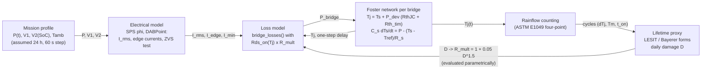

# Multiphysics: coupled electro-thermal-aging reduced-order model along a 24 h mission profile

**Maturity: L2 (simulation only).** The electrical and loss models are the project's own (`dabtools.dab.dab_model`,
`dabtools.dab.losses`, datasheet-typical device data with `verified=False`); the thermal network parameters are the
13_Thermal_Analysis values plus **estimated** capacitances; the mission profile is **assumed**; the lifetime laws are
**literature-typical functional forms for Si IGBT modules** used only to form ratios. **No absolute lifetime in years is
claimed anywhere in this module.**

```
python3 Advanced_Research_2026/Multiphysics_Models/electro_thermal_aging.py      # ~3 s, deterministic
```
Outputs in `results/`: `mission_profile.csv`, `thermal_traces_<variant>.csv`, `rainflow_<variant>.csv`, `lifetime_proxy.json`,
`lifetime_table.md`, `fig_mission.png`, `fig_tj_traces.png`, `fig_rainflow.png`, `fig_lifetime_ratio.png`, `fig_coupling_diagram.png`, `provenance.json`.

## 1. Coupling



Equations: SPS phase shift from `sps_phi_for_power`; per-device rms current `I_rms/sqrt(2)`; ZVS test per edge against
`zvs_current_min(Coss_er + C_par, V, L)`; `bridge_losses` (conduction with `rds_on(Tj)`, ZVS turn-off with k_zvs = 0.35,
hard-switching Eon + Eoff + Coss dump, dead-time diode). Thermal: junction and case lags (tau ~ 0.3 s) are quasi-static at the
60 s step, so `Tj = Ts + P_dev (RthJC + Rth_tim)`; the heatsink is one lumped node, integrated exactly over each step.

| parameter | value | source |
|---|---|---|
| RthJC HV / LV | 0.45 / 0.30 K/W | devices.py (datasheet typ., unverified) |
| Rth_tim | 0.35 K/W | design_values.json |
| R_s natural / forced air 3 m/s / cold plate | 1.0 / 0.22 / 0.05 K/W | 13_Thermal_Analysis (catalogue class) |
| C_s | 500 J/K (0.55 kg Al extrusion), 540 J/K (plate) | **estimate** |
| coolant reference | ambient (air); 35 C constant (liquid, chiller) | assumption |
| mission | night charge 50 %, morning discharge 80/40 %, midday charge 100/60 %, evening discharge 100/30 %, standby 10-20 %; 1-min +/-100 % pulses every 30 min 09-17 h; V2 = 300 + 150 SoC (40 kWh), V1 = 800 +/- 20 V, Tamb 25-45 C | **assumed** |
| LESIT form | N_f = A dTj^-5 exp(0.617 eV / kB Tm) | Held et al. 1997 class values (Si modules) |
| Bayerer form | N_f = K dTj^-4.416 exp(1285 K / Tj,min) t_on^-0.463 | Bayerer et al. 2008 exponents, I/V/D terms dropped |

## 2. Results (`results/lifetime_table.md`)

| variant | Tj HV max / mean (C) | Tj LV max / mean (C) | largest dTj cycle HV / LV (K) | mean loss (W) | hard-switched min/day | energy ratio | lifetime proxy ratio LESIT HV / LV | Bayerer HV / LV |
|---|---|---|---|---|---|---|---|---|
| natural convection | 94.5 / 53.0 | 64.0 / 45.8 | 67 / 35 | 24.3 | 581 | 1.000 | **0.01 / 0.10** | 0.06 / 0.23 |
| forced air 3 m/s (baseline) | 62.8 / 41.3 | 50.8 / 38.5 | 37 / 24 | 23.9 | 581 | 1.000 | 1 / 1 | 1 / 1 |
| liquid cold plate (35 C coolant) | 46.4 / 38.7 | 39.7 / 36.9 | 11 / 4 | 23.7 | 581 | 1.000 | **180 / 4500** | 130 / 5300 |
| forced air + power slew limit 50 W/s | 63.4 / 41.4 | 50.8 / 38.4 | 38 / 24 | 24.1 | 590 | 0.988 | 0.91 / 1.00 | 0.93 / 1.00 |
| forced air + fan control (heatsink held >= 55 C) | 62.9 / 45.6 | 56.7 / 42.8 | 35 / 29 | 24.1 | 581 | 1.000 | 0.91 / 0.39 | 1.06 / 0.68 |

Electro-thermal feedback: mean losses 23.9 W with Rds_on(Tj) against 23.3 W at a fixed 25 C (+2.9 %). Aging feedback
(+5 % Rds_on = end-of-life criterion): losses +1.6 %, daily damage proxy +0.4 to +0.6 % - the self-acceleration loop is
weak in this design because Tj - Tcase is only a few kelvin.

How to read this:

* **The ratios between cooling options are driven by the dTj exponent (4.4-5)**: forced air roughly halves the largest
  cycle compared with natural convection, which the power law turns into a factor 10-100; liquid cooling removes most of
  the cycling (dTj 11 / 4 K) and the proxies explode to 10^2-10^3. Such numbers only say "the thermal-cycling mechanism is
  not life-limiting with liquid cooling"; the two proxies disagree by 2-3x between themselves, which is the honest
  uncertainty of the functional form, before any device-specific coefficient is known.
* **The dominant stress is not full power but light-load hard switching**: 581 minutes per day are hard switched (10-20 %
  standby segments and the d > 1 corners when the battery is near 450 V, where the SPS schedule loses ZVS); the loss model
  then dumps the Coss energy (4 x 1/2 Coss V^2 fs ~ 40 W on the HV bridge), which produces the highest Tj of the day
  (HV 95 C with natural convection at 45 C ambient). The firmware's EPS matching (not modelled here, SPS only) reduces this,
  and it is the strongest argument for the adaptive ZVS control of the primary research contribution.
* **Both "cycling-aware" variants are negative results**: a 50 W/s reference slew limit does not change the cycles (the
  heatsink time constant of ~110 s already filters the 1-minute pulses; the ramps create more small cycles and deliver 1.2 %
  less energy); holding the heatsink warm with fan control removes some swing but raises the mean temperature, and the
  Arrhenius term wins on the LV bridge (0.4-0.7x). A cycling-aware strategy that would help this converter is one that
  **avoids the hard-switched light-load region** (modulation / burst mode / ZVS-aware operating point), not one that shapes
  the power slew.

## 3. Not verified / limits

* No measured thermal impedance, no device power-cycling data; Foster capacitances are estimates; one lumped heatsink node per bridge (no spreading, no per-device coupling).
* The mission profile is invented for illustration; results change with it.
* Loss model limits: SPS only (no EPS/TPS), k_zvs = 0.35 assumption, datasheet-typical device data `verified=False`, Coss-dump hard-switching term that the Active_Gate_Drive analysis flags as conservative.
* The lifetime laws are for Si IGBT modules; for discrete SiC TO-247 only the functional form is used and only ratios are reported; no years.
* Rainflow residue counted as half cycles; cycles below 0.05 K dropped.
