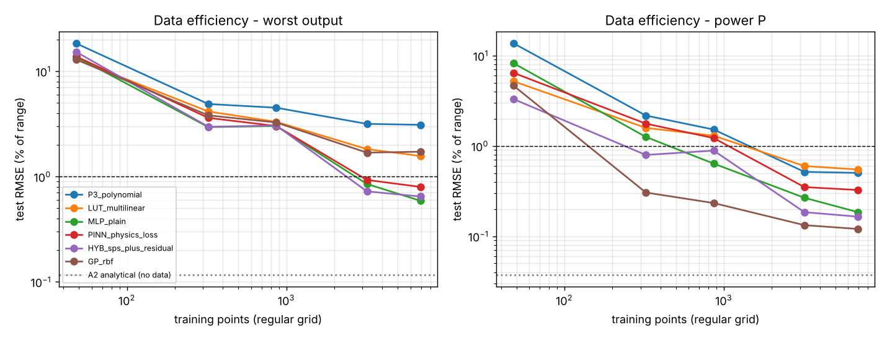
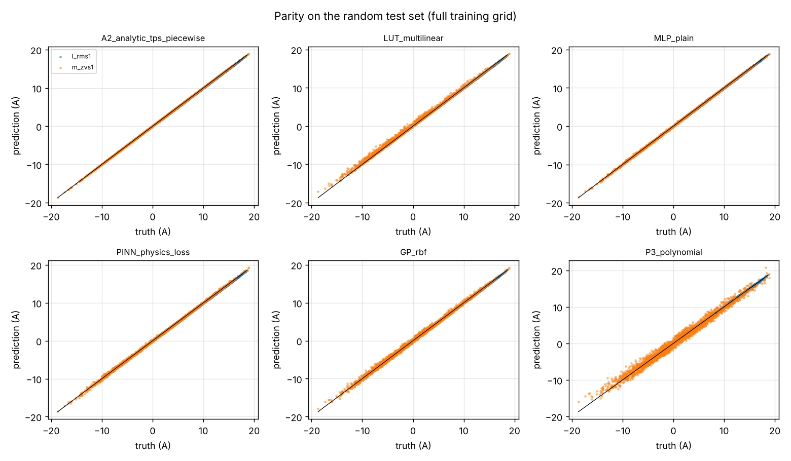
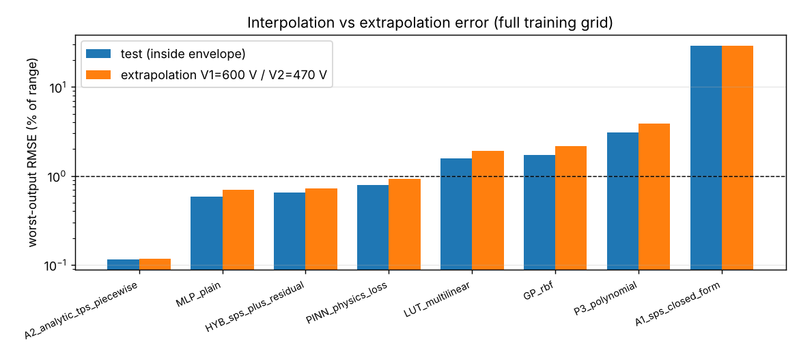

# Physics_Informed_Models - fair comparison of surrogate models for the DAB steady-state map

Maturity: **L2 (simulation-validated against the project's numerical waveform model; no hardware)**.
Script: `surrogate_comparison.py` (numpy / scipy / matplotlib only, own back-propagation, fixed seed
2026, 194 s on one core). Everything in `results/` and `provenance.json` is regenerated by it.

## Question

Which surrogate of the DAB steady-state map
`(V1, V2, phi, D1, D2) -> (P, I_rms1, I_peak1, m_zvs1, m_zvs2)` is best for this converter, judged on
accuracy inside the design envelope, accuracy outside it, training data needed, and inference cost?
Candidates: the analytical closed form (physics baseline), a plain MLP, a physics-informed MLP, a
hybrid "analytical + NN residual", Gaussian-process regression and a look-up table / polynomial.

## Ground truth and data

* Ground truth: `dabtools.dab.dab_model.DABPoint` (numerical three-level waveforms, N = 4000
  samples per period) with L = 64 uH, n = 2, fs = 100 kHz from `design_values.json`; the ZVS margins
  are `zvs_margin(port, I_min)` with the energy criterion
  I_min = sqrt(2 (C_oss,er V^2 + 0.5 C_par V^2) / L) (HV: C3M0032120K 170 pF, LV: C3M0016120K 350 pF
  referred, C_par = 60 pF) - this reproduces I_min = 2.00 / 3.07 A at 800 / 400 V as in
  `design_values.json`.
* Envelope: V1 650-850 V, V2 300-450 V, phi 2-60 deg, D1, D2 0.55-1.0 (forward power only).
* Training sets: nested regular grids (needed for the LUT, given identically to every model)
  with 48, 324, 864, 3200 and 6912 = 6 x 6 x 12 x 4 x 4 points.
* Test set: 2000 uniformly random points inside the envelope (`results/test_set_random.csv`).
* Extrapolation set: 400 points with V1 = 600 V (200) or V2 = 470 V (200), other inputs random
  (`results/extrapolation_set.csv`).
* Error metric: RMSE as % of the test-set range of each output (ranges: P 11.8 kW, I_rms 17.9 A,
  I_peak 22.8 A, margins 37.6 / 39.1 A); "1 % accuracy" = worst-output RMSE < 1 % of range.

## Models

| key | model | notes |
|---|---|---|
| A1 | SPS closed form (Kheraluwala 1992): P = V1 V2' phi (pi - |phi|) / (2 pi^2 fs L), piecewise-linear current with D1 = D2 = 1 assumed | the firmware feed-forward model; wrong by construction when D < 1 |
| A2 | exact piecewise-linear TPS solution: di/dtheta = (v1 - v2') / (omega L) integrated over the <= 8 edge-delimited segments, zero-mean condition, closed-form P, I_rms, I_peak and edge currents | the physics baseline extended to EPS / DPS / TPS (same mathematics as `03_Mathematical_Models`); no training data |
| P3 | cubic polynomial least squares, 56 monomials | |
| LUT | 5-D multilinear interpolation on the training grid (`RegularGridInterpolator`) | linear extrapolation outside |
| MLP | 5-32-32-5 tanh, Adam (lr 3e-3, cosine decay), minibatch 256, 1200 epochs, own numpy backprop | |
| PINN | same MLP + physics losses: (i) SPS-limit anchor - collocation points with D1 = D2 = 1 and voltages 560-940 / 270-480 V whose targets come from the closed form (also outside the training envelope); (ii) homogeneity y(kV1, kV2) = S_k y(V1, V2) with S = (k^2, k, k, k, k), i.e. P scales with V^2 and all currents / margins with V at fixed L, fs; (iii) consistency inequalities implied by P = mean(v1 i): |P| <= V1 sqrt(D1) I_rms (Cauchy-Schwarz) and I_peak >= I_rms, as squared hinges | the residual of P = mean(v1 i) itself cannot be formed without the waveform, so its consequences (i)-(iii) are imposed instead |
| HYB | analytical SPS (A1) + MLP residual | the network learns the D1, D2 effect on top of the closed form |
| GP | GP regression per output, ARD RBF + noise, hyper-parameters by maximum marginal likelihood (L-BFGS with analytic gradient, 40 iterations, one start) on a 200-point subset, prediction with <= 1500 training points | subset sizes chosen for the 15-minute budget |

Inference cost is counted as floating-point operations per evaluation (MACs x 2, tanh = 8):
A2 ~420 (sorting 8 edges, 8 segments), LUT ~460, P3 ~730, MLP 3200, GP 187 500 (1500 kernel rows x 5
outputs). The Python wall time per evaluation in `metrics.json` is not representative of an
embedded implementation (A2 and HYB are scalar Python loops there).

## Results (full training grid, 6912 points; `results/metrics_table.md`, `results/metrics.json`)

| model | worst-output RMSE (% range) | P RMSE (W) | I_peak RMSE (A) | max |P err| (W) | extrapolation worst RMSE (% range) | points for 1 % (all outputs) | ops / eval | train (s) |
|---|---|---|---|---|---|---|---|---|
| **A2 analytical TPS** | **0.116** | **4.4** | **0.006** | **13** | **0.116** | **0 (no data)** | 420 | 0 |
| MLP plain | 0.589 | 21.8 | 0.134 | 82 | 0.697 | 3200 | 3200 | 19 |
| HYB SPS + residual | 0.646 | 19.4 | 0.095 | 74 | 0.718 | 3200 | 3200 (+160) | 14 |
| PINN | 0.797 | 38.3 | 0.182 | 160 | 0.932 | 3200 | 3200 | 62 |
| LUT multilinear | 1.565 | 64.6 | 0.357 | 175 | 1.924 | not reached (6912) | 460 | 0 |
| GP (ARD RBF) | 1.720 | 14.2 | 0.393 | 61 | 2.155 | not reached | 187 500 | 6 |
| P3 polynomial | 3.097 | 59.2 | 0.707 | 223 | 3.853 | not reached | 730 | 0 |
| A1 SPS closed form | 29.07 | 1370 | 1.55 | 4070 | 29.06 | - | 160 | 0 |

Data efficiency (worst-output RMSE in % of range vs training points):

| model | 48 | 324 | 864 | 3200 | 6912 |
|---|---|---|---|---|---|
| LUT | 12.9 | 4.1 | 3.3 | 1.8 | 1.6 |
| MLP | 13.7 | 3.0 | 3.0 | 0.85 | 0.59 |
| PINN | 13.8 | 3.6 | 3.0 | 0.93 | 0.80 |
| HYB | 15.3 | 3.0 | 3.1 | 0.72 | 0.65 |
| GP | 12.9 | 3.8 | 3.3 | 1.7 | 1.7 |
| P3 | 18.4 | 4.9 | 4.5 | 3.2 | 3.1 |

For the power output alone the GP is the most data-efficient learner (0.3 % of range with 324
points, 0.12 % with 6912) and the HYB residual network reaches 1 % with 324 points; the ZVS margins
(a minimum over edges, non-smooth in phi, D1, D2) and the peak current (|i| maximum) are what every
learned model struggles with.

## Honest conclusion

**The analytical model wins, and it is not close.** The exact piecewise-linear solution (A2) is
5x more accurate than the best learned surrogate trained on 6912 points (0.12 % vs 0.59 % of range;
its residual is the discretisation error of the ground truth itself: 4 W on P, 0.1 A on the edge
currents at N = 4000), it needs no training data, it extrapolates with unchanged error, and it costs
about 420 operations - fewer than the MLP (3200) and three orders of magnitude fewer than the GP.
For this problem - a lossless piecewise-linear circuit whose map is known in closed form - a neural
or GP surrogate has no accuracy, cost or data advantage. The learned models become interesting
only when the map is *not* known analytically (dead-time, parasitic-capacitance and loss effects
measured on hardware, which this project does not have): then the ranking among the learners is
MLP ~ HYB > PINN > LUT ~ GP > polynomial at 3200-6912 points, and the hybrid residual form is the
sensible architecture because it keeps the closed form as backbone.

Specific negative results, reported as found:

* The physics-informed loss did **not** improve the plain MLP here (0.80 % vs 0.59 %), including
  outside the envelope (0.93 % vs 0.70 %): the SPS anchor only constrains the D1 = D2 = 1 slice, the
  homogeneity constraint is already satisfied by the data, and the hinge inequalities are inactive
  on a converged network; the extra terms cost 3x training time and slightly bias the fit. A PINN
  earns its place only when data are scarce in regions the physics covers - at 324 points the PINN is
  not better either (3.6 % vs 3.0 %).
* The SPS closed form used by the firmware feed-forward (A1) is 29 % of range off when D1 or D2 < 1 -
  the EPS/TPS modulator must use the A2 solution (or its tabulated inverse), not the SPS formula.
* The multilinear LUT needs more than 6912 grid points to reach 1 % on the peak current (1.6 % at
  6912); a LUT of the *inverse* map on a smaller grid plus A2 for the forward evaluation is the
  practical embedded choice (see `Embedded_AI/` when written).
* The GP's I_peak error (1.7 %) comes from the single ARD length-scale per input having to fit a
  kink; the hyper-parameter budget (200 points, 40 iterations) was limited for run time - with the
  earlier 400-point / 100-iteration setting (which took 15 minutes for one grid) the GP ranking did
  not change.

## Files

* `surrogate_comparison.py` - regenerates everything.
* `results/ground_truth_grid_6x6x12x4x4.csv`, `results/test_set_random.csv`,
  `results/extrapolation_set.csv` - the data (DABPoint N = 4000).
* `results/metrics.json`, `results/metrics_table.md` - all metrics, learning curves, GP hyper-parameters.
* `results/parity_*_test.csv` - truth vs prediction on the test set for every model.
* `results/fig_data_efficiency.png`, `results/fig_parity.png`, `results/fig_extrapolation.png`.
* `provenance.json` - Python / package versions, git commit, SHA-256 of the inputs, wall time.

## Not verified

* Ground truth is the project's lossless numerical model (no dead time, no R_s, no C_oss
  non-linearity, no magnetising current); the surrogates were never confronted with measured data,
  so nothing here says how any of them would fit a real converter.
* The "1 % accuracy" threshold is relative to the output *range*; a user needing 1 % of *reading*
  at light load will find all learned models insufficient (max |P| errors of 60-220 W).
* The operation counts are hand counts, not measured on the C2000; the GP count assumes 1500
  training points kept in memory.
* MLP / PINN hyper-parameters (2 x 32 tanh, 1200 epochs) were fixed by the brief, not tuned; a
  larger network trained longer narrows but does not close the gap to A2 on the non-smooth outputs.
* The GP hyper-parameter optimisation was budget-limited (see above).
