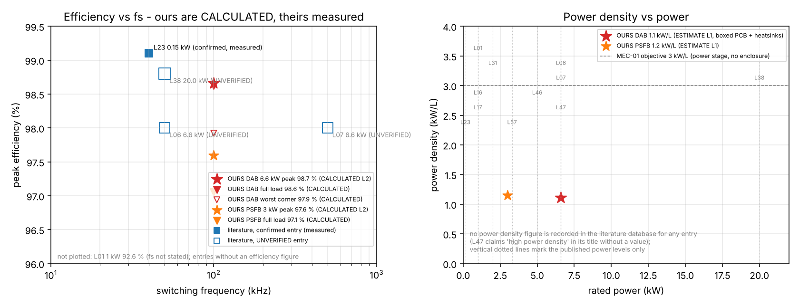

# Research_Benchmarks - this design against published 6.6 kW-class isolated bidirectional DC-DC work

Maturity: **L2 for the project numbers (calculated, simulation-backed), L1 for the power-density
estimates; the literature numbers are quoted, not reproduced.** Nothing here has been measured.

## Purpose

Place the 6.6 kW SiC DAB design (`SiC_6k6_Industrial_DAB/`) and the project's 3 kW PSFB baseline
(`hardware/`, `docs/`) next to the published work recorded in
`../Literature_Database/literature_2022_2026.csv` (57 entries, `evidence` column), with the
provenance of every number visible, and define how a fair measured comparison would be done
(`benchmark_methodology.md`).

## Method

`benchmark_table.py` (numpy / pandas / matplotlib):

1. Reads the literature database and marks an entry *confirmed* only if its `verification_status`
   **starts with** `confirmed`. `partially confirmed` and `not found` entries are *unverified*.
2. Selects the 12 entries that describe an isolated bidirectional DC-DC converter or design (device,
   gate-driver, estimation-only and review entries are excluded). The quantitative figures are
   transcribed from the database fields `power_rating`, `switching_freq`, `efficiency_reported`
   (reproduced verbatim in the CSV column `database_text`). For a confirmed entry they go into the
   main columns; for an unverified entry they go **only** into the `unverified numbers` column and
   are drawn as hollow markers.
3. Adds the project's two designs with calculated efficiencies: DAB from
   `04_Design_Calculations/design_values.json` (loss model, 800/400 V curve, nine envelope corners);
   PSFB from the `docs/02_design_calculations.md` loss budget (91.1 W at 3 kW) scaled with load as in
   `tools/psfb_design.py` (fixed 13.7 W, linear 15.9 W, quadratic 61.5 W). Power density is a boxed
   estimate (PCB outline x assumed height over heatsinks: 340 x 250 x 70 mm for the DAB, 260 x 200 x
   50 mm for the PSFB), no enclosure, no fans, no mechanical CAD - labelled L1.
4. Writes `results/benchmark_table.csv`, `results/benchmark_table.md`, `results/benchmark_summary.json`,
   `results/fig_benchmark.png` and `provenance.json` (versions, git commit, SHA-256 of the inputs).

## Result table (14 rows: 12 literature + 2 project designs)

Condensed view; the full table with devices, voltage ranges, control and validation level is in
`results/benchmark_table.md` / `.csv`.

| id | what | fs (kHz) | P (kW) | eta peak (%) | power density | status |
|---|---|---|---|---|---|---|
| L01 | DAB, hybrid phase-shift MPC (IEICE ELEX 2026) | n/s | 1.0 | 92.6 (measured) | n/r | confirmed |
| L16 | DAB TPS, MDCS-MPC (TPEL 2020) | 20 | 1.0 | n/s | n/r | confirmed |
| L17 | DAB TPS, MPC (IEEE Access 2021) | n/s | 1.0 | n/s | n/r | confirmed |
| L23 | DAB, integrated-leakage transformer (Sci. Rep. 2025) | 40 | 0.15 | 99.1 (measured) | n/r | confirmed - not comparable (150 W) |
| L31 | DAB family modelling (TIE 2025) | n/s | 2.0 | n/s | n/r | confirmed |
| L47 | GaN 6.6 kW OBC, PFC + DAB (Micromachines 2024) | n/s | 6.6 | n/s | n/r ("high power density" in the title, no value) | confirmed |
| L57 | GaN planar DAB OBC (ECCE Asia 2025) | 250 | 3.3 | n/s (PLECS only) | n/r | confirmed |
| L06 | reconfigurable SiC/GaN DAB (APEC 2025) | - | - | - | n/r | **unverified**: 50 kHz, 6.6 kW, 98 % peak (abstract snippet) |
| L07 | TI PMP21495 CLLC reference design | - | - | - | n/r | **unverified**: 500 kHz, 6.6 kW, 98 % peak (third-party page) |
| L25 | bare-die SiC planar DAB OBC (UMD) | - | - | - | n/r | **unverified**: 3.3 kW / 500 kHz not confirmed |
| L38 | 20 kW SiC DAB, rms-minimised TPS (TPEL 2025) | - | - | - | n/r | **unverified**: 50 kHz, 20 kW, 98.8 % (aggregator) |
| L46 | reconfigurable DAB, TPEL version of L06 | - | - | - | n/r | **unverified**: 5 kW, 97.8 % (ResearchGate) |
| OURS-DAB | SiC DAB 650-850 V / 300-450 V, 6.6 kW | 100 | 6.6 | **98.66 calculated, L2** (80 % load, 800/400 V); full load 98.62; worst corner 850/300 V 97.92 | 1.1 kW/L estimate, L1 | calculated, no hardware |
| OURS-PSFB | PSFB 400 V -> 48 V, 3 kW (unidirectional baseline) | 100 | 3.0 | **97.59 calculated, L2** (47 % load); full load 97.1 | 1.2 kW/L estimate, L1 | calculated, no hardware |

n/s = not stated in the accessible sources recorded in the database; n/r = not recorded.
Only **two** confirmed literature rows carry a peak-efficiency figure (L01 at 1 kW, L23 at 150 W) and
neither is in the 6.6 kW class; every 6.6 kW-class efficiency figure in the database (L06, L07) is
unverified. The benchmark is therefore mostly a statement of what *cannot* yet be compared.

Left: efficiency vs switching frequency - ours are stars/triangles labelled CALCULATED, confirmed
literature points are filled squares, unverified ones hollow. Right: power density vs power - no
literature entry has a recorded power-density value, so only the two project estimates and the
MEC-01 objective (3 kW/L) are plotted; dotted lines mark the published power levels.

## Why the comparison is unequal (explicit)

1. **Calculated vs measured.** Our efficiencies come from a loss model whose largest single item
   (PCB copper and bus bars, 26 W of 92 W) is an estimate and whose semiconductor parameters were
   entered from memory of the datasheets (`devices.py`, `verified=False`). A first prototype is
   expected to fall below the calculated value; published values are measured on built hardware.
2. **Different voltage ranges and ratios.** Our DAB covers 650-850 V / 300-450 V (d = 0.7 ... 1.4)
   bidirectionally; L06 claims 200-800 V input at 400 V output with a reconfigurable bridge; L07 is a
   400 V-class resonant CLLC; L01/L16/L17 are 1 kW laboratory prototypes at 300 V or below.
3. **Topology and frequency.** Phase-shift DAB at 100 kHz vs resonant CLLC at 500 kHz (L07) or
   reconfigurable bridges at 50 kHz (L06): different loss mechanisms, magnetics and ZVS ranges.
4. **Cooling and ambient.** Ours assumes forced air 3 m/s (DAB) or 2 m/s (PSFB) at 45-50 C
   ambient; the published cooling conditions are not recorded in the database.
5. **Auxiliary power.** Our DAB budget includes 12 W of fans/bias; published figures usually exclude
   gate drive and control supplies.
6. **Power density.** Ours are boxed estimates without enclosure; no published value is available
   in the database, and published values rarely state what the volume includes.
7. **Peak vs full load vs weighted.** Ours reports peak (80 % load), full load and the worst
   envelope corner; the literature values are "peak" with unstated load and voltage.

## Files

* `benchmark_table.py` - regenerates everything in `results/` and `provenance.json` (runs in ~2 s).
* `benchmark_methodology.md` - how a fair measured comparison would be done (test matrix,
  IEC 61683-style / CEC-weighted efficiency, instruments, uncertainty budget, power-density definition).
* `results/benchmark_table.csv|md`, `results/benchmark_summary.json`, `results/fig_benchmark.png`.

## Not verified

* None of the project numbers have been measured; no hardware, no HIL exists (L2 / L1 as marked).
* The literature figures were transcribed from the database (abstract snippets, repository pages,
  third-party pages); no full text was read for L06, L07, L38, L46, L25, and the database itself
  marks them as partially confirmed. Even the confirmed entries were confirmed at the
  title/venue/year level; the quoted figures come from abstracts.
* The PSFB part-load curve uses the fixed/linear/quadratic loss split of `tools/psfb_design.py`;
  the resulting 97.59 % peak at 47 % load is a model artefact of that split, not a measurement.
* The boxed-volume heights (70 mm DAB, 50 mm PSFB) are assumptions; no mechanical model exists.
* The IEC 61683 / CEC weighting values in the methodology are quoted from general knowledge of the
  standards and were not checked against the standard texts in this environment.
