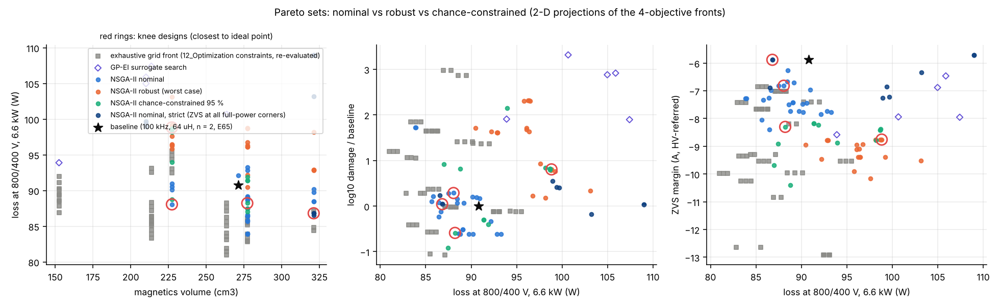
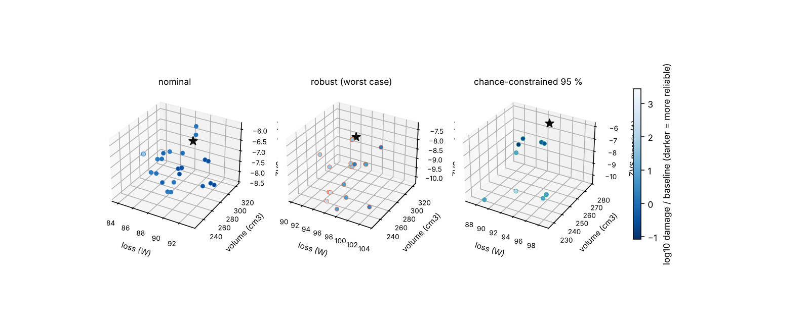
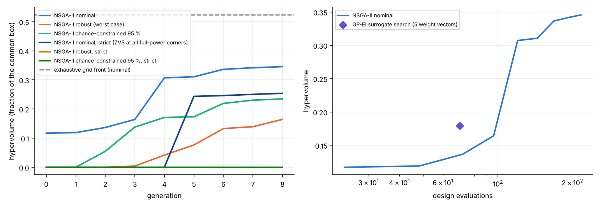
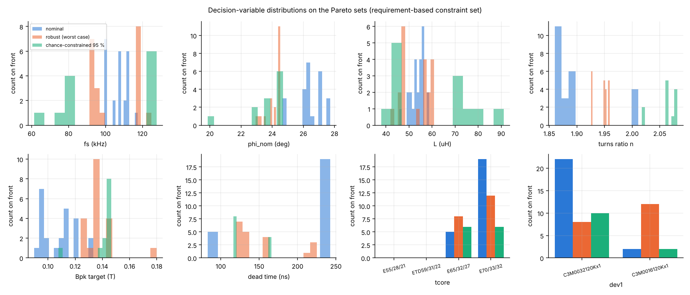
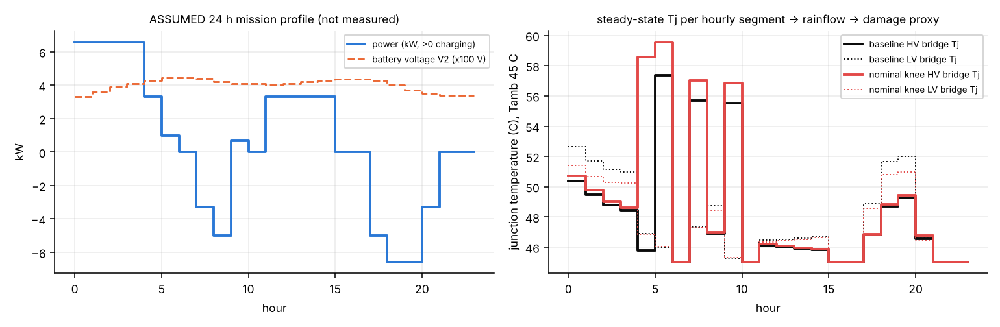

# Robust_Optimization - reliability-aware multi-objective DAB design under uncertainty

_Generated by `robust_optimize.py` (seed 20261010, NSGA-II population 24 x 8 generations per variant, 6 LHS uncertainty samples per design, 10006 design evaluations in 173 s). Maturity **L2** (analytical/simulation models, nothing measured)._

## 1. Problem

Design variables (9, mixed): switching frequency fs 60-200 kHz; nominal phase shift phi_nom 12-50 deg, which fixes the series inductance L = V1 n V2 phi (pi - phi) / (2 pi^2 fs P) at 800/400 V, 6.6 kW (L is reported); turns ratio n 1.6-2.4; transformer peak-flux target 0.08-0.20 T; transformer core {E55, ETD59, E65, E70}; inductor core {ETD44, ETD49, E55}; dead time 80-250 ns; HV device {C3M0032120K, C3M0016120K}; LV device {C3M0016120K x1, C3M0032120K x2}. Modulation is SPS (as in 12_Optimization); magnetics are designed at the nominal point with `dabtools.dab.magnetics.design_transformer/design_inductor`.

Objectives (all minimised, no weighted sum):

1. total converter loss at 800/400 V, 6.6 kW (W) - same budget as 04/12: bridges, gate drive, transformer, inductor, 12 W auxiliary, 0.4 % PCB/bus-bar;
2. magnetics volume (cm3) = 2.2 x (transformer + inductor core volume), as in 12_Optimization;
3. reliability proxy: log10 of the daily lifetime consumption D = sum n_i / Nf_i of the hotter bridge over the ASSUMED 24 h mission profile (rainflow count of the hourly steady-state Tj sequence, Coffin-Manson/Arrhenius law Nf = A dTj^alpha exp(Q/(R Tm)) with the LESIT coefficients A = 3.025e+05, alpha = -5.039, Q/R = 11897 K). **These coefficients are literature-typical values for Si IGBT modules (Held et al. 1997); they are not measured for discrete SiC TO-247 devices, so only the ratio between designs is meaningful** - the objective is reported as log10(D / D_baseline). For the record the absolute proxy for the baseline is 1.48e+13 years, i.e. thermal cycling is not life-limiting with the project heatsink (dTj < 15 K);
4. negative ZVS margin: -min over {nominal + 4 envelope corners} x {100 %, 50 % load} of (I_edge - I_min) at both bridges, A referred to the HV side (I_min from the energy criterion with Coss_er and the 60 pF winding capacitance of design_values.json).

Constraints (<= 0), following 00_Requirements/02_operating_envelope.md: full power reachable at all 9 (V1, V2) corners with phi <= 60 deg (requirement 1, firmware clamp); Tj <= 125 C at every full-power corner (13_Thermal_Analysis limit, heatsink 0.22 K/W + 0.35 K/W pad) **with hard-switching losses charged wherever the ZVS criterion fails** (requirement 2/3: a point without ZVS is allowed if the thermal budget holds); ZVS at both bridges at the nominal voltages 800/400 V at 100 % and 50 % load (EL-04a style); transformer Bpk at 850 V <= 0.2 T; transformer and inductor window fill <= 0.7; HV peak current <= 24 A (design_values I_limit_pk). ZVS over the envelope corners is objective 4 (maximised margin) and, in the three *strict* variants, an additional hard constraint (ZVS at both bridges at all five full-power points); the strict variants are reported because the task asked for corner ZVS as a constraint, and section 3.3 shows why it is incompatible with the 60 deg limit under inductance tolerance for SPS.

Uncertainty (assumed uniform, not measured): kL series inductance tolerance +/-15 % [0.85, 1.15]; kCoss Coss_er tolerance +/-20 % [0.8, 1.2]; kRds Rds_on aging +0..30 % [1, 1.3]; kCore ferrite core-loss tolerance +/-25 % [0.75, 1.25]; Tamb ambient 25..55 C [25, 55]. One Latin-hypercube set of 6 samples (common random numbers, `results/uncertainty_samples_LHS.csv`) is used for every design. **Robust** variant: every objective and constraint is the worst case over the samples. **Chance-constrained** variant: objectives are sample means, every constraint is enforced at its 95 % empirical quantile, so ZVS at the envelope corners holds with probability >= 95 % (at most 0 of 6 samples may fail).

Mission profile (`results/mission_profile_ASSUMED.csv`, figure below): ASSUMED EV-charger / battery-interface day, bidirectional (night charging 6.6 kW with battery voltage rising 330 -> 445 V, morning and evening vehicle-to-grid discharge up to 6.6 kW, midday PV charging 3.3 kW, standby hours with 12 W auxiliary loss). Segments are hourly, so each is evaluated at steady state (thermal time constants of TO-247 + heatsink are minutes).

## 2. Methods

* **Evaluator** (`dab_eval.py`): closed-form SPS waveform quantities (exact piecewise-linear rms), project loss model (`dabtools.dab.losses` re-implemented with Rds_on/Coss scaling, identical at scale 1), 5-step electro-thermal iteration, project magnetics design routines. Self-test against the numerical `DABPoint` model: rms/peak within 0.31 %, edge currents identical to `dab_model.sps_switching_currents`. Cross-check with the stored 12_Optimization baseline (phi = 28 deg -> 63.7 uH, no winding capacitance): stored 91.63 W, this evaluator 90.67 W; the project baseline with L = 64.0 uH gives 90.79 W. The 1 W difference has a cause worth recording: `DABPoint.switching_currents()` detects a third, wrap-around edge on bridge 1 (theta = 2 pi - d_theta) so 12_Optimization and 04 count three HV turn-off/dead-time events per period instead of two (HV switching 2.80 W and dead-time diode 0.87 W in design_values.json vs 1.88 W and 0.59 W here); the closed form uses two edges per bridge.
* **NSGA-II** (numpy): constrained non-dominated sorting (feasible beats infeasible, infeasible ranked by total violation), crowding distance, binary tournament, SBX (eta_c = 15, p_c = 0.9), polynomial mutation (eta_m = 20, p_m = 1/9). The reported Pareto set is the non-dominated subset of all feasible first-front members archived over the generations. Hypervolume is a Monte-Carlo estimate (1e5 fixed points) in a common box spanned by the union of all fronts.
* **Surrogate-assisted search**: Gaussian process (ARD squared-exponential kernel, hyperparameters by marginal likelihood, L-BFGS-B, two restarts) on an augmented-Tchebycheff scalarisation s = max_k w_k f~_k + 0.05 sum_k w_k f~_k of the box-normalised objectives, expected-improvement acquisition maximised over 4000 random + 300 local candidates; 5 weight vectors, 8 LHS initial + 6 iterations each. Infeasible designs get s = 2 + violation. This is a simplified single-objective BO per weight vector (ParEGO-like), not a hypervolume-based multi-objective BO; the weight vectors only steer the search, the result reported is the non-dominated set of all feasible evaluated points.
* **Exhaustive grid**: the 8640-point grid of 12_Optimization re-evaluated with this evaluator (Bpk target 0.13 T as there) for a like-for-like comparison.
* **Knee selection**: on each front, min-max normalise the four objectives over the front and take the point closest (Euclidean) to the ideal point; a second knee from the (loss, volume) projection (maximum distance from the chord between the extremes) is reported as a cross-check. Both are standard knee heuristics; neither is a tuned weighted-sum score.

## 3. Results

Variants: `nominal`, `robust`, `cc` use the requirement-based constraint set; `*_strict` add ZVS at every full-power corner as a hard constraint.

| variant | evaluations | non-dominated designs | hypervolume | loss range (W) | volume range (cm3) | ZVS-margin range (A) | log10 D/D_base range |
|---|---|---|---|---|---|---|---|
| NSGA-II nominal | 216 | 24 | 0.346 | 83.9 - 93.3 | 227 - 321 | -8.40 - -6.26 | -0.61 - +1.72 |
| NSGA-II robust (worst case) | 216 | 20 | 0.164 | 90.5 - 103.1 | 227 - 321 | -10.16 - -8.76 | +0.18 - +2.32 |
| NSGA-II chance-constrained 95 % | 216 | 12 | 0.235 | 87.0 - 98.7 | 227 - 277 | -10.40 - -8.18 | -0.92 - +2.15 |
| NSGA-II nominal, strict (ZVS at all full-power corners) | 216 | 9 | 0.254 | 86.5 - 109.0 | 210 - 321 | -7.26 - -5.71 | -0.18 - +0.55 |
| NSGA-II robust, strict | 216 | 0 | 0.000 | nan - nan | nan - nan | nan - nan | +nan - +nan |
| NSGA-II chance-constrained 95 %, strict | 216 | 0 | 0.000 | nan - nan | nan - nan | nan - nan | +nan - +nan |
| exhaustive grid (nominal, re-evaluated) | 8640 (1380 feasible) | 52 | 0.523 | 81.0 - 95.5 | 152 - 321 | -12.92 - -6.84 | -1.07 - +2.98 |
| GP-EI surrogate search (nominal) | 70 | 5 | 0.179 | 93.9 - 107.4 | 152 - 264 | -8.58 - -6.46 | +1.90 - +3.31 |

The robust and chance-constrained hypervolumes are computed in the same box but from worst-case / mean objectives, so they are not directly comparable to the nominal value; the comparison that matters is the shift of the fronts in the figures. NSGA-II nominal dominates 0 % of the grid's 4-D non-dominated designs and 20 % of the surrogate-search designs; at the surrogate budget (70 evaluations) NSGA-II nominal had hypervolume 0.137 vs 0.179 for the surrogate search. The grid front is evaluated under 12_Optimization's own constraint set (phi <= 60 deg, Tj, Bpk, fills; 1380 of 8640 feasible; 564 of them also pass this module's nominal set); only 0 grid designs satisfy the strict ZVS-at-every-full-power-corner + Ipk <= 24 A set, because the grid's phi_nom steps (20, 25, 30, 35 deg) straddle the narrow strict window (see 3.3) - its reported front designs (phi_nom 20 deg) hard-switch at the 650/450 V and 850/300 V full-power corners (allowed by the requirements if Tj holds, which it does with this heatsink).

### 3.1 Knee designs

| fs (kHz) | phi_nom (deg) | L (uH) | n | Bpk (T) | transformer | inductor | t_dead (ns) | HV device | LV device | loss (W) | volume (cm3) | log10 D/D_base | ZVS margin (A) |
|---|---|---|---|---|---|---|---|---|---|---|---|---|---|
| 113 | 26.2 | 53.8 | 2.01 | 0.113 | E65/32/27 | ETD49/25/16 | 233 | C3M0032120Kx1 | C3M0032120Kx2 | 88.1 | 227 | +0.29 | -6.82 | NSGA-II nominal, knee (ideal-point distance 0.64)
| 118 | 24.5 | 47.4 | 1.96 | 0.134 | E65/32/27 | ETD49/25/16 | 131 | C3M0032120Kx1 | C3M0032120Kx2 | 98.8 | 227 | +0.80 | -8.76 | NSGA-II robust (worst case), knee (ideal-point distance 0.72)
| 74 | 23.9 | 78.0 | 2.06 | 0.146 | E70/33/32 | ETD49/25/16 | 116 | C3M0032120Kx1 | C3M0016120Kx1 | 88.2 | 277 | -0.59 | -8.30 | NSGA-II chance-constrained 95 %, knee (ideal-point distance 1.01)
| 105 | 27.5 | 58.0 | 1.95 | 0.083 | E70/33/32 | E55/28/21 | 153 | C3M0032120Kx1 | C3M0016120Kx1 | 86.8 | 321 | +0.04 | -5.88 | NSGA-II nominal, strict (ZVS at all full-power corners), knee (ideal-point distance 1.05)
| 101 | 26.2 | 55.8 | 1.86 | 0.113 | E70/33/32 | E55/28/21 | 232 | C3M0032120Kx1 | C3M0016120Kx1 | 90.2 | 321 | -0.61 | -7.77 | NSGA-II nominal, 2-D (loss, volume) chord knee
| 91 | 24.4 | 60.9 | 1.95 | 0.134 | E70/33/32 | E55/28/21 | 225 | C3M0032120Kx1 | C3M0016120Kx1 | 98.2 | 321 | +0.18 | -8.77 | NSGA-II robust (worst case), 2-D (loss, volume) chord knee
| 128 | 24.7 | 46.4 | 2.06 | 0.146 | E65/32/27 | ETD49/25/16 | 116 | C3M0032120Kx1 | C3M0016120Kx1 | 98.7 | 227 | +0.80 | -8.39 | NSGA-II chance-constrained 95 %, 2-D (loss, volume) chord knee
| 105 | 28.0 | 59.0 | 1.95 | 0.175 | E70/33/32 | E55/28/21 | 153 | C3M0032120Kx1 | C3M0016120Kx1 | 109.0 | 321 | +0.04 | -5.71 | NSGA-II nominal, strict (ZVS at all full-power corners), 2-D (loss, volume) chord knee
| 100 | 28.2 | 64.0 | 2.00 | 0.130 | E65/32/27 | E55/28/21 | 150 | C3M0032120Kx1 | C3M0016120Kx1 | 90.8 | 271 | +0.00 | -5.88 | **baseline** (nominal evaluation)

Rationale: the knee is the design beyond which improving any one objective costs disproportionately in the others (closest point to the ideal in the normalised objective space). The nominal knee runs at 113 kHz with phi_nom 26.2 deg (L = 53.8 uH), n = 2.01, E65/32/27 / ETD49/25/16, dead time 233 ns, C3M0032120Kx1 / C3M0032120Kx2: 88.1 W (eta 98.68 %), 227 cm3, mission efficiency 98.29 % (1292 Wh/day), Tj max 58 C, dTj (HV/LV) 14.6/6.4 K, ZVS margin -6.82 A.

### 3.2 Baseline (100 kHz, 64 uH, n = 2, E65/E55, 150 ns, C3M0032120K / C3M0016120K) against the fronts

| variant | baseline objectives (loss W, volume cm3, log10 D/D_base, ZVS margin A) | feasible under variant | front designs dominating it | normalised distance to front | loss reduction available (W) | volume reduction available (cm3) | ZVS-margin gain available (A) |
|---|---|---|---|---|---|---|---|
| nominal | 90.8, 271, +0.00, -5.88 | yes | 0 of 24 | 0.428 | 0.0 | 0 | -0.00 |
| robust (worst case) | 97.5, 271, +0.40, -7.35 | no | 0 of 20 | 1.028 | 0.0 | 0 | -0.00 |
| chance-constrained 95 % | 93.4, 271, -0.32, -6.01 | no | 0 of 12 | 0.997 | 0.0 | 0 | -0.00 |
| nominal, strict (ZVS at all full-power corners) | 90.8, 271, +0.00, -5.88 | yes | 0 of 9 | 0.486 | 0.0 | 0 | -0.00 |
| robust, strict | 97.5, 271, +0.40, -7.35 | no | 0 of 0 | nan | 0.0 | 0 | -0.00 |
| chance-constrained 95 %, strict | 93.4, 271, -0.32, -6.01 | no | 0 of 0 | nan | 0.0 | 0 | -0.00 |
The baseline is **non-dominated** in the nominal problem: no design of the front is at least as good in all four objectives, so it is Pareto-optimal within this model. It is not near-Pareto-optimal in this model. Under the robust and chance-constrained variants the baseline is NOT feasible (worst-case constraint violated) / NOT feasible respectively; its ZVS-at-corners probability over the LHS set is 1.00 (see also `results/knee_and_baseline.json`).

### 3.3 Effect of the uncertainty treatment

* 1 of the 24 nominal-front designs remain feasible under the robust (worst case) constraints.
* 1 of the 24 nominal-front designs remain feasible under the chance-constrained 95 % constraints.
* 19 of the 24 nominal-front designs remain feasible under the nominal, strict (ZVS at all full-power corners) constraints.
* 0 of the 24 nominal-front designs remain feasible under the robust, strict constraints.
* 0 of the 24 nominal-front designs remain feasible under the chance-constrained 95 %, strict constraints.
* nominal front: ZVS-at-corners probability over the LHS set is min 1.00, mean 1.00; 100 % of its designs reach >= 95 %.
* robust (worst case) front: ZVS-at-corners probability over the LHS set is min 1.00, mean 1.00; 100 % of its designs reach >= 95 %.
* chance-constrained 95 % front: ZVS-at-corners probability over the LHS set is min 1.00, mean 1.00; 100 % of its designs reach >= 95 %.
* nominal, strict (ZVS at all full-power corners) front: ZVS-at-corners probability over the LHS set is min 0.50, mean 0.63; 0 % of its designs reach >= 95 %.
* **No feasible design was found by the robust, strict variant** (216 evaluations); least-violating final design: constraints [0.014, -0.532, -0.318, -0.138, -0.217, -0.505, -0.155] (order ['phi_corner', 'Tj', 'zvs_full', 'Bpk_850V', 'fill_xf', 'fill_ind', 'Ipk']).
* **No feasible design was found by the chance-constrained 95 %, strict variant** (216 evaluations); least-violating final design: constraints [-0.16, -0.535, -0.004, -0.23, 0.009, -0.634, -0.122] (order ['phi_corner', 'Tj', 'zvs_full', 'Bpk_850V', 'fill_xf', 'fill_ind', 'Ipk']).
* Shift of the fronts (minimum loss / maximum ZVS margin / best log10 D on each front): nominal 83.9 W / -6.26 A / -0.61; robust (worst case) 90.5 W / -8.76 A / +0.18; chance-constrained 95 % 87.0 W / -8.18 A / -0.92; nominal, strict (ZVS at all full-power corners) 86.5 W / -5.71 A / -0.18. Worst-case objectives include +30 % Rds_on, +25 % core loss and 55 C ambient simultaneously, so a robust front sits above the nominal one in loss by construction; the chance-constrained objectives are sample means and sit close to the nominal values, the difference is in which designs are admitted.
* Why the strict worst case is (nearly) empty - closed form: with SPS at full power the HV bridge keeps ZVS at the 650/450 V corner only if phi > pi (V2' - V1) / (2 V2') (I0 > 0) and the LV bridge at 850/300 V only if phi > pi (V1 - V2') / (2 V1) (I1 > 0); for n = 2 these are 25.0 deg and 26.5 deg. Because P = V1 V2' phi (pi - phi) / (2 pi^2 fs L), the same K = 2 pi^2 fs L P that gives phi >= 26.5 deg at 850/300 V (V1 V2' = 510 kV^2) gives phi = 57 deg at 650/300 V (390 kV^2). A +15 % inductance pushes the 650/300 V corner to 85 deg (> 60 deg limit of 00_Requirements / firmware clamp) while a -15 % inductance pulls the 850/300 V corner below the ZVS boundary: the two requirements can only be met simultaneously for a +/-1.5 % inductance band (n = 1.95 widens it to about 5 %, still far below the assumed +/-15 % tolerance). The nominal strict window for n = 2 is phi_nom = 26.5-28.5 deg - the baseline (28.2 deg) sits inside it, which also explains why only 0 of the 8640 grid designs (phi_nom 20/25/30/35 deg) satisfy the strict constraint set. Consequence: with SPS, ZVS at the voltage-mismatch corners at full power cannot be *guaranteed* under a +/-15 % inductance tolerance; the requirement document already allows hard-switched operation where the thermal budget holds, which is what the main variants enforce (Tj with hard-switching losses) while the corner margin is maximised as an objective. EPS/TPS modulation (11_Control_Algorithms) is the known remedy and is outside this SPS study.

### 3.4 Decision-variable patterns on the fronts

* nominal: fs 99-117 kHz (median 108), phi_nom 25-28 deg, n 1.86-2.01 (median 1.88), Bpk 0.090-0.133 T, t_dead 83-243 ns; transformer cores {'E55/28/21': 0, 'ETD59/31/22': 0, 'E65/32/27': 5, 'E70/33/32': 19}; HV device {'C3M0032120Kx1': 22, 'C3M0016120Kx1': 2}.
* robust (worst case): fs 91-125 kHz (median 97), phi_nom 23-25 deg, n 1.93-1.96 (median 1.95), Bpk 0.124-0.180 T, t_dead 119-225 ns; transformer cores {'E55/28/21': 0, 'ETD59/31/22': 0, 'E65/32/27': 8, 'E70/33/32': 12}; HV device {'C3M0032120Kx1': 8, 'C3M0016120Kx1': 12}.
* chance-constrained 95 %: fs 61-128 kHz (median 105), phi_nom 20-25 deg, n 2.02-2.08 (median 2.06), Bpk 0.108-0.146 T, t_dead 116-166 ns; transformer cores {'E55/28/21': 0, 'ETD59/31/22': 0, 'E65/32/27': 6, 'E70/33/32': 6}; HV device {'C3M0032120Kx1': 10, 'C3M0016120Kx1': 2}.
* nominal, strict (ZVS at all full-power corners): fs 96-129 kHz (median 105), phi_nom 25-28 deg, n 1.93-1.95 (median 1.95), Bpk 0.082-0.182 T, t_dead 137-249 ns; transformer cores {'E55/28/21': 0, 'ETD59/31/22': 3, 'E65/32/27': 0, 'E70/33/32': 6}; HV device {'C3M0032120Kx1': 9, 'C3M0016120Kx1': 0}.

Full fronts: `results/pareto_fronts.csv` (NSGA-II, three variants), `results/grid_front_reevaluated.csv`, `results/bo_front.csv`; hypervolume history and BO traces: `results/convergence.json`.

## 4. Maturity and what was NOT verified

Maturity **L2**: every number comes from the analytical/semi-numerical project models (SPS closed form, datasheet-typical device parameters flagged `verified=False`, Steinmetz/Dowell magnetics, one-node thermal network). Not verified:

* no hardware, no measured losses, temperatures, ZVS transitions or inductance/capacitance tolerances - the uncertainty ranges are assumptions;
* the lifetime law and its coefficients (LESIT, Si IGBT modules) are not calibrated for discrete SiC TO-247 devices; the proxy ranks designs, it does not predict a lifetime;
* the mission profile is invented (labelled ASSUMED); a different profile changes the reliability ranking and the mission efficiency;
* the mission thermal model is quasi-static (hourly steady state), so sub-hour power cycling and the resulting small-amplitude Tj cycles are not counted;
* SPS modulation only - EPS/TPS would change the ZVS margins at the voltage-mismatch corners (see 11_Control_Algorithms);
* the hypervolume is a Monte-Carlo estimate (1e5 points); NSGA-II is stochastic - a single seed per variant is reported (deterministic, but no multi-seed statistics);
* the chance constraint uses an empirical quantile over 24 LHS samples (resolution 1/24), not an analytical probability;
* the surrogate search is a simplified single-objective BO per weight vector; its lower hypervolume at equal budget is a result of this run, not a general statement about BO.

## 5. Files

`dab_eval.py` (shared evaluator, also used by `../Uncertainty_Quantification/`), `robust_optimize.py` (this run), `results/` (CSV, JSON, PNG), `provenance.json`.
