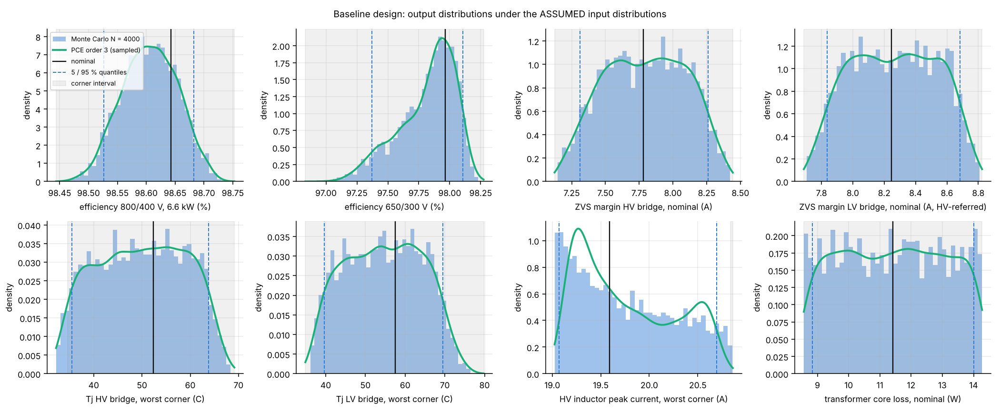
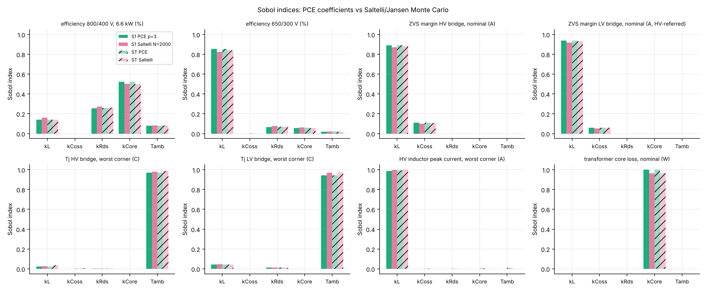
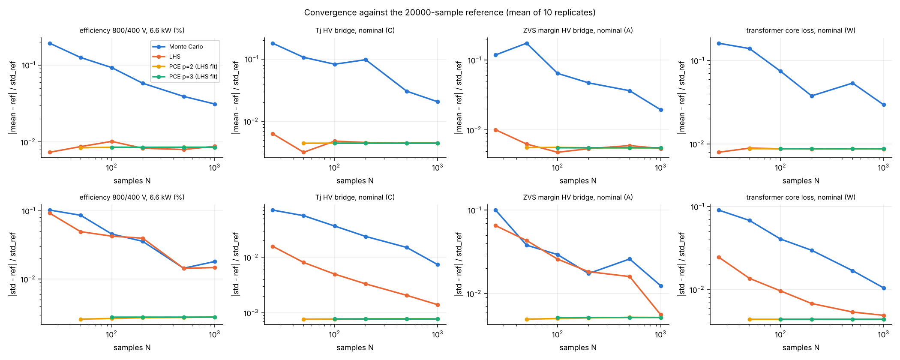
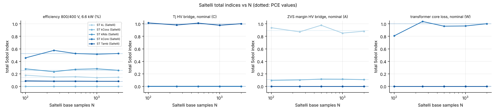

# Uncertainty_Quantification - propagation of parameter uncertainty through the baseline DAB design

_Generated by `uq_baseline.py` (seed 20261010, 107683 model evaluations in 27 s). Maturity **L2**._

## 1. Problem

Baseline design: 100 kHz, L = 64 uH, n = 2, E65/32/27 transformer (28:14, Bpk 0.13 T), E55 series inductor, dead time 150 ns, C3M0032120K HV bridge, C3M0016120K LV bridge, forced-air heatsink 0.22 K/W + 0.35 K/W pad. Model: shared evaluator `../Robust_Optimization/dab_eval.py` (closed-form SPS waveforms, project loss/thermal/magnetics models, hard-switching losses charged where the ZVS energy criterion fails).

Uncertain inputs - **assumed distributions, not measured**:

| input | meaning | primary assumption | alternative assumption (section 3.6) |
|---|---|---|---|
| kL | series inductance tolerance +/-15 % | U(0.85, 1.15) | N(1, 0.075) truncated at 3 sigma |
| kCoss | Coss_er tolerance +/-20 % | U(0.8, 1.2) | N(1, 0.1) truncated at 3 sigma |
| kRds | Rds_on aging +0..30 % | U(1, 1.3) | same |
| kCore | ferrite core-loss tolerance +/-25 % | U(0.75, 1.25) | same |
| Tamb | ambient 25..55 C | U(25, 55) | same |

Quantities of interest (15): efficiency at 800/400 V and at the four envelope corners (650/300, 650/450, 850/300, 850/450 V) at 6.6 kW; ZVS margin (I_edge - I_min, A, HV-referred) of both bridges at nominal and the minimum over the five points; Tj of both bridges at nominal and the maximum over the five points; HV inductor peak current at nominal and its maximum; transformer core loss at nominal.

## 2. Methods

* **Monte Carlo**: N = 4000 pseudo-random samples (numpy PCG64); a 20000-sample run is the reference for the convergence study.
* **Latin hypercube**: N = 200 and 500 (one point per stratum per dimension, random pairing); 10 replicates per N in the convergence study.
* **Polynomial chaos (non-intrusive, least squares)**: Y(xi) = sum_a c_a Psi_a(xi) with Psi_a = prod_j phi_{a_j}(xi_j), phi_n orthonormal Legendre on U(-1,1) (uniform inputs) or orthonormal probabilists' Hermite on N(0,1) (normal inputs); total degree p <= 3 (56 terms for p = 3, 21 for p = 2); coefficients from an LHS design of 500 points by `numpy.linalg.lstsq`; validation R^2 on the independent 4000 MC samples. Moments and Sobol indices follow from orthonormality: mean = c_0, Var = sum_{a != 0} c_a^2, S_i = sum over indices with only a_i > 0 of c_a^2 / Var, ST_i = sum over indices with a_i > 0 of c_a^2 / Var.
* **Saltelli / Jansen**: matrices A, B and A_B^(i) with N = 2000 base samples (14000 runs); S_i = mean[f_B (f_AB - f_A)]/Var (Saltelli 2010), ST_i = mean[(f_A - f_AB)^2]/(2 Var) (Jansen 1999).
* **Interval / corner analysis**: all 2^5 = 32 vertices of the input box plus the nominal point; the min/max per QoI is compared with the MC extremes (a QoI that is monotonic in every input attains its extremes at vertices).

## 3. Results

### 3.1 Statistics (primary, uniform inputs)

| QoI | nominal | MC mean (N=4000) | MC std | 5 % | 95 % | LHS-200 mean / std | LHS-500 mean / std | PCE p=3 mean / std | PCE R^2 | corner min / max | MC min / max (N=20000) |
|---|---|---|---|---|---|---|---|---|---|---|---|
| efficiency 800/400 V, 6.6 kW (%) | 98.643 | 98.606 | 0.048 | 98.527 | 98.682 | 98.608 / 0.048 | 98.608 / 0.045 | 98.608 / 0.047 | 1.000 | 98.444 / 98.753 | 98.463 / 98.743 |
| efficiency 650/300 V (%) | 97.963 | 97.816 | 0.229 | 97.370 | 98.107 | 97.827 / 0.219 | 97.826 / 0.220 | 97.825 / 0.224 | 0.996 | 96.833 / 98.274 | 96.935 / 98.250 |
| efficiency 650/450 V (%) | 98.202 | 98.066 | 0.173 | 97.736 | 98.278 | 98.062 / 0.181 | 98.064 / 0.177 | 98.065 / 0.168 | 0.896 | 97.516 / 98.387 | 97.577 / 98.374 |
| efficiency 850/300 V (%) | 97.973 | 97.898 | 0.101 | 97.729 | 98.060 | 97.899 / 0.105 | 97.899 / 0.099 | 97.899 / 0.101 | 1.000 | 97.548 / 98.167 | 97.580 / 98.163 |
| efficiency 850/450 V (%) | 98.687 | 98.657 | 0.046 | 98.581 | 98.733 | 98.658 / 0.047 | 98.658 / 0.044 | 98.658 / 0.046 | 1.000 | 98.522 / 98.785 | 98.537 / 98.778 |
| ZVS margin HV bridge, nominal (A) | 7.781 | 7.795 | 0.299 | 7.312 | 8.261 | 7.786 / 0.303 | 7.786 / 0.298 | 7.786 / 0.298 | 1.000 | 7.123 / 8.444 | 7.131 / 8.441 |
| ZVS margin LV bridge, nominal (A, HV-referred) | 8.248 | 8.262 | 0.271 | 7.835 | 8.683 | 8.253 / 0.273 | 8.253 / 0.269 | 8.253 / 0.269 | 1.000 | 7.687 / 8.824 | 7.694 / 8.822 |
| min ZVS margin over corners (A) | 0.918 | 0.894 | 1.229 | -1.125 | 2.681 | 0.856 / 1.228 | 0.856 / 1.222 | 0.856 / 1.221 | 1.000 | -1.544 / 2.985 | -1.533 / 2.982 |
| Tj HV bridge, nominal (C) | 48.612 | 44.057 | 8.717 | 30.175 | 57.615 | 43.940 / 8.801 | 43.941 / 8.781 | 43.942 / 8.780 | 1.000 | 28.243 / 59.771 | 28.346 / 59.679 |
| Tj LV bridge, nominal (C) | 51.053 | 46.790 | 8.851 | 32.700 | 60.477 | 46.663 / 8.925 | 46.665 / 8.902 | 46.665 / 8.908 | 1.000 | 30.349 / 63.243 | 30.510 / 63.080 |
| Tj HV bridge, worst corner (C) | 52.342 | 49.856 | 9.043 | 35.435 | 63.757 | 49.766 / 9.111 | 49.727 / 9.131 | 49.720 / 9.071 | 0.988 | 34.619 / 69.140 | 31.667 / 68.698 |
| Tj LV bridge, worst corner (C) | 57.515 | 54.695 | 9.505 | 39.607 | 69.505 | 54.470 / 9.537 | 54.475 / 9.426 | 54.487 / 9.506 | 1.000 | 34.854 / 79.763 | 35.446 / 78.809 |
| HV inductor peak current, nominal (A) | 9.781 | 9.795 | 0.196 | 9.500 | 10.106 | 9.789 / 0.194 | 9.789 / 0.194 | 9.789 / 0.194 | 1.000 | 9.470 / 10.143 | 9.470 / 10.143 |
| HV inductor peak current, worst corner (A) | 19.589 | 19.757 | 0.525 | 19.071 | 20.692 | 19.768 / 0.525 | 19.768 / 0.523 | 19.774 / 0.498 | 0.888 | 20.839 / 20.861 | 19.023 / 20.861 |
| transformer core loss, nominal (W) | 11.418 | 11.420 | 1.656 | 8.837 | 14.010 | 11.418 / 1.653 | 11.418 / 1.650 | 11.418 / 1.648 | 1.000 | 8.564 / 14.273 | 8.564 / 14.272 |

The corner interval contains the full 20000-sample MC range for 13 of 15 QoIs; the exceptions (Tj1_max_C, Ipk_max_A) are not monotonic in every input (the ZVS/hard-switching transition or the Tj-Rds feedback), so a pure corner analysis under-estimates their range.

### 3.2 Sobol indices (PCE coefficients vs Saltelli/Jansen)

| QoI | S1 kL (PCE / Saltelli) | S1 kCoss (PCE / Saltelli) | S1 kRds (PCE / Saltelli) | S1 kCore (PCE / Saltelli) | S1 Tamb (PCE / Saltelli) | ST kL (PCE / Saltelli) | ST kCoss (PCE / Saltelli) | ST kRds (PCE / Saltelli) | ST kCore (PCE / Saltelli) | ST Tamb (PCE / Saltelli) |
|---|---|---|---|---|---|---|---|---|---|---|
| efficiency 800/400 V, 6.6 kW (%) | 0.14 / 0.16 | 0.00 / 0.00 | 0.26 / 0.27 | 0.52 / 0.50 | 0.08 / 0.08 | 0.14 / 0.14 | 0.00 / 0.00 | 0.26 / 0.26 | 0.52 / 0.50 | 0.08 / 0.08 |
| efficiency 650/300 V (%) | 0.85 / 0.83 | 0.00 / 0.00 | 0.07 / 0.07 | 0.06 / 0.06 | 0.02 / 0.02 | 0.86 / 0.84 | 0.00 / 0.00 | 0.07 / 0.07 | 0.06 / 0.06 | 0.02 / 0.02 |
| efficiency 650/450 V (%) | 0.76 / 0.76 | 0.01 / 0.00 | 0.06 / 0.05 | 0.15 / 0.10 | 0.02 / 0.01 | 0.77 / 0.81 | 0.01 / 0.03 | 0.06 / 0.04 | 0.15 / 0.13 | 0.02 / 0.01 |
| efficiency 850/300 V (%) | 0.08 / 0.07 | 0.00 / 0.00 | 0.18 / 0.20 | 0.69 / 0.65 | 0.05 / 0.06 | 0.08 / 0.08 | 0.00 / 0.00 | 0.18 / 0.19 | 0.69 / 0.67 | 0.05 / 0.06 |
| efficiency 850/450 V (%) | 0.02 / 0.03 | 0.00 / 0.00 | 0.18 / 0.19 | 0.75 / 0.72 | 0.05 / 0.06 | 0.02 / 0.02 | 0.00 / 0.00 | 0.18 / 0.18 | 0.75 / 0.72 | 0.05 / 0.06 |
| ZVS margin HV bridge, nominal (A) | 0.89 / 0.87 | 0.11 / 0.10 | 0.00 / 0.00 | 0.00 / 0.00 | 0.00 / 0.00 | 0.89 / 0.88 | 0.11 / 0.11 | 0.00 / 0.00 | 0.00 / 0.00 | 0.00 / 0.00 |
| ZVS margin LV bridge, nominal (A, HV-referred) | 0.94 / 0.92 | 0.06 / 0.05 | 0.00 / 0.00 | 0.00 / 0.00 | 0.00 / 0.00 | 0.94 / 0.93 | 0.06 / 0.06 | 0.00 / 0.00 | 0.00 / 0.00 | 0.00 / 0.00 |
| min ZVS margin over corners (A) | 1.00 / 0.98 | 0.00 / 0.00 | 0.00 / 0.00 | 0.00 / 0.00 | 0.00 / 0.00 | 1.00 / 0.99 | 0.00 / 0.00 | 0.00 / 0.00 | 0.00 / 0.00 | 0.00 / 0.00 |
| Tj HV bridge, nominal (C) | 0.00 / 0.00 | 0.00 / 0.00 | 0.00 / 0.00 | 0.00 / 0.00 | 1.00 / 1.02 | 0.00 / 0.00 | 0.00 / 0.00 | 0.00 / 0.00 | 0.00 / 0.00 | 1.00 / 1.03 |
| Tj LV bridge, nominal (C) | 0.00 / 0.00 | 0.00 / 0.00 | 0.00 / 0.00 | 0.00 / 0.00 | 1.00 / 1.02 | 0.00 / 0.00 | 0.00 / 0.00 | 0.00 / 0.00 | 0.00 / 0.00 | 1.00 / 1.02 |
| Tj HV bridge, worst corner (C) | 0.02 / 0.03 | 0.00 / 0.00 | 0.00 / 0.00 | 0.00 / 0.00 | 0.97 / 0.98 | 0.02 / 0.04 | 0.00 / 0.01 | 0.00 / 0.00 | 0.00 / 0.00 | 0.97 / 0.99 |
| Tj LV bridge, worst corner (C) | 0.04 / 0.05 | 0.00 / 0.00 | 0.01 / 0.01 | 0.00 / 0.00 | 0.94 / 0.97 | 0.05 / 0.04 | 0.00 / 0.00 | 0.01 / 0.01 | 0.00 / 0.00 | 0.94 / 0.97 |
| HV inductor peak current, nominal (A) | 1.00 / 0.98 | 0.00 / 0.00 | 0.00 / 0.00 | 0.00 / 0.00 | 0.00 / 0.00 | 1.00 / 0.99 | 0.00 / 0.00 | 0.00 / 0.00 | 0.00 / 0.00 | 0.00 / 0.00 |
| HV inductor peak current, worst corner (A) | 0.99 / 1.00 | 0.00 / 0.00 | 0.00 / 0.00 | 0.00 / 0.00 | 0.00 / 0.00 | 0.99 / 1.00 | 0.00 / 0.00 | 0.00 / 0.00 | 0.01 / 0.00 | 0.01 / 0.00 |
| transformer core loss, nominal (W) | 0.00 / 0.00 | 0.00 / 0.00 | 0.00 / 0.00 | 1.00 / 0.96 | 0.00 / 0.00 | 0.00 / 0.00 | 0.00 / 0.00 | 0.00 / 0.00 | 1.00 / 0.97 | 0.00 / 0.00 |

Ranking by total index (PCE): **eta_nom_pct**: kCore > kRds > kL; **zvs1_nom_A**: kL > kCoss > kCore; **zvs2_nom_A**: kL > kCoss > kCore; **Tj1_max_C**: Tamb > kL > kRds; **Ipk_max_A**: kL > Tamb > kCore; **P_core_xf_nom_W**: kCore > kCoss > kRds.
 Largest PCE-vs-Saltelli deviation of a total index: 0.04 (QoI eta_650_450_pct). Interaction content: the largest ST - S1 (PCE) is 0.01 (eta_650_450_pct), i.e. the model is close to additive in these inputs over the box, which is also why PCE order 2 already captures most of the variance.

### 3.3 PCE accuracy by order

| order | terms | LS condition number | R^2 min | R^2 median | worst QoI |
|---|---|---|---|---|---|
| 1 | 6 | 1.1 | 0.6120 | 0.9984 | Ipk_max_A |
| 2 | 21 | 1.5 | 0.8206 | 1.0000 | Ipk_max_A |
| 3 | 56 | 2.2 | 0.8882 | 1.0000 | Ipk_max_A |

### 3.4 Convergence (MC vs LHS vs PCE)

Error of the mean and of the standard deviation, normalised by the reference standard deviation, averaged over replicates. LHS reduces the error of the mean by roughly an order of magnitude for the smooth QoIs (efficiency, core loss, Tj) at equal N; PCE fitted on the same LHS points reaches the reference statistics with N = 100-200 where plain MC still needs thousands. For the ZVS margin (piecewise behaviour at the hard-switching boundary is absent at nominal, so it is smooth too) the picture is the same. The floor of about 0.005-0.01 reached by LHS and PCE is the standard error of the 20000-sample reference itself (1/sqrt(20000) = 0.0071 for the mean), not a limitation of the methods.

| N | MC mean err efficiency 800/400 V, 6.6 kW | MC mean err Tj HV bridge, nominal | LHS mean err efficiency 800/400 V, 6.6 kW | LHS mean err Tj HV bridge, nominal | PCE2 mean err efficiency 800/400 V, 6.6 kW | PCE2 mean err Tj HV bridge, nominal | PCE3 mean err efficiency 800/400 V, 6.6 kW | PCE3 mean err Tj HV bridge, nominal |
|---|---|---|---|---|---|---|---|---|
| 25 | 0.1919 | 0.1792 | 0.0074 | 0.0063 | n/a | n/a | n/a | n/a |
| 50 | 0.1251 | 0.1064 | 0.0087 | 0.0032 | 0.0084 | 0.0045 | n/a | n/a |
| 100 | 0.0926 | 0.0824 | 0.0102 | 0.0048 | 0.0086 | 0.0045 | 0.0086 | 0.0045 |
| 200 | 0.0580 | 0.0974 | 0.0083 | 0.0046 | 0.0085 | 0.0045 | 0.0086 | 0.0045 |
| 500 | 0.0391 | 0.0305 | 0.0080 | 0.0045 | 0.0086 | 0.0045 | 0.0086 | 0.0045 |
| 1000 | 0.0312 | 0.0206 | 0.0088 | 0.0045 | 0.0086 | 0.0045 | 0.0086 | 0.0045 |

### 3.5 Interval / worst-case corner analysis

Worst corners (of 32): efficiency at nominal 98.44 % (kRds = 1.3, kCore = 1.25, Tamb = 55 C) vs 98.75 % best; HV Tj worst corner 69.1 C, LV 79.8 C (limit 125 C); minimum ZVS margin over the envelope -1.54 A (negative = hard switching at a full-power corner in that case); peak current 20.9 A (limit 24 A, trip 32 A); transformer core loss 8.6-14.3 W. The 5-95 % MC band is much narrower than the corner interval (see table 3.1): the corners are simultaneous extremes of all five inputs.

### 3.6 Sensitivity to the distribution assumption

With L and Coss normal (sigma 7.5 % / 10 %, truncated at 3 sigma) instead of uniform: efficiency at nominal 98.609 +/- 0.046 % (uniform: 98.606 +/- 0.048 %); ZVS margin HV 7.77 +/- 0.24 A (uniform: 7.79 +/- 0.30 A); the total Sobol index of kL on the HV ZVS margin changes from 0.89 to 0.89 and that of kCoss from 0.11 to 0.11 (Hermite-Legendre mixed PCE, order 2, R^2 min 0.840). The ranking is robust to the assumption; the magnitudes of the indices and the quantiles are not, which is the expected limitation of assumed input distributions.

## 4. Maturity and what was NOT verified

Maturity **L2**. Not verified:

* input distributions (ranges and shapes) are assumptions; no component measurements, no datasheet tolerance statistics were available - the Rds_on aging range in particular is a placeholder for a measured degradation law;
* the inputs are treated as independent; L and Coss are temperature dependent in reality (correlated with Tamb), which would change the Sobol split;
* the model is the analytical project chain (datasheet-typical device data flagged `verified=False`, Steinmetz/Dowell magnetics, one-node thermal network) - model-form error is not quantified here;
* winding-capacitance (60 pF), heatsink and TIM resistances, dead time and gate-drive parameters were kept deterministic;
* the PCE is a global least-squares fit; its R^2 is reported per QoI and is lowest where the response has a kink (ZVS/hard-switching transition at a corner);
* Saltelli estimates with N = 2000 have a sampling uncertainty of a few 0.01 (visible in the convergence plot); no bootstrap confidence intervals were computed.

## 5. Files

`uq_baseline.py` (this run), `results/uq_summary.json` (all statistics and indices), `results/mc_samples.csv`, `results/corner_analysis.csv`, `results/pce_coefficients_order*.csv`, `results/*.png`, `provenance.json`. Model: `../Robust_Optimization/dab_eval.py`.
