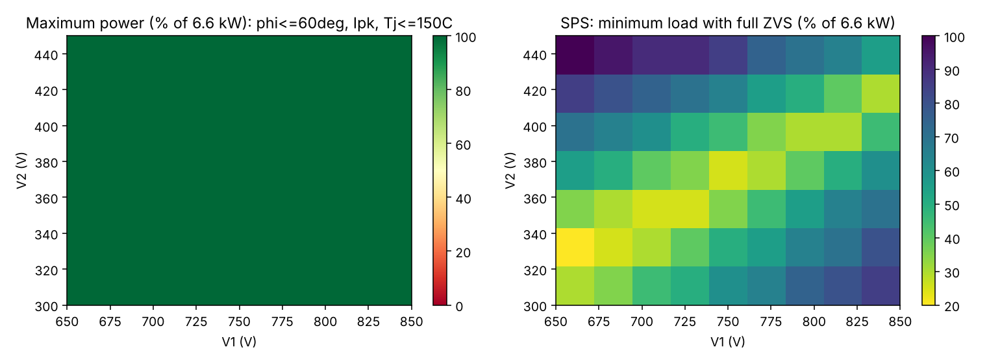
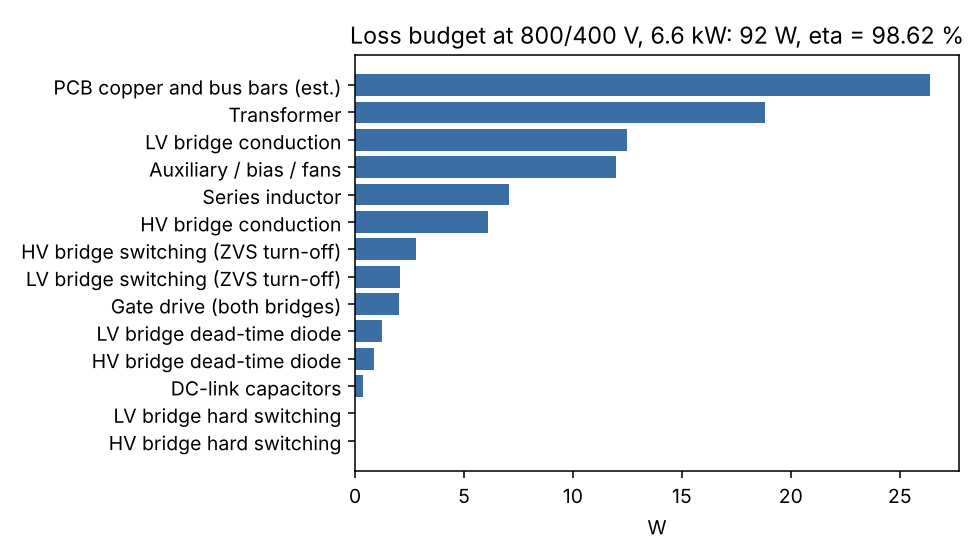
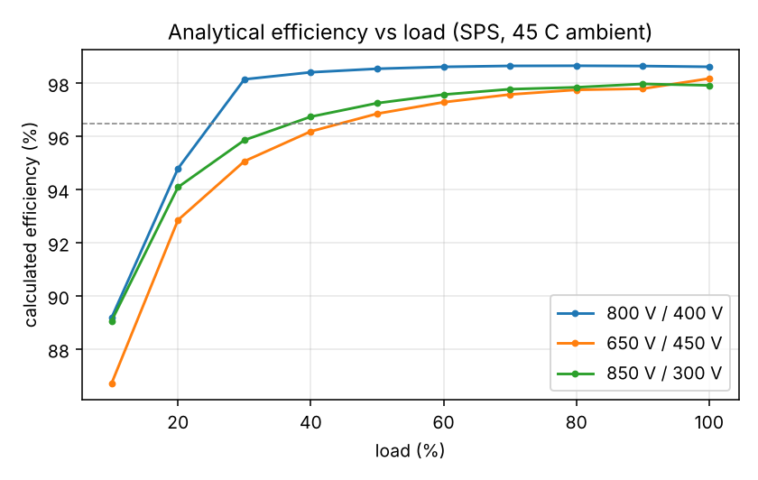
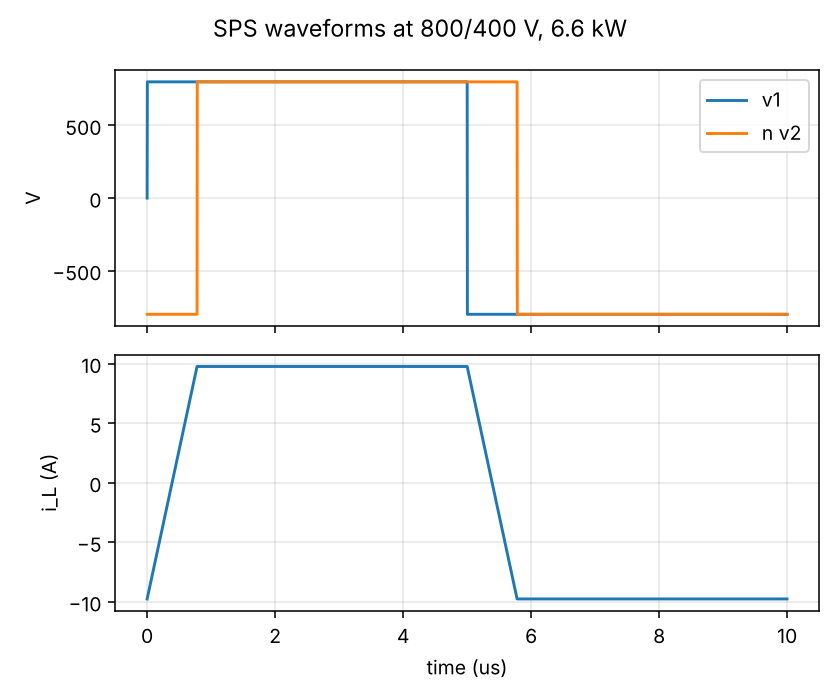

# 04 - Design calculations: 6.6 kW SiC DAB

_Generated by `dab_design.py`; all values analytical. Device data flagged `verified=False` in `dabtools/dab/devices.py`._

## 1. Series inductance and phase shift

phi_nom = 28 deg at 800/400 V, 6.6 kW  ->  **L = 64 uH** (HV-referred), P_max(800/400) = 12.5 kW. Transformer leakage (interleaved design) 4.1 uH, external inductor 59.9 uH.

## 2. Full-power corners (SPS)

| V1 | V2 | phi (deg) | I_rms HV (A) | I_pk HV (A) | I_rms LV (A) | ZVS margin HV (A) | ZVS margin LV (A) | Tj HV (C) | Tj LV (C) | loss (W) | eta (%) | P_max allowed (%) |
|---|---|---|---|---|---|---|---|---|---|---|---|---|
| 650 | 300 | 57.1 | 13.7 | 16.8 | 27.5 | 15.0 | 12.9 | 53 | 57 | 140 | 97.92 | 100 |
| 650 | 400 | 36.7 | 11.2 | 16.2 | 22.4 | 5.1 | 14.7 | 50 | 54 | 114 | 98.30 | 100 |
| 650 | 450 | 31.5 | 11.3 | 18.6 | 22.6 | 0.7 | 16.9 | 49 | 55 | 122 | 98.18 | 100 |
| 800 | 300 | 41.0 | 12.2 | 18.4 | 24.3 | 16.3 | 5.2 | 52 | 54 | 134 | 98.01 | 100 |
| 800 | 400 | 28.2 | 9.2 | 9.8 | 18.5 | 7.6 | 8.2 | 49 | 51 | 92 | 98.62 | 100 |
| 800 | 450 | 24.4 | 8.8 | 12.3 | 17.6 | 3.4 | 10.6 | 48 | 51 | 93 | 98.61 | 100 |
| 850 | 300 | 37.7 | 12.2 | 19.6 | 24.4 | 17.3 | 3.0 | 53 | 54 | 140 | 97.92 | 100 |
| 850 | 400 | 26.2 | 9.0 | 11.0 | 17.9 | 8.7 | 6.2 | 49 | 50 | 94 | 98.60 | 100 |
| 850 | 450 | 22.8 | 8.3 | 10.3 | 16.6 | 4.6 | 8.5 | 48 | 50 | 88 | 98.68 | 100 |

Negative ZVS margins mark hard-switched edges at full power (SPS); the derating map and the TPS table show the mitigation.

## 3. TPS modulation at the corners (numerical minimum-rms search with ZVS constraint)

| V1 | V2 | I_rms SPS (A) | I_rms TPS (A) | D1 | D2 | backflow SPS (W) | backflow TPS (W) | ZVS down to (% load, TPS) |
|---|---|---|---|---|---|---|---|---|
| 650 | 300 | 13.8 | 13.8 | 1.00 | 1.00 | 930 | 930 | 35 |
| 650 | 400 | 11.2 | 11.2 | 1.00 | 0.93 | 131 | 137 | 75 |
| 650 | 450 | 11.3 | 11.2 | 1.00 | 0.85 | 16 | 25 | 100 |
| 800 | 300 | 12.2 | 12.2 | 0.93 | 1.00 | 1231 | 754 | 75 |
| 800 | 400 | 9.2 | 9.2 | 1.00 | 1.00 | 294 | 294 | 35 |
| 800 | 450 | 8.8 | 8.9 | 1.00 | 0.93 | 90 | 96 | 75 |
| 850 | 300 | 12.2 | 12.1 | 0.78 | 1.00 | 1417 | 225 | 100 |
| 850 | 400 | 8.9 | 8.9 | 1.00 | 1.00 | 392 | 392 | 50 |
| 850 | 450 | 8.3 | 8.3 | 1.00 | 1.00 | 140 | 140 | 75 |

## 4. Loss budget and efficiency at 800/400 V, 6.6 kW

| Item | W |
|---|---|
| HV bridge conduction | 6.1 |
| HV bridge switching (ZVS turn-off) | 2.8 |
| HV bridge hard switching | 0.0 |
| HV bridge dead-time diode | 0.9 |
| LV bridge conduction | 12.5 |
| LV bridge switching (ZVS turn-off) | 2.0 |
| LV bridge hard switching | 0.0 |
| LV bridge dead-time diode | 1.2 |
| Gate drive (both bridges) | 2.0 |
| Transformer | 18.8 |
| Series inductor | 7.0 |
| DC-link capacitors | 0.4 |
| Auxiliary / bias / fans | 12.0 |
| PCB copper and bus bars (est.) | 26.4 |
| **Total** | **92.2** |

**Calculated efficiency 98.62 %** (objective >= 96.5 %), calculated peak 98.66 % (objective >= 97.5 %). Junction temperatures at 45 C ambient: HV 49 C, LV 51 C (heatsink 0.22 K/W per bridge, TIM 0.35 K/W).

## 5. Transformer (E65/32/27 pair, 3C95)

| Item | interleaved (P/2-S-P/2) | non-interleaved (integrated leakage) |
|---|---|---|
| N1 | 28 | 28 |
| N2 | 14 | 14 |
| Bpk (T) | 0.132 | 0.132 |
| core loss (W) | 11.4 | 11.4 |
| copper loss (W) | 7.41 | 8.62 |
| Rac/Rdc primary | 1.04 | 1.15 |
| Rac/Rdc secondary | 1.08 | 1.31 |
| litz strands 0.1 mm primary | 294 | 294 |
| litz strands 0.1 mm secondary | 588 | 588 |
| primary layers | 2 | 2 |
| secondary layers | 2 | 2 |
| window fill factor | 0.656 | 0.656 |
| leakage (H) | 4.1e-06 | 1.64e-05 |
| interwinding C (F) | 6.31e-10 | 3.16e-10 |
| temperature rise (K, 3 m/s) | 35.7 | 38 |

The non-interleaved arrangement would give ~16 uH of leakage, i.e. 26 % of the required 64 uH, at the cost of 1.2x the copper loss (proximity effect). The baseline therefore uses the interleaved transformer plus a discrete inductor; the integrated-leakage option is kept as an optimisation variable (12_Optimization) with a +/-20 % manufacturing tolerance on the leakage.

## 6. External series inductor (E55/28/21 pair, 3C95, gapped)

L = 59.9 uH, N = 17, centre-leg gap 2.10 mm (before fringing correction), Bpk = 0.116 T at 1.2 x I_pk, stored energy 4.1 mJ, core loss 4.6 W, copper loss 2.5 W (294 x 0.1 mm litz, 2 layers), fill 0.28.

## 7. DC-link capacitors and bleeders

HV link: 4 x 20 uF / 1100 V film: I_rms = 4.2 A, ripple 0.01 % at nominal, 0.04 % worst corner; ESR loss 0.1 W. Bleeder 1.41 MOhm (0.51 W at 850 V) discharges to < 60 V in 5 min.

LV link: 4 x 30 uF / 700 V film: I_rms = 8.4 A, ripple 0.03 % nominal, 0.09 % worst; ESR loss 0.3 W. Bleeder 1.24 MOhm (0.16 W).

## 8. Protection thresholds derived here

Design envelope peak-current limit 24 A (HV side); hardware comparator trip 32 A HV side = 64 A LV side (above the worst-corner peak with 60 % margin, below the device pulsed rating); DC-link OV trip 900 V (HV) / 480 V (LV); UV 600 V / 280 V; Tj model limit 150 C -> heatsink NTC trip at 95 C.

