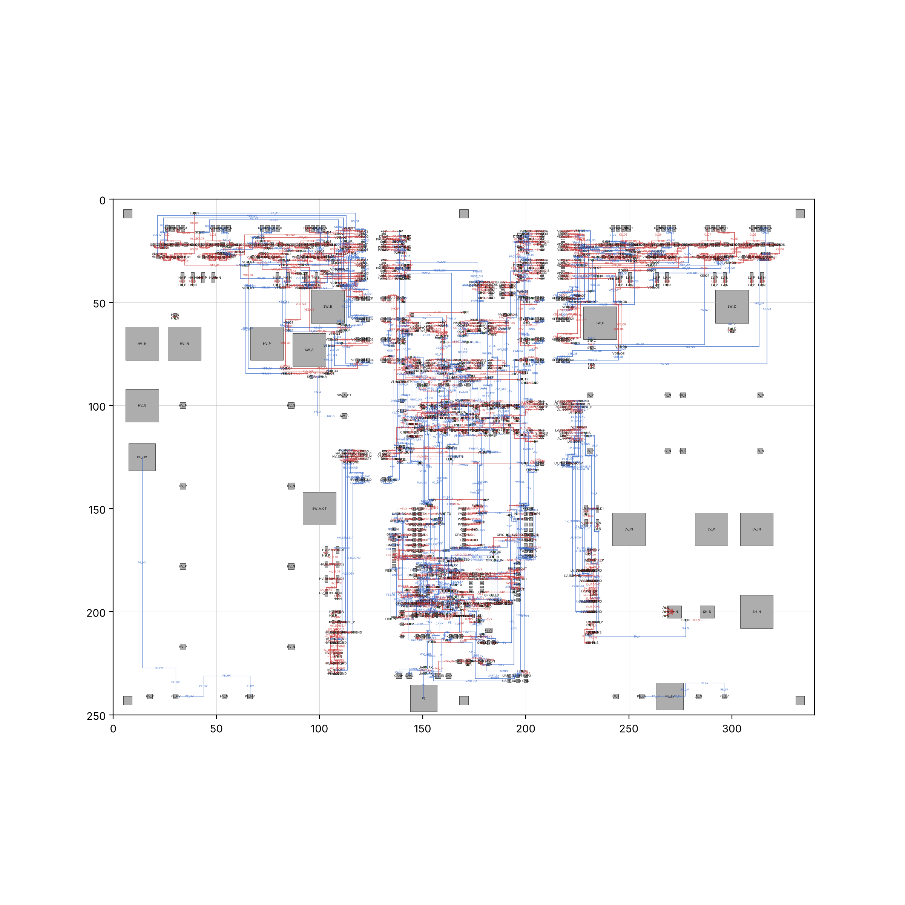
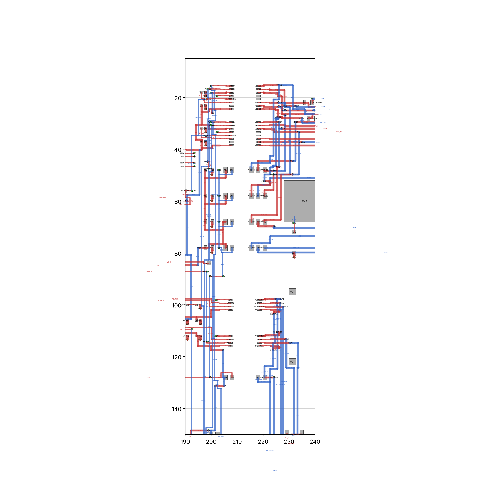
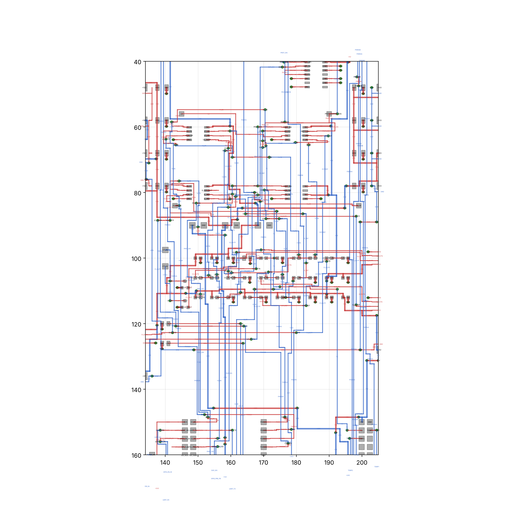

# 08 - PCB

The board file is part of the KiCad project in `../07_KiCad_Schematics/SiC_DAB_6k6.kicad_pcb` (one
project directory so that KiCad's schematic<->PCB link works without re-importing). It is generated
by `../dabtools/kicad_dab/gen_pcb_dab.py` on the shared `tools/kicad/boardgen.py` builder; routing by
`tools/kicad/router.py` (negotiated congestion + hard final pass, see `tools/kicad/README.md`);
checked by KiCad's DRC with the net-class rules in `SiC_DAB_6k6.kicad_dru`. DRC results:
`../07_KiCad_Schematics/drc_report.txt` and `drc_summary.json`; stack-up and fabrication notes:
`../17_Manufacturing/`.

## Floor plan (340 x 250 mm, 6 layers, 2 oz)

| x range | region | content |
|---|---|---|
| 5 - 118 mm | HV (850 V) | Q1-Q4 bridge on heatsink bar A (top edge), gate clusters, DC-link film capacitors C1-C4, HF decoupling C5-C8, HV studs J1/J2, SW_A/SW_B studs and the series-inductor return (J9 via CT1), Y capacitors CY1/CY2 and PE lug J21 (bottom edge) |
| 118 - 134 mm | barrier 1 | 16 mm copper-free (all layers); only the certified straddlers cross: U1/U2 gate drivers, PS1-PS4 bias modules (milled 1.6 mm slot in the pin gap), CT1 (one-turn insulated lead), U5 isolated amplifier, PS9 |
| 134 - 205 mm | control (SELV) | drivers' VCCI/DT parts and bias input capacitors along both barriers, sensing chain (U8-U12), BoosterPack headers J10-J12, interlocks/optocouplers, CAN, relays/fans driver, power supplies U13-U15, connectors on the bottom edge, PE lug J20 |
| 205 - 221 mm | barrier 2 | as barrier 1: U3/U4, PS5-PS8, U6/U7 (LV sense), PS10 |
| 221 - 335 mm | LV (450 V) | Q5-Q8 on heatsink bar B, gate clusters, LV link capacitors C9-C12, LV studs J5/J6, fuse F2, shunt R7 (1 mOhm) with Kelvin sense parts, Y capacitors CY3/CY4 and PE lug J22 |

Layers: F.Cu components/pours, In1 and In3 reference planes (HV_N / GND / LV_N per region), In2 and
In4 power planes (HV_P / GND / LV_P), B.Cu switch-node strips and signals (`stackup.md`). The bridge
switching loops close through the plane pairs; the switch-node strips on B.Cu run from the TO-247
drain/source pads to the studs.

Isolation features (from `../15_Safety_Reliability/01_insulation_coordination.md`): clearance
classes HV_POWER / HV_GATE / LV_POWER / LV_GATE / CTRL / PE enforced as DRC rules (12 mm HV-LV and
HV-control power, 10 mm LV-control, 8 mm gate-signal, 5.5 mm gate-bias module pairs, 8.5/5 mm
PE-HV/LV), barrier rule areas on all copper layers, slots under the SIP modules, three PE nets
(PE_HV, PE, PE_LV) bonded through the chassis because no copper may cross the barriers.

Fine-pitch fan-out: UCC21520 / AMC1301 / TLV9062 / LM393 / 74HC32 / TCAN332 / ULN2003 pins get
alternating short/long stubs with a hard keep-out and a horizontal-only, via-free corridor; plane
pins (GND) get a via 1.2 mm beyond the long stubs.

## Status (routing run 27, 2026-10-10)

KiCad DRC on the generated board: **0 errors, 0 unconnected items**, 63 warnings (11 silkscreen
overlaps, 27 silkscreen over copper, 16 silkscreen edge clearance, 9 dangling fan-out stubs on the
reserved single-pin header nets listed in `dabtools/kicad_dab/design_dab.py: RESERVED_SINGLE_PIN_NETS`).
Numbers: `../07_KiCad_Schematics/drc_summary.json`; full list: `drc_report.txt`.

Convergence history of the last runs (all with the same design rules - no rule was weakened):

| Run | Result | Change made afterwards |
|---|---|---|
| 24 | 43 errors: +5V unrouted at the U4 driver exit, 1 courtyard (F1/J3), 2 starved thermals | driver-side DT/VCCI parts moved from 2 mm to 4 mm off the corridor mouth (both barriers); J3 moved 2 mm from the fuse holder; C160/J16 GND pads solid |
| 25 | aborted: TP2 (SW_B test point) inside the J3 pad halo | TP2 moved 6 mm right |
| 26 | 40 errors: only +5V unrouted, sealed at a U9 sense-amplifier stub by a stack of horizontal sense-signal tracks | U10/U11 moved 8 mm right (14 mm exit channel); router region re-route widened to 3/5/8 mm reach |
| 27 | **0 errors, 0 unconnected** | - |

Images (matplotlib render of the generated board, `tools/kicad/plot_board.py`):

| whole board | barrier 2 / LV driver side | control region |
|---|---|---|
|  |  |  |

Manufacturing outputs (gerbers for the 6 copper layers, drill, position, PDFs) are regenerated by
`../17_Manufacturing/export_outputs.py` into `../17_Manufacturing/outputs/`.

Not verified: no fabrication, no assembly, no measurement; silkscreen warnings are cosmetic and are
left for the manual clean-up before fabrication; the parasitic estimate of the layout is in
`../../Advanced_Research_2026/Parasitic_Extraction/`.
