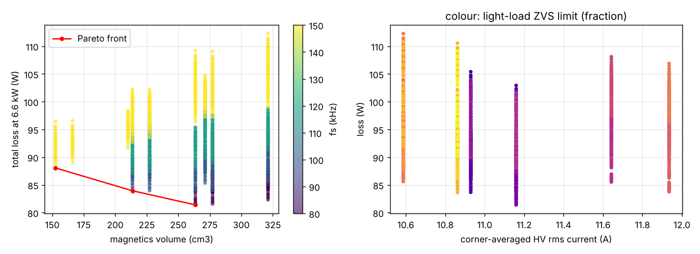
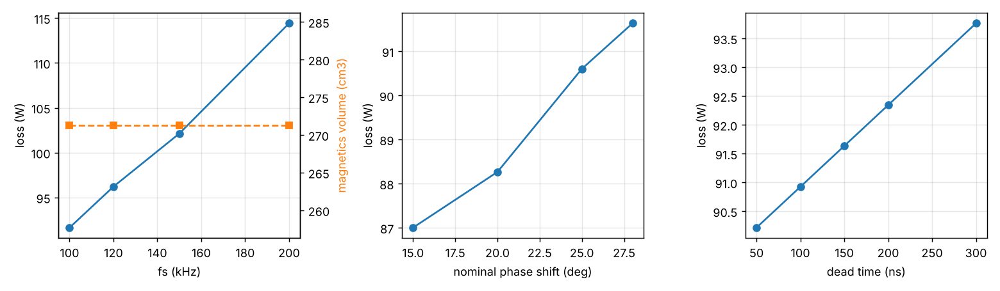

# 12 - Multi-objective design-space optimisation

_Generated by `optimize.py` (deterministic exhaustive grid, 8640 candidates, 1404 feasible)._

## Method
Exhaustive evaluation of the variable grid below with the analytical loss/thermal/magnetics models of 03/04; infeasible points (full power not reachable at a corner with phi <= 60 deg, Tj > 150 C, window fill > 0.7, Bpk > 0.2 T) are discarded; the non-dominated set in (loss, magnetics volume) is reported. No stochastic optimiser is used, so the result is reproducible bit-for-bit.

| variable | values |
|---|---|
| fs | [60000.0, 80000.0, 100000.0, 120000.0, 150000.0] |
| n | [1.8, 2.0, 2.2] |
| phi_deg | [20, 25, 30, 35] |
| tcore | ['E55/28/21', 'ETD59/31/22', 'E65/32/27', 'E70/33/32'] |
| lcore | ['ETD44/22/15', 'ETD49/25/16', 'E55/28/21'] |
| t_dead | [1e-07, 1.5e-07, 2e-07] |
| dev1 | [('C3M0032120K', 1), ('C3M0016120K', 1)] |
| dev2 | [('C3M0016120K', 1), ('C3M0032120K', 2)] |

## Pareto front (loss vs magnetics volume at 800/400 V, 6.6 kW)

| fs (kHz) | n | phi_nom | L (uH) | transformer | inductor | t_dead (ns) | HV device | LV device | loss (W) | eta (%) | volume (cm3) | I_rms avg (A) | ZVS light-load | Tj HV/LV (C) | cost idx |
|---|---|---|---|---|---|---|---|---|---|---|---|---|---|---|---|
| 80 | 2.0 | 20 | 60 | E70/33/32 | ETD44/22/15 | 100 | C3M0016120Kx1 | C3M0032120Kx2 | 81 | 98.78 | 264 | 11.2 | 45 % | 47/49 | 20.5 |
| 100 | 2.0 | 20 | 48 | E65/32/27 | ETD44/22/15 | 100 | C3M0016120Kx1 | C3M0032120Kx2 | 84 | 98.74 | 214 | 11.2 | 45 % | 47/49 | 19.5 |
| 150 | 2.0 | 20 | 32 | ETD59/31/22 | ETD44/22/15 | 100 | C3M0016120Kx1 | C3M0032120Kx2 | 88 | 98.68 | 152 | 11.2 | 55 % | 48/50 | 18.2 |

## Baseline position
The baseline (100 kHz, n = 2, phi = 28 deg, E65 + E55, 150 ns, C3M0032120K / C3M0016120K) has 92 W loss, 271 cm3 magnetics, corner-averaged rms 10.9 A, ZVS down to 30 % load. 
Lower switching frequency reduces loss but grows the magnetics (and the DC-link ripple current); a larger nominal phase shift (smaller L) reduces magnetics volume and the circulating current at the corners but reduces the light-load ZVS range. The baseline sits on the knee of the front; a 80 kHz / 25 deg variant is the main alternative if the thermal budget (13) proves tighter than modelled.

## Convergence / validity
The grid is exhaustive, so there is no convergence criterion; resolution is limited by the grid steps (fs 20-30 kHz, phi 5 deg). The absolute loss values inherit the uncertainty of the device parameters (`verified=False`) and the k_zvs assumption; the ranking between candidates is less sensitive because all share the same models.

