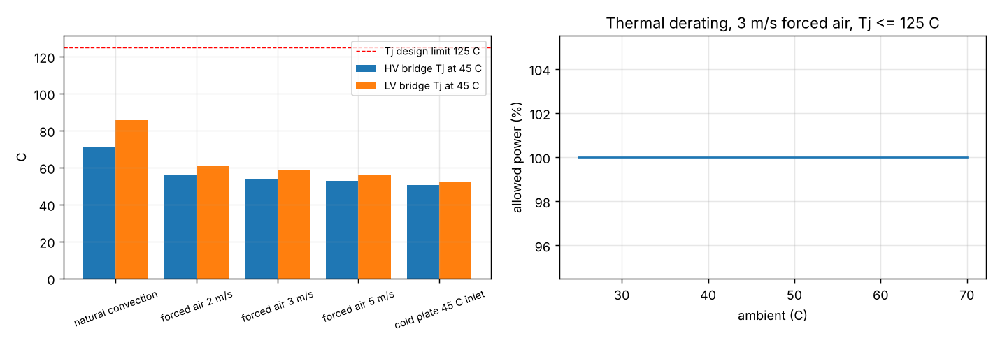

# 13 - Thermal analysis

_Generated by `thermal_analysis.py`. Heatsink and capacitor thermal resistances are catalogue-class assumptions marked for verification._

## 1. Heat sources (worst corner of the full-power envelope, scaled from the nominal loss split)

| source | nominal (W) | worst corner (W) |
|---|---|---|
| HV bridge (4 x C3M0032120K) | 9.8 | 21.7 |
| LV bridge (4 x C3M0016120K) | 15.7 | 34.9 |
| transformer | 18.8 | 41.7 |
| series inductor | 7.0 | 15.6 |
| DC-link capacitors (8 film) | 0.4 | 0.8 |
| auxiliary, control, fans | 12 | 12 |

## 2. Cooling options (one heatsink per bridge, 4 TO-247-4 with 0.35 K/W silicone pads)

| option | Rth sink (K/W) | Tamb (C) | Tj HV (C) | Tsink HV (C) | Tj LV (C) | Tsink LV (C) | Tj <= 125 C |
|---|---|---|---|---|---|---|---|
| natural convection | 1.0 | 45 | 71 | 67 | 86 | 80 | yes |
| natural convection | 1.0 | 55 | 81 | 77 | 96 | 90 | yes |
| forced air 2 m/s | 0.3 | 45 | 56 | 52 | 61 | 55 | yes |
| forced air 2 m/s | 0.3 | 55 | 66 | 62 | 71 | 65 | yes |
| forced air 3 m/s | 0.22 | 45 | 54 | 50 | 58 | 53 | yes |
| forced air 3 m/s | 0.22 | 55 | 64 | 60 | 68 | 63 | yes |
| forced air 5 m/s | 0.16 | 45 | 53 | 48 | 56 | 51 | yes |
| forced air 5 m/s | 0.16 | 55 | 63 | 58 | 66 | 61 | yes |
| cold plate 45 C inlet | 0.05 | 45 | 50 | 46 | 52 | 47 | yes |
| cold plate 45 C inlet | 0.05 | 55 | 60 | 56 | 62 | 57 | yes |

**Selection: forced air, 3 m/s, two 150 x 60 x 40 mm extrusions (0.22 K/W each)**: Tj stays below 70 C at 45 C ambient, which leaves margin for the device-parameter uncertainty (if the real losses were 2x the model, Tj would still be < 95 C). Natural convection is not sufficient at 55 C. A cold plate is only justified for a sealed (IP54 without airflow) enclosure; it also cools the magnetics through the chassis, which forced air does for free. The PCB carries the heat of the magnetics (transformer 14 K rise at 3 m/s) and the capacitors; no thermal vias are needed under the TO-247 devices because they sit on the heatsink bar, but 2 oz copper on all layers spreads the lead heat.

## 3. Capacitors
Film capacitors: hot-spot 46 C at 45 C ambient (ESR loss 0.04 W each, 15 K/W) against an 85 C / 105 C rating -> lifetime not limited by temperature; voltage derating 850 V / 1100 V = 77 % (HV), 450 V / 700 V = 64 % (LV).

## 4. Thermal cycling
Junction-to-case swing per full on/off power cycle: dTj ~ 4 K (HV device); with TO-247 solder-die attach and a silicone pad interface this is far below the 40-60 K swings where power-cycling lifetime becomes the limiting factor (manufacturer power-cycling curves to be consulted for the exact device). Daily cycling over 10 years = 3650 cycles - negligible against the > 1e5 cycles typical at dTj < 30 K.

## 5. Worst-case ambient and derating

Above 55 C the firmware derates the power reference linearly (APP-06); the NTC on each heatsink trips at 95 C sink temperature (Tj ~ 110 C at the modelled losses).

## 6. Airflow
Two 80 mm fans (~60 m3/h each) across the 60 mm fin height give ~3 m/s over the fins; pressure drop is small (open extrusions). Fan failure is detected by the heatsink NTC rise and reported over CAN (no on-board tachometer input in rev A).

