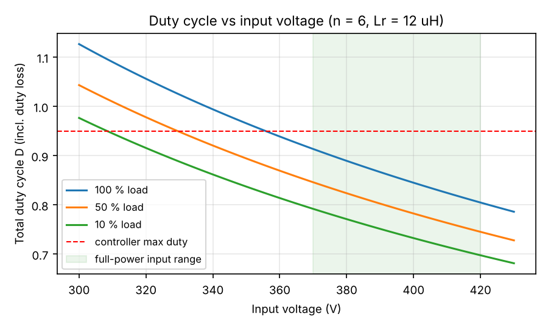
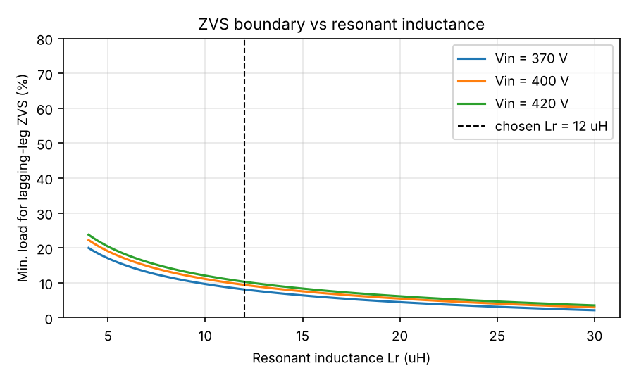
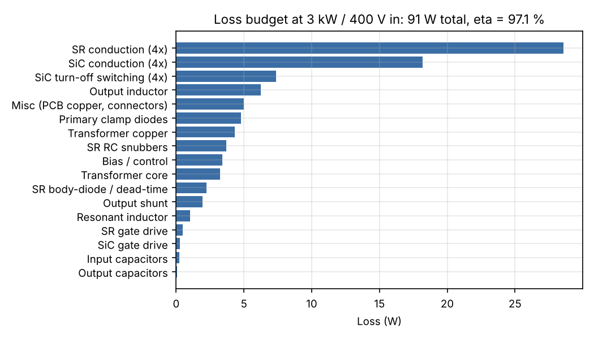
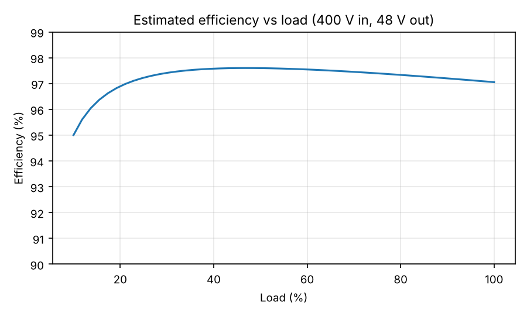
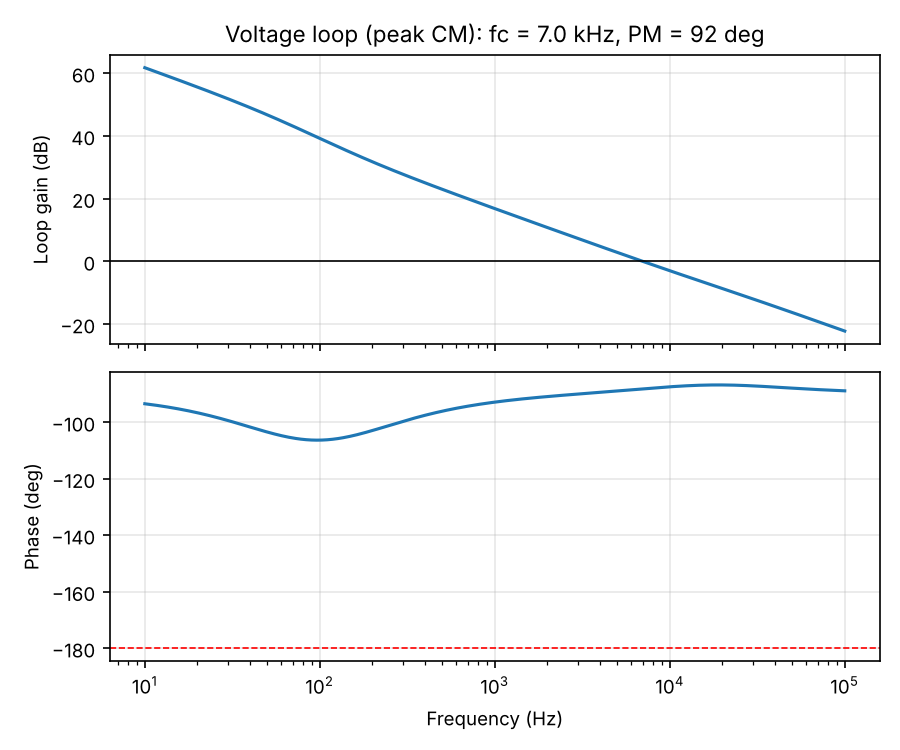

# 02 - Design calculations

_Generated by `tools/psfb_design.py`. Re-run the script after changing any input._

## 1. Specification

| Parameter | Value |
|---|---|
| Input voltage (full power) | 370 - 420 V DC (nominal 400 V, from PFC) |
| Input voltage (derated power) | down to 320 V (hold-up) |
| Output | 48 V / 62.5 A / 3.0 kW |
| Switching frequency | 100 kHz per switch (output ripple at 200 kHz) |
| Topology | ZVS phase-shifted full bridge, centre-tapped secondary, synchronous rectification, primary clamp diodes |
| Isolation | reinforced, 4000 Vrms test, >= 8 mm creepage/clearance |
| Efficiency target | >= 96 % at full load |

## 2. Turns ratio and duty cycle

Transformer ratio chosen **n = Np/Ns = 6** (18:3:3), resonant inductance **Lr = 12 uH**.

Duty loss during primary current reversal: dD = 4 * Ip * Lr * fsw / Vin

| Vin (V) | Vsec (V) | D_eff | duty loss dD | total D |
|---|---|---|---|---|
| 320 | 53.3 | 0.900 | 0.156 | 1.056 |
| 370 | 61.7 | 0.778 | 0.135 | 0.914 |
| 400 | 66.7 | 0.720 | 0.125 | 0.845 |
| 420 | 70.0 | 0.686 | 0.119 | 0.805 |

At 320 V the total duty exceeds the controller limit, so the output is current-limited (hold-up derating).
SR drain stress (centre-tap, clamped by the primary clamp diodes): 2 * Vin_max / n = **140 V** -> 200 V MOSFETs (IPP110N20N3 G).

## 3. Currents

| Quantity | Value |
|---|---|
| Primary reflected load current Io/n | 10.4 A |
| Magnetising current peak (Lm = 1.0 mH) | 0.85 A |
| Primary peak current | 12.3 A |
| Primary RMS current | 10.1 A |
| Secondary half-winding RMS | 41.0 A |
| Per SR MOSFET RMS (2 in parallel) | 20.5 A |
| Input capacitor RMS current | 4.8 A |

## 4. ZVS of the lagging leg

Energy to swing the leg: E = Coss(er) * Vin^2 + 0.5 * Ctr * Vin^2 = 20.0 uJ (Coss(er) = 100 pF per device, Ctr = 50 pF).

Minimum primary current: Ip_zvs = sqrt(2E/Lr) = **1.83 A** -> ZVS maintained down to about **9 % load** (magnetising current included). Below that the lagging leg switches with partial ZVS; the SiC Coss energy at 400 V is small (~20 uJ -> 4.0 W worst case).

Resonant transition time at the boundary: t = (pi/2) * sqrt(Lr * Ceq) = **86 ns**; at full load the linear charge time is 10 ns. UCC28951 adaptive delays (ADEL/ADELEF) are set to cover 10 - 86 ns, with a 22 ns hard minimum in the UCC21520 (R_DT = 2.2 k).

## 5. Main transformer

Throughput VA for a centre-tapped secondary: Pt = Pout/eta + sqrt(2) * Pout = 7368 VA. Required area product (Ku = 0.3, J = 450 A/cm^2, Bpk = 0.125 T): Ap = **5.5 cm^4**; ETD59/31/22 provides 13.5 cm^4.

| Item | Value |
|---|---|
| Core | ETD59/31/22, 3C95 (Ferroxcube) or PC95 (TDK), ungapped (Lm ~ 1 mH) |
| Turns | Np = 18, Ns = 3 + 3 (centre-tapped) |
| Flux swing at 400 V nominal | 255 mT p-p (Bpk = 128 mT) |
| Flux swing worst case (420 V, D = 0.95) | 301 mT p-p |
| Core loss | 3.3 W |
| Primary winding | litz 600 x 0.1 mm (4.71 mm^2), R = 11.8 mOhm, P = 1.2 W |
| Secondary windings | 2 x copper foil 0.15 x 38 mm in parallel per half (11.4 mm^2), R = 0.94 mOhm, P = 3.1 W total |
| Skin depth at 100 kHz | 0.21 mm |
| Winding arrangement | S1 - P/2 - S2 - P/2 interleaved (foil secondaries), 3 layers reinforced tape between P and S |
| Total transformer loss | 7.6 W |

## 6. Resonant (shim) inductor

Lr = 12 uH on ETD39/20/13 (3C95), N = 10 turns litz, air gap ~ 1.31 mm (centre leg, before fringing correction). Bpk = 118 mT at Ip_pk = 12.3 A, stored energy 908 uJ, estimated loss 1.0 W. Transformer leakage (~1 uH) adds to this; measure and trim the gap.

## 7. Output inductor

Required for 20 % ripple: Lo = (Vsec - Vo) * D_eff * T/2 / dI = **5.4 uH**.

Design: 2 stacked Magnetics 77439-A7 (Kool Mu 60u, OD 47 mm) or 58439 (High Flux), N = 5 turns of 2 x 6 mm flat copper. L0 = 6.8 uH, H = 40 Oe at peak current -> 70 % permeability -> **L = 4.7 uH at full load**, ripple 14.2 A p-p (23 %). Copper loss 4.7 W (R = 1.21 mOhm).

## 8. Capacitors

Output: ripple spec 100 mV p-p -> ESR < 7.0 mOhm and C > 89 uF. Chosen 6 x 470 uF / 63 V low-ESR electrolytic (ESR 3 mOhm parallel) + 6 x 10 uF / 100 V X7S MLCC. Ripple: ESR term 47 mV, capacitive term 3 mV. 50 % load step at fc = 8 kHz: dV ~ 218 mV.

Input: 4 x 10 uF / 450 V film (B32778) + 2 x 0.47 uF / 630 V MLCC at the bridge. Ripple 1.1 V p-p, capacitor RMS current 4.8 A. Bulk hold-up capacitance is provided by the PFC stage.

## 9. Loss budget and efficiency (400 V in, full load)

| Loss element | W |
|---|---|
| SiC conduction (4x) | 18.2 |
| SiC turn-off switching (4x) | 7.4 |
| SiC gate drive | 0.3 |
| SR conduction (4x) | 28.6 |
| SR body-diode / dead-time | 2.2 |
| SR gate drive | 0.5 |
| SR RC snubbers | 3.7 |
| Primary clamp diodes | 4.8 |
| Transformer core | 3.3 |
| Transformer copper | 4.3 |
| Resonant inductor | 1.0 |
| Output inductor | 6.2 |
| Input capacitors | 0.2 |
| Output capacitors | 0.1 |
| Output shunt | 2.0 |
| Bias / control | 3.4 |
| Misc (PCB copper, connectors) | 5.0 |
| **Total** | **91.1** |

**Estimated efficiency: 97.1 %** (target 96 %).

Junction temperatures (Tamb 50 C, forced air, extruded heatsinks): SiC ~ 63 C, SR ~ 65 C.

## 10. Control loop (UCC28951, peak current mode)

| Item | Value |
|---|---|
| Feedback divider | R_top = 2 x 10.0 k (series), R_bot = 1.10 k -> Vout = 47.95 V with EA+ = 2.5 V |
| Current transformer | 1:100, burden R = 12 Ohm (calc. 10.8 Ohm) |
| CS at full load / OC threshold | 1.48 V / 2.0 V -> cycle-by-cycle limit at Ip = 16.7 A (100 A output) |
| Plant pole / ESR zero | 73 Hz / 16.9 kHz |
| Type-II compensator | Rz = 150.0 k, Cz = 8 nF, Cp = 56 pF |
| Crossover / phase margin | 7.0 kHz / 92 deg |
| Soft start | C_SS = 0.10 uF -> ~20 ms |
| Gate resistors (SiC) | R_on = 5.1 Ohm, R_off = 2.2 Ohm (diode), peak gate current ~2.4 A |

## 11. PCB copper requirements (IPC-2221, 2 oz outer, 20 K rise)

| Net | Current | Min. width (single layer) | Implementation |
|---|---|---|---|
| Primary loop (VBUS, SW, PRI) | 10.1 A rms | 2.4 mm | 6 mm tracks + In2 plane |
| Secondary windings (SEC_A/B) | 41.0 A rms | 16.5 mm | polygon pours on F.Cu + B.Cu |
| Output (VOUT, SGND) | 62.5 A | 29.6 mm | pours on F.Cu, In2.Cu, B.Cu stitched with vias |
